# Page: Overview

# Overview

<details>
<summary>Relevant source files</summary>

The following files were used as context for generating this wiki page:

- [README.md](README.md)
- [jeo/__init__.py](jeo/__init__.py)

</details>


## Purpose and Scope

This document provides a high-level introduction to the Jeo repository, a JAX-based machine learning framework specifically designed for geospatial remote sensing and Earth Observation applications. Jeo enables researchers and practitioners to train and deploy ML models on satellite imagery and other geospatial data using modern distributed computing frameworks.

This overview covers the framework's core architecture, key dependencies, and integration patterns. For detailed installation and setup instructions, see [Getting Started](#2). For in-depth technical documentation of specific components, see [Core Architecture](#3) and its subsections.

Sources: [README.md:1-126](), [jeo/__init__.py:1-15]()

## Core Design Philosophy

Jeo is built around several key design principles that make it effective for geospatial ML workflows:

| Design Principle | Implementation | Benefits |
|------------------|----------------|----------|
| **JAX-First** | Built on JAX/Flax for computation | Hardware-agnostic execution (CPU/GPU/TPU) |
| **Scalable Data** | TensorFlow Datasets integration | Reproducible, version-controlled datasets |
| **Geospatial Focus** | GeeFlow integration for Earth Engine | Direct access to petabyte-scale satellite data |
| **Modular Architecture** | Component-based system design | Easy customization and extension |
| **Research-Ready** | Configuration-driven experiments | Rapid prototyping and reproducible research |

The framework has been successfully used in multiple research publications focusing on deforestation monitoring, forest classification, and global environmental analysis.

Sources: [README.md:10-25](), [README.md:31-54]()

## High-Level System Architecture

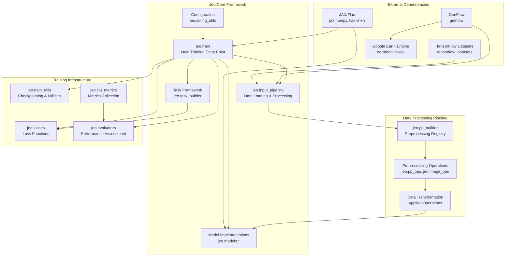

Sources: [README.md:10-18](), [README.md:22-25]()

## Core Components

### Training System
The `jeo.train` module serves as the main entry point for all training workflows. It orchestrates the interaction between data loading, model initialization, training loops, and evaluation cycles. The system supports distributed training across multiple devices and provides comprehensive checkpointing capabilities.

### Data Pipeline
Jeo's data pipeline is built around TensorFlow Datasets (`tensorflow_datasets`) for standardized dataset access, with specialized support for geospatial data through GeeFlow integration. The `jeo.input_pipeline` module handles data loading, while the preprocessing system (`jeo.pp_builder`, `jeo.pp_ops`) provides extensible data transformation capabilities.

### Model Architecture Framework
The framework supports multiple model architectures optimized for different geospatial tasks:
- **BIT (Big Transfer)**: ResNetV1-based convolutional networks with GroupNorm
- **ViT (Vision Transformer)**: Standard vision transformer architecture
- **MTSViT**: Multi-Modal Temporal-Spatial Vision Transformers for time-series analysis

### Task Abstraction
The `jeo.task_builder` provides a unified interface for defining different ML tasks (classification, segmentation, regression) with task-specific loss functions and evaluation metrics.

Sources: [README.md:83-89]()

## Integration with Geospatial Ecosystem

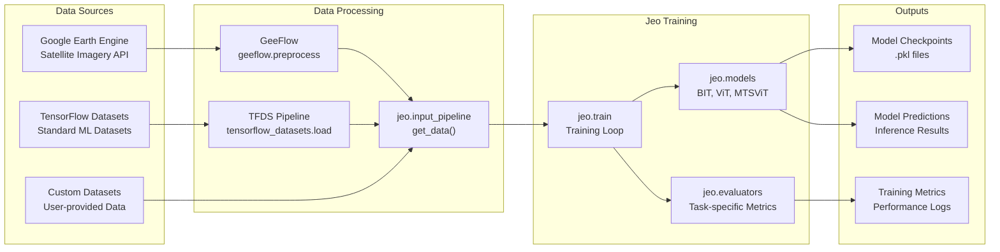

The integration pattern shown above demonstrates how Jeo serves as a bridge between large-scale geospatial data sources and modern ML training infrastructure. GeeFlow handles the complexity of interfacing with Google Earth Engine's API, while Jeo provides the ML training and evaluation framework.

Sources: [README.md:22-29]()

## Quick Start Example

The simplest way to understand Jeo's operation is through the provided demo configuration:

```bash
python -m jeo.train --config configs/tests/tiny_bit.py:runlocal \
--workdir /tmp/jeo/demo_tiny_bit
```

This command demonstrates the key components in action:
- `jeo.train`: Main training module
- `configs/tests/tiny_bit.py`: Configuration file defining model, data, and training parameters
- `:runlocal`: Configuration modifier for local CPU execution
- `--workdir`: Directory for checkpoints and output artifacts

The example trains a BIT model on CIFAR-10 data, showcasing the framework's ability to work with both standard ML datasets and geospatial data using the same unified interface.

Sources: [README.md:74-92]()

## Hardware and Deployment Support

Jeo is designed to run efficiently across different computing environments:

| Environment | Support Level | Key Features |
|-------------|---------------|--------------|
| **Local CPU** | Full support | Development and small-scale experiments |
| **GPU** | Full support | Accelerated training with CUDA |
| **Google Cloud TPU VMs** | Full support | Large-scale distributed training |
| **Multi-device** | Native support | Automatic sharding and parallelization |

The JAX foundation provides automatic device placement and distributed computing capabilities, making it straightforward to scale from laptop development to cloud-scale training without code changes.

Sources: [README.md:16-18]()

---

# Page: Getting Started

# Getting Started

<details>
<summary>Relevant source files</summary>

The following files were used as context for generating this wiki page:

- [README.md](README.md)
- [jeo/configs/tests/tiny_bit.py](jeo/configs/tests/tiny_bit.py)
- [jeo/configs/tests/tiny_vit.py](jeo/configs/tests/tiny_vit.py)

</details>


This document provides a step-by-step guide to installing Jeo and running your first training experiment. It covers the basic installation process, demonstrates how to execute a simple training job, and introduces the core configuration concepts needed to get started with the framework.

For detailed information about the core architecture and system components, see [Core Architecture](#3). For comprehensive configuration options and advanced training features, see [Training and Configuration](#6).

## Installation

Jeo requires Python and can be installed directly from the source repository. The framework is built on JAX/Flax and integrates with TensorFlow Datasets for data loading.

### Prerequisites

- Python 3.8 or higher
- Git for cloning the repository
- Virtual environment (recommended)

### Installation Steps

```bash
# Clone the repository
git clone https://github.com/google-deepmind/jeo

# Navigate to the code directory
cd jeo/jeo

# Create and activate virtual environment
python -m venv .venv
source .venv/bin/activate  # On Windows: .venv\Scripts\activate

# Install Jeo in development mode
pip install -e ..
```

The installation process sets up all required dependencies including JAX, Flax, TensorFlow Datasets, and other supporting libraries needed for geospatial machine learning workflows.

**Sources:** [README.md:58-72]()

## First Training Run

Once installed, you can immediately test the installation by running a demonstration training job. This uses a minimal configuration to train a small model on CIFAR-10 for just a few steps.

### Demo Command

```bash
python -m jeo.train --config configs/tests/tiny_bit.py:runlocal \
--workdir /tmp/jeo/demo_tiny_bit
```

This command demonstrates the basic training interface:
- `jeo.train` is the main training module
- `--config` specifies the configuration file and variant (`:runlocal`)
- `--workdir` sets the directory for checkpoints and artifacts

The demo will train a BIT model (a modified ResNet architecture) on the CIFAR-10 dataset for just 2 training steps to verify everything works correctly.

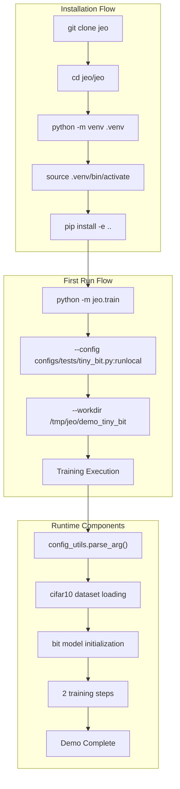

**Sources:** [README.md:74-92](), [configs/tests/tiny_bit.py:84-98]()

## Configuration System Overview

Jeo uses Python-based configuration files that return `ml_collections.ConfigDict` objects. The configuration system supports different execution modes and parameter overrides.

### Basic Configuration Structure

The configuration files follow a standard pattern:

```python
def get_config(arg=None):
    """Returns config."""
    arg = config_utils.parse_arg(arg, runlocal=False, test=False)
    config = ml_collections.ConfigDict()
    
    # Core configuration sections
    config.task_type = "classification"
    config.dataset = "cifar10"
    config.model_name = "bit"
    # ... additional parameters
    
    return config
```

### Configuration Modes

The configuration system supports different execution modes:

| Mode | Purpose | Characteristics |
|------|---------|----------------|
| Default | Full training | Normal batch sizes, full epochs, complete evaluation |
| `:runlocal` | Local testing | Small batch size (2), limited steps (2), minimal model |
| `:test` | Unit testing | Minimal configuration for automated tests |
| `:colab` | Colab demos | Medium batch size (16), short training (2 epochs) |

**Sources:** [configs/tests/tiny_bit.py:21-28, 84-98](), [configs/tests/tiny_vit.py:21-24, 88-103]()

## Basic Training Workflow

Understanding the basic workflow helps in configuring and running training experiments effectively.

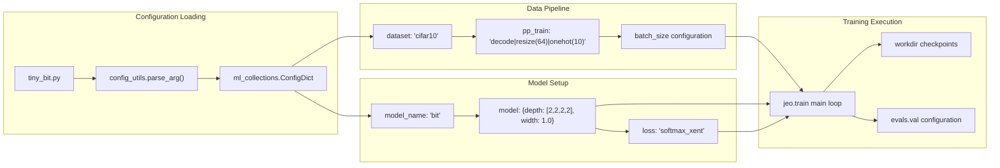

### Key Configuration Parameters

The essential parameters for any training configuration:

| Parameter | Purpose | Example |
|-----------|---------|---------|
| `task_type` | Defines the ML task | `"classification"`, `"segmentation"` |
| `dataset` | Dataset identifier | `"cifar10"`, custom dataset name |
| `model_name` | Model architecture | `"bit"`, `"vit"`, `"mtsvit"` |
| `batch_size` | Training batch size | `4096`, `2` (for testing) |
| `total_epochs` | Training duration | `200`, `None` (use total_steps) |
| `pp_train` | Preprocessing pipeline | `"decode|resize(64)|onehot(10)"` |

**Sources:** [configs/tests/tiny_bit.py:25-60](), [configs/tests/tiny_vit.py:21-57]()

## Understanding the Demo Configuration

The `tiny_bit.py` configuration demonstrates a complete setup for image classification:

### Data Configuration
```python
config.dataset = "cifar10"
config.train_split = "train"
config.num_classes = 10
config.shuffle_buffer_size = 10_000
```

### Model Configuration
```python
config.model_name = "bit"
config.model = dict(
    depth=[2, 2, 2, 2],  # ResNet architecture depth
    width=1.0,           # Width multiplier
    num_classes=config.get_ref("num_classes"),
)
```

### Training Configuration
```python
config.batch_size = 4096
config.total_epochs = 200
config.optax_name = "big_vision.momentum_hp"
config.lr = (0.1 / 256) * config.batch_size
```

The `:runlocal` mode overrides these settings for quick testing, reducing batch size to 2, limiting to 2 total steps, and using a smaller model architecture.

**Sources:** [configs/tests/tiny_bit.py:32-68, 84-98]()

## Next Steps

After successfully running the demo, you can:

1. **Explore Different Models**: Try the ViT configuration with `configs/tests/tiny_vit.py`
2. **Understand Data Processing**: Learn about preprocessing pipelines in [Data Processing](#4)
3. **Configure Custom Training**: Study the configuration system in [Configuration System](#6.2)
4. **Add Custom Models**: Review model implementations in [Model Implementations](#5.1)
5. **Set Up Evaluation**: Configure metrics and evaluation in [Evaluation Framework](#3.4)

The framework is designed to scale from quick local experiments to large-scale distributed training on TPUs, with the same configuration patterns applying across different scales and hardware configurations.

**Sources:** [README.md:56-93]()

---

# Page: Core Architecture

# Core Architecture

<details>
<summary>Relevant source files</summary>

The following files were used as context for generating this wiki page:

- [README.md](README.md)
- [jeo/tasks/task_builder.py](jeo/tasks/task_builder.py)
- [jeo/train.py](jeo/train.py)

</details>


This document provides a detailed overview of the main architectural components within the Jeo framework and how they interact to enable geospatial machine learning training. It covers the core systems, data flow patterns, and key abstractions that make up the framework's foundation.

For information about specific model implementations, see [Model Implementations](#5.1). For details about the training configuration system, see [Configuration System](#6.2). For evaluation and metrics specifics, see [Evaluation and Metrics](#7).

## Architecture Overview

Jeo is built around a modular architecture that separates concerns between data processing, model definition, task configuration, training orchestration, and evaluation. The framework is designed to work seamlessly with JAX/Flax for computation and TensorFlow Datasets for data loading.

### High-Level System Components

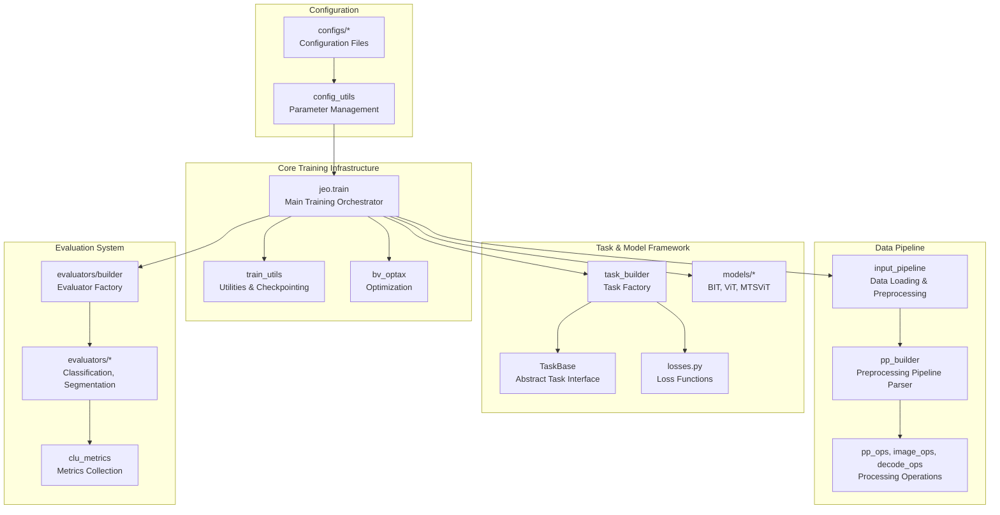

**Sources:** [README.md:10-25](), [jeo/train.py:29-43](), [jeo/tasks/task_builder.py:132-146]()

## Core Components

### Training Orchestrator

The `jeo.train` module serves as the central orchestrator that coordinates all components during training. The main training loop is implemented in the `_main` function, which handles:

- Configuration loading and validation
- Dataset initialization via `input_pipeline.get_data()`
- Model and task setup through factory patterns
- Training step execution with the `update_fn` function
- Evaluation scheduling and execution
- Checkpointing and metrics collection

The training script follows a clear sectioned approach with 8 main phases: Setup, Dataset initialization, Model/task/optimizer initialization, Train step function definition, Checkpoint initialization, Pre-loop setup, Main training loop, and Post-loop finalization.

**Sources:** [jeo/train.py:70-481]()

### Task Framework

The task system is built around the `TaskBase` abstract class, which defines the interface for different types of machine learning tasks. Tasks are responsible for:

- Processing model inputs via the `model_inputs()` method
- Computing losses and auxiliary outputs through `get_loss_and_aux()`
- Creating prediction functions with `get_predict_fn()`

The `task_builder.from_config()` factory function instantiates tasks based on configuration, supporting common task types like classification, segmentation, regression, and contrastive learning.

**Sources:** [jeo/tasks/task_builder.py:35-146]()

### Input Pipeline System

The input pipeline handles data loading, preprocessing, and batching. It integrates with TensorFlow Datasets and supports custom dataset modules. The system uses a string-based preprocessing specification that gets parsed into executable operations.

Key components include:
- `input_pipeline.get_data()` for dataset loading
- `pp_builder` for parsing preprocessing specifications
- Various operation modules (`pp_ops`, `image_ops`, `decode_ops`) for data transformations

**Sources:** [jeo/train.py:137-159]()

## Training Pipeline Flow

### Data and Computation Flow

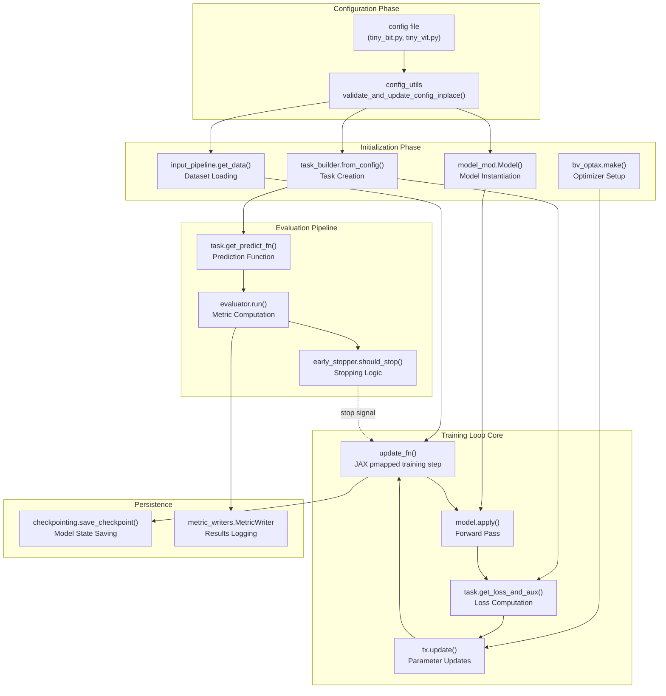

**Sources:** [jeo/train.py:255-300](), [jeo/train.py:361-385](), [jeo/train.py:398-464]()

## Key Architectural Patterns

### Factory Pattern for Component Creation

The framework extensively uses factory patterns to create components based on configuration:

| Factory Function | Purpose | Configuration Key |
|------------------|---------|-------------------|
| `task_builder.from_config()` | Creates task instances | `task_type` |
| `eval_builder.from_config()` | Creates evaluators | `evals` |
| `bv_optax.make()` | Creates optimizers | `optax_name` |
| `input_pipeline.get_data()` | Creates datasets | `dataset` |

**Sources:** [jeo/tasks/task_builder.py:132-146](), [jeo/train.py:186-189](), [jeo/train.py:247-249](), [jeo/train.py:351-354]()

### Modular Preprocessing System

The preprocessing system uses a registry pattern where operations are registered by module name and can be composed using string specifications. The `pp_builder` parses these specifications into executable pipelines.

**Sources:** [jeo/train.py:86-91]()

### JAX Transformation Integration

The framework is designed around JAX's functional programming model:
- Training steps use `jax.pmap` for multi-device execution
- Model initialization uses `jax.jit` with CPU backend
- State management follows JAX's immutable patterns
- Random number generation uses JAX's PRNG system

**Sources:** [jeo/train.py:194-209](), [jeo/train.py:256-300]()

### Evaluation Integration

Evaluators are integrated into the training loop with configurable scheduling. They receive a prediction function from the task and can trigger early stopping based on performance metrics.

**Sources:** [jeo/train.py:361-385]()

This architecture provides a flexible, extensible framework for geospatial machine learning that separates concerns while maintaining tight integration between components during training execution.

---

# Page: Input Pipeline System

# Input Pipeline System

<details>
<summary>Relevant source files</summary>

The following files were used as context for generating this wiki page:

- [jeo/input_pipeline.py](jeo/input_pipeline.py)
- [jeo/pp/pp_utils.py](jeo/pp/pp_utils.py)

</details>


## Purpose and Scope

The Input Pipeline System is responsible for loading, preprocessing, and batching data for training and evaluation in the Jeo framework. This system handles data from multiple sources including TensorFlow Datasets (TFDS), custom dataset modules, and geospatial data through GeeFlow integration. For information about preprocessing operations and pipeline configuration, see [Data Processing](#4). For details about model architectures that consume this data, see [Model Architecture Framework](#3.2).

## System Overview

The input pipeline transforms raw data into model-ready batches through a multi-stage process involving data loading, preprocessing, filtering, batching, and device sharding.

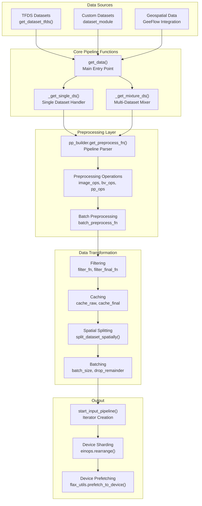

**Sources:** [jeo/input_pipeline.py:1-514]()

## Data Loading Architecture

The system supports three primary data loading mechanisms through a unified interface:

### TFDS Integration

The `get_dataset_tfds()` function provides seamless integration with TensorFlow Datasets:

| Parameter | Purpose | Type |
|-----------|---------|------|
| `dataset` | TFDS dataset name | `str` |
| `split` | Dataset split specification | `str` |
| `shuffle_files` | Whether to shuffle input files | `bool` |
| `skip_decode` | Features to skip decoding | `Sequence[str]` |
| `interleave_cycle_length` | Parallel file reading | `int \| None` |

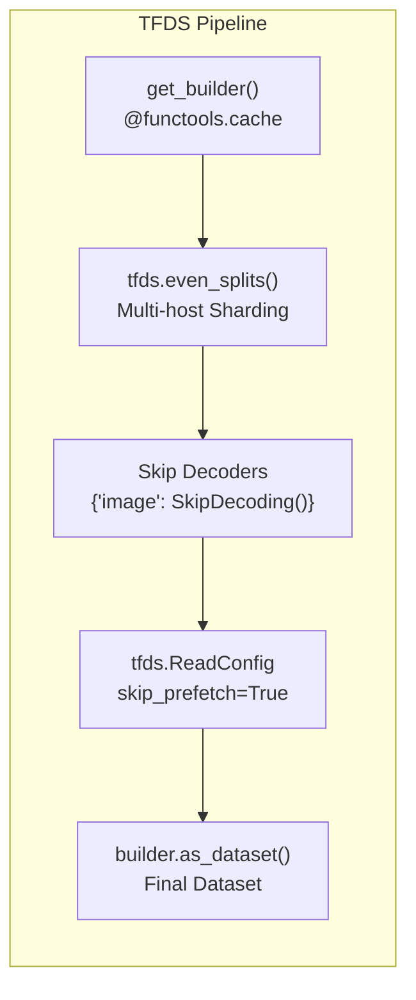

**Sources:** [jeo/input_pipeline.py:433-473]()

### Custom Dataset Modules

For non-TFDS datasets, the system loads custom dataset modules dynamically:

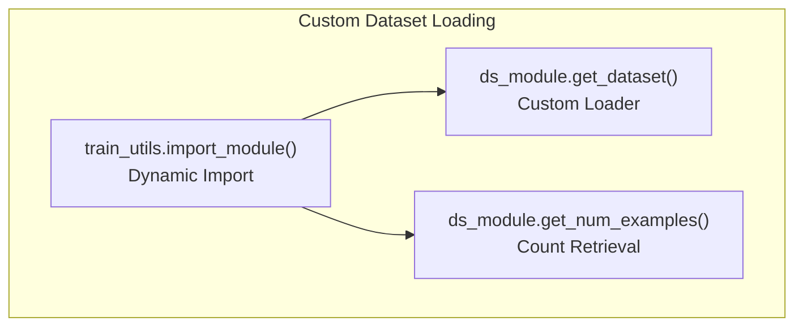

**Sources:** [jeo/input_pipeline.py:188-193](), [jeo/input_pipeline.py:50-53]()

### Dataset Mixing

The `_get_mixture_ds()` function enables training on multiple datasets simultaneously:

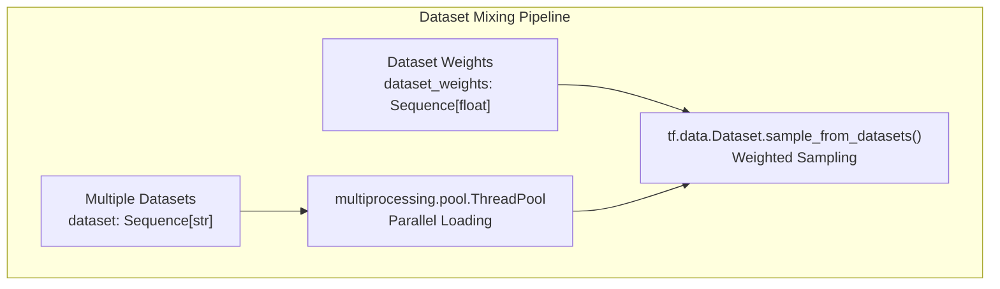

**Sources:** [jeo/input_pipeline.py:323-388]()

## Preprocessing Integration

The input pipeline integrates with the preprocessing system through string-based pipeline specifications:

### Pipeline Construction

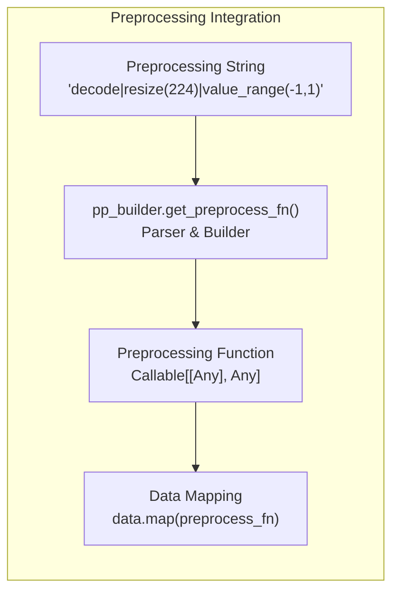

### Preprocessing Utilities

The `pp_utils.py` module provides essential utilities for preprocessing operations:

| Utility | Function | Purpose |
|---------|----------|---------|
| `InKeyOutKey` | Decorator class | Single-input single-output operation wrapper |
| `get_lookup_table()` | Label mapping | Creates TensorFlow lookup tables |
| `load_normalization_ranges()` | Statistics loading | Loads normalization parameters with caching |
| `maybe_repeat()` | Argument handling | Repeats arguments for multi-element processing |

**Sources:** [jeo/pp/pp_utils.py:87-125](), [jeo/pp/pp_utils.py:32-51](), [jeo/pp/pp_utils.py:54-84]()

## Batching and Device Sharding

The system provides sophisticated batching and sharding capabilities for multi-device training:

### Training vs Evaluation Modes

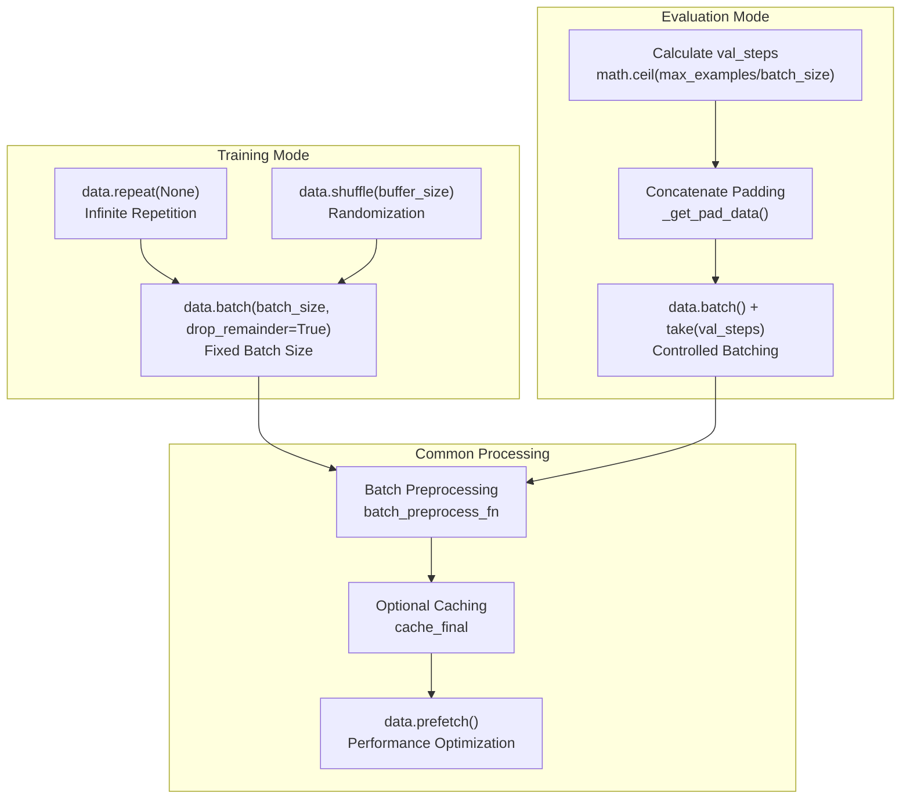

### Device Sharding Pipeline

The `start_input_pipeline()` function handles conversion to device-ready format:

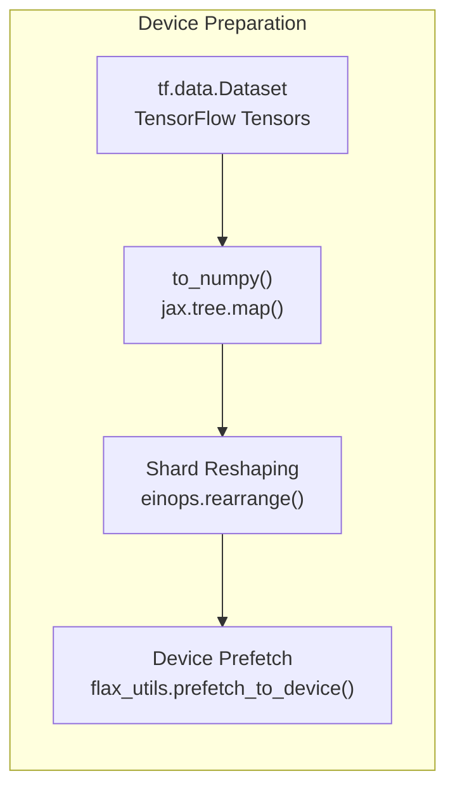

**Sources:** [jeo/input_pipeline.py:409-430]()

## Advanced Features

### Spatial Dataset Splitting

The `split_dataset_spatially()` function enables splitting large geospatial images into smaller patches:

| Parameter | Type | Purpose |
|-----------|------|---------|
| `n` | `int` | Number of splits per axis (n×n total) |
| `shift` | `int` | Pixel-wise shift between patches |
| `size` | `int` | Size of each sub-patch |
| `keep_keys` | `Sequence[str]` | Keys to preserve unchanged |
| `split_keys` | `Sequence[str]` | Keys to spatially split |

**Sources:** [jeo/input_pipeline.py:78-115]()

### Caching Strategies

The system supports two caching levels:

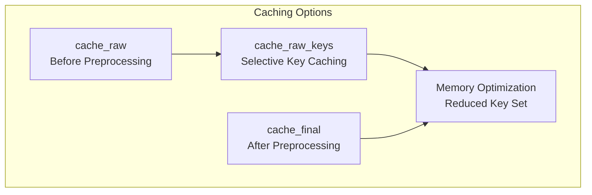

### Data Service Integration

For distributed training, the system supports TensorFlow Data Service:

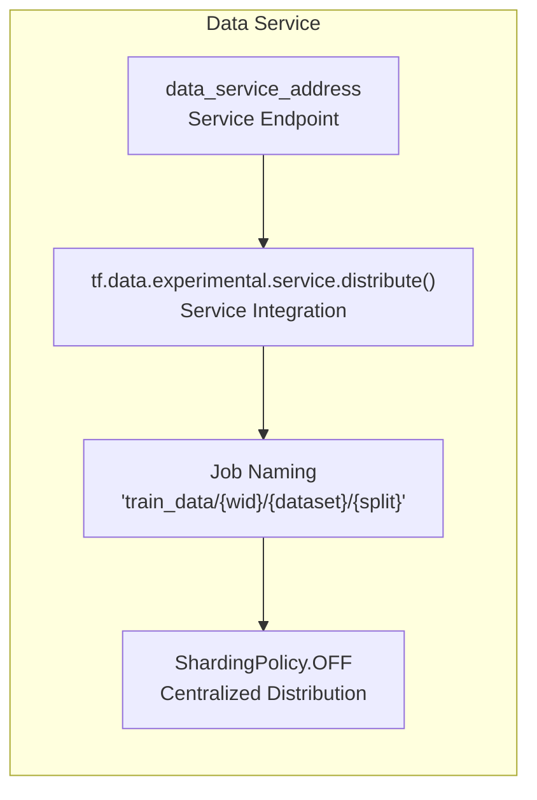

**Sources:** [jeo/input_pipeline.py:257-269]()

## Core API Reference

### Primary Functions

| Function | Purpose | Key Parameters |
|----------|---------|----------------|
| `get_data()` | Main entry point for dataset loading | `dataset`, `split`, `preprocess_fn`, `batch_size` |
| `get_num_examples()` | Retrieve dataset size information | `dataset`, `split`, `data_dir`, `dataset_module` |
| `start_input_pipeline()` | Convert dataset to device-ready iterator | `data`, `n_prefetch`, `shard` |

### Configuration Parameters

The system accepts extensive configuration through the `_get_single_ds()` function:

| Category | Parameters | Purpose |
|----------|------------|---------|
| Data Source | `dataset`, `split`, `data_dir`, `dataset_module` | Dataset identification |
| Preprocessing | `preprocess_fn`, `batch_preprocess_fn`, `pp_modules` | Data transformation |
| Performance | `prefetch`, `num_parallel_calls`, `shuffle_buffer_size` | Optimization settings |
| Filtering | `filter_fn`, `filter_final_fn` | Data selection |
| Caching | `cache_raw`, `cache_final`, `cache_raw_keys` | Performance caching |
| Evaluation | `val_steps`, `split_dataset_args` | Evaluation-specific options |

**Sources:** [jeo/input_pipeline.py:118-183](), [jeo/input_pipeline.py:391-406]()

---

# Page: Model Architecture Framework

# Model Architecture Framework

<details>
<summary>Relevant source files</summary>

The following files were used as context for generating this wiki page:

- [jeo/components/transformers.py](jeo/components/transformers.py)
- [jeo/models/bit.py](jeo/models/bit.py)
- [jeo/models/mtsvit.py](jeo/models/mtsvit.py)
- [jeo/models/vit.py](jeo/models/vit.py)

</details>


This document covers the model architecture framework in Jeo, including the available model implementations, common components, and how models integrate with the training and evaluation systems. For information about training configuration and parameter management, see [Training System](#3.3). For details about specific model usage in tasks, see [Task Definitions](#5.2).

## Overview

The Jeo model architecture framework provides a standardized approach to implementing and using deep learning models for geospatial applications. The framework supports three main model families: BIT (ResNet-based), ViT (Vision Transformer), and MTSViT (Multi-Modal Temporal-Spatial Vision Transformer), along with shared transformer components that enable consistent implementation patterns across different architectures.

### Model Framework Architecture

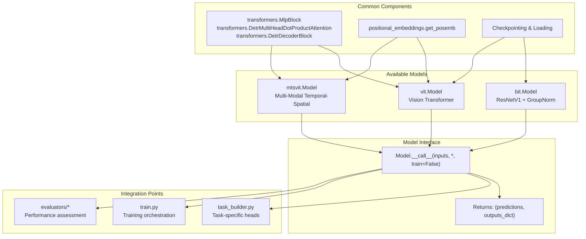

**Sources:** [jeo/models/bit.py:94-141](), [jeo/models/vit.py:142-230](), [jeo/models/mtsvit.py:43-229]()

## Model Implementations

### BIT (ResNet with GroupNorm)

The BIT model implements ResNet V1 architecture with GroupNorm instead of BatchNorm, making it suitable for various batch sizes and geospatial applications.

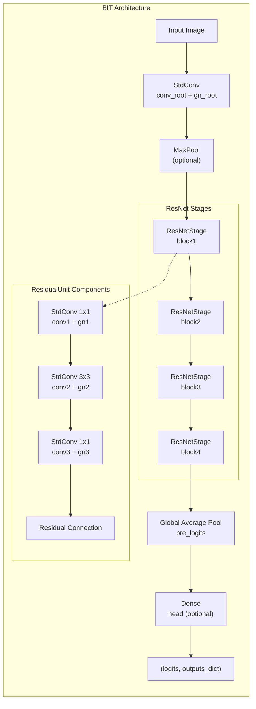

Key characteristics:
- Uses `StdConv` with weight standardization ([jeo/models/bit.py:36-42]())
- Adaptive GroupNorm with `min(32, channels)` groups ([jeo/models/bit.py:45-48]())
- Configurable depth (26, 50, 101, 152, 200 layers) ([jeo/models/bit.py:146-155]())
- Returns intermediate activations in `outputs_dict` ([jeo/models/bit.py:110-140]())

**Sources:** [jeo/models/bit.py:94-141](), [jeo/models/bit.py:51-77](), [jeo/models/bit.py:80-91]()

### ViT (Vision Transformer)

The ViT implementation provides a flexible transformer architecture with various scaling options and pooling strategies.

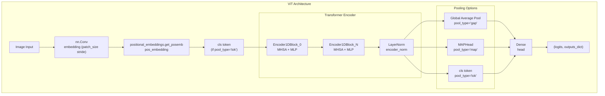

Key characteristics:
- Factory function `Model()` with variant support (Ti/S/M/B/L/H/g/G/e) ([jeo/models/vit.py:233-257]())
- Multiple pooling strategies: `gap`, `map`, `tok` ([jeo/models/vit.py:192-208]())
- Learnable or sinusoidal positional embeddings ([jeo/models/vit.py:172-173]())
- Support for high-resolution fine-tuning ([jeo/models/vit.py:260-275]())

**Sources:** [jeo/models/vit.py:142-230](), [jeo/models/vit.py:84-105](), [jeo/models/vit.py:55-81]()

### MTSViT (Multi-Modal Temporal-Spatial Vision Transformer)

MTSViT handles multi-modal temporal-spatial data with separate spatial and temporal processing stages.

```mermaid
graph TB
    subgraph "MTSViT Architecture"
        MultiModalInput["Multi-modal Inputs<br/>inputs[mod_name]"]
        
        subgraph "Tokenization"
            Tokenize["tokenize()<br/>Separate tokenization per modality"]
            SpatialMods["Spatial Modalities<br/>(patch_h > 1)"]
            NonSpatialMods["Non-spatial Modalities<br/>(patch_h = 1)"]
        end
        
        subgraph "Spatial Processing"
            SpatialPE["positional_embeddings<br/>pe_spatial"]
            SpatialEnc["vit.Encoder<br/>transformer_spatial"]
        end
        
        subgraph "Temporal Processing"  
            TemporalPE["positional_embeddings<br/>pe_temp"]
            ClsTokens["cls_temp tokens<br/>(num_classes)"]
            TemporalEnc["vit.Encoder<br/>transformer_temporal"]
        end
        
        subgraph "Multi-Modal Decoder"
            ChunkDec["ChunkDecoder<br/>spatial_decoder"]
            DetrBlocks["transformers.DetrDecoderBlock<br/>Cross-attention layers"]
        end
        
        subgraph "Task Heads"
            ClassHead["Classification Head<br/>cls token → Dense"]
            SegHead["Segmentation Head<br/>patches → Dense → reshape"]
        end
        
        Output["(predictions, outputs_dict)"]
    end
    
    MultiModalInput --> Tokenize
    Tokenize --> SpatialMods
    Tokenize --> NonSpatialMods
    
    SpatialMods --> SpatialPE
    SpatialPE --> SpatialEnc
    
    SpatialEnc --> TemporalPE
    NonSpatialMods --> TemporalPE
    TemporalPE --> ClsTokens
    ClsTokens --> TemporalEnc
    
    TemporalEnc --> ChunkDec
    ChunkDec --> DetrBlocks
    
    DetrBlocks --> ClassHead
    DetrBlocks --> SegHead
    
    ClassHead --> Output
    SegHead --> Output
```

Key characteristics:
- Multi-modal input support with configurable patch sizes ([jeo/models/mtsvit.py:55-56]())
- Spatial-first or temporal-first processing ([jeo/models/mtsvit.py:68](), [jeo/models/mtsvit.py:94-177]())
- DETR-style decoder for cross-modal attention ([jeo/models/mtsvit.py:273-376]())
- Support for both classification and segmentation heads ([jeo/models/mtsvit.py:184-228]())

**Sources:** [jeo/models/mtsvit.py:43-229](), [jeo/models/mtsvit.py:273-376](), [jeo/models/mtsvit.py:231-270]()

## Common Components

### Transformer Building Blocks

The framework provides shared transformer components that are used across different model architectures:

| Component | Purpose | Used By |
|-----------|---------|---------|
| `MlpBlock` | Feed-forward layers with GELU activation | ViT, MTSViT |
| `DetrMultiHeadDotProductAttention` | Multi-head attention with positional embeddings | MTSViT decoder |
| `DetrDecoderBlock` | Complete transformer decoder block | MTSViT cross-modal processing |
| `PatchMerger3D` | Hierarchical patch merging for multi-scale | MTSViT (optional) |

**Sources:** [jeo/components/transformers.py:28-63](), [jeo/components/transformers.py:127-256](), [jeo/components/transformers.py:259-395]()

### Model Loading and Checkpointing

All models support a consistent loading interface:

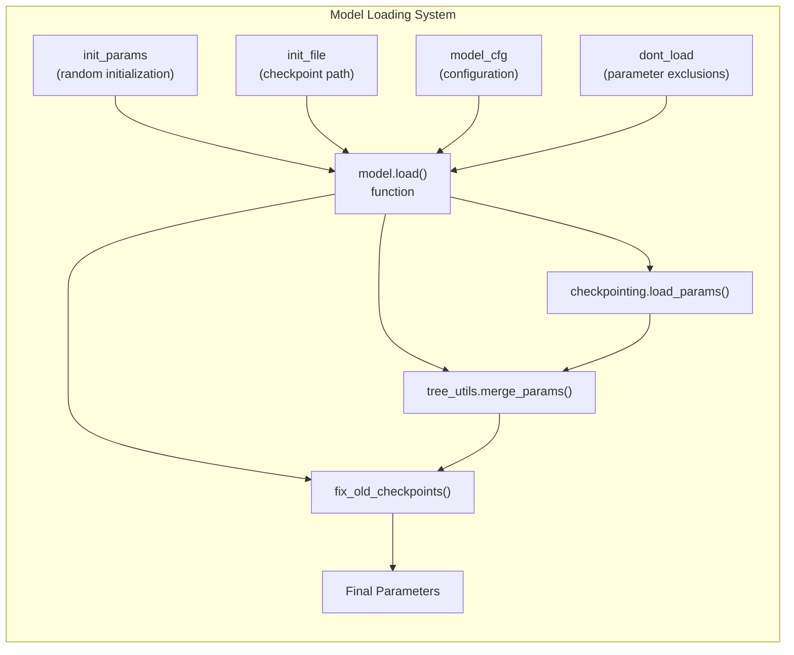

**Sources:** [jeo/models/bit.py:169-175](), [jeo/models/vit.py:317-336](), [jeo/tools/checkpointing.py](), [jeo/tools/tree_utils.py]()

## Model Integration with Training System

### Training Loop Integration

Models integrate with the training system through a standardized interface:

```mermaid
graph TB
    subgraph "Training Integration"
        ConfigFile["Configuration<br/>(tiny_bit.py, tiny_vit.py)"]
        ModelFactory["Model Creation<br/>task_builder.create_model()"]
        
        subgraph "Training Step"
            ForwardPass["model(batch, train=True)"]
            LossComp["Loss Computation"]
            Gradients["Gradient Calculation"]
            ParamUpdate["Parameter Update"]
        end
        
        subgraph "Evaluation Step"
            EvalForward["model(batch, train=False)"]
            Metrics["Metric Calculation"]
        end
        
        Checkpointing["Checkpoint Saving<br/>train_utils.save_checkpoint()"]
    end
    
    ConfigFile --> ModelFactory
    ModelFactory --> ForwardPass
    ForwardPass --> LossComp
    LossComp --> Gradients
    Gradients --> ParamUpdate
    
    ModelFactory --> EvalForward
    EvalForward --> Metrics
    
    ParamUpdate --> Checkpointing
```

### Model Output Format

All models follow a consistent output format that integrates with the task and evaluation systems:

| Output Key | Description | Usage |
|------------|-------------|-------|
| `logits` | Main predictions (1D for classification) | Loss computation, metrics |
| `logits_2d` | Spatial predictions (for segmentation) | Segmentation tasks, dense prediction |
| `pre_logits` | Pre-classification features | Feature extraction, analysis |
| `pre_logits_2d` | Spatial features before final layer | Dense feature maps |
| Intermediate activations | Layer-wise outputs (stem, stages, etc.) | Analysis, visualization, multi-scale |

**Sources:** [jeo/models/bit.py:110-140](), [jeo/models/vit.py:190-230](), [jeo/models/mtsvit.py:203-229]()

## Configuration and Variants

### Model Variants

Each model family supports different size variants:

**BIT Variants:**
- Configurable depth: 26, 50, 101, 152, 200 layers
- Configurable width multiplier
- Customizable stem and pooling configurations

**ViT Variants:**
- Predefined sizes: Ti, S, M, B, L, H, g, G, e
- Patch sizes: /8, /16, /32
- Example: `"B/16"` = Base model with 16x16 patches

**MTSViT Configuration:**
- Multi-modal patch sizes per modality
- Configurable encoder depths (spatial, temporal, decoder)
- Head type selection (classification vs segmentation)

**Sources:** [jeo/models/bit.py:97-102](), [jeo/models/vit.py:238-257](), [jeo/models/mtsvit.py:55-68]()

---

# Page: Training System

# Training System

<details>
<summary>Relevant source files</summary>

The following files were used as context for generating this wiki page:

- [jeo/tools/tree_utils.py](jeo/tools/tree_utils.py)
- [jeo/train.py](jeo/train.py)
- [jeo/train_utils.py](jeo/train_utils.py)

</details>


The Training System is the core orchestrator of model training in Jeo, responsible for executing the training loop, managing model parameters, handling checkpointing, and coordinating distributed training across multiple devices. This system integrates all components including data loading, model execution, optimization, and evaluation.

For information about data preprocessing and pipeline configuration, see [Input Pipeline System](#3.1). For details about model architectures and implementations, see [Model Architecture Framework](#3.2). For evaluation and metrics collection, see [Evaluation Framework](#3.4).

## Training Loop Architecture

The training system is built around a structured multi-section training loop implemented in the main training script. The architecture follows a clear separation between setup, execution, and cleanup phases.

### Training Loop Flow

```mermaid
flowchart TD
    Setup["Setup Phase<br/>_main() sections 1-3"]
    DataInit["Dataset Initialization<br/>input_pipeline.get_data()"]
    ModelInit["Model & Optimizer Init<br/>model.init() + tx.init()"]
    UpdateFn["Update Function Definition<br/>@jax.pmap update_fn()"]
    CheckpointLoad["Checkpoint Loading<br/>checkpointing.load_checkpoint()"]
    PreLoop["Pre-loop Setup<br/>Replication & Evaluators"]
    TrainLoop["Training Loop<br/>zip(range(steps), train_iter)"]
    Cleanup["Cleanup & Finalization<br/>finalize_and_cleanup()"]
    
    Setup --> DataInit
    DataInit --> ModelInit
    ModelInit --> UpdateFn
    UpdateFn --> CheckpointLoad
    CheckpointLoad --> PreLoop
    PreLoop --> TrainLoop
    TrainLoop --> Cleanup
    
    subgraph "Training Loop Internals"
        TrainStep["Train Step<br/>update_fn()"]
        CheckpointSave["Checkpoint Saving<br/>checkpointing.save_checkpoint()"]
        EvalRun["Evaluation Run<br/>run_evaluators()"]
        ProgressReport["Progress Reporting<br/>chrono.tick()"]
        
        TrainStep --> CheckpointSave
        CheckpointSave --> EvalRun
        EvalRun --> ProgressReport
        ProgressReport --> TrainStep
    end
    
    TrainLoop --> TrainStep
```

Sources: [jeo/train.py:70-481]()

### Update Function Architecture

The core training step is implemented as a pmapped function that handles parameter updates, gradient computation, and metric collection:

```mermaid
graph TD
    UpdateFn["update_fn()"]
    RNGSplit["RNG Splitting<br/>jax.random.split()"]
    Mixup["Mixup Augmentation<br/>mixup.get_mixup()"]
    LossFn["Loss Function<br/>task.get_loss_and_aux()"]
    GradComp["Gradient Computation<br/>jax.value_and_grad()"]
    GradProcess["Gradient Processing<br/>jax.lax.pmean()"]
    ParamUpdate["Parameter Update<br/>optax.apply_updates()"]
    Metrics["Metrics Collection<br/>measurements dict"]
    
    UpdateFn --> RNGSplit
    RNGSplit --> Mixup
    Mixup --> LossFn
    LossFn --> GradComp
    GradComp --> GradProcess
    GradProcess --> ParamUpdate
    ParamUpdate --> Metrics
```

Sources: [jeo/train.py:256-300]()

## Parameter Management

The training system provides sophisticated parameter management capabilities including parameter freezing, initialization from checkpoints, and parameter tree manipulation.

### Parameter Initialization and Loading

| Operation | Function | Purpose |
|-----------|----------|---------|
| Model Initialization | `model.init()` | Initialize parameters on CPU |
| Parameter Loading | `train_utils.load()` | Load from checkpoint with validation |
| Parameter Merging | `tree_utils.merge_params()` | Merge loaded and initialized parameters |
| Parameter Freezing | `train_utils.get_frozen_mask()` | Create freeze masks from schedule |

### Frozen Parameter System

```mermaid
graph TB
    Schedule["config.schedule<br/>List of (pattern, sched) tuples"]
    Patterns["Pattern Matching<br/>tree_utils.make_mask_trees()"]
    FrozenMask["Frozen Mask Generation<br/>tree_utils.split_frozen()"]
    GradMask["Gradient Masking<br/>bv_optax.replace_frozen()"]
    
    Schedule --> Patterns
    Patterns --> FrozenMask
    FrozenMask --> GradMask
    
    subgraph "Parameter Tree Operations"
        TreeMap["tree_map_with_names()"]
        TreeFilter["tree_filter()"]
        TreeCompare["tree_compare()"]
    end
    
    FrozenMask --> TreeMap
    TreeMap --> TreeFilter
    TreeFilter --> TreeCompare
```

Sources: [jeo/train_utils.py:175-196](), [jeo/tools/tree_utils.py:316-334](), [jeo/tools/tree_utils.py:447-463]()

## Checkpointing System

The checkpointing system handles model state persistence, restoration, and distributed coordination across training processes.

### Checkpoint Operations

```mermaid
sequenceDiagram
    participant TL as "Training Loop"
    participant CT as "checkpointing_timeout()"
    participant SC as "save_checkpoint()"
    participant LC as "load_checkpoint()"
    participant FS as "File System"
    
    TL->>CT: Check previous checkpoint write
    CT->>TL: Timeout validation
    TL->>SC: Save checkpoint async
    SC->>FS: Write checkpoint.npz
    
    Note over SC,FS: Copy to timestamped file if keep_ckpt_steps
    
    TL->>LC: Load existing checkpoint
    LC->>FS: Read checkpoint data
    LC->>TL: Return checkpoint tree
    
    Note over TL: Recover bfloat16 dtypes
```

### Checkpoint Structure

The checkpoint contains:

| Component | Source | Description |
|-----------|--------|-------------|
| `params` | `params_cpu` | Model parameters |
| `opt` | `opt_cpu` | Optimizer state |
| `chrono` | `chrono.save()` | Timing and progress data |
| `state` | `state_cpu` | Model state (batch norm, etc.) |

Sources: [jeo/train.py:315-333](), [jeo/train.py:415-438]()

## Timing and Progress Tracking

The `Chrono` class provides comprehensive timing, progress tracking, and performance monitoring throughout training.

### Chrono Architecture

```mermaid
classDiagram
    class Chrono {
        +program_start_time: float
        +train_start_time: float
        +accum_train_time: float
        +accum_program_time: float
        +accum_pause_time: float
        +accum_examples_seen: int
        +warmup: int
        +note: str
        
        +inform() Configure timing parameters
        +tick() Record training step
        +pause() Pause timing for evaluations
        +resume() Resume timing after pause
        +save() Serialize timing state
        +load() Restore timing state
        +log_timing() Context manager for operations
    }
    
    class MetricWriter {
        +measure() Record metrics
    }
    
    Chrono --> MetricWriter : uses for logging
```

### Timing Flow

```mermaid
graph LR
    Init["Chrono()"]
    Inform["inform()<br/>Setup parameters"]
    Warmup["Warmup Period<br/>Skip first 2 steps"]
    Tick["tick()<br/>Record step timing"]
    Pause["pause()<br/>During evaluation"]
    Resume["resume()<br/>After evaluation"]
    Save["save()<br/>To checkpoint"]
    
    Init --> Inform
    Inform --> Warmup
    Warmup --> Tick
    Tick --> Pause
    Pause --> Resume
    Resume --> Tick
    Tick --> Save
```

Sources: [jeo/train_utils.py:270-468]()

## Distributed Training Support

The training system includes built-in support for distributed training across multiple devices and hosts using JAX's pmap functionality.

### Distributed Components

| Component | Function | Purpose |
|-----------|----------|---------|
| Device Coordination | `jax.pmap()` | Parallel execution across devices |
| Host Synchronization | `train_utils.sync()` | Synchronize all hosts |
| Batch Distribution | `local_batch_size = batch_size // jax.process_count()` | Distribute batches |
| Gradient Aggregation | `jax.lax.pmean()` | Average gradients across devices |
| Parameter Replication | `flax.jax_utils.replicate()` | Replicate parameters to devices |

### Distributed Training Flow

```mermaid
graph TB
    BatchSplit["Batch Splitting<br/>batch_size // process_count"]
    ParamRepl["Parameter Replication<br/>flax.jax_utils.replicate()"]
    PmapUpdate["Pmapped Update<br/>@jax.pmap update_fn"]
    GradMean["Gradient Averaging<br/>jax.lax.pmean()"]
    Sync["Host Synchronization<br/>train_utils.sync()"]
    
    BatchSplit --> ParamRepl
    ParamRepl --> PmapUpdate
    PmapUpdate --> GradMean
    GradMean --> Sync
    
    subgraph "Multi-Device Execution"
        Dev0["Device 0"]
        Dev1["Device 1"]
        DevN["Device N"]
        
        Dev0 -.-> GradMean
        Dev1 -.-> GradMean
        DevN -.-> GradMean
    end
```

Sources: [jeo/train.py:118-129](), [jeo/train.py:256](), [jeo/train.py:287](), [jeo/train_utils.py:119-124]()

## Configuration and Utilities

The training system includes extensive configuration validation, module importing, and utility functions for managing training workflows.

### Configuration Management

```mermaid
graph TD
    ConfigLoad["FLAGS.config"]
    Validate["validate_and_update_config_inplace()"]
    StepsCalc["train_utils.steps()"]
    ModuleImport["import_module()"]
    
    ConfigLoad --> Validate
    Validate --> StepsCalc
    Validate --> ModuleImport
    
    subgraph "Step Calculations"
        TotalSteps["total_steps"]
        LogSteps["log_training_steps"]
        CkptSteps["ckpt_steps"]
        KeepSteps["keep_ckpt_steps"]
    end
    
    StepsCalc --> TotalSteps
    StepsCalc --> LogSteps
    StepsCalc --> CkptSteps
    StepsCalc --> KeepSteps
```

### Utility Functions

| Function | Purpose | Usage |
|----------|---------|-------|
| `itstime()` | Determine when to execute periodic actions | Checkpoint saving, logging, evaluation |
| `steps()` | Convert duration specifications to step counts | Handle epochs/examples/percent configs |
| `hms()` | Format time durations | Progress reporting |
| `log_memory()` | Log memory usage statistics | Performance monitoring |
| `get_files()` | Resolve file patterns | Checkpoint and data file discovery |

Sources: [jeo/train_utils.py:145-163](), [jeo/train_utils.py:198-237](), [jeo/train_utils.py:493-572](), [jeo/train.py:162-169]()

---

# Page: Evaluation Framework

# Evaluation Framework

<details>
<summary>Relevant source files</summary>

The following files were used as context for generating this wiki page:

- [jeo/evaluators/builder.py](jeo/evaluators/builder.py)
- [jeo/metrics/clu_metrics_builder.py](jeo/metrics/clu_metrics_builder.py)

</details>


The Evaluation Framework provides a comprehensive system for assessing model performance during training and validation. It includes abstract interfaces for evaluators, a flexible metrics collection system, and seamless integration with the training loop for periodic performance monitoring and early stopping.

For information about specific metrics implementations, see [Metrics Library](#7.1). For details on configuring evaluators for different task types, see [Evaluators](#7.2).

## Core Architecture

The evaluation framework is built around three main components: the `EvaluatorBase` abstract interface, the `MetricsCollection` system, and the evaluator builder that creates configured evaluator instances from configuration specifications.

```mermaid
graph TB
    subgraph "Evaluation Framework Core"
        EvaluatorBase["EvaluatorBase<br/>Abstract Interface"]
        MetricsCollection["MetricsCollection<br/>Metrics Management"]
        EvaluatorBuilder["from_config()<br/>Evaluator Factory"]
    end
    
    subgraph "Concrete Evaluators"
        ClassificationEval["Classification Evaluator<br/>Multi-class & Multi-label"]
        SegmentationEval["Segmentation Evaluator<br/>Semantic Segmentation"]
        CustomEval["Custom Evaluators<br/>Task-specific"]
    end
    
    subgraph "Metrics System" 
        CLUMetrics["clu_metrics<br/>Metric Implementations"]
        MetricsBuilder["get_metrics_cls()<br/>Collection Builder"]
        GatherFn["get_gather_fn()<br/>Distributed Collection"]
    end
    
    subgraph "Training Integration"
        TrainLoop["train.py<br/>Training Loop"]
        PredictFn["predict_fn<br/>Model Prediction"]
        EvalScheduling["Evaluation Scheduling<br/>log_eval_steps"]
    end
    
    %% Core relationships
    EvaluatorBase --> ClassificationEval
    EvaluatorBase --> SegmentationEval
    EvaluatorBase --> CustomEval
    
    EvaluatorBuilder --> EvaluatorBase
    EvaluatorBuilder --> MetricsCollection
    
    MetricsCollection --> MetricsBuilder
    MetricsBuilder --> CLUMetrics
    MetricsCollection --> GatherFn
    
    %% Training integration
    TrainLoop --> EvaluatorBuilder
    PredictFn --> EvaluatorBase
    TrainLoop --> EvalScheduling
    EvalScheduling --> EvaluatorBase
```

**Evaluator Framework Architecture**

Sources: [jeo/evaluators/builder.py:32-46](), [jeo/metrics/clu_metrics_builder.py:34-73]()

## EvaluatorBase Interface

The `EvaluatorBase` class defines the core interface that all evaluators must implement. It provides a standardized way to set up metrics, configure datasets, and run evaluation across distributed environments.

```mermaid
classDiagram
    class EvaluatorBase {
        <<abstract>>
        +__init__(predict_fn, batch_size, metrics, **data_config)
        +_get_eval_fn(predict_fn)* 
        +run(params)*
        +_setup_metrics_and_eval_iter(metrics, predict_fn)
        +_setup_dataset(batch_size, **data_config)
        +metrics: MetricsCollection
        +eval_fn: Callable
        +data_iter: Iterator
        +steps: int
    }
    
    class MetricsCollection {
        +__init__(metrics_list)
        +get_gather_fn() GatherFn
        +get_single_fn() SingleFn
        +reset_states()
        +update_state(metrics_update)
        +result() dict
        -_collection_cls: type
        -_state: Collection
    }
    
    class InputPipeline {
        +get_data() Dataset
        +start_input_pipeline() Iterator
    }
    
    EvaluatorBase --> MetricsCollection : uses
    EvaluatorBase --> InputPipeline : configures
```

**EvaluatorBase Class Structure**

The abstract methods that concrete evaluators must implement are:
- `__init__`: Initialize the evaluator with prediction function, batch size, metrics list, and data configuration
- `_get_eval_fn`: Create the evaluation function and apply `pmap` for distributed execution  
- `run`: Execute evaluation across the dataset and compute all configured metrics

Sources: [jeo/evaluators/builder.py:32-81]()

## Metrics Collection System

The `MetricsCollection` class manages the lifecycle of metrics computation, from initialization through state updates to final result computation. It builds on the CLU metrics library and provides both single-device and distributed computation patterns.

```mermaid
graph LR
    subgraph "Metrics Lifecycle"
        MetricsList["metrics_list<br/>['accuracy', 'f1', 'loss']"]
        GetMetricsCls["get_metrics_cls()<br/>Dynamic Class Creation"]
        CollectionCls["Metrics Collection Class<br/>JAX-serializable"]
        
        MetricsList --> GetMetricsCls
        GetMetricsCls --> CollectionCls
    end
    
    subgraph "State Management"
        ResetStates["reset_states()<br/>Clear State"]
        UpdateState["update_state()<br/>Accumulate Updates"]
        Result["result()<br/>Compute Final Values"]
        
        ResetStates --> UpdateState
        UpdateState --> Result
        UpdateState --> UpdateState
    end
    
    subgraph "Update Functions"
        GatherFn["get_gather_fn()<br/>Distributed Updates"]
        SingleFn["get_single_fn()<br/>Single Device Updates"] 
        MetricsInputs["_get_metrics_inputs()<br/>Input Preparation"]
        
        GatherFn --> MetricsInputs
        SingleFn --> MetricsInputs
    end
    
    CollectionCls --> GatherFn
    CollectionCls --> SingleFn
```

**Metrics Collection Workflow**

The system supports a wide range of metric types through string-based registration:

| Metric Category | Supported Metrics | Implementation |
|-----------------|-------------------|----------------|
| **Classification** | `accuracy`, `f1`, `f1_macro`, `precision`, `recall` | `clu_metrics.Accuracy`, `clu_metrics.F1` |
| **Regression** | `mse`, `rmse`, `mae`, `bias` | `clu_metrics.MSE`, `clu_metrics.RMSE` |
| **Correlation** | `pearson`, `spearman_correlation` | `clu_metrics.PearsonCorrelation` |
| **Segmentation** | `miou`, `confusion_matrix` | `clu_metrics.MIoU` |
| **Ranking** | `aucpr`, `roc_auc`, `map` | `clu_metrics.AUCPR`, `clu_metrics.ROCAUC` |
| **Calibration** | `ece` | `clu_metrics.ECE` |

Sources: [jeo/metrics/clu_metrics_builder.py:75-179](), [jeo/metrics/clu_metrics_builder.py:191-257]()

## Evaluator Configuration and Building

The `from_config` function serves as the main factory for creating evaluator instances from configuration specifications. It supports both dictionary-based and list-based configuration formats and handles module importation dynamically.

```mermaid
graph TD
    subgraph "Configuration Input"
        ConfigDict["ml_collections.ConfigDict<br/>Main Configuration"]
        EvalSpecs["config.evals<br/>Evaluator Specifications"]
        TaskConfig["Task-specific Config<br/>batch_size, metrics, data"]
    end
    
    subgraph "Configuration Processing"
        ParseSpecs["Parse Evaluator Specs<br/>Dict or List format"]
        ExtractConfig["Extract Configuration<br/>name, module, params"]  
        SetDefaults["Set Default Values<br/>batch_size, log_steps"]
        ImportModule["train_utils.import_module()<br/>Dynamic Import"]
    end
    
    subgraph "Evaluator Creation"
        ModuleCls["Module Class<br/>or module.Evaluator"]
        InstantiateEval["Instantiate Evaluator<br/>module_cls(predict_fn, **cfg)"]
        EvalTuple["(name, evaluator, logsteps, prefix)<br/>Return Tuple"]
    end
    
    ConfigDict --> ParseSpecs
    EvalSpecs --> ParseSpecs
    TaskConfig --> ExtractConfig
    
    ParseSpecs --> ExtractConfig
    ExtractConfig --> SetDefaults
    SetDefaults --> ImportModule
    
    ImportModule --> ModuleCls
    ModuleCls --> InstantiateEval
    InstantiateEval --> EvalTuple
```

**Evaluator Configuration and Building Process**

Configuration examples for different evaluator types:

```python
# Dictionary format
config.evals = {
    'val': {'type': 'classification', 'split': 'validation'},  
    'test': {'type': 'segmentation', 'split': 'test'}
}

# List format  
config.evals = [
    ('val_acc', 'classification'),
    ('test_seg', 'segmentation')
]
```

The builder handles several important configuration aspects:
- **Batch Size**: Uses `batch_size_eval` or falls back to training `batch_size`
- **Logging Steps**: Configures evaluation frequency via `log_eval_steps` or evaluator-specific `log_steps`
- **Data Steps**: Uses global `val_steps` for JEO evaluators or evaluator-specific `steps`
- **Module Import**: Dynamically imports evaluator classes using `train_utils.import_module`

Sources: [jeo/evaluators/builder.py:83-132]()

## Integration with Training Loop

The evaluation framework integrates seamlessly with the training loop through periodic evaluation scheduling and metric aggregation. Evaluators receive the model's prediction function and are called at configured intervals during training.

```mermaid
sequenceDiagram
    participant TL as "train.py<br/>Training Loop"
    participant EB as "evaluators.builder<br/>from_config()"
    participant E as "Evaluator Instance"
    participant MC as "MetricsCollection"
    participant DS as "Dataset Iterator"
    
    TL->>EB: Create evaluators from config
    EB->>E: Instantiate with predict_fn
    E->>MC: Setup metrics collection
    E->>DS: Setup dataset iterator
    
    loop Training Steps
        TL->>TL: Training step
        
        alt Every log_eval_steps
            TL->>E: evaluator.run(params)
            E->>MC: Reset metrics state
            
            loop Evaluation Steps
                E->>DS: Get batch
                E->>E: Apply eval_fn (pmapped)
                E->>MC: Update metrics state
            end
            
            E->>MC: Compute final results
            MC-->>E: Return metrics dict
            E-->>TL: Return evaluation results
            TL->>TL: Log metrics with prefix
        end
    end
```

**Evaluation Integration Sequence**

The training loop manages evaluator scheduling based on:
- **Global scheduling**: `log_eval_steps` configuration parameter
- **Per-evaluator scheduling**: Individual `log_steps` in evaluator config
- **Early stopping**: Evaluation results can trigger training termination
- **Metric prefixing**: Each evaluator's results are prefixed (e.g., `"val/"`, `"test/"`)

Sources: [jeo/evaluators/builder.py:83-132](), [jeo/evaluators/builder.py:47-81]()

---

# Page: Data Processing

# Data Processing

<details>
<summary>Relevant source files</summary>

The following files were used as context for generating this wiki page:

- [jeo/pp/pp_builder.py](jeo/pp/pp_builder.py)
- [jeo/pp/pp_utils.py](jeo/pp/pp_utils.py)
- [jeo/tools/bv_optax.py](jeo/tools/bv_optax.py)

</details>


This document covers Jeo's data preprocessing system, which transforms raw data into model-ready formats through a flexible pipeline architecture. The system uses a string-based specification language to define preprocessing operations that are applied sequentially to input data.

For information about specific preprocessing operations, see [Preprocessing Operations](#4.1). For details on configuring and composing preprocessing pipelines, see [Pipeline Configuration](#4.2). For the broader input pipeline system that integrates with datasets, see [Input Pipeline System](#3.1).

## System Overview

Jeo's data preprocessing system is built around a registry-based architecture that allows for flexible composition of preprocessing operations. The system takes inspiration from Google's big_vision library and provides a domain-specific language for specifying preprocessing pipelines as strings.

```mermaid
graph TB
    subgraph "Pipeline Specification"
        ConfigString["Pipeline String<br/>\"decode|resize(224)|flip_lr\""]
        Parser["pp_builder.parse_name<br/>String Parser"]
        Operations["Parsed Operations<br/>[(decode, [], {}), (resize, [224], {})]"]
    end
    
    subgraph "Registry System"
        GlobalRegistry["Registry._GLOBAL_REGISTRY<br/>Global Operation Store"]
        Lookup["Registry.lookup<br/>Operation Retrieval"]
        RegisteredOps["Registered Operations<br/>preprocess_ops.*"]
    end
    
    subgraph "Pipeline Execution"
        PreprocessFn["get_preprocess_fn<br/>Pipeline Constructor"]
        DataDict["Input Data<br/>{\"image\": tensor, ...}"]
        ProcessedData["Processed Data<br/>{\"image\": processed_tensor, ...}"]
    end
    
    subgraph "Utilities"
        PPUtils["pp_utils.py<br/>Helper Functions"]
        InKeyOutKey["InKeyOutKey Decorator<br/>Key Management"]
        Normalization["load_normalization_ranges<br/>Stats Loading"]
    end
    
    ConfigString --> Parser
    Parser --> Operations
    Operations --> Lookup
    GlobalRegistry --> Lookup
    RegisteredOps --> GlobalRegistry
    
    Operations --> PreprocessFn
    Lookup --> PreprocessFn
    PreprocessFn --> ProcessedData
    DataDict --> PreprocessFn
    
    PPUtils --> InKeyOutKey
    PPUtils --> Normalization
    InKeyOutKey -.-> RegisteredOps
    Normalization -.-> RegisteredOps
```

Sources: [jeo/pp/pp_builder.py:1-229](), [jeo/pp/pp_utils.py:1-126]()

## Pipeline Specification Language

The preprocessing system uses a pipe-separated string format to define sequential operations. Each operation can have positional and keyword arguments, following Python function call syntax.

**Basic Format**: `operation1|operation2(arg1, kwarg=value)|operation3`

**Key Components**:

| Component | Description | Example |
|-----------|-------------|---------|
| Operation Name | Registry key for the preprocessing function | `resize`, `decode`, `normalize` |
| Positional Args | Arguments passed to the operation | `resize(224)` |
| Keyword Args | Named parameters | `crop(size=224, method="random")` |
| Pipeline Separator | Pipe character connecting operations | `decode|resize(224)|flip_lr` |

The `get_preprocess_fn` function in [jeo/pp/pp_builder.py:31-95]() parses this specification and returns a preprocessing function that can be applied to data dictionaries.

```mermaid
flowchart LR
    subgraph "String Parsing"
        InputString["\"decode|resize(224)|flip_lr\""]
        Split["Split by '|'<br/>['decode', 'resize(224)', 'flip_lr']"]
        ParseEach["parse_name() for each<br/>Extract name, args, kwargs"]
    end
    
    subgraph "Operation Resolution"
        RegistryLookup["Registry.lookup()<br/>Find operation function"]
        PartialApplication["functools.partial<br/>Apply arguments"]
        OpList["List of Operations<br/>[decode_fn, resize_fn, flip_fn]"]
    end
    
    subgraph "Pipeline Function"
        DataInput["Data Dictionary<br/>{\"image\": raw_tensor}"]
        Sequential["Sequential Application<br/>Apply ops in order"]
        DataOutput["Processed Dictionary<br/>{\"image\": processed_tensor}"]
    end
    
    InputString --> Split
    Split --> ParseEach
    ParseEach --> RegistryLookup
    RegistryLookup --> PartialApplication
    PartialApplication --> OpList
    
    DataInput --> Sequential
    OpList --> Sequential
    Sequential --> DataOutput
```

Sources: [jeo/pp/pp_builder.py:98-151](), [jeo/pp/pp_builder.py:31-95]()

## Registry System

The `Registry` class provides a global registry for preprocessing operations. Operations are registered with string keys and can be looked up and instantiated with parameters.

**Core Registry Operations**:

| Method | Purpose | Usage |
|--------|---------|-------|
| `Registry.register(name)` | Register a new operation | Decorator for operation functions |
| `Registry.lookup(lookup_string)` | Retrieve and configure operation | Used by pipeline builder |
| `Registry.knows(lookup_string)` | Check if operation exists | Validation and error handling |

The registry stores operations with the `preprocess_ops.` prefix, allowing for namespaced organization of different operation types.

```mermaid
graph TB
    subgraph "Registration Process"
        OpFunction["Operation Function<br/>def my_preprocess_op(...)"]
        Decorator["@Registry.register<br/>(\"preprocess_ops.my_op\")"]
        GlobalStore["Registry._GLOBAL_REGISTRY<br/>{\"preprocess_ops.my_op\": function}"]
    end
    
    subgraph "Lookup Process"
        LookupString["\"my_op(param=value)\""]
        ParseName["parse_name()<br/>Extract name, args, kwargs"]
        RetrieveFunction["Retrieve from registry<br/>registry[\"preprocess_ops.my_op\"]"]
        PartialFunc["functools.partial<br/>Apply parameters"]
    end
    
    subgraph "Temporary Operations"
        ContextManager["temporary_ops(**kw)<br/>Temporary registration"]
        WithBlock["with temporary_ops(...):<br/>Limited scope usage"]
        Cleanup["Automatic cleanup<br/>Remove from registry"]
    end
    
    OpFunction --> Decorator
    Decorator --> GlobalStore
    
    LookupString --> ParseName
    ParseName --> RetrieveFunction
    GlobalStore --> RetrieveFunction
    RetrieveFunction --> PartialFunc
    
    ContextManager --> WithBlock
    WithBlock --> Cleanup
    GlobalStore -.-> ContextManager
```

Sources: [jeo/pp/pp_builder.py:153-196](), [jeo/pp/pp_builder.py:198-229]()

## Utility Functions

The `pp_utils.py` module provides essential utilities for preprocessing operations, including key management, data type handling, and normalization parameter loading.

**Key Utilities**:

- **`InKeyOutKey` Decorator**: Manages input/output key specification for preprocessing operations [jeo/pp/pp_utils.py:87-126]()
- **`get_lookup_table`**: Creates TensorFlow lookup tables for label mapping [jeo/pp/pp_utils.py:32-51]()
- **`load_normalization_ranges`**: Loads normalization statistics from GeeFlow data [jeo/pp/pp_utils.py:54-84]()
- **`maybe_repeat`**: Utility for repeating arguments to match expected lengths [jeo/pp/pp_utils.py:26-29]()

The `InKeyOutKey` decorator is particularly important as it provides a standard pattern for operations that transform single inputs to single outputs while managing dictionary keys:

```python
@InKeyOutKey(indefault="image", outdefault="image")
def my_operation(input_tensor, **kwargs):
    return processed_tensor
```

Sources: [jeo/pp/pp_utils.py:87-126](), [jeo/pp/pp_utils.py:32-84]()

## Data Flow Architecture

The preprocessing system integrates with Jeo's broader training pipeline by transforming raw data dictionaries into model-ready formats. The system expects input data as dictionaries with at least an "image" key containing 3D tensors.

```mermaid
flowchart TD
    subgraph "Data Sources"
        RawData["Raw Data Dictionary<br/>{\"image\": raw_tensor, \"label\": id}"]
        StatsFiles["Normalization Stats<br/>GeeFlow statistics files"]
    end
    
    subgraph "Preprocessing Pipeline"
        ConfigLoad["Load Pipeline Config<br/>pp_pipeline string"]
        BuildPipeline["get_preprocess_fn()<br/>Build preprocessing function"]
        ApplyOps["Sequential Operations<br/>Apply each operation"]
    end
    
    subgraph "Operation Types"
        Decode["Decode Operations<br/>Image format conversion"]
        Transform["Transform Operations<br/>Resize, crop, flip"]
        Normalize["Normalization<br/>Statistics-based scaling"]
        Augment["Augmentation<br/>Data variation"]
    end
    
    subgraph "Output"
        ProcessedData["Processed Data<br/>{\"image\": processed_tensor, ...}"]
        ModelReady["Model-Ready Batches<br/>Training pipeline input"]
    end
    
    RawData --> BuildPipeline
    ConfigLoad --> BuildPipeline
    StatsFiles -.-> Normalize
    
    BuildPipeline --> ApplyOps
    ApplyOps --> Decode
    ApplyOps --> Transform
    ApplyOps --> Normalize
    ApplyOps --> Augment
    
    Decode --> ProcessedData
    Transform --> ProcessedData
    Normalize --> ProcessedData
    Augment --> ProcessedData
    
    ProcessedData --> ModelReady
```

Sources: [jeo/pp/pp_builder.py:72-94](), [jeo/pp/pp_utils.py:54-84]()

## Integration Points

The data processing system integrates with several other components in the Jeo framework:

**Training Integration**: The preprocessing functions generated by `get_preprocess_fn` are used within the input pipeline system to transform data before feeding it to models.

**Configuration System**: Pipeline specifications are typically defined in configuration files and passed to the preprocessing system through the training script.

**Statistics Loading**: The `load_normalization_ranges` function integrates with GeeFlow's statistics system to provide data-driven normalization parameters.

**Logging and Debugging**: The system provides optional logging of data before and after preprocessing, as well as step-by-step operation logging for debugging pipeline behavior.

Sources: [jeo/pp/pp_builder.py:31-95](), [jeo/pp/pp_utils.py:54-84]()

---

# Page: Preprocessing Operations

# Preprocessing Operations

<details>
<summary>Relevant source files</summary>

The following files were used as context for generating this wiki page:

- [jeo/pp/bv_ops.py](jeo/pp/bv_ops.py)
- [jeo/pp/decode_ops.py](jeo/pp/decode_ops.py)
- [jeo/pp/image_ops.py](jeo/pp/image_ops.py)
- [jeo/pp/pp_ops.py](jeo/pp/pp_ops.py)
- [jeo/pp/rand_det_ops.py](jeo/pp/rand_det_ops.py)

</details>


This page documents all available preprocessing operations in the Jeo framework. Preprocessing operations are modular, composable functions that transform input data before feeding it to models. They handle tasks such as image decoding, resizing, augmentation, normalization, and satellite-specific data processing.

For information about how these operations are composed into preprocessing pipelines, see [Pipeline Configuration](#4.2). For details about the broader input pipeline system that uses these operations, see [Input Pipeline System](#3.1).

## Operation Registry System

All preprocessing operations in Jeo are registered using a centralized registry system. Operations are registered as factory functions that return the actual preprocessing function, enabling parameterization and reuse across different configurations.

```mermaid
graph TB
    subgraph "Registry System"
        Registry["pp_builder.Registry<br/>Centralized Operation Store"]
        RegDecorator["@Registry.register()<br/>Decorator Function"]
    end
    
    subgraph "Operation Modules"
        ImageOps["image_ops.py<br/>Basic Image Processing"]
        RandOps["rand_det_ops.py<br/>Random Deterministic Ops"]
        DecodeOps["decode_ops.py<br/>Satellite Data Decoding"]
        BVOps["bv_ops.py<br/>Big Vision Operations"]
        PPOps["pp_ops.py<br/>General Operations"]
    end
    
    subgraph "Runtime Pipeline"
        PPBuilder["pp_builder<br/>Pipeline Parser"]
        Pipeline["Preprocessing Pipeline<br/>String-based Configuration"]
        Applied["Applied Operations<br/>Data Transformation"]
    end
    
    RegDecorator --> Registry
    ImageOps --> RegDecorator
    RandOps --> RegDecorator
    DecodeOps --> RegDecorator
    BVOps --> RegDecorator
    PPOps --> RegDecorator
    
    Registry --> PPBuilder
    PPBuilder --> Pipeline
    Pipeline --> Applied
```

**Sources:** [jeo/pp/pp_builder.py](), [jeo/pp/image_ops.py:22](), [jeo/pp/rand_det_ops.py:22](), [jeo/pp/decode_ops.py:19](), [jeo/pp/bv_ops.py:21](), [jeo/pp/pp_ops.py:29]()

## Operation Categories

Preprocessing operations are organized into five main categories based on their functionality:

| Category | Module | Purpose | Key Operations |
|----------|--------|---------|----------------|
| **Image Processing** | `image_ops.py` | Basic image transformations | `decode`, `resize`, `central_crop`, `random_crop` |
| **Random Deterministic** | `rand_det_ops.py` | Reproducible augmentations | `det_rotate`, `det_fliplr`, `det_crop`, `det_noise` |
| **Satellite Decoding** | `decode_ops.py` | Satellite-specific processing | `decode_jeo_satellites` |
| **Big Vision Operations** | `bv_ops.py` | Forked from big_vision | `value_range`, `onehot`, `lookup`, `keep`, `drop` |
| **General Operations** | `pp_ops.py` | Multi-modal and utility ops | `cast`, `transpose`, `jeo_concat`, `select_channels` |

```mermaid
graph LR
    subgraph "Operation Flow"
        Raw["Raw Data<br/>(encoded images, tensors)"]
        Decode["Decoding Operations<br/>decode, decode_jeo_satellites"]
        Transform["Transformation Operations<br/>resize, crop, rotate"]
        Augment["Augmentation Operations<br/>det_noise, det_fliplr, flip_lr"]
        Format["Formatting Operations<br/>cast, transpose, concat"]
        Output["Model-Ready Data<br/>(normalized tensors)"]
    end
    
    Raw --> Decode
    Decode --> Transform
    Transform --> Augment
    Augment --> Format
    Format --> Output
```

**Sources:** [jeo/pp/image_ops.py:15-18](), [jeo/pp/rand_det_ops.py:15-18](), [jeo/pp/decode_ops.py:15](), [jeo/pp/bv_ops.py:15](), [jeo/pp/pp_ops.py:15-24]()

## Image Processing Operations

The `image_ops.py` module provides fundamental image processing operations for decoding, resizing, cropping, and basic augmentations.

### Decoding Operations

| Operation | Function | Description |
|-----------|----------|-------------|
| `decode` | `get_decode()` | Decode encoded image strings with optional precision control |
| `decode_jpeg_and_inception_crop` | `get_decode_jpeg_and_inception_crop()` | Combined JPEG decoding and inception-style cropping |

### Resizing Operations

| Operation | Function | Description |
|-----------|----------|-------------|
| `resize` | `get_resize()` | Resize image to specified dimensions |
| `resize_small` | `get_resize_small()` | Resize keeping aspect ratio, targeting smaller side |
| `resize_long` | `get_resize_long()` | Resize keeping aspect ratio, targeting longer side |

### Cropping Operations

| Operation | Function | Description |
|-----------|----------|-------------|
| `central_crop` | `get_central_crop()` | Extract center crop of specified size |
| `random_crop` | `get_random_crop()` | Random crop with optional multiple crops |
| `inception_crop` | `get_inception_crop()` | Inception-style random crop with area/aspect ratio control |

**Sources:** [jeo/pp/image_ops.py:26-51](), [jeo/pp/image_ops.py:53-86](), [jeo/pp/image_ops.py:104-158](), [jeo/pp/image_ops.py:160-202](), [jeo/pp/image_ops.py:204-229](), [jeo/pp/image_ops.py:231-264]()

## Random Deterministic Operations

The `rand_det_ops.py` module provides reproducible augmentation operations that use pre-generated random values stored in data keys for deterministic behavior.

### Key Pattern: Deterministic Randomness

These operations use the pattern of generating random values once and storing them in data keys (e.g., `"rollx"`, `"rolly"`, `"angle"`), then using these values consistently across operations:

```mermaid
graph TD
    subgraph "Deterministic Random Pattern"
        GenRand["get_randu()<br/>Generate [0,1) random value"]
        StoreKey["Store in data key<br/>(e.g., 'angle', 'fliplr')"]
        UseKey["Use key in operation<br/>det_rotate, det_fliplr"]
        Reproduce["Reproducible Results<br/>Same seed → Same output"]
    end
    
    GenRand --> StoreKey
    StoreKey --> UseKey
    UseKey --> Reproduce
```

### Core Operations

| Operation | Function | Random Key | Description |
|-----------|----------|------------|-------------|
| `randu` | `get_randu()` | User-specified | Generate random uniform float [0, 1) |
| `det_roll` | `get_det_roll()` | `rollx`, `rolly` | Deterministic image rolling |
| `det_rotate` | `get_det_rotate()` | `angle` | Smooth rotation using affine transform |
| `det_rotate90` | `get_det_rotate90()` | `angle` | Orthogonal rotation (90° increments) |
| `det_fliplr` | `get_det_fliplr()` | `fliplr` | Horizontal flip based on threshold |
| `det_crop` | `get_det_crop()` | `crop` | Deterministic random crop |
| `det_noise` | `get_det_noise()` | `noise` | Multiplicative or additive noise |

**Sources:** [jeo/pp/rand_det_ops.py:28-36](), [jeo/pp/rand_det_ops.py:39-49](), [jeo/pp/rand_det_ops.py:60-86](), [jeo/pp/rand_det_ops.py:89-120](), [jeo/pp/rand_det_ops.py:123-135](), [jeo/pp/rand_det_ops.py:173-193](), [jeo/pp/rand_det_ops.py:221-244]()

## Satellite Data Operations

The `decode_ops.py` module provides specialized operations for processing satellite imagery and geospatial data.

### Satellite Decoding

The primary operation `decode_jeo_satellites` handles standardized satellite data decoding with normalization and masking:

```mermaid
graph TD
    subgraph "decode_jeo_satellites Operation"
        Input["Satellite Data Keys<br/>(per satellite type)"]
        LoadNorm["Load Normalization<br/>pp_utils.load_normalization_ranges"]
        Normalize["Normalize by Center/Scale<br/>(bins_median, bins_mad_std)"]
        HandleMask["Process Padding Masks<br/>(*_mask keys)"]
        ZeroPad["Zero Padding<br/>(optional)"]
        Clip["Value Clipping<br/>(optional)"]
        Output["Normalized Satellite Data"]
    end
    
    Input --> LoadNorm
    LoadNorm --> Normalize
    Normalize --> HandleMask
    HandleMask --> ZeroPad
    ZeroPad --> Clip
    Clip --> Output
```

**Parameters:**
- `sat_keys`: List of satellite data keys to process
- `normalize`: Enable normalization (default: True)
- `zero_pad`: Set masked values to 0 (default: True)
- `clip`: Clip values to range (default: False)
- `vmin`, `vmax`: Clipping range (default: -1, 1)

**Sources:** [jeo/pp/decode_ops.py:23-59]()

## Big Vision Operations

The `bv_ops.py` module contains operations forked from the big_vision codebase, providing data manipulation and formatting utilities.

### Data Manipulation

| Operation | Function | Description |
|-----------|----------|-------------|
| `value_range` | `get_value_range()` | Transform values from one range to another |
| `lookup` | `get_lookup()` | Map strings to numbers using lookup tables |
| `onehot` | `get_onehot()` | One-hot encode labels with multi-label support |

### Data Structure Operations

| Operation | Function | Description |
|-----------|----------|-------------|
| `keep` | `get_keep()` | Keep only specified keys in data dictionary |
| `drop` | `get_drop()` | Remove specified keys from data dictionary |
| `copy` | `get_copy()` | Copy values between keys |
| `concat` | `get_concat()` | Concatenate tensors along specified axis |
| `pad_to_shape` | `get_pad_to_shape()` | Pad tensor to target shape |
| `choice` | `get_choice()` | Randomly sample entries from tensors |

**Sources:** [jeo/pp/bv_ops.py:27-66](), [jeo/pp/bv_ops.py:68-103](), [jeo/pp/bv_ops.py:106-141](), [jeo/pp/bv_ops.py:144-161](), [jeo/pp/bv_ops.py:164-176](), [jeo/pp/bv_ops.py:187-196](), [jeo/pp/bv_ops.py:211-236](), [jeo/pp/bv_ops.py:284-339]()

## General Operations

The `pp_ops.py` module provides general-purpose operations for multi-modal data processing and tensor manipulation.

### Data Type and Shape Operations

| Operation | Function | Description |
|-----------|----------|-------------|
| `cast` | `get_cast()` | Cast tensor to specified dtype |
| `transpose` | `get_transpose()` | Transpose tensor dimensions |
| `squeeze_dim` | `get_squeeze_dim()` | Remove dimension at specified axis |
| `expand_dim` | `get_expand_dim()` | Add dimension at specified axis |
| `ensure_4d` | `get_ensure_4d()` | Ensure tensor has 4 dimensions |
| `reshape` | `get_reshape()` | Reshape tensor to new shape |

### Multi-Modal Operations

| Operation | Function | Description |
|-----------|----------|-------------|
| `jeo_concat` | `get_concat()` | Concatenate with broadcasting support |
| `select_channels` | `get_select_channels()` | Select specific channels by index |
| `select_channels_by_name` | `get_select_channels_by_name()` | Select channels by name |
| `extract_channels` | `get_extract_channels()` | Extract channels to separate tensors |
| `add_meta_as_channel` | `get_add_meta_as_channel()` | Add metadata as image channel |

**Sources:** [jeo/pp/pp_ops.py:33-41](), [jeo/pp/pp_ops.py:44-52](), [jeo/pp/pp_ops.py:132-143](), [jeo/pp/pp_ops.py:174-185](), [jeo/pp/pp_ops.py:188-199](), [jeo/pp/pp_ops.py:245-258](), [jeo/pp/pp_ops.py:83-109](), [jeo/pp/pp_ops.py:261-266](), [jeo/pp/pp_ops.py:269-280](), [jeo/pp/pp_ops.py:283-292]()

## Common Patterns and Utilities

### InKeyOutKey Decorator

Many operations use the `@pp_utils.InKeyOutKey` decorator to standardize input/output key handling:

```python
@Registry.register("preprocess_ops.resize", replace=True)
@pp_utils.InKeyOutKey(indefault="image", outdefault="image")
def get_resize(size, method="bilinear", antialias=False):
    # Implementation handles single tensor
    def _resize(image):
        return tf.image.resize(image, size, method=method, antialias=antialias)
    return _resize
```

### Key Naming Conventions

- **Input keys**: Usually `"image"` for images, specific names for satellite data
- **Mask keys**: Suffix `"_mask"` for padding/validity masks  
- **Random keys**: Descriptive names like `"angle"`, `"fliplr"`, `"crop"`
- **Output keys**: Often same as input, or specified via `outkey` parameter

### Registration Pattern

All operations follow the registration pattern:
```python
@Registry.register("preprocess_ops.operation_name", replace=True)
def get_operation_name(parameters):
    def _operation(data):
        # Implementation
        return transformed_data
    return _operation
```

**Sources:** [jeo/pp/pp_utils.py](), [jeo/pp/image_ops.py:53-54](), [jeo/pp/rand_det_ops.py:28](), [jeo/pp/pp_ops.py:33]()

---

# Page: Pipeline Configuration

# Pipeline Configuration

<details>
<summary>Relevant source files</summary>

The following files were used as context for generating this wiki page:

- [jeo/pp/pp_builder.py](jeo/pp/pp_builder.py)
- [jeo/pp/pp_utils.py](jeo/pp/pp_utils.py)
- [jeo/tools/bv_optax.py](jeo/tools/bv_optax.py)

</details>


This page describes how to configure and compose preprocessing pipelines in Jeo using the string-based specification language. Pipeline configuration defines the sequence of data transformations applied to input data before it reaches the model training loop.

For documentation of individual preprocessing operations available in pipelines, see [Preprocessing Operations](#4.1). For information about the broader data processing system, see [Data Processing](#4).

## Overview

Jeo uses a string-based mini-language to define preprocessing pipelines. This system, adapted from BigVision, allows you to specify complex data transformation sequences using a simple syntax. The pipeline configuration system consists of:

- **Pipeline Specification Language**: A string-based syntax for defining operation sequences
- **Registry System**: A global registry for preprocessing operations
- **Parser**: Converts pipeline strings into executable functions
- **Execution Engine**: Applies operations sequentially to data dictionaries

## Pipeline Specification Language

### Basic Syntax

Pipeline strings use the pipe (`|`) character to separate operations:

```
operation1|operation2(arg1, arg2)|operation3(key=value)
```

Each operation in the pipeline:
- Takes a dictionary as input and returns a dictionary as output
- Can have positional and keyword arguments
- Is applied sequentially from left to right

### Operation Format

Operations follow this format:
- Simple operation: `resize`
- With positional args: `resize(224, 224)`
- With keyword args: `resize(size=224)`
- Mixed arguments: `resize(224, interpolation="bilinear")`

**Sources**: [jeo/pp/pp_builder.py:31-96]()

## System Architecture

```mermaid
graph TB
    subgraph "Pipeline Configuration System"
        PipelineString["Pipeline String<br/>\"decode|resize(224)|normalize\""]
        Parser["pp_builder.parse_name()<br/>String Parser"]
        Registry["pp_builder.Registry<br/>Global Operation Registry"]
        Builder["pp_builder.get_preprocess_fn()<br/>Pipeline Builder"]
    end
    
    subgraph "Operation Registry"
        ImageOps["image_ops.py<br/>Registered Operations"]
        PPOps["pp_ops.py<br/>Registered Operations"] 
        DecodeOps["decode_ops.py<br/>Registered Operations"]
        CustomOps["Custom Operations<br/>User-defined"]
    end
    
    subgraph "Runtime Execution"
        DataDict["Input Data Dict<br/>{\"image\": tensor, ...}"]
        OpSequence["Sequential Operation<br/>Application"]
        ProcessedData["Processed Data Dict<br/>{\"image\": processed, ...}"]
    end
    
    PipelineString --> Parser
    Parser --> Registry
    Registry --> Builder
    Builder --> OpSequence
    
    ImageOps --> Registry
    PPOps --> Registry
    DecodeOps --> Registry
    CustomOps --> Registry
    
    DataDict --> OpSequence
    OpSequence --> ProcessedData
```

**Sources**: [jeo/pp/pp_builder.py:31-96](), [jeo/pp/pp_builder.py:153-196]()

## Pipeline Parsing and Execution Flow

```mermaid
flowchart TD
    subgraph "Parse Phase"
        InputString["Pipeline String"]
        SplitOps["Split by Pipe '|'<br/>pp_builder.py:63"]
        ParseEach["parse_name() for each<br/>pp_builder.py:98-151"]
        RegistryLookup["Registry.lookup()<br/>pp_builder.py:177-188"]
        CreateFunctions["Create Operation Functions"]
    end
    
    subgraph "Execution Phase"
        InputData["Data Dictionary"]
        ApplySeq["Apply Operations Sequentially<br/>pp_builder.py:72-94"]
        LogSteps["Optional Step Logging<br/>pp_builder.py:79-83"]
        ValidateOutput["Validate Output Dict<br/>pp_builder.py:86-88"]
        OutputData["Processed Data"]
    end
    
    InputString --> SplitOps
    SplitOps --> ParseEach
    ParseEach --> RegistryLookup
    RegistryLookup --> CreateFunctions
    
    CreateFunctions --> ApplySeq
    InputData --> ApplySeq
    ApplySeq --> LogSteps
    LogSteps --> ValidateOutput
    ValidateOutput --> OutputData
```

**Sources**: [jeo/pp/pp_builder.py:31-96](), [jeo/pp/pp_builder.py:98-151]()

## Registry System

The Registry class manages global registration and lookup of preprocessing operations.

### Registration

Operations are registered using the `@Registry.register()` decorator:

```python
@Registry.register("preprocess_ops.my_operation")
def my_operation(arg1, arg2=None):
    def _operation(data):
        # Transform data dictionary
        return data
    return _operation
```

### Lookup Process

The registry lookup process handles:

1. **Name Parsing**: Extract operation name and arguments using `parse_name()`
2. **Registry Lookup**: Find registered function in global registry
3. **Partial Application**: Apply parsed arguments using `functools.partial()`

| Component | Function | Purpose |
|-----------|----------|---------|
| `parse_name()` | Parse operation strings | Extracts name, args, kwargs |
| `Registry.lookup()` | Find operations | Returns configured function |
| `Registry.register()` | Register operations | Adds to global registry |
| `Registry.knows()` | Check availability | Validates operation exists |

**Sources**: [jeo/pp/pp_builder.py:153-196](), [jeo/pp/pp_builder.py:98-151]()

## Configuration Examples

### Basic Image Pipeline

```
decode|resize(224)|normalize
```

This pipeline:
1. Decodes image data
2. Resizes to 224x224 pixels  
3. Normalizes pixel values

### Complex Pipeline with Arguments

```
decode|resize(size=256)|random_crop(224)|flip_lr(prob=0.5)|normalize(mean=[0.485, 0.456, 0.406])
```

This pipeline applies:
- Image decoding
- Resize to 256 pixels
- Random crop to 224x224
- Random horizontal flip with 50% probability
- Normalization with specified mean values

### Conditional Operations

```
decode|maybe_resize(224)|augment_if_training|normalize
```

Operations can include conditional logic based on training/evaluation mode.

**Sources**: [jeo/pp/pp_builder.py:31-59]()

## Utility Functions and Helpers

### InKeyOutKey Decorator

The `InKeyOutKey` decorator simplifies writing preprocessing operations that work on specific dictionary keys:

```python
@InKeyOutKey(indefault="image", outdefault="image")
def my_transform(scale_factor):
    def _transform(image_tensor):
        return image_tensor * scale_factor
    return _transform
```

### Key Features

| Feature | Description | Usage |
|---------|-------------|-------|
| `indefault` | Default input key | Specify source data key |
| `outdefault` | Default output key | Specify destination key |
| `with_data` | Access full data dict | Enable auxiliary data access |

### Helper Functions

| Function | Purpose | Location |
|----------|---------|----------|
| `maybe_repeat()` | Repeat arguments | [jeo/pp/pp_utils.py:26-29]() |
| `get_lookup_table()` | Create label mapping | [jeo/pp/pp_utils.py:32-51]() |
| `load_normalization_ranges()` | Load statistics | [jeo/pp/pp_utils.py:54-84]() |

**Sources**: [jeo/pp/pp_utils.py:87-126](), [jeo/pp/pp_utils.py:26-84]()

## Debugging and Logging

### Pipeline Logging

The `get_preprocess_fn()` function supports debugging through logging parameters:

| Parameter | Purpose | Effect |
|-----------|---------|---------|
| `log_data` | Log input/output data | Shows data before/after pipeline |
| `log_steps` | Log individual steps | Shows data at each operation |

### Example Usage

```python
preprocess_fn = get_preprocess_fn(
    "decode|resize(224)|normalize",
    log_data="my_dataset",
    log_steps=True
)
```

This configuration logs:
- Input data before preprocessing
- Data state after each operation
- Final output after all operations

**Sources**: [jeo/pp/pp_builder.py:31-96]()

## Temporary Operations

For testing or specialized use cases, you can register temporary operations using the `temporary_ops` context manager:

```python
with temporary_ops(
    custom_op=lambda alpha: lambda d: transform_data(d, alpha)):
    pp_fn = get_preprocess_fn("decode|custom_op(alpha=2.0)")
    result = pp_fn(data)
```

This allows:
- Runtime operation registration
- Scoped operation availability
- Testing of new operations without permanent registration

**Sources**: [jeo/pp/pp_builder.py:198-228]()

## Error Handling

### Common Errors

| Error Type | Cause | Solution |
|------------|-------|----------|
| `ValueError` | Syntax error in pipeline string | Check operation syntax |
| `KeyError` | Unknown operation name | Verify operation is registered |
| `SyntaxError` | Invalid argument parsing | Check argument format |

### Validation

The system validates:
- Pipeline string syntax during parsing
- Operation existence in registry
- Output dictionary format after execution

**Sources**: [jeo/pp/pp_builder.py:69-70](), [jeo/pp/pp_builder.py:86-88](), [jeo/pp/pp_builder.py:180-183]()

---

# Page: Models and Tasks

# Models and Tasks

<details>
<summary>Relevant source files</summary>

The following files were used as context for generating this wiki page:

- [jeo/tasks/segmentation.py](jeo/tasks/segmentation.py)
- [jeo/tasks/task_builder.py](jeo/tasks/task_builder.py)

</details>


This document provides an overview of the model architectures and task definitions supported by the Jeo framework. It covers the abstract task system, available task types, and how models integrate with tasks during training and evaluation.

For detailed implementation information about specific model architectures, see [Model Implementations](#5.1). For information about configuring and defining custom tasks, see [Task Definitions](#5.2).

## Task System Architecture

The Jeo framework uses an abstract task system that separates the concerns of model computation, loss calculation, and data processing. Tasks define how to compute losses and auxiliary metrics from model outputs and batch data.

### Task Framework Hierarchy

```mermaid
classDiagram
    class TaskBase {
        <<abstract>>
        +loss_fn: Callable
        +modalities: Sequence[str]
        +input_as_dict: bool
        +model_inputs(batches) tuple
        +get_predict_fn(model, rngs, train) PredictFn
        +get_loss_and_aux(model_outputs, batches, train)* tuple
    }

    class ClassificationTask {
        +labels_key: str
        +get_loss_and_aux(model_outputs, batches, train) tuple
    }

    class SegmentationTask {
        +exclude_background_class: bool
        +labels_key: str
        +weights_key: str
        +mask_key: str
        +get_loss_and_aux(model_outputs, batches, train) tuple
    }

    class RegressionSegmentationTask {
        +labels_key: str
        +mask_key: str
        +get_loss_and_aux(model_outputs, batches, train) tuple
    }

    class PanopticSegmentationTask {
        +exclude_background_class: bool
        +min_fraction: float
        +get_loss_and_aux(model_outputs, batches, train) tuple
    }

    TaskBase <|-- ClassificationTask
    TaskBase <|-- SegmentationTask
    TaskBase <|-- RegressionSegmentationTask
    TaskBase <|-- PanopticSegmentationTask
```

*Sources: [jeo/tasks/task_builder.py:35-111](), [jeo/tasks/segmentation.py:22-157]()*

### Task Registration and Factory System

The framework uses a registration system to map task names to their implementations, allowing for easy configuration and extensibility.

```mermaid
graph TD
    subgraph "Task Registry"
        COMMON_TASKS["COMMON_TASKS dict<br/>task_builder.py:113-129"]
        TaskFactory["from_config()<br/>task_builder.py:132-145"]
    end

    subgraph "Task Configuration"
        Config["config.task_type<br/>config.loss<br/>config.task_kw"]
        LossKw["config.loss_kw"]
    end

    subgraph "Task Implementations"
        ClassTask["classification.ClassificationTask"]
        SegTask["segmentation.SegmentationTask"]
        RegTask["regression.RegressionTask"]
        MAETask["mae.MaeTask"]
        ContrastiveTask["contrastive.SimClrTask"]
    end

    Config --> TaskFactory
    LossKw --> TaskFactory
    TaskFactory --> COMMON_TASKS
    COMMON_TASKS --> ClassTask
    COMMON_TASKS --> SegTask
    COMMON_TASKS --> RegTask
    COMMON_TASKS --> MAETask
    COMMON_TASKS --> ContrastiveTask
```

*Sources: [jeo/tasks/task_builder.py:113-146]()*

## Available Task Types

The framework provides a comprehensive set of task types for different machine learning scenarios:

| Task Type | Implementation | Purpose |
|-----------|----------------|---------|
| `classification` | `classification.ClassificationTask` | Standard multi-class classification |
| `classification_multihead` | `classification.MultiHeadClassificationTask` | Multi-output classification |
| `classification_multilabel` | `classification.ClassificationTask` | Multi-label classification |
| `segmentation` | `segmentation.SegmentationTask` | Semantic segmentation |
| `regression_segmentation` | `segmentation.RegressionSegmentationTask` | Regression over spatial data |
| `panoptic_segmentation` | `segmentation.PanopticSegmentationTask` | Combined semantic + instance segmentation |
| `regression` | `regression.RegressionTask` | Standard regression |
| `masked_autoencoder` | `mae.MaeTask` | Self-supervised masked reconstruction |
| `simclr` | `contrastive.SimClrTask` | Contrastive learning |
| `ssl_classification` | `ssl_tasks.SslClassificationTask` | Semi-supervised classification |

*Sources: [jeo/tasks/task_builder.py:113-129]()*

### Segmentation Task Details

The segmentation tasks demonstrate the flexibility of the task system:

```mermaid
graph LR
    subgraph "SegmentationTask"
        SegInput["Model Input<br/>Batch Images"]
        SegLogits["Model Output<br/>logits (B,H,W,N_CLASSES)"]
        SegLabels["Ground Truth<br/>segmentation_mask (B,H,W,1)"]
        SegWeights["Weights Calculation<br/>exclude_background_class<br/>valid_mask"]
        SegLoss["Loss Computation<br/>generalized_softmax_xent"]
    end

    subgraph "RegressionSegmentationTask"
        RegInput["Model Input<br/>Batch Images"]
        RegLogits["Model Output<br/>predictions (B,H,W,1)"]
        RegLabels["Ground Truth<br/>labels (B,H,W,1)"]
        RegMask["Valid Mask<br/>valid_label_mask"]
        RegLoss["Loss Computation<br/>l2_loss"]
    end

    SegInput --> SegLogits
    SegLogits --> SegLoss
    SegLabels --> SegWeights
    SegWeights --> SegLoss

    RegInput --> RegLogits
    RegLogits --> RegLoss
    RegLabels --> RegLoss
    RegMask --> RegLoss
```

*Sources: [jeo/tasks/segmentation.py:22-106]()*

## Model-Task Integration

Tasks define how models interact with data and losses during training. The integration follows a standardized pattern:

### Model Input Processing

```mermaid
sequenceDiagram
    participant Task as "TaskBase"
    participant Model as "Model (BIT/ViT/MTSViT)"
    participant Loss as "Loss Function"
    participant Eval as "Evaluator"

    Task->>Task: "model_inputs(*batches)"
    Note over Task: "Extract modalities<br/>from batch data"
    
    Task->>Model: "model.apply(params, *inputs)"
    Model->>Task: "model_outputs<br/>(logits, aux)"
    
    Task->>Task: "get_loss_and_aux(outputs, batches)"
    Task->>Loss: "loss_fn(logits, labels, weights)"
    Loss->>Task: "loss_value, aux_dict"
    
    Task->>Eval: "predict_fn(params, **batch)"
    Note over Eval: "Used for evaluation<br/>during training"
```

*Sources: [jeo/tasks/task_builder.py:53-111]()*

### Loss and Auxiliary Information Flow

Tasks are responsible for computing both the primary loss and auxiliary information that can be used for monitoring and evaluation:

```mermaid
graph TD
    subgraph "Task Processing Pipeline"
        ModelOutput["Model Outputs<br/>(logits, model_aux)"]
        BatchData["Batch Data<br/>(images, labels, masks)"]
        
        subgraph "Loss Computation"
            LossCalc["Loss Calculation<br/>self.loss_fn()"]
            WeightCalc["Weight Calculation<br/>_get_weights()"]
            MaskApply["Mask Application<br/>valid pixels only"]
        end
        
        subgraph "Output"
            PrimaryLoss["Primary Loss<br/>scalar or array"]
            AuxDict["Auxiliary Dict<br/>metrics, model_aux"]
        end
    end

    ModelOutput --> LossCalc
    BatchData --> WeightCalc
    BatchData --> MaskApply
    WeightCalc --> LossCalc
    MaskApply --> LossCalc
    
    LossCalc --> PrimaryLoss
    LossCalc --> AuxDict
    ModelOutput --> AuxDict
```

*Sources: [jeo/tasks/segmentation.py:42-70]()*

## Task Configuration

Tasks are configured through the main configuration system and can accept various parameters:

### Base Task Parameters

All tasks inherit common configuration options from `TaskBase`:

- `loss_name`: Name of the loss function to use
- `loss_kw`: Additional keyword arguments for the loss function  
- `modalities`: Input modalities to extract from batch data (default: `("image",)`)
- `input_as_dict`: Whether to pass inputs as dictionary to model

### Task-Specific Parameters

Different task types accept specialized parameters:

**SegmentationTask**:
- `exclude_background_class`: Whether to exclude background pixels from loss
- `labels_key`: Key for segmentation labels in batch (default: `"segmentation_mask"`)
- `weights_key`: Optional key for pixel-wise weights
- `mask_key`: Key for valid pixel mask
- `model_aux_metrics`: Model auxiliary metrics to include in output

**RegressionSegmentationTask**:
- `labels_key`: Key for regression target values
- `mask_key`: Key for valid pixel mask

*Sources: [jeo/tasks/task_builder.py:38-51](), [jeo/tasks/segmentation.py:25-40](), [jeo/tasks/segmentation.py:76-81]()*

The task system provides a flexible foundation for defining how models, losses, and evaluation metrics interact during training, making it easy to extend Jeo to new problem domains and model architectures.

---

# Page: Model Implementations

# Model Implementations

<details>
<summary>Relevant source files</summary>

The following files were used as context for generating this wiki page:

- [jeo/models/bit.py](jeo/models/bit.py)
- [jeo/models/mtsvit.py](jeo/models/mtsvit.py)
- [jeo/models/vit.py](jeo/models/vit.py)

</details>


This document provides detailed documentation of the three core model architectures implemented in the Jeo framework: BIT (ResNet V1), ViT (Vision Transformer), and MTSViT (Multi-Modal Temporal-Spatial Vision Transformer). Each model is designed for different use cases within geospatial machine learning tasks.

For information about how these models are integrated into training tasks, see [Task Definitions](#5.2). For details on the training system that orchestrates these models, see [Training System](#3.3).

## Model Architecture Overview

The Jeo framework implements three distinct model architectures, each optimized for different types of geospatial data and tasks:

```mermaid
graph TB
    subgraph "Model Implementations"
        BIT["bit.Model<br/>ResNet V1 + GroupNorm"]
        ViT["vit._Model<br/>Vision Transformer"]
        MTSViT["mtsvit.Model<br/>Multi-Modal Temporal-Spatial ViT"]
    end
    
    subgraph "Core Components"
        StdConv["bit.StdConv<br/>Standardized Convolution"]
        ResUnit["bit.ResidualUnit<br/>Bottleneck Block"]
        Encoder["vit.Encoder<br/>Transformer Encoder"]
        MlpBlock["vit.MlpBlock<br/>Feed-forward Block"]
        ChunkDecoder["mtsvit.ChunkDecoder<br/>DETR Decoder"]
    end
    
    subgraph "Shared Utilities"
        Checkpointing["checkpointing<br/>Model Persistence"]
        TreeUtils["tree_utils<br/>Parameter Management"]
        PosEmb["positional_embeddings<br/>Position Encoding"]
    end
    
    BIT --> StdConv
    BIT --> ResUnit
    ViT --> Encoder
    ViT --> MlpBlock
    MTSViT --> ChunkDecoder
    MTSViT --> Encoder
    
    BIT --> Checkpointing
    ViT --> Checkpointing
    MTSViT --> Checkpointing
    
    BIT --> TreeUtils
    ViT --> TreeUtils
    
    ViT --> PosEmb
    MTSViT --> PosEmb
```

**Sources:** [jeo/models/bit.py:1-176](), [jeo/models/vit.py:1-358](), [jeo/models/mtsvit.py:1-459]()

## BIT: ResNet V1 with GroupNorm

The BIT (Big Transfer) model is a ResNet V1 implementation enhanced with Group Normalization and weight standardization. It is particularly effective for transfer learning scenarios in geospatial applications.

### Architecture Components

```mermaid
graph TB
    subgraph "bit.Model Architecture"
        StemConv["StdConv<br/>conv_root"]
        StemNorm["group_norm<br/>gn_root"]
        StemPool["nn.max_pool<br/>stem pooling"]
        
        Block1["ResNetStage<br/>block1"]
        Block2["ResNetStage<br/>block2"]
        Block3["ResNetStage<br/>block3"]
        Block4["ResNetStage<br/>block4"]
        
        GAP["jnp.mean<br/>Global Average Pool"]
        Head["nn.Dense<br/>head"]
    end
    
    subgraph "ResNetStage Components"
        ResUnit1["ResidualUnit<br/>unit1"]
        ResUnitN["ResidualUnit<br/>unit2...N"]
    end
    
    subgraph "ResidualUnit Components"
        Conv1["StdConv 1x1<br/>conv1"]
        Conv2["StdConv 3x3<br/>conv2"]
        Conv3["StdConv 1x1<br/>conv3"]
        GN1["group_norm<br/>gn1"]
        GN2["group_norm<br/>gn2"]
        GN3["group_norm<br/>gn3"]
        Proj["StdConv 1x1<br/>conv_proj"]
    end
    
    StemConv --> StemNorm
    StemNorm --> StemPool
    StemPool --> Block1
    Block1 --> Block2
    Block2 --> Block3
    Block3 --> Block4
    Block4 --> GAP
    GAP --> Head
    
    Block1 --> ResUnit1
    ResUnit1 --> ResUnitN
    
    ResUnit1 --> Conv1
    Conv1 --> GN1
    GN1 --> Conv2
    Conv2 --> GN2
    GN2 --> Conv3
    Conv3 --> GN3
```

**Sources:** [jeo/models/bit.py:94-141](), [jeo/models/bit.py:51-78](), [jeo/models/bit.py:80-92]()

### Key Implementation Details

| Component | Implementation | Purpose |
|-----------|---------------|---------|
| `StdConv` | [jeo/models/bit.py:36-43]() | Applies weight standardization to convolution kernels |
| `group_norm` | [jeo/models/bit.py:45-48]() | Adaptive GroupNorm with `min(32, channels)` groups |
| `ResidualUnit` | [jeo/models/bit.py:51-78]() | Bottleneck residual block with 1x1→3x3→1x1 convolutions |
| `get_block_desc` | [jeo/models/bit.py:146-155]() | Maps depth (26, 50, 101, 152, 200) to block configurations |

The model supports configurable depth, width scaling, and stem configurations through parameters like `depth`, `width`, `stem_conv_kernel`, and `stem_pool_kernel`.

**Sources:** [jeo/models/bit.py:94-103]()

## ViT: Vision Transformer

The Vision Transformer implementation follows the standard ViT architecture with support for various model sizes and configurations through a factory pattern.

### Architecture Components

```mermaid
graph TB
    subgraph "vit._Model Architecture"
        Patch["nn.Conv<br/>embedding"]
        PosEmb["positional_embeddings<br/>pos_embedding"]
        ClsToken["cls token<br/>optional"]
        Dropout1["nn.Dropout<br/>input dropout"]
        
        TransEncoder["Encoder<br/>Transformer"]
        
        PoolGAP["jnp.mean<br/>gap pooling"]
        PoolMAP["MAPHead<br/>attention pooling"]
        PoolTok["x[:, 0]<br/>token pooling"]
        
        PreLogits["nn.Dense<br/>pre_logits"]
        Head["nn.Dense<br/>head"]
    end
    
    subgraph "Encoder Components"
        Block0["Encoder1DBlock<br/>encoderblock_0"]
        BlockN["Encoder1DBlock<br/>encoderblock_N"]
        EncNorm["nn.LayerNorm<br/>encoder_norm"]
    end
    
    subgraph "Encoder1DBlock Components"
        LN1["nn.LayerNorm<br/>pre-attention"]
        MHSA["nn.MultiHeadDotProductAttention<br/>self-attention"]
        Drop1["nn.Dropout<br/>attention dropout"]
        LN2["nn.LayerNorm<br/>pre-mlp"]
        MLP["MlpBlock<br/>feed-forward"]
        Drop2["nn.Dropout<br/>mlp dropout"]
    end
    
    Patch --> PosEmb
    PosEmb --> ClsToken
    ClsToken --> Dropout1
    Dropout1 --> TransEncoder
    
    TransEncoder --> Block0
    Block0 --> BlockN
    BlockN --> EncNorm
    
    Block0 --> LN1
    LN1 --> MHSA
    MHSA --> Drop1
    Drop1 --> LN2
    LN2 --> MLP
    MLP --> Drop2
    
    EncNorm --> PoolGAP
    EncNorm --> PoolMAP
    EncNorm --> PoolTok
    
    PoolGAP --> PreLogits
    PoolMAP --> PreLogits
    PoolTok --> PreLogits
    PreLogits --> Head
```

**Sources:** [jeo/models/vit.py:142-231](), [jeo/models/vit.py:84-106](), [jeo/models/vit.py:55-82]()

### Model Variants and Configuration

The ViT implementation supports standard model variants through the `decode_variant` function:

| Variant | Width | Depth | MLP Dim | Heads |
|---------|-------|-------|---------|-------|
| Ti (Tiny) | 192 | 12 | 768 | 3 |
| S (Small) | 384 | 12 | 1536 | 6 |
| B (Base) | 768 | 12 | 3072 | 12 |
| L (Large) | 1024 | 24 | 4096 | 16 |
| H (Huge) | 1280 | 32 | 5120 | 16 |

**Sources:** [jeo/models/vit.py:238-257]()

The model factory function `Model` allows specifying variants like `"B/16"` for Base model with 16x16 patches:

**Sources:** [jeo/models/vit.py:233-236]()

## MTSViT: Multi-Modal Temporal-Spatial Vision Transformer

The MTSViT model extends the Vision Transformer architecture to handle multi-modal temporal-spatial data, making it particularly suitable for satellite time series analysis.

### Architecture Overview

```mermaid
graph TB
    subgraph "mtsvit.Model Pipeline"
        Input["Multi-modal Inputs<br/>inputs[mod_k]"]
        Tokenize["tokenize()<br/>Patchify & Project"]
        
        SpatialFirst{"spatial_first?"}
        
        subgraph "Spatial-First Path"
            SpatPE["positional_embeddings<br/>pe_spatial"]
            SpatEnc["vit.Encoder<br/>transformer_spatial"]
            TempPE["positional_embeddings<br/>pe_temp"]
            ClsTemp["cls_temp tokens<br/>N classes"]
            TempEnc["vit.Encoder<br/>transformer_temporal"]
        end
        
        subgraph "Temporal-First Path"
            TempPE2["positional_embeddings<br/>pe_temp"]
            ClsTemp2["cls_temp tokens<br/>N classes"]
            TempEnc2["vit.Encoder<br/>transformer_temporal"]
            SpatPE2["positional_embeddings<br/>pe_spatial"]
            SpatEnc2["vit.Encoder<br/>transformer_spatial"]
        end
        
        Decoder["ChunkDecoder<br/>spatial_decoder"]
        
        ClassHead["Classification Head<br/>head_cls"]
        SegHead["Segmentation Head<br/>head_cls + reshape"]
    end
    
    subgraph "ChunkDecoder Components"
        DetrBlock0["DetrDecoderBlock<br/>decoderblock_0"]
        DetrBlockN["DetrDecoderBlock<br/>decoderblock_N"]
        Multiscale["PatchMerger3D<br/>optional multiscale"]
    end
    
    Input --> Tokenize
    Tokenize --> SpatialFirst
    
    SpatialFirst -->|True| SpatPE
    SpatPE --> SpatEnc
    SpatEnc --> TempPE
    TempPE --> ClsTemp
    ClsTemp --> TempEnc
    
    SpatialFirst -->|False| TempPE2
    TempPE2 --> ClsTemp2
    ClsTemp2 --> TempEnc2
    TempEnc2 --> SpatPE2
    SpatPE2 --> SpatEnc2
    
    TempEnc --> Decoder
    SpatEnc2 --> Decoder
    
    Decoder --> DetrBlock0
    DetrBlock0 --> DetrBlockN
    DetrBlockN --> Multiscale
    
    Decoder --> ClassHead
    Decoder --> SegHead
```

**Sources:** [jeo/models/mtsvit.py:43-229](), [jeo/models/mtsvit.py:273-376]()

### Multi-Modal Processing

The MTSViT model handles multiple modalities with different spatial and temporal resolutions:

| Processing Stage | Function | Purpose |
|------------------|----------|---------|
| Tokenization | `tokenize()` | Converts each modality to patches and embeddings |
| Spatial/Non-spatial Split | [mtsvit.py:82-93]() | Separates modalities by spatial extent |
| Sequence Padding | `pad_and_pack_sequences()` | Handles variable temporal lengths |
| Attention Masking | `get_attention_masks()` | Creates masks for padded sequences |

**Sources:** [jeo/models/mtsvit.py:231-270](), [jeo/models/mtsvit.py:379-439]()

### ChunkDecoder Implementation

The `ChunkDecoder` implements a DETR-style transformer decoder for multi-modal interaction:

```mermaid
graph LR
    subgraph "ChunkDecoder Flow"
        Queries["Object Queries<br/>First Modality"]
        Values["Encoder Output<br/>Other Modalities"]
        QPosEmb["DetrQueryPosEmbedding<br/>query_pos_emb"]
        
        DetrLayer1["DetrDecoderBlock<br/>Cross-attention + Self-attention"]
        DetrLayerN["DetrDecoderBlock<br/>Layer N"]
        
        Merger["PatchMerger3D<br/>Multiscale Processing"]
        Output["Final Output<br/>Multi-modal Features"]
    end
    
    Queries --> DetrLayer1
    Values --> DetrLayer1
    QPosEmb --> DetrLayer1
    
    DetrLayer1 --> DetrLayerN
    DetrLayerN --> Merger
    Merger --> Output
```

**Sources:** [jeo/models/mtsvit.py:273-376]()

## Common Patterns and Utilities

All three models share common implementation patterns and utilities:

### Checkpoint Loading and Parameter Management

Each model implements a `load` function for checkpoint initialization with support for parameter merging and compatibility fixes:

| Model | Load Function | Key Features |
|-------|---------------|--------------|
| BIT | [bit.py:169-175]() | Handles old GroupNorm parameter format |
| ViT | [vit.py:317-336]() | Position embedding resampling, old checkpoint fixes |
| MTSViT | Inherits from components | Uses shared checkpointing utilities |

**Sources:** [jeo/models/bit.py:158-175](), [jeo/models/vit.py:278-336]()

### Parameter Initialization and Configuration

All models follow consistent patterns for parameter initialization:

- Zero initialization for classification heads when `head_zeroinit=True`
- Xavier uniform initialization for attention weights
- Learnable or sinusoidal position embeddings
- Configurable dropout rates for training

**Sources:** [jeo/models/bit.py:135-136](), [jeo/models/vit.py:224-226](), [jeo/models/mtsvit.py:121-122]()

### Output Format Standardization

All models return a tuple `(logits, outputs_dict)` where:
- `logits`: Primary model output for the task
- `outputs_dict`: Dictionary containing intermediate representations like `pre_logits`, `logits_2d`, `stem`, etc.

This standardization enables consistent integration with the training and evaluation framework.

**Sources:** [jeo/models/bit.py:140](), [jeo/models/vit.py:230](), [jeo/models/mtsvit.py:229]()

---

# Page: Task Definitions

# Task Definitions

<details>
<summary>Relevant source files</summary>

The following files were used as context for generating this wiki page:

- [jeo/tasks/segmentation.py](jeo/tasks/segmentation.py)
- [jeo/tasks/task_builder.py](jeo/tasks/task_builder.py)

</details>


This document covers the task definition system in Jeo, which provides an abstraction layer for different machine learning tasks such as classification, segmentation, and regression. Tasks bridge the gap between model outputs and loss computation by defining how to extract meaningful predictions from model outputs and compute appropriate losses for different problem types.

For information about specific model architectures, see [Model Implementations](#5.1). For details about loss functions used by tasks, see [Loss Functions](#8). For evaluation and metrics, see [Evaluation and Metrics](#7).

## Overview

The task system in Jeo follows an object-oriented design where all tasks inherit from a common `TaskBase` abstract class. Tasks are responsible for:

- Processing model inputs before feeding them to the model
- Extracting loss values and auxiliary metrics from model outputs
- Providing prediction functions for evaluation
- Managing task-specific configuration parameters

## Task Interface

The core task interface is defined by the `TaskBase` abstract class, which provides a consistent API for all task types.

```mermaid
classDiagram
    class TaskBase {
        <<abstract>>
        +loss_fn: Callable
        +modalities: Sequence[str]
        +input_as_dict: bool
        +__init__(loss_name, loss_kw, modalities, input_as_dict)
        +model_inputs(*batches) ArrayTupleOrDict
        +get_predict_fn(model, rngs, train) PredictFn
        +get_loss_and_aux(model_outputs, *batches, train)* tuple
    }
    
    class SegmentationTask {
        +exclude_background_class: bool
        +labels_key: str
        +weights_key: str
        +mask_key: str
        +get_loss_and_aux(model_outputs, *batches, train) tuple
    }
    
    class RegressionSegmentationTask {
        +labels_key: str
        +mask_key: str
        +get_loss_and_aux(model_outputs, *batches, train) tuple
    }
    
    class PanopticSegmentationTask {
        +exclude_background_class: bool
        +min_fraction: float
        +get_loss_and_aux(model_outputs, *batches, train) tuple
        +_panoptic_predictions_from_logits(logits) dict
    }
    
    TaskBase <|-- SegmentationTask
    TaskBase <|-- RegressionSegmentationTask  
    TaskBase <|-- PanopticSegmentationTask
```

**Sources:** [jeo/tasks/task_builder.py:35-111](), [jeo/tasks/segmentation.py:22-41](), [jeo/tasks/segmentation.py:73-82](), [jeo/tasks/segmentation.py:109-116]()

### Core Methods

#### `model_inputs()`
Processes raw batch data into the format expected by the model. By default, extracts specified modalities from the batch and returns them as a tuple.

#### `get_predict_fn()`
Returns a prediction function that applies the model to inputs and formats outputs for evaluation. This function handles the interface between the model and evaluation system.

#### `get_loss_and_aux()` (Abstract)
The core method that must be implemented by each task. Takes model outputs and batch data, returning a loss value and auxiliary metrics dictionary.

**Sources:** [jeo/tasks/task_builder.py:53-72](), [jeo/tasks/task_builder.py:74-104](), [jeo/tasks/task_builder.py:106-111]()

## Task Registry and Factory

Jeo provides a registry system for common task types and a factory function for creating tasks from configuration.

```mermaid
graph TB
    subgraph "Task Registry System"
        Registry["COMMON_TASKS Registry<br/>task_builder.py:113-129"]
        Factory["from_config() Factory<br/>task_builder.py:132-145"]
        Config["Task Configuration<br/>config dict"]
    end
    
    subgraph "Available Task Types"
        Classification["classification<br/>ClassificationTask"]
        Segmentation["segmentation<br/>SegmentationTask"] 
        Regression["regression<br/>RegressionTask"]
        MAE["masked_autoencoder<br/>MaeTask"]
        MultiLabel["classification_multilabel<br/>ClassificationTask"]
        Panoptic["panoptic_segmentation<br/>PanopticSegmentationTask"]
        RegSeg["regression_segmentation<br/>RegressionSegmentationTask"]
    end
    
    Config --> Factory
    Registry --> Factory
    Factory --> Classification
    Factory --> Segmentation
    Factory --> Regression
    Factory --> MAE
    Factory --> MultiLabel
    Factory --> Panoptic
    Factory --> RegSeg
```

**Sources:** [jeo/tasks/task_builder.py:113-129](), [jeo/tasks/task_builder.py:132-145]()

The `COMMON_TASKS` registry maps task type strings to their implementation paths:

| Task Type | Implementation Path | Description |
|-----------|-------------------|-------------|
| `classification` | `classification.ClassificationTask` | Standard image classification |
| `segmentation` | `segmentation.SegmentationTask` | Semantic segmentation |
| `regression` | `regression.RegressionTask` | Regression tasks |
| `panoptic_segmentation` | `segmentation.PanopticSegmentationTask` | Panoptic segmentation |
| `regression_segmentation` | `segmentation.RegressionSegmentationTask` | Pixel-wise regression |
| `masked_autoencoder` | `mae.MaeTask` | Masked autoencoder tasks |

## Segmentation Task Implementations

The segmentation module demonstrates how different task variations can be implemented while sharing common functionality.

### SegmentationTask

The standard semantic segmentation task handles pixel-wise classification with support for background exclusion and masking.

```mermaid
flowchart TD
    ModelOutput["Model Outputs<br/>logits: (B,H,W,N_CLASSES)"]
    Batch["Batch Data<br/>labels, weights, masks"]
    
    subgraph "SegmentationTask Processing"
        ExtractLabels["Extract Labels<br/>segmentation_mask key"]
        ExtractWeights["Extract Weights<br/>optional weights_key"]
        ApplyMask["Apply Valid Mask<br/>optional mask_key"]
        ComputeLoss["Compute Loss<br/>generalized_softmax_xent"]
    end
    
    Loss["Loss Value"]
    Aux["Auxiliary Metrics<br/>model_aux_metrics"]
    
    ModelOutput --> ExtractLabels
    Batch --> ExtractLabels
    Batch --> ExtractWeights
    Batch --> ApplyMask
    
    ExtractLabels --> ComputeLoss
    ExtractWeights --> ComputeLoss
    ApplyMask --> ComputeLoss
    
    ComputeLoss --> Loss
    ComputeLoss --> Aux
```

**Key Parameters:**
- `exclude_background_class`: Whether to exclude background pixels from loss computation
- `labels_key`: Key for segmentation masks in batch data (default: "segmentation_mask")  
- `weights_key`: Optional key for pixel weights
- `mask_key`: Key for valid pixel mask (default: "{labels_key}_mask")

**Sources:** [jeo/tasks/segmentation.py:22-41](), [jeo/tasks/segmentation.py:42-70]()

### RegressionSegmentationTask

Handles pixel-wise regression tasks where each pixel predicts a continuous value rather than a class.

**Key Features:**
- Uses L2 loss by default instead of cross-entropy
- Supports valid pixel masking
- Handles single-channel regression outputs

**Sources:** [jeo/tasks/segmentation.py:73-106]()

### PanopticSegmentationTask

Combines semantic and instance segmentation into a unified panoptic segmentation task.

**Key Features:**
- Processes both semantic and instance predictions
- Filters small objects based on `min_fraction` parameter
- Computes separate losses for semantic and instance branches

**Sources:** [jeo/tasks/segmentation.py:109-157]()

## Task Configuration

Tasks are typically configured through the training configuration system. The `from_config()` factory function handles task instantiation:

```mermaid
sequenceDiagram
    participant Config as "Training Config"
    participant Factory as "from_config()"
    participant Registry as "COMMON_TASKS"
    participant Module as "Task Module"
    participant Task as "Task Instance"
    
    Config->>Factory: task configuration dict
    Factory->>Registry: lookup task_type
    Registry->>Factory: module path
    Factory->>Module: import task class
    Module->>Factory: task class
    Factory->>Task: instantiate with config
    Task->>Factory: configured task instance
```

**Configuration Parameters:**
- `task_type`: String identifying the task type (maps to `COMMON_TASKS`)
- `loss`: Loss function name (passed as `loss_name`)
- `loss_kw`: Additional loss function parameters
- `task_kw`: Task-specific parameters

**Sources:** [jeo/tasks/task_builder.py:132-145]()

## Integration with Training System

Tasks integrate with the broader training system by providing a standardized interface for loss computation and model evaluation.

```mermaid
graph LR
    subgraph "Training Loop"
        TrainStep["Training Step"]
        ModelApply["Model Apply"]
        TaskLoss["Task.get_loss_and_aux()"]
        Optimizer["Optimizer Update"]
    end
    
    subgraph "Evaluation"
        EvalStep["Evaluation Step"] 
        TaskPredict["Task.get_predict_fn()"]
        Metrics["Metrics Computation"]
    end
    
    ModelApply --> TaskLoss
    TaskLoss --> Optimizer
    Optimizer --> TrainStep
    
    TaskPredict --> Metrics
    Metrics --> EvalStep
```

The task system ensures consistent interfaces across different problem types while allowing for task-specific customizations in loss computation, input processing, and evaluation metrics.

**Sources:** [jeo/tasks/task_builder.py:74-104](), [jeo/tasks/task_builder.py:106-111]()

---

# Page: Training and Configuration

# Training and Configuration

<details>
<summary>Relevant source files</summary>

The following files were used as context for generating this wiki page:

- [jeo/configs/config_utils.py](jeo/configs/config_utils.py)
- [jeo/train.py](jeo/train.py)

</details>


This page provides a comprehensive guide to configuring and running training experiments in Jeo. It covers the main training script, configuration system, command-line interface, and available utilities for experiment management.

For information about specific model architectures and task definitions, see [Models and Tasks](#5). For details about the evaluation system and metrics, see [Evaluation and Metrics](#7). For training utilities like checkpointing and distributed training, see [Training Utilities](#6.3).

## Overview

Jeo's training and configuration system is built around a central training script (`train.py`) that orchestrates the entire training process through a modular configuration system. The framework uses ML Collections for configuration management and provides flexible parameter parsing for experiment customization.

## Training Script Architecture

The main training script follows a structured approach with eight distinct sections that handle different aspects of the training lifecycle.

```mermaid
flowchart TD
    CLI["Command Line Interface<br/>--config, --workdir, --cleanup"]
    ConfigLoad["config_flags.DEFINE_config_file<br/>Configuration Loading"]
    
    subgraph "Training Script Sections"
        Setup["Section 1: Setup<br/>validate_and_update_config_inplace<br/>ThreadPool initialization"]
        Datasets["Section 2: Datasets<br/>input_pipeline.get_data<br/>start_input_pipeline"]
        ModelInit["Section 3: Model/Task/Optimizer<br/>model_mod.Model<br/>task_builder.from_config<br/>bv_optax.make"]
        UpdateFn["Section 4: Train Step<br/>update_fn (pmap)<br/>loss_fn, grads"]
        Checkpoint["Section 5: Checkpoint Init<br/>checkpointing.load_checkpoint<br/>train_utils.load"]
        PreLoop["Section 6: Pre-loop Setup<br/>flax.jax_utils.replicate<br/>eval_builder.from_config"]
        TrainLoop["Section 7: Train Loop<br/>update_fn execution<br/>run_evaluators"]
        PostLoop["Section 8: Post-loop<br/>pool.close<br/>finalize_and_cleanup"]
    end
    
    CLI --> ConfigLoad
    ConfigLoad --> Setup
    Setup --> Datasets
    Datasets --> ModelInit
    ModelInit --> UpdateFn
    UpdateFn --> Checkpoint
    Checkpoint --> PreLoop
    PreLoop --> TrainLoop
    TrainLoop --> PostLoop
```

Sources: [jeo/train.py:70-481]()

The training script uses a systematic approach where each section has specific responsibilities:

| Section | Purpose | Key Functions |
|---------|---------|---------------|
| Setup | Environment initialization, config validation | `validate_and_update_config_inplace`, `import_module` |
| Datasets | Data pipeline setup | `input_pipeline.get_data`, `start_input_pipeline` |
| Model/Task/Optimizer | Core component initialization | `task_builder.from_config`, `bv_optax.make` |
| Train Step | Update function definition | `update_fn` (pmapped), `loss_fn` |
| Checkpoint | Model state loading | `checkpointing.load_checkpoint`, `train_utils.load` |
| Pre-loop | Replication and evaluator setup | `flax.jax_utils.replicate`, `eval_builder.from_config` |
| Train Loop | Main training execution | Training step execution, evaluation |
| Post-loop | Cleanup and finalization | `pool.close`, `finalize_and_cleanup` |

Sources: [jeo/train.py:72-481]()

## Configuration System

Jeo uses a sophisticated configuration parsing system that supports both file-based configurations and command-line parameter overrides.

```mermaid
flowchart LR
    subgraph "Configuration Sources"
        ConfigFile["Configuration File<br/>.py files with get_config()"]
        CLIArgs["Command Line Arguments<br/>:key=value,flag syntax"]
    end
    
    subgraph "Parsing System"
        ParseArg["parse_arg()<br/>config_utils.py"]
        TypeConversion["Type Conversion<br/>get_type_with_default<br/>autotype"]
        ConfigDict["ml_collections.ConfigDict<br/>Type-safe configuration"]
    end
    
    subgraph "Standard Configurations"
        Transformers["TRANSFORMERS dict<br/>Predefined architectures"]
        FewShot["get_fewshot()<br/>Standard evaluation config"]
        LinearProbe["get_linear_probe_imagenet()<br/>Linear probe config"]
    end
    
    ConfigFile --> ParseArg
    CLIArgs --> ParseArg
    ParseArg --> TypeConversion
    TypeConversion --> ConfigDict
    
    Transformers --> ConfigDict
    FewShot --> ConfigDict
    LinearProbe --> ConfigDict
```

Sources: [jeo/configs/config_utils.py:47-108](), [jeo/configs/config_utils.py:19-39](), [jeo/configs/config_utils.py:144-212]()

### Parameter Parsing

The `parse_arg` function provides flexible configuration parsing with several supported formats:

```python
# Examples of configuration syntax
--config amazing.py:runlocal,schedule=long,res=128
--config amazing.py:res=128
--config amazing.py:runlocal              # Boolean flag
--config amazing.py:runlocal=False        # Explicit false
--config amazing.py:128                   # Unnamed first parameter
```

The parser supports automatic type conversion and strict boolean parsing for robust configuration handling.

Sources: [jeo/configs/config_utils.py:47-108]()

### Predefined Configurations

Jeo includes several standard configuration templates:

**Transformer Architectures**
```python
TRANSFORMERS = {
    "TinyToy": dict(num_layers=3, num_heads=1, mlp_dim=192, emb_dim=48),
    "B": dict(num_layers=12, num_heads=12, mlp_dim=3072, emb_dim=768),
    "L": dict(num_layers=24, num_heads=16, mlp_dim=4096, emb_dim=1024),
    # ... additional architectures
}
```

**Standard Evaluation Configurations**
- `get_fewshot()`: Few-shot learning evaluation setup
- `get_linear_probe_imagenet()`: ImageNet linear probing configuration

Sources: [jeo/configs/config_utils.py:19-39](), [jeo/configs/config_utils.py:144-176](), [jeo/configs/config_utils.py:178-212]()

## Command-Line Interface

The training script provides several command-line flags for experiment control:

| Flag | Type | Purpose |
|------|------|---------|
| `--config` | config_file | Training configuration file path |
| `--workdir` | string | Work unit directory for outputs |
| `--cleanup` | boolean | Delete workdir after successful completion |
| `--file_group` | string | Permission group for file storage |
| `--data_service_address` | string | tf.data service address |

Sources: [jeo/train.py:45-58]()

### Configuration File Integration

The training script uses ML Collections' `config_flags.DEFINE_config_file()` to load configuration files with lock protection to prevent accidental modification during training.

Sources: [jeo/train.py:45-46]()

## Training Flow and Lifecycle

The training process follows a well-defined lifecycle with clear separation of concerns:

```mermaid
flowchart TD
    subgraph "Initialization Phase"
        ConfigValidation["train_utils.validate_and_update_config_inplace<br/>Configuration validation"]
        DatasetSetup["input_pipeline.get_data<br/>Dataset initialization"]
        ModelSetup["Model/Task/Optimizer<br/>Component initialization"]
    end
    
    subgraph "Training Phase"
        UpdateFunction["update_fn (pmapped)<br/>Parallel training step"]
        LossComputation["loss_fn<br/>Task-specific loss calculation"]
        GradientUpdate["optax.apply_updates<br/>Parameter updates"]
    end
    
    subgraph "Monitoring Phase"
        Evaluation["run_evaluators<br/>Periodic evaluation"]
        Metrics["mw.measure<br/>Metrics logging"]
        EarlyStopping["early_stopper.should_stop<br/>Training termination"]
    end
    
    subgraph "Persistence Phase"
        Checkpointing["checkpointing.save_checkpoint<br/>Model state saving"]
        MetricsSaving["train_utils.save_metrics<br/>Results persistence"]
    end
    
    ConfigValidation --> DatasetSetup
    DatasetSetup --> ModelSetup
    ModelSetup --> UpdateFunction
    UpdateFunction --> LossComputation
    LossComputation --> GradientUpdate
    GradientUpdate --> Evaluation
    Evaluation --> Metrics
    Metrics --> EarlyStopping
    Evaluation --> Checkpointing
    Metrics --> MetricsSaving
    
    EarlyStopping -.->|Stop Signal| UpdateFunction
    GradientUpdate -.->|Continue| UpdateFunction
```

Sources: [jeo/train.py:80-463]()

### Key Training Components

**Update Function**: The core training step is implemented as a pmapped function that handles:
- Random number generation for stochastic components
- Mixup augmentation for segmentation tasks
- Loss computation and gradient calculation
- Parameter updates and state management

**Evaluation Integration**: Training integrates with the evaluation system through:
- `eval_builder.from_config()` for evaluator initialization
- `run_evaluators()` for periodic evaluation
- Early stopping based on evaluation metrics

**Checkpointing**: Model persistence is handled through:
- Automatic checkpoint saving at configured intervals
- Resume functionality from existing checkpoints
- Model initialization from pretrained weights

Sources: [jeo/train.py:256-301](), [jeo/train.py:361-381](), [jeo/train.py:308-332]()

## Integration with Framework Components

The training and configuration system serves as the central orchestrator that integrates all framework components:

```mermaid
graph TB
    subgraph "Configuration Layer"
        ConfigFiles["Configuration Files<br/>.py with get_config()"]
        ConfigUtils["config_utils.py<br/>parse_arg, TRANSFORMERS"]
    end
    
    subgraph "Training Orchestration"
        TrainScript["train.py<br/>Main training loop"]
        TrainUtils["train_utils.py<br/>Utilities and validation"]
    end
    
    subgraph "Core Components"
        InputPipeline["input_pipeline<br/>Data loading"]
        TaskBuilder["task_builder<br/>Task definitions"]
        Models["Model implementations<br/>BIT, ViT, MTSViT"]
        EvalBuilder["eval_builder<br/>Evaluation setup"]
        BVOptax["bv_optax<br/>Optimizer setup"]
    end
    
    subgraph "Infrastructure"
        Checkpointing["checkpointing<br/>Model persistence"]
        MetricWriters["metric_writers<br/>Logging infrastructure"]
        EarlyStopping["early_stopping<br/>Training control"]
    end
    
    ConfigFiles --> ConfigUtils
    ConfigUtils --> TrainScript
    TrainScript --> TrainUtils
    
    TrainScript --> InputPipeline
    TrainScript --> TaskBuilder
    TrainScript --> Models
    TrainScript --> EvalBuilder
    TrainScript --> BVOptax
    
    TrainScript --> Checkpointing
    TrainScript --> MetricWriters
    TrainScript --> EarlyStopping
```

Sources: [jeo/train.py:29-41](), [jeo/train.py:185-355]()

This architecture provides a clean separation between configuration management, training orchestration, and component integration, enabling flexible experimentation while maintaining code organization and reusability.

---

# Page: Training Script

# Training Script

<details>
<summary>Relevant source files</summary>

The following files were used as context for generating this wiki page:

- [README.md](README.md)
- [jeo/train.py](jeo/train.py)

</details>


## Purpose and Scope

The training script serves as the main entry point for training machine learning models in the Jeo framework. It orchestrates the complete training workflow from data loading through model training to evaluation and checkpointing. This document covers the `jeo.train` module which implements the core training loop and coordinates all training-related components.

For information about specific model architectures, see [Model Implementations](#5.1). For details about task definitions and loss functions, see [Task Definitions](#5.2) and [Loss Functions](#8). For evaluation specifics, see [Evaluators](#7.2).

## Command-Line Interface

The training script is invoked through the `jeo.train` module and accepts several command-line flags for configuration:

| Flag | Type | Description |
|------|------|-------------|
| `--config` | config_file | Training configuration file (required) |
| `--workdir` | string | Work unit directory for outputs |
| `--cleanup` | boolean | Delete workdir after successful completion |
| `--file_group` | string | Permission group for file storage |
| `--data_service_address` | string | Address for tf.data service |

The script follows the standard pattern of configuration-driven training where most parameters are specified in configuration files rather than command-line arguments.

Sources: [jeo/train.py:45-58]()

## Training Script Architecture

The training script implements a structured 8-section architecture that coordinates all training components:

```mermaid
flowchart TD
    CLI["Command Line Interface"] --> Setup["Section 1: Setup"]
    Setup --> Dataset["Section 2: Dataset Initialization"] 
    Dataset --> ModelInit["Section 3: Model/Task/Optimizer Init"]
    ModelInit --> UpdateFn["Section 4: Train Step Function"]
    UpdateFn --> Checkpoint["Section 5: Checkpoint Loading"]
    Checkpoint --> PreLoop["Section 6: Pre-loop Setup"]
    PreLoop --> TrainLoop["Section 7: Training Loop"]
    TrainLoop --> Cleanup["Section 8: Post-loop Cleanup"]
    
    subgraph "Core Components"
        InputPipeline["input_pipeline.get_data"]
        TaskBuilder["task_builder.from_config"]
        ModelModule["model_mod.Model"]
        BVOptax["bv_optax.make"]
        Evaluators["eval_builder.from_config"]
        EarlyStopping["early_stopping.from_config"]
    end
    
    Dataset --> InputPipeline
    ModelInit --> TaskBuilder
    ModelInit --> ModelModule
    ModelInit --> BVOptax
    PreLoop --> Evaluators
    PreLoop --> EarlyStopping
```

Sources: [jeo/train.py:70-481]()

## Training Loop Flow

The core training loop implements a pmapped JAX training step with comprehensive monitoring and evaluation:

```mermaid
flowchart TB
    Start["Training Loop Start"] --> StepStart["mw.step_start(step)"]
    StepStart --> DoTrain{"do_train?"}
    
    DoTrain -->|Yes| UpdateStep["update_fn(params, state, opt, rngs, batch)"]
    DoTrain -->|No| SkipTrain["Skip Training"]
    
    UpdateStep --> LossCheck{"Loss finite?"}
    LossCheck -->|No| Error["Set error and break"]
    LossCheck -->|Yes| Profiling["Profile if needed"]
    
    Profiling --> Checkpoint["Checkpoint if needed"]
    SkipTrain --> Checkpoint
    
    Checkpoint --> Logging["Log training metrics"]
    Logging --> RunEval["run_evaluators(step)"]
    
    RunEval --> EarlyStop{"Early stopping?"}
    EarlyStop -->|Yes| Break["Break loop"]
    EarlyStop -->|No| StepEnd["mw.step_end()"]
    
    StepEnd --> NextStep["Next step"]
    NextStep --> StepStart
    
    Break --> Finalize["Section 8: Finalize"]
    Error --> Finalize
```

The `update_fn` is a pmapped JAX function that performs the actual parameter updates:

```mermaid
flowchart LR
    UpdateFn["update_fn(params, state, opt, rng, batch)"] --> RNG["Split RNG"]
    RNG --> Mixup["Apply mixup if configured"]
    Mixup --> LossFn["loss_fn(params, state, batch)"]
    LossFn --> ModelApply["model.apply with train=True"]
    ModelApply --> TaskLoss["task.get_loss_and_aux"]
    TaskLoss --> Grads["jax.value_and_grad"]
    Grads --> PMean["jax.lax.pmean across devices"]
    PMean --> OptUpdate["tx.update(grads, opt, params)"]
    OptUpdate --> ApplyUpdates["optax.apply_updates"]
    ApplyUpdates --> Measurements["Collect measurements"]
    Measurements --> Return["Return updated params, state, opt"]
```

Sources: [jeo/train.py:256-300](), [jeo/train.py:398-464]()

## Configuration and Initialization

The training script implements a comprehensive initialization process that handles model setup, optimizer configuration, and component registration:

### Component Registration and Setup

```mermaid
graph TB
    Config["FLAGS.config"] --> Validate["train_utils.validate_and_update_config_inplace"]
    Validate --> PPModules["Register preprocessing modules"]
    PPModules --> Seed["Initialize JAX PRNG seed"]
    
    Seed --> DataInit["Dataset Initialization"]
    DataInit --> GetData["input_pipeline.get_data"]
    GetData --> StartPipeline["input_pipeline.start_input_pipeline"]
    
    StartPipeline --> ModelInit["Model Initialization"]
    ModelInit --> ImportModel["train_utils.import_module(model_name)"]
    ImportModel --> CreateModel["model_mod.Model(**config.model)"]
    CreateModel --> TaskInit["task_builder.from_config"]
    
    TaskInit --> InitParams["Initialize parameters on CPU"]
    InitParams --> OptInit["bv_optax.make optimizer"]
```

### Parameter Initialization

The script uses a careful approach to parameter initialization, ensuring all parameters are created on CPU before being replicated to devices:

- Parameters are initialized using a CPU-backed JIT function
- Model state and parameters are separated using `flax.core.pop`
- Optional head bias initialization for better convergence
- Parameter freezing support through the schedule configuration

Sources: [jeo/train.py:184-254]()

## Checkpointing and Resuming

The training script implements a sophisticated checkpointing system with multiple resumption strategies:

### Checkpoint Resolution Priority

```mermaid
flowchart TD
    CheckpointLogic["Determine checkpoint strategy"] --> ExistingCkpt{"save_ckpt_path exists?"}
    ExistingCkpt -->|Yes| ResumeExisting["Resume from existing checkpoint"]
    ExistingCkpt -->|No| ConfigResume{"config.resume exists?"}
    
    ConfigResume -->|Yes| ResumeConfig["Resume from config.resume path"]
    ConfigResume -->|No| ModelInit{"config.model_init exists?"}
    
    ModelInit -->|Yes| InitFromModel["Initialize from model_init"]
    ModelInit -->|No| TrainScratch["Train from scratch"]
    
    ResumeExisting --> LoadCheckpoint["checkpointing.load_checkpoint"]
    ResumeConfig --> LoadCheckpoint
    InitFromModel --> LoadModel["train_utils.load"]
    
    LoadCheckpoint --> RecoverDtype["checkpointing.recover_dtype"]
    RecoverDtype --> RestoreState["Restore params, opt, state, chrono"]
    LoadModel --> ContinueTraining["Continue to training"]
    RestoreState --> ContinueTraining
    TrainScratch --> ContinueTraining
```

### Checkpoint Saving

The script implements asynchronous checkpoint saving with configurable retention:

- Checkpoints are saved at intervals specified by `ckpt_steps`
- Optional checkpoint copying at `keep_ckpt_steps` intervals
- Asynchronous saving using thread pool to avoid blocking training
- Timeout handling for checkpoint operations

Sources: [jeo/train.py:308-332](), [jeo/train.py:415-438]()

## Integration with Other Components

The training script serves as the central orchestrator, integrating multiple framework components:

### Component Integration Map

```mermaid
graph TB
    TrainScript["jeo.train"] --> InputPipeline["input_pipeline"]
    TrainScript --> TaskBuilder["task_builder"]
    TrainScript --> ModelModule["models/*"]
    TrainScript --> BVOptax["bv_optax"]
    TrainScript --> EvalBuilder["evaluators.builder"]
    TrainScript --> EarlyStopping["early_stopping"]
    TrainScript --> Checkpointing["checkpointing"]
    TrainScript --> MetricWriters["metric_writers"]
    TrainScript --> TrainUtils["train_utils"]
    
    InputPipeline --> TFDS["TensorFlow Datasets"]
    InputPipeline --> PPOps["Preprocessing Operations"]
    TaskBuilder --> Losses["Loss Functions"]
    ModelModule --> JAXFlax["JAX/Flax Models"]
    BVOptax --> Optax["Optax Optimizers"]
    EvalBuilder --> CLUMetrics["CLU Metrics"]
```

### Evaluation Integration

The script implements periodic evaluation through the `run_evaluators` function:

- Evaluators are run at specified intervals or when early stopping is triggered
- Metrics are collected and written to the metric writer
- Early stopping decisions are made based on evaluation results
- Final metrics are saved at training completion

Sources: [jeo/train.py:361-381]()

## Error Handling and Cleanup

The training script implements comprehensive error handling and cleanup procedures:

### Error Detection and Handling

- **Loss validation**: Training stops if loss becomes NaN or infinite
- **Early stopping**: Configurable early stopping based on metric thresholds
- **Timeout handling**: Checkpoint operations have configurable timeouts
- **Exception propagation**: Errors are collected and reported after cleanup

### Cleanup Procedures

```mermaid
flowchart LR
    TrainComplete["Training Complete/Error"] --> StopProfiler["Stop profiler if active"]
    StopProfiler --> ClosePool["Close thread pool"]
    ClosePool --> CloseMetrics["Close metric writer"]
    CloseMetrics --> Finalize["train_utils.finalize_and_cleanup"]
    Finalize --> DeleteWorkdir{"cleanup flag?"}
    DeleteWorkdir -->|Yes| Remove["Remove workdir"]
    DeleteWorkdir -->|No| Keep["Keep workdir"]
```

The script ensures proper resource cleanup regardless of how training terminates, including:

- Thread pool closure and join
- Metric writer cleanup
- Optional workdir deletion
- Error reporting through the cleanup process

Sources: [jeo/train.py:465-481]()

---

# Page: Configuration System

# Configuration System

<details>
<summary>Relevant source files</summary>

The following files were used as context for generating this wiki page:

- [jeo/configs/config_utils.py](jeo/configs/config_utils.py)
- [jeo/configs/tests/tiny_bit.py](jeo/configs/tests/tiny_bit.py)
- [jeo/configs/tests/tiny_vit.py](jeo/configs/tests/tiny_vit.py)

</details>


The Configuration System in Jeo provides a flexible, Python-based approach to defining and managing training configurations. It uses `ml_collections.ConfigDict` objects to represent hierarchical configurations and supports dynamic parameter overrides through command-line arguments.

For information about training execution and the main training script, see [Training Script](#6.1). For details about training utilities like checkpointing, see [Training Utilities](#6.3).

## Overview

The configuration system is built around Python configuration files that define training parameters, model architectures, data processing pipelines, and evaluation settings. Each configuration file contains a `get_config()` function that returns a structured configuration object, with support for command-line parameter overrides.

```mermaid
graph TB
    subgraph "Configuration Files"
        ConfigPy["config.py files<br/>(tiny_bit.py, tiny_vit.py)"]
        GetConfig["get_config() function"]
        GetArg["get_arg() function"]
    end
    
    subgraph "Configuration Utilities"
        ConfigUtils["config_utils.py"]
        ParseArg["parse_arg()"]
        TypeConversion["Type conversion utilities"]
        StandardConfigs["Standard config generators"]
    end
    
    subgraph "Configuration Structure"
        ConfigDict["ml_collections.ConfigDict"]
        TaskType["task_type"]
        DataConfig["Data configuration"]
        ModelConfig["Model configuration"] 
        TrainingConfig["Training configuration"]
        EvalConfig["Evaluation configuration"]
    end
    
    subgraph "Runtime"
        CLI["Command Line Arguments"]
        TrainScript["train.py"]
        ParsedConfig["Final Configuration"]
    end
    
    ConfigPy --> GetConfig
    GetConfig --> GetArg
    GetArg --> ParseArg
    ParseArg --> ConfigUtils
    
    ConfigUtils --> TypeConversion
    ConfigUtils --> StandardConfigs
    
    GetConfig --> ConfigDict
    ConfigDict --> TaskType
    ConfigDict --> DataConfig
    ConfigDict --> ModelConfig
    ConfigDict --> TrainingConfig
    ConfigDict --> EvalConfig
    
    CLI --> ParseArg
    TrainScript --> GetConfig
    GetConfig --> ParsedConfig
```

Sources: [jeo/configs/config_utils.py:1-212](), [jeo/configs/tests/tiny_bit.py:1-128](), [jeo/configs/tests/tiny_vit.py:1-137]()

## Configuration File Structure

Configuration files follow a standardized pattern with specific functions and structure:

### Core Functions

| Function | Purpose | Arguments |
|----------|---------|-----------|
| `get_config()` | Main entry point that returns the complete configuration | `arg=None` (command-line arguments) |
| `get_arg()` | Parses command-line arguments with defaults | `arg` (raw argument string) |
| `nosweep()` | Placeholder for hyperparameter sweeps | `add` (unused) |
| `metrics()` | Defines which metrics to track | Variable arguments |

### Configuration Sections

Each configuration contains these main sections:

- **Task Configuration**: `task_type`, model selection
- **Data Configuration**: Dataset, splits, preprocessing
- **Training Configuration**: Batch size, epochs, logging intervals
- **Model Configuration**: Architecture-specific parameters
- **Optimizer Configuration**: Learning rate, weight decay, schedules
- **Evaluation Configuration**: Evaluators and metrics

```mermaid
graph LR
    subgraph "Configuration File Structure"
        GetConfigFn["get_config(arg=None)"]
        GetArgFn["get_arg(arg)"]
        ConfigDict["ml_collections.ConfigDict()"]
        
        subgraph "Configuration Sections"
            TaskConfig["task_type = 'classification'"]
            DataConfig["dataset, train_split, num_classes"]
            PPConfig["pp_train, pp_eval preprocessing"]
            TrainConfig["batch_size, total_epochs, seed"]
            ModelConfig["model_name, model parameters"]
            OptimConfig["optax_name, lr, schedule"]
            EvalConfig["evals dictionary"]
        end
        
        subgraph "Conditional Logic"
            RunLocal["if arg.runlocal:"]
            Test["if arg.test:"]
            Colab["if arg.colab:"]
        end
    end
    
    GetConfigFn --> GetArgFn
    GetArgFn --> ConfigDict
    ConfigDict --> TaskConfig
    ConfigDict --> DataConfig
    ConfigDict --> PPConfig
    ConfigDict --> TrainConfig
    ConfigDict --> ModelConfig
    ConfigDict --> OptimConfig
    ConfigDict --> EvalConfig
    
    ConfigDict --> RunLocal
    ConfigDict --> Test
    ConfigDict --> Colab
```

Sources: [jeo/configs/tests/tiny_bit.py:25-116](), [jeo/configs/tests/tiny_vit.py:21-125]()

## Argument Parsing System

The `parse_arg()` function in `config_utils.py` provides flexible command-line argument parsing with automatic type conversion:

### Argument Syntax

Arguments can be passed in several formats:

| Format | Example | Description |
|--------|---------|-------------|
| Key-value pairs | `--config config.py:lr=0.01,bs=32` | Explicit parameter setting |
| Boolean flags | `--config config.py:runlocal` | Boolean flag (defaults to True) |
| Explicit boolean | `--config config.py:runlocal=False` | Explicit boolean value |
| Unnamed single value | `--config config.py:128` | Value for first spec parameter |

### Type Conversion

The system automatically converts string arguments to appropriate types:

- **Boolean**: `'True'`/`'true'` → `True`, `'False'`/`'false'`/`''` → `False`
- **Integer**: Numeric strings → `int`
- **Float**: Decimal strings → `float`
- **String**: Everything else remains as string

```mermaid
graph TD
    subgraph "Argument Parsing Flow"
        RawArg["Raw argument string<br/>'lr=0.01,runlocal,bs=32'"]
        Normalize["Normalize and split<br/>comma-separated pairs"]
        ParsePairs["Parse key=value pairs<br/>{'lr': '0.01', 'runlocal': 'True', 'bs': '32'}"]
        
        subgraph "Type Processing"
            Spec["Specification with defaults<br/>parse_arg(arg, lr=0.1, runlocal=False, bs=4096)"]
            TypeFn["get_type_with_default()<br/>Extract type from default"]
            Convert["Apply type conversion<br/>str → bool/int/float"]
        end
        
        Result["ml_collections.ConfigDict<br/>Type-safe configuration"]
    end
    
    RawArg --> Normalize
    Normalize --> ParsePairs
    ParsePairs --> Spec
    Spec --> TypeFn
    TypeFn --> Convert
    Convert --> Result
```

Sources: [jeo/configs/config_utils.py:47-108](), [jeo/configs/config_utils.py:111-142]()

## Standard Configuration Templates

The `config_utils.py` module provides standard configuration templates for common use cases:

### Transformer Configurations

The `TRANSFORMERS` dictionary contains predefined transformer architectures:

| Variant | Layers | Heads | MLP Dim | Embedding Dim | Use Case |
|---------|--------|-------|---------|---------------|-----------|
| `"TinyToy"` | 3 | 1 | 192 | 48 | Testing |
| `"Ti"` | 12 | 3 | 768 | 192 | Tiny models |
| `"S"` | 12 | 6 | 1536 | 384 | Small models |
| `"B"` | 12 | 12 | 3072 | 768 | Base models |
| `"L"` | 24 | 16 | 4096 | 1024 | Large models |

### Standard Evaluation Configurations

- **Few-shot evaluation**: `get_fewshot()` creates standard few-shot learning configurations
- **Linear probe**: `get_linear_probe_imagenet()` creates ImageNet linear probing setups

```mermaid
graph LR
    subgraph "Standard Templates"
        TransformersDict["TRANSFORMERS dictionary"]
        FewshotFn["get_fewshot()"]
        LinearProbeFn["get_linear_probe_imagenet()"]
    end
    
    subgraph "Transformer Variants"
        TinyToy["TinyToy: 3 layers"]
        Ti["Ti: 12 layers, 3 heads"]
        S["S: 12 layers, 6 heads"] 
        B["B: 12 layers, 12 heads"]
        L["L: 24 layers, 16 heads"]
    end
    
    subgraph "Evaluation Templates"
        FewshotConfig["Few-shot evaluation<br/>pets, uc_merced, imagenet"]
        LinearConfig["Linear probe<br/>ImageNet classification"]
    end
    
    TransformersDict --> TinyToy
    TransformersDict --> Ti
    TransformersDict --> S
    TransformersDict --> B
    TransformersDict --> L
    
    FewshotFn --> FewshotConfig
    LinearProbeFn --> LinearConfig
```

Sources: [jeo/configs/config_utils.py:19-39](), [jeo/configs/config_utils.py:144-175](), [jeo/configs/config_utils.py:178-211]()

## Conditional Configuration

Configuration files support conditional logic based on runtime flags to adapt for different execution environments:

### Common Conditional Flags

| Flag | Purpose | Typical Changes |
|------|---------|-----------------|
| `runlocal` | Fast local testing | Small batch sizes, fewer steps, reduced model size |
| `test` | Unit testing | Minimal configuration for CI/CD |
| `colab` | Colab notebook execution | Medium batch sizes, shorter training |

### Configuration Overrides

When conditional flags are set, configurations are automatically adjusted:

```python
if arg.runlocal:
    config.batch_size = 2
    config.total_steps = 2
    config.model.variant = "Ti/16"  # Smaller model
    config.evals.val.steps = 2
    del config.ckpt_steps  # No checkpointing
```

```mermaid
graph TD
    subgraph "Conditional Configuration Logic"
        BaseConfig["Base Configuration"]
        
        subgraph "Conditional Branches" 
            RunLocalCheck["if arg.runlocal:"]
            TestCheck["if arg.test:"]
            ColabCheck["if arg.colab:"]
        end
        
        subgraph "Configuration Adjustments"
            FastConfig["Fast/Minimal Config<br/>batch_size=2, total_steps=2"]
            TestConfig["Test Config<br/>Minimal for CI/CD"]
            ColabConfig["Colab Config<br/>Medium resources"]
        end
        
        FinalConfig["Final Configuration"]
    end
    
    BaseConfig --> RunLocalCheck
    BaseConfig --> TestCheck  
    BaseConfig --> ColabCheck
    
    RunLocalCheck --> FastConfig
    TestCheck --> TestConfig
    ColabCheck --> ColabConfig
    
    FastConfig --> FinalConfig
    TestConfig --> FinalConfig
    ColabConfig --> FinalConfig
```

Sources: [jeo/configs/tests/tiny_bit.py:84-115](), [jeo/configs/tests/tiny_vit.py:88-124]()

## Integration with Training Pipeline

The configuration system integrates seamlessly with Jeo's training pipeline:

1. **Configuration Loading**: The training script imports and calls `get_config()` from the specified configuration file
2. **Argument Processing**: Command-line arguments are parsed and merged with base configuration
3. **Configuration Validation**: Type checking and validation occur during parsing
4. **Runtime Access**: Training components access configuration parameters via dot notation

The configuration object becomes the single source of truth for all training parameters, ensuring consistency across data loading, model initialization, training loops, and evaluation.

Sources: [jeo/configs/config_utils.py:1-212](), [jeo/configs/tests/tiny_bit.py:1-128](), [jeo/configs/tests/tiny_vit.py:1-137]()

---

# Page: Training Utilities

# Training Utilities

<details>
<summary>Relevant source files</summary>

The following files were used as context for generating this wiki page:

- [jeo/tools/tree_utils.py](jeo/tools/tree_utils.py)
- [jeo/train_utils.py](jeo/train_utils.py)

</details>


This document covers the advanced training utilities provided by Jeo for managing training experiments, including checkpointing, parameter freezing, timing, distributed training support, and tree manipulation utilities. For information about the main training script and orchestration, see [Training Script](#6.1). For configuration file management, see [Configuration System](#6.2).

## Overview

The training utilities in Jeo provide essential infrastructure for managing complex training experiments. These utilities are primarily implemented in `train_utils.py` and `tree_utils.py`, offering functionality for parameter management, performance monitoring, distributed coordination, and checkpoint handling.

## Module Import and Loading System

### Dynamic Module Loading

The training utilities provide a flexible module import system that supports loading models and components from different codebases including Big Vision and Scenic.

```mermaid
flowchart TD
    subgraph "Module Import System"
        import_module["import_module()"]
        split_path_cls["split_path_cls()"]
        load["load()"]
    end
    
    subgraph "Source Types"
        bv["BV: prefix<br/>Big Vision models"]
        scenic["SCENIC: prefix<br/>Scenic models"]
        jeo["jeo.models<br/>Local models"]
        proj["proj.<br/>Project models"]
    end
    
    subgraph "Loading Process"
        path_resolution["Path Resolution"]
        module_import["Module Import"]
        class_extraction["Class Extraction"]
        model_assignment["Model Assignment"]
    end
    
    import_module --> split_path_cls
    split_path_cls --> path_resolution
    
    bv --> path_resolution
    scenic --> path_resolution
    jeo --> path_resolution
    proj --> path_resolution
    
    path_resolution --> module_import
    module_import --> class_extraction
    class_extraction --> model_assignment
    
    load --> import_module
```

**Sources:** [jeo/train_utils.py:42-74](), [jeo/train_utils.py:76-81](), [jeo/train_utils.py:83-104]()

### Parameter Loading

The `load` function provides sophisticated parameter loading with support for both parameters and state:

| Feature | Description | Implementation |
|---------|-------------|----------------|
| Signature Detection | Automatically detects if load function supports `init_state` | `inspect.signature(load_fn).parameters` |
| State Handling | Returns both parameters and state when available | Tuple unpacking logic |
| Fallback Support | Gracefully handles load functions without state support | Conditional parameter passing |

**Sources:** [jeo/train_utils.py:83-104]()

## Parameter Management and Freezing

### Parameter Freezing Workflow

Jeo provides comprehensive support for selectively freezing model parameters during training using regex-based pattern matching.

```mermaid
flowchart TD
    subgraph "Parameter Freezing System"
        config_schedule["config.schedule<br/>[(pattern, sched), ...]"]
        get_frozen_mask["get_frozen_mask()"]
        make_mask_trees["make_mask_trees()"]
        split_frozen["split_frozen()"]
    end
    
    subgraph "Tree Utilities"
        tree_map_regex["tree_map_with_regex()"]
        tree_flatten_names["tree_flatten_with_names()"]
        check_compile_patterns["check_and_compile_patterns()"]
    end
    
    subgraph "Outputs"
        frozen_mask["frozen_mask<br/>Boolean pytree"]
        active_masks["active_masks<br/>Learning parameters"]
        active_scheds["active_scheds<br/>Learning schedulers"]
    end
    
    config_schedule --> get_frozen_mask
    get_frozen_mask --> make_mask_trees
    make_mask_trees --> check_compile_patterns
    make_mask_trees --> tree_map_regex
    
    tree_map_regex --> tree_flatten_names
    
    make_mask_trees --> split_frozen
    split_frozen --> frozen_mask
    split_frozen --> active_masks
    split_frozen --> active_scheds
```

**Sources:** [jeo/train_utils.py:175-196](), [jeo/tools/tree_utils.py:316-335](), [jeo/tools/tree_utils.py:447-464]()

### Tree Manipulation Utilities

The tree utilities provide powerful functions for manipulating JAX pytrees:

| Function | Purpose | Key Features |
|----------|---------|--------------|
| `tree_flatten_with_names` | Flatten trees with parameter names | Custom traversal alignment |
| `tree_map_with_names` | Apply functions with name context | Path-aware transformations |
| `tree_map_with_regex` | Regex-based tree transformations | Pattern matching support |
| `merge_params` | Merge loaded and initialized parameters | Mismatch handling |
| `tree_replace` | Rename/remove nested keys | Regex-based key transformations |

**Sources:** [jeo/tools/tree_utils.py:33-86](), [jeo/tools/tree_utils.py:88-118](), [jeo/tools/tree_utils.py:150-193](), [jeo/tools/tree_utils.py:337-418]()

## Timing and Performance Monitoring

### Chrono Class Architecture

The `Chrono` class provides comprehensive timing and progress reporting for training loops.

```mermaid
flowchart LR
    subgraph "Chrono Timing System"
        chrono_init["__init__()<br/>Initialize timers"]
        inform["inform()<br/>Provide context"]
        tick["tick()<br/>Step timing"]
        pause_resume["pause()/resume()<br/>Evaluation timing"]
    end
    
    subgraph "Time Types"
        program_time["program_time<br/>Total runtime"]
        train_time["train_time<br/>Actual training"]
        pause_time["pause_time<br/>Evaluation overhead"]
    end
    
    subgraph "Measurements"
        img_per_sec["img/sec/core"]
        core_hours["core_hours_{device}"]
        progress["progress"]
        eta["ETA estimation"]
    end
    
    subgraph "Context Managers"
        log_timing["log_timing()<br/>Single measurements"]
        log_timing_avg["log_timing_avg()<br/>Averaged measurements"]
    end
    
    chrono_init --> inform
    inform --> tick
    tick --> program_time
    tick --> train_time
    pause_resume --> pause_time
    
    tick --> img_per_sec
    tick --> core_hours
    tick --> progress
    tick --> eta
    
    chrono_init --> log_timing
    chrono_init --> log_timing_avg
```

**Sources:** [jeo/train_utils.py:270-469]()

### Timing Utilities

| Utility | Purpose | Usage |
|---------|---------|-------|
| `hms()` | Human-readable time formatting | Duration display |
| `itstime()` | Conditional execution timing | Step-based scheduling |
| `log_memory()` | Memory usage monitoring | Host and device memory |
| `sync()` | Host synchronization | Distributed coordination |

**Sources:** [jeo/train_utils.py:256-268](), [jeo/train_utils.py:198-238](), [jeo/train_utils.py:471-491](), [jeo/train_utils.py:119-124]()

## Checkpointing and Persistence

### Checkpointing Infrastructure

```mermaid
flowchart TD
    subgraph "Checkpointing System"
        itstime_check["itstime()<br/>Check if checkpoint time"]
        save_checkpoint["Save Checkpoint<br/>Async write"]
        timeout_check["checkpointing_timeout()<br/>Monitor progress"]
        cleanup["finalize_and_cleanup()<br/>Success handling"]
    end
    
    subgraph "Configuration"
        ckpt_steps["config.ckpt_steps"]
        keep_ckpt_steps["config.keep_ckpt_steps"]
        ckpt_timeout["config.ckpt_timeout"]
        total_steps["config.total_steps"]
    end
    
    subgraph "Validation"
        validate_config["validate_and_update_config_inplace()"]
        divisibility_check["keep_ckpt_steps % ckpt_steps == 0"]
    end
    
    subgraph "Outputs"
        metrics_save["save_metrics()<br/>NPZ format"]
        workdir_cleanup["Workdir cleanup<br/>On success"]
        sync_hosts["sync()<br/>Host coordination"]
    end
    
    ckpt_steps --> validate_config
    keep_ckpt_steps --> validate_config
    validate_config --> divisibility_check
    
    ckpt_steps --> itstime_check
    total_steps --> itstime_check
    itstime_check --> save_checkpoint
    
    save_checkpoint --> timeout_check
    ckpt_timeout --> timeout_check
    
    cleanup --> metrics_save
    cleanup --> sync_hosts
    cleanup --> workdir_cleanup
```

**Sources:** [jeo/train_utils.py:145-163](), [jeo/train_utils.py:165-173](), [jeo/train_utils.py:240-254](), [jeo/train_utils.py:126-143]()

## Step Conversion Utilities

The `steps()` function provides flexible duration specification for training configurations:

| Duration Type | Config Key | Description |
|---------------|------------|-------------|
| Steps | `{prefix}_steps` | Direct step count |
| Examples | `{prefix}_examples` | Converted via batch size |
| Epochs | `{prefix}_epochs` | Converted via dataset size |
| Percent | `{prefix}_percent` | Fraction of total steps |

**Sources:** [jeo/train_utils.py:493-573]()

## Configuration Management

### Configuration Validation

The training utilities include comprehensive configuration validation and backward compatibility support:

```mermaid
flowchart TD
    subgraph "Config Validation"
        validate_update["validate_and_update_config_inplace()"]
        copy_if_set["copy_if_set()<br/>Backward compatibility"]
        verify_settings["Verify checkpoint settings"]
    end
    
    subgraph "Compatibility Mappings"
        num_epochs["num_epochs → total_epochs"]
        checkpoint_steps["checkpoint_steps → ckpt_steps"]
        keep_checkpoint["keep_checkpoint_steps → keep_ckpt_steps"]
    end
    
    subgraph "Validation Rules"
        ckpt_divisibility["keep_ckpt_steps % ckpt_steps == 0"]
        ckpt_existence["ckpt_steps must exist if keep_ckpt_steps"]
    end
    
    validate_update --> copy_if_set
    copy_if_set --> num_epochs
    copy_if_set --> checkpoint_steps
    copy_if_set --> keep_checkpoint
    
    validate_update --> verify_settings
    verify_settings --> ckpt_divisibility
    verify_settings --> ckpt_existence
```

**Sources:** [jeo/train_utils.py:145-163]()

## File and Pattern Utilities

### File Handling

| Function | Purpose | Features |
|----------|---------|----------|
| `get_files()` | Glob pattern file resolution | Comma-separated patterns, validation |
| `check_and_compile_patterns()` | Regex pattern validation | Common mistake detection |
| Parameter pattern matching | Tree-based parameter selection | First-match priority |

**Sources:** [jeo/train_utils.py:106-117](), [jeo/tools/tree_utils.py:420-444]()

## Integration with Training Loop

The training utilities integrate seamlessly with the main training infrastructure:

```mermaid
flowchart LR
    subgraph "Training Loop Integration"
        train_script["train.py"]
        chrono_singleton["chrono singleton"]
        config_validation["Config validation"]
        param_freezing["Parameter freezing"]
    end
    
    subgraph "Utility Functions"
        import_module["Dynamic imports"]
        load_params["Parameter loading"]
        timing_context["Timing contexts"]
        checkpoint_mgmt["Checkpoint management"]
    end
    
    train_script --> chrono_singleton
    train_script --> config_validation
    train_script --> param_freezing
    
    config_validation --> import_module
    param_freezing --> load_params
    chrono_singleton --> timing_context
    train_script --> checkpoint_mgmt
```

**Sources:** [jeo/train_utils.py:467-469](), [jeo/train_utils.py:145-163](), [jeo/train_utils.py:175-196]()

---

# Page: Evaluation and Metrics

# Evaluation and Metrics

<details>
<summary>Relevant source files</summary>

The following files were used as context for generating this wiki page:

- [jeo/metrics/clu_metrics.py](jeo/metrics/clu_metrics.py)
- [jeo/metrics/clu_metrics_builder.py](jeo/metrics/clu_metrics_builder.py)

</details>


This document covers the comprehensive metrics system in Jeo, which provides a wide range of evaluation metrics for classification, segmentation, regression, and correlation tasks. The system is built on top of CLU (Common Loop Utils) metrics and provides JAX-compatible, distributed-training-ready metric computation.

For information about how these metrics are used within evaluators during training, see [Evaluators](#7.2). For details about the training loop integration, see [Training System](#3.3).

## Overview

The Jeo metrics system consists of two main components:

1. **Core Metrics Library** - Individual metric implementations for different task types
2. **Metrics Collection System** - Infrastructure for managing and computing multiple metrics together

All metrics are designed to work efficiently with JAX's functional programming model and support distributed training through automatic gathering and merging of metric states across devices.

## Metrics Architecture

```mermaid
graph TB
    subgraph "Base CLU Framework"
        CLUMetric["clu_metrics_builder.Metric<br/>Base Class"]
        CLUAverage["clu_metrics_builder.Average"]
        CLUCollection["clu_metrics_builder.Collection"]
        CLUCollecting["clu_metrics_builder.CollectingMetric"]
    end
    
    subgraph "Jeo Core Metrics"
        ConfusionMatrix["ConfusionMatrix<br/>Multiclass Tasks"]
        ConfusionMatrixML["ConfusionMatrixMultilabel<br/>Multilabel Tasks"]
        Accuracy["Accuracy<br/>Classification"]
        MSE["MSE/RMSE/MAE<br/>Regression"]
    end
    
    subgraph "Classification Metrics"
        AUCPR["AUCPR"]
        Precision["Precision"]
        Recall["Recall"]
        F1["F1"]
        ROCAUC["ROCAUC"]
    end
    
    subgraph "Segmentation Metrics"
        MIoU["MIoU"]
        F1Macro["F1Macro"]
        PrecisionMacro["PrecisionMacro"]
        RecallMacro["RecallMacro"]
    end
    
    subgraph "Correlation Metrics"
        PearsonCorr["PearsonCorrelation"]
        SpearmanCorr["SpearmanCorrelation"]
        ExamplePearson["ExamplePearsonCorr"]
    end
    
    subgraph "Specialized Metrics"
        ECE["ECE<br/>Calibration"]
        Stratified["StratifiedAveragedMetric"]
        MatthewsCorr["MatthewsCorrelation"]
    end
    
    %% Inheritance relationships
    CLUMetric --> ConfusionMatrix
    CLUMetric --> ConfusionMatrixML
    CLUAverage --> Accuracy
    CLUAverage --> MSE
    CLUCollecting --> ROCAUC
    CLUCollecting --> PearsonCorr
    
    %% Derived metrics
    ConfusionMatrixML --> AUCPR
    ConfusionMatrixML --> Precision
    ConfusionMatrixML --> Recall
    ConfusionMatrixML --> F1
    ConfusionMatrix --> MIoU
    ConfusionMatrix --> F1Macro
    ConfusionMatrix --> PrecisionMacro
    ConfusionMatrix --> RecallMacro
```

**Sources:** [jeo/metrics/clu_metrics.py:1-1184]()

## Available Metrics by Category

### Classification Metrics

| Metric | Class | Purpose | Key Features |
|--------|-------|---------|--------------|
| Accuracy | `Accuracy` | Overall classification accuracy | Supports per-pixel weights and masking |
| Precision | `Precision` | Precision at threshold 0.5 | Micro-averaged across classes |
| Recall | `Recall` | Recall at threshold 0.5 | Micro-averaged across classes |
| F1 Score | `F1` | F1 score at threshold 0.5 | Micro-averaged across classes |
| AUC-PR | `AUCPR` | Area under Precision-Recall curve | Supports multilabel classification |
| ROC-AUC | `ROCAUC` | Area under ROC curve | Binary classification with subsampling |
| Matthews Correlation | `MatthewsCorrelation` | Matthews correlation coefficient | Binary classification only |

### Segmentation Metrics

| Metric | Class | Purpose | Key Features |
|--------|-------|---------|--------------|
| Mean IoU | `MIoU` | Mean Intersection over Union | Excludes background class option |
| F1 Macro | `F1Macro` | Macro-averaged F1 score | Per-class averaging |
| Precision Macro | `PrecisionMacro` | Macro-averaged precision | Handles class imbalance |
| Recall Macro | `RecallMacro` | Macro-averaged recall | NaN-safe averaging |

### Regression Metrics

| Metric | Class | Purpose | Key Features |
|--------|-------|---------|--------------|
| MSE | `MSE` | Mean Squared Error | Basic regression metric |
| RMSE | `RMSE` | Root Mean Squared Error | Square root of MSE |
| MAE | `MAE` | Mean Absolute Error | L1 loss metric |
| Bias | `Bias` | Prediction bias | Average prediction - label |

### Correlation Metrics

| Metric | Class | Purpose | Key Features |
|--------|-------|---------|--------------|
| Pearson Correlation | `PearsonCorrelation` | Linear correlation | Supports label weights |
| Spearman Correlation | `SpearmanCorrelation` | Rank correlation | Robust to outliers |
| Example Pearson | `ExamplePearsonCorr` | Example-wise correlation | For multi-instance tasks |

**Sources:** [jeo/metrics/clu_metrics.py:547-1184](), [jeo/metrics/clu_metrics_builder.py:99-179]()

## Metrics Collection System

```mermaid
graph TB
    subgraph "Configuration Layer"
        MetricsList["metrics_list<br/>['accuracy', 'f1', 'miou']"]
        MetricsBuilder["get_metrics_cls()<br/>Collection Class Factory"]
    end
    
    subgraph "Collection Management"
        MetricsCollection["MetricsCollection<br/>State Manager"]
        CollectionCls["Generated Collection Class<br/>JAX-serializable"]
    end
    
    subgraph "Update Functions"
        SingleUpdate["get_single_update()<br/>Single Device"]
        GatheredUpdate["get_gathered_update()<br/>Distributed (pmapped)"]
    end
    
    subgraph "Model Integration"
        ModelOutputs["Model Outputs<br/>{logits, predictions}"]
        Inputs["Input Data<br/>{labels, mask, weights}"]
        MetricsInputs["_get_metrics_inputs()<br/>Combined Dict"]
    end
    
    subgraph "Computation Flow"
        FromModelOutput["from_model_output()<br/>Create Metric Instance"]
        MergeStates["merge()<br/>Combine Across Devices"]
        ComputeResults["compute()<br/>Final Metric Values"]
    end
    
    %% Flow
    MetricsList --> MetricsBuilder
    MetricsBuilder --> CollectionCls
    CollectionCls --> MetricsCollection
    
    MetricsCollection --> SingleUpdate
    MetricsCollection --> GatheredUpdate
    
    ModelOutputs --> MetricsInputs
    Inputs --> MetricsInputs
    MetricsInputs --> FromModelOutput
    
    FromModelOutput --> MergeStates
    MergeStates --> ComputeResults
```

**Sources:** [jeo/metrics/clu_metrics_builder.py:34-258]()

### MetricsCollection Class

The `MetricsCollection` class provides a stateful interface for managing multiple metrics:

```python
# Key methods from MetricsCollection
class MetricsCollection:
    def reset_states(self)           # Clear metric states
    def update_state(self, update)   # Accumulate metric update  
    def result(self)                 # Compute final results
    def get_gather_fn(self)          # Get pmapped update function
    def get_single_fn(self)          # Get single-device update function
```

**Sources:** [jeo/metrics/clu_metrics_builder.py:34-73]()

### Metrics Registration System

The system uses a string-based registration approach where metric names are mapped to implementations:

| Registration Name | Mapped Class | Notes |
|------------------|--------------|-------|
| `"accuracy"`, `"acc"` | `Accuracy` | Basic classification accuracy |
| `"aucpr"`, `"map"` | `AUCPR` | Mean Average Precision |
| `"roc_auc"`, `"auc"` | `ROCAUC` | ROC Area Under Curve |
| `"f1"` | `F1` | Micro-averaged F1 |
| `"f1_macro"` | `F1Macro` | Macro-averaged F1 |
| `"miou"` | `MIoU` | Mean Intersection over Union |
| `"mse"`, `"rmse"`, `"mae"` | `MSE`, `RMSE`, `MAE` | Regression metrics |
| `"pearson_correlation"` | `PearsonCorrelation` | Linear correlation |
| `"stratified_*"` | Dynamic | Stratified versions of base metrics |

**Sources:** [jeo/metrics/clu_metrics_builder.py:99-179]()

## Model Output Integration

```mermaid
graph LR
    subgraph "Model Outputs"
        Logits["logits<br/>Raw model outputs"]
        Predictions["predictions<br/>Processed outputs"]
        LogVar["log_variances<br/>Uncertainty estimates"]
    end
    
    subgraph "Input Data"
        Labels["labels/label_ids<br/>Ground truth"]
        Weights["label_weights<br/>Per-sample weights"]
        Mask["mask<br/>Valid samples"]
    end
    
    subgraph "Metrics Input Processing"
        GetInputs["_get_metrics_inputs()<br/>Combine all inputs"]
        MetricsDict["metrics_inputs<br/>{loss, logits, labels, mask, ...}"]
    end
    
    subgraph "Metric Computation"
        FromOutput["Metric.from_model_output()<br/>Create metric instance"]
        Compute["metric.compute()<br/>Final value"]
    end
    
    %% Data flow
    Logits --> GetInputs
    Predictions --> GetInputs
    LogVar --> GetInputs
    Labels --> GetInputs
    Weights --> GetInputs
    Mask --> GetInputs
    
    GetInputs --> MetricsDict
    MetricsDict --> FromOutput
    FromOutput --> Compute
```

**Sources:** [jeo/metrics/clu_metrics_builder.py:191-227]()

### Supported Model Output Keys

The metrics system automatically extracts relevant data from model outputs and inputs:

**Model Outputs:**
- `logits` - Raw model predictions
- `predictions` - Processed predictions (probabilities)
- `log_variances` - Uncertainty estimates
- `pred_uncertainty` - Prediction uncertainty

**Input Data:**
- `labels`, `label_ids`, `label` - Ground truth labels
- `label_weights` - Per-sample or per-pixel weights
- `mask` - Valid sample indicators
- `corrupt_pixels` - Corrupted pixel masks

**Sources:** [jeo/metrics/clu_metrics_builder.py:203-226]()

## Distributed Training Support

The metrics system is designed for distributed training with JAX's `pmap`:

### Single vs Gathered Updates

```mermaid
graph TB
    subgraph "Single Device Mode"
        SingleModel["Model Forward Pass"]
        SingleUpdate["get_single_update()"]
        SingleMetrics["Local Metrics"]
    end
    
    subgraph "Distributed Mode (pmap)"
        PmappedModel["pmapped Model Forward"]
        GatheredUpdate["get_gathered_update()"]
        GatherAxis["axis_name='batch'"]
        AllGatherOp["jax.lax.all_gather()"]
        MergedMetrics["Merged Metrics"]
    end
    
    SingleModel --> SingleUpdate
    SingleUpdate --> SingleMetrics
    
    PmappedModel --> GatheredUpdate
    GatheredUpdate --> GatherAxis
    GatherAxis --> AllGatherOp
    AllGatherOp --> MergedMetrics
```

**Sources:** [jeo/metrics/clu_metrics_builder.py:229-258]()

### Metric State Merging

All metrics implement a `merge()` method that combines states across devices:

```python
# Example from ConfusionMatrix
def merge(self, other: "ConfusionMatrix") -> "ConfusionMatrix":
    return type(self)(matrix=self.matrix + other.matrix)

# Example from Average-based metrics  
def merge(self, other):
    return type(self)(
        total=self.total + other.total,
        count=self.count + other.count
    )
```

**Sources:** [jeo/metrics/clu_metrics.py:143-158](), [jeo/metrics/clu_metrics.py:399-407]()

## Advanced Features

### Stratified Metrics

The system supports stratified evaluation where metrics are computed separately for different ranges of the target variable:

```python
# Dynamically created stratified metrics
StratifiedMAE = get_stratified_avg_metric("mae")
StratifiedRMSE = get_stratified_avg_metric("rmse")
```

**Sources:** [jeo/metrics/clu_metrics.py:702-782]()

### Threshold-based Metrics

Many metrics support custom thresholds and provide precision-recall curves:

- `recall_at_precision_function(precision_point)` - Creates recall@precision metrics
- `ConfusionMatrixMultilabel` - Uses 200 threshold points by default
- Expensive variants that use sklearn for higher accuracy

**Sources:** [jeo/metrics/clu_metrics.py:215-273]()

### Masking and Weighting

All metrics support sophisticated masking and weighting:

- **Label weights** - Per-sample or per-pixel importance weights
- **Masks** - Exclude padded or invalid samples
- **Background class exclusion** - Ignore background in segmentation

**Sources:** [jeo/metrics/clu_metrics.py:78-141](), [jeo/metrics/clu_metrics.py:362-397]()

---

# Page: Metrics Library

# Metrics Library

<details>
<summary>Relevant source files</summary>

The following files were used as context for generating this wiki page:

- [.github/workflows/ci.yml](.github/workflows/ci.yml)
- [docs/index.md](docs/index.md)
- [jeo/evaluators/utils.py](jeo/evaluators/utils.py)
- [jeo/metrics/clu_metrics.py](jeo/metrics/clu_metrics.py)

</details>


The Metrics Library provides comprehensive metric computation capabilities for machine learning evaluation in Jeo. It implements a wide range of metrics for classification, regression, segmentation, and correlation analysis, with particular emphasis on geospatial and remote sensing applications. The library is built on top of CLU (Common Loop Utils) metrics framework and integrates seamlessly with JAX/Flax training pipelines.

For information about metric evaluation during training, see [Evaluators](#7.2). For training system integration, see [Training System](#3.3).

## Metrics Architecture Overview

The metrics system is organized into core metric implementations and evaluation utilities, with support for both standard and specialized geospatial metrics.

```mermaid
graph TB
    subgraph "Core Metrics Library"
        CLUBase["clu_metrics_builder.Metric<br/>Base CLU Metric Interface"]
        CLUCollection["clu_metrics_builder.Collection<br/>Metric Collection Manager"]
        CLUCollecting["clu_metrics_builder.CollectingMetric<br/>Data Collecting Base"]
        CLUAverage["clu_metrics_builder.Average<br/>Averaging Base"]
    end
    
    subgraph "Jeo Classification Metrics"
        ConfusionMatrixMultilabel["ConfusionMatrixMultilabel<br/>Multilabel Classification Base"]
        ConfusionMatrix["ConfusionMatrix<br/>Multiclass Classification Base"]
        AUCPR["AUCPR<br/>Area Under PR Curve"]
        Precision["Precision<br/>At Threshold 0.5"]
        Recall["Recall<br/>At Threshold 0.5"]
        F1["F1<br/>At Threshold 0.5"]
        Accuracy["Accuracy<br/>Classification Accuracy"]
        ROCAUC["ROCAUC<br/>ROC AUC Score"]
    end
    
    subgraph "Jeo Regression Metrics"
        MSE["MSE<br/>Mean Squared Error"]
        RMSE["RMSE<br/>Root Mean Squared Error"]
        MAE["MAE<br/>Mean Absolute Error"]
        Bias["Bias<br/>Prediction Bias"]
    end
    
    subgraph "Jeo Segmentation Metrics"
        MIoU["MIoU<br/>Mean Intersection over Union"]
        F1Macro["F1Macro<br/>Macro-averaged F1"]
        PrecisionMacro["PrecisionMacro<br/>Macro-averaged Precision"]
        RecallMacro["RecallMacro<br/>Macro-averaged Recall"]
    end
    
    subgraph "Jeo Correlation Metrics"
        PearsonCorrelation["PearsonCorrelation<br/>Pearson Correlation"]
        SpearmanCorrelation["SpearmanCorrelation<br/>Spearman Correlation"]
        ExamplePearsonCorr["ExamplePearsonCorr<br/>Example-wise Pearson"]
    end
    
    subgraph "Evaluation Utilities"
        PerClassMetrics["get_per_class_metrics()<br/>Per-class F1, Precision, Recall"]
        StratifiedMetrics["get_stratified_metrics()<br/>Stratified Evaluation"]
    end
    
    %% Inheritance relationships
    CLUBase --> ConfusionMatrixMultilabel
    CLUBase --> ConfusionMatrix
    CLUAverage --> Accuracy
    CLUAverage --> MSE
    CLUAverage --> MAE
    CLUAverage --> Bias
    CLUCollecting --> ROCAUC
    CLUCollecting --> PearsonCorrelation
    CLUCollecting --> SpearmanCorrelation
    
    %% Derived metrics
    ConfusionMatrixMultilabel --> AUCPR
    ConfusionMatrixMultilabel --> Precision
    ConfusionMatrixMultilabel --> Recall
    ConfusionMatrixMultilabel --> F1
    ConfusionMatrix --> MIoU
    ConfusionMatrix --> F1Macro
    ConfusionMatrix --> PrecisionMacro
    ConfusionMatrix --> RecallMacro
    MSE --> RMSE
    
    %% Integration with evaluation
    ConfusionMatrix -.-> PerClassMetrics
    ConfusionMatrix -.-> StratifiedMetrics
```

Sources: [jeo/metrics/clu_metrics.py:1-1184](), [jeo/evaluators/utils.py:1-211]()

## Metric Class Hierarchy

The metrics system follows a clear inheritance pattern with specialized base classes for different metric types.

```mermaid
classDiagram
    class CLUMetric {
        <<abstract>>
        +from_model_output()
        +merge()
        +compute()
    }
    
    class ConfusionMatrixMultilabel {
        +true_positives: Array
        +true_negatives: Array  
        +false_positives: Array
        +false_negatives: Array
        +thresholds: Array
        +from_model_output()
        +merge()
        +_get_precision_recall()
    }
    
    class ConfusionMatrix {
        +matrix: Array
        +exclude_background_class: bool
        +from_model_output()
        +merge()
        +compute()
    }
    
    class AUCPR {
        +compute()
    }
    
    class Precision {
        +compute()
    }
    
    class Recall {
        +compute()
    }
    
    class F1 {
        +compute()
    }
    
    class MIoU {
        +compute()
    }
    
    class Accuracy {
        +from_model_output()
    }
    
    class MSE {
        +from_model_output()
    }
    
    class RMSE {
        +compute()
    }
    
    CLUMetric <|-- ConfusionMatrixMultilabel
    CLUMetric <|-- ConfusionMatrix
    CLUMetric <|-- Accuracy
    CLUMetric <|-- MSE
    
    ConfusionMatrixMultilabel <|-- AUCPR
    ConfusionMatrixMultilabel <|-- Precision
    ConfusionMatrixMultilabel <|-- Recall
    ConfusionMatrixMultilabel <|-- F1
    
    ConfusionMatrix <|-- MIoU
    
    MSE <|-- RMSE
```

Sources: [jeo/metrics/clu_metrics.py:46-412](), [jeo/metrics/clu_metrics.py:548-663]()

## Classification Metrics

Classification metrics support both binary and multi-class scenarios, with specialized handling for multilabel classification tasks common in geospatial applications.

### Multilabel Classification Metrics

| Metric Class | Purpose | Key Features |
|--------------|---------|--------------|
| `ConfusionMatrixMultilabel` | Base for multilabel metrics | Threshold-based evaluation, supports masking |
| `AUCPR` | Area Under Precision-Recall Curve | Interpolation-based AUCPR computation |
| `Precision` | Precision at threshold 0.5 | Microaveraged across classes |
| `Recall` | Recall at threshold 0.5 | Microaveraged across classes |
| `F1` | F1 score at threshold 0.5 | Microaveraged across classes |
| `MatthewsCorrelation` | Matthews correlation coefficient | Binary classification only |

### Multiclass Classification Metrics

| Metric Class | Purpose | Key Features |
|--------------|---------|--------------|
| `ConfusionMatrix` | Base for multiclass metrics | Supports per-pixel weights, background class exclusion |
| `Accuracy` | Classification accuracy | Supports masking and label weights |
| `ROCAUC` | ROC Area Under Curve | Subsampling support for large datasets |

Sources: [jeo/metrics/clu_metrics.py:46-328](), [jeo/metrics/clu_metrics.py:548-578](), [jeo/metrics/clu_metrics.py:827-882]()

## Regression Metrics

Regression metrics are designed for continuous value prediction tasks, with support for masking and label weighting.

| Metric Class | Formula | Use Case |
|--------------|---------|----------|
| `MSE` | `mean((logits - labels)²)` | Standard regression evaluation |
| `RMSE` | `sqrt(MSE)` | Regression with interpretable units |
| `MAE` | `mean(abs(logits - labels))` | Robust to outliers |
| `Bias` | `mean(logits - labels)` | Systematic prediction bias |

### Stratified Regression Metrics

The `get_stratified_avg_metric()` function creates stratified versions of regression metrics for analysis across different value ranges:

```python
# Available stratified metrics
stratified_mae = get_stratified_avg_metric("mae")
stratified_mse = get_stratified_avg_metric("mse") 
stratified_rmse = get_stratified_avg_metric("rmse")
```

Sources: [jeo/metrics/clu_metrics.py:618-700](), [jeo/metrics/clu_metrics.py:702-782]()

## Segmentation Metrics

Segmentation metrics operate on confusion matrices to compute class-wise and averaged performance measures.

| Metric Class | Computation | Description |
|--------------|-------------|-------------|
| `MIoU` | `mean(tp / (tp + fp + fn))` | Mean Intersection over Union |
| `F1Macro` | `mean(2*tp / (2*tp + fp + fn))` | Macro-averaged F1 score |
| `PrecisionMacro` | `mean(tp / (tp + fp))` | Macro-averaged precision |
| `RecallMacro` | `mean(tp / (tp + fn))` | Macro-averaged recall |

All segmentation metrics support background class exclusion via the `exclude_background_class` parameter.

Sources: [jeo/metrics/clu_metrics.py:481-545]()

## Correlation Metrics

Correlation metrics analyze relationships between predictions and targets, particularly useful for geospatial regression tasks.

### Correlation Metric Types

| Metric Class | Correlation Type | Implementation |
|--------------|------------------|----------------|
| `PearsonCorrelation` | Linear correlation | `scipy.stats.pearsonr` |
| `SpearmanCorrelation` | Rank correlation | `scipy.stats.spearmanr` |
| `ExamplePearsonCorr` | Example-wise Pearson | Per-example correlation analysis |

Sources: [jeo/metrics/clu_metrics.py:885-1050]()

## Evaluation Utilities

The evaluation utilities provide higher-level functions for computing comprehensive metric sets.

### Per-Class Metrics

The `get_per_class_metrics()` function computes detailed per-class performance:

```python
# Default metrics: f1, precision, recall
DEFAULT_PER_CLASS_METRICS = ("f1", "prec", "recall")

# Available metric types
supported_metrics = {"f1", "prec", "recall", "iou", "miou", "acc"}
```

### Stratified Metrics

The `get_stratified_metrics()` function implements stratified sampling evaluation with standard error computation:

- Overall Accuracy (OA) with stratification
- User's Accuracy (UA) and Producer's Accuracy (PA) per class
- F1 scores with confidence intervals
- Area proportion estimates with standard errors

Sources: [jeo/evaluators/utils.py:19-211]()

## Metric Integration Flow

```mermaid
flowchart TD
    subgraph "Training Loop"
        ModelOutput["Model Output<br/>logits, predictions"]
        Labels["Ground Truth<br/>labels, targets"]
        Weights["Optional Inputs<br/>label_weights, mask"]
    end
    
    subgraph "Metric Creation"
        FromModelOutput["metric.from_model_output()<br/>Create metric instance"]
        MetricState["Metric State<br/>Accumulated values"]
    end
    
    subgraph "Metric Aggregation"
        Merge["metric.merge()<br/>Combine across devices"]
        Collection["Collection<br/>Multiple metrics"]
    end
    
    subgraph "Metric Computation"
        Compute["metric.compute()<br/>Final metric values"]
        Results["Metric Results<br/>Scalar values"]
    end
    
    subgraph "Evaluation Utilities"
        PerClass["get_per_class_metrics()<br/>Detailed class analysis"]
        Stratified["get_stratified_metrics()<br/>Stratified evaluation"]
    end
    
    %% Flow connections
    ModelOutput --> FromModelOutput
    Labels --> FromModelOutput
    Weights --> FromModelOutput
    
    FromModelOutput --> MetricState
    MetricState --> Merge
    Merge --> Collection
    
    Collection --> Compute
    Compute --> Results
    
    Results --> PerClass
    Results --> Stratified
    
    %% Data types
    ModelOutput -.->|"jnp.ndarray"| FromModelOutput
    Labels -.->|"jnp.ndarray"| FromModelOutput
    Weights -.->|"Optional[jnp.ndarray]"| FromModelOutput
```

Sources: [jeo/metrics/clu_metrics.py:30-36](), [jeo/evaluators/utils.py:22-211]()

## Specialized Metrics

### Calibration Metrics

| Metric | Purpose | Implementation |
|--------|---------|----------------|
| `ECE` | Expected Calibration Error | Binned calibration analysis |

### Uncertainty Metrics

| Metric | Purpose | Use Case |
|--------|---------|----------|
| `MinLogvar` | Minimum log variance | Uncertainty lower bound |
| `MaxLogvar` | Maximum log variance | Uncertainty upper bound |

### Utility Metrics

| Metric | Purpose | Output |
|--------|---------|--------|
| `MaskCount` | Count unmasked examples | Sample size tracking |

Sources: [jeo/metrics/clu_metrics.py:785-1147]()

---

# Page: Evaluators

# Evaluators

<details>
<summary>Relevant source files</summary>

The following files were used as context for generating this wiki page:

- [jeo/evaluators/builder.py](jeo/evaluators/builder.py)
- [jeo/evaluators/classification.py](jeo/evaluators/classification.py)
- [jeo/evaluators/semantic_segmentation.py](jeo/evaluators/semantic_segmentation.py)

</details>


This document covers the evaluation framework in Jeo, which provides standardized interfaces and implementations for assessing model performance across different tasks. Evaluators coordinate between model predictions, datasets, and metrics collection to produce comprehensive performance assessments during training and validation.

For information about the underlying metrics computations, see [Metrics Library](#7.1). For details about loss functions used during evaluation, see [Loss Functions](#8).

## Architecture Overview

The evaluator system follows a modular architecture with abstract base classes, concrete implementations for specific tasks, and a configuration-driven factory system.

```mermaid
graph TB
    subgraph "Configuration Layer"
        ConfigDict["ml_collections.ConfigDict<br/>Evaluation Configuration"]
        FromConfig["from_config()<br/>Factory Function"]
    end
    
    subgraph "Base Framework"
        EvaluatorBase["EvaluatorBase<br/>Abstract Interface"]
        SetupMetrics["_setup_metrics_and_eval_iter()<br/>Metrics Initialization"]
        SetupDataset["_setup_dataset()<br/>Dataset Construction"]
    end
    
    subgraph "Task-Specific Evaluators"  
        ClassificationEval["classification.Evaluator<br/>Multi-class/Multi-label"]
        SegmentationEval["semantic_segmentation.Evaluator<br/>Pixel-level Segmentation"]
    end
    
    subgraph "Data Pipeline Integration"
        InputPipeline["input_pipeline.get_data()<br/>Dataset Loading"]
        PPBuilder["pp_builder.get_preprocess_fn()<br/>Preprocessing"]
        DataIter["input_pipeline.start_input_pipeline()<br/>Iterator"]
    end
    
    subgraph "Metrics Integration"
        MetricsCollection["jeo_metrics.MetricsCollection<br/>Metrics Management"]
        MetricsFn["metrics.get_gather_fn()<br/>Collection Function"]
    end
    
    subgraph "JAX Integration"
        PredictFn["predict_fn<br/>Model Prediction Function"]
        EvalFn["eval_fn<br/>JAX pmapped Evaluation"]
        ParamsUpdate["metrics.update_state()<br/>State Updates"]
    end
    
    %% Configuration flow
    ConfigDict --> FromConfig
    FromConfig --> ClassificationEval
    FromConfig --> SegmentationEval
    
    %% Base class relationships
    EvaluatorBase --> ClassificationEval
    EvaluatorBase --> SegmentationEval
    EvaluatorBase --> SetupMetrics
    EvaluatorBase --> SetupDataset
    
    %% Data pipeline connections
    SetupDataset --> InputPipeline
    SetupDataset --> PPBuilder
    InputPipeline --> DataIter
    
    %% Metrics connections
    SetupMetrics --> MetricsCollection
    MetricsCollection --> MetricsFn
    
    %% JAX execution
    PredictFn --> EvalFn
    EvalFn --> ParamsUpdate
    MetricsFn --> EvalFn
```

**Sources:** [jeo/evaluators/builder.py:32-82](), [jeo/evaluators/classification.py:29-98](), [jeo/evaluators/semantic_segmentation.py:41-168]()

## Base Evaluator Interface

The `EvaluatorBase` class defines the standard interface that all evaluators must implement:

```mermaid
classDiagram
    class EvaluatorBase {
        <<abstract>>
        +__init__(predict_fn, batch_size, metrics, **data_config)
        +_get_eval_fn(predict_fn) eval_function*
        +run(params) Iterator[tuple[str, Any]]*
        +_setup_metrics_and_eval_iter(metrics, predict_fn)
        +_setup_dataset(batch_size, **data_config)
        -metrics: MetricsCollection
        -metrics_fn: Callable
        -eval_fn: Callable
        -data_iter: Iterator
        -steps: int
    }
    
    class ClassificationEvaluator {
        +__init__(predict_fn, batch_size, loss_name, multilabel, metrics, ...)
        +_get_eval_fn(predict_fn) eval_function
        +run(params) Iterator[tuple[str, Any]]
        +_get_mask(batch) Array
        -loss_fn: Callable
        -logits_to_pred_fn: Callable
        -subsplit: Optional[list]
        -multihead: bool
        -per_class_metrics: bool|list
    }
    
    class SegmentationEvaluator {
        +__init__(predict_fn, batch_size, loss_name, exclude_background_class, ...)
        +_get_eval_fn(predict_fn) eval_function
        +run(params) Iterator[tuple[str, Any]]
        +_get_metric_inputs() Callable
        -labels_key: str
        -mask_key: str
        -class_mapping: Optional[dict]
        -strata_key: Optional[str]
    }
    
    EvaluatorBase <|-- ClassificationEvaluator
    EvaluatorBase <|-- SegmentationEvaluator
```

**Sources:** [jeo/evaluators/builder.py:32-81](), [jeo/evaluators/classification.py:29-46](), [jeo/evaluators/semantic_segmentation.py:41-75]()

### Core Methods

| Method | Purpose | Implementation |
|--------|---------|----------------|
| `__init__` | Initialize evaluator with prediction function and configuration | Sets up metrics, data pipeline, and task-specific parameters |
| `_get_eval_fn` | Create JAX-compiled evaluation function | Returns pmapped function for distributed evaluation |
| `run` | Execute evaluation across dataset | Iterates through data, computes metrics, yields results |
| `_setup_metrics_and_eval_iter` | Initialize metrics collection and evaluation function | Shared setup for metrics and JAX compilation |
| `_setup_dataset` | Configure dataset loading and preprocessing | Handles batch sizing, preprocessing pipelines, and data iteration |

**Sources:** [jeo/evaluators/builder.py:35-81]()

## Configuration and Factory System

The `from_config` function provides a unified interface for creating evaluators from configuration dictionaries:

```mermaid
flowchart TD
    subgraph "Configuration Processing"
        ConfigInput["ml_collections.ConfigDict<br/>config.evals"]
        SpecExtraction["Spec Extraction<br/>Dict or List Format"]
        NameModule["Name/Module Resolution<br/>evaluator_name:module_path"]
    end
    
    subgraph "Parameter Resolution"
        BatchSize["Batch Size Resolution<br/>batch_size_eval || batch_size"]
        LogSteps["Log Steps Configuration<br/>log_eval_steps || 1000"]
        ValSteps["Validation Steps<br/>val_steps from global config"]
        SkipDecode["Skip Decode Setting<br/>skip_decode: ('image',)"]
    end
    
    subgraph "Module Loading"
        ImportModule["train_utils.import_module()<br/>Dynamic Import"]
        GetEvaluator["getattr(module, 'Evaluator')<br/>Class Resolution"]
        Instantiate["Evaluator(**cfg)<br/>Instance Creation"]
    end
    
    subgraph "Output"
        EvaluatorList["List[tuple[str, Evaluator, int, str]]<br/>(name, evaluator, log_steps, prefix)"]
    end
    
    ConfigInput --> SpecExtraction
    SpecExtraction --> NameModule
    NameModule --> BatchSize
    BatchSize --> LogSteps
    LogSteps --> ValSteps
    ValSteps --> SkipDecode
    SkipDecode --> ImportModule
    ImportModule --> GetEvaluator
    GetEvaluator --> Instantiate
    Instantiate --> EvaluatorList
```

**Sources:** [jeo/evaluators/builder.py:83-132]()

### Configuration Structure

The evaluator configuration supports both dictionary and list formats:

**Dictionary Format:**
```python
config.evals = {
    "val_clean": {
        "type": "classification",  # Optional, defaults to key name
        "dataset": "cifar10",
        "split": "test",
        "metrics": ["acc", "f1", "aucpr"],
        "batch_size": 512,
        "log_steps": 1000
    }
}
```

**List Format:**
```python
config.evals = [
    ("val_clean", "classification"),  # (name, module)
    "semantic_segmentation"  # Shortcut when name == module
]
```

**Sources:** [jeo/evaluators/builder.py:92-132]()

## Classification Evaluator

The classification evaluator handles binary, multi-class, and multi-label classification tasks with support for various prediction configurations.

### Key Features

| Feature | Configuration | Purpose |
|---------|---------------|---------|
| Multi-label Support | `multilabel=True` | Uses sigmoid activation instead of softmax |
| Multi-head Models | `multihead=True` | Selects task-specific head from model outputs |
| Subsplit Filtering | `subsplit=[0,1,2]` | Evaluates only specific data subsets |
| Per-class Metrics | `per_class_metrics=True` | Computes metrics for individual classes |
| Custom Loss Functions | `loss_name="sigmoid_xent"` | Configurable loss computation |

**Sources:** [jeo/evaluators/classification.py:32-46]()

### Default Metrics

The classification evaluator uses these metrics by default:

```python
DEFAULT_METRICS = ("acc", "f1", "aucpr", "prec", "recall", "loss")
```

**Sources:** [jeo/evaluators/classification.py:26]()

### Evaluation Function Structure

```mermaid
graph LR
    subgraph "Input Processing"
        Params["params<br/>Model Parameters"]
        Batch["batch<br/>Input Batch"]
        PredictFn["predict_fn(params, **batch)<br/>Model Prediction"]
    end
    
    subgraph "Output Processing"
        Logits["logits<br/>(B,N) or (B,num_heads,N)"]
        HeadSelection["Multi-head Selection<br/>jnp.take_along_axis()"]
        LogitsToPreds["Logits to Predictions<br/>sigmoid | softmax"]
    end
    
    subgraph "Loss and Metrics"
        LossCompute["Loss Computation<br/>loss_fn(logits, labels)"]
        MaskGeneration["Mask Generation<br/>_get_mask(batch)"]
        MetricsUpdate["Metrics Update<br/>metrics_fn(loss, outputs, inputs)"]
    end
    
    Params --> PredictFn
    Batch --> PredictFn
    PredictFn --> Logits
    Logits --> HeadSelection
    HeadSelection --> LogitsToPreds
    LogitsToPreds --> LossCompute
    Batch --> MaskGeneration
    LossCompute --> MetricsUpdate
    MaskGeneration --> MetricsUpdate
```

**Sources:** [jeo/evaluators/classification.py:47-74]()

## Semantic Segmentation Evaluator

The semantic segmentation evaluator handles pixel-level prediction tasks with support for class remapping, background exclusion, and stratified evaluation.

### Advanced Features

| Feature | Configuration | Purpose |
|---------|---------------|---------|
| Background Exclusion | `exclude_background_class=True` | Ignores background pixels in metrics |
| Class Remapping | `class_mapping={0:1, 1:0}` | Remaps prediction classes post-hoc |
| Valid Pixel Masking | `mask_key="segmentation_mask_mask"` | Uses validity masks for pixels |
| Stratified Evaluation | `strata_key="elevation", strata_weights=[0.3,0.7]` | Evaluates across data strata |
| Custom Label Keys | `labels_key="land_cover"` | Configurable label field names |

**Sources:** [jeo/evaluators/semantic_segmentation.py:44-75]()

### Default Metrics

```python
DEFAULT_METRICS = ("acc", "loss", "miou")
```

**Sources:** [jeo/evaluators/semantic_segmentation.py:27]()

### Segmentation Processing Pipeline

```mermaid
flowchart TD
    subgraph "Input Processing"
        ModelOutputs["predict_fn(params, **batch)<br/>Model Outputs"]
        Logits["logits<br/>(B,H,W,N)"]
        Labels["batch[labels_key]<br/>(B,H,W) or (B,H,W,N)"]
    end
    
    subgraph "Logits Processing"
        ClassMapping["Class Remapping<br/>_postprocess_logits()"]
        LogitsFilter["Logits Filtering<br/>+ batch[logits_filter_key]"]
        SoftmaxConversion["Softmax Conversion<br/>logits_to_pred_fn()"]
    end
    
    subgraph "Labels Processing"
        LabelDimReduction["Dimension Reduction<br/>labels[...,0] if needed"]
        IntLabels["Integer Labels<br/>labels.argmax(-1)"]
        WeightGeneration["Weight Generation<br/>Background + Valid Mask"]
    end
    
    subgraph "Loss and Metrics"
        LossComputation["Loss Computation<br/>loss_fn(logits, labels, weights)"]
        MetricsInputs["Metrics Inputs<br/>outputs, inputs, extra"]
        StrataHandling["Strata Processing<br/>batch[strata_key]"]
    end
    
    ModelOutputs --> Logits
    Logits --> ClassMapping
    ClassMapping --> LogitsFilter
    LogitsFilter --> SoftmaxConversion
    
    Labels --> LabelDimReduction
    LabelDimReduction --> IntLabels
    IntLabels --> WeightGeneration
    
    SoftmaxConversion --> LossComputation
    WeightGeneration --> LossComputation
    LossComputation --> MetricsInputs
    StrataHandling --> MetricsInputs
```

**Sources:** [jeo/evaluators/semantic_segmentation.py:76-129]()

## Integration with Training System

Evaluators integrate with the main training loop through the configuration system and are executed at specified intervals:

```mermaid
sequenceDiagram
    participant TrainLoop as "train.py<br/>Training Loop"
    participant EvalBuilder as "evaluators.builder<br/>from_config()"
    participant Evaluator as "TaskEvaluator<br/>(classification|segmentation)"
    participant Metrics as "MetricsCollection<br/>jeo_metrics"
    participant Dataset as "input_pipeline<br/>Data Iterator"
    
    TrainLoop->>EvalBuilder: from_config(config, predict_fn)
    EvalBuilder->>Evaluator: __init__(predict_fn, **cfg)
    Evaluator->>Metrics: _setup_metrics_and_eval_iter()
    Evaluator->>Dataset: _setup_dataset(**data_config)
    
    loop Training Steps
        TrainLoop->>TrainLoop: train_step()
        alt Evaluation Step
            TrainLoop->>Evaluator: run(params)
            loop Evaluation Batches
                Evaluator->>Dataset: next(data_iter)
                Evaluator->>Evaluator: eval_fn(params, batch)
                Evaluator->>Metrics: update_state(metrics_update)
            end
            Evaluator->>TrainLoop: yield (metric_name, value)
        end
    end
```

**Sources:** [jeo/evaluators/builder.py:83-132](), [jeo/evaluators/classification.py:83-97](), [jeo/evaluators/semantic_segmentation.py:146-167]()

### Evaluation Scheduling

Evaluators are scheduled based on configuration parameters:

| Parameter | Default | Purpose |
|-----------|---------|---------|
| `log_eval_steps` | 1000 | Global evaluation frequency |
| `log_steps` | Inherits from global | Per-evaluator override |
| `val_steps` | None | Number of validation steps |
| `batch_size_eval` | Uses `batch_size` | Evaluation batch size |

**Sources:** [jeo/evaluators/builder.py:112-122]()

---

# Page: Loss Functions

# Loss Functions

<details>
<summary>Relevant source files</summary>

The following files were used as context for generating this wiki page:

- [jeo/losses/losses.py](jeo/losses/losses.py)

</details>


The Loss Functions system provides a comprehensive library of loss functions for training machine learning models in Jeo. This module implements various loss functions organized by task type, supports loss combination, and provides utilities for dynamic loss function loading.

For information about how loss functions integrate with the training loop, see [Training System](#3.3). For evaluation metrics computation, see [Metrics Library](#7.1).

## Loss Function Taxonomy

The loss functions are organized into distinct categories based on their intended use cases and mathematical properties:

```mermaid
graph TD
    LossLibrary["Loss Functions Library<br/>jeo/losses/losses.py"]
    
    subgraph "Classification Losses"
        SoftmaxXent["softmax_xent<br/>Standard Cross-Entropy"]
        GenSoftmaxXent["generalized_softmax_xent<br/>Weighted + Smoothed"]
        SigmoidXent["sigmoid_xent<br/>Binary/Multi-label"]
        FocalLoss["softmax_focal_loss<br/>Focal Loss"]
        DiceLoss["generalized_dice<br/>Dice/Tversky Loss"]
    end
    
    subgraph "Regression Losses"
        L2Loss["l2_loss<br/>MSE Loss"]
        HuberLoss["huber_loss<br/>Robust L2"]
        KLDLoss["kld_loss<br/>KL Divergence"]
    end
    
    subgraph "Probabilistic Losses"
        GNLLLoss["gnll_loss<br/>Gaussian NLL"]
    end
    
    subgraph "Self-Supervised Losses"
        NTXent["nt_xent<br/>Contrastive Loss"]
    end
    
    subgraph "Super-Resolution"
        SupresLoss["supres_losses<br/>Multi-metric SR"]
        SSIMLoss["ssim<br/>Structural Similarity"]
    end
    
    subgraph "Loss Combiners"
        WeightedSum["weighted_losses_sum<br/>Multi-loss Combination"]
    end
    
    LossLibrary --> SoftmaxXent
    LossLibrary --> GenSoftmaxXent
    LossLibrary --> SigmoidXent
    LossLibrary --> FocalLoss
    LossLibrary --> DiceLoss
    LossLibrary --> L2Loss
    LossLibrary --> HuberLoss
    LossLibrary --> KLDLoss
    LossLibrary --> GNLLLoss
    LossLibrary --> NTXent
    LossLibrary --> SupresLoss
    LossLibrary --> SSIMLoss
    LossLibrary --> WeightedSum
```

Sources: [jeo/losses/losses.py:15-26](), [jeo/losses/losses.py:683-714]()

## Loss Function Registry System

The system uses a registry pattern to organize and dynamically load loss functions:

```mermaid
graph TB
    subgraph "Loss Function Registries"
        ClassificationFns["CLASSIFICATION_LOSS_FNS<br/>{softmax_xent, sigmoid_xent,<br/>generalized_softmax_xent,<br/>softmax_focal_loss}"]
        RegressionFns["REGRESSION_LOSS_FNS<br/>{l2_loss, kld_loss, huber_loss}"]
        SegmentationFns["SEMANTIC_SEGMENTATION_LOSS_FNS<br/>{generalized_dice}"]
        SelfSupFns["SELFSUP_LOSS_FNS<br/>{nt_xent}"]
    end
    
    subgraph "Unified Registry"
        LossFns["LOSS_FNS<br/>Combined Registry"]
    end
    
    subgraph "Dynamic Loading"
        GetLossFn["get_loss_fn(loss_name, **kwargs)<br/>Function Factory"]
        ModuleImport["train_utils.import_module<br/>External Loss Loading"]
    end
    
    ClassificationFns --> LossFns
    RegressionFns --> LossFns
    SegmentationFns --> LossFns
    SelfSupFns --> LossFns
    
    LossFns --> GetLossFn
    ModuleImport --> GetLossFn
    
    GetLossFn --> PartialApplication["functools.partial<br/>Parameter Binding"]
```

Sources: [jeo/losses/losses.py:683-714](), [jeo/losses/losses.py:717-727]()

## Available Loss Functions

### Classification Loss Functions

| Function Name | Purpose | Key Parameters | Use Cases |
|---------------|---------|----------------|-----------|
| `softmax_xent` | Standard cross-entropy | `logits`, `labels`, `reduction`, `kl` | Multi-class classification |
| `generalized_softmax_xent` | Extended cross-entropy | `weights`, `label_smoothing`, `normalize` | Weighted/smoothed classification |
| `sigmoid_xent` | Binary cross-entropy | `weights`, `label_smoothing`, `normalize` | Binary/multi-label classification |
| `softmax_focal_loss` | Focal loss for imbalanced data | `alpha`, `gamma`, `weights` | Imbalanced classification |
| `generalized_dice` | Dice/Tversky loss | `norm_type`, `beta`, `class_weights`, `dual` | Semantic segmentation |

Sources: [jeo/losses/losses.py:41-46](), [jeo/losses/losses.py:49-90](), [jeo/losses/losses.py:92-123](), [jeo/losses/losses.py:237-291](), [jeo/losses/losses.py:125-199]()

### Regression Loss Functions

| Function Name | Purpose | Key Parameters | Use Cases |
|---------------|---------|----------------|-----------|
| `l2_loss` | Mean squared error | `as_mse`, `weights` | Continuous regression |
| `huber_loss` | Robust L2 loss | `delta`, `weights` | Robust regression |
| `kld_loss` | KL divergence loss | `gamma`, `activation` | Probabilistic regression |

Sources: [jeo/losses/losses.py:327-347](), [jeo/losses/losses.py:349-368](), [jeo/losses/losses.py:397-429]()

### Specialized Loss Functions

| Function Name | Purpose | Key Parameters | Use Cases |
|---------------|---------|----------------|-----------|
| `gnll_loss` | Gaussian negative log-likelihood | `log_variances`, `eps` | Uncertainty quantification |
| `nt_xent` | NT-Xent contrastive loss | `temperature`, `axis_name` | Self-supervised learning |
| `supres_losses` | Super-resolution metrics | `border`, `use_l1`, `with_sigma` | Image super-resolution |

Sources: [jeo/losses/losses.py:373-395](), [jeo/losses/losses.py:584-630](), [jeo/losses/losses.py:434-524]()

## Loss Function Parameters

Most loss functions support common parameters for flexibility:

```mermaid
graph LR
    subgraph "Common Parameters"
        Logits["logits<br/>Model Predictions"]
        Labels["labels<br/>Ground Truth"]
        Reduction["reduction: bool<br/>Batch Averaging"]
        Weights["weights: jnp.ndarray<br/>Sample Weighting"]
    end
    
    subgraph "Advanced Parameters"
        LabelSmoothing["label_smoothing: float<br/>Regularization"]
        Normalize["normalize: bool<br/>Per-item Normalization"]
        Activation["activation: str<br/>Output Function"]
    end
    
    subgraph "Task-Specific"
        ClassWeights["class_weights<br/>Per-class Weighting"]
        Temperature["temperature<br/>Softmax Temperature"]
        Gamma["gamma<br/>Focal/Power Parameter"]
    end
    
    Logits --> LossFunction["Loss Function"]
    Labels --> LossFunction
    Reduction --> LossFunction
    Weights --> LossFunction
    LabelSmoothing --> LossFunction
    Normalize --> LossFunction
    Activation --> LossFunction
    ClassWeights --> LossFunction
    Temperature --> LossFunction
    Gamma --> LossFunction
```

Sources: [jeo/losses/losses.py:54-56](), [jeo/losses/losses.py:96-99](), [jeo/losses/losses.py:130-137]()

## Multi-Loss Combination

The system supports combining multiple loss functions through the `weighted_losses_sum` function:

```mermaid
graph TD
    subgraph "Loss Configuration"
        LossConfig["losses_config: dict<br/>{loss_name: {loss, weight, loss_kw}}"]
    end
    
    subgraph "Loss Computation"
        Loss1["Loss Function 1<br/>get_loss_fn(loss1_config)"]
        Loss2["Loss Function 2<br/>get_loss_fn(loss2_config)"]
        LossN["Loss Function N<br/>get_loss_fn(lossN_config)"]
    end
    
    subgraph "Combination"
        WeightedSum["combined_loss = Σ(weight_i * loss_i)"]
        Normalization["normalize_loss_weights<br/>Σ(weights) = 1.0"]
    end
    
    subgraph "Output"
        CombinedLoss["Combined Loss Value"]
        IndividualLosses["Individual Loss Values<br/>{name: value}"]
    end
    
    LossConfig --> Loss1
    LossConfig --> Loss2
    LossConfig --> LossN
    
    Loss1 --> WeightedSum
    Loss2 --> WeightedSum
    LossN --> WeightedSum
    
    WeightedSum --> Normalization
    Normalization --> CombinedLoss
    
    Loss1 --> IndividualLosses
    Loss2 --> IndividualLosses
    LossN --> IndividualLosses
```

Sources: [jeo/losses/losses.py:640-678]()

## Helper Functions and Utilities

The module provides several utility functions for loss computation:

| Function | Purpose | Location |
|----------|---------|----------|
| `get_soft_targets` | Convert labels to soft targets with smoothing | [jeo/losses/losses.py:301-322]() |
| `onehot` | One-hot encoding with custom on/off values | [jeo/losses/losses.py:293-299]() |
| `get_loss_fn` | Dynamic loss function loading and partial application | [jeo/losses/losses.py:717-727]() |
| `ssim` | Structural similarity metric | [jeo/losses/losses.py:526-555]() |

## Integration with Training Pipeline

Loss functions integrate with the training system through the task builder and training utilities:

```mermaid
flowchart TD
    subgraph "Configuration"
        TaskConfig["Task Configuration<br/>Loss Specification"]
    end
    
    subgraph "Runtime"
        TaskBuilder["Task Builder<br/>Loss Function Setup"]
        GetLossFn["get_loss_fn<br/>Function Resolution"]
        LossExecution["Loss Computation<br/>logits + labels → loss"]
    end
    
    subgraph "Training Loop"
        ForwardPass["Model Forward Pass<br/>inputs → logits"]
        LossComputation["Loss Computation<br/>loss_fn(logits, labels)"]
        BackwardPass["Gradient Computation<br/>∇loss"]
    end
    
    TaskConfig --> TaskBuilder
    TaskBuilder --> GetLossFn
    GetLossFn --> LossExecution
    
    ForwardPass --> LossComputation
    LossExecution --> LossComputation
    LossComputation --> BackwardPass
```

Sources: [jeo/losses/losses.py:717-727]()

## Usage Examples

### Single Loss Function
```python
# Basic softmax cross-entropy
loss_fn = get_loss_fn("softmax_xent")
loss = loss_fn(logits=model_output, labels=targets)

# With parameters
loss_fn = get_loss_fn("generalized_softmax_xent", 
                      label_smoothing=0.1, 
                      normalize=True)
```

### Multi-Loss Configuration
```python
losses_config = {
    "main_loss": {
        "loss": "softmax_xent",
        "weight": 1.0
    },
    "regularization": {
        "loss": "l2_loss", 
        "weight": 0.1,
        "loss_kw": {"as_mse": True}
    }
}
combined_loss, individual_losses = weighted_losses_sum(
    logits=logits, 
    labels=labels,
    losses_config=losses_config
)
```

Sources: [jeo/losses/losses.py:640-678](), [jeo/losses/losses.py:717-727]()

---

# Page: Development and Contributing

# Development and Contributing

<details>
<summary>Relevant source files</summary>

The following files were used as context for generating this wiki page:

- [.github/workflows/ci.yml](.github/workflows/ci.yml)
- [docs/index.md](docs/index.md)
- [jeo/evaluators/utils.py](jeo/evaluators/utils.py)
- [mkdocs.yml](mkdocs.yml)

</details>


This document provides guidance for developers who want to contribute to or extend the Jeo framework. It covers the development setup, CI/CD pipeline, documentation system, testing framework, and contribution guidelines.

For information about using Jeo for training and inference, see [Getting Started](#2). For details about the core architecture and systems, see [Core Architecture](#3).

## Development Infrastructure

Jeo uses a modern development infrastructure built around GitHub Actions for continuous integration and MkDocs for documentation. The framework emphasizes automated testing, documentation generation, and streamlined contribution workflows.

### CI/CD Pipeline

The Jeo project uses GitHub Actions for continuous integration and deployment. The primary workflow automatically deploys documentation to GitHub Pages whenever changes are pushed to the main branch.

```mermaid
flowchart TD
    Push["Push to main branch"] --> Trigger["GitHub Actions Trigger"]
    Trigger --> Checkout["actions/checkout@v4"]
    Checkout --> SetupPython["actions/setup-python@v5<br/>Python 3.x"]
    SetupPython --> Cache["actions/cache@v4<br/>mkdocs-material cache"]
    Cache --> InstallDeps["pip install mkdocs-material"]
    InstallDeps --> Deploy["mkdocs gh-deploy<br/>--force --clean<br/>--remote-branch gh-pages"]
    Deploy --> Pages["GitHub Pages<br/>Documentation Site"]
    
    subgraph "Workflow Configuration"
        Config[".github/workflows/ci.yml<br/>Deploy MkDocs site to Pages"]
    end
    
    Config -.-> Trigger
```

**CI/CD Pipeline Workflow**

The continuous integration workflow includes the following key steps:

| Step | Action | Purpose |
|------|--------|---------|
| **Checkout** | `actions/checkout@v4` | Retrieves source code from repository |
| **Python Setup** | `actions/setup-python@v5` | Configures Python 3.x environment |
| **Caching** | `actions/cache@v4` | Caches MkDocs Material dependencies |
| **Installation** | `pip install mkdocs-material` | Installs documentation dependencies |
| **Deployment** | `mkdocs gh-deploy` | Builds and deploys docs to GitHub Pages |

Sources: [.github/workflows/ci.yml:1-28]()

### Documentation System

Jeo uses MkDocs Material for generating and hosting documentation. The system is configured to support advanced markdown features, code highlighting, and interactive diagrams.

```mermaid
graph TB
    subgraph "Documentation Sources"
        DocsDir["docs/<br/>Markdown Files"]
        IndexMd["docs/index.md<br/>Main Documentation"]
        Images["docs/images/<br/>Jeo Logo & Assets"]
    end
    
    subgraph "MkDocs Configuration"
        MkDocsYml["mkdocs.yml<br/>Site Configuration"]
        Theme["material theme<br/>Navigation & Features"]
        Extensions["markdown_extensions<br/>pymdownx, mermaid"]
    end
    
    subgraph "Build Process"
        MkDocsBuild["mkdocs build<br/>Static Site Generation"]
        GhDeploy["mkdocs gh-deploy<br/>GitHub Pages Deployment"]
    end
    
    subgraph "Output"
        GitHubPages["GitHub Pages<br/>google-deepmind.github.io/jeo"]
    end
    
    DocsDir --> MkDocsBuild
    IndexMd --> MkDocsBuild
    Images --> MkDocsBuild
    MkDocsYml --> MkDocsBuild
    Theme --> MkDocsBuild
    Extensions --> MkDocsBuild
    
    MkDocsBuild --> GhDeploy
    GhDeploy --> GitHubPages
```

**Documentation System Architecture**

The documentation system includes several key components:

- **Site Configuration**: Managed through `mkdocs.yml` with Material theme
- **Markdown Extensions**: Supports code highlighting, diagrams, and advanced formatting
- **Navigation**: Automatic section generation with tabs and search functionality
- **Assets**: Logo and images stored in `docs/images/`
- **Deployment**: Automated via GitHub Actions to GitHub Pages

Key configuration features:

| Feature | Configuration | Purpose |
|---------|---------------|---------|
| **Theme** | `material` | Modern, responsive documentation theme |
| **Code Highlighting** | `pymdownx.highlight` | Syntax highlighting with line numbers |
| **Diagrams** | `pymdownx.superfences` + `mermaid` | Interactive diagram rendering |
| **Navigation** | `navigation.tabs`, `navigation.sections` | Organized content structure |
| **Search** | `search.highlight`, `search.suggest` | Enhanced search functionality |

Sources: [mkdocs.yml:1-108](), [docs/index.md:1-95]()

## Testing and Evaluation Framework

Jeo includes comprehensive testing utilities, particularly for evaluating model performance and metrics computation. The evaluation framework supports both standard and stratified metrics calculations.

### Evaluation Utilities

The `jeo.evaluators.utils` module provides specialized functions for computing per-class and stratified metrics from confusion matrices.

```mermaid
graph TB
    subgraph "Evaluation Functions"
        GetPerClass["get_per_class_metrics()<br/>Per-class F1, Precision, Recall"]
        GetStratified["get_stratified_metrics()<br/>Stratified Sampling Metrics"]
        DefaultMetrics["DEFAULT_PER_CLASS_METRICS<br/>('f1', 'prec', 'recall')"]
    end
    
    subgraph "Input Data"
        ConfusionMatrix["Confusion Matrix<br/>numpy.ndarray"]
        LabelMap["Label Map<br/>Class Names"]
        StrataWeights["Strata Weights<br/>Stratified Sampling"]
        ClassReductions["Class Reductions<br/>Optional Mapping"]
    end
    
    subgraph "Computed Metrics"
        PerClassMetrics["Per-class Metrics<br/>F1, Precision, Recall, IoU, Accuracy"]
        StratifiedMetrics["Stratified Metrics<br/>Overall Accuracy, User's/Producer's Accuracy"]
        StandardErrors["Standard Errors<br/>Statistical Confidence Intervals"]
    end
    
    ConfusionMatrix --> GetPerClass
    LabelMap --> GetPerClass
    DefaultMetrics --> GetPerClass
    GetPerClass --> PerClassMetrics
    
    ConfusionMatrix --> GetStratified
    StrataWeights --> GetStratified
    ClassReductions --> GetStratified
    GetStratified --> StratifiedMetrics
    GetStratified --> StandardErrors
```

**Evaluation Utilities Architecture**

The evaluation system supports multiple types of metrics:

| Metric Type | Function | Supported Metrics |
|-------------|----------|-------------------|
| **Per-class** | `get_per_class_metrics()` | F1, Precision, Recall, IoU, Accuracy |
| **Stratified** | `get_stratified_metrics()` | Overall Accuracy, User's/Producer's Accuracy, F1 |
| **Statistical** | Built-in to stratified | Standard errors and confidence intervals |

Key features:

- **Confusion Matrix Processing**: Supports both 2D and 3D confusion matrices
- **Class Filtering**: Option to exclude unknown classes or specific patterns
- **Stratified Sampling**: Handles weighted strata for unbiased estimations
- **Class Reduction**: Supports mapping multiple classes to fewer categories
- **Statistical Robustness**: Computes standard errors for stratified metrics

Sources: [jeo/evaluators/utils.py:1-211]()

## Development Workflow

### Setting Up Development Environment

To contribute to Jeo, developers should follow these steps:

1. **Fork and Clone**: Fork the repository and clone it locally
2. **Dependencies**: Install JAX, Flax, TensorFlow, and other required packages
3. **Documentation**: Install MkDocs Material for local documentation development
4. **Testing**: Set up evaluation utilities and test data

### Documentation Development

The documentation system uses MkDocs Material with the following structure:

```bash
docs/
├── index.md                 # Main documentation page
├── images/                  # Logo and visual assets
└── (additional pages)       # Wiki pages as they are added
```

To develop documentation locally:

```bash
pip install mkdocs-material
mkdocs serve  # Local development server
mkdocs build  # Build static site
```

### Testing Framework

Jeo includes comprehensive testing utilities for model evaluation:

- **Metrics Computation**: Use `jeo.evaluators.utils` for performance metrics
- **Confusion Matrix Analysis**: Support for multi-class and stratified evaluation
- **Statistical Validation**: Standard error computation for robust evaluation

### Contributing Guidelines

When contributing to Jeo:

1. **Code Quality**: Follow JAX and Flax best practices
2. **Documentation**: Update relevant wiki pages and docstrings
3. **Testing**: Include evaluation utilities and test cases
4. **CI/CD**: Ensure all automated checks pass
5. **Review Process**: Submit pull requests with clear descriptions

### Repository Structure

The Jeo repository follows a modular architecture:

- **Core Framework**: Training, models, and evaluation systems
- **Documentation**: MkDocs-based wiki and API documentation
- **CI/CD**: GitHub Actions for automated testing and deployment
- **Examples**: Configuration files and usage examples

Sources: [.github/workflows/ci.yml:1-28](), [mkdocs.yml:1-108](), [docs/index.md:1-95]()

---

# Page: Development Setup

# Development Setup

<details>
<summary>Relevant source files</summary>

The following files were used as context for generating this wiki page:

- [.github/workflows/ci.yml](.github/workflows/ci.yml)
- [docs/index.md](docs/index.md)
- [jeo/evaluators/utils.py](jeo/evaluators/utils.py)
- [mkdocs.yml](mkdocs.yml)

</details>


This document covers the development infrastructure for the Jeo framework, including documentation generation, continuous integration/continuous deployment (CI/CD) pipeline, and development workflow. This guide is intended for contributors who want to extend or modify the Jeo codebase.

For information about example configurations and reference implementations, see [Example Configurations](#9.2).

## Documentation System

Jeo uses **MkDocs** with the **Material** theme for documentation generation and hosting. The documentation system is configured to automatically deploy to GitHub Pages when changes are pushed to the main branch.

### MkDocs Configuration

The documentation system is configured through the `mkdocs.yml` file, which defines the site structure, theme settings, and markdown extensions.

```mermaid
graph TB
    subgraph "Documentation Source"
        DocsDir["docs/<br/>Markdown Files"]
        MkDocsConfig["mkdocs.yml<br/>Configuration"]
        AssetsDir["docs/assets/<br/>Images & Resources"]
    end
    
    subgraph "MkDocs Processing"
        MkDocsEngine["MkDocs Engine<br/>Site Generator"]
        MaterialTheme["Material Theme<br/>UI Components"]
        MarkdownExt["Markdown Extensions<br/>Feature Enhancements"]
    end
    
    subgraph "Output"
        StaticSite["Static Site<br/>HTML/CSS/JS"]
        GHPages["GitHub Pages<br/>Hosted Documentation"]
    end
    
    DocsDir --> MkDocsEngine
    MkDocsConfig --> MkDocsEngine
    AssetsDir --> MkDocsEngine
    
    MaterialTheme --> MkDocsEngine
    MarkdownExt --> MkDocsEngine
    
    MkDocsEngine --> StaticSite
    StaticSite --> GHPages
```

**Documentation Build Process**

Sources: [mkdocs.yml:1-108]()

### Key Configuration Features

| Feature Category | Configuration | Purpose |
|------------------|---------------|---------|
| **Site Information** | `site_name`, `site_url`, `repo_url` | Basic site metadata and repository linking |
| **Theme Features** | `navigation.tabs`, `content.code.copy`, `search.highlight` | Enhanced navigation and user experience |
| **Markdown Extensions** | `pymdownx.superfences`, `pymdownx.mermaid`, `admonition` | Advanced formatting and diagram support |
| **Content Features** | `toc.follow`, `navigation.footer`, `content.tooltips` | Improved content navigation and accessibility |

The documentation supports **Mermaid diagrams** through the `pymdownx.superfences` extension, enabling technical documentation with flowcharts and system diagrams.

Sources: [mkdocs.yml:16-51](), [mkdocs.yml:94-98]()

## CI/CD Pipeline

The continuous integration and deployment pipeline is implemented using **GitHub Actions** and automatically deploys documentation updates to GitHub Pages.

### GitHub Actions Workflow

```mermaid
graph LR
    subgraph "Trigger Events"
        PushMain["Push to main<br/>Branch"]
    end
    
    subgraph "GitHub Actions Workflow"
        CheckoutCode["actions/checkout@v4<br/>Code Retrieval"]
        SetupPython["actions/setup-python@v5<br/>Python 3.x Setup"]
        CacheSetup["actions/cache@v4<br/>Dependencies Cache"]
        InstallDeps["pip install<br/>mkdocs-material"]
        DeployDocs["mkdocs gh-deploy<br/>Documentation Deploy"]
    end
    
    subgraph "Deployment Target"
        GHPagesRepo["gh-pages Branch<br/>GitHub Pages"]
    end
    
    PushMain --> CheckoutCode
    CheckoutCode --> SetupPython
    SetupPython --> CacheSetup
    CacheSetup --> InstallDeps
    InstallDeps --> DeployDocs
    DeployDocs --> GHPagesRepo
```

**CI/CD Workflow Architecture**

Sources: [.github/workflows/ci.yml:1-28]()

### Workflow Configuration Details

The CI/CD pipeline implements several optimization strategies:

- **Caching Strategy**: Uses weekly cache rotation with `cache_id=$(date --utc '+%V')` to balance cache freshness with build performance
- **Permissions**: Requires `contents: write` permission for deployment to GitHub Pages
- **Environment**: Runs on `ubuntu-latest` with Python 3.x
- **Deployment**: Uses `mkdocs gh-deploy --force --clean --remote-branch gh-pages` for atomic deployments

The workflow automatically triggers when commits are pushed to the `main` branch, ensuring documentation stays synchronized with code changes.

Sources: [.github/workflows/ci.yml:5-8](), [.github/workflows/ci.yml:19-27]()

## Development Workflow

### Local Development Setup

For local development and testing of documentation changes:

1. **Install Dependencies**:
   ```bash
   pip install mkdocs-material
   ```

2. **Local Development Server**:
   ```bash
   mkdocs serve
   ```

3. **Build Documentation**:
   ```bash
   mkdocs build
   ```

### File Structure

```mermaid
graph TB
    subgraph "Repository Root"
        GithubDir[".github/<br/>CI/CD Workflows"]
        DocsDir["docs/<br/>Documentation Source"]
        JeoDir["jeo/<br/>Core Framework"]
        ConfigFiles["mkdocs.yml<br/>Documentation Config"]
    end
    
    subgraph "Documentation Structure"
        IndexMD["docs/index.md<br/>Main Documentation"]
        ImagesDir["docs/images/<br/>Assets & Resources"]
        AssetFiles["docs/assets/<br/>Additional Resources"]
    end
    
    subgraph "CI/CD Structure"
        WorkflowsDir[".github/workflows/<br/>Action Definitions"]
        CIML[".github/workflows/ci.yml<br/>Documentation Deploy"]
    end
    
    GithubDir --> WorkflowsDir
    WorkflowsDir --> CIML
    DocsDir --> IndexMD
    DocsDir --> ImagesDir
    DocsDir --> AssetFiles
```

**Development File Organization**

Sources: [docs/index.md:1-95](), [.github/workflows/ci.yml:1-28]()

## Testing Framework

While the provided files don't show explicit testing configuration, a complete development setup for Jeo would typically include:

### Expected Testing Infrastructure

| Component | Purpose | Implementation |
|-----------|---------|----------------|
| **Unit Tests** | Test individual functions and classes | `pytest` framework with JAX/Flax test utilities |
| **Integration Tests** | Test component interactions | End-to-end pipeline testing |
| **Documentation Tests** | Validate code examples in docs | `doctest` or similar |
| **Performance Tests** | Benchmark training and inference | JAX profiling tools |

### Testing Workflow Integration

```mermaid
graph LR
    subgraph "Development Cycle"
        CodeChange["Code Changes<br/>Local Development"]
        LocalTest["Local Testing<br/>pytest & validation"]
        CommitPush["Commit & Push<br/>Version Control"]
    end
    
    subgraph "CI Pipeline"
        TestSuite["Automated Tests<br/>Unit & Integration"]
        DocsBuild["Documentation Build<br/>MkDocs Generation"]
        DocsDeploy["Documentation Deploy<br/>GitHub Pages"]
    end
    
    CodeChange --> LocalTest
    LocalTest --> CommitPush
    CommitPush --> TestSuite
    TestSuite --> DocsBuild
    DocsBuild --> DocsDeploy
```

**Expected Testing and Deployment Flow**

## Contributing Guidelines

### Documentation Contributions

When contributing to documentation:

1. **Markdown Standards**: Follow the configured markdown extensions in `mkdocs.yml`
2. **Diagram Standards**: Use Mermaid for technical diagrams, avoiding colors for accessibility
3. **Asset Management**: Place images in `docs/images/` and reference with appropriate paths
4. **Navigation**: Update navigation structure in `mkdocs.yml` when adding new pages

### Code Documentation

The documentation system supports several advanced features for code documentation:

- **Code Highlighting**: Syntax highlighting with line numbers via `pymdownx.highlight`
- **Code Annotations**: Inline code annotations with `content.code.annotate`
- **Code Copying**: One-click code copying with `content.code.copy`
- **Snippets**: Reusable code snippets with `pymdownx.snippets`

Sources: [mkdocs.yml:78-93]()

## Development Environment Requirements

### System Dependencies

- **Python**: Version 3.x (configured in CI/CD)
- **MkDocs Material**: Documentation theme and extensions
- **Git**: Version control for contribution workflow
- **JAX/Flax**: Core framework dependencies (for code development)

### Optional Development Tools

- **Local Preview**: `mkdocs serve` for real-time documentation preview
- **Build Validation**: `mkdocs build` for local build testing
- **Cache Management**: Understanding of GitHub Actions caching for CI/CD optimization

Sources: [.github/workflows/ci.yml:16-18](), [mkdocs.yml:4-6]()

---

# Page: Example Configurations

# Example Configurations

<details>
<summary>Relevant source files</summary>

The following files were used as context for generating this wiki page:

- [jeo/configs/tests/tiny_bit.py](jeo/configs/tests/tiny_bit.py)
- [jeo/configs/tests/tiny_vit.py](jeo/configs/tests/tiny_vit.py)

</details>


This document provides reference implementations and example configurations for different use cases and testing scenarios in the Jeo framework. These configurations serve as templates for setting up training experiments and demonstrate how to configure various components of the system.

For information about the configuration system architecture, see [Configuration System](#6.2). For details about the training process that uses these configurations, see [Training Script](#6.1).

## Overview

The Jeo framework includes several pre-built configuration files designed for testing and development scenarios. These configurations provide working examples of how to set up training experiments for different models and tasks, with built-in support for various execution modes including local testing, continuous integration, and development environments.

## Configuration File Structure

All example configurations follow a standardized structure that defines the complete training setup. The configurations are implemented as Python modules that return `ml_collections.ConfigDict` objects containing all necessary parameters.

```mermaid
graph TB
    subgraph "Configuration Module Structure"
        GetConfig["get_config()"]
        GetArg["get_arg()"] 
        ConfigDict["ml_collections.ConfigDict"]
        ParseArg["config_utils.parse_arg()"]
    end
    
    subgraph "Configuration Sections"
        TaskType["task_type"]
        DataConfig["Data Configuration"]
        PreprocessConfig["Preprocessing Configuration"] 
        TrainingConfig["Training Configuration"]
        ModelConfig["Model Configuration"]
        OptimizerConfig["Optimizer Configuration"]
        EvalConfig["Evaluation Configuration"]
    end
    
    subgraph "Execution Modes"
        RunLocal["runlocal mode"]
        TestMode["test mode"]
        ColabMode["colab mode"]
    end
    
    GetArg --> ParseArg
    ParseArg --> GetConfig
    GetConfig --> ConfigDict
    
    ConfigDict --> TaskType
    ConfigDict --> DataConfig
    ConfigDict --> PreprocessConfig
    ConfigDict --> TrainingConfig
    ConfigDict --> ModelConfig
    ConfigDict --> OptimizerConfig
    ConfigDict --> EvalConfig
    
    GetConfig --> RunLocal
    GetConfig --> TestMode
    GetConfig --> ColabMode
```

**Sources:** [jeo/configs/tests/tiny_bit.py:21-28](), [jeo/configs/tests/tiny_vit.py:21-26]()

### Core Functions

Each configuration module implements these standard functions:

| Function | Purpose | Parameters |
|----------|---------|------------|
| `get_config(arg=None)` | Main configuration entry point | Optional argument string |
| `get_arg(arg)` | Parse command-line arguments | Argument string from training script |
| `nosweep(add)` | Sweep configuration placeholder | Sweep parameters (unused in examples) |
| `metrics(*_)` | Define metrics to track | Variable arguments (unused in examples) |

## Example Configurations

### Tiny BIT Configuration

The `tiny_bit.py` configuration provides a minimal setup for testing the BIT (ResNetV1) model on CIFAR-10:

```mermaid
graph LR
    subgraph "Data Pipeline"
        CIFAR10["cifar10 dataset"]
        TrainSplit["train split"]
        TestSplit["test split"]
        ShuffleBuffer["shuffle_buffer_size: 10,000"]
    end
    
    subgraph "Preprocessing"
        PPPre["decode|resize(64)"]
        PPPost["onehot(10)|value_range(-1,1)|keep('image','labels')"]
        PPTrain["pp_train"]
        PPEval["pp_eval"]
    end
    
    subgraph "Model Configuration"
        ModelName["model_name: 'bit'"]
        ModelDepth["depth: [2,2,2,2]"]
        ModelWidth["width: 1.0"]
        NumClasses["num_classes: 10"]
    end
    
    subgraph "Training Setup"
        BatchSize["batch_size: 4096"]
        TotalEpochs["total_epochs: 200"]
        Seed["seed: 0"]
        Loss["loss: 'softmax_xent'"]
    end
    
    CIFAR10 --> PPPre
    PPPre --> PPPost
    PPPost --> PPTrain
    PPPost --> PPEval
    
    ModelName --> ModelDepth
    ModelDepth --> ModelWidth
    ModelWidth --> NumClasses
```

**Sources:** [jeo/configs/tests/tiny_bit.py:32-61]()

Key configuration parameters:

- **Dataset**: CIFAR-10 with train/test splits
- **Model**: BIT architecture with depth `[2,2,2,2]` (R26 variant)
- **Training**: 200 epochs, batch size 4096, cosine learning rate schedule
- **Preprocessing**: Decode, resize to 64x64, one-hot encoding, value normalization

### Tiny ViT Configuration

The `tiny_vit.py` configuration demonstrates Vision Transformer setup:

```mermaid
graph LR
    subgraph "ViT Model Config"
        ModelName["model_name: 'vit'"]
        Variant["variant: 'S/16'"]
        RepSize["rep_size: True"]
        PoolType["pool_type: 'gap'"]
    end
    
    subgraph "Training Features"
        EarlyStopping["early_stopping"]
        Monitor["monitor: 'val/acc'"]
        Patience["patience_epochs: 50"]
        MinDelta["min_delta: 0.001"]
    end
    
    subgraph "Optimizer Config"
        OptaxName["optax_name: 'big_vision.momentum_hp'"]
        GradClip["grad_clip_norm: 1.0"]
        WeightDecay["wd: (1e-4/256) * batch_size"]
        LearningRate["lr: (0.1/256) * batch_size"]
    end
    
    ModelName --> Variant
    Variant --> RepSize
    RepSize --> PoolType
    
    EarlyStopping --> Monitor
    Monitor --> Patience
    Patience --> MinDelta
```

**Sources:** [jeo/configs/tests/tiny_vit.py:50-86]()

Notable features:
- **Model**: ViT-S/16 variant with global average pooling
- **Early Stopping**: Monitors validation accuracy with 50-epoch patience
- **Optimizer**: Big Vision momentum with gradient clipping

## Execution Modes

Both configurations support multiple execution modes that modify parameters for different use cases:

### Standard Mode

Default configuration for full training runs with complete datasets and normal batch sizes.

### RunLocal Mode  

Optimized for local development and quick testing:

```mermaid
graph TB
    subgraph "RunLocal Modifications"
        BatchSize["batch_size: 2"]
        TotalSteps["total_steps: 2"]
        WarmupSteps["warmup_steps: 1"]
        LogSteps["log_training_steps: 1"]
        ModelSize["Reduced model size"]
        NoCheckpoint["Remove checkpointing"]
    end
    
    subgraph "Evaluation Changes"
        EvalSteps["eval steps: 2"]
        NoCache["cache_final: False"]
        ReducedValidation["Minimal validation"]
    end
    
    BatchSize --> TotalSteps
    TotalSteps --> WarmupSteps
    WarmupSteps --> LogSteps
    LogSteps --> ModelSize
    ModelSize --> NoCheckpoint
```

**Sources:** [jeo/configs/tests/tiny_bit.py:84-98](), [jeo/configs/tests/tiny_vit.py:88-102]()

### Test Mode

Configured for continuous integration and automated testing:

- **Batch Size**: 2 (minimal memory usage)
- **Steps**: 2 total steps for quick execution  
- **Validation**: 2 evaluation steps only
- **Model**: Reduced architecture (e.g., `depth=[1,1,1,1]` for BIT)
- **Features**: Disabled checkpointing and profiling

**Sources:** [jeo/configs/tests/tiny_bit.py:100-114](), [jeo/configs/tests/tiny_vit.py:111-124]()

### Colab Mode (ViT Only)

Optimized for Google Colab environments:

- **Batch Size**: 16 (Colab GPU memory constraints)
- **Epochs**: 2 (quick demonstration)
- **Buffer Size**: 10 (reduced memory usage)
- **Warmup**: 1,000 steps

**Sources:** [jeo/configs/tests/tiny_vit.py:104-110]()

## Configuration Sections Breakdown

### Data Configuration

| Parameter | Purpose | Example Value |
|-----------|---------|---------------|
| `dataset` | Dataset name for TFDS | `"cifar10"` |
| `train_split` | Training data split | `"train"` |
| `shuffle_buffer_size` | Shuffle buffer per host | `10_000` |
| `num_classes` | Number of output classes | `10` |
| `download_and_prepare` | Auto-download dataset | `True` |

### Preprocessing Configuration

Both configurations use similar preprocessing pipelines:

```python
pp_pre = "decode|resize(64)"
pp_post = "|onehot(10, key='label', key_result='labels')" + \
          "|value_range(-1,1)|keep('image','labels')"
```

This pipeline:
1. Decodes images from raw format
2. Resizes to 64×64 pixels  
3. Converts labels to one-hot encoding
4. Normalizes pixel values to [-1,1] range
5. Keeps only image and label fields

### Model Configuration

**BIT Model:**
```python
config.model = dict(
    depth=[2, 2, 2, 2],  # ResNet layer depths
    width=1.0,           # Width multiplier
    num_classes=10,      # Output classes
)
```

**ViT Model:**
```python
config.model = dict(
    variant="S/16",      # Small model, 16x16 patches
    rep_size=True,       # Include representation size
    pool_type="gap",     # Global average pooling
    num_classes=10,      # Output classes
)
```

### Evaluation Configuration

Both configurations define validation evaluators:

```python
config.evals.val = {
    "type": "classification",
    "dataset": config.dataset,
    "split": "test",
    "pp": pp_eval,
    "loss_name": config.loss,
    "metrics": ("acc", "f1", "aucpr", "prec", "recall", "loss"),
    "cache_final": True
}
```

**Sources:** [jeo/configs/tests/tiny_bit.py:71-82](), [jeo/configs/tests/tiny_vit.py:69-80]()

## Customizing Configurations

### Creating New Configurations

To create a new configuration file:

1. **Import required modules**:
   ```python
   from jeo.configs import config_utils
   import ml_collections
   ```

2. **Implement required functions**:
   - `get_config(arg=None)` - Main configuration
   - `get_arg(arg)` - Argument parsing (optional)
   - `nosweep(add)` - Sweep configuration
   - `metrics(*_)` - Metrics definition

3. **Define configuration sections** following the standard pattern shown in the examples

4. **Add execution mode support** by checking parsed arguments and modifying configuration accordingly

### Common Customization Patterns

| Customization | Configuration Change |
|---------------|---------------------|  
| Different dataset | Modify `config.dataset`, `config.num_classes`, preprocessing |
| Model architecture | Change `config.model_name`, `config.model` parameters |
| Learning schedule | Update `config.schedule` dictionary |
| Additional metrics | Extend `metrics` tuple in evaluators |
| Custom preprocessing | Modify `pp_train` and `pp_eval` strings |

**Sources:** [jeo/configs/tests/tiny_bit.py](), [jeo/configs/tests/tiny_vit.py]()