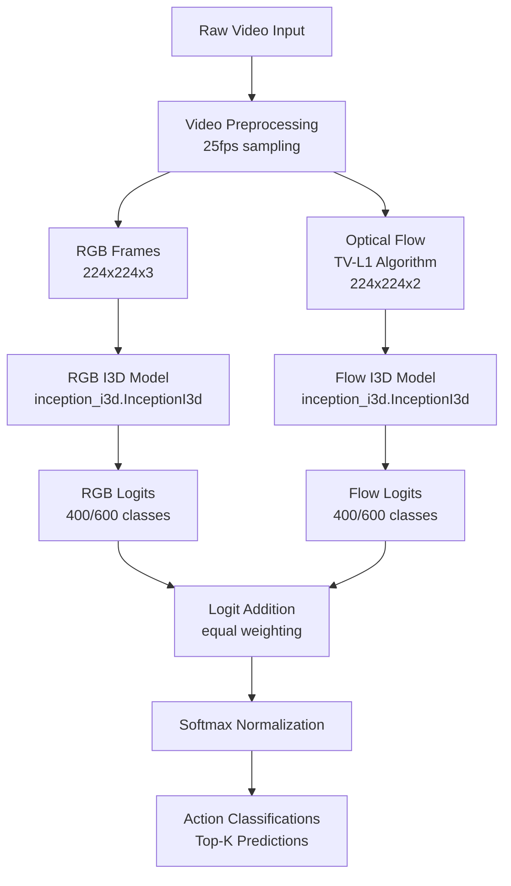
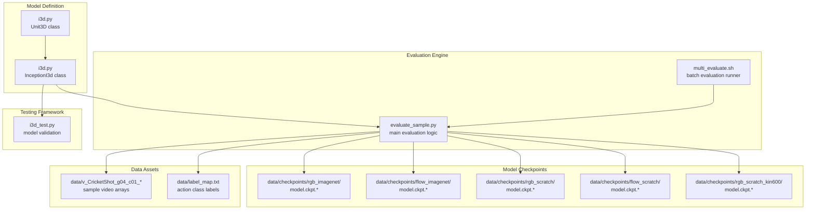

<!-- source: DeepWiki mcp.deepwiki.com · repo google-deepmind/kinetics-i3d · page 1 I3D Video Classification Overview · fetched 2026-10-26 -->

# I3D Video Classification Overview

<details>
<summary>Relevant source files</summary>

The following files were used as context for generating this wiki page:

- [README.md](README.md)

</details>


## Purpose and Scope

This document provides a comprehensive overview of the I3D (Inflated 3D ConvNets) video classification system. I3D is a deep learning architecture designed for action recognition in videos, implementing a two-stream approach that processes both RGB appearance information and optical flow motion data to achieve state-of-the-art video classification performance.

The system implements the architecture described in the paper "Quo Vadis, Action Recognition? A New Model and the Kinetics Dataset" and provides pre-trained models for video action recognition on the Kinetics dataset. For detailed information about specific model architectures, see [Model Architecture](#2). For evaluation procedures and usage instructions, see [Evaluation Framework](#4).

## System Overview

I3D extends 2D convolutional neural networks to 3D by "inflating" 2D convolution filters into 3D filters, enabling the processing of temporal information in videos. The system uses a two-stream architecture that separately processes RGB frames and optical flow, then combines their predictions for final classification.

### Two-Stream Architecture Workflow



**Sources:** [README.md:11-13](), [README.md:44-47](), [README.md:102-104]()

### Core System Components

The I3D system consists of several key components that work together to perform video action recognition:



**Sources:** [README.md:40-47](), [README.md:82-86](), [README.md:97-104]()

## Key Features and Capabilities

### Pre-training Strategies

The system provides models trained using two different initialization strategies:

| Training Strategy | Description | Available Models |
|-------------------|-------------|------------------|
| **ImageNet + Kinetics** | 2D ImageNet pre-training, then 3D inflation and Kinetics fine-tuning | `rgb_imagenet`, `flow_imagenet` |
| **Kinetics-Only** | Training from scratch using standard initializers | `rgb_scratch`, `flow_scratch`, `rgb_scratch_kin600` |

**Sources:** [README.md:92-104]()

### Model Configurations

The system supports multiple evaluation configurations through command-line flags:

- **RGB-only processing**: `--eval_type=rgb`
- **Flow-only processing**: `--eval_type=flow`  
- **Joint two-stream**: `--eval_type=joint`
- **Kinetics-600 RGB**: `--eval_type=rgb600`

**Sources:** [README.md:92-95]()

### Performance Benchmarks

The models achieve state-of-the-art performance on standard video action recognition datasets:

| Model Configuration | ImageNet + Kinetics | Kinetics-Only |
|---------------------|:------------------:|:-------------:|
| RGB-I3D | 71.1% / 89.3% | 68.4% / 88.0% |
| Flow-I3D | 63.4% / 84.9% | 61.5% / 83.4% |
| Two-Stream I3D | **74.2% / 91.3%** | 71.6% / 90.0% |

*Values shown as Top-1 / Top-5 accuracy on Kinetics test set*

**Sources:** [README.md:132-138]()

## Input Processing Pipeline

The system processes raw video through a standardized preprocessing pipeline:

### RGB Stream Processing
- Frame sampling at 25 FPS
- Resize preserving aspect ratio (smallest dimension = 256px)
- Center crop to 224×224 pixels  
- Pixel normalization to [-1, 1] range
- Final shape: `(1, num_frames, 224, 224, 3)`

### Flow Stream Processing  
- Frame sampling at 25 FPS
- Grayscale conversion
- TV-L1 optical flow algorithm computation
- Flow truncation to [-20, 20] range
- Normalization to [-1, 1] range
- Final shape: `(1, num_frames, 224, 224, 2)`

**Sources:** [README.md:149-167]()

## Getting Started

The system provides a simple entry point through the main evaluation script:

```bash
python evaluate_sample.py
```

This command loads the default two-stream I3D model with ImageNet pre-training, processes the included sample video (`v_CricketShot_g04_c01`), and outputs classification predictions with probabilities and logit values.

For systematic evaluation across all model configurations, use:

```bash
./multi_evaluate.sh
```

**Sources:** [README.md:40-42](), [README.md:94-95]()

## Output Format

The system generates comprehensive classification results including:
- Logits tensor norm
- Top-20 predicted action classes  
- Class probabilities and raw logit values
- Human-readable action labels from the Kinetics taxonomy

**Sources:** [README.md:49-78]()

---

