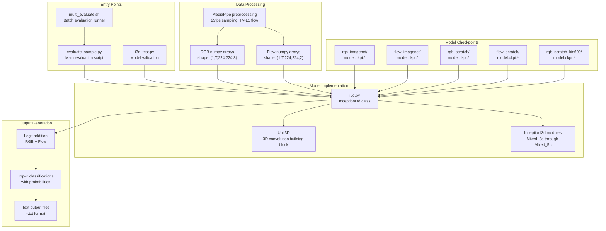
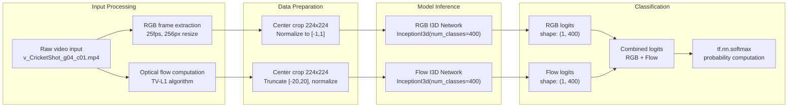
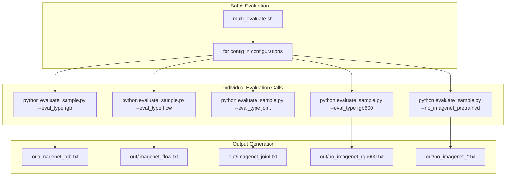

<!-- source: DeepWiki mcp.deepwiki.com · repo google-deepmind/kinetics-i3d · page 1.1 System Architecture · fetched 2026-10-26 -->

# System Architecture

Relevant source files

The following files were used as context for generating this wiki page:

- [README.md](README.md)

This document describes the high-level architecture of the I3D (Inflated 3D ConvNets) video classification system, focusing on the core components, data flow, and integration patterns. For detailed information about specific model architectures, see [Model Architecture](#2). For evaluation procedures and usage examples, see [Evaluation Framework](#4).

## Overall System Design

The I3D system implements a two-stream architecture for video action recognition, where RGB appearance information and optical flow motion information are processed through separate 3D convolutional networks and combined for final classification. The system is built on TensorFlow and Sonnet, providing pre-trained models for both ImageNet-bootstrapped and from-scratch training configurations.

### Core Architecture Components

Sources: [README.md:1-201](), [evaluate_sample.py](), [i3d.py](), [multi_evaluate.sh]()

### Two-Stream Processing Pipeline

Sources: [README.md:140-167](), [evaluate_sample.py]()

## Model Configuration System

The system supports multiple model configurations through command-line flags in `evaluate_sample.py`. Each configuration corresponds to different training strategies and input modalities:

| Configuration | Flag | Description | Checkpoint Path |
|---------------|------|-------------|-----------------|
| ImageNet RGB | `--eval_type rgb` | RGB stream with ImageNet pre-training | `data/checkpoints/rgb_imagenet/` |
| ImageNet Flow | `--eval_type flow` | Flow stream with ImageNet pre-training | `data/checkpoints/flow_imagenet/` |
| ImageNet Joint | `--eval_type joint` | Both streams with ImageNet pre-training | Both RGB and Flow checkpoints |
| Kinetics RGB | `--no_imagenet_pretrained --eval_type rgb` | RGB stream trained from scratch | `data/checkpoints/rgb_scratch/` |
| Kinetics Flow | `--no_imagenet_pretrained --eval_type flow` | Flow stream trained from scratch | `data/checkpoints/flow_scratch/` |
| Kinetics Joint | `--no_imagenet_pretrained --eval_type joint` | Both streams trained from scratch | Both scratch checkpoints |
| Kinetics-600 RGB | `--eval_type rgb600` | RGB on Kinetics-600 dataset | `data/checkpoints/rgb_scratch_kin600/` |

Sources: [README.md:90-104](), [multi_evaluate.sh]()

## Checkpoint Management

The system uses TensorFlow checkpoint format with three files per model:
- `model.ckpt.data-00000-of-00001`: Weight data
- `model.ckptr.index`: Variable index
- `model.ckpt.meta`: Graph metadata

Checkpoints are loaded through TensorFlow's `tf.train.Saver` mechanism in the evaluation scripts, with separate savers for RGB and Flow streams when running joint evaluation.

Sources: [README.md:97-104]()

## Evaluation Framework Integration

### Script Orchestration

Sources: [multi_evaluate.sh](), [README.md:94-96]()

### Core Evaluation Logic

The `evaluate_sample.py` script serves as the primary interface, implementing:

1. **Model instantiation**: Creates `InceptionI3d` objects for RGB and/or Flow streams
2. **Checkpoint loading**: Restores pre-trained weights using `tf.train.Saver`
3. **Data preprocessing**: Loads and validates input numpy arrays
4. **Forward pass**: Executes inference through the model graphs
5. **Result formatting**: Generates human-readable classification output

The script outputs the logits norm, top-20 class predictions with probabilities, and corresponding class labels from the Kinetics action vocabulary.

Sources: [evaluate_sample.py](), [README.md:44-78]()

---

