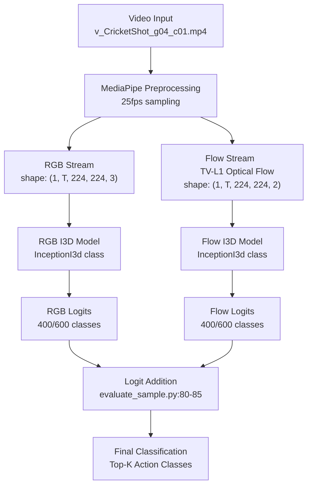
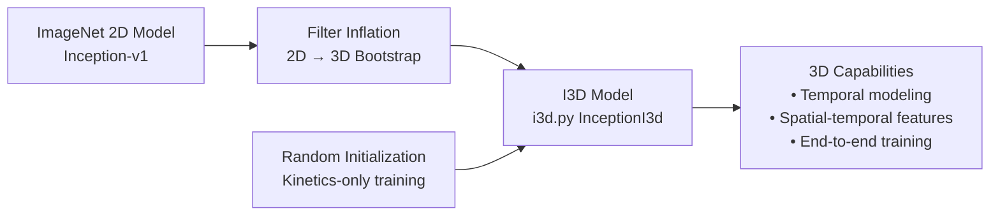
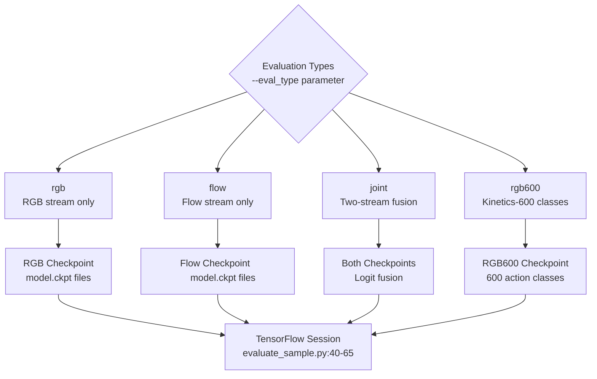
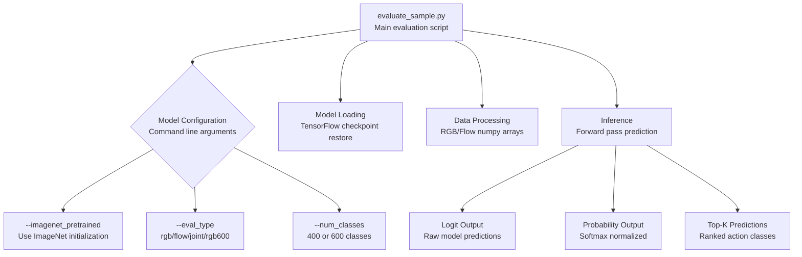
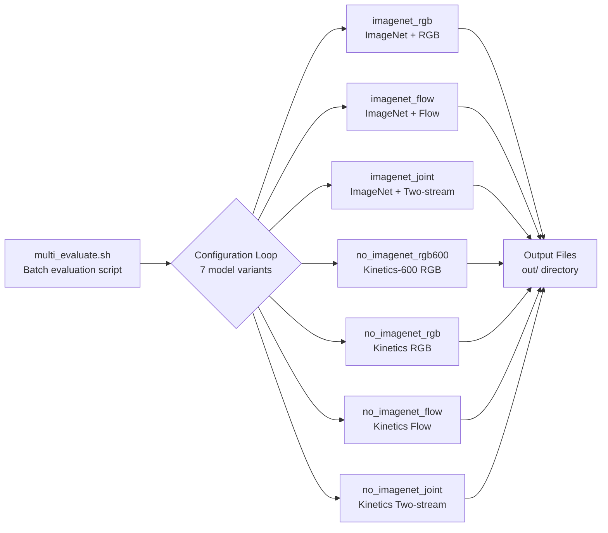
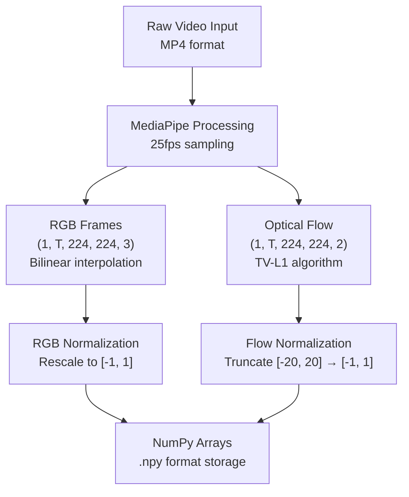

<!-- source: DeepWiki mcp.deepwiki.com · repo google-deepmind/kinetics-i3d · page 1.2 Key Features and Capabilities · fetched 2026-10-26 -->

# Key Features and Capabilities

Relevant source files

The following files were used as context for generating this wiki page:

- [README.md](README.md)

This document outlines the key features and capabilities of the I3D (Inflated 3D ConvNets) video classification system. It covers the core architectural innovations, model variants, performance characteristics, and evaluation framework that make this implementation suitable for state-of-the-art video action recognition.

For detailed information about the overall system architecture, see [System Architecture](#1.1). For comprehensive model architecture details, see [Model Architecture](#2).

## Core Architecture Features

The I3D system implements several key architectural innovations that enable effective video understanding:

### Two-Stream Processing Architecture

The system employs a dual-stream approach that processes both appearance and motion information independently before combining predictions.

**Sources:** [README.md:44-47](), [README.md:102-104]()

### 3D Convolution Inflation

The I3D architecture extends 2D Inception networks to 3D by inflating 2D convolution filters into 3D equivalents, enabling temporal modeling while leveraging ImageNet-pretrained weights.

**Sources:** [README.md:99-101](), [README.md:12-13]()

## Model Variants and Pre-training Strategies

The system provides multiple model configurations optimized for different use cases and training strategies:

### Available Model Checkpoints

| Model Type | Pre-training | Stream | Checkpoint Path | Use Case |
|------------|-------------|---------|-----------------|----------|
| `rgb_imagenet` | ImageNet + Kinetics | RGB | `data/checkpoints/rgb_imagenet/` | Best RGB performance |
| `flow_imagenet` | ImageNet + Kinetics | Flow | `data/checkpoints/flow_imagenet/` | Best Flow performance |
| `rgb_scratch` | Kinetics-only | RGB | `data/checkpoints/rgb_scratch/` | No ImageNet dependency |
| `flow_scratch` | Kinetics-only | Flow | `data/checkpoints/flow_scratch/` | No ImageNet dependency |
| `rgb_scratch_kin600` | Kinetics-600 | RGB | `data/checkpoints/rgb_scratch_kin600/` | Extended class vocabulary |

### Training Configuration Options

**Sources:** [README.md:92-95](), [README.md:20]()

## Performance Capabilities

The system achieves state-of-the-art performance across multiple video understanding benchmarks:

### Kinetics Dataset Results

| Model Configuration | Top-1 Accuracy | Top-5 Accuracy | Training Strategy |
|-------------------|---------------|---------------|------------------|
| RGB-I3D (ImageNet + Kinetics) | 71.1% | 89.3% | Pre-trained initialization |
| Flow-I3D (ImageNet + Kinetics) | 63.4% | 84.9% | Pre-trained initialization |
| Two-Stream I3D (ImageNet + Kinetics) | 74.2% | 91.3% | Joint prediction |
| RGB-I3D (Kinetics-only) | 68.4% | 88.0% | From-scratch training |
| Flow-I3D (Kinetics-only) | 61.5% | 83.4% | From-scratch training |
| Two-Stream I3D (Kinetics-only) | 71.6% | 90.0% | Joint prediction |

### Benchmark Performance

The system demonstrated competitive performance on established video understanding benchmarks:

- **UCF101**: State-of-the-art results from fine-tuning Kinetics pre-trained models
- **HMDB51**: State-of-the-art results from fine-tuning Kinetics pre-trained models  
- **CVPR 2017 Charades Challenge**: First place using I3D models pre-trained on Kinetics

**Sources:** [README.md:132-138](), [README.md:15-18]()

## Evaluation and Inference Features

The system provides a comprehensive evaluation framework supporting various inference modes and batch processing:

### Core Evaluation Capabilities

### Batch Evaluation System

**Sources:** [README.md:94-95](), [README.md:40-52]()

## Data Processing Capabilities

The system includes comprehensive video preprocessing capabilities integrated with MediaPipe:

### Preprocessing Pipeline Features

- **Frame Sampling**: 25 FPS sampling rate for both RGB and Flow streams
- **Resolution Standardization**: 224×224 pixel crops with aspect ratio preservation
- **Optical Flow Computation**: TV-L1 algorithm for motion estimation
- **Normalization**: Pixel value rescaling to [-1, 1] range
- **Batch Processing**: Support for variable-length video sequences

### Supported Input Formats

### Action Class Vocabulary

The system supports comprehensive action recognition with:

- **Kinetics-400**: 400 human action classes
- **Kinetics-600**: Extended 600 human action classes  
- **Label Mapping**: Human-readable action descriptions
- **Hierarchical Structure**: Organized action categories

**Sources:** [README.md:149-167](), [README.md:22]()

---

