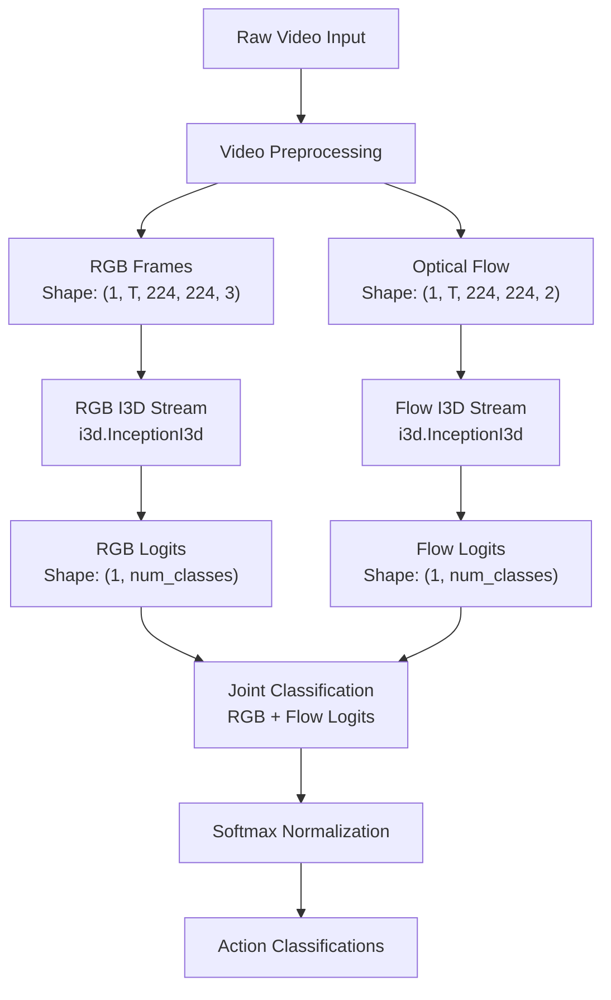
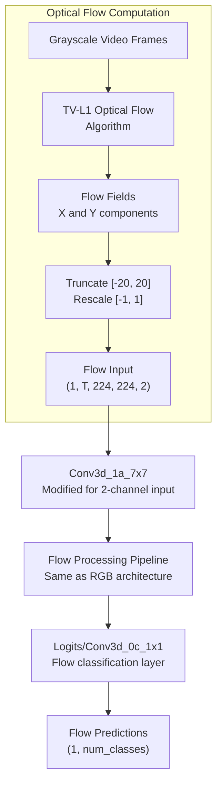
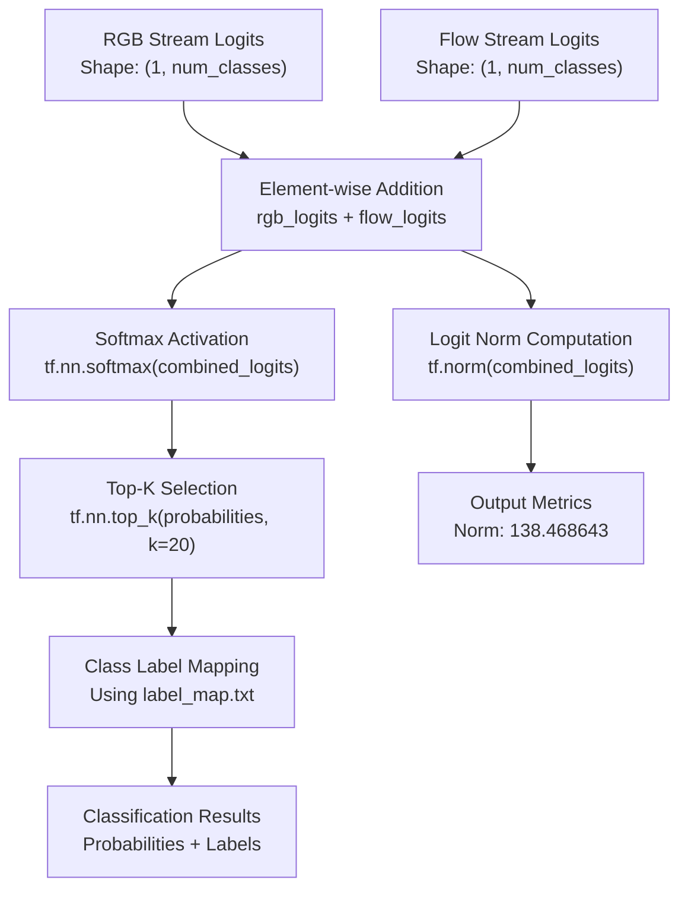
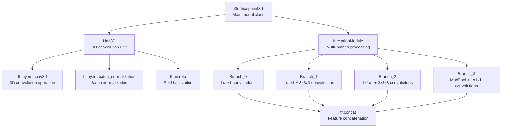

<!-- source: DeepWiki mcp.deepwiki.com · repo google-deepmind/kinetics-i3d · page 2 Model Architecture · fetched 2026-10-26 -->

# Model Architecture

Relevant source files

The following files were used as context for generating this wiki page:

- [README.md](README.md)
- [data/checkpoints/rgb_scratch_kin600/model.ckpt.index](data/checkpoints/rgb_scratch_kin600/model.ckpt.index)

This document provides a detailed technical overview of the I3D (Inflated 3D ConvNets) model architecture implementation. It covers the two-stream design, individual stream processing, joint classification mechanism, and the specific code components that implement these features.

For information about running evaluations and using pre-trained models, see [Evaluation Framework](#4). For details about the available checkpoints and training configurations, see [Pre-trained Models](#3).

## Overall I3D Architecture

The I3D model implements a two-stream architecture that processes both spatial appearance information (RGB) and temporal motion information (optical flow) through separate 3D convolutional networks. The architecture is based on the Inception-v1 model, with 2D convolutions inflated to 3D to handle video data.

### Two-Stream I3D Design

**Sources:** [README.md:44-104](), [README.md:134-138]()

### Model Configuration Options

The I3D implementation supports multiple evaluation modes controlled by the `eval_type` parameter:

| Configuration | Description | Checkpoint Path |
|---------------|-------------|-----------------|
| `rgb` | RGB stream only with ImageNet pre-training | `rgb_imagenet/` |
| `flow` | Flow stream only with ImageNet pre-training | `flow_imagenet/` |
| `joint` | Combined RGB + Flow streams with ImageNet pre-training | Both checkpoints |
| `rgb600` | RGB stream trained from scratch on Kinetics-600 | `rgb_scratch_kin600/` |

**Sources:** [README.md:92-104]()

## RGB Stream Processing

The RGB stream processes visual appearance information from video frames using 3D convolutions applied to RGB pixel data.

### RGB Stream Architecture

```mermaid
graph TD
    RGBInput["RGB Input<br/>(1, T, 224, 224, 3)"] --> Conv3d_1a["Conv3d_1a_7x7<br/>7x7x7 convolution"]
    Conv3d_1a --> MaxPool3d_2a["MaxPool3d_2a_1x3x3<br/>Pooling layer"]
    MaxPool3d_2a --> Conv3d_2b["Conv3d_2b_1x1<br/>1x1x1 convolution"]
    Conv3d_2b --> Conv3d_2c["Conv3d_2c_3x3<br/>3x3x3 convolution"]
    Conv3d_2c --> MaxPool3d_3a["MaxPool3d_3a_1x3x3<br/>Pooling layer"]
    
    MaxPool3d_3a --> Mixed_3b["Mixed_3b<br/>Inception Module"]
    Mixed_3b --> Mixed_3c["Mixed_3c<br/>Inception Module"]
    Mixed_3c --> MaxPool3d_4a["MaxPool3d_4a_3x3x3<br/>Pooling layer"]
    
    MaxPool3d_4a --> Mixed_4b["Mixed_4b<br/>Inception Module"]
    Mixed_4b --> Mixed_4c["Mixed_4c<br/>Inception Module"]
    Mixed_4c --> Mixed_4d["Mixed_4d<br/>Inception Module"]
    Mixed_4d --> Mixed_4e["Mixed_4e<br/>Inception Module"]
    Mixed_4e --> Mixed_4f["Mixed_4f<br/>Inception Module"]
    
    Mixed_4f --> MaxPool3d_5a["MaxPool3d_5a_2x2x2<br/>Pooling layer"]
    MaxPool3d_5a --> Mixed_5b["Mixed_5b<br/>Inception Module"]
    Mixed_5b --> Mixed_5c["Mixed_5c<br/>Inception Module"]
    
    Mixed_5c --> AvgPool3d["AvgPool3d<br/>Global average pooling"]
    AvgPool3d --> Logits["Logits/Conv3d_0c_1x1<br/>Classification layer"]
    Logits --> RGBOutput["RGB Predictions<br/>(1, num_classes)"]
```

**Sources:** [data/checkpoints/rgb_scratch_kin600/model.ckpt.index:1-31]()

### RGB Preprocessing Pipeline

The RGB stream expects input frames that have been preprocessed according to specific requirements:

- **Frame Rate:** 25 frames per second sampling
- **Resolution:** 224x224 pixels with preserved aspect ratio
- **Normalization:** Pixel values rescaled between -1 and 1
- **Cropping:** Center crop during inference, random crop during training

**Sources:** [README.md:149-158]()

## Flow Stream Processing

The Flow stream processes temporal motion information captured through optical flow computation between consecutive video frames.

### Flow Stream Architecture

**Sources:** [README.md:160-167]()

### Flow Preprocessing Details

The optical flow computation follows a specific pipeline:

1. **Grayscale Conversion:** RGB frames converted to grayscale
2. **TV-L1 Algorithm:** Optical flow computation using TV-L1 method
3. **Value Truncation:** Flow values truncated to range [-20, 20]
4. **Normalization:** Values rescaled to [-1, 1] range
5. **Channel Selection:** Only X and Y flow components used (2 channels)

**Sources:** [README.md:160-167]()

## Joint Classification

The joint classification mechanism combines predictions from both RGB and Flow streams to produce final action classifications.

### Logit Fusion Strategy

**Sources:** [README.md:102-104](), [README.md:49-78]()

### Implementation in evaluate_sample.py

The joint classification is implemented in the main evaluation script with the following key components:

- **Equal Weighting:** RGB and Flow logits are combined with equal weights (1:1 ratio)
- **Logit Addition:** Simple element-wise addition of logit tensors
- **Probability Computation:** Softmax applied to combined logits
- **Top-K Prediction:** Top 20 classes selected based on probability scores

**Sources:** [README.md:44-52]()

## Model Components and Implementation

### Core I3D Module Structure

The I3D model is implemented in the `i3d.py` file with the main class being `InceptionI3d`. The model architecture includes:

**Sources:** [data/checkpoints/rgb_scratch_kin600/model.ckpt.index:1-31]()

### Checkpoint Structure

The model checkpoints contain the following key components:

- **Convolution Weights:** `Conv3d_*/conv_3d/w` parameters for 3D convolutions
- **Batch Normalization:** `*/batch_norm/beta`, `*/batch_norm/moving_mean`, `*/batch_norm/moving_variance`
- **Momentum Terms:** `*/Momentum` parameters for optimizer state
- **Classification Layer:** `Logits/Conv3d_0c_1x1` final classification weights

**Sources:** [data/checkpoints/rgb_scratch_kin600/model.ckpt.index:1-31]()

### Training Configuration Support

The architecture supports multiple training configurations:

| Component | ImageNet + Kinetics | Kinetics-Only |
|-----------|-------------------|---------------|
| **Initialization** | 2D → 3D filter inflation | Random initialization |
| **Training Steps** | RGB: 115k, Flow: 155k | RGB: 115k, Flow: 155k |
| **Learning Rate** | Multi-stage schedule | Multi-stage schedule |
| **Optimization** | SGD with momentum (0.9) | SGD with momentum (0.9) |

**Sources:** [README.md:99-129]()

---

