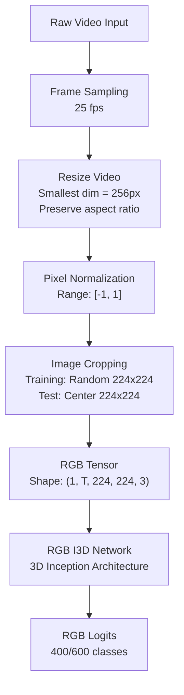
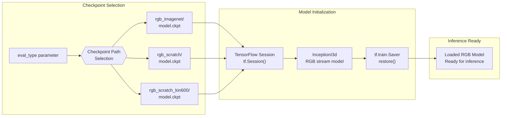
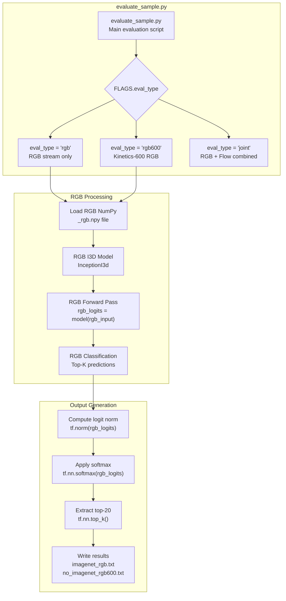

<!-- source: DeepWiki mcp.deepwiki.com · repo google-deepmind/kinetics-i3d · page 2.1 RGB Stream Processing · fetched 2026-10-26 -->

# RGB Stream Processing

Relevant source files

The following files were used as context for generating this wiki page:

- [README.md](README.md)
- [data/checkpoints/rgb_imagenet/model.ckpt.index](data/checkpoints/rgb_imagenet/model.ckpt.index)

This document describes the RGB stream component of the I3D (Inflated 3D ConvNets) video classification system. The RGB stream processes visual appearance information from video frames to generate action classification logits. For information about the complementary motion processing, see [Flow Stream Processing](#2.2). For details on how RGB and Flow streams are combined, see [Joint Classification](#2.3).

## Overview

The RGB stream in I3D processes raw video frames to extract spatial appearance features using 3D convolutional networks. It operates on sequences of RGB frames sampled at 25fps, applying 3D convolutions inflated from 2D Inception-v1 architectures to capture both spatial and temporal patterns in video data.

**RGB Data Processing Pipeline**

Sources: [README.md:149-158]()

## Input Data Format

The RGB stream expects preprocessed video data in a specific tensor format:

| Property | Value | Description |
|----------|-------|-------------|
| **Shape** | `(1, num_frames, 224, 224, 3)` | Batch size 1, temporal dimension, height, width, RGB channels |
| **Pixel Range** | `[-1, 1]` | Normalized pixel values |
| **Frame Rate** | 25 fps | Temporal sampling rate |
| **Spatial Resolution** | 224×224 | Square crop from resized frames |

The preprocessing pipeline applies bilinear interpolation for resizing and uses different cropping strategies for training versus inference. Sample RGB data is provided as NumPy arrays in the repository for testing purposes.

Sources: [README.md:153-158]()

## RGB I3D Network Architecture

The RGB stream uses an Inflated 3D ConvNet based on Inception-v1 architecture. The network inflates 2D convolution filters to 3D by adding a temporal dimension, enabling processing of video sequences while leveraging ImageNet pre-trained weights.

**RGB I3D Network Structure**

```mermaid
graph TD
    subgraph "RGB Input Processing"
        RGBInput["RGB Tensor<br/>(1, T, 224, 224, 3)"] --> Conv3d1a["Conv3d_1a_7x7<br/>7x7x7 convolution<br/>64 filters"]
        Conv3d1a --> MaxPool1["MaxPool3d_2a_3x3<br/>3x3x3 pooling"]
        MaxPool1 --> Conv3d2b["Conv3d_2b_1x1<br/>1x1x1 convolution<br/>64 filters"]
        Conv3d2b --> Conv3d2c["Conv3d_2c_3x3<br/>3x3x3 convolution<br/>192 filters"]
    end
    
    subgraph "Inception Blocks"
        Conv3d2c --> Mixed3b["Mixed_3b<br/>Inception Block"]
        Mixed3b --> Mixed3c["Mixed_3c<br/>Inception Block"]
        Mixed3c --> Mixed4b["Mixed_4b<br/>Inception Block"]
        Mixed4b --> Mixed4c["Mixed_4c<br/>Inception Block"]
        Mixed4c --> Mixed4d["Mixed_4d<br/>Inception Block"]
        Mixed4d --> Mixed4e["Mixed_4e<br/>Inception Block"]
        Mixed4e --> Mixed4f["Mixed_4f<br/>Inception Block"]
        Mixed4f --> Mixed5b["Mixed_5b<br/>Inception Block"]
        Mixed5b --> Mixed5c["Mixed_5c<br/>Inception Block"]
    end
    
    subgraph "Classification Head"
        Mixed5c --> AvgPool["AvgPool3d_0a_7x7<br/>Global average pooling"]
        AvgPool --> Dropout["Dropout_0b"]
        Dropout --> Logits["Logits/Conv3d_0c_1x1<br/>1x1x1 convolution"]
        Logits --> RGBOutput["RGB Logits<br/>400/600 classes"]
    end
```

Sources: [data/checkpoints/rgb_imagenet/model.ckpt.index:1-12]()

## Model Configurations

The RGB stream supports multiple model configurations based on training strategy and dataset:

| Configuration | Checkpoint Path | Training Strategy | Dataset | Classes |
|---------------|----------------|-------------------|---------|---------|
| **RGB ImageNet** | `rgb_imagenet/` | ImageNet → Kinetics | Kinetics-400 | 400 |
| **RGB Scratch** | `rgb_scratch/` | From scratch | Kinetics-400 | 400 |
| **RGB Kinetics-600** | `rgb_scratch_kin600/` | From scratch | Kinetics-600 | 600 |

Each checkpoint contains TensorFlow model files (`model.ckpt.data`, `model.ckpt.index`, `model.ckpt.meta`) that store the trained network parameters.

**RGB Model Loading Pipeline**

Sources: [README.md:92-104](), [evaluate_sample.py:40-50]()

## Integration with Evaluation System

The RGB stream integrates with the evaluation framework through the `evaluate_sample.py` script, which handles model loading, data preprocessing, and inference execution.

The evaluation system supports RGB-only inference using the `--eval_type rgb` flag, which processes only the RGB stream without the Flow component. This allows for faster inference when motion information is not required.

**RGB Evaluation Flow**

Sources: [evaluate_sample.py:1-100](), [README.md:40-78]()

## Performance Characteristics

The RGB stream achieves the following performance metrics on the Kinetics test set:

| Model Type | Top-1 Accuracy | Top-5 Accuracy |
|------------|----------------|----------------|
| **RGB-I3D (ImageNet + Kinetics)** | 71.1% | 89.3% |
| **RGB-I3D (Kinetics only)** | 68.4% | 88.0% |

The ImageNet pre-trained models demonstrate superior performance due to better initialization from 2D visual features, which are inflated to 3D for video processing.

Sources: [README.md:132-138]()

---

