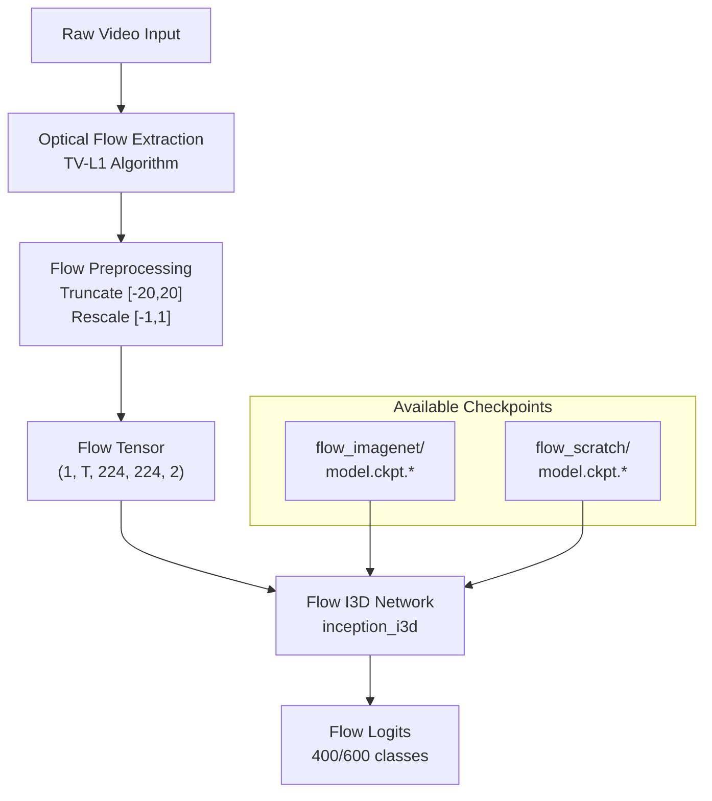
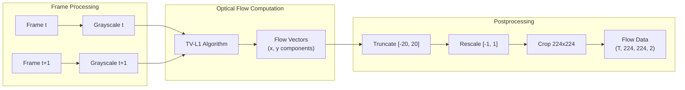
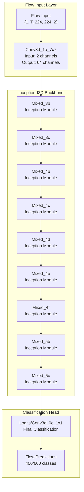
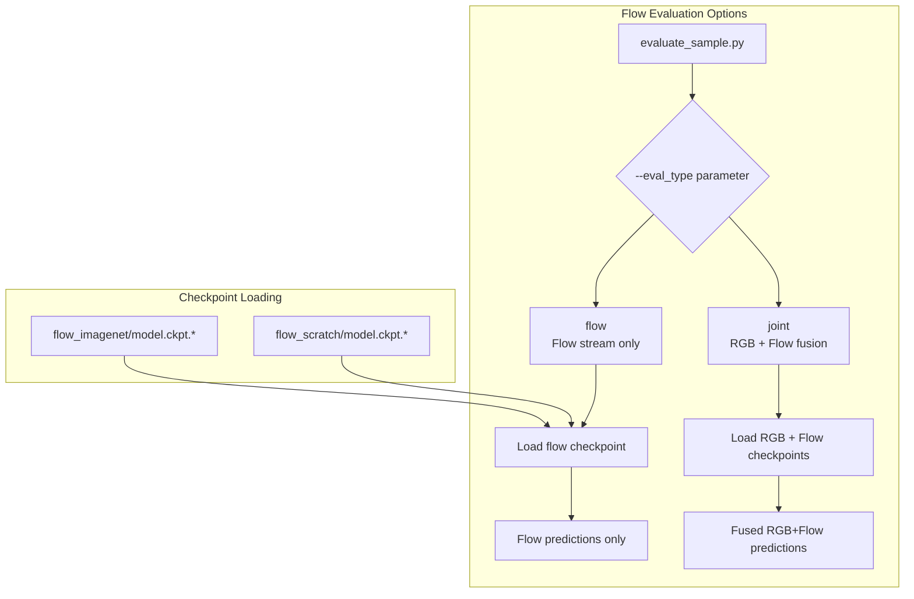
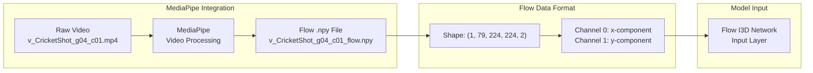

<!-- source: DeepWiki mcp.deepwiki.com · repo google-deepmind/kinetics-i3d · page 2.2 Flow Stream Processing · fetched 2026-10-26 -->

# Flow Stream Processing

Relevant source files

The following files were used as context for generating this wiki page:

- [README.md](README.md)
- [data/checkpoints/flow_imagenet/model.ckpt.index](data/checkpoints/flow_imagenet/model.ckpt.index)

This document covers the optical flow stream processing component of the I3D two-stream video classification architecture. It details how motion information is extracted from video sequences, preprocessed, and fed through the Flow I3D network to generate motion-based action predictions.

For information about the RGB appearance stream, see [RGB Stream Processing](#2.1). For details on how the two streams are combined, see [Joint Classification](#2.3).

## Overview

The Flow stream processes optical flow information to capture temporal motion patterns in video sequences. Unlike the RGB stream which focuses on visual appearance, the Flow stream specializes in understanding movement dynamics that are crucial for action recognition.

**Flow Stream Processing Pipeline**

Sources: [README.md:160-167](), [README.md:97-104]()

## Optical Flow Preprocessing Pipeline

The Flow stream preprocessing converts raw video frames into optical flow representations that capture pixel-level motion between consecutive frames.

### Flow Extraction Process

| Step | Process | Details |
|------|---------|---------|
| 1 | Frame Sampling | 25 frames per second |
| 2 | Grayscale Conversion | Convert color frames to grayscale |
| 3 | Optical Flow Computation | TV-L1 algorithm (similar to OpenCV implementation) |
| 4 | Value Truncation | Clip pixel values to range [-20, 20] |
| 5 | Normalization | Rescale to range [-1, 1] |
| 6 | Spatial Cropping | Same 224x224 cropping as RGB stream |

The resulting flow data has shape `(1, num_frames, 224, 224, 2)` where the final dimension represents the x and y components of optical flow vectors.

**Optical Flow Processing Steps**

Sources: [README.md:160-167](), [README.md:149-151]()

## Flow I3D Model Architecture

The Flow I3D network uses the same Inception-I3D architecture as the RGB stream but is specifically trained on optical flow inputs. The key difference is the input layer which accepts 2-channel flow data instead of 3-channel RGB data.

### Model Specifications

**Flow I3D Architecture Overview**

The network architecture mirrors the RGB stream with identical Inception module structures, but the initial convolution layer is adapted to process 2-channel optical flow input rather than 3-channel RGB input.

Sources: [data/checkpoints/flow_imagenet/model.ckpt.index:1-10](), [README.md:100-104]()

## Training Configuration and Checkpoints

The Flow stream models are trained with different initialization strategies and learning rate schedules compared to the RGB stream.

### Available Flow Models

| Model Type | Checkpoint Path | Pre-training | Classes |
|------------|----------------|-------------|---------|
| ImageNet + Kinetics | `flow_imagenet/` | ImageNet → Kinetics | 400 |
| Kinetics Only | `flow_scratch/` | None (from scratch) | 400 |

### Flow Training Schedule

The Flow models require more training steps than RGB models due to the complexity of learning from motion information:

```mermaid
gantt
    title Flow Model Training Schedule
    dateFormat X
    axisFormat %s
    
    section Learning Rate
    1e-1 Phase 1    :0, 97000
    1e-2 Phase 2    :97000, 104500
    1e-3 Phase 3    :104500, 115000
    1e-1 Extended 1 :115000, 140000
    1e-2 Extended 2 :140000, 150000
    1e-3 Extended 3 :150000, 155000
```

**Flow Training Extended Schedule (155k steps total)**

The extended training schedule (115k-155k steps) was added after determining that Flow models required additional training beyond the initial 115k steps used for RGB models.

Sources: [README.md:119-129](), [README.md:128-129]()

## Model Loading and Evaluation

The Flow stream can be evaluated independently or as part of the joint two-stream classification system.

### Evaluation Modes

**Flow Model Evaluation Configurations**

### Performance Results

The Flow stream achieves the following performance on the Kinetics test set:

| Model Configuration | Top-1 Accuracy | Top-5 Accuracy |
|-------------------|----------------|----------------|
| Flow-I3D (ImageNet + Kinetics) | 63.4% | 84.9% |
| Flow-I3D (Kinetics only) | 61.5% | 83.4% |

Sources: [README.md:44-47](), [README.md:134-138]()

## Integration with Preprocessing Pipeline

The Flow stream processing integrates with the broader video preprocessing pipeline that has been open-sourced through Google's MediaPipe project.

**Flow Data Pipeline Integration**

The provided sample data demonstrates the expected input format, with the cricket shot video preprocessed into optical flow representations ready for the Flow I3D network.

Sources: [README.md:22](), [README.md:145-167](), [README.md:177-178]()

---

