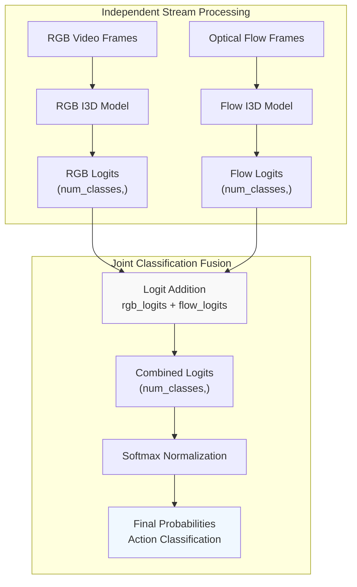
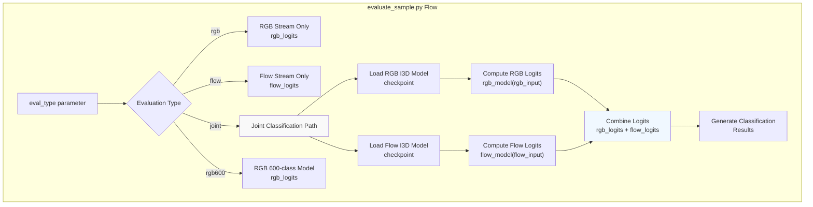
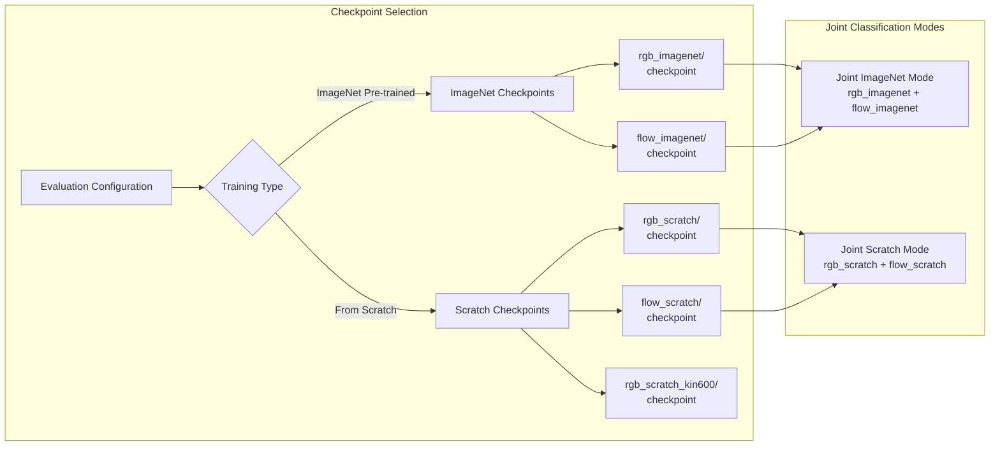
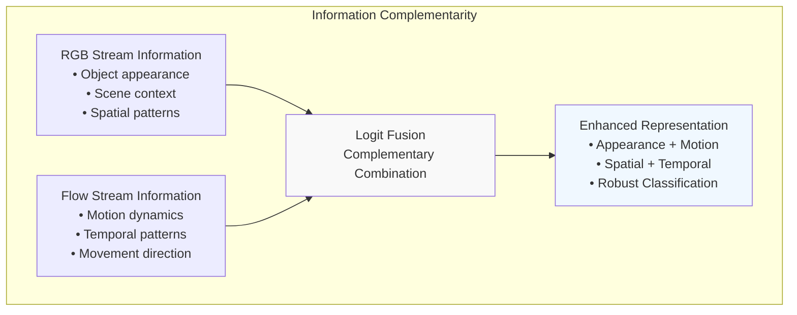

<!-- source: DeepWiki mcp.deepwiki.com · repo google-deepmind/kinetics-i3d · page 2.3 Joint Classification · fetched 2026-10-26 -->

# Joint Classification

Relevant source files

The following files were used as context for generating this wiki page:

- [README.md](README.md)

This document describes how the I3D system combines predictions from the RGB and Flow streams to produce final action classification results. Joint classification represents the fusion mechanism that leverages both visual appearance and motion information for improved video understanding performance.

For information about individual stream processing, see [RGB Stream Processing](#2.1) and [Flow Stream Processing](#2.2). For details about the evaluation framework that implements joint classification, see [Core Evaluation Script](#4.1).

## Logit Fusion Mechanism

The I3D system implements joint classification through a simple but effective logit fusion approach. Both the RGB and Flow streams produce classification logits independently, which are then combined through element-wise addition with equal weighting.

**Logit Fusion Architecture**

Sources: [README.md:102-104]()

## Implementation in Code

The joint classification mechanism is implemented in the evaluation script through conditional logic that handles different evaluation modes. The system supports multiple evaluation types including individual streams and joint classification.

**Joint Classification Code Flow**

The implementation handles model loading, inference, and logit combination based on the specified evaluation configuration.

Sources: [README.md:44-47](), [README.md:102-104]()

## Evaluation Configurations

The system provides several evaluation configurations that demonstrate different approaches to combining or isolating the two streams. Each configuration produces distinct output files for analysis.

| Evaluation Type | Configuration | Output File | Description |
|----------------|---------------|-------------|-------------|
| `rgb` | ImageNet + Kinetics | `imagenet_rgb.txt` | RGB stream only with ImageNet pre-training |
| `flow` | ImageNet + Kinetics | `imagenet_flow.txt` | Flow stream only with ImageNet pre-training |
| `joint` | ImageNet + Kinetics | `imagenet_joint.txt` | Combined RGB + Flow with ImageNet pre-training |
| `rgb600` | Scratch Kinetics-600 | `no_imagenet_rgb600.txt` | RGB-only 600-class model |
| `rgb` | Scratch Kinetics | `no_imagenet_rgb.txt` | RGB stream trained from scratch |
| `flow` | Scratch Kinetics | `no_imagenet_flow.txt` | Flow stream trained from scratch |
| `joint` | Scratch Kinetics | `no_imagenet_joint.txt` | Combined streams trained from scratch |

**Model Configuration for Joint Classification**

Sources: [README.md:92-95](), [README.md:97-104]()

## Performance Benefits

Joint classification consistently outperforms individual stream results across different training configurations. The fusion of appearance and motion information provides complementary signals that improve overall classification accuracy.

### Accuracy Comparison

| Model Configuration | RGB-I3D | Flow-I3D | Two-Stream I3D |
|-------------------|---------|----------|----------------|
| ImageNet + Kinetics | 71.1 / 89.3 | 63.4 / 84.9 | **74.2 / 91.3** |
| Kinetics Only | 68.4 / 88.0 | 61.5 / 83.4 | **71.6 / 90.0** |

*Values represent top-1 / top-5 accuracy percentages*

The joint classification approach demonstrates:
- **Improved top-1 accuracy**: 3.1% gain over RGB-only with ImageNet pre-training
- **Enhanced top-5 accuracy**: 2.0% improvement in top-5 classification  
- **Consistent benefits**: Similar improvements across both training strategies
- **Complementary information**: Flow stream captures motion patterns that RGB stream misses

**Complementary Information Fusion**

Sources: [README.md:131-138]()

---

