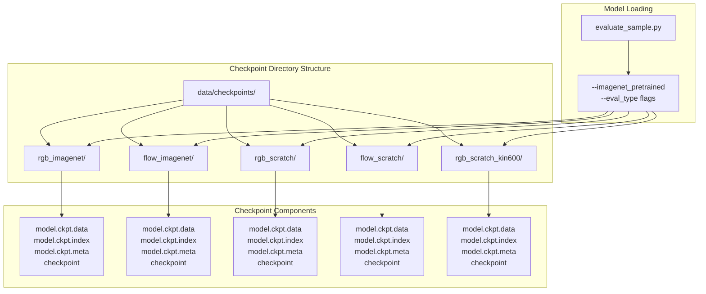
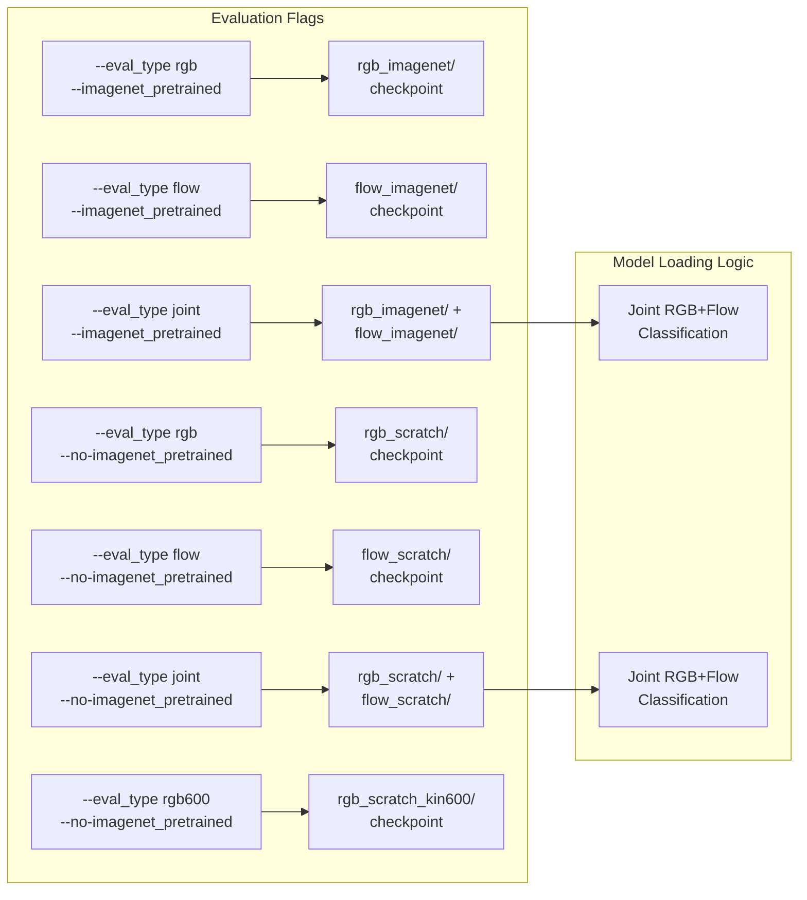
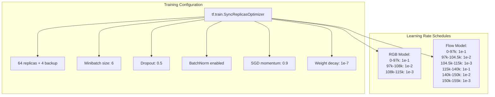
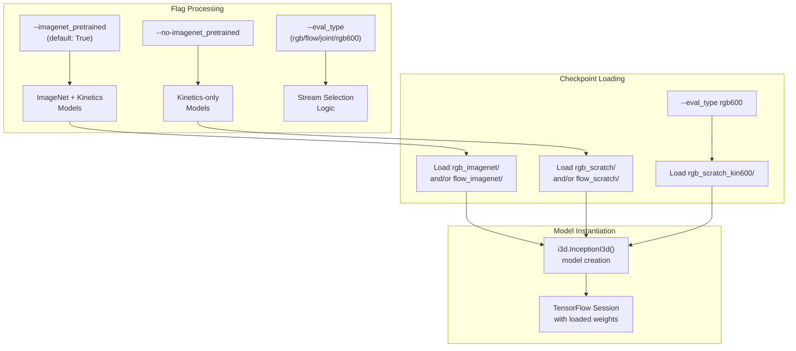
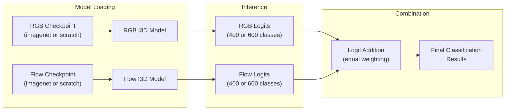

<!-- source: DeepWiki mcp.deepwiki.com · repo google-deepmind/kinetics-i3d · page 3 Pre-trained Models · fetched 2026-10-26 -->

# Pre-trained Models

Relevant source files

The following files were used as context for generating this wiki page:

- [README.md](README.md)
- [data/checkpoints/rgb_scratch_kin600/checkpoint](data/checkpoints/rgb_scratch_kin600/checkpoint)

This document provides a comprehensive overview of the pre-trained I3D model checkpoints available in the repository, their training configurations, and how they are used within the evaluation system. It covers model variants, checkpoint structure, and the relationship between training strategies and model performance.

For information about the model architecture itself, see [Model Architecture](#2). For details on how to run evaluations with these models, see [Evaluation Framework](#4).

## Model Categories

The repository provides two main categories of pre-trained models based on their training strategy:

### ImageNet + Kinetics Models
These models are initialized using ImageNet pre-trained 2D Inception-v1 weights that are "inflated" to 3D, then fine-tuned on the Kinetics dataset. This approach leverages the rich feature representations learned from ImageNet's large-scale image classification task.

### Kinetics-Only Models  
These models are trained from scratch on the Kinetics dataset using standard TensorFlow/Sonnet initializers, without any ImageNet pre-training. This category includes both Kinetics-400 and Kinetics-600 variants.

## Checkpoint Structure and Organization

### Available Model Checkpoints

The repository contains multiple pre-trained checkpoints organized by training strategy and input modality:

Sources: [README.md:90-104](), [data/checkpoints/rgb_scratch_kin600/checkpoint:1-3]()

### TensorFlow Checkpoint Format

Each model checkpoint consists of three main files that follow TensorFlow's standard checkpoint format:

| File Extension | Purpose |
|---|---|
| `.ckpt.data` | Contains the actual parameter values (weights and biases) |
| `.ckpt.index` | Index file mapping variable names to their locations in the data file |
| `.ckpt.meta` | Contains the graph structure and metadata |
| `checkpoint` | Points to the latest checkpoint file |

Sources: [data/checkpoints/rgb_scratch_kin600/checkpoint:1-3]()

## Model Configuration Mapping

The evaluation system uses command-line flags to select different pre-trained models:

### Evaluation Type to Model Mapping

Sources: [README.md:92-96]()

## Training Configurations and Performance

### Training Strategy Comparison

The models were trained using different initialization strategies, each with distinct performance characteristics:

| Model Category | Initialization | Dataset | Top-1 Accuracy | Top-5 Accuracy |
|---|---|---|---|---|
| RGB-I3D (ImageNet + Kinetics) | ImageNet 2D → 3D inflation | Kinetics-400 | 71.1% | 89.3% |
| Flow-I3D (ImageNet + Kinetics) | ImageNet 2D → 3D inflation | Kinetics-400 | 63.4% | 84.9% |
| Two-Stream I3D (ImageNet + Kinetics) | Combined streams | Kinetics-400 | 74.2% | 91.3% |
| RGB-I3D (Kinetics-only) | Random initialization | Kinetics-400 | 68.4% | 88.0% |
| Flow-I3D (Kinetics-only) | Random initialization | Kinetics-400 | 61.5% | 83.4% |
| Two-Stream I3D (Kinetics-only) | Combined streams | Kinetics-400 | 71.6% | 90.0% |

Sources: [README.md:131-138]()

### Training Hyperparameters

The models were trained using synchronous SGD with the following configuration:

Sources: [README.md:106-129]()

## Model Usage in Evaluation Pipeline

### Default Model Loading Behavior

The `evaluate_sample.py` script determines which checkpoints to load based on command-line flags:

Sources: [README.md:42-47](), [README.md:90-104]()

### Joint Classification Pipeline

For two-stream evaluation (`--eval_type joint`), the system loads both RGB and Flow models and combines their predictions:

Sources: [README.md:102-104]()

## Special Model: Kinetics-600 RGB

The repository includes a special RGB-only model trained from scratch on the larger Kinetics-600 dataset, which contains 600 action classes compared to the standard 400 classes:

- **Checkpoint Path**: `data/checkpoints/rgb_scratch_kin600/`
- **Evaluation Flag**: `--eval_type rgb600`
- **Dataset**: Kinetics-600 (600 action classes)
- **Training**: From scratch (no ImageNet pre-training)
- **Input Modality**: RGB only

This model represents the latest addition to the available pre-trained models and demonstrates performance on the expanded action vocabulary.

Sources: [README.md:20](), [data/checkpoints/rgb_scratch_kin600/checkpoint:1-3]()

---

