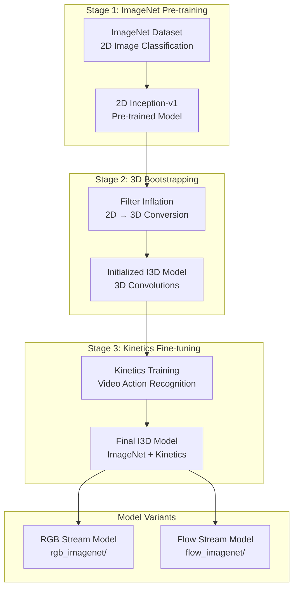
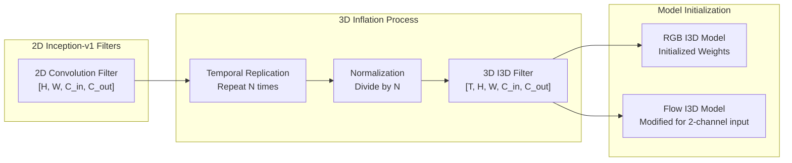
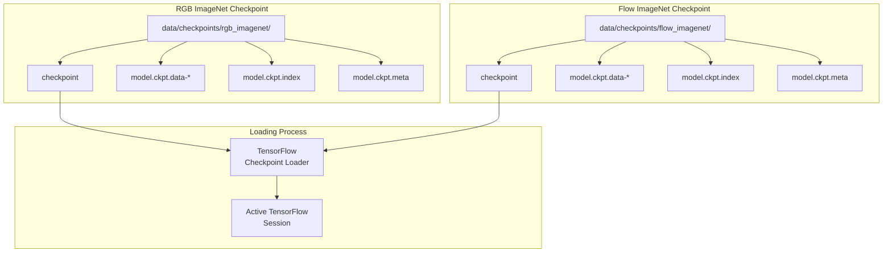
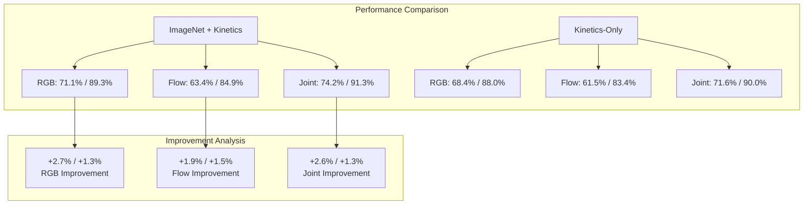
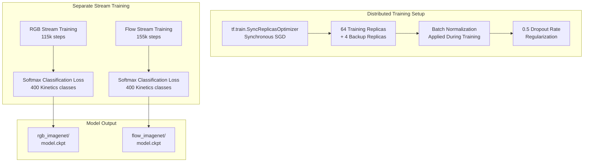

<!-- source: DeepWiki mcp.deepwiki.com · repo google-deepmind/kinetics-i3d · page 3.1 ImageNet + Kinetics Models · fetched 2026-10-26 -->

# ImageNet + Kinetics Models

Relevant source files

The following files were used as context for generating this wiki page:

- [README.md](README.md)
- [data/checkpoints/flow_imagenet/checkpoint](data/checkpoints/flow_imagenet/checkpoint)
- [data/checkpoints/rgb_imagenet/checkpoint](data/checkpoints/rgb_imagenet/checkpoint)

This page details the I3D models that leverage ImageNet pre-training followed by Kinetics dataset fine-tuning. These models represent the primary approach described in the original "Quo Vadis" paper and demonstrate superior performance compared to training from scratch. For information about models trained exclusively on Kinetics, see [Kinetics-Only Models](#3.2).

## Training Pipeline and Bootstrapping Approach

The ImageNet + Kinetics models employ a unique two-stage training strategy that leverages existing 2D ImageNet knowledge for 3D video understanding.

### Two-Stage Training Pipeline

Sources: [README.md:99-100](), [README.md:92]()

### Filter Inflation Process

The bootstrapping process converts 2D Inception-v1 filters into 3D I3D filters by replicating weights across the temporal dimension and normalizing appropriately. This initialization strategy provides a significant advantage over random initialization.

Sources: [README.md:99-100]()

## Available Checkpoints

The ImageNet + Kinetics models are available as pre-trained checkpoints for both RGB and Flow streams.

### Checkpoint Structure

| Stream | Checkpoint Directory | Description |
|--------|---------------------|-------------|
| RGB | `data/checkpoints/rgb_imagenet/` | RGB stream pre-trained on ImageNet then Kinetics |
| Flow | `data/checkpoints/flow_imagenet/` | Flow stream pre-trained on ImageNet then Kinetics |

### Checkpoint Files

Each checkpoint directory contains the standard TensorFlow checkpoint files:

Sources: [data/checkpoints/rgb_imagenet/checkpoint:1](), [data/checkpoints/flow_imagenet/checkpoint:1]()

## Performance Characteristics

The ImageNet + Kinetics models demonstrate superior performance compared to their Kinetics-only counterparts across all evaluation metrics.

### Kinetics Test Set Results

| Model | ImageNet + Kinetics (Top-1 / Top-5) | Kinetics-Only (Top-1 / Top-5) |
|-------|-------------------------------------|-------------------------------|
| RGB-I3D | 71.1% / 89.3% | 68.4% / 88.0% |
| Flow-I3D | 63.4% / 84.9% | 61.5% / 83.4% |
| Two-Stream I3D | 74.2% / 91.3% | 71.6% / 90.0% |

Sources: [README.md:134-138]()

### Performance Analysis

Sources: [README.md:134-138]()

## Training Configuration

The ImageNet + Kinetics models use identical training configurations to their Kinetics-only counterparts, with the key difference being the initialization strategy.

### Training Hyperparameters

| Parameter | RGB Stream | Flow Stream |
|-----------|------------|-------------|
| Total Steps | 115,000 | 155,000 |
| Batch Size | 6 | 6 |
| Optimizer | SGD (momentum=0.9) | SGD (momentum=0.9) |
| Weight Decay | 1e-7 | 1e-7 |
| Dropout | 0.5 | 0.5 |
| Replicas | 64 (+ 4 backup) | 64 (+ 4 backup) |

### Learning Rate Schedules

**RGB Stream:**
- Steps 0-97k: 1e-1
- Steps 97k-108k: 1e-2  
- Steps 108k-115k: 1e-3

**Flow Stream:**
- Steps 0-97k: 1e-1
- Steps 97k-104.5k: 1e-2
- Steps 104.5k-115k: 1e-3
- Steps 115k-140k: 1e-1
- Steps 140k-150k: 1e-2
- Steps 150k-155k: 1e-3

Sources: [README.md:113-126]()

### Training Architecture

Sources: [README.md:106-111](), [README.md:113-126]()

The ImageNet + Kinetics models represent the recommended approach for most applications, providing the best balance of accuracy and training efficiency through effective transfer learning from 2D image understanding to 3D video analysis.

---

