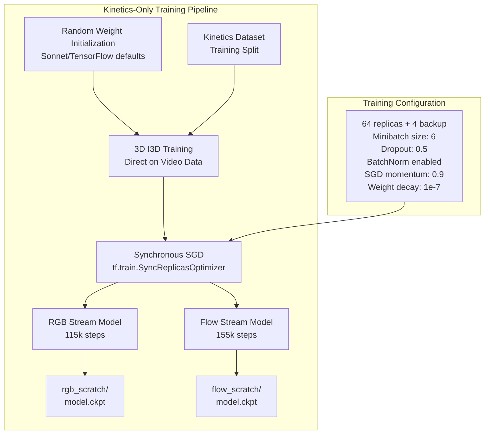
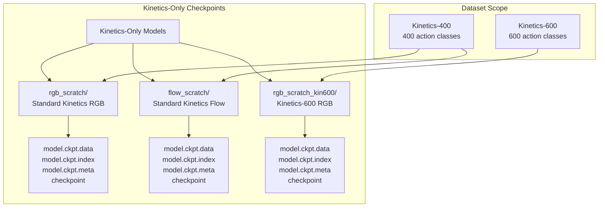
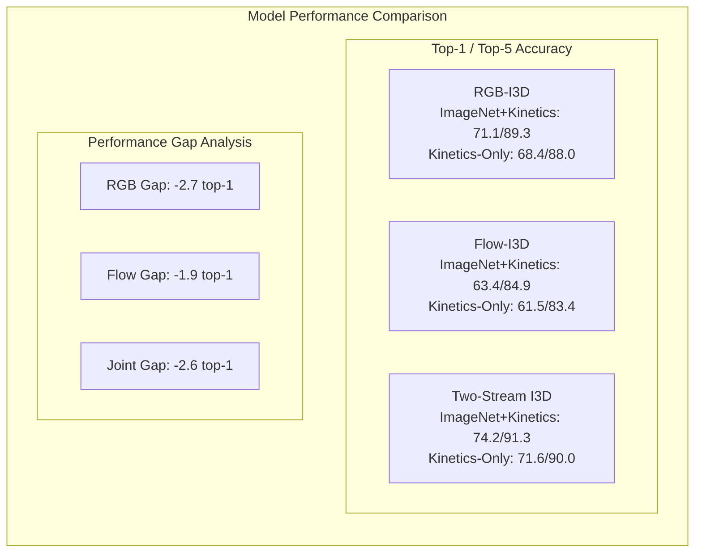

<!-- source: DeepWiki mcp.deepwiki.com · repo google-deepmind/kinetics-i3d · page 3.2 Kinetics-Only Models · fetched 2026-10-26 -->

# Kinetics-Only Models

Relevant source files

The following files were used as context for generating this wiki page:

- [README.md](README.md)
- [data/checkpoints/flow_scratch/checkpoint](data/checkpoints/flow_scratch/checkpoint)
- [data/checkpoints/rgb_scratch_kin600/checkpoint](data/checkpoints/rgb_scratch_kin600/checkpoint)

This document covers the I3D models that were trained from scratch exclusively on the Kinetics dataset, without any ImageNet pre-training. These models demonstrate the effectiveness of training large-scale video classification networks directly on action recognition data.

For information about models that combine ImageNet pre-training with Kinetics fine-tuning, see [ImageNet + Kinetics Models](#3.1). For detailed analysis of the performance characteristics of from-scratch training, see [From-Scratch Training Results](#5.2). For specific details about the Kinetics-600 RGB model, see [Kinetics-600 RGB Model](#3.2.1).

## Training Approach

Kinetics-only models are initialized using the default Sonnet and TensorFlow initializers rather than bootstrapping from 2D ImageNet models. This approach trains the 3D convolution filters directly on video data from the beginning, allowing the network to learn spatiotemporal features specifically optimized for action recognition.

The training methodology differs from ImageNet + Kinetics models in several key aspects:

Training methodology diagram:

Sources: [README.md:98-130]()

## Available Model Checkpoints

The repository provides several Kinetics-only model checkpoints stored in the `data/checkpoints` directory:

Checkpoint structure diagram:

Sources: [README.md:97-104](), [data/checkpoints/rgb_scratch_kin600/checkpoint:1-3](), [data/checkpoints/flow_scratch/checkpoint:1-3]()

| Model Type | Checkpoint Directory | Dataset | Description |
|------------|---------------------|---------|-------------|
| RGB Stream | `rgb_scratch/` | Kinetics-400 | RGB-only model trained from scratch |
| Flow Stream | `flow_scratch/` | Kinetics-400 | Optical flow model trained from scratch |
| RGB Stream | `rgb_scratch_kin600/` | Kinetics-600 | RGB model trained on extended dataset |

## Training Configuration Details

The training process uses distinct learning rate schedules for RGB and Flow streams:

**RGB Stream Training (115k steps):**
- Steps 0-97k: Learning rate 1e-1
- Steps 97k-108k: Learning rate 1e-2  
- Steps 108k-115k: Learning rate 1e-3

**Flow Stream Training (155k steps):**
- Steps 0-97k: Learning rate 1e-1
- Steps 97k-104.5k: Learning rate 1e-2
- Steps 104.5k-115k: Learning rate 1e-3
- Steps 115k-140k: Learning rate 1e-1 (restart)
- Steps 140k-150k: Learning rate 1e-2
- Steps 150k-155k: Learning rate 1e-3

The Flow models require additional training steps due to the complexity of learning optical flow representations from scratch.

Sources: [README.md:106-130]()

## Performance Comparison

Performance comparison between training approaches:

The Kinetics-only models achieve competitive performance while demonstrating that effective video understanding can be learned directly from action recognition data without ImageNet pre-training.

Sources: [README.md:131-139]()

## Model Integration

Kinetics-only models integrate with the evaluation framework through specific configuration flags:

| Evaluation Type | Flag | Model Used |
|----------------|------|------------|
| RGB Only | `--eval_type rgb` | `rgb_scratch/` checkpoint |
| Flow Only | `--eval_type flow` | `flow_scratch/` checkpoint |
| Joint Classification | `--eval_type joint` | Both checkpoints combined |
| Kinetics-600 RGB | `--eval_type rgb600` | `rgb_scratch_kin600/` checkpoint |

The models maintain the same architectural structure as their ImageNet pre-trained counterparts, differing only in initialization and training methodology. This allows seamless integration with the existing evaluation and inference pipeline.

Sources: [README.md:94-96]()

---

