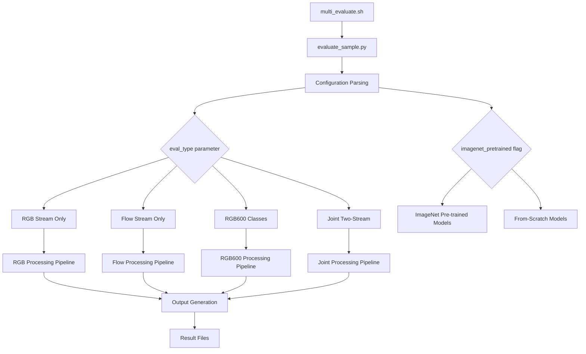
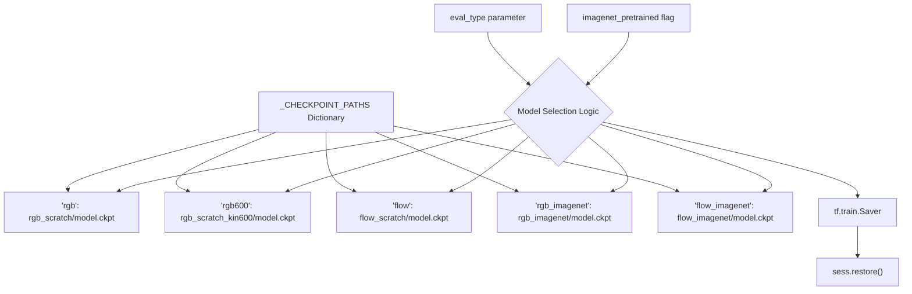
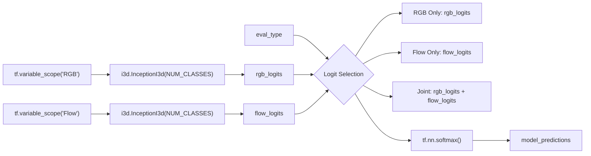
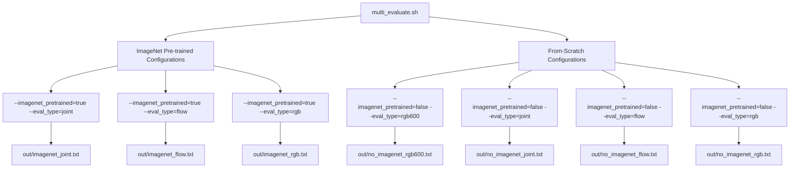
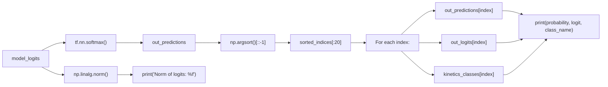

<!-- source: DeepWiki mcp.deepwiki.com · repo google-deepmind/kinetics-i3d · page 4 Evaluation Framework · fetched 2026-10-26 -->

# Evaluation Framework

<details>
<summary>Relevant source files</summary>

The following files were used as context for generating this wiki page:

- [evaluate_sample.py](evaluate_sample.py)
- [multi_evaluate.sh](multi_evaluate.sh)

</details>


The evaluation framework provides tools for testing pre-trained I3D models on video samples and analyzing their classification performance. This system supports evaluation of different model configurations including RGB-only, optical flow-only, and joint two-stream models, with both ImageNet pre-trained and from-scratch training variants.

For information about the actual model architectures being evaluated, see [Model Architecture](#2). For details about the pre-trained model checkpoints, see [Pre-trained Models](#3). For analysis of evaluation results, see [Results and Analysis](#5).

## System Overview

The evaluation framework consists of two primary components: a core evaluation script for single runs and a batch evaluation script for systematic testing across multiple configurations.

**Evaluation System Architecture**



Sources: [evaluate_sample.py:47-48](), [evaluate_sample.py:61-62](), [multi_evaluate.sh:17-23]()

## Core Evaluation Script

The `evaluate_sample.py` script serves as the primary evaluation engine, handling model loading, inference, and result generation for individual evaluation runs.

### Configuration Parameters

The script accepts two main configuration flags that determine the evaluation behavior:

| Parameter | Values | Description |
|-----------|--------|-------------|
| `eval_type` | `rgb`, `rgb600`, `flow`, `joint` | Specifies which model stream(s) to evaluate |
| `imagenet_pretrained` | `true`, `false` | Whether to use ImageNet pre-trained models |

Sources: [evaluate_sample.py:47-48]()

### Model Loading and Checkpoint Management

The evaluation script maintains a mapping of model types to their corresponding checkpoint paths:

**Checkpoint Path Configuration**



Sources: [evaluate_sample.py:34-40](), [evaluate_sample.py:121-124](), [evaluate_sample.py:131-134]()

### Input Data Processing

The script processes sample video data stored as NumPy arrays, with different input shapes for RGB and optical flow streams:

- **RGB Input**: Shape `(1, 79, 224, 224, 3)` for appearance information
- **Flow Input**: Shape `(1, 79, 224, 224, 2)` for motion information

Sources: [evaluate_sample.py:28-32](), [evaluate_sample.py:71-73](), [evaluate_sample.py:96-98]()

### Model Architecture Instantiation

The script creates separate I3D model instances for each stream using the `InceptionI3d` class:



Sources: [evaluate_sample.py:76-80](), [evaluate_sample.py:99-103](), [evaluate_sample.py:110-116]()

## Batch Evaluation System

The `multi_evaluate.sh` script orchestrates systematic evaluation across all supported model configurations, generating a comprehensive set of results for comparison.

### Evaluation Configuration Matrix

The batch script executes seven distinct evaluation configurations:

**Batch Evaluation Workflow**



Sources: [multi_evaluate.sh:17-23]()

### Output File Generation

Each evaluation configuration generates a dedicated output file in the `out/` directory with a standardized naming convention:

- **ImageNet Pre-trained**: `imagenet_{stream_type}.txt`
- **From-Scratch**: `no_imagenet_{stream_type}.txt`
- **Special Case**: `no_imagenet_rgb600.txt` for the 600-class RGB model

Sources: [multi_evaluate.sh:17-23]()

## Output Format and Analysis

The evaluation framework generates standardized output containing logit norms, probability rankings, and class predictions.

### Standard Output Structure

Each evaluation produces the following output format:

1. **Logit Norm**: L2 norm of the raw logit values
2. **Top-K Predictions**: Ranked list of top 20 most probable classes
3. **Class Information**: For each prediction, shows probability, logit value, and class label

**Output Generation Process**



Sources: [evaluate_sample.py:140-151]()

### Class Label Integration

The system supports both 400-class and 600-class Kinetics datasets through separate label map files:

- **400 Classes**: `data/label_map.txt`
- **600 Classes**: `data/label_map_600.txt`

The appropriate label map is selected based on the `eval_type` parameter, with `rgb600` using the 600-class mapping.

Sources: [evaluate_sample.py:42-43](), [evaluate_sample.py:57-67]()

## Usage Examples

### Single Evaluation

To run a single evaluation configuration:

```bash
python evaluate_sample.py --eval_type joint --imagenet_pretrained true
```

### Comprehensive Evaluation

To run all evaluation configurations:

```bash
./multi_evaluate.sh
```

This generates seven output files covering all combinations of model types and training strategies, enabling comprehensive performance comparison across the I3D model variants.

Sources: [multi_evaluate.sh:1-24](), [evaluate_sample.py:47-48]()

---

