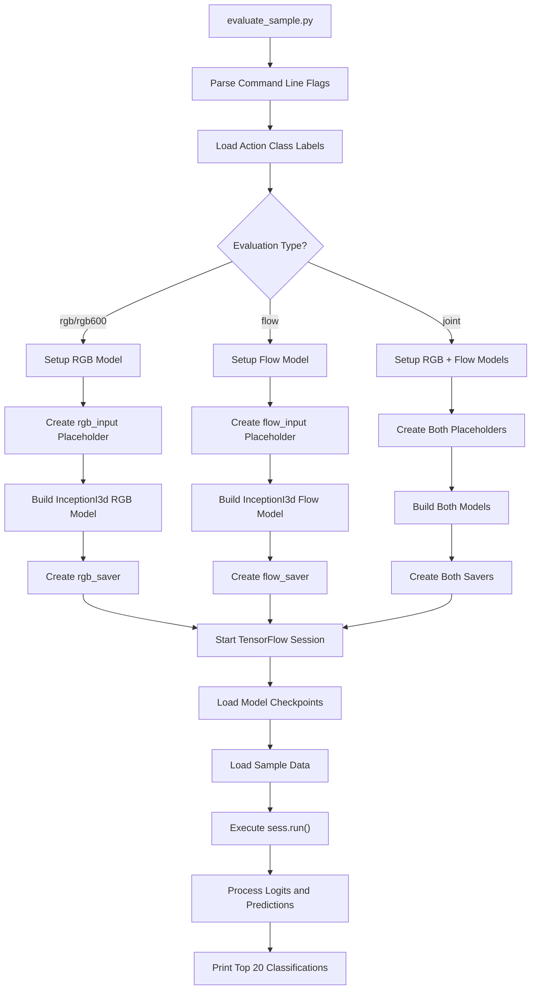
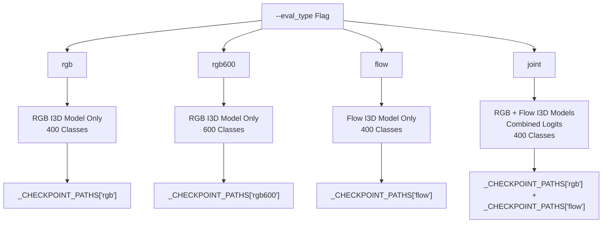
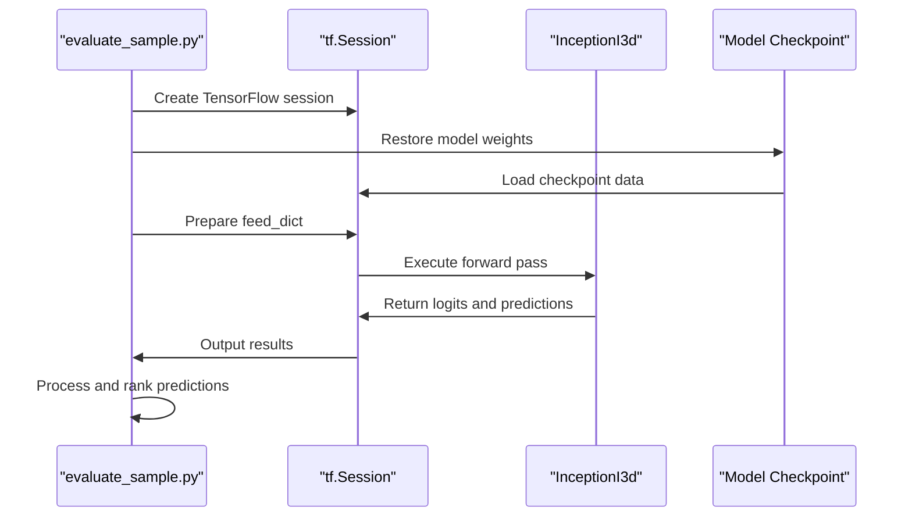

<!-- source: DeepWiki mcp.deepwiki.com · repo google-deepmind/kinetics-i3d · page 4.1 Core Evaluation Script · fetched 2026-10-26 -->

# Core Evaluation Script

<details>
<summary>Relevant source files</summary>

The following files were used as context for generating this wiki page:

- [evaluate_sample.py](evaluate_sample.py)

</details>


This document covers the `evaluate_sample.py` script, which serves as the primary evaluation interface for running inference with pre-trained I3D models on video data. The script provides a command-line interface for classifying video samples using different model configurations and training approaches.

For information about running systematic batch evaluations across multiple configurations, see [Batch Evaluation](#4.2). For detailed analysis of the output format, see [Output Format Specification](#5.3).

## Script Overview

The `evaluate_sample.py` script is the main entry point for performing video action classification using I3D models. It supports both single-stream (RGB or Flow) and dual-stream (Joint) evaluation modes, with options for different pre-training strategies.

### Core Functionality

The script performs the following key operations:

1. **Model Configuration**: Sets up I3D model instances based on evaluation type
2. **Checkpoint Loading**: Loads pre-trained model weights from specified checkpoint paths  
3. **Data Loading**: Loads preprocessed video data (RGB frames and/or optical flow)
4. **Inference Execution**: Runs forward pass through the model(s)
5. **Results Processing**: Generates predictions and outputs top classifications

### Script Flow Diagram



Sources: [evaluate_sample.py:51-155]()

## Command Line Parameters

The script accepts two primary command-line flags that control its behavior:

| Parameter | Type | Default | Description |
|-----------|------|---------|-------------|
| `--eval_type` | string | `'joint'` | Evaluation mode: `'rgb'`, `'rgb600'`, `'flow'`, or `'joint'` |
| `--imagenet_pretrained` | boolean | `True` | Whether to use ImageNet pre-trained models |

### Evaluation Type Configuration



Sources: [evaluate_sample.py:47-48](), [evaluate_sample.py:57-67]()

## Model Configuration and Paths

The script uses predefined constants to manage model checkpoints and data paths:

### Checkpoint Paths
- **RGB Scratch**: `data/checkpoints/rgb_scratch/model.ckpt`
- **RGB Kinetics-600**: `data/checkpoints/rgb_scratch_kin600/model.ckpt`  
- **Flow Scratch**: `data/checkpoints/flow_scratch/model.ckpt`
- **RGB ImageNet**: `data/checkpoints/rgb_imagenet/model.ckpt`
- **Flow ImageNet**: `data/checkpoints/flow_imagenet/model.ckpt`

### Sample Data Paths
- **RGB Data**: `data/v_CricketShot_g04_c01_rgb.npy`
- **Flow Data**: `data/v_CricketShot_g04_c01_flow.npy`

### Label Map Paths
- **400 Classes**: `data/label_map.txt`
- **600 Classes**: `data/label_map_600.txt`

Sources: [evaluate_sample.py:29-43]()

## Model Architecture Setup

The script creates different model configurations based on the evaluation type:

### RGB Stream Configuration

For RGB-based evaluation (`rgb`, `rgb600`, `joint`), the script:

1. Creates a placeholder with shape `(1, 79, 224, 224, 3)` for RGB input
2. Instantiates `i3d.InceptionI3d` within `RGB` variable scope
3. Configures the model with appropriate number of classes (400 or 600)
4. Creates variable mapping for checkpoint restoration

### Flow Stream Configuration

For flow-based evaluation (`flow`, `joint`), the script:

1. Creates a placeholder with shape `(1, 79, 224, 224, 2)` for optical flow input
2. Instantiates `i3d.InceptionI3d` within `Flow` variable scope  
3. Creates variable mapping for checkpoint restoration

### Joint Classification Logic

When `eval_type='joint'`, the final logits are computed as:
```
model_logits = rgb_logits + flow_logits
```

Sources: [evaluate_sample.py:69-116]()

## Evaluation Workflow

### Data Loading and Preprocessing

The script loads preprocessed numpy arrays containing:
- **RGB Data**: Video frames normalized and resized to 224x224x3
- **Flow Data**: Optical flow vectors with 2 channels (x,y components)

### Inference Execution



The core inference loop executes:

```python
out_logits, out_predictions = sess.run(
    [model_logits, model_predictions],
    feed_dict=feed_dict)
```

Sources: [evaluate_sample.py:118-142]()

## Output Format

The script generates console output with the following information:

1. **Logits Norm**: L2 norm of the output logits vector
2. **Top 20 Predictions**: Ranked list showing:
   - Softmax probability
   - Raw logit value  
   - Action class label

### Example Output Structure
```
Norm of logits: 12.345678
Top classes and probabilities
0.1234 5.678 cricket_shot
0.0987 4.321 batting
...
```

The results are sorted by probability in descending order using `np.argsort(out_predictions)[::-1]`.

Sources: [evaluate_sample.py:144-151]()

## Usage Examples

### Basic RGB Evaluation
```bash
python evaluate_sample.py --eval_type=rgb --imagenet_pretrained=True
```

### Flow-Only Evaluation  
```bash
python evaluate_sample.py --eval_type=flow --imagenet_pretrained=False
```

### Joint Stream Evaluation
```bash
python evaluate_sample.py --eval_type=joint --imagenet_pretrained=True
```

### Kinetics-600 RGB Evaluation
```bash
python evaluate_sample.py --eval_type=rgb600 --imagenet_pretrained=False
```

Sources: [evaluate_sample.py:47-48]()

---

