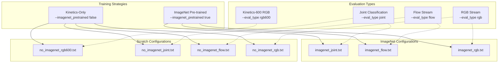
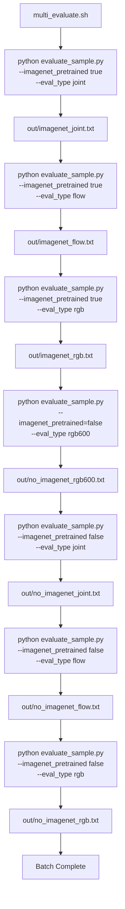

<!-- source: DeepWiki mcp.deepwiki.com · repo google-deepmind/kinetics-i3d · page 4.2 Batch Evaluation · fetched 2026-10-26 -->

# Batch Evaluation

<details>
<summary>Relevant source files</summary>

The following files were used as context for generating this wiki page:

- [multi_evaluate.sh](multi_evaluate.sh)

</details>


## Purpose and Scope

This document covers the batch evaluation system for running systematic evaluations across multiple I3D model configurations. The batch evaluation orchestrates multiple runs of the core evaluation script to compare different model variants and training strategies.

For details about the core evaluation script that underlies batch evaluation, see [Core Evaluation Script](#4.1). For analysis and interpretation of batch evaluation results, see [Results and Analysis](#5).

## Overview of Batch Evaluation System

The batch evaluation system provides automated execution of comprehensive model comparisons using the `multi_evaluate.sh` script. This system runs the core evaluation script multiple times with different parameter combinations to systematically evaluate all available model configurations.

The primary purposes of batch evaluation are:
- Compare ImageNet pre-trained models against Kinetics-only models
- Evaluate performance differences between RGB, Flow, and Joint classification approaches  
- Generate standardized output files for systematic performance analysis
- Automate the process of running multiple evaluation configurations

Sources: [multi_evaluate.sh:1-24]()

## Evaluation Configuration Matrix

The batch evaluation system tests seven distinct model configurations, combining two training strategies with four evaluation approaches:

| Configuration | ImageNet Pre-training | Evaluation Type | Output File |
|---------------|----------------------|-----------------|-------------|
| Config 1 | Yes | `joint` | `imagenet_joint.txt` |
| Config 2 | Yes | `flow` | `imagenet_flow.txt` |
| Config 3 | Yes | `rgb` | `imagenet_rgb.txt` |
| Config 4 | No | `rgb600` | `no_imagenet_rgb600.txt` |
| Config 5 | No | `joint` | `no_imagenet_joint.txt` |
| Config 6 | No | `flow` | `no_imagenet_flow.txt` |
| Config 7 | No | `rgb` | `no_imagenet_rgb.txt` |

### Configuration Matrix Diagram



Sources: [multi_evaluate.sh:17-23]()

## Execution Flow and Script Structure

The `multi_evaluate.sh` script executes as a sequential batch process, running each configuration independently and redirecting output to separate files in the `out/` directory.

### Batch Execution Flow



### Key Script Components

The script structure follows a simple sequential execution pattern:

- **Command Pattern**: Each line executes `python evaluate_sample.py` with specific parameter combinations
- **Output Redirection**: Uses shell redirection (`>`) to capture output to individual files  
- **Parameter Variations**: Systematically varies `--imagenet_pretrained` and `--eval_type` parameters
- **File Naming Convention**: Output files use prefixes `imagenet_` or `no_imagenet_` to indicate training strategy

Sources: [multi_evaluate.sh:17-23]()

## Output File Organization

The batch evaluation generates seven output files in the `out/` directory, each containing complete evaluation results for one model configuration:

### Output File Structure

| File Pattern | Description | Example Content |
|-------------|-------------|-----------------|
| `imagenet_*.txt` | Results from ImageNet pre-trained models | Classification results with ImageNet bootstrap weights |
| `no_imagenet_*.txt` | Results from Kinetics-only models | Classification results from scratch training |

### Output File Contents

Each output file contains the standard evaluation output format:
- Norm of prediction logits
- Top 20 predicted action classes with probabilities and raw logits
- Human-readable action labels from the class vocabulary

The files enable systematic comparison of:
- **Training Strategy Impact**: Compare `imagenet_rgb.txt` vs `no_imagenet_rgb.txt`
- **Stream Contribution**: Compare `*_rgb.txt`, `*_flow.txt`, and `*_joint.txt` files
- **Dataset Scale Effects**: Compare `no_imagenet_rgb.txt` vs `no_imagenet_rgb600.txt`

Sources: [multi_evaluate.sh:17-23]()

## Usage and Customization

### Running Batch Evaluation

Execute the batch evaluation script from the repository root:

```bash
chmod +x multi_evaluate.sh
./multi_evaluate.sh
```

**Prerequisites:**
- Ensure the `out/` directory exists for output file storage
- Verify all required model checkpoints are available (see [Pre-trained Models](#3))
- Confirm `evaluate_sample.py` is functional (see [Core Evaluation Script](#4.1))

### Script Customization

The `multi_evaluate.sh` script can be modified for different evaluation scenarios:

**Adding New Configurations:**
Add new lines following the existing pattern:
```bash
python evaluate_sample.py --imagenet_pretrained [true|false] --eval_type [type] > out/[output_file].txt
```

**Modifying Output Locations:**
Change the output redirection target to write results to different directories or file names.

**Parallel Execution:**
Modify the script to run evaluations in parallel by adding `&` to commands and including `wait` at the end:
```bash
python evaluate_sample.py --imagenet_pretrained true --eval_type joint > out/imagenet_joint.txt &
python evaluate_sample.py --imagenet_pretrained true --eval_type flow > out/imagenet_flow.txt &
# ... other commands with &
wait
```

**Selective Evaluation:**
Comment out specific lines to run only desired configurations, useful for testing or partial comparisons.

Sources: [multi_evaluate.sh:1-24]()

---

