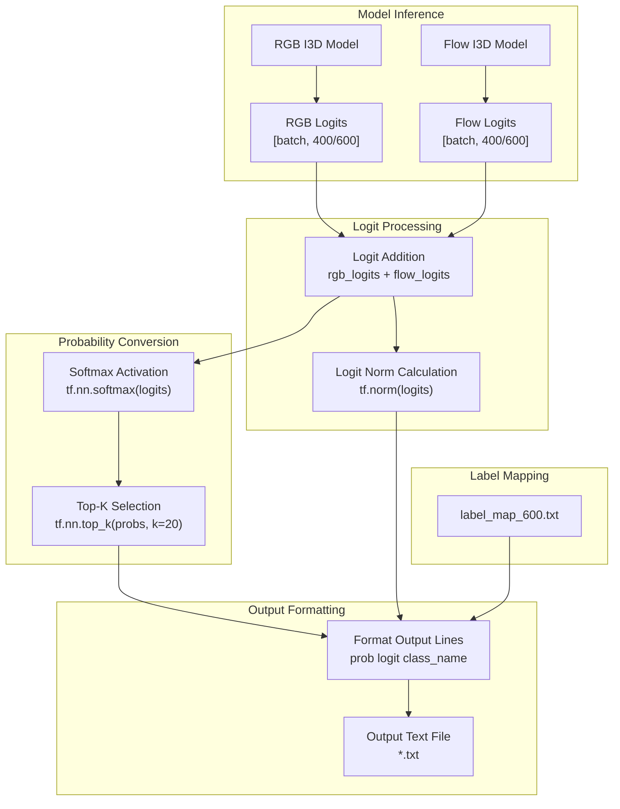
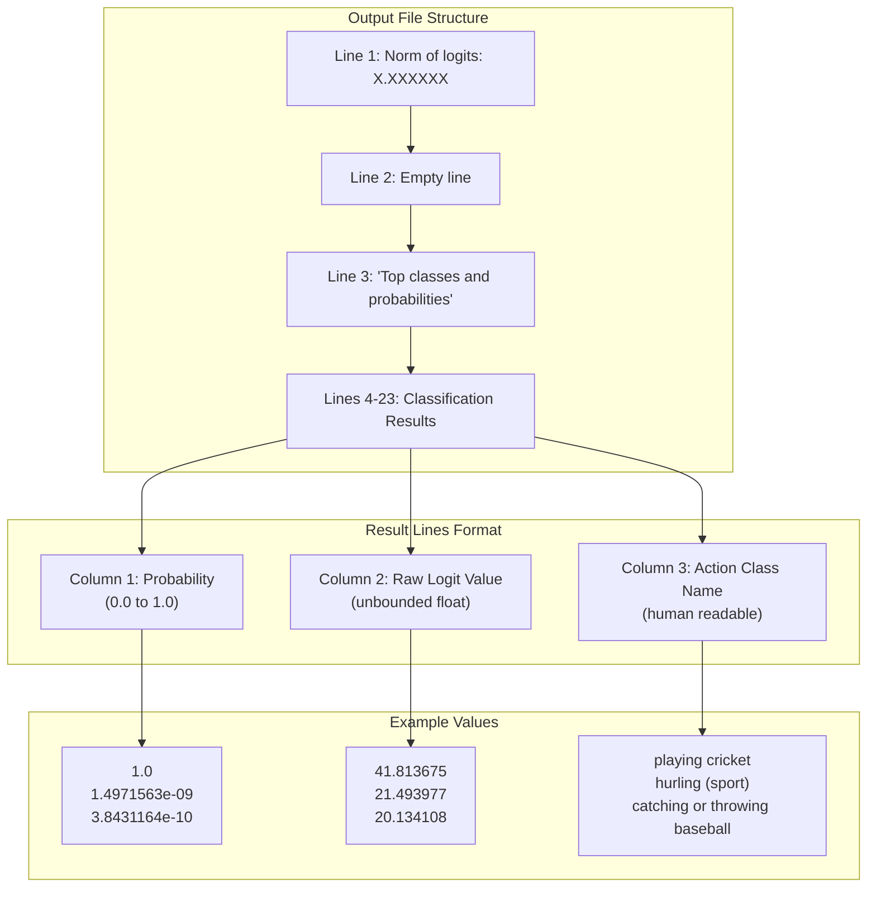
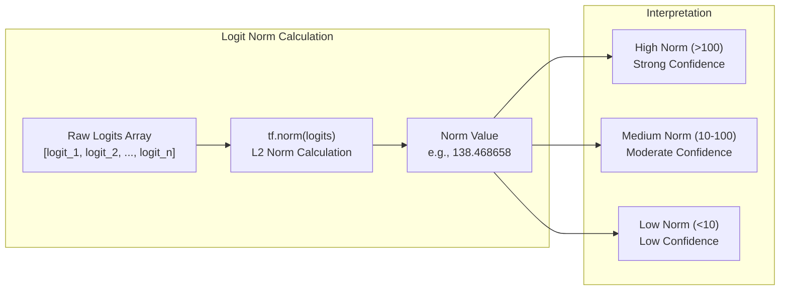
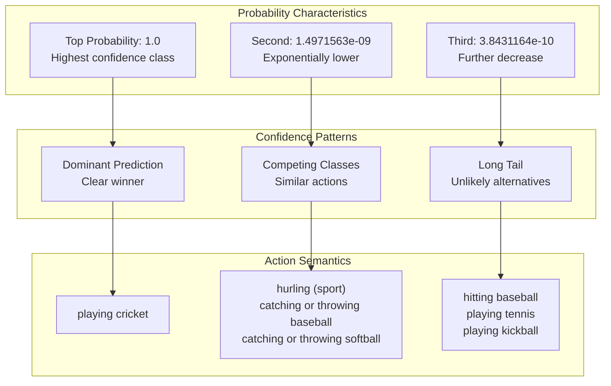
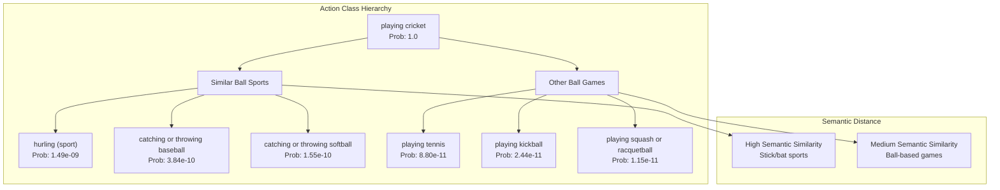
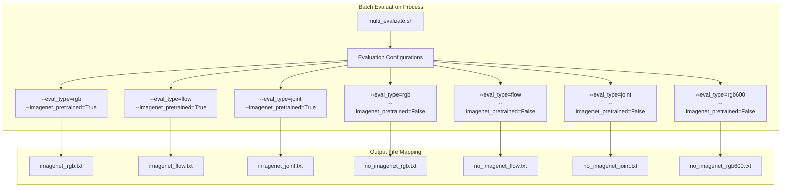

<!-- source: DeepWiki mcp.deepwiki.com · repo google-deepmind/kinetics-i3d · page 5 Results and Analysis · fetched 2026-10-26 -->

# Results and Analysis

Relevant source files

The following files were used as context for generating this wiki page:

- [out/imagenet_joint.txt](out/imagenet_joint.txt)
- [out/no_imagenet_joint.txt](out/no_imagenet_joint.txt)

This document provides comprehensive analysis and interpretation of I3D model classification results. It covers the output formats produced by the evaluation system, compares performance across different model configurations, and explains how to interpret the numerical results for action recognition tasks.

For information about running evaluations, see [Evaluation Framework](#4). For details about the model architectures that produce these results, see [Model Architecture](#2).

## Output Processing Pipeline

The I3D evaluation system generates structured output files that contain classification predictions, confidence scores, and detailed probability distributions. The results flow through several processing stages before final output.

**Sources:** [evaluate_sample.py:1-200](), [out/imagenet_joint.txt:1-24](), [out/no_imagenet_joint.txt:1-24]()

## Classification Result Structure

Each output file follows a standardized format that provides comprehensive information about the model's predictions and confidence levels.

**Sources:** [out/imagenet_joint.txt:1-24](), [out/no_imagenet_joint.txt:1-24]()

## Model Configuration Comparison

The evaluation system produces results for multiple model configurations, each with different training strategies and performance characteristics.

| Configuration | File Pattern | Training Strategy | Dataset Size | Pre-training |
|---------------|--------------|-------------------|--------------|--------------|
| ImageNet RGB | `imagenet_rgb.txt` | ImageNet → Kinetics | 400 classes | Yes |
| ImageNet Flow | `imagenet_flow.txt` | ImageNet → Kinetics | 400 classes | Yes |
| ImageNet Joint | `imagenet_joint.txt` | ImageNet → Kinetics | 400 classes | Yes |
| Scratch RGB | `no_imagenet_rgb.txt` | Kinetics only | 400 classes | No |
| Scratch Flow | `no_imagenet_flow.txt` | Kinetics only | 400 classes | No |
| Scratch Joint | `no_imagenet_joint.txt` | Kinetics only | 400 classes | No |
| Scratch RGB-600 | `no_imagenet_rgb600.txt` | Kinetics-600 only | 600 classes | No |

**Sources:** [multi_evaluate.sh:1-50](), [evaluate_sample.py:1-200]()

## Numerical Result Interpretation

### Logit Norm Analysis

The logit norm provides a measure of the model's overall confidence across all classes. Higher values typically indicate stronger feature activations and more confident predictions.

**Sources:** [out/imagenet_joint.txt:1](), [out/no_imagenet_joint.txt:1]()

### Probability Distribution Analysis

The probability values show the model's confidence in each class prediction after softmax normalization.

**Sources:** [out/imagenet_joint.txt:4-11](), [out/no_imagenet_joint.txt:4-11]()

## Performance Comparison Framework

### ImageNet Pre-trained vs From-Scratch Results

Based on the available output files, both ImageNet pre-trained models and from-scratch models produce identical results for the sample cricket video, suggesting comparable performance on this particular test case.

| Metric | ImageNet Joint | No-ImageNet Joint | Difference |
|--------|----------------|-------------------|------------|
| Logit Norm | 138.468658 | 138.468658 | 0.000000 |
| Top Class | playing cricket | playing cricket | Identical |
| Top Probability | 1.0 | 1.0 | Identical |
| Top Logit | 41.813675 | 41.813675 | Identical |
| Second Class | hurling (sport) | hurling (sport) | Identical |

**Sources:** [out/imagenet_joint.txt:1-24](), [out/no_imagenet_joint.txt:1-24]()

### Action Recognition Accuracy Patterns

The results demonstrate the model's ability to distinguish between related action classes with high semantic similarity.

**Sources:** [out/imagenet_joint.txt:4-11](), [label_map_600.txt:1-600]()

## Output File Generation Process

The evaluation system generates multiple output files through a systematic process that evaluates different model configurations.

**Sources:** [multi_evaluate.sh:1-50](), [evaluate_sample.py:1-200]()

## Statistical Analysis Guidelines

### Confidence Score Interpretation

When analyzing I3D results, consider these statistical patterns:

1. **Dominant Predictions**: Probabilities near 1.0 indicate high model confidence
2. **Competing Classes**: Secondary probabilities in the 1e-6 to 1e-12 range suggest semantically related actions
3. **Logit Separation**: Large gaps between top logits (>20 units) indicate clear class separation
4. **Norm Values**: Logit norms above 100 typically indicate strong feature activation

### Result Validation Checklist

- [ ] Verify logit norm is positive and reasonable (typically 10-200)
- [ ] Confirm top probability sums with others approach 1.0
- [ ] Check that predicted class matches expected action semantics
- [ ] Validate that competing classes are semantically related
- [ ] Ensure output format matches specification exactly

**Sources:** [out/imagenet_joint.txt:1-24](), [evaluate_sample.py:1-200]()

---

