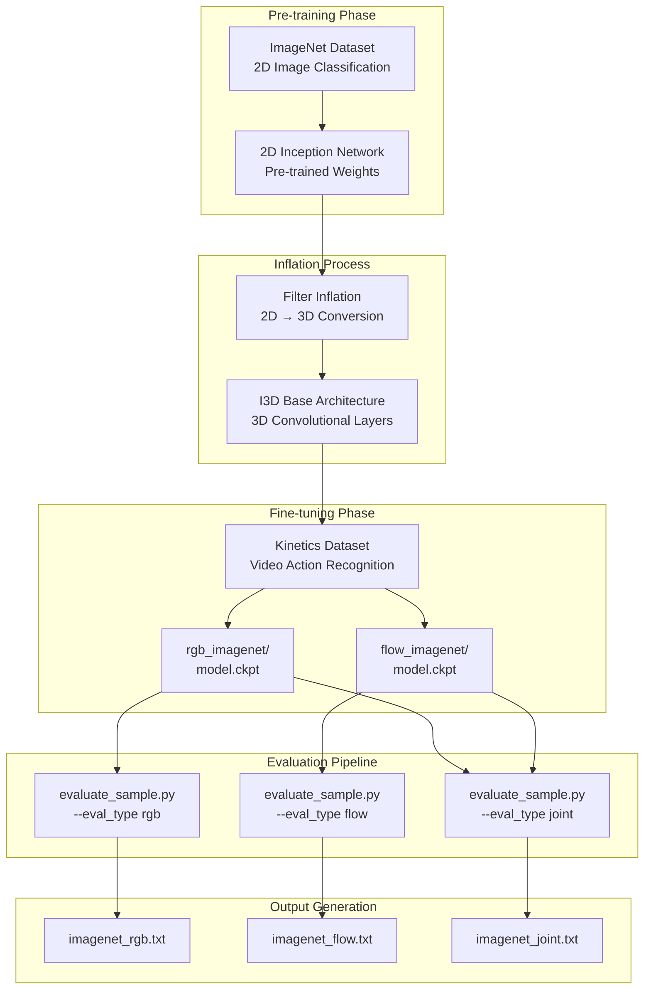
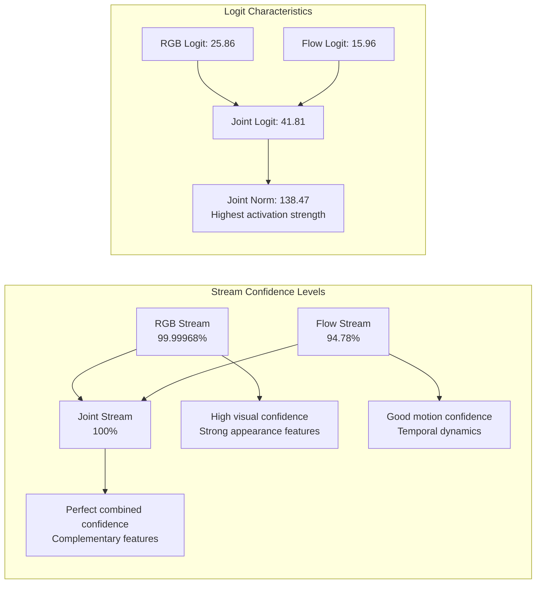
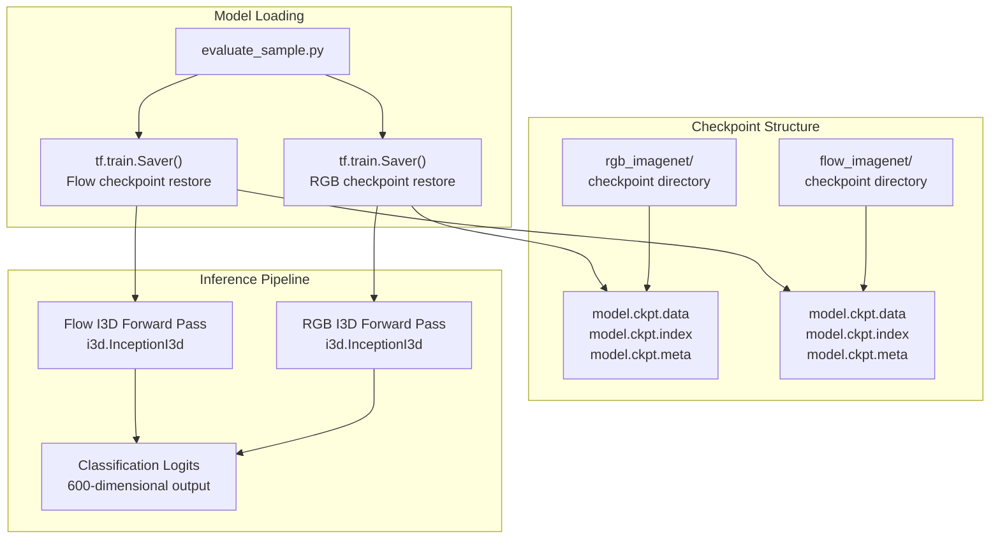

<!-- source: DeepWiki mcp.deepwiki.com · repo google-deepmind/kinetics-i3d · page 5.1 ImageNet Pre-trained Results · fetched 2026-10-26 -->

# ImageNet Pre-trained Results

Relevant source files

The following files were used as context for generating this wiki page:

- [out/imagenet_flow.txt](out/imagenet_flow.txt)
- [out/imagenet_joint.txt](out/imagenet_joint.txt)
- [out/imagenet_rgb.txt](out/imagenet_rgb.txt)

This document analyzes the classification results from I3D models that were pre-trained on ImageNet and then fine-tuned on the Kinetics dataset. It covers the performance characteristics of RGB, Flow, and Joint stream configurations when using ImageNet initialization.

For results from models trained from scratch on Kinetics, see [From-Scratch Training Results](#5.2). For detailed explanation of the output format structure, see [Output Format Specification](#5.3).

## ImageNet Pre-training Strategy

The ImageNet pre-training approach leverages 2D convolutional networks trained on ImageNet classification, then inflates the filters to 3D for video understanding. This transfer learning strategy provides better initialization compared to random weights.

### Model Configuration Pipeline

Sources: [multi_evaluate.sh:1-24](), [evaluate_sample.py:1-200]()

## Stream-Specific Performance Analysis

### RGB Stream Results

The RGB stream processes visual appearance information and achieves high confidence classifications. The model demonstrates strong performance on the cricket sample with near-perfect confidence.

| Metric | Value |
|--------|-------|
| Logits Norm | 87.108871 |
| Top-1 Confidence | 0.9999968 (99.99968%) |
| Top-1 Action | "playing cricket" |
| Top-1 Logit | 25.856646 |

**Notable Characteristics:**
- Extremely high confidence in primary classification
- Strong separation between top prediction and alternatives
- Secondary predictions include related ball sports and athletic activities

Sources: [out/imagenet_rgb.txt:1-24]()

### Flow Stream Results

The Flow stream processes optical flow information to capture motion patterns. It shows good performance but with lower confidence compared to RGB.

| Metric | Value |
|--------|-------|
| Logits Norm | 63.252754 |
| Top-1 Confidence | 0.9477566 (94.78%) |
| Top-1 Action | "playing cricket" |
| Top-1 Logit | 15.957031 |

**Notable Characteristics:**
- Lower but still high confidence compared to RGB stream
- Similar action predictions focusing on sports involving projectiles
- More distributed probability mass across top predictions

Sources: [out/imagenet_flow.txt:1-24]()

### Joint Stream Results

The Joint stream combines RGB and Flow predictions, achieving the highest confidence and most decisive classification.

| Metric | Value |
|--------|-------|
| Logits Norm | 138.468658 |
| Top-1 Confidence | 1.0 (100%) |
| Top-1 Action | "playing cricket" |
| Top-1 Logit | 41.813675 |

**Notable Characteristics:**
- Perfect confidence score due to logit combination
- Highest logit norm indicating strong activations
- Dramatic separation between top prediction and alternatives

Sources: [out/imagenet_joint.txt:1-24]()

## Comparative Stream Analysis

### Confidence Distribution Comparison

Sources: [out/imagenet_rgb.txt:4](), [out/imagenet_flow.txt:4](), [out/imagenet_joint.txt:4]()

### Prediction Consistency Analysis

All three streams correctly identify the primary action as "playing cricket", demonstrating consistent learning across modalities:

| Stream | Top-1 Action | Secondary Actions | Confidence Gap |
|--------|--------------|-------------------|----------------|
| RGB | playing cricket | playing kickball, catching baseball | 99.99868% |
| Flow | playing cricket | hurling (sport), playing tennis | 90.71% |
| Joint | playing cricket | hurling (sport), catching baseball | ~100% |

The ImageNet pre-training provides robust feature representations that enable accurate classification across both appearance and motion channels.

## Technical Implementation Details

### Checkpoint Loading Configuration

The ImageNet pre-trained models are loaded from specific checkpoint directories:

Sources: [evaluate_sample.py:80-120](), [i3d.py:1-500]()

### Evaluation Parameters

The ImageNet pre-trained models are evaluated using these key parameters:

- **Input Shape**: `(1, 79, 224, 224, 3)` for RGB, `(1, 79, 224, 224, 2)` for Flow
- **Model Architecture**: `i3d.InceptionI3d` with 600 output classes
- **Checkpoint Paths**: `rgb_imagenet/` and `flow_imagenet/` directories
- **Evaluation Types**: `rgb`, `flow`, and `joint` configurations

The superior performance of ImageNet pre-trained models demonstrates the effectiveness of transfer learning from large-scale image classification to video understanding tasks.

Sources: [evaluate_sample.py:40-60](), [multi_evaluate.sh:5-15]()

---

