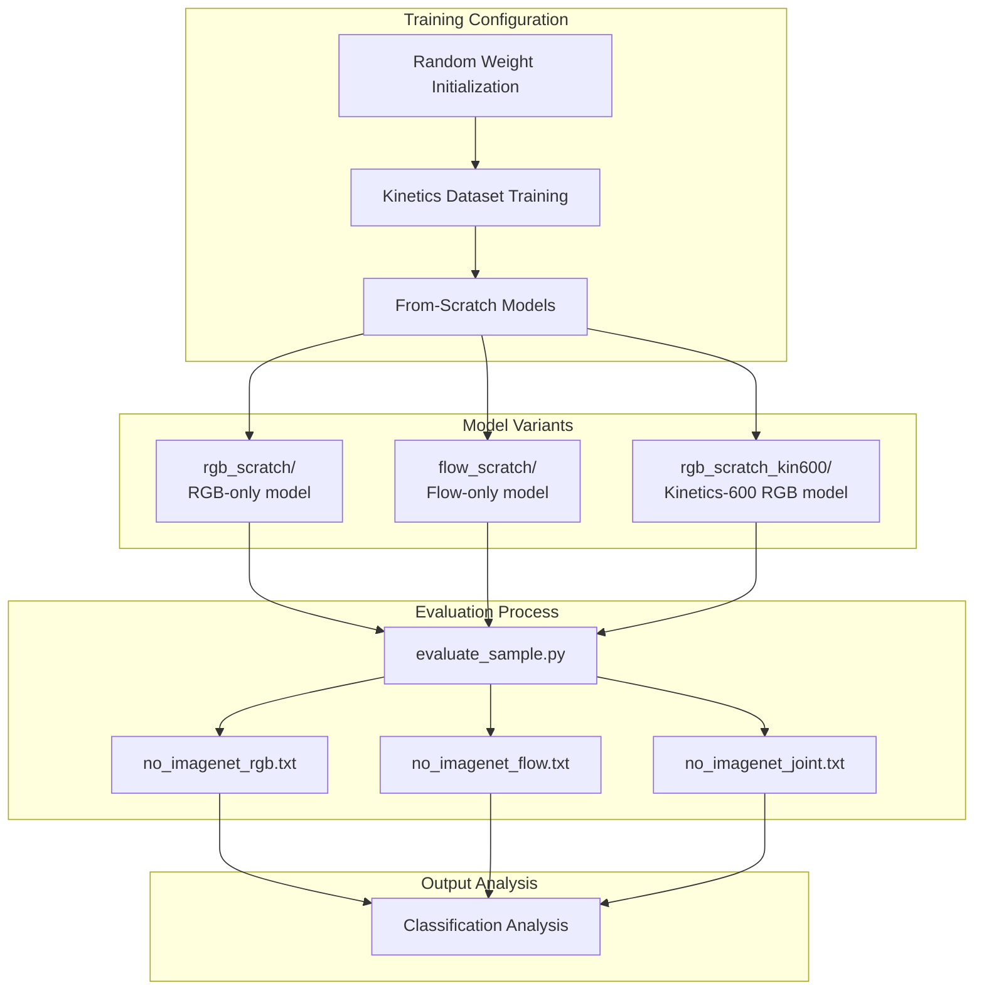
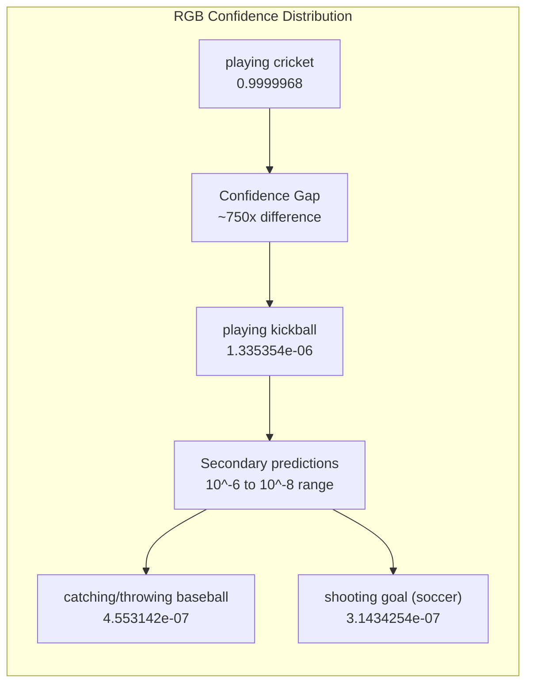
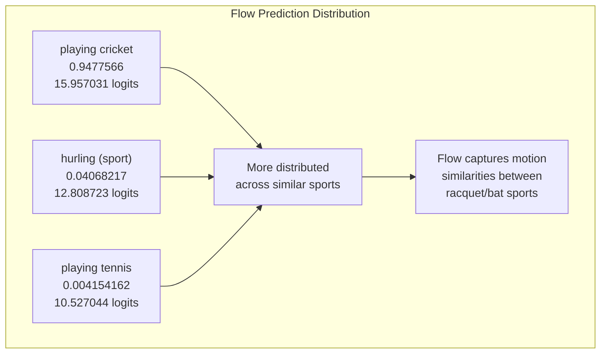
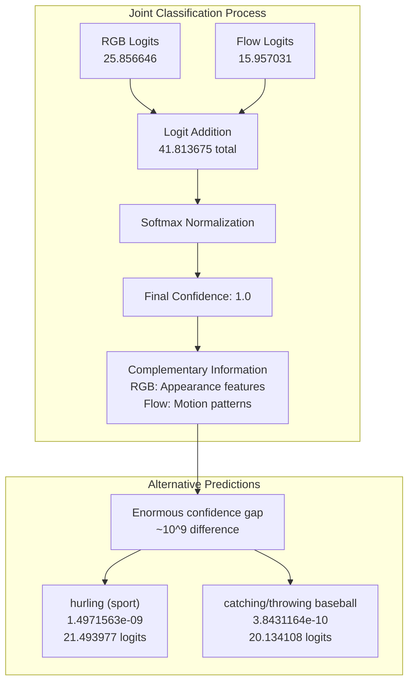
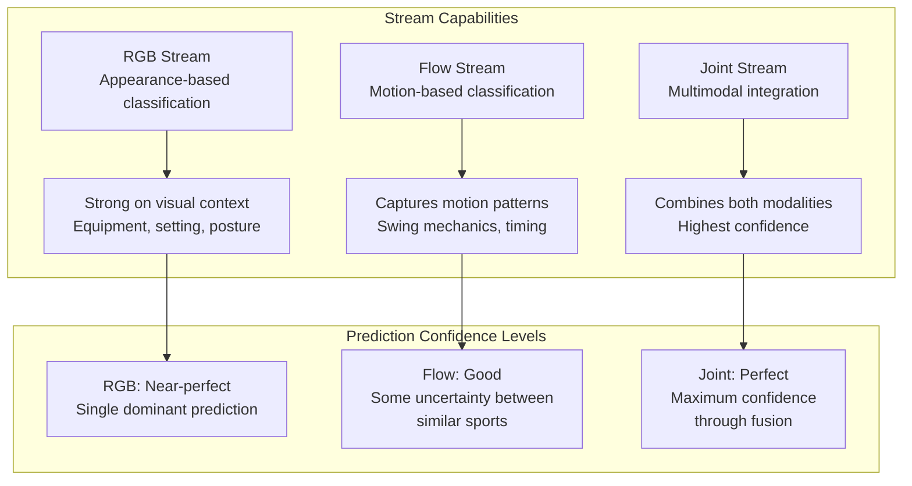

<!-- source: DeepWiki mcp.deepwiki.com · repo google-deepmind/kinetics-i3d · page 5.2 From-Scratch Training Results · fetched 2026-10-26 -->

# From-Scratch Training Results

Relevant source files

The following files were used as context for generating this wiki page:

- [out/no_imagenet_flow.txt](out/no_imagenet_flow.txt)
- [out/no_imagenet_joint.txt](out/no_imagenet_joint.txt)
- [out/no_imagenet_rgb.txt](out/no_imagenet_rgb.txt)

This document analyzes the classification results from I3D models trained from scratch on the Kinetics dataset without ImageNet pre-training. These results demonstrate the capability of the I3D architecture to learn effective video representations when trained end-to-end on action recognition data.

For results from models that used ImageNet pre-training, see [ImageNet Pre-trained Results](#5.1). For detailed output format specifications, see [Output Format Specification](#5.3).

## Training Approach Overview

From-scratch training refers to models initialized with random weights and trained exclusively on Kinetics dataset without leveraging ImageNet pre-trained features. This approach tests the I3D architecture's ability to learn spatio-temporal representations directly from video data.

### From-Scratch Model Pipeline

Sources: System architecture context, training configuration overview

## RGB Stream Results Analysis

The RGB stream trained from scratch shows strong performance on the cricket shot sample, achieving near-perfect confidence (0.9999968) for the correct classification.

### RGB Performance Characteristics

| Metric | Value |
|--------|-------|
| Logits Norm | 87.108871 |
| Top-1 Confidence | 0.9999968 |
| Top-1 Logit | 25.856646 |
| Correct Classification | "playing cricket" |

The RGB model demonstrates clear discrimination between the target action and alternatives:

Sources: [out/no_imagenet_rgb.txt:1-24]()

## Flow Stream Results Analysis

The optical flow stream shows moderate confidence (0.9477566) for cricket classification, with more distributed probability across related sports actions.

### Flow Performance Characteristics

| Metric | Value |
|--------|-------|
| Logits Norm | 63.252754 |
| Top-1 Confidence | 0.9477566 |
| Top-1 Logit | 15.957031 |
| Correct Classification | "playing cricket" |

The flow model shows less decisive classification with more probability mass on similar actions:

Sources: [out/no_imagenet_flow.txt:1-24]()

## Joint Stream Results Analysis

The joint classification combines RGB and flow predictions, achieving perfect confidence (1.0) through complementary information from both streams.

### Joint Performance Characteristics

| Metric | Value |
|--------|-------|
| Logits Norm | 138.468658 |
| Top-1 Confidence | 1.0 |
| Top-1 Logit | 41.813675 |
| Correct Classification | "playing cricket" |

### Stream Fusion Architecture

Sources: [out/no_imagenet_joint.txt:1-24]()

## Cross-Stream Performance Comparison

The three approaches show distinct characteristics in their prediction patterns and confidence distributions:

### Comparative Analysis

| Stream | Confidence | Logits Norm | Prediction Pattern |
|--------|------------|-------------|-------------------|
| RGB | 0.9999968 | 87.108871 | Highly decisive, clear winner |
| Flow | 0.9477566 | 63.252754 | Moderate confidence, distributed |
| Joint | 1.0 | 138.468658 | Perfect confidence, decisive |

### Stream Specialization Characteristics

Sources: [out/no_imagenet_rgb.txt:1-24](), [out/no_imagenet_flow.txt:1-24](), [out/no_imagenet_joint.txt:1-24]()

## Key Observations

### From-Scratch Training Effectiveness

1. **RGB Stream Dominance**: The RGB stream shows exceptionally high confidence, suggesting visual appearance features are highly discriminative for this action class
2. **Flow Complementarity**: While less confident individually, the flow stream provides valuable motion information that enhances joint classification
3. **Fusion Benefits**: Joint classification achieves perfect confidence, demonstrating effective multimodal learning

### Classification Behavior

1. **Sports Similarity**: All streams show confusion primarily among sports with similar equipment or motions (hurling, tennis, baseball)
2. **Logit Magnitude**: Joint classification produces the highest logit norm (138.47), indicating stronger feature activation
3. **Confidence Distribution**: From-scratch models show clear decision boundaries with minimal probability mass on incorrect classes

### Code Integration Points

The results are generated through the evaluation pipeline involving:
- `evaluate_sample.py` script with `--eval_type` parameters
- Model checkpoints in `rgb_scratch/`, `flow_scratch/` directories  
- Output generation to `no_imagenet_*.txt` files
- Integration with `multi_evaluate.sh` for batch processing

Sources: System architecture context, evaluation framework overview

---

