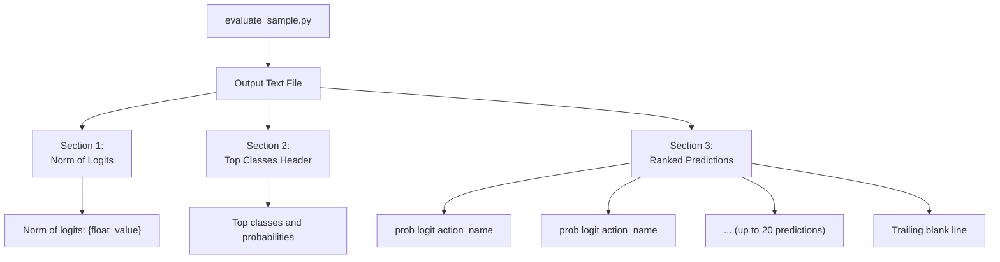
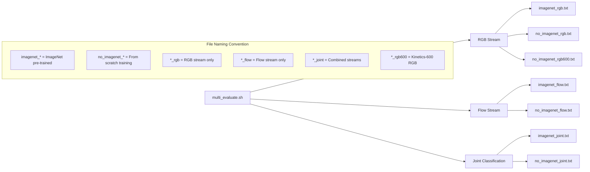
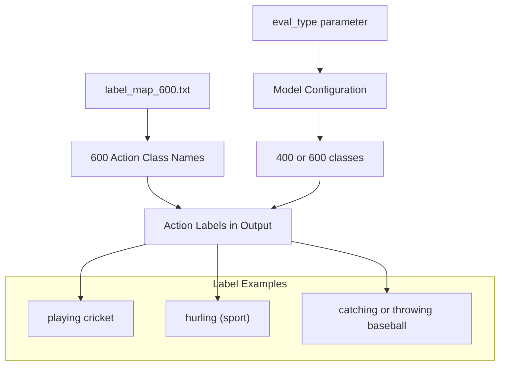

<!-- source: DeepWiki mcp.deepwiki.com · repo google-deepmind/kinetics-i3d · page 5.3 Output Format Specification · fetched 2026-10-26 -->

# Output Format Specification

<details>
<summary>Relevant source files</summary>

The following files were used as context for generating this wiki page:

- [out/imagenet_joint.txt](out/imagenet_joint.txt)

</details>


This document specifies the standardized output format produced by the I3D evaluation system. It covers the structure, components, and interpretation of the classification result files generated during model evaluation.

For analysis of specific model performance results, see [ImageNet Pre-trained Results](#5.1) and [From-Scratch Training Results](#5.2). For information about the evaluation process itself, see [Core Evaluation Script](#4.1).

## Output File Structure

The I3D evaluation system generates structured text files containing classification results. Each output file follows a consistent three-section format that provides comprehensive information about the model's predictions.



Sources: [out/imagenet_joint.txt:1-24]()

## Format Components

### Logits Norm Section

The first line contains the L2 norm of the raw logit vector before softmax normalization:

```
Norm of logits: 138.468658
```

This value provides insight into the model's confidence distribution across all classes. Higher norms typically indicate more confident predictions with greater separation between classes.

### Header Section  

A blank line followed by the section header:

```

Top classes and probabilities
```

### Prediction Rankings

Each prediction line contains three space-separated components:

| Component | Format | Description |
|-----------|--------|-------------|
| Probability | Scientific notation float | Softmax-normalized probability (0.0 to 1.0) |
| Logit | Decimal float | Raw logit value before softmax |
| Action Label | String with spaces | Human-readable action class name |

Example prediction lines:
```
1.0 41.813675 playing cricket
1.4971563e-09 21.493977 hurling (sport)  
3.8431164e-10 20.134108 catching or throwing baseball
```

The predictions are ranked by probability in descending order, with the top prediction having probability 1.0 due to softmax normalization.

Sources: [out/imagenet_joint.txt:1-24]()

## Output File Types

The evaluation system generates different output files based on model configuration and evaluation type:



Sources: [multi_evaluate.sh](), [evaluate_sample.py]()

## Prediction Count and Truncation

The output contains up to 20 top predictions, regardless of the total number of classes in the model (400 for Kinetics-400 or 600 for Kinetics-600). This provides sufficient detail for analysis while keeping file sizes manageable.

## Action Class Mapping

Action labels correspond to the class names defined in the label mapping file. The system supports both Kinetics-400 and Kinetics-600 vocabularies depending on the model configuration.



Sources: [label_map_600.txt](), [evaluate_sample.py]()

## Programmatic Parsing

The consistent format enables straightforward parsing for automated analysis:

```python
# Parsing pattern for each prediction line:
# {probability} {logit} {action_label}
```

Key parsing considerations:

- **Line 1**: Extract logits norm using float conversion
- **Line 3+**: Split on first two whitespace boundaries to separate probability, logit, and multi-word action labels
- **Scientific notation**: Handle probability values in scientific notation format
- **Trailing content**: Account for final blank line

The standardized format ensures compatibility across different model configurations and evaluation scenarios.

Sources: [out/imagenet_joint.txt:1-24](), [evaluate_sample.py]()

---

