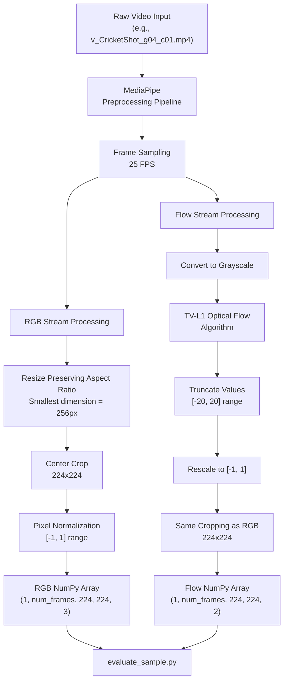
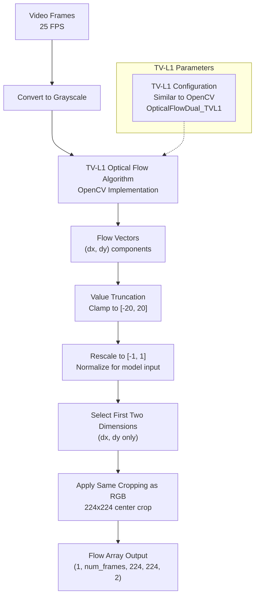
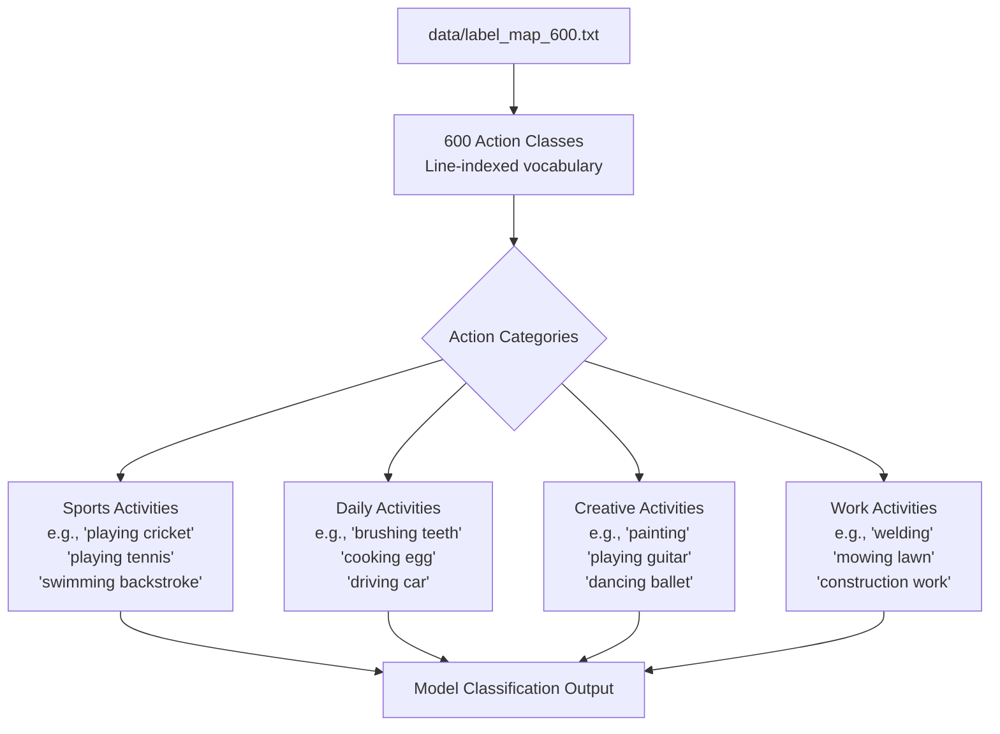
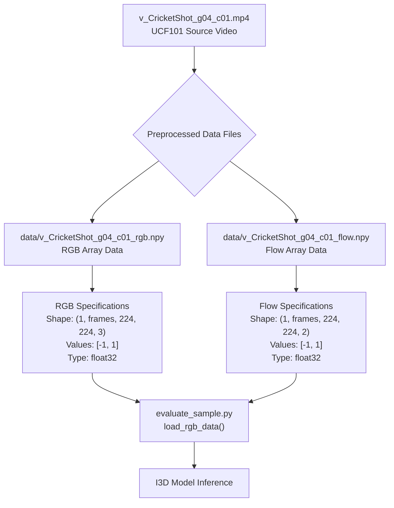

<!-- source: DeepWiki mcp.deepwiki.com · repo google-deepmind/kinetics-i3d · page 6 Data and Preprocessing · fetched 2026-10-26 -->

# Data and Preprocessing

Relevant source files

The following files were used as context for generating this wiki page:

- [README.md](README.md)
- [data/label_map_600.txt](data/label_map_600.txt)

This document covers the data input requirements, preprocessing pipelines, and action class vocabulary used by the I3D video classification system. It details how raw video data is transformed into the RGB frames and optical flow representations required by the two-stream I3D models.

For information about model architecture and how preprocessed data flows through the networks, see [Model Architecture](#2). For details about evaluation and output formats, see [Evaluation Framework](#4).

## Input Data Requirements

The I3D system accepts video input that is processed into two complementary data streams: RGB appearance information and optical flow motion information. The preprocessing pipeline transforms raw video files into standardized NumPy arrays with specific dimensional requirements.

### Data Flow Overview

**Sources:** [README.md:140-181]()

## RGB Preprocessing Pipeline

The RGB stream processes visual appearance information from video frames through a standardized preprocessing pipeline that ensures consistent input dimensions and value ranges for the I3D model.

### RGB Processing Steps

| Step | Operation | Parameters | Output |
|------|-----------|------------|---------|
| Frame Sampling | Extract frames at fixed rate | 25 FPS | Individual frames |
| Resize | Preserve aspect ratio | Smallest dimension = 256px | Resized frames |
| Cropping | Center crop during test | 224×224 pixels | Cropped frames |
| Normalization | Rescale pixel values | Range [-1, 1] | Normalized frames |
| Batching | Add batch dimension | Batch size = 1 | Final array shape |

The RGB preprocessing pipeline produces arrays with shape `(1, num_frames, 224, 224, 3)` where the dimensions represent:
- Batch size: 1
- Temporal dimension: Variable number of frames
- Height: 224 pixels
- Width: 224 pixels  
- Channels: 3 (Red, Green, Blue)

### RGB Implementation Details

The preprocessing uses bilinear interpolation for resizing operations. During training, random 224×224 crops are selected, while during evaluation, center crops are used consistently. The pixel value normalization transforms the standard [0, 255] range to [-1, 1] for optimal model performance.

**Sources:** [README.md:153-158]()

## Optical Flow Preprocessing Pipeline

The optical flow stream captures motion information between consecutive video frames using the TV-L1 optical flow algorithm. This provides complementary temporal dynamics information to the RGB appearance stream.

### Flow Processing Architecture

### Flow Array Structure

The optical flow preprocessing produces arrays with shape `(1, num_frames, 224, 224, 2)` where:
- Batch size: 1
- Temporal dimension: Variable number of frames  
- Height: 224 pixels
- Width: 224 pixels
- Channels: 2 (horizontal and vertical flow components)

The flow values represent pixel displacement between consecutive frames, capturing motion patterns that complement the RGB appearance information.

**Sources:** [README.md:160-167]()

## Action Class Vocabulary

The I3D models support classification across 600 distinct action classes defined in the Kinetics dataset. The complete vocabulary is stored in the label map file and covers a diverse range of human activities.

### Label Map Structure

### Class Index Mapping

The action classes are indexed starting from 0, with each line in `label_map_600.txt` corresponding to a class index. For example:
- Index 0: "abseiling"
- Index 336: "playing cricket" 
- Index 599: "zumba"

The model outputs logits and probabilities for all 600 classes, with the highest-scoring classes representing the most likely actions detected in the input video.

**Sources:** [data/label_map_600.txt:1-601]()

## Sample Data Format

The repository includes preprocessed sample data demonstrating the expected input format for both RGB and optical flow streams. This sample data is derived from the UCF101 dataset for testing and demonstration purposes.

### Sample Data Structure

### Data Validation

The sample data files provide reference implementations for:
- Correct array dimensionality
- Proper value normalization ranges
- Expected data types and formats
- Batch dimension handling

These files serve as templates for preprocessing new video data to match the model's input requirements.

**Sources:** [README.md:145-147](), [README.md:157-158](), [README.md:166-167]()

---

