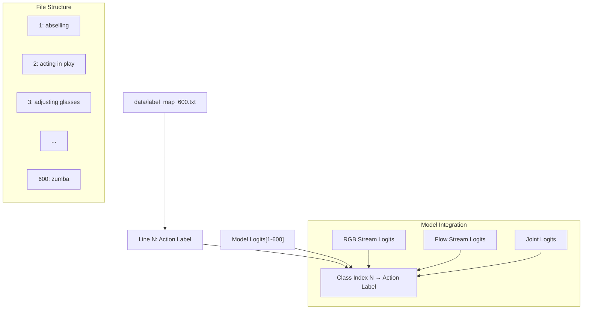
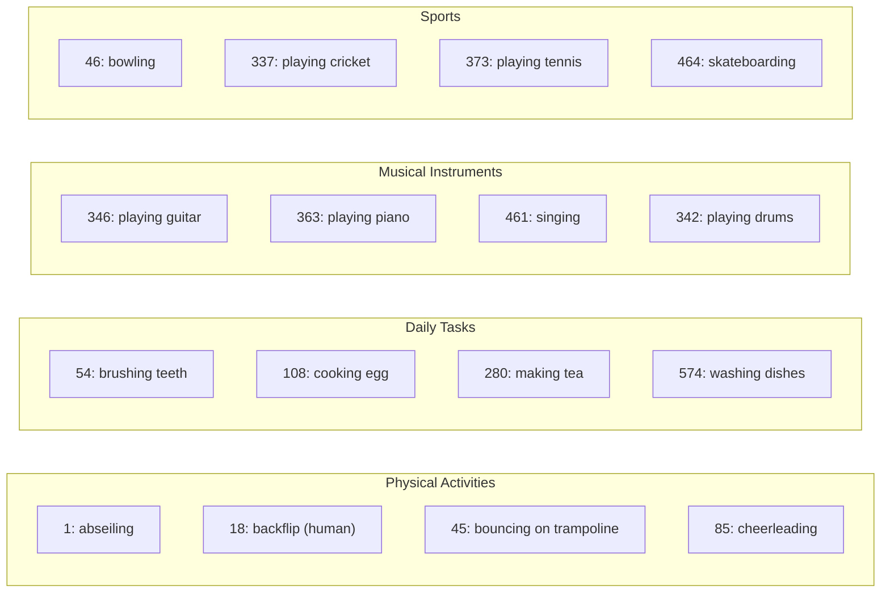
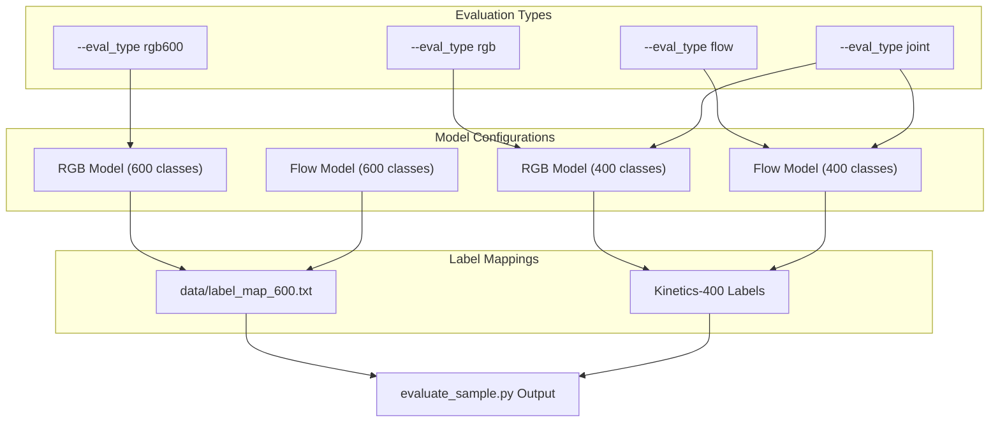

<!-- source: DeepWiki mcp.deepwiki.com · repo google-deepmind/kinetics-i3d · page 6.1 Action Class Labels · fetched 2026-10-26 -->

# Action Class Labels

Relevant source files

The following files were used as context for generating this wiki page:

- [data/label_map_600.txt](data/label_map_600.txt)

This page provides a complete reference for the action class vocabulary used by the I3D video classification models. It covers the 600 action classes supported by the Kinetics-600 trained models, the label mapping file structure, and how these labels integrate with the model architecture and evaluation system.

For information about the video preprocessing pipeline that prepares input data for classification, see [Video Preprocessing Pipeline](#6.2). For details about how these labels appear in classification outputs, see [Output Format Specification](#5.3).

## Action Class Vocabulary Overview

The I3D system supports action recognition across 600 distinct action classes derived from the Kinetics-600 dataset. These classes span a diverse range of human activities including sports, daily activities, musical performances, and occupational tasks. The complete vocabulary is defined in the label mapping file and serves as the canonical reference for all model predictions.

### Label Map File Structure

The action classes are stored in a simple text file format where each line contains a single action label. The file uses 1-based indexing, meaning the first action class corresponds to class index 1 in the model outputs.

**Sources:** [data/label_map_600.txt:1-601]()

## Action Class Categories

The 600 action classes can be broadly categorized into several domains:

| Category | Examples | Count Range |
|----------|----------|-------------|
| Sports & Athletics | `abseiling`, `archery`, `bowling`, `cricket`, `golf putting` | ~150 classes |
| Daily Activities | `brushing teeth`, `cooking egg`, `making tea`, `washing dishes` | ~200 classes |
| Musical Performance | `playing guitar`, `playing piano`, `singing`, `drumming` | ~50 classes |
| Physical Exercise | `doing aerobics`, `push up`, `yoga`, `weightlifting` | ~80 classes |
| Work & Crafts | `welding`, `carpentry`, `painting`, `sewing` | ~60 classes |
| Social Activities | `dancing`, `celebrating`, `hugging`, `applauding` | ~60 classes |

### Sample Action Classes

Here are representative examples from different categories:

**Sources:** [data/label_map_600.txt:1-601]()

## Integration with Model Architecture

The action class labels directly correspond to the output dimensions of the I3D model architectures. Different model configurations support different numbers of classes:

**Sources:** [data/label_map_600.txt:1-601](), [evaluate_sample.py]()

## Usage in Evaluation Pipeline

The action class labels are integrated into the evaluation pipeline through the `evaluate_sample.py` script, which maps model predictions back to human-readable action names:

### Label Loading Process

1. **File Reading**: The label map file is read line by line to build the class vocabulary
2. **Index Mapping**: Each line number corresponds to the class index (1-based indexing)
3. **Prediction Mapping**: Model logits are mapped to class names using the index
4. **Output Generation**: Top-K predictions include both class names and confidence scores

### Output Format Integration

The evaluation system uses these labels to generate structured output that includes:

- **Class Names**: Human-readable action descriptions
- **Class Indices**: Numeric identifiers (1-600)
- **Confidence Scores**: Softmax probabilities
- **Logit Values**: Raw model outputs

## Complete Action Class Reference

The following table shows the complete mapping from class indices to action labels:

| Index | Action Class | Index | Action Class | Index | Action Class |
|-------|--------------|-------|--------------|-------|--------------|
| 1 | abseiling | 201 | gospel singing in church | 401 | putting on lipstick |
| 2 | acting in play | 202 | grinding meat | 402 | putting on mascara |
| 3 | adjusting glasses | 203 | grooming dog | 403 | putting on sari |
| 4 | air drumming | 204 | grooming horse | 404 | putting on shoes |
| 5 | alligator wrestling | 205 | gymnastics tumbling | 405 | raising eyebrows |
| ... | ... | ... | ... | ... | ... |
| 596 | wrestling | 598 | yawning | 600 | zumba |
| 597 | writing | 599 | yoga | | |

*Note: This table shows a sample of entries. The complete list contains all 600 action classes as defined in the source file.*

**Sources:** [data/label_map_600.txt:1-601]()

## Model Compatibility

Different pre-trained models in the repository support different subsets of these action classes:

| Model Type | Classes Supported | Label Source |
|------------|------------------|--------------|
| ImageNet + Kinetics RGB/Flow | 400 classes | Kinetics-400 subset |
| Scratch Kinetics RGB/Flow | 400 classes | Kinetics-400 subset |
| Scratch Kinetics-600 RGB | 600 classes | `data/label_map_600.txt` |

The 600-class vocabulary represents the most comprehensive action recognition capability available in this repository, with the 400-class models supporting a subset of these actions.

**Sources:** [data/label_map_600.txt:1-601]()

---

