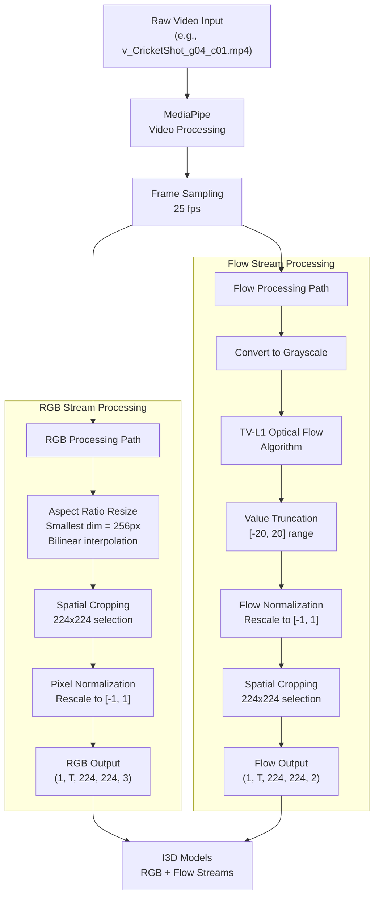
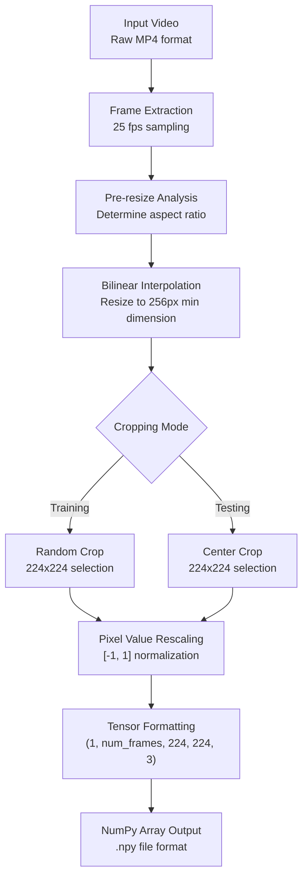
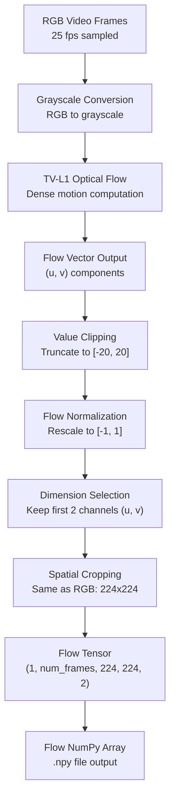
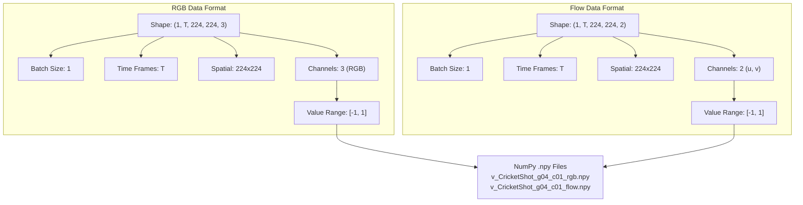
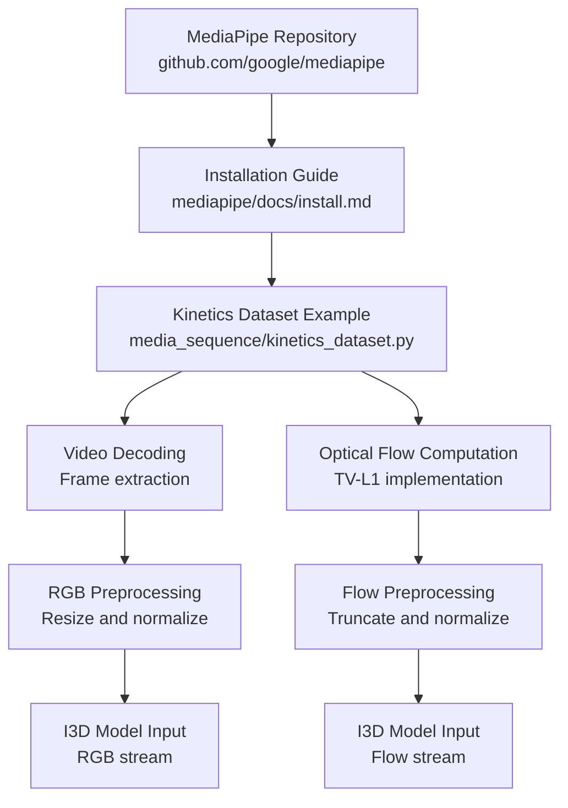
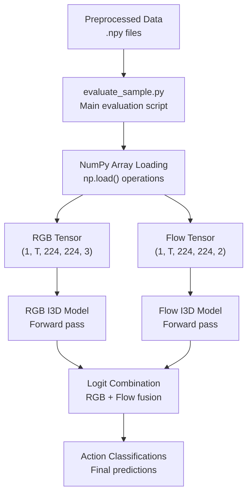

<!-- source: DeepWiki mcp.deepwiki.com · repo google-deepmind/kinetics-i3d · page 6.2 Video Preprocessing Pipeline · fetched 2026-10-26 -->

# Video Preprocessing Pipeline

Relevant source files

The following files were used as context for generating this wiki page:

- [README.md](README.md)

This document details the video preprocessing pipeline used to convert raw video files into the formatted RGB frames and optical flow data required by the I3D models. The preprocessing transforms input videos into two parallel data streams that feed the RGB and Flow I3D networks respectively.

For information about the action class labels used in the final output, see [Action Class Labels](#6.1). For details about the I3D model architecture that consumes this preprocessed data, see [Model Architecture](#2).

## Overview

The I3D video preprocessing pipeline converts raw video input into two synchronized data streams optimized for the two-stream I3D architecture. The pipeline uses MediaPipe for video processing and applies specific transformations to prepare data for both RGB appearance analysis and optical flow motion analysis.

### Preprocessing Pipeline Architecture

Sources: [README.md:149-167]()

## RGB Stream Preprocessing

The RGB stream preprocessing transforms raw video frames into normalized RGB tensors suitable for visual appearance analysis. The process maintains temporal consistency while standardizing spatial dimensions and pixel value ranges.

### RGB Processing Steps

### RGB Processing Parameters

| Parameter | Training Mode | Testing Mode |
|-----------|---------------|--------------|
| Frame Rate | 25 fps | 25 fps |
| Resize Method | Bilinear interpolation | Bilinear interpolation |
| Minimum Dimension | 256 pixels | 256 pixels |
| Crop Strategy | Random 224×224 | Center 224×224 |
| Pixel Range | [-1, 1] | [-1, 1] |
| Output Shape | (1, T, 224, 224, 3) | (1, T, 224, 224, 3) |

Sources: [README.md:150-158]()

## Flow Stream Preprocessing

The Flow stream preprocessing computes optical flow vectors to capture motion information between consecutive frames. The TV-L1 optical flow algorithm generates dense motion fields that are normalized and formatted for the Flow I3D network.

### Flow Processing Steps

### TV-L1 Optical Flow Algorithm

The preprocessing pipeline uses the TV-L1 optical flow algorithm, which is similar to the OpenCV implementation. The algorithm computes dense optical flow between consecutive frames, producing horizontal and vertical motion vectors.

| Flow Parameter | Value | Description |
|----------------|-------|-------------|
| Algorithm | TV-L1 | Total Variation L1 optical flow |
| Input Format | Grayscale frames | Converted from RGB |
| Output Channels | 2 (u, v) | Horizontal and vertical flow |
| Value Range | [-20, 20] → [-1, 1] | Truncated then normalized |
| Spatial Resolution | 224×224 | Matches RGB processing |

Sources: [README.md:160-167]()

## Data Format Specifications

The preprocessing pipeline outputs standardized NumPy arrays for both RGB and Flow streams. These arrays maintain consistent formatting for integration with the I3D model architecture.

### Output Data Structures

### Sample Data Example

The repository includes preprocessed sample data from the UCF101 dataset:

- **Source Video**: `v_CricketShot_g04_c01.mp4`
- **RGB Output**: `v_CricketShot_g04_c01_rgb.npy`
- **Flow Output**: `v_CricketShot_g04_c01_flow.npy`

The sample data demonstrates the complete preprocessing pipeline output and serves as a reference for the expected data format.

Sources: [README.md:145-148](), [README.md:157-167]()

## MediaPipe Integration

The video preprocessing pipeline integrates with Google's MediaPipe framework, which provides the core video processing capabilities. MediaPipe handles the low-level video decoding, frame extraction, and optical flow computation.

### MediaPipe Component Integration

### MediaPipe Setup Requirements

The preprocessing pipeline requires MediaPipe installation and configuration:

1. **MediaPipe Installation**: Follow the setup instructions in the MediaPipe repository
2. **Kinetics Dataset Processing**: Reference implementation available in MediaPipe examples
3. **Custom Video Processing**: Adapt the preprocessing pipeline for custom video inputs

Sources: [README.md:22](), [README.md:149](), [README.md:180]()

## Preprocessing Pipeline Usage

The preprocessing pipeline integrates with the evaluation system through the standardized NumPy array format. The `evaluate_sample.py` script demonstrates how preprocessed data is loaded and fed into the I3D models.

### Data Loading Integration

The preprocessing pipeline ensures that all input data conforms to the expected tensor shapes and value ranges required by the I3D model architecture, enabling seamless integration between data processing and model inference.

Sources: [README.md:44-47](), [README.md:157-167]()

---

