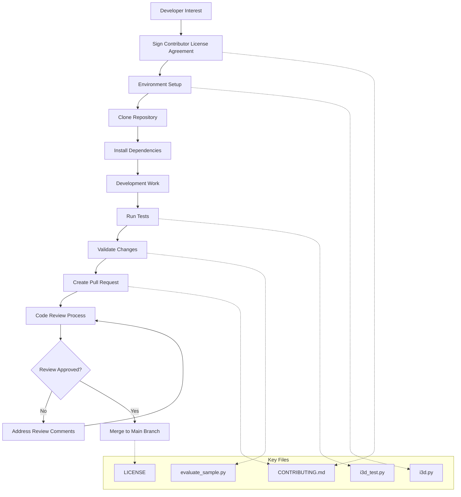
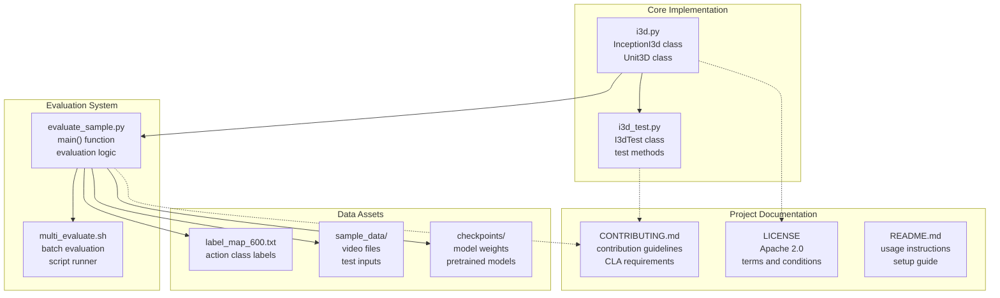
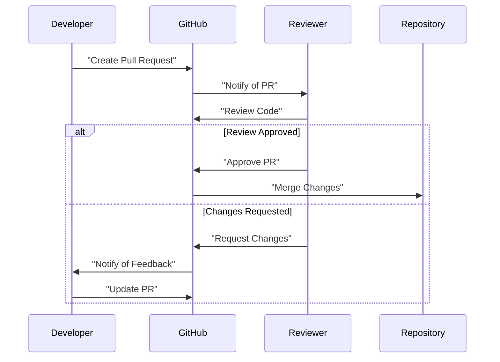

<!-- source: DeepWiki mcp.deepwiki.com · repo google-deepmind/kinetics-i3d · page 7 Development and Contribution · fetched 2026-10-26 -->

# Development and Contribution

<details>
<summary>Relevant source files</summary>

The following files were used as context for generating this wiki page:

- [CONTRIBUTING.md](CONTRIBUTING.md)
- [LICENSE](LICENSE)

</details>


This document provides comprehensive information for developers who want to contribute to or extend the Kinetics I3D codebase. It covers the essential setup requirements, contribution process, and licensing terms that govern participation in this project.

For information about using the evaluation framework, see [Evaluation Framework](#4). For details about model architecture and implementation, see [Model Architecture](#2).

## Development Workflow Overview

The following diagram illustrates the complete development and contribution workflow for the Kinetics I3D project:



**Sources:** [CONTRIBUTING.md:1-33](), [LICENSE:1-203]()

## Project Structure for Developers

Understanding the codebase structure is essential for effective contribution. The following diagram shows the key components and their relationships:



**Sources:** [CONTRIBUTING.md:1-33](), [LICENSE:1-203]()

## 7.1 Setup and Dependencies

### Core Dependencies

The Kinetics I3D project requires several key dependencies for development and testing:

| Dependency | Purpose | Version Requirements |
|------------|---------|---------------------|
| TensorFlow | Deep learning framework | Compatible with Sonnet |
| Sonnet | Neural network library | DeepMind's TensorFlow extension |
| MediaPipe | Video preprocessing | For optical flow computation |
| NumPy | Numerical operations | Standard scientific computing |

### Development Environment Setup

To set up a development environment for contributing to the I3D project:

1. **Clone the repository:**
   ```bash
   git clone https://github.com/google-deepmind/kinetics-i3d.git
   cd kinetics-i3d
   ```

2. **Install dependencies:**
   The project uses TensorFlow and Sonnet as primary dependencies. Ensure compatibility between versions when setting up your environment.

3. **Validate installation:**
   Run the test suite to verify your setup:
   ```bash
   python i3d_test.py
   ```

### File Structure for Development

Key files that developers should understand:

- `i3d.py` - Contains the core `InceptionI3d` class and `Unit3D` building blocks
- `i3d_test.py` - Contains the `I3dTest` class with validation methods
- `evaluate_sample.py` - Main evaluation script with `main()` function
- `multi_evaluate.sh` - Batch evaluation orchestration script

**Sources:** [CONTRIBUTING.md:1-33]()

## 7.2 Contributing Guidelines

### Contributor License Agreement

All contributions to the Kinetics I3D project must be accompanied by a Contributor License Agreement (CLA). This requirement ensures proper intellectual property handling while allowing contributors to retain copyright to their work.

#### CLA Requirements

Contributors must sign one of two CLA types:

| CLA Type | When to Use | Link |
|----------|-------------|------|
| Individual CLA | For individual developers contributing original code | [Google Individual CLA](https://cla.developers.google.com/about/google-individual) |
| Corporate CLA | For employees contributing on behalf of their company | [Google Corporate CLA](https://cla.developers.google.com/about/google-corporate) |

The CLA process is outlined in [CONTRIBUTING.md:6-25]():

- Individual contributors who own their intellectual property should sign the individual CLA
- Corporate contributors whose employers want to allow contributions should sign the corporate CLA
- The CLA gives Google permission to use and redistribute contributions as part of the project
- Contributors retain copyright to their original work

### Code Review Process

All submissions require review through GitHub pull requests, as specified in [CONTRIBUTING.md:27-32]():



#### Review Requirements

- All submissions, including those by project members, require review
- Reviews are conducted through GitHub pull requests
- Contributors should consult GitHub Help documentation for pull request guidance
- Multiple review rounds may be necessary before acceptance

### Contribution Types

The project accepts various types of contributions:

- **Bug fixes** - Corrections to existing functionality
- **Feature enhancements** - Improvements to existing capabilities  
- **Documentation updates** - Clarifications and additions to documentation
- **Test improvements** - Enhancements to the test suite
- **Performance optimizations** - Efficiency improvements

**Sources:** [CONTRIBUTING.md:1-33]()

## 7.3 License Information

### Apache 2.0 License

The Kinetics I3D project is licensed under the Apache License, Version 2.0, as specified in [LICENSE:1-203](). This license provides broad permissions for use, modification, and redistribution.

#### Key License Terms

| Aspect | Details |
|--------|---------|
| **Permissions** | Commercial use, modification, distribution, patent use, private use |
| **Conditions** | License and copyright notice, state changes |
| **Limitations** | Liability, warranty |

#### License Definitions

The license defines several key terms in [LICENSE:8-65]():

- **License** - The terms and conditions for use, reproduction, and distribution
- **Licensor** - The copyright owner or authorized entity granting the License  
- **Legal Entity** - Individual or organization exercising License permissions
- **Source** - Preferred form for making modifications (source code, documentation, configuration)
- **Object** - Compiled or transformed form of the Source
- **Work** - The work of authorship made available under the License
- **Derivative Works** - Works based on or derived from the original Work
- **Contribution** - Work intentionally submitted for inclusion in the project

#### Rights and Obligations

The Apache 2.0 license grants users extensive rights while imposing minimal obligations:

**Rights Granted:**
- Perpetual, worldwide, non-exclusive copyright license
- Rights to reproduce, prepare derivative works, display, perform, sublicense, and distribute
- Patent license for contributions that would otherwise infringe contributor patents

**Obligations:**
- Include license and copyright notices in distributions
- State changes made to modified files  
- Retain all copyright, patent, trademark, and attribution notices
- Include readable copy of attribution notices in derivative works

#### Warranty Disclaimer

The license includes comprehensive warranty disclaimers in [LICENSE:144-152]():

- Work provided "AS IS" without warranties of any kind
- No warranties of title, non-infringement, merchantability, or fitness for purpose
- Users assume all risks associated with using the Work
- Contributors not liable for damages except in cases of deliberate or grossly negligent acts

**Sources:** [LICENSE:1-203]()

---

