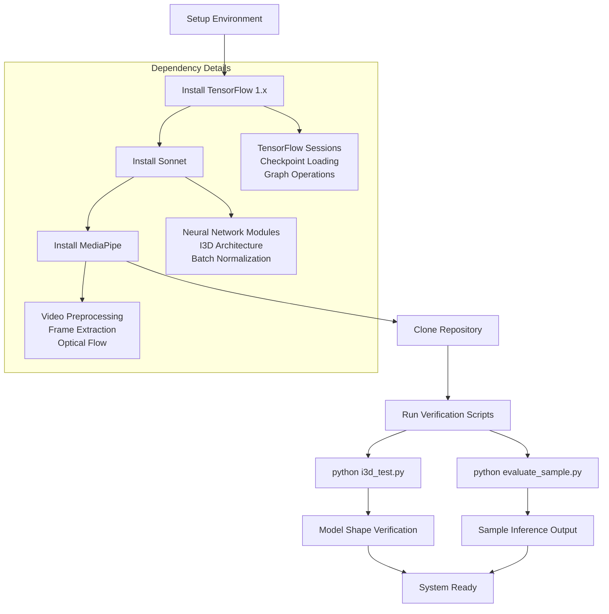
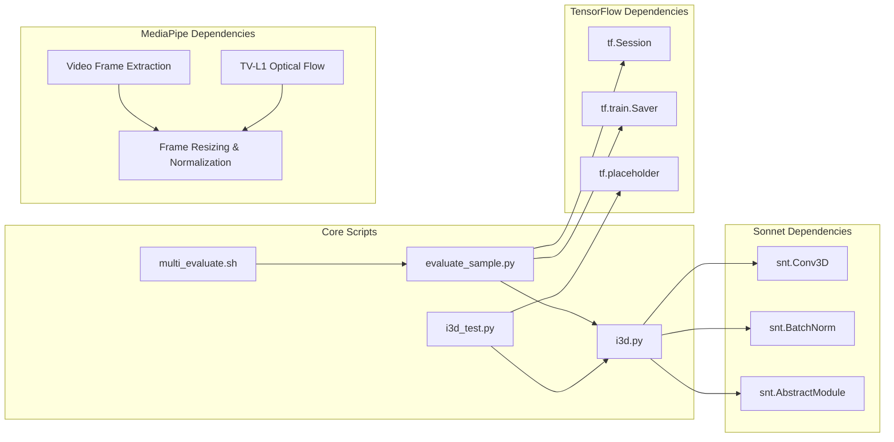

<!-- source: DeepWiki mcp.deepwiki.com · repo google-deepmind/kinetics-i3d · page 7.1 Setup and Dependencies · fetched 2026-10-26 -->

# Setup and Dependencies

<details>
<summary>Relevant source files</summary>

The following files were used as context for generating this wiki page:

- [README.md](README.md)

</details>


This page covers the installation requirements and setup instructions for the I3D video classification system. It includes core dependencies, installation steps, and verification procedures to ensure the system is properly configured for running inference and evaluation.

For information about running evaluations after setup, see [Core Evaluation Script](#4.1). For details about the model architecture and how dependencies support it, see [System Architecture](#1.1).

## System Requirements

The I3D system requires a Python environment with specific deep learning and video processing libraries. The system is designed to work with TensorFlow 1.x and requires Google's Sonnet library for neural network components.

### Hardware Requirements

- **CPU**: Multi-core processor recommended for video preprocessing
- **Memory**: Minimum 8GB RAM for loading model checkpoints and processing video data
- **Storage**: Approximately 2GB for model checkpoints and sample data
- **GPU**: Optional but recommended for faster inference (CUDA-compatible)

### Software Requirements

- **Python**: 3.6 or higher
- **Operating System**: Linux, macOS, or Windows with compatible Python environment
- **Git**: For repository cloning and version control

## Core Dependencies

The I3D system has three primary dependency categories: deep learning frameworks, video processing libraries, and system utilities.

### Dependency Installation Flow



**Sources:** [README.md:31-36]()

### Core Framework Dependencies

| Component | Purpose | Version Requirements |
|-----------|---------|---------------------|
| **TensorFlow** | Deep learning framework for model execution | 1.x (TensorFlow 2.x not supported) |
| **Sonnet** | Neural network library providing I3D modules | Compatible with TensorFlow 1.x |
| **MediaPipe** | Video preprocessing and frame extraction | Latest stable version |
| **NumPy** | Numerical computing for array operations | Standard scientific Python stack |

### System Component Dependencies



**Sources:** [README.md:31-32](), [README.md:149](), [README.md:44-47]()

## Installation Steps

### Step 1: Install Sonnet

Sonnet is the primary dependency that must be installed before cloning the repository. Follow the official Sonnet installation instructions:

```bash
# Install Sonnet following official instructions
# See: https://github.com/deepmind/sonnet
```

**Important:** Sonnet installation includes TensorFlow 1.x as a dependency. Ensure you have a compatible Python environment before installation.

**Sources:** [README.md:31-32]()

### Step 2: Clone Repository

After Sonnet installation, clone the I3D repository:

```bash
git clone https://github.com/deepmind/kinetics-i3d
cd kinetics-i3d
```

**Sources:** [README.md:34-36]()

### Step 3: MediaPipe Setup (Optional)

For video preprocessing capabilities, install MediaPipe following Google's official instructions. This is required if you plan to process raw video files rather than using the provided preprocessed samples.

**Sources:** [README.md:22](), [README.md:149]()

## Verification

### Model Architecture Verification

Run the test script to verify the I3D model can be built correctly and produces expected tensor shapes:

```bash
python i3d_test.py
```

This script validates:
- Model construction without errors
- Correct tensor shapes for RGB and Flow streams
- Proper integration of Sonnet modules

**Sources:** [README.md:82-86]()

### Sample Inference Verification

Run the sample evaluation to verify the complete inference pipeline:

```bash
python evaluate_sample.py
```

Expected output includes:
- Norm of logits tensor (approximately 138.47)
- Top 20 predicted classes with probabilities
- Logit values for each prediction

The output should resemble:
```
Norm of logits: 138.468643

Top classes and probabilities
1.0 41.8137 playing cricket
1.49716e-09 21.494 hurling (sport)
...
```

**Sources:** [README.md:42-78]()

### Comprehensive Verification

For complete system verification across all model configurations, run the batch evaluation script:

```bash
bash multi_evaluate.sh
```

This executes `evaluate_sample.py` with different model configurations and generates output files in the `out/` directory for verification.

**Sources:** [README.md:94-95]()

## Common Setup Issues

### TensorFlow Version Compatibility

The system requires TensorFlow 1.x. TensorFlow 2.x is not supported due to API changes in session management and checkpoint loading.

**Symptoms:**
- `AttributeError: module 'tensorflow' has no attribute 'Session'`
- Checkpoint loading errors

**Solution:** Install TensorFlow 1.x through Sonnet installation or use virtual environment with TensorFlow 1.x.

### Sonnet Installation Failures

**Symptoms:**
- Build errors during Sonnet compilation
- Missing compiler dependencies

**Solution:** Ensure you have compatible build tools (GCC, Bazel) installed before Sonnet installation.

### MediaPipe Setup Issues

**Symptoms:**
- Video preprocessing failures
- Missing MediaPipe modules

**Solution:** MediaPipe setup is optional for basic inference. The repository includes preprocessed sample data that can be used without MediaPipe installation.

**Sources:** [README.md:31-32](), [README.md:149]()

## Dependency Verification Commands

| Component | Verification Command | Expected Result |
|-----------|---------------------|-----------------|
| **TensorFlow** | `python -c "import tensorflow as tf; print(tf.__version__)"` | Version 1.x output |
| **Sonnet** | `python -c "import sonnet as snt; print('Sonnet OK')"` | "Sonnet OK" |
| **I3D Model** | `python i3d_test.py` | "All tests passed" |
| **Full Pipeline** | `python evaluate_sample.py` | Classification output |

**Sources:** [README.md:82-86](), [README.md:42-47]()

---

