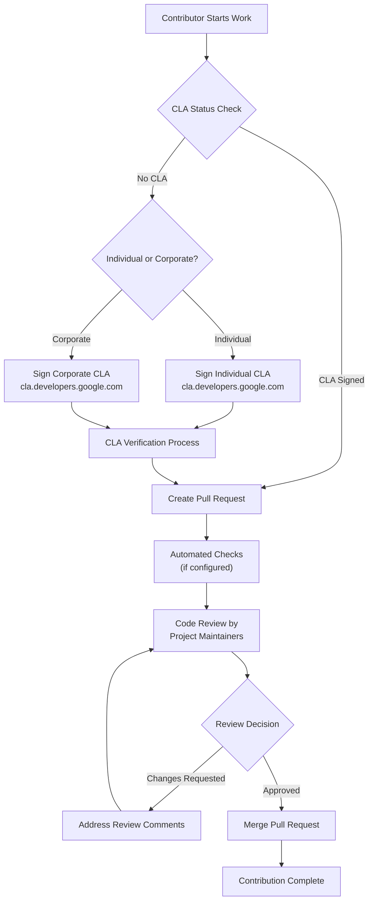
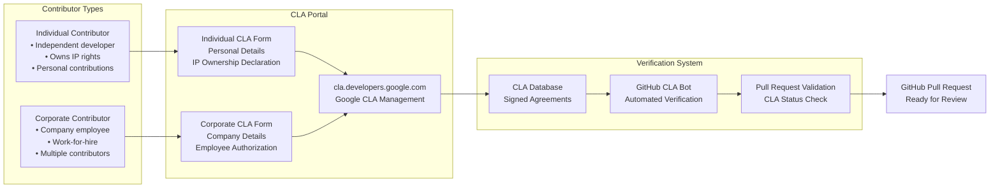

<!-- source: DeepWiki mcp.deepwiki.com · repo google-deepmind/kinetics-i3d · page 7.2 Contributing Guidelines · fetched 2026-10-26 -->

# Contributing Guidelines

Relevant source files

The following files were used as context for generating this wiki page:

- [CONTRIBUTING.md](CONTRIBUTING.md)

This document outlines the process for contributing code, documentation, and other improvements to the I3D Video Classification repository. It covers the mandatory Contributor License Agreement (CLA) requirements and the code review process using GitHub pull requests.

For information about setup and development environment configuration, see [Setup and Dependencies](#7.1). For license terms, see [License Information](#7.3).

## Purpose and Scope

The contributing guidelines establish the legal and procedural requirements for external contributions to this Google DeepMind project. All contributions must comply with these requirements before they can be accepted into the codebase.

## Contributor License Agreement Requirements

All contributions to this project must be accompanied by a signed Contributor License Agreement (CLA). The CLA ensures that contributors retain copyright to their work while granting the project permission to use and redistribute the contributions.

### CLA Types and Requirements

The project supports two types of CLAs based on the contributor's status:

| Contributor Type | CLA Required | Use Case |
|-----------------|--------------|----------|
| Individual | Individual CLA | Independent developers writing original code they own |
| Corporate | Corporate CLA | Employees contributing on behalf of their company |

### Individual Contributors

Individual contributors must sign an Individual CLA when they meet these criteria:
- Writing original source code
- Own the intellectual property of their contributions
- Not contributing on behalf of an employer

The Individual CLA is accessed through Google's CLA portal and must be completed before any pull requests can be accepted.

### Corporate Contributors

Corporate contributors must have their employer sign a Corporate CLA when:
- Contributing work performed as part of employment
- Company policy requires corporate approval for open source contributions
- Multiple employees from the same organization will be contributing

Sources: [CONTRIBUTING.md:1-33]()

## Code Review Process

All code submissions, including those from project maintainers, must undergo review through GitHub's pull request system. This ensures code quality and consistency across the codebase.

### Review Requirements

The review process enforces these requirements:
- All submissions require approval from project maintainers
- Changes must pass automated checks if configured
- Documentation updates may be required for significant changes
- Breaking changes require additional review and approval

### Pull Request Workflow

Contributors should follow GitHub's standard pull request workflow as documented in GitHub Help. The process integrates with the CLA verification system to ensure compliance before merge approval.

Sources: [CONTRIBUTING.md:27-33]()

## Contribution Workflow

**Contribution Process Flow**

This diagram shows the complete workflow from initial contribution through final merge, highlighting the mandatory CLA verification step.

Sources: [CONTRIBUTING.md:1-33]()

## CLA Management System

**CLA Management and Verification System**

This diagram illustrates how the CLA system integrates with GitHub's pull request workflow to ensure legal compliance before code review.

Sources: [CONTRIBUTING.md:6-25]()

## Integration with Development Workflow

The contributing guidelines integrate with the broader development ecosystem through several touchpoints:

### Repository Integration
- CLA verification occurs automatically on pull request creation
- GitHub branch protection rules may enforce CLA completion
- Automated testing systems respect CLA requirements

### Legal Compliance
- Copyright retention ensures contributors maintain ownership
- Redistribution permissions enable open source distribution
- IP ownership verification prevents legal complications

### Community Management
- Consistent review process maintains code quality
- Open contribution model encourages community participation
- Clear requirements reduce friction for new contributors

Sources: [CONTRIBUTING.md:1-33]()

---

