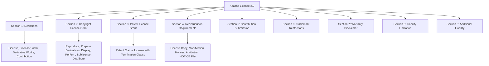
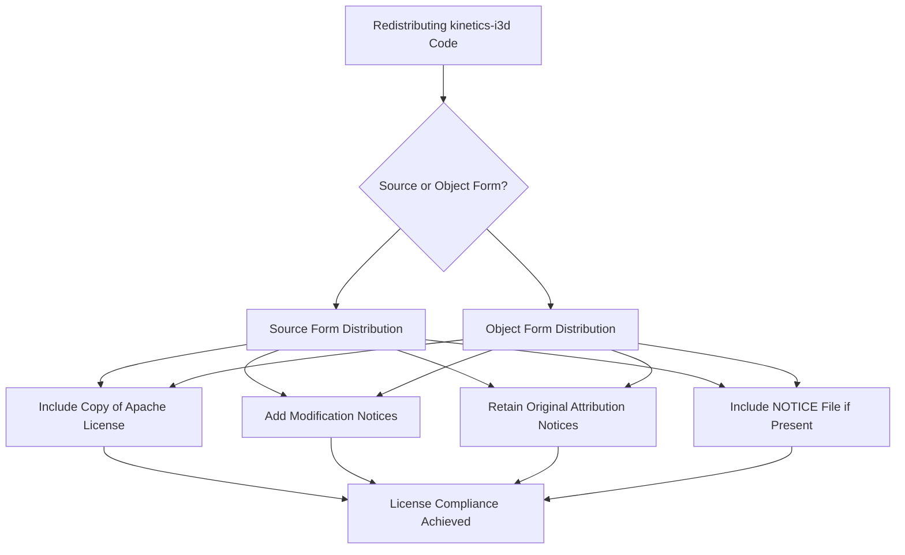

<!-- source: DeepWiki mcp.deepwiki.com · repo google-deepmind/kinetics-i3d · page 7.3 License Information · fetched 2026-10-26 -->

# License Information

<details>
<summary>Relevant source files</summary>

The following files were used as context for generating this wiki page:

- [LICENSE](LICENSE)

</details>


This page documents the licensing terms and conditions that govern the use, modification, and distribution of the kinetics-i3d codebase. This information is essential for users, researchers, and contributors who want to understand their rights and obligations when working with this code.

For information about contributing code and the Contributor License Agreement process, see [Contributing Guidelines](#7.2).

## License Overview

The kinetics-i3d repository is licensed under the **Apache License Version 2.0**, dated January 2004. This is a permissive open-source license that allows broad usage while providing patent protection and requiring proper attribution.

### License Structure



Sources: [LICENSE:1-203]()

## Key Permissions and Rights

The Apache 2.0 license grants users comprehensive rights to use and modify the kinetics-i3d codebase:

### Granted Permissions

| Permission | Description | License Section |
|------------|-------------|-----------------|
| **Use** | Run the software for any purpose | Section 2 |
| **Reproduce** | Make copies of the code | Section 2 |
| **Modify** | Create derivative works and modifications | Section 2 |
| **Distribute** | Share original or modified versions | Section 2 |
| **Sublicense** | Grant rights to others under different terms | Section 2 |
| **Commercial Use** | Use in commercial applications and products | Section 2 |
| **Patent Rights** | Use any patent claims covered by contributions | Section 3 |

### Geographic and Temporal Scope

The license grants these rights on a **perpetual, worldwide, non-exclusive, no-charge, royalty-free, irrevocable** basis, providing maximum flexibility for users.

Sources: [LICENSE:67-72]()

## Redistribution Requirements

When distributing the kinetics-i3d code or derivative works, you must comply with specific requirements:

### Mandatory Requirements



### Specific Requirements Detail

1. **License Copy**: Include a copy of the Apache License with any distribution
2. **Modification Notices**: Mark modified files with prominent change notices
3. **Attribution Preservation**: Retain copyright, patent, trademark, and attribution notices from the original work
4. **NOTICE File**: If present, include readable copy of attribution notices in derivative works

Sources: [LICENSE:90-122]()

## Patent License Grant

The license includes important patent protections that apply to the kinetics-i3d codebase:

### Patent Rights Granted

Each contributor grants users a **perpetual, worldwide, non-exclusive, no-charge, royalty-free, irrevocable patent license** to:

- Make, have made, use, offer to sell, sell, import, and transfer the work
- Apply only to patent claims necessarily infringed by the contribution
- Cover combinations of contributions with the overall work

### Patent License Termination

The patent license **automatically terminates** if you initiate patent litigation against any entity alleging that the work or any contribution constitutes patent infringement.

Sources: [LICENSE:74-88]()

## Disclaimer and Liability Limitations

The Apache 2.0 license includes important disclaimers that users must understand:

### Warranty Disclaimer

The kinetics-i3d code is provided **"AS IS"** without warranties of any kind, including:

- No warranty of MERCHANTABILITY
- No warranty of FITNESS FOR A PARTICULAR PURPOSE  
- No warranty of TITLE or NON-INFRINGEMENT
- No express or implied warranties or conditions

### Liability Limitations

Contributors have **no liability** for damages arising from use of the work, including:

- Direct, indirect, special, incidental, or consequential damages
- Loss of goodwill, work stoppage, computer failure
- Commercial damages or losses
- Even if advised of the possibility of such damages

Sources: [LICENSE:144-164]()

## Practical Guidance for Users

### For End Users

- **✅ Permitted**: Use kinetics-i3d for research, commercial applications, or personal projects
- **✅ Permitted**: Modify the code for your specific needs
- **✅ Permitted**: Integrate into larger applications or systems
- **⚠️ Required**: Keep license file if redistributing

### For Researchers and Academics

- **✅ Permitted**: Use in academic research and publications
- **✅ Permitted**: Modify for research experiments
- **✅ Permitted**: Share modified versions with collaborators
- **⚠️ Required**: Maintain attribution notices when sharing

### For Commercial Users

- **✅ Permitted**: Use in commercial products and services
- **✅ Permitted**: Integrate into proprietary applications
- **✅ Permitted**: Charge for applications that include this code
- **⚠️ Required**: Follow redistribution requirements if sharing source

### For Contributors

- **⚠️ Note**: Contributions submitted are under Apache 2.0 terms
- **⚠️ Note**: May require signing Contributor License Agreement
- **⚠️ Note**: See [Contributing Guidelines](#7.2) for full requirements

Sources: [LICENSE:131-137]()

## License Application to Repository

### File Coverage

The Apache 2.0 license applies to all files in the kinetics-i3d repository unless explicitly stated otherwise, including:

- Source code files (`i3d.py`, `evaluate_sample.py`, etc.)
- Configuration files and scripts (`multi_evaluate.sh`)
- Documentation and data files
- Model checkpoints and related assets

### Standard License Notice

The standard Apache 2.0 boilerplate notice should be included in new source files:

```
Copyright [yyyy] [name of copyright owner]

Licensed under the Apache License, Version 2.0 (the "License");
you may not use this file except in compliance with the License.
You may obtain a copy of the License at

    http://www.apache.org/licenses/LICENSE-2.0

Unless required by applicable law or agreed to in writing, software
distributed under the License is distributed on an "AS IS" BASIS,
WITHOUT WARRANTIES OR CONDITIONS OF ANY KIND, either express or implied.
See the License for the specific language governing permissions and
limitations under the License.
```

Sources: [LICENSE:179-202]()

## Full License Text

The complete Apache License Version 2.0 text is available in the repository root as [LICENSE:1-203](). This file contains the authoritative legal text that governs all use of the kinetics-i3d codebase.

For the most current version of the Apache 2.0 license, refer to the official Apache Software Foundation website at http://www.apache.org/licenses/.

Sources: [LICENSE:1-203]()