# Page: I3D Video Classification Overview

# I3D Video Classification Overview

<details>
<summary>Relevant source files</summary>

The following files were used as context for generating this wiki page:

- [README.md](README.md)

</details>


## Purpose and Scope

This document provides a comprehensive overview of the I3D (Inflated 3D ConvNets) video classification system. I3D is a deep learning architecture designed for action recognition in videos, implementing a two-stream approach that processes both RGB appearance information and optical flow motion data to achieve state-of-the-art video classification performance.

The system implements the architecture described in the paper "Quo Vadis, Action Recognition? A New Model and the Kinetics Dataset" and provides pre-trained models for video action recognition on the Kinetics dataset. For detailed information about specific model architectures, see [Model Architecture](#2). For evaluation procedures and usage instructions, see [Evaluation Framework](#4).

## System Overview

I3D extends 2D convolutional neural networks to 3D by "inflating" 2D convolution filters into 3D filters, enabling the processing of temporal information in videos. The system uses a two-stream architecture that separately processes RGB frames and optical flow, then combines their predictions for final classification.

### Two-Stream Architecture Workflow

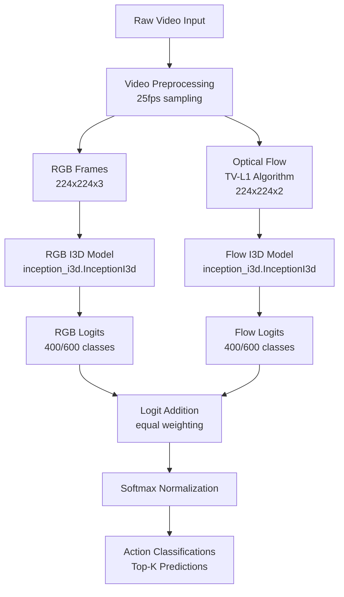

**Sources:** [README.md:11-13](), [README.md:44-47](), [README.md:102-104]()

### Core System Components

The I3D system consists of several key components that work together to perform video action recognition:

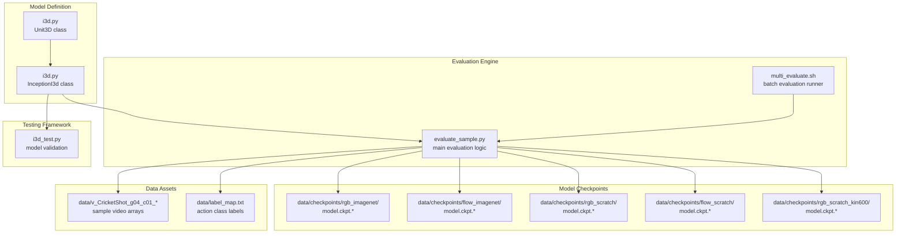

**Sources:** [README.md:40-47](), [README.md:82-86](), [README.md:97-104]()

## Key Features and Capabilities

### Pre-training Strategies

The system provides models trained using two different initialization strategies:

| Training Strategy | Description | Available Models |
|-------------------|-------------|------------------|
| **ImageNet + Kinetics** | 2D ImageNet pre-training, then 3D inflation and Kinetics fine-tuning | `rgb_imagenet`, `flow_imagenet` |
| **Kinetics-Only** | Training from scratch using standard initializers | `rgb_scratch`, `flow_scratch`, `rgb_scratch_kin600` |

**Sources:** [README.md:92-104]()

### Model Configurations

The system supports multiple evaluation configurations through command-line flags:

- **RGB-only processing**: `--eval_type=rgb`
- **Flow-only processing**: `--eval_type=flow`  
- **Joint two-stream**: `--eval_type=joint`
- **Kinetics-600 RGB**: `--eval_type=rgb600`

**Sources:** [README.md:92-95]()

### Performance Benchmarks

The models achieve state-of-the-art performance on standard video action recognition datasets:

| Model Configuration | ImageNet + Kinetics | Kinetics-Only |
|---------------------|:------------------:|:-------------:|
| RGB-I3D | 71.1% / 89.3% | 68.4% / 88.0% |
| Flow-I3D | 63.4% / 84.9% | 61.5% / 83.4% |
| Two-Stream I3D | **74.2% / 91.3%** | 71.6% / 90.0% |

*Values shown as Top-1 / Top-5 accuracy on Kinetics test set*

**Sources:** [README.md:132-138]()

## Input Processing Pipeline

The system processes raw video through a standardized preprocessing pipeline:

### RGB Stream Processing
- Frame sampling at 25 FPS
- Resize preserving aspect ratio (smallest dimension = 256px)
- Center crop to 224×224 pixels  
- Pixel normalization to [-1, 1] range
- Final shape: `(1, num_frames, 224, 224, 3)`

### Flow Stream Processing  
- Frame sampling at 25 FPS
- Grayscale conversion
- TV-L1 optical flow algorithm computation
- Flow truncation to [-20, 20] range
- Normalization to [-1, 1] range
- Final shape: `(1, num_frames, 224, 224, 2)`

**Sources:** [README.md:149-167]()

## Getting Started

The system provides a simple entry point through the main evaluation script:

```bash
python evaluate_sample.py
```

This command loads the default two-stream I3D model with ImageNet pre-training, processes the included sample video (`v_CricketShot_g04_c01`), and outputs classification predictions with probabilities and logit values.

For systematic evaluation across all model configurations, use:

```bash
./multi_evaluate.sh
```

**Sources:** [README.md:40-42](), [README.md:94-95]()

## Output Format

The system generates comprehensive classification results including:
- Logits tensor norm
- Top-20 predicted action classes  
- Class probabilities and raw logit values
- Human-readable action labels from the Kinetics taxonomy

**Sources:** [README.md:49-78]()

---

# Page: System Architecture

# System Architecture

<details>
<summary>Relevant source files</summary>

The following files were used as context for generating this wiki page:

- [README.md](README.md)

</details>


This document describes the high-level architecture of the I3D (Inflated 3D ConvNets) video classification system, focusing on the core components, data flow, and integration patterns. For detailed information about specific model architectures, see [Model Architecture](#2). For evaluation procedures and usage examples, see [Evaluation Framework](#4).

## Overall System Design

The I3D system implements a two-stream architecture for video action recognition, where RGB appearance information and optical flow motion information are processed through separate 3D convolutional networks and combined for final classification. The system is built on TensorFlow and Sonnet, providing pre-trained models for both ImageNet-bootstrapped and from-scratch training configurations.

### Core Architecture Components

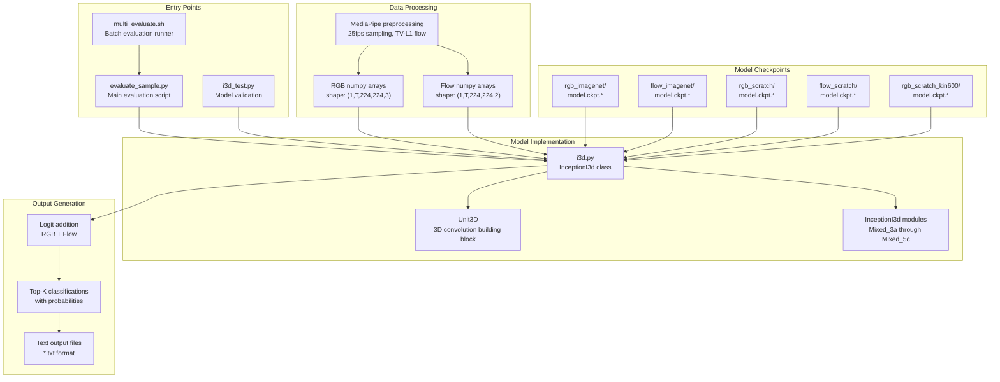

Sources: [README.md:1-201](), [evaluate_sample.py](), [i3d.py](), [multi_evaluate.sh]()

### Two-Stream Processing Pipeline

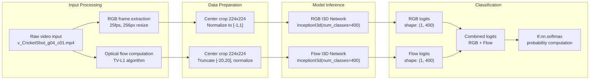

Sources: [README.md:140-167](), [evaluate_sample.py]()

## Model Configuration System

The system supports multiple model configurations through command-line flags in `evaluate_sample.py`. Each configuration corresponds to different training strategies and input modalities:

| Configuration | Flag | Description | Checkpoint Path |
|---------------|------|-------------|-----------------|
| ImageNet RGB | `--eval_type rgb` | RGB stream with ImageNet pre-training | `data/checkpoints/rgb_imagenet/` |
| ImageNet Flow | `--eval_type flow` | Flow stream with ImageNet pre-training | `data/checkpoints/flow_imagenet/` |
| ImageNet Joint | `--eval_type joint` | Both streams with ImageNet pre-training | Both RGB and Flow checkpoints |
| Kinetics RGB | `--no_imagenet_pretrained --eval_type rgb` | RGB stream trained from scratch | `data/checkpoints/rgb_scratch/` |
| Kinetics Flow | `--no_imagenet_pretrained --eval_type flow` | Flow stream trained from scratch | `data/checkpoints/flow_scratch/` |
| Kinetics Joint | `--no_imagenet_pretrained --eval_type joint` | Both streams trained from scratch | Both scratch checkpoints |
| Kinetics-600 RGB | `--eval_type rgb600` | RGB on Kinetics-600 dataset | `data/checkpoints/rgb_scratch_kin600/` |

Sources: [README.md:90-104](), [multi_evaluate.sh]()

## Checkpoint Management

The system uses TensorFlow checkpoint format with three files per model:
- `model.ckpt.data-00000-of-00001`: Weight data
- `model.ckptr.index`: Variable index
- `model.ckpt.meta`: Graph metadata

Checkpoints are loaded through TensorFlow's `tf.train.Saver` mechanism in the evaluation scripts, with separate savers for RGB and Flow streams when running joint evaluation.

Sources: [README.md:97-104]()

## Evaluation Framework Integration

### Script Orchestration

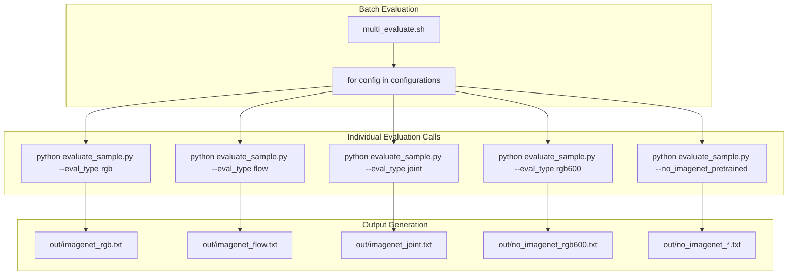

Sources: [multi_evaluate.sh](), [README.md:94-96]()

### Core Evaluation Logic

The `evaluate_sample.py` script serves as the primary interface, implementing:

1. **Model instantiation**: Creates `InceptionI3d` objects for RGB and/or Flow streams
2. **Checkpoint loading**: Restores pre-trained weights using `tf.train.Saver`
3. **Data preprocessing**: Loads and validates input numpy arrays
4. **Forward pass**: Executes inference through the model graphs
5. **Result formatting**: Generates human-readable classification output

The script outputs the logits norm, top-20 class predictions with probabilities, and corresponding class labels from the Kinetics action vocabulary.

Sources: [evaluate_sample.py](), [README.md:44-78]()

---

# Page: Key Features and Capabilities

# Key Features and Capabilities

<details>
<summary>Relevant source files</summary>

The following files were used as context for generating this wiki page:

- [README.md](README.md)

</details>


This document outlines the key features and capabilities of the I3D (Inflated 3D ConvNets) video classification system. It covers the core architectural innovations, model variants, performance characteristics, and evaluation framework that make this implementation suitable for state-of-the-art video action recognition.

For detailed information about the overall system architecture, see [System Architecture](#1.1). For comprehensive model architecture details, see [Model Architecture](#2).

## Core Architecture Features

The I3D system implements several key architectural innovations that enable effective video understanding:

### Two-Stream Processing Architecture

The system employs a dual-stream approach that processes both appearance and motion information independently before combining predictions.

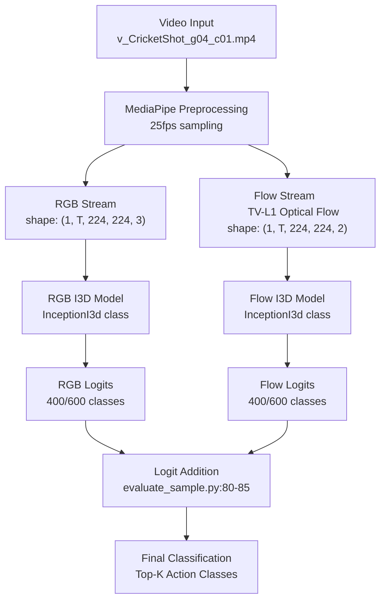

**Sources:** [README.md:44-47](), [README.md:102-104]()

### 3D Convolution Inflation

The I3D architecture extends 2D Inception networks to 3D by inflating 2D convolution filters into 3D equivalents, enabling temporal modeling while leveraging ImageNet-pretrained weights.

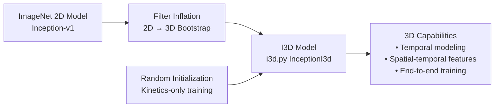

**Sources:** [README.md:99-101](), [README.md:12-13]()

## Model Variants and Pre-training Strategies

The system provides multiple model configurations optimized for different use cases and training strategies:

### Available Model Checkpoints

| Model Type | Pre-training | Stream | Checkpoint Path | Use Case |
|------------|-------------|---------|-----------------|----------|
| `rgb_imagenet` | ImageNet + Kinetics | RGB | `data/checkpoints/rgb_imagenet/` | Best RGB performance |
| `flow_imagenet` | ImageNet + Kinetics | Flow | `data/checkpoints/flow_imagenet/` | Best Flow performance |
| `rgb_scratch` | Kinetics-only | RGB | `data/checkpoints/rgb_scratch/` | No ImageNet dependency |
| `flow_scratch` | Kinetics-only | Flow | `data/checkpoints/flow_scratch/` | No ImageNet dependency |
| `rgb_scratch_kin600` | Kinetics-600 | RGB | `data/checkpoints/rgb_scratch_kin600/` | Extended class vocabulary |

### Training Configuration Options

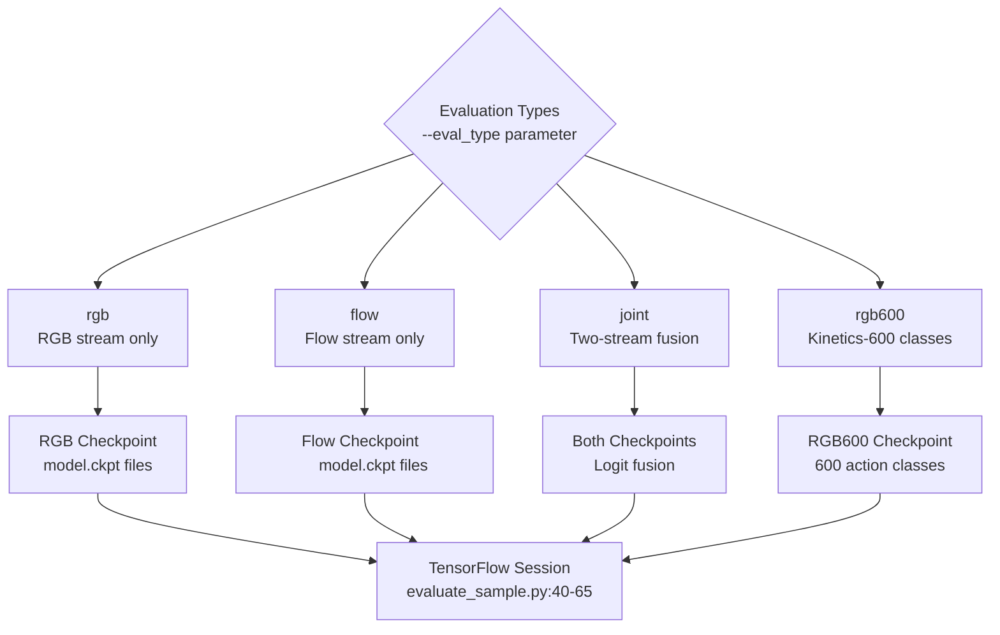

**Sources:** [README.md:92-95](), [README.md:20]()

## Performance Capabilities

The system achieves state-of-the-art performance across multiple video understanding benchmarks:

### Kinetics Dataset Results

| Model Configuration | Top-1 Accuracy | Top-5 Accuracy | Training Strategy |
|-------------------|---------------|---------------|------------------|
| RGB-I3D (ImageNet + Kinetics) | 71.1% | 89.3% | Pre-trained initialization |
| Flow-I3D (ImageNet + Kinetics) | 63.4% | 84.9% | Pre-trained initialization |
| Two-Stream I3D (ImageNet + Kinetics) | 74.2% | 91.3% | Joint prediction |
| RGB-I3D (Kinetics-only) | 68.4% | 88.0% | From-scratch training |
| Flow-I3D (Kinetics-only) | 61.5% | 83.4% | From-scratch training |
| Two-Stream I3D (Kinetics-only) | 71.6% | 90.0% | Joint prediction |

### Benchmark Performance

The system demonstrated competitive performance on established video understanding benchmarks:

- **UCF101**: State-of-the-art results from fine-tuning Kinetics pre-trained models
- **HMDB51**: State-of-the-art results from fine-tuning Kinetics pre-trained models  
- **CVPR 2017 Charades Challenge**: First place using I3D models pre-trained on Kinetics

**Sources:** [README.md:132-138](), [README.md:15-18]()

## Evaluation and Inference Features

The system provides a comprehensive evaluation framework supporting various inference modes and batch processing:

### Core Evaluation Capabilities

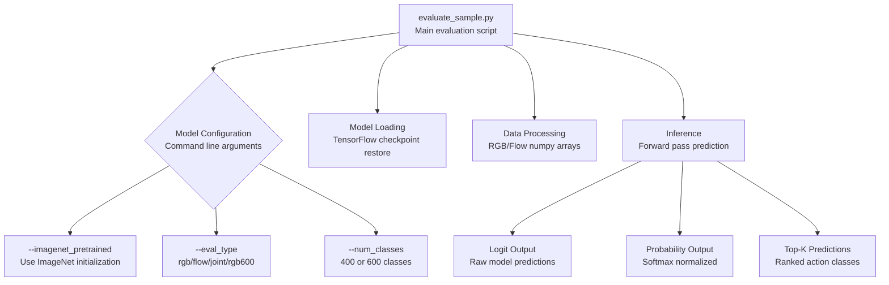

### Batch Evaluation System

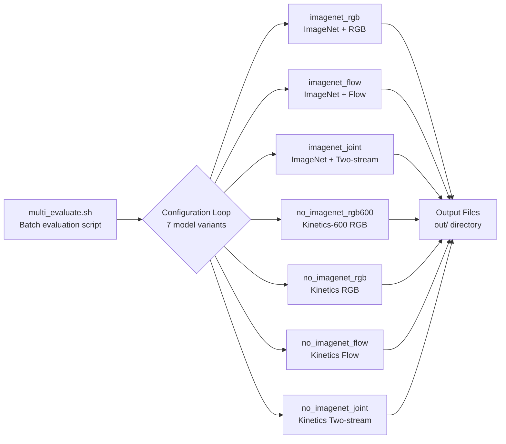

**Sources:** [README.md:94-95](), [README.md:40-52]()

## Data Processing Capabilities

The system includes comprehensive video preprocessing capabilities integrated with MediaPipe:

### Preprocessing Pipeline Features

- **Frame Sampling**: 25 FPS sampling rate for both RGB and Flow streams
- **Resolution Standardization**: 224×224 pixel crops with aspect ratio preservation
- **Optical Flow Computation**: TV-L1 algorithm for motion estimation
- **Normalization**: Pixel value rescaling to [-1, 1] range
- **Batch Processing**: Support for variable-length video sequences

### Supported Input Formats

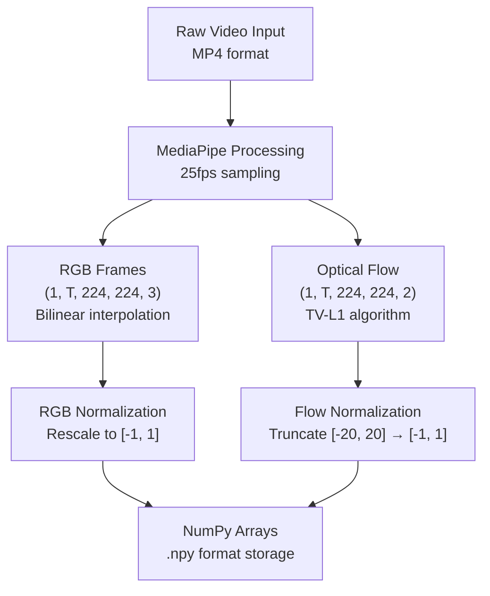

### Action Class Vocabulary

The system supports comprehensive action recognition with:

- **Kinetics-400**: 400 human action classes
- **Kinetics-600**: Extended 600 human action classes  
- **Label Mapping**: Human-readable action descriptions
- **Hierarchical Structure**: Organized action categories

**Sources:** [README.md:149-167](), [README.md:22]()

---

# Page: Model Architecture

# Model Architecture

<details>
<summary>Relevant source files</summary>

The following files were used as context for generating this wiki page:

- [README.md](README.md)
- [data/checkpoints/rgb_scratch_kin600/model.ckpt.index](data/checkpoints/rgb_scratch_kin600/model.ckpt.index)

</details>


This document provides a detailed technical overview of the I3D (Inflated 3D ConvNets) model architecture implementation. It covers the two-stream design, individual stream processing, joint classification mechanism, and the specific code components that implement these features.

For information about running evaluations and using pre-trained models, see [Evaluation Framework](#4). For details about the available checkpoints and training configurations, see [Pre-trained Models](#3).

## Overall I3D Architecture

The I3D model implements a two-stream architecture that processes both spatial appearance information (RGB) and temporal motion information (optical flow) through separate 3D convolutional networks. The architecture is based on the Inception-v1 model, with 2D convolutions inflated to 3D to handle video data.

### Two-Stream I3D Design

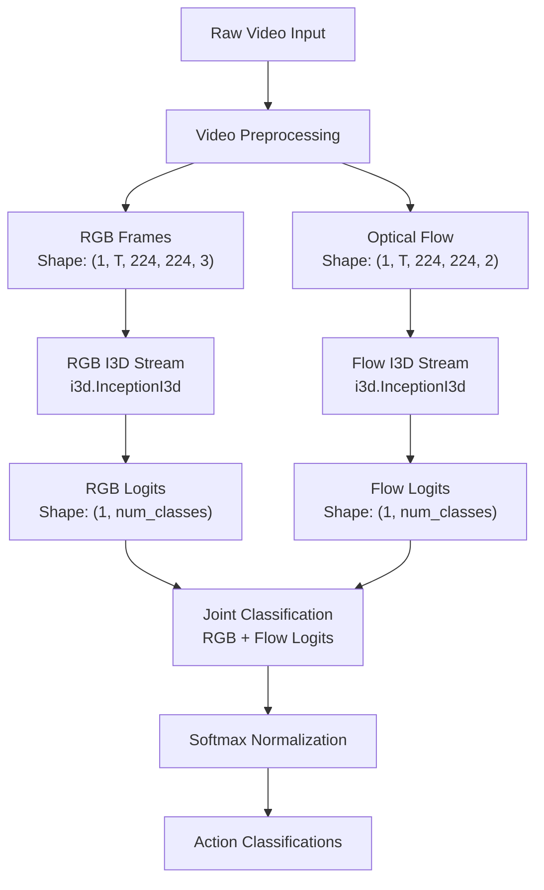

**Sources:** [README.md:44-104](), [README.md:134-138]()

### Model Configuration Options

The I3D implementation supports multiple evaluation modes controlled by the `eval_type` parameter:

| Configuration | Description | Checkpoint Path |
|---------------|-------------|-----------------|
| `rgb` | RGB stream only with ImageNet pre-training | `rgb_imagenet/` |
| `flow` | Flow stream only with ImageNet pre-training | `flow_imagenet/` |
| `joint` | Combined RGB + Flow streams with ImageNet pre-training | Both checkpoints |
| `rgb600` | RGB stream trained from scratch on Kinetics-600 | `rgb_scratch_kin600/` |

**Sources:** [README.md:92-104]()

## RGB Stream Processing

The RGB stream processes visual appearance information from video frames using 3D convolutions applied to RGB pixel data.

### RGB Stream Architecture

```mermaid
graph TD
    RGBInput["RGB Input<br/>(1, T, 224, 224, 3)"] --> Conv3d_1a["Conv3d_1a_7x7<br/>7x7x7 convolution"]
    Conv3d_1a --> MaxPool3d_2a["MaxPool3d_2a_1x3x3<br/>Pooling layer"]
    MaxPool3d_2a --> Conv3d_2b["Conv3d_2b_1x1<br/>1x1x1 convolution"]
    Conv3d_2b --> Conv3d_2c["Conv3d_2c_3x3<br/>3x3x3 convolution"]
    Conv3d_2c --> MaxPool3d_3a["MaxPool3d_3a_1x3x3<br/>Pooling layer"]
    
    MaxPool3d_3a --> Mixed_3b["Mixed_3b<br/>Inception Module"]
    Mixed_3b --> Mixed_3c["Mixed_3c<br/>Inception Module"]
    Mixed_3c --> MaxPool3d_4a["MaxPool3d_4a_3x3x3<br/>Pooling layer"]
    
    MaxPool3d_4a --> Mixed_4b["Mixed_4b<br/>Inception Module"]
    Mixed_4b --> Mixed_4c["Mixed_4c<br/>Inception Module"]
    Mixed_4c --> Mixed_4d["Mixed_4d<br/>Inception Module"]
    Mixed_4d --> Mixed_4e["Mixed_4e<br/>Inception Module"]
    Mixed_4e --> Mixed_4f["Mixed_4f<br/>Inception Module"]
    
    Mixed_4f --> MaxPool3d_5a["MaxPool3d_5a_2x2x2<br/>Pooling layer"]
    MaxPool3d_5a --> Mixed_5b["Mixed_5b<br/>Inception Module"]
    Mixed_5b --> Mixed_5c["Mixed_5c<br/>Inception Module"]
    
    Mixed_5c --> AvgPool3d["AvgPool3d<br/>Global average pooling"]
    AvgPool3d --> Logits["Logits/Conv3d_0c_1x1<br/>Classification layer"]
    Logits --> RGBOutput["RGB Predictions<br/>(1, num_classes)"]
```

**Sources:** [data/checkpoints/rgb_scratch_kin600/model.ckpt.index:1-31]()

### RGB Preprocessing Pipeline

The RGB stream expects input frames that have been preprocessed according to specific requirements:

- **Frame Rate:** 25 frames per second sampling
- **Resolution:** 224x224 pixels with preserved aspect ratio
- **Normalization:** Pixel values rescaled between -1 and 1
- **Cropping:** Center crop during inference, random crop during training

**Sources:** [README.md:149-158]()

## Flow Stream Processing

The Flow stream processes temporal motion information captured through optical flow computation between consecutive video frames.

### Flow Stream Architecture

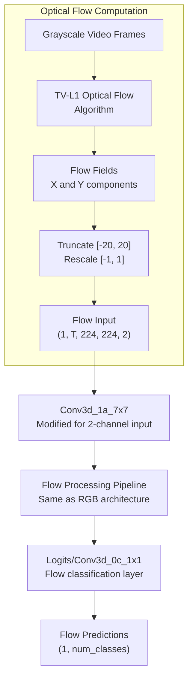

**Sources:** [README.md:160-167]()

### Flow Preprocessing Details

The optical flow computation follows a specific pipeline:

1. **Grayscale Conversion:** RGB frames converted to grayscale
2. **TV-L1 Algorithm:** Optical flow computation using TV-L1 method
3. **Value Truncation:** Flow values truncated to range [-20, 20]
4. **Normalization:** Values rescaled to [-1, 1] range
5. **Channel Selection:** Only X and Y flow components used (2 channels)

**Sources:** [README.md:160-167]()

## Joint Classification

The joint classification mechanism combines predictions from both RGB and Flow streams to produce final action classifications.

### Logit Fusion Strategy

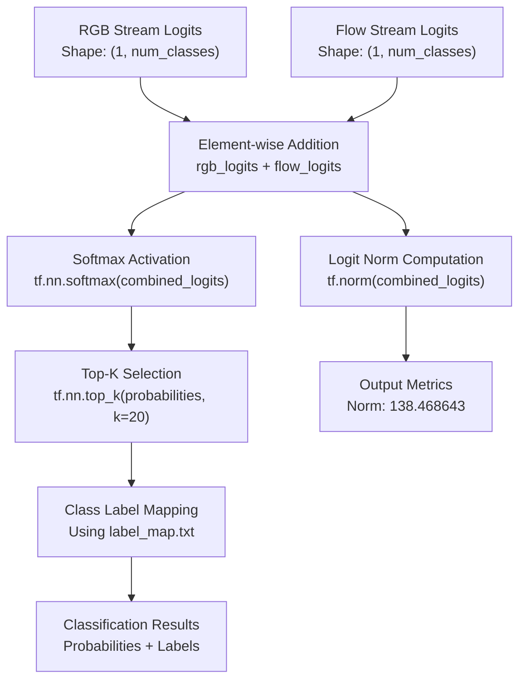

**Sources:** [README.md:102-104](), [README.md:49-78]()

### Implementation in evaluate_sample.py

The joint classification is implemented in the main evaluation script with the following key components:

- **Equal Weighting:** RGB and Flow logits are combined with equal weights (1:1 ratio)
- **Logit Addition:** Simple element-wise addition of logit tensors
- **Probability Computation:** Softmax applied to combined logits
- **Top-K Prediction:** Top 20 classes selected based on probability scores

**Sources:** [README.md:44-52]()

## Model Components and Implementation

### Core I3D Module Structure

The I3D model is implemented in the `i3d.py` file with the main class being `InceptionI3d`. The model architecture includes:

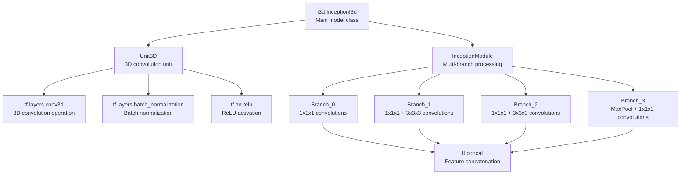

**Sources:** [data/checkpoints/rgb_scratch_kin600/model.ckpt.index:1-31]()

### Checkpoint Structure

The model checkpoints contain the following key components:

- **Convolution Weights:** `Conv3d_*/conv_3d/w` parameters for 3D convolutions
- **Batch Normalization:** `*/batch_norm/beta`, `*/batch_norm/moving_mean`, `*/batch_norm/moving_variance`
- **Momentum Terms:** `*/Momentum` parameters for optimizer state
- **Classification Layer:** `Logits/Conv3d_0c_1x1` final classification weights

**Sources:** [data/checkpoints/rgb_scratch_kin600/model.ckpt.index:1-31]()

### Training Configuration Support

The architecture supports multiple training configurations:

| Component | ImageNet + Kinetics | Kinetics-Only |
|-----------|-------------------|---------------|
| **Initialization** | 2D → 3D filter inflation | Random initialization |
| **Training Steps** | RGB: 115k, Flow: 155k | RGB: 115k, Flow: 155k |
| **Learning Rate** | Multi-stage schedule | Multi-stage schedule |
| **Optimization** | SGD with momentum (0.9) | SGD with momentum (0.9) |

**Sources:** [README.md:99-129]()

---

# Page: RGB Stream Processing

# RGB Stream Processing

<details>
<summary>Relevant source files</summary>

The following files were used as context for generating this wiki page:

- [README.md](README.md)
- [data/checkpoints/rgb_imagenet/model.ckpt.index](data/checkpoints/rgb_imagenet/model.ckpt.index)

</details>


This document describes the RGB stream component of the I3D (Inflated 3D ConvNets) video classification system. The RGB stream processes visual appearance information from video frames to generate action classification logits. For information about the complementary motion processing, see [Flow Stream Processing](#2.2). For details on how RGB and Flow streams are combined, see [Joint Classification](#2.3).

## Overview

The RGB stream in I3D processes raw video frames to extract spatial appearance features using 3D convolutional networks. It operates on sequences of RGB frames sampled at 25fps, applying 3D convolutions inflated from 2D Inception-v1 architectures to capture both spatial and temporal patterns in video data.

**RGB Data Processing Pipeline**
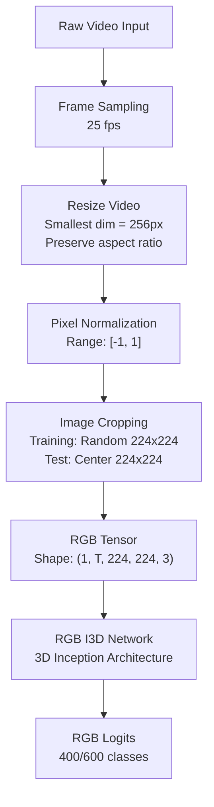

Sources: [README.md:149-158]()

## Input Data Format

The RGB stream expects preprocessed video data in a specific tensor format:

| Property | Value | Description |
|----------|-------|-------------|
| **Shape** | `(1, num_frames, 224, 224, 3)` | Batch size 1, temporal dimension, height, width, RGB channels |
| **Pixel Range** | `[-1, 1]` | Normalized pixel values |
| **Frame Rate** | 25 fps | Temporal sampling rate |
| **Spatial Resolution** | 224×224 | Square crop from resized frames |

The preprocessing pipeline applies bilinear interpolation for resizing and uses different cropping strategies for training versus inference. Sample RGB data is provided as NumPy arrays in the repository for testing purposes.

Sources: [README.md:153-158]()

## RGB I3D Network Architecture

The RGB stream uses an Inflated 3D ConvNet based on Inception-v1 architecture. The network inflates 2D convolution filters to 3D by adding a temporal dimension, enabling processing of video sequences while leveraging ImageNet pre-trained weights.

**RGB I3D Network Structure**
```mermaid
graph TD
    subgraph "RGB Input Processing"
        RGBInput["RGB Tensor<br/>(1, T, 224, 224, 3)"] --> Conv3d1a["Conv3d_1a_7x7<br/>7x7x7 convolution<br/>64 filters"]
        Conv3d1a --> MaxPool1["MaxPool3d_2a_3x3<br/>3x3x3 pooling"]
        MaxPool1 --> Conv3d2b["Conv3d_2b_1x1<br/>1x1x1 convolution<br/>64 filters"]
        Conv3d2b --> Conv3d2c["Conv3d_2c_3x3<br/>3x3x3 convolution<br/>192 filters"]
    end
    
    subgraph "Inception Blocks"
        Conv3d2c --> Mixed3b["Mixed_3b<br/>Inception Block"]
        Mixed3b --> Mixed3c["Mixed_3c<br/>Inception Block"]
        Mixed3c --> Mixed4b["Mixed_4b<br/>Inception Block"]
        Mixed4b --> Mixed4c["Mixed_4c<br/>Inception Block"]
        Mixed4c --> Mixed4d["Mixed_4d<br/>Inception Block"]
        Mixed4d --> Mixed4e["Mixed_4e<br/>Inception Block"]
        Mixed4e --> Mixed4f["Mixed_4f<br/>Inception Block"]
        Mixed4f --> Mixed5b["Mixed_5b<br/>Inception Block"]
        Mixed5b --> Mixed5c["Mixed_5c<br/>Inception Block"]
    end
    
    subgraph "Classification Head"
        Mixed5c --> AvgPool["AvgPool3d_0a_7x7<br/>Global average pooling"]
        AvgPool --> Dropout["Dropout_0b"]
        Dropout --> Logits["Logits/Conv3d_0c_1x1<br/>1x1x1 convolution"]
        Logits --> RGBOutput["RGB Logits<br/>400/600 classes"]
    end
```

Sources: [data/checkpoints/rgb_imagenet/model.ckpt.index:1-12]()

## Model Configurations

The RGB stream supports multiple model configurations based on training strategy and dataset:

| Configuration | Checkpoint Path | Training Strategy | Dataset | Classes |
|---------------|----------------|-------------------|---------|---------|
| **RGB ImageNet** | `rgb_imagenet/` | ImageNet → Kinetics | Kinetics-400 | 400 |
| **RGB Scratch** | `rgb_scratch/` | From scratch | Kinetics-400 | 400 |
| **RGB Kinetics-600** | `rgb_scratch_kin600/` | From scratch | Kinetics-600 | 600 |

Each checkpoint contains TensorFlow model files (`model.ckpt.data`, `model.ckpt.index`, `model.ckpt.meta`) that store the trained network parameters.

**RGB Model Loading Pipeline**
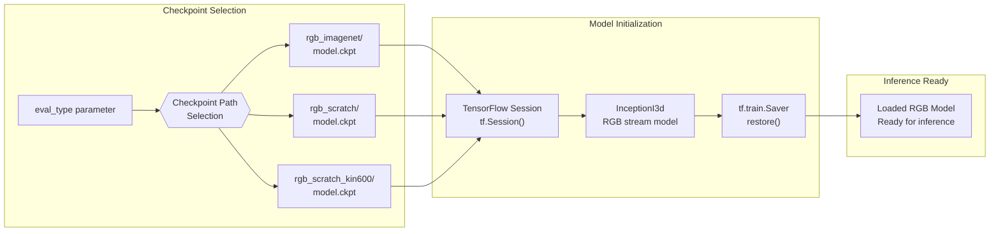

Sources: [README.md:92-104](), [evaluate_sample.py:40-50]()

## Integration with Evaluation System

The RGB stream integrates with the evaluation framework through the `evaluate_sample.py` script, which handles model loading, data preprocessing, and inference execution.

The evaluation system supports RGB-only inference using the `--eval_type rgb` flag, which processes only the RGB stream without the Flow component. This allows for faster inference when motion information is not required.

**RGB Evaluation Flow**
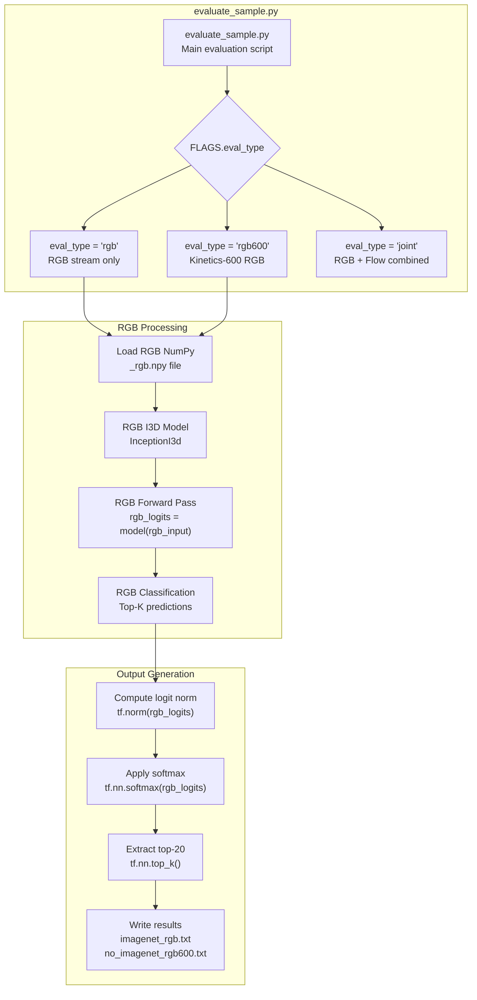

Sources: [evaluate_sample.py:1-100](), [README.md:40-78]()

## Performance Characteristics

The RGB stream achieves the following performance metrics on the Kinetics test set:

| Model Type | Top-1 Accuracy | Top-5 Accuracy |
|------------|----------------|----------------|
| **RGB-I3D (ImageNet + Kinetics)** | 71.1% | 89.3% |
| **RGB-I3D (Kinetics only)** | 68.4% | 88.0% |

The ImageNet pre-trained models demonstrate superior performance due to better initialization from 2D visual features, which are inflated to 3D for video processing.

Sources: [README.md:132-138]()

---

# Page: Flow Stream Processing

# Flow Stream Processing

<details>
<summary>Relevant source files</summary>

The following files were used as context for generating this wiki page:

- [README.md](README.md)
- [data/checkpoints/flow_imagenet/model.ckpt.index](data/checkpoints/flow_imagenet/model.ckpt.index)

</details>


This document covers the optical flow stream processing component of the I3D two-stream video classification architecture. It details how motion information is extracted from video sequences, preprocessed, and fed through the Flow I3D network to generate motion-based action predictions.

For information about the RGB appearance stream, see [RGB Stream Processing](#2.1). For details on how the two streams are combined, see [Joint Classification](#2.3).

## Overview

The Flow stream processes optical flow information to capture temporal motion patterns in video sequences. Unlike the RGB stream which focuses on visual appearance, the Flow stream specializes in understanding movement dynamics that are crucial for action recognition.

```mermaid
graph TD
    RawVideo["Raw Video Input"] --> FlowExtraction["Optical Flow Extraction<br/>TV-L1 Algorithm"]
    FlowExtraction --> FlowPreprocess["Flow Preprocessing<br/>Truncate [-20,20]<br/>Rescale [-1,1]"]
    FlowPreprocess --> FlowTensor["Flow Tensor<br/>(1, T, 224, 224, 2)"]
    FlowTensor --> FlowI3D["Flow I3D Network<br/>inception_i3d"]
    FlowI3D --> FlowLogits["Flow Logits<br/>400/600 classes"]
    
    subgraph "Available Checkpoints"
        FlowImageNet["flow_imagenet/<br/>model.ckpt.*"]
        FlowScratch["flow_scratch/<br/>model.ckpt.*"]
    end
    
    FlowImageNet --> FlowI3D
    FlowScratch --> FlowI3D
```

**Flow Stream Processing Pipeline**

Sources: [README.md:160-167](), [README.md:97-104]()

## Optical Flow Preprocessing Pipeline

The Flow stream preprocessing converts raw video frames into optical flow representations that capture pixel-level motion between consecutive frames.

### Flow Extraction Process

| Step | Process | Details |
|------|---------|---------|
| 1 | Frame Sampling | 25 frames per second |
| 2 | Grayscale Conversion | Convert color frames to grayscale |
| 3 | Optical Flow Computation | TV-L1 algorithm (similar to OpenCV implementation) |
| 4 | Value Truncation | Clip pixel values to range [-20, 20] |
| 5 | Normalization | Rescale to range [-1, 1] |
| 6 | Spatial Cropping | Same 224x224 cropping as RGB stream |

The resulting flow data has shape `(1, num_frames, 224, 224, 2)` where the final dimension represents the x and y components of optical flow vectors.

```mermaid
graph LR
    subgraph "Frame Processing"
        Frame1["Frame t"] --> Grayscale1["Grayscale t"]
        Frame2["Frame t+1"] --> Grayscale2["Grayscale t+1"]
    end
    
    subgraph "Optical Flow Computation"
        Grayscale1 --> TVL1["TV-L1 Algorithm"]
        Grayscale2 --> TVL1
        TVL1 --> FlowVectors["Flow Vectors<br/>(x, y components)"]
    end
    
    subgraph "Postprocessing"
        FlowVectors --> Truncate["Truncate [-20, 20]"]
        Truncate --> Rescale["Rescale [-1, 1]"]
        Rescale --> Crop["Crop 224x224"]
        Crop --> FlowData["Flow Data<br/>(T, 224, 224, 2)"]
    end
```

**Optical Flow Processing Steps**

Sources: [README.md:160-167](), [README.md:149-151]()

## Flow I3D Model Architecture

The Flow I3D network uses the same Inception-I3D architecture as the RGB stream but is specifically trained on optical flow inputs. The key difference is the input layer which accepts 2-channel flow data instead of 3-channel RGB data.

### Model Specifications

```mermaid
graph TB
    subgraph "Flow Input Layer"
        FlowInput["Flow Input<br/>(1, T, 224, 224, 2)"] --> Conv3d1a["Conv3d_1a_7x7<br/>Input: 2 channels<br/>Output: 64 channels"]
    end
    
    subgraph "Inception-I3D Backbone"
        Conv3d1a --> Mixed3b["Mixed_3b<br/>Inception Module"]
        Mixed3b --> Mixed3c["Mixed_3c<br/>Inception Module"]
        Mixed3c --> Mixed4b["Mixed_4b<br/>Inception Module"]
        Mixed4b --> Mixed4c["Mixed_4c<br/>Inception Module"]
        Mixed4c --> Mixed4d["Mixed_4d<br/>Inception Module"]
        Mixed4d --> Mixed4e["Mixed_4e<br/>Inception Module"]
        Mixed4e --> Mixed4f["Mixed_4f<br/>Inception Module"]
        Mixed4f --> Mixed5b["Mixed_5b<br/>Inception Module"]
        Mixed5b --> Mixed5c["Mixed_5c<br/>Inception Module"]
    end
    
    subgraph "Classification Head"
        Mixed5c --> Logits["Logits/Conv3d_0c_1x1<br/>Final Classification"]
        Logits --> Output["Flow Predictions<br/>400/600 classes"]
    end
```

**Flow I3D Architecture Overview**

The network architecture mirrors the RGB stream with identical Inception module structures, but the initial convolution layer is adapted to process 2-channel optical flow input rather than 3-channel RGB input.

Sources: [data/checkpoints/flow_imagenet/model.ckpt.index:1-10](), [README.md:100-104]()

## Training Configuration and Checkpoints

The Flow stream models are trained with different initialization strategies and learning rate schedules compared to the RGB stream.

### Available Flow Models

| Model Type | Checkpoint Path | Pre-training | Classes |
|------------|----------------|-------------|---------|
| ImageNet + Kinetics | `flow_imagenet/` | ImageNet → Kinetics | 400 |
| Kinetics Only | `flow_scratch/` | None (from scratch) | 400 |

### Flow Training Schedule

The Flow models require more training steps than RGB models due to the complexity of learning from motion information:

```mermaid
gantt
    title Flow Model Training Schedule
    dateFormat X
    axisFormat %s
    
    section Learning Rate
    1e-1 Phase 1    :0, 97000
    1e-2 Phase 2    :97000, 104500
    1e-3 Phase 3    :104500, 115000
    1e-1 Extended 1 :115000, 140000
    1e-2 Extended 2 :140000, 150000
    1e-3 Extended 3 :150000, 155000
```

**Flow Training Extended Schedule (155k steps total)**

The extended training schedule (115k-155k steps) was added after determining that Flow models required additional training beyond the initial 115k steps used for RGB models.

Sources: [README.md:119-129](), [README.md:128-129]()

## Model Loading and Evaluation

The Flow stream can be evaluated independently or as part of the joint two-stream classification system.

### Evaluation Modes

```mermaid
graph TD
    subgraph "Flow Evaluation Options"
        EvalScript["evaluate_sample.py"] --> EvalType{--eval_type parameter}
        
        EvalType --> FlowOnly["flow<br/>Flow stream only"]
        EvalType --> Joint["joint<br/>RGB + Flow fusion"]
        
        FlowOnly --> FlowCheckpoint["Load flow checkpoint"]
        Joint --> BothCheckpoints["Load RGB + Flow checkpoints"]
        
        FlowCheckpoint --> FlowPrediction["Flow predictions only"]
        BothCheckpoints --> FusedPrediction["Fused RGB+Flow predictions"]
    end
    
    subgraph "Checkpoint Loading"
        FlowImageNetCkpt["flow_imagenet/model.ckpt.*"]
        FlowScratchCkpt["flow_scratch/model.ckpt.*"]
        
        FlowImageNetCkpt --> FlowCheckpoint
        FlowScratchCkpt --> FlowCheckpoint
    end
```

**Flow Model Evaluation Configurations**

### Performance Results

The Flow stream achieves the following performance on the Kinetics test set:

| Model Configuration | Top-1 Accuracy | Top-5 Accuracy |
|-------------------|----------------|----------------|
| Flow-I3D (ImageNet + Kinetics) | 63.4% | 84.9% |
| Flow-I3D (Kinetics only) | 61.5% | 83.4% |

Sources: [README.md:44-47](), [README.md:134-138]()

## Integration with Preprocessing Pipeline

The Flow stream processing integrates with the broader video preprocessing pipeline that has been open-sourced through Google's MediaPipe project.

```mermaid
graph LR
    subgraph "MediaPipe Integration"
        RawVideo["Raw Video<br/>v_CricketShot_g04_c01.mp4"] --> MediaPipe["MediaPipe<br/>Video Processing"]
        MediaPipe --> FlowNpy["Flow .npy File<br/>v_CricketShot_g04_c01_flow.npy"]
    end
    
    subgraph "Flow Data Format"
        FlowNpy --> FlowShape["Shape: (1, 79, 224, 224, 2)"]
        FlowShape --> FlowChannels["Channel 0: x-component<br/>Channel 1: y-component"]
    end
    
    subgraph "Model Input"
        FlowChannels --> FlowI3DInput["Flow I3D Network<br/>Input Layer"]
    end
```

**Flow Data Pipeline Integration**

The provided sample data demonstrates the expected input format, with the cricket shot video preprocessed into optical flow representations ready for the Flow I3D network.

Sources: [README.md:22](), [README.md:145-167](), [README.md:177-178]()

---

# Page: Joint Classification

# Joint Classification

<details>
<summary>Relevant source files</summary>

The following files were used as context for generating this wiki page:

- [README.md](README.md)

</details>


This document describes how the I3D system combines predictions from the RGB and Flow streams to produce final action classification results. Joint classification represents the fusion mechanism that leverages both visual appearance and motion information for improved video understanding performance.

For information about individual stream processing, see [RGB Stream Processing](#2.1) and [Flow Stream Processing](#2.2). For details about the evaluation framework that implements joint classification, see [Core Evaluation Script](#4.1).

## Logit Fusion Mechanism

The I3D system implements joint classification through a simple but effective logit fusion approach. Both the RGB and Flow streams produce classification logits independently, which are then combined through element-wise addition with equal weighting.

```mermaid
graph TD
    subgraph "Independent Stream Processing"
        RGBFrames["RGB Video Frames"] --> RGBModel["RGB I3D Model"]
        FlowFrames["Optical Flow Frames"] --> FlowModel["Flow I3D Model"]
        
        RGBModel --> RGBLogits["RGB Logits<br/>(num_classes,)"]
        FlowModel --> FlowLogits["Flow Logits<br/>(num_classes,)"]
    end
    
    subgraph "Joint Classification Fusion"
        RGBLogits --> LogitFusion["Logit Addition<br/>rgb_logits + flow_logits"]
        FlowLogits --> LogitFusion
        
        LogitFusion --> CombinedLogits["Combined Logits<br/>(num_classes,)"]
        CombinedLogits --> Softmax["Softmax Normalization"]
        Softmax --> FinalPredictions["Final Probabilities<br/>Action Classification"]
    end
    
    style LogitFusion fill:#f9f9f9
    style FinalPredictions fill:#f0f8ff
```

**Logit Fusion Architecture**

Sources: [README.md:102-104]()

## Implementation in Code

The joint classification mechanism is implemented in the evaluation script through conditional logic that handles different evaluation modes. The system supports multiple evaluation types including individual streams and joint classification.

```mermaid
graph TD
    subgraph "evaluate_sample.py Flow"
        EvalType["eval_type parameter"] --> TypeCheck{"Evaluation Type"}
        
        TypeCheck -->|"rgb"| RGBOnly["RGB Stream Only<br/>rgb_logits"]
        TypeCheck -->|"flow"| FlowOnly["Flow Stream Only<br/>flow_logits"] 
        TypeCheck -->|"joint"| JointPath["Joint Classification Path"]
        TypeCheck -->|"rgb600"| RGB600["RGB 600-class Model<br/>rgb_logits"]
        
        JointPath --> LoadRGBModel["Load RGB I3D Model<br/>checkpoint"]
        JointPath --> LoadFlowModel["Load Flow I3D Model<br/>checkpoint"]
        
        LoadRGBModel --> ComputeRGB["Compute RGB Logits<br/>rgb_model(rgb_input)"]
        LoadFlowModel --> ComputeFlow["Compute Flow Logits<br/>flow_model(flow_input)"]
        
        ComputeRGB --> CombineLogits["Combine Logits<br/>rgb_logits + flow_logits"]
        ComputeFlow --> CombineLogits
        
        CombineLogits --> OutputResults["Generate Classification<br/>Results"]
    end
    
    style JointPath fill:#f9f9f9
    style CombineLogits fill:#f0f8ff
```

**Joint Classification Code Flow**

The implementation handles model loading, inference, and logit combination based on the specified evaluation configuration.

Sources: [README.md:44-47](), [README.md:102-104]()

## Evaluation Configurations

The system provides several evaluation configurations that demonstrate different approaches to combining or isolating the two streams. Each configuration produces distinct output files for analysis.

| Evaluation Type | Configuration | Output File | Description |
|----------------|---------------|-------------|-------------|
| `rgb` | ImageNet + Kinetics | `imagenet_rgb.txt` | RGB stream only with ImageNet pre-training |
| `flow` | ImageNet + Kinetics | `imagenet_flow.txt` | Flow stream only with ImageNet pre-training |
| `joint` | ImageNet + Kinetics | `imagenet_joint.txt` | Combined RGB + Flow with ImageNet pre-training |
| `rgb600` | Scratch Kinetics-600 | `no_imagenet_rgb600.txt` | RGB-only 600-class model |
| `rgb` | Scratch Kinetics | `no_imagenet_rgb.txt` | RGB stream trained from scratch |
| `flow` | Scratch Kinetics | `no_imagenet_flow.txt` | Flow stream trained from scratch |
| `joint` | Scratch Kinetics | `no_imagenet_joint.txt` | Combined streams trained from scratch |

```mermaid
graph LR
    subgraph "Checkpoint Selection"
        EvalConfig["Evaluation Configuration"] --> CheckpointType{"Training Type"}
        
        CheckpointType -->|"ImageNet Pre-trained"| ImageNetCP["ImageNet Checkpoints"]
        CheckpointType -->|"From Scratch"| ScratchCP["Scratch Checkpoints"]
        
        ImageNetCP --> RGBImageNet["rgb_imagenet/<br/>checkpoint"]
        ImageNetCP --> FlowImageNet["flow_imagenet/<br/>checkpoint"]
        
        ScratchCP --> RGBScratch["rgb_scratch/<br/>checkpoint"]
        ScratchCP --> FlowScratch["flow_scratch/<br/>checkpoint"]
        ScratchCP --> RGB600["rgb_scratch_kin600/<br/>checkpoint"]
    end
    
    subgraph "Joint Classification Modes"
        JointImageNet["Joint ImageNet Mode<br/>rgb_imagenet + flow_imagenet"]
        JointScratch["Joint Scratch Mode<br/>rgb_scratch + flow_scratch"]
        
        RGBImageNet --> JointImageNet
        FlowImageNet --> JointImageNet
        
        RGBScratch --> JointScratch
        FlowScratch --> JointScratch
    end
```

**Model Configuration for Joint Classification**

Sources: [README.md:92-95](), [README.md:97-104]()

## Performance Benefits

Joint classification consistently outperforms individual stream results across different training configurations. The fusion of appearance and motion information provides complementary signals that improve overall classification accuracy.

### Accuracy Comparison

| Model Configuration | RGB-I3D | Flow-I3D | Two-Stream I3D |
|-------------------|---------|----------|----------------|
| ImageNet + Kinetics | 71.1 / 89.3 | 63.4 / 84.9 | **74.2 / 91.3** |
| Kinetics Only | 68.4 / 88.0 | 61.5 / 83.4 | **71.6 / 90.0** |

*Values represent top-1 / top-5 accuracy percentages*

The joint classification approach demonstrates:
- **Improved top-1 accuracy**: 3.1% gain over RGB-only with ImageNet pre-training
- **Enhanced top-5 accuracy**: 2.0% improvement in top-5 classification  
- **Consistent benefits**: Similar improvements across both training strategies
- **Complementary information**: Flow stream captures motion patterns that RGB stream misses

```mermaid
graph TD
    subgraph "Information Complementarity"
        RGBInfo["RGB Stream Information<br/>• Object appearance<br/>• Scene context<br/>• Spatial patterns"] 
        FlowInfo["Flow Stream Information<br/>• Motion dynamics<br/>• Temporal patterns<br/>• Movement direction"]
        
        RGBInfo --> Fusion["Logit Fusion<br/>Complementary Combination"]
        FlowInfo --> Fusion
        
        Fusion --> EnhancedRep["Enhanced Representation<br/>• Appearance + Motion<br/>• Spatial + Temporal<br/>• Robust Classification"]
    end
    
    style Fusion fill:#f9f9f9
    style EnhancedRep fill:#f0f8ff
```

**Complementary Information Fusion**

Sources: [README.md:131-138]()

---

# Page: Pre-trained Models

# Pre-trained Models

<details>
<summary>Relevant source files</summary>

The following files were used as context for generating this wiki page:

- [README.md](README.md)
- [data/checkpoints/rgb_scratch_kin600/checkpoint](data/checkpoints/rgb_scratch_kin600/checkpoint)

</details>


This document provides a comprehensive overview of the pre-trained I3D model checkpoints available in the repository, their training configurations, and how they are used within the evaluation system. It covers model variants, checkpoint structure, and the relationship between training strategies and model performance.

For information about the model architecture itself, see [Model Architecture](#2). For details on how to run evaluations with these models, see [Evaluation Framework](#4).

## Model Categories

The repository provides two main categories of pre-trained models based on their training strategy:

### ImageNet + Kinetics Models
These models are initialized using ImageNet pre-trained 2D Inception-v1 weights that are "inflated" to 3D, then fine-tuned on the Kinetics dataset. This approach leverages the rich feature representations learned from ImageNet's large-scale image classification task.

### Kinetics-Only Models  
These models are trained from scratch on the Kinetics dataset using standard TensorFlow/Sonnet initializers, without any ImageNet pre-training. This category includes both Kinetics-400 and Kinetics-600 variants.

## Checkpoint Structure and Organization

### Available Model Checkpoints

The repository contains multiple pre-trained checkpoints organized by training strategy and input modality:

```mermaid
graph TD
    subgraph "Checkpoint Directory Structure"
        DataCheckpoints["data/checkpoints/"] --> ImageNetRGB["rgb_imagenet/"]
        DataCheckpoints --> ImageNetFlow["flow_imagenet/"]
        DataCheckpoints --> ScratchRGB["rgb_scratch/"]
        DataCheckpoints --> ScratchFlow["flow_scratch/"]
        DataCheckpoints --> ScratchRGB600["rgb_scratch_kin600/"]
    end
    
    subgraph "Checkpoint Components"
        ImageNetRGB --> RGBImageNetFiles["model.ckpt.data<br/>model.ckpt.index<br/>model.ckpt.meta<br/>checkpoint"]
        ImageNetFlow --> FlowImageNetFiles["model.ckpt.data<br/>model.ckpt.index<br/>model.ckpt.meta<br/>checkpoint"]
        ScratchRGB --> RGBScratchFiles["model.ckpt.data<br/>model.ckpt.index<br/>model.ckpt.meta<br/>checkpoint"]
        ScratchFlow --> FlowScratchFiles["model.ckpt.data<br/>model.ckpt.index<br/>model.ckpt.meta<br/>checkpoint"]
        ScratchRGB600 --> RGB600Files["model.ckpt.data<br/>model.ckpt.index<br/>model.ckpt.meta<br/>checkpoint"]
    end
    
    subgraph "Model Loading"
        EvaluateScript["evaluate_sample.py"] --> CheckpointPath["--imagenet_pretrained<br/>--eval_type flags"]
        CheckpointPath --> ImageNetRGB
        CheckpointPath --> ImageNetFlow
        CheckpointPath --> ScratchRGB
        CheckpointPath --> ScratchFlow
        CheckpointPath --> ScratchRGB600
    end
```

Sources: [README.md:90-104](), [data/checkpoints/rgb_scratch_kin600/checkpoint:1-3]()

### TensorFlow Checkpoint Format

Each model checkpoint consists of three main files that follow TensorFlow's standard checkpoint format:

| File Extension | Purpose |
|---|---|
| `.ckpt.data` | Contains the actual parameter values (weights and biases) |
| `.ckpt.index` | Index file mapping variable names to their locations in the data file |
| `.ckpt.meta` | Contains the graph structure and metadata |
| `checkpoint` | Points to the latest checkpoint file |

Sources: [data/checkpoints/rgb_scratch_kin600/checkpoint:1-3]()

## Model Configuration Mapping

The evaluation system uses command-line flags to select different pre-trained models:

### Evaluation Type to Model Mapping

```mermaid
graph LR
    subgraph "Evaluation Flags"
        EvalRGB["--eval_type rgb<br/>--imagenet_pretrained"] --> RGBImageNet["rgb_imagenet/<br/>checkpoint"]
        EvalFlow["--eval_type flow<br/>--imagenet_pretrained"] --> FlowImageNet["flow_imagenet/<br/>checkpoint"]
        EvalJoint["--eval_type joint<br/>--imagenet_pretrained"] --> BothImageNet["rgb_imagenet/ +<br/>flow_imagenet/"]
        
        EvalRGBScratch["--eval_type rgb<br/>--no-imagenet_pretrained"] --> RGBScratch["rgb_scratch/<br/>checkpoint"]
        EvalFlowScratch["--eval_type flow<br/>--no-imagenet_pretrained"] --> FlowScratch["flow_scratch/<br/>checkpoint"]
        EvalJointScratch["--eval_type joint<br/>--no-imagenet_pretrained"] --> BothScratch["rgb_scratch/ +<br/>flow_scratch/"]
        
        EvalRGB600["--eval_type rgb600<br/>--no-imagenet_pretrained"] --> RGB600["rgb_scratch_kin600/<br/>checkpoint"]
    end
    
    subgraph "Model Loading Logic"
        BothImageNet --> JointClassification1["Joint RGB+Flow<br/>Classification"]
        BothScratch --> JointClassification2["Joint RGB+Flow<br/>Classification"]
    end
```

Sources: [README.md:92-96]()

## Training Configurations and Performance

### Training Strategy Comparison

The models were trained using different initialization strategies, each with distinct performance characteristics:

| Model Category | Initialization | Dataset | Top-1 Accuracy | Top-5 Accuracy |
|---|---|---|---|---|
| RGB-I3D (ImageNet + Kinetics) | ImageNet 2D → 3D inflation | Kinetics-400 | 71.1% | 89.3% |
| Flow-I3D (ImageNet + Kinetics) | ImageNet 2D → 3D inflation | Kinetics-400 | 63.4% | 84.9% |
| Two-Stream I3D (ImageNet + Kinetics) | Combined streams | Kinetics-400 | 74.2% | 91.3% |
| RGB-I3D (Kinetics-only) | Random initialization | Kinetics-400 | 68.4% | 88.0% |
| Flow-I3D (Kinetics-only) | Random initialization | Kinetics-400 | 61.5% | 83.4% |
| Two-Stream I3D (Kinetics-only) | Combined streams | Kinetics-400 | 71.6% | 90.0% |

Sources: [README.md:131-138]()

### Training Hyperparameters

The models were trained using synchronous SGD with the following configuration:

```mermaid
graph TD
    subgraph "Training Configuration"
        SGD["tf.train.SyncReplicasOptimizer"] --> Replicas["64 replicas + 4 backup"]
        SGD --> BatchSize["Minibatch size: 6"]
        SGD --> Dropout["Dropout: 0.5"]
        SGD --> BatchNorm["BatchNorm enabled"]
        SGD --> Momentum["SGD momentum: 0.9"]
        SGD --> WeightDecay["Weight decay: 1e-7"]
    end
    
    subgraph "Learning Rate Schedules"
        RGBSchedule["RGB Model:<br/>0-97k: 1e-1<br/>97k-108k: 1e-2<br/>108k-115k: 1e-3"]
        FlowSchedule["Flow Model:<br/>0-97k: 1e-1<br/>97k-104.5k: 1e-2<br/>104.5k-115k: 1e-3<br/>115k-140k: 1e-1<br/>140k-150k: 1e-2<br/>150k-155k: 1e-3"]
    end
    
    SGD --> RGBSchedule
    SGD --> FlowSchedule
```

Sources: [README.md:106-129]()

## Model Usage in Evaluation Pipeline

### Default Model Loading Behavior

The `evaluate_sample.py` script determines which checkpoints to load based on command-line flags:

```mermaid
graph TD
    subgraph "Flag Processing"
        ImageNetFlag["--imagenet_pretrained<br/>(default: True)"] --> ImageNetPath["ImageNet + Kinetics<br/>Models"]
        NoImageNetFlag["--no-imagenet_pretrained"] --> ScratchPath["Kinetics-only<br/>Models"]
        
        EvalType["--eval_type<br/>(rgb/flow/joint/rgb600)"] --> StreamSelection["Stream Selection<br/>Logic"]
    end
    
    subgraph "Checkpoint Loading"
        ImageNetPath --> LoadImageNet["Load rgb_imagenet/<br/>and/or flow_imagenet/"]
        ScratchPath --> LoadScratch["Load rgb_scratch/<br/>and/or flow_scratch/"]
        
        RGB600Type["--eval_type rgb600"] --> LoadRGB600["Load rgb_scratch_kin600/"]
    end
    
    subgraph "Model Instantiation"
        LoadImageNet --> CreateModel["i3d.InceptionI3d()<br/>model creation"]
        LoadScratch --> CreateModel
        LoadRGB600 --> CreateModel
        
        CreateModel --> TFSession["TensorFlow Session<br/>with loaded weights"]
    end
```

Sources: [README.md:42-47](), [README.md:90-104]()

### Joint Classification Pipeline

For two-stream evaluation (`--eval_type joint`), the system loads both RGB and Flow models and combines their predictions:

```mermaid
graph LR
    subgraph "Model Loading"
        RGBCheckpoint["RGB Checkpoint<br/>(imagenet or scratch)"] --> RGBModel["RGB I3D Model"]
        FlowCheckpoint["Flow Checkpoint<br/>(imagenet or scratch)"] --> FlowModel["Flow I3D Model"]
    end
    
    subgraph "Inference"
        RGBModel --> RGBLogits["RGB Logits<br/>(400 or 600 classes)"]
        FlowModel --> FlowLogits["Flow Logits<br/>(400 or 600 classes)"]
    end
    
    subgraph "Combination"
        RGBLogits --> AddLogits["Logit Addition<br/>(equal weighting)"]
        FlowLogits --> AddLogits
        AddLogits --> FinalPrediction["Final Classification<br/>Results"]
    end
```

Sources: [README.md:102-104]()

## Special Model: Kinetics-600 RGB

The repository includes a special RGB-only model trained from scratch on the larger Kinetics-600 dataset, which contains 600 action classes compared to the standard 400 classes:

- **Checkpoint Path**: `data/checkpoints/rgb_scratch_kin600/`
- **Evaluation Flag**: `--eval_type rgb600`
- **Dataset**: Kinetics-600 (600 action classes)
- **Training**: From scratch (no ImageNet pre-training)
- **Input Modality**: RGB only

This model represents the latest addition to the available pre-trained models and demonstrates performance on the expanded action vocabulary.

Sources: [README.md:20](), [data/checkpoints/rgb_scratch_kin600/checkpoint:1-3]()

---

# Page: ImageNet + Kinetics Models

# ImageNet + Kinetics Models

<details>
<summary>Relevant source files</summary>

The following files were used as context for generating this wiki page:

- [README.md](README.md)
- [data/checkpoints/flow_imagenet/checkpoint](data/checkpoints/flow_imagenet/checkpoint)
- [data/checkpoints/rgb_imagenet/checkpoint](data/checkpoints/rgb_imagenet/checkpoint)

</details>


This page details the I3D models that leverage ImageNet pre-training followed by Kinetics dataset fine-tuning. These models represent the primary approach described in the original "Quo Vadis" paper and demonstrate superior performance compared to training from scratch. For information about models trained exclusively on Kinetics, see [Kinetics-Only Models](#3.2).

## Training Pipeline and Bootstrapping Approach

The ImageNet + Kinetics models employ a unique two-stage training strategy that leverages existing 2D ImageNet knowledge for 3D video understanding.

### Two-Stage Training Pipeline

```mermaid
graph TD
    subgraph "Stage 1: ImageNet Pre-training"
        ImageNet["ImageNet Dataset<br/>2D Image Classification"] --> Inception2D["2D Inception-v1<br/>Pre-trained Model"]
    end
    
    subgraph "Stage 2: 3D Bootstrapping"
        Inception2D --> Bootstrap["Filter Inflation<br/>2D → 3D Conversion"]
        Bootstrap --> I3DInit["Initialized I3D Model<br/>3D Convolutions"]
    end
    
    subgraph "Stage 3: Kinetics Fine-tuning"
        I3DInit --> KineticsTrain["Kinetics Training<br/>Video Action Recognition"]
        KineticsTrain --> FinalModel["Final I3D Model<br/>ImageNet + Kinetics"]
    end
    
    subgraph "Model Variants"
        FinalModel --> RGBModel["RGB Stream Model<br/>rgb_imagenet/"]
        FinalModel --> FlowModel["Flow Stream Model<br/>flow_imagenet/"]
    end
```

Sources: [README.md:99-100](), [README.md:92]()

### Filter Inflation Process

The bootstrapping process converts 2D Inception-v1 filters into 3D I3D filters by replicating weights across the temporal dimension and normalizing appropriately. This initialization strategy provides a significant advantage over random initialization.

```mermaid
graph LR
    subgraph "2D Inception-v1 Filters"
        Filter2D["2D Convolution Filter<br/>[H, W, C_in, C_out]"]
    end
    
    subgraph "3D Inflation Process"
        Filter2D --> Replicate["Temporal Replication<br/>Repeat N times"]
        Replicate --> Normalize["Normalization<br/>Divide by N"]
        Normalize --> Filter3D["3D I3D Filter<br/>[T, H, W, C_in, C_out]"]
    end
    
    subgraph "Model Initialization"
        Filter3D --> InitRGB["RGB I3D Model<br/>Initialized Weights"]
        Filter3D --> InitFlow["Flow I3D Model<br/>Modified for 2-channel input"]
    end
```

Sources: [README.md:99-100]()

## Available Checkpoints

The ImageNet + Kinetics models are available as pre-trained checkpoints for both RGB and Flow streams.

### Checkpoint Structure

| Stream | Checkpoint Directory | Description |
|--------|---------------------|-------------|
| RGB | `data/checkpoints/rgb_imagenet/` | RGB stream pre-trained on ImageNet then Kinetics |
| Flow | `data/checkpoints/flow_imagenet/` | Flow stream pre-trained on ImageNet then Kinetics |

### Checkpoint Files

Each checkpoint directory contains the standard TensorFlow checkpoint files:

```mermaid
graph TD
    subgraph "RGB ImageNet Checkpoint"
        RGBDir["data/checkpoints/rgb_imagenet/"] --> RGBCkpt["checkpoint"]
        RGBDir --> RGBData["model.ckpt.data-*"]
        RGBDir --> RGBIndex["model.ckpt.index"] 
        RGBDir --> RGBMeta["model.ckpt.meta"]
    end
    
    subgraph "Flow ImageNet Checkpoint"
        FlowDir["data/checkpoints/flow_imagenet/"] --> FlowCkpt["checkpoint"]
        FlowDir --> FlowData["model.ckpt.data-*"]
        FlowDir --> FlowIndex["model.ckpt.index"]
        FlowDir --> FlowMeta["model.ckpt.meta"]
    end
    
    subgraph "Loading Process"
        RGBCkpt --> Loader["TensorFlow<br/>Checkpoint Loader"]
        FlowCkpt --> Loader
        Loader --> Session["Active TensorFlow<br/>Session"]
    end
```

Sources: [data/checkpoints/rgb_imagenet/checkpoint:1](), [data/checkpoints/flow_imagenet/checkpoint:1]()

## Performance Characteristics

The ImageNet + Kinetics models demonstrate superior performance compared to their Kinetics-only counterparts across all evaluation metrics.

### Kinetics Test Set Results

| Model | ImageNet + Kinetics (Top-1 / Top-5) | Kinetics-Only (Top-1 / Top-5) |
|-------|-------------------------------------|-------------------------------|
| RGB-I3D | 71.1% / 89.3% | 68.4% / 88.0% |
| Flow-I3D | 63.4% / 84.9% | 61.5% / 83.4% |
| Two-Stream I3D | 74.2% / 91.3% | 71.6% / 90.0% |

Sources: [README.md:134-138]()

### Performance Analysis

```mermaid
graph TD
    subgraph "Performance Comparison"
        ImageNetPre["ImageNet + Kinetics"] --> RGBPerf["RGB: 71.1% / 89.3%"]
        ImageNetPre --> FlowPerf["Flow: 63.4% / 84.9%"] 
        ImageNetPre --> JointPerf["Joint: 74.2% / 91.3%"]
        
        ScratchTrain["Kinetics-Only"] --> RGBScratch["RGB: 68.4% / 88.0%"]
        ScratchTrain --> FlowScratch["Flow: 61.5% / 83.4%"]
        ScratchTrain --> JointScratch["Joint: 71.6% / 90.0%"]
    end
    
    subgraph "Improvement Analysis"
        RGBPerf --> RGBGain["+2.7% / +1.3%<br/>RGB Improvement"]
        FlowPerf --> FlowGain["+1.9% / +1.5%<br/>Flow Improvement"]
        JointPerf --> JointGain["+2.6% / +1.3%<br/>Joint Improvement"]
    end
```

Sources: [README.md:134-138]()

## Training Configuration

The ImageNet + Kinetics models use identical training configurations to their Kinetics-only counterparts, with the key difference being the initialization strategy.

### Training Hyperparameters

| Parameter | RGB Stream | Flow Stream |
|-----------|------------|-------------|
| Total Steps | 115,000 | 155,000 |
| Batch Size | 6 | 6 |
| Optimizer | SGD (momentum=0.9) | SGD (momentum=0.9) |
| Weight Decay | 1e-7 | 1e-7 |
| Dropout | 0.5 | 0.5 |
| Replicas | 64 (+ 4 backup) | 64 (+ 4 backup) |

### Learning Rate Schedules

**RGB Stream:**
- Steps 0-97k: 1e-1
- Steps 97k-108k: 1e-2  
- Steps 108k-115k: 1e-3

**Flow Stream:**
- Steps 0-97k: 1e-1
- Steps 97k-104.5k: 1e-2
- Steps 104.5k-115k: 1e-3
- Steps 115k-140k: 1e-1
- Steps 140k-150k: 1e-2
- Steps 150k-155k: 1e-3

Sources: [README.md:113-126]()

### Training Architecture

```mermaid
graph TD
    subgraph "Distributed Training Setup"
        SyncSGD["tf.train.SyncReplicasOptimizer<br/>Synchronous SGD"] --> Replicas["64 Training Replicas<br/>+ 4 Backup Replicas"]
        Replicas --> BatchNorm["Batch Normalization<br/>Applied During Training"]
        BatchNorm --> Dropout["0.5 Dropout Rate<br/>Regularization"]
    end
    
    subgraph "Separate Stream Training"
        RGBTrain["RGB Stream Training<br/>115k steps"] --> RGBLoss["Softmax Classification Loss<br/>400 Kinetics classes"]
        FlowTrain["Flow Stream Training<br/>155k steps"] --> FlowLoss["Softmax Classification Loss<br/>400 Kinetics classes"]
    end
    
    subgraph "Model Output"
        RGBLoss --> RGBCheckpoint["rgb_imagenet/<br/>model.ckpt"]
        FlowLoss --> FlowCheckpoint["flow_imagenet/<br/>model.ckpt"]
    end
```

Sources: [README.md:106-111](), [README.md:113-126]()

The ImageNet + Kinetics models represent the recommended approach for most applications, providing the best balance of accuracy and training efficiency through effective transfer learning from 2D image understanding to 3D video analysis.

---

# Page: Kinetics-Only Models

# Kinetics-Only Models

<details>
<summary>Relevant source files</summary>

The following files were used as context for generating this wiki page:

- [README.md](README.md)
- [data/checkpoints/flow_scratch/checkpoint](data/checkpoints/flow_scratch/checkpoint)
- [data/checkpoints/rgb_scratch_kin600/checkpoint](data/checkpoints/rgb_scratch_kin600/checkpoint)

</details>


This document covers the I3D models that were trained from scratch exclusively on the Kinetics dataset, without any ImageNet pre-training. These models demonstrate the effectiveness of training large-scale video classification networks directly on action recognition data.

For information about models that combine ImageNet pre-training with Kinetics fine-tuning, see [ImageNet + Kinetics Models](#3.1). For detailed analysis of the performance characteristics of from-scratch training, see [From-Scratch Training Results](#5.2). For specific details about the Kinetics-600 RGB model, see [Kinetics-600 RGB Model](#3.2.1).

## Training Approach

Kinetics-only models are initialized using the default Sonnet and TensorFlow initializers rather than bootstrapping from 2D ImageNet models. This approach trains the 3D convolution filters directly on video data from the beginning, allowing the network to learn spatiotemporal features specifically optimized for action recognition.

The training methodology differs from ImageNet + Kinetics models in several key aspects:

Training methodology diagram:

```mermaid
graph TD
    subgraph "Kinetics-Only Training Pipeline"
        InitRandom["Random Weight Initialization<br/>Sonnet/TensorFlow defaults"]
        KineticsData["Kinetics Dataset<br/>Training Split"]
        SyncSGD["Synchronous SGD<br/>tf.train.SyncReplicasOptimizer"]
        
        InitRandom --> Training["3D I3D Training<br/>Direct on Video Data"]
        KineticsData --> Training
        Training --> SyncSGD
        
        SyncSGD --> RGBModel["RGB Stream Model<br/>115k steps"]
        SyncSGD --> FlowModel["Flow Stream Model<br/>155k steps"]
        
        RGBModel --> RGBCheckpoint["rgb_scratch/<br/>model.ckpt"]
        FlowModel --> FlowCheckpoint["flow_scratch/<br/>model.ckpt"]
    end
    
    subgraph "Training Configuration"
        Config["64 replicas + 4 backup<br/>Minibatch size: 6<br/>Dropout: 0.5<br/>BatchNorm enabled<br/>SGD momentum: 0.9<br/>Weight decay: 1e-7"]
    end
    
    Config --> SyncSGD
```

Sources: [README.md:98-130]()

## Available Model Checkpoints

The repository provides several Kinetics-only model checkpoints stored in the `data/checkpoints` directory:

Checkpoint structure diagram:

```mermaid
graph TB
    subgraph "Kinetics-Only Checkpoints"
        KineticsModels["Kinetics-Only Models"]
        
        KineticsModels --> RGBScratch["rgb_scratch/<br/>Standard Kinetics RGB"]
        KineticsModels --> FlowScratch["flow_scratch/<br/>Standard Kinetics Flow"]  
        KineticsModels --> RGB600["rgb_scratch_kin600/<br/>Kinetics-600 RGB"]
        
        RGBScratch --> RGBFiles["model.ckpt.data<br/>model.ckpt.index<br/>model.ckpt.meta<br/>checkpoint"]
        FlowScratch --> FlowFiles["model.ckpt.data<br/>model.ckpt.index<br/>model.ckpt.meta<br/>checkpoint"]
        RGB600 --> RGB600Files["model.ckpt.data<br/>model.ckpt.index<br/>model.ckpt.meta<br/>checkpoint"]
    end
    
    subgraph "Dataset Scope"
        StandardKinetics["Kinetics-400<br/>400 action classes"]
        ExtendedKinetics["Kinetics-600<br/>600 action classes"]
        
        StandardKinetics --> RGBScratch
        StandardKinetics --> FlowScratch
        ExtendedKinetics --> RGB600
    end
```

Sources: [README.md:97-104](), [data/checkpoints/rgb_scratch_kin600/checkpoint:1-3](), [data/checkpoints/flow_scratch/checkpoint:1-3]()

| Model Type | Checkpoint Directory | Dataset | Description |
|------------|---------------------|---------|-------------|
| RGB Stream | `rgb_scratch/` | Kinetics-400 | RGB-only model trained from scratch |
| Flow Stream | `flow_scratch/` | Kinetics-400 | Optical flow model trained from scratch |
| RGB Stream | `rgb_scratch_kin600/` | Kinetics-600 | RGB model trained on extended dataset |

## Training Configuration Details

The training process uses distinct learning rate schedules for RGB and Flow streams:

**RGB Stream Training (115k steps):**
- Steps 0-97k: Learning rate 1e-1
- Steps 97k-108k: Learning rate 1e-2  
- Steps 108k-115k: Learning rate 1e-3

**Flow Stream Training (155k steps):**
- Steps 0-97k: Learning rate 1e-1
- Steps 97k-104.5k: Learning rate 1e-2
- Steps 104.5k-115k: Learning rate 1e-3
- Steps 115k-140k: Learning rate 1e-1 (restart)
- Steps 140k-150k: Learning rate 1e-2
- Steps 150k-155k: Learning rate 1e-3

The Flow models require additional training steps due to the complexity of learning optical flow representations from scratch.

Sources: [README.md:106-130]()

## Performance Comparison

Performance comparison between training approaches:

```mermaid
graph LR
    subgraph "Model Performance Comparison"
        subgraph "Top-1 / Top-5 Accuracy"
            RGBComp["RGB-I3D<br/>ImageNet+Kinetics: 71.1/89.3<br/>Kinetics-Only: 68.4/88.0"]
            FlowComp["Flow-I3D<br/>ImageNet+Kinetics: 63.4/84.9<br/>Kinetics-Only: 61.5/83.4"]
            JointComp["Two-Stream I3D<br/>ImageNet+Kinetics: 74.2/91.3<br/>Kinetics-Only: 71.6/90.0"]
        end
        
        subgraph "Performance Gap Analysis"
            RGBGap["RGB Gap: -2.7 top-1"]
            FlowGap["Flow Gap: -1.9 top-1"] 
            JointGap["Joint Gap: -2.6 top-1"]
        end
    end
```

The Kinetics-only models achieve competitive performance while demonstrating that effective video understanding can be learned directly from action recognition data without ImageNet pre-training.

Sources: [README.md:131-139]()

## Model Integration

Kinetics-only models integrate with the evaluation framework through specific configuration flags:

| Evaluation Type | Flag | Model Used |
|----------------|------|------------|
| RGB Only | `--eval_type rgb` | `rgb_scratch/` checkpoint |
| Flow Only | `--eval_type flow` | `flow_scratch/` checkpoint |
| Joint Classification | `--eval_type joint` | Both checkpoints combined |
| Kinetics-600 RGB | `--eval_type rgb600` | `rgb_scratch_kin600/` checkpoint |

The models maintain the same architectural structure as their ImageNet pre-trained counterparts, differing only in initialization and training methodology. This allows seamless integration with the existing evaluation and inference pipeline.

Sources: [README.md:94-96]()

---

# Page: Kinetics-600 RGB Model

# Kinetics-600 RGB Model

<details>
<summary>Relevant source files</summary>

The following files were used as context for generating this wiki page:

- [data/checkpoints/rgb_scratch_kin600/checkpoint](data/checkpoints/rgb_scratch_kin600/checkpoint)
- [data/checkpoints/rgb_scratch_kin600/model.ckpt.index](data/checkpoints/rgb_scratch_kin600/model.ckpt.index)
- [data/checkpoints/rgb_scratch_kin600/model.ckpt.meta](data/checkpoints/rgb_scratch_kin600/model.ckpt.meta)

</details>


This document provides detailed technical information about the RGB model trained from scratch on the Kinetics-600 dataset. This model processes visual appearance information from video frames without ImageNet pre-training, representing one of the core model variants in the I3D system.

For information about models that use ImageNet pre-training, see [ImageNet + Kinetics Models](#3.1). For the broader category of scratch-trained models, see [Kinetics-Only Models](#3.2). For general RGB stream architecture details, see [RGB Stream Processing](#2.1).

## Model Specifications

The Kinetics-600 RGB model is an Inflated 3D ConvNet trained from scratch on 600 action classes. This model demonstrates that competitive performance can be achieved without ImageNet pre-training when sufficient video data is available.

### Training Configuration

| Parameter | Value |
|-----------|-------|
| Training Dataset | Kinetics-600 |
| Input Modality | RGB frames only |
| Pre-training | None (trained from scratch) |
| Output Classes | 600 action categories |
| Architecture | Inception-I3D |
| Input Resolution | 224×224×3 per frame |

**Architecture Overview**
```mermaid
graph TD
    Input["RGB Video Input<br/>224x224x3 frames"] --> Conv3d_1a["Conv3d_1a_7x7<br/>Initial 3D convolution"]
    Conv3d_1a --> MaxPool["MaxPool3d_2a_3x3<br/>Spatial-temporal pooling"]
    MaxPool --> Conv3d_2b["Conv3d_2b_1x1<br/>Bottleneck layer"]
    Conv3d_2b --> Conv3d_2c["Conv3d_2c_3x3<br/>Feature extraction"]
    Conv3d_2c --> Mixed3["Mixed_3b/Mixed_3c<br/>Inception modules"]
    Mixed3 --> Mixed4["Mixed_4b/4c/4d/4e/4f<br/>Inception modules"]
    Mixed4 --> Mixed5["Mixed_5b/Mixed_5c<br/>Final inception layers"]
    Mixed5 --> Logits["Logits/Conv3d_0c_1x1<br/>Classification head"]
    Logits --> Output["600-class predictions"]
```

Sources: [data/checkpoints/rgb_scratch_kin600/model.ckpt.index:1-31]()

## Checkpoint Structure

The model checkpoint follows TensorFlow's standard format with specific organization for the I3D architecture components.

### Checkpoint Files

**File Organization**
```mermaid
graph LR
    CheckpointDir["data/checkpoints/rgb_scratch_kin600/"] --> CheckpointFile["checkpoint"]
    CheckpointDir --> DataFile["model.ckpt.data"]
    CheckpointDir --> IndexFile["model.ckpt.index"]
    CheckpointDir --> MetaFile["model.ckpt.meta"]
    
    CheckpointFile --> ModelPath["model_checkpoint_path: 'model.ckpt'"]
    IndexFile --> WeightIndex["Weight tensor index<br/>Conv3d layers, batch_norm, Mixed blocks"]
    DataFile --> WeightData["Actual weight tensors<br/>Binary format"]
    MetaFile --> GraphDef["TensorFlow graph definition<br/>Network architecture"]
```

The checkpoint file contains a simple text reference:
- `model_checkpoint_path: "model.ckpt"`
- `all_model_checkpoint_paths: "model.ckpt"`

### Weight Organization

The model weights are organized hierarchically following the Inception-I3D structure:

| Layer Type | Pattern | Example |
|------------|---------|---------|
| Initial Conv | `Conv3d_1a_7x7/*` | `Conv3d_1a_7x7/batch_norm/beta` |
| Bottleneck | `Conv3d_2b_1x1/*` | `Conv3d_2b_1x1/conv_3d/w` |
| Standard Conv | `Conv3d_2c_3x3/*` | `Conv3d_2c_3x3/batch_norm/moving_variance` |
| Inception Blocks | `Mixed_*/*` | `Mixed_3b/Branch_0/Conv3d_0a_1x1/*` |
| Classification | `Logits/*` | `Logits/Conv3d_0c_1x1/conv_3d/b` |

Sources: [data/checkpoints/rgb_scratch_kin600/checkpoint:1-3](), [data/checkpoints/rgb_scratch_kin600/model.ckpt.index:1-31]()

## Model Loading Process

The evaluation system loads this model through a standardized TensorFlow checkpoint restoration process.

**Model Loading Workflow**
```mermaid
graph TD
    EvalScript["evaluate_sample.py"] --> CheckFlags["Check --eval_type flag"]
    CheckFlags --> RGB600Check{"`eval_type == 'rgb600'`"}
    RGB600Check -->|Yes| LoadPath["Set checkpoint_path:<br/>rgb_scratch_kin600"]
    RGB600Check -->|No| OtherPath["Use different checkpoint"]
    
    LoadPath --> TFSession["TensorFlow Session"]
    TFSession --> Saver["tf.train.Saver"]
    Saver --> RestoreOp["saver.restore(sess, checkpoint_path)"]
    
    RestoreOp --> Conv3dWeights["Load Conv3d_* weights"]
    RestoreOp --> MixedWeights["Load Mixed_* weights"] 
    RestoreOp --> LogitsWeights["Load Logits weights"]
    RestoreOp --> BatchNormWeights["Load batch_norm parameters"]
    
    Conv3dWeights --> ReadyModel["Model ready for inference"]
    MixedWeights --> ReadyModel
    LogitsWeights --> ReadyModel
    BatchNormWeights --> ReadyModel
```

Sources: [data/checkpoints/rgb_scratch_kin600/model.ckpt.index:1-31]()

## Usage in Evaluation

This model is specifically invoked using the `rgb600` evaluation type in the core evaluation framework.

### Evaluation Command

```bash
python evaluate_sample.py \
  --eval_type=rgb600 \
  --imagenet_pretrained=False \
  --sample_path=data/video_sample.avi
```

### Integration with Batch Evaluation

The `multi_evaluate.sh` script includes this model in systematic evaluations:

**Batch Evaluation Integration**
```mermaid
graph LR
    MultiEval["multi_evaluate.sh"] --> RGB600Config["rgb600 configuration"]
    RGB600Config --> EvalCall["evaluate_sample.py --eval_type=rgb600"]
    EvalCall --> Output["no_imagenet_rgb600.txt"]
    
    RGB600Config --> CheckpointPath["data/checkpoints/rgb_scratch_kin600/"]
    RGB600Config --> NoImageNet["--imagenet_pretrained=False"]
    RGB600Config --> Classes600["600 action classes"]
```

The evaluation produces output files following the naming pattern `no_imagenet_rgb600.txt` to indicate this model was trained without ImageNet pre-training.

Sources: [data/checkpoints/rgb_scratch_kin600/checkpoint:1-3]()

## Architecture Details

The model implements the full Inception-I3D architecture with 3D convolutions inflated from the 2D Inception-v1 design.

### Layer Structure

**Inception Module Organization**
```mermaid
graph TD
    Input["Input tensor"] --> Mixed["Mixed_Xb block"]
    
    Mixed --> Branch0["Branch_0<br/>Conv3d_0a_1x1"]
    Mixed --> Branch1["Branch_1<br/>Conv3d_0a_1x1 → Conv3d_0b_3x3"]
    Mixed --> Branch2["Branch_2<br/>Conv3d_0a_1x1 → Conv3d_0a_3x3 → Conv3d_0b_3x3"]
    Mixed --> Branch3["Branch_3<br/>MaxPool3d → Conv3d_0b_1x1"]
    
    Branch0 --> BN0["batch_norm<br/>β, γ, moving_mean, moving_variance"]
    Branch1 --> BN1["batch_norm<br/>parameters"]
    Branch2 --> BN2["batch_norm<br/>parameters"]
    Branch3 --> BN3["batch_norm<br/>parameters"]
    
    BN0 --> Concat["Concatenate"]
    BN1 --> Concat
    BN2 --> Concat
    BN3 --> Concat
    
    Concat --> Output["Mixed block output"]
```

### Weight Components

Each layer contains multiple parameter types:

| Component | Purpose | Storage Format |
|-----------|---------|----------------|
| `conv_3d/w` | Convolution weights | 5D tensor (T×H×W×C_in×C_out) |
| `batch_norm/beta` | Batch norm shift | 1D tensor |
| `batch_norm/gamma` | Batch norm scale | 1D tensor |
| `batch_norm/moving_mean` | Running mean | 1D tensor |
| `batch_norm/moving_variance` | Running variance | 1D tensor |
| `conv_3d/w/Momentum` | Optimizer state | Same shape as weights |

Sources: [data/checkpoints/rgb_scratch_kin600/model.ckpt.index:1-31]()

## Performance Characteristics

This model represents the Kinetics-600 scratch-trained variant, designed to demonstrate I3D effectiveness without ImageNet initialization.

### Key Features

- **No ImageNet dependency**: Trained entirely on video data
- **600-class output**: Full Kinetics-600 action vocabulary
- **RGB-only input**: Processes visual appearance without optical flow
- **Standard I3D architecture**: Full Inception-I3D implementation
- **TensorFlow format**: Compatible with standard TF checkpoint loading

### Evaluation Integration

The model integrates seamlessly with the evaluation framework through the `rgb600` evaluation type, producing standardized output formats compatible with the broader I3D evaluation ecosystem.

Sources: [data/checkpoints/rgb_scratch_kin600/checkpoint:1-3]()

---

# Page: Evaluation Framework

# Evaluation Framework

<details>
<summary>Relevant source files</summary>

The following files were used as context for generating this wiki page:

- [evaluate_sample.py](evaluate_sample.py)
- [multi_evaluate.sh](multi_evaluate.sh)

</details>


The evaluation framework provides tools for testing pre-trained I3D models on video samples and analyzing their classification performance. This system supports evaluation of different model configurations including RGB-only, optical flow-only, and joint two-stream models, with both ImageNet pre-trained and from-scratch training variants.

For information about the actual model architectures being evaluated, see [Model Architecture](#2). For details about the pre-trained model checkpoints, see [Pre-trained Models](#3). For analysis of evaluation results, see [Results and Analysis](#5).

## System Overview

The evaluation framework consists of two primary components: a core evaluation script for single runs and a batch evaluation script for systematic testing across multiple configurations.

**Evaluation System Architecture**

```mermaid
graph TD
    MultiEval["multi_evaluate.sh"] --> EvalSample["evaluate_sample.py"]
    
    EvalSample --> ConfigParsing["Configuration Parsing"]
    ConfigParsing --> ModelType{"eval_type parameter"}
    ConfigParsing --> PretrainFlag{"imagenet_pretrained flag"}
    
    ModelType --> RGB["RGB Stream Only"]
    ModelType --> Flow["Flow Stream Only"] 
    ModelType --> RGB600["RGB600 Classes"]
    ModelType --> Joint["Joint Two-Stream"]
    
    PretrainFlag --> ImageNetModels["ImageNet Pre-trained Models"]
    PretrainFlag --> ScratchModels["From-Scratch Models"]
    
    RGB --> RGBPipeline["RGB Processing Pipeline"]
    Flow --> FlowPipeline["Flow Processing Pipeline"]
    RGB600 --> RGB600Pipeline["RGB600 Processing Pipeline"]
    Joint --> JointPipeline["Joint Processing Pipeline"]
    
    RGBPipeline --> OutputGen["Output Generation"]
    FlowPipeline --> OutputGen
    RGB600Pipeline --> OutputGen  
    JointPipeline --> OutputGen
    
    OutputGen --> ResultFiles["Result Files"]
```

Sources: [evaluate_sample.py:47-48](), [evaluate_sample.py:61-62](), [multi_evaluate.sh:17-23]()

## Core Evaluation Script

The `evaluate_sample.py` script serves as the primary evaluation engine, handling model loading, inference, and result generation for individual evaluation runs.

### Configuration Parameters

The script accepts two main configuration flags that determine the evaluation behavior:

| Parameter | Values | Description |
|-----------|--------|-------------|
| `eval_type` | `rgb`, `rgb600`, `flow`, `joint` | Specifies which model stream(s) to evaluate |
| `imagenet_pretrained` | `true`, `false` | Whether to use ImageNet pre-trained models |

Sources: [evaluate_sample.py:47-48]()

### Model Loading and Checkpoint Management

The evaluation script maintains a mapping of model types to their corresponding checkpoint paths:

**Checkpoint Path Configuration**

```mermaid
graph TD
    CheckpointPaths["_CHECKPOINT_PATHS Dictionary"] --> RGB["'rgb': rgb_scratch/model.ckpt"]
    CheckpointPaths --> RGB600["'rgb600': rgb_scratch_kin600/model.ckpt"]
    CheckpointPaths --> Flow["'flow': flow_scratch/model.ckpt"]
    CheckpointPaths --> RGBImageNet["'rgb_imagenet': rgb_imagenet/model.ckpt"]
    CheckpointPaths --> FlowImageNet["'flow_imagenet': flow_imagenet/model.ckpt"]
    
    EvalType["eval_type parameter"] --> ModelSelection{"Model Selection Logic"}
    ImageNetFlag["imagenet_pretrained flag"] --> ModelSelection
    
    ModelSelection --> RGB
    ModelSelection --> RGB600
    ModelSelection --> Flow
    ModelSelection --> RGBImageNet
    ModelSelection --> FlowImageNet
    
    ModelSelection --> TensorFlowSaver["tf.train.Saver"]
    TensorFlowSaver --> SessionRestore["sess.restore()"]
```

Sources: [evaluate_sample.py:34-40](), [evaluate_sample.py:121-124](), [evaluate_sample.py:131-134]()

### Input Data Processing

The script processes sample video data stored as NumPy arrays, with different input shapes for RGB and optical flow streams:

- **RGB Input**: Shape `(1, 79, 224, 224, 3)` for appearance information
- **Flow Input**: Shape `(1, 79, 224, 224, 2)` for motion information

Sources: [evaluate_sample.py:28-32](), [evaluate_sample.py:71-73](), [evaluate_sample.py:96-98]()

### Model Architecture Instantiation

The script creates separate I3D model instances for each stream using the `InceptionI3d` class:

```mermaid
graph LR
    RGBScope["tf.variable_scope('RGB')"] --> RGBModel["i3d.InceptionI3d(NUM_CLASSES)"]
    FlowScope["tf.variable_scope('Flow')"] --> FlowModel["i3d.InceptionI3d(NUM_CLASSES)"]
    
    RGBModel --> RGBLogits["rgb_logits"]
    FlowModel --> FlowLogits["flow_logits"]
    
    EvalType["eval_type"] --> LogitSelection{"Logit Selection"}
    RGBLogits --> LogitSelection
    FlowLogits --> LogitSelection
    
    LogitSelection --> RGBOnly["RGB Only: rgb_logits"]
    LogitSelection --> FlowOnly["Flow Only: flow_logits"] 
    LogitSelection --> JointStream["Joint: rgb_logits + flow_logits"]
    
    LogitSelection --> Softmax["tf.nn.softmax()"]
    Softmax --> Predictions["model_predictions"]
```

Sources: [evaluate_sample.py:76-80](), [evaluate_sample.py:99-103](), [evaluate_sample.py:110-116]()

## Batch Evaluation System

The `multi_evaluate.sh` script orchestrates systematic evaluation across all supported model configurations, generating a comprehensive set of results for comparison.

### Evaluation Configuration Matrix

The batch script executes seven distinct evaluation configurations:

**Batch Evaluation Workflow**

```mermaid
graph TD
    BatchScript["multi_evaluate.sh"] --> ImageNetConfigs["ImageNet Pre-trained Configurations"]
    BatchScript --> ScratchConfigs["From-Scratch Configurations"]
    
    ImageNetConfigs --> ImageNetJoint["--imagenet_pretrained=true --eval_type=joint"]
    ImageNetConfigs --> ImageNetFlow["--imagenet_pretrained=true --eval_type=flow"]
    ImageNetConfigs --> ImageNetRGB["--imagenet_pretrained=true --eval_type=rgb"]
    
    ScratchConfigs --> ScratchRGB600["--imagenet_pretrained=false --eval_type=rgb600"]
    ScratchConfigs --> ScratchJoint["--imagenet_pretrained=false --eval_type=joint"]
    ScratchConfigs --> ScratchFlow["--imagenet_pretrained=false --eval_type=flow"]
    ScratchConfigs --> ScratchRGB["--imagenet_pretrained=false --eval_type=rgb"]
    
    ImageNetJoint --> OutputJoint["out/imagenet_joint.txt"]
    ImageNetFlow --> OutputFlow["out/imagenet_flow.txt"]
    ImageNetRGB --> OutputRGB["out/imagenet_rgb.txt"]
    ScratchRGB600 --> OutputRGB600["out/no_imagenet_rgb600.txt"]
    ScratchJoint --> OutputScratchJoint["out/no_imagenet_joint.txt"]
    ScratchFlow --> OutputScratchFlow["out/no_imagenet_flow.txt"]
    ScratchRGB --> OutputScratchRGB["out/no_imagenet_rgb.txt"]
```

Sources: [multi_evaluate.sh:17-23]()

### Output File Generation

Each evaluation configuration generates a dedicated output file in the `out/` directory with a standardized naming convention:

- **ImageNet Pre-trained**: `imagenet_{stream_type}.txt`
- **From-Scratch**: `no_imagenet_{stream_type}.txt`
- **Special Case**: `no_imagenet_rgb600.txt` for the 600-class RGB model

Sources: [multi_evaluate.sh:17-23]()

## Output Format and Analysis

The evaluation framework generates standardized output containing logit norms, probability rankings, and class predictions.

### Standard Output Structure

Each evaluation produces the following output format:

1. **Logit Norm**: L2 norm of the raw logit values
2. **Top-K Predictions**: Ranked list of top 20 most probable classes
3. **Class Information**: For each prediction, shows probability, logit value, and class label

**Output Generation Process**

```mermaid
graph LR
    ModelLogits["model_logits"] --> LogitNorm["np.linalg.norm()"]
    ModelLogits --> Softmax["tf.nn.softmax()"]
    Softmax --> Predictions["out_predictions"]
    
    Predictions --> Sorting["np.argsort()[::-1]"]
    Sorting --> TopK["sorted_indices[:20]"]
    
    TopK --> OutputLoop["For each index:"]
    OutputLoop --> ProbOutput["out_predictions[index]"]
    OutputLoop --> LogitOutput["out_logits[index]"]
    OutputLoop --> ClassOutput["kinetics_classes[index]"]
    
    LogitNorm --> PrintNorm["print('Norm of logits: %f')"]
    ProbOutput --> PrintResults["print(probability, logit, class_name)"]
    LogitOutput --> PrintResults
    ClassOutput --> PrintResults
```

Sources: [evaluate_sample.py:140-151]()

### Class Label Integration

The system supports both 400-class and 600-class Kinetics datasets through separate label map files:

- **400 Classes**: `data/label_map.txt`
- **600 Classes**: `data/label_map_600.txt`

The appropriate label map is selected based on the `eval_type` parameter, with `rgb600` using the 600-class mapping.

Sources: [evaluate_sample.py:42-43](), [evaluate_sample.py:57-67]()

## Usage Examples

### Single Evaluation

To run a single evaluation configuration:

```bash
python evaluate_sample.py --eval_type joint --imagenet_pretrained true
```

### Comprehensive Evaluation

To run all evaluation configurations:

```bash
./multi_evaluate.sh
```

This generates seven output files covering all combinations of model types and training strategies, enabling comprehensive performance comparison across the I3D model variants.

Sources: [multi_evaluate.sh:1-24](), [evaluate_sample.py:47-48]()

---

# Page: Core Evaluation Script

# Core Evaluation Script

<details>
<summary>Relevant source files</summary>

The following files were used as context for generating this wiki page:

- [evaluate_sample.py](evaluate_sample.py)

</details>


This document covers the `evaluate_sample.py` script, which serves as the primary evaluation interface for running inference with pre-trained I3D models on video data. The script provides a command-line interface for classifying video samples using different model configurations and training approaches.

For information about running systematic batch evaluations across multiple configurations, see [Batch Evaluation](#4.2). For detailed analysis of the output format, see [Output Format Specification](#5.3).

## Script Overview

The `evaluate_sample.py` script is the main entry point for performing video action classification using I3D models. It supports both single-stream (RGB or Flow) and dual-stream (Joint) evaluation modes, with options for different pre-training strategies.

### Core Functionality

The script performs the following key operations:

1. **Model Configuration**: Sets up I3D model instances based on evaluation type
2. **Checkpoint Loading**: Loads pre-trained model weights from specified checkpoint paths  
3. **Data Loading**: Loads preprocessed video data (RGB frames and/or optical flow)
4. **Inference Execution**: Runs forward pass through the model(s)
5. **Results Processing**: Generates predictions and outputs top classifications

### Script Flow Diagram

```mermaid
flowchart TD
    Start["evaluate_sample.py"] --> ParseFlags["Parse Command Line Flags"]
    ParseFlags --> SetupClasses["Load Action Class Labels"]
    SetupClasses --> ConfigCheck{"Evaluation Type?"}
    
    ConfigCheck -->|"rgb/rgb600"| SetupRGB["Setup RGB Model"]
    ConfigCheck -->|"flow"| SetupFlow["Setup Flow Model"] 
    ConfigCheck -->|"joint"| SetupBoth["Setup RGB + Flow Models"]
    
    SetupRGB --> CreateRGBPlaceholder["Create rgb_input Placeholder"]
    SetupFlow --> CreateFlowPlaceholder["Create flow_input Placeholder"]
    SetupBoth --> CreateBothPlaceholders["Create Both Placeholders"]
    
    CreateRGBPlaceholder --> BuildRGBModel["Build InceptionI3d RGB Model"]
    CreateFlowPlaceholder --> BuildFlowModel["Build InceptionI3d Flow Model"]
    CreateBothPlaceholders --> BuildBothModels["Build Both Models"]
    
    BuildRGBModel --> CreateRGBSaver["Create rgb_saver"]
    BuildFlowModel --> CreateFlowSaver["Create flow_saver"]
    BuildBothModels --> CreateBothSavers["Create Both Savers"]
    
    CreateRGBSaver --> SessionStart["Start TensorFlow Session"]
    CreateFlowSaver --> SessionStart
    CreateBothSavers --> SessionStart
    
    SessionStart --> LoadCheckpoints["Load Model Checkpoints"]
    LoadCheckpoints --> LoadData["Load Sample Data"]
    LoadData --> RunInference["Execute sess.run()"]
    RunInference --> ProcessResults["Process Logits and Predictions"]
    ProcessResults --> OutputResults["Print Top 20 Classifications"]
```

Sources: [evaluate_sample.py:51-155]()

## Command Line Parameters

The script accepts two primary command-line flags that control its behavior:

| Parameter | Type | Default | Description |
|-----------|------|---------|-------------|
| `--eval_type` | string | `'joint'` | Evaluation mode: `'rgb'`, `'rgb600'`, `'flow'`, or `'joint'` |
| `--imagenet_pretrained` | boolean | `True` | Whether to use ImageNet pre-trained models |

### Evaluation Type Configuration

```mermaid
graph TD
    EvalType["--eval_type Flag"] --> RGB["rgb"]
    EvalType --> RGB600["rgb600"]
    EvalType --> Flow["flow"]
    EvalType --> Joint["joint"]
    
    RGB --> RGBModel["RGB I3D Model Only<br/>400 Classes"]
    RGB600 --> RGB600Model["RGB I3D Model Only<br/>600 Classes"]
    Flow --> FlowModel["Flow I3D Model Only<br/>400 Classes"]
    Joint --> JointModel["RGB + Flow I3D Models<br/>Combined Logits<br/>400 Classes"]
    
    RGBModel --> CheckpointPath1["_CHECKPOINT_PATHS['rgb']"]
    RGB600Model --> CheckpointPath2["_CHECKPOINT_PATHS['rgb600']"]
    FlowModel --> CheckpointPath3["_CHECKPOINT_PATHS['flow']"]
    JointModel --> CheckpointPath4["_CHECKPOINT_PATHS['rgb'] +<br/>_CHECKPOINT_PATHS['flow']"]
```

Sources: [evaluate_sample.py:47-48](), [evaluate_sample.py:57-67]()

## Model Configuration and Paths

The script uses predefined constants to manage model checkpoints and data paths:

### Checkpoint Paths
- **RGB Scratch**: `data/checkpoints/rgb_scratch/model.ckpt`
- **RGB Kinetics-600**: `data/checkpoints/rgb_scratch_kin600/model.ckpt`  
- **Flow Scratch**: `data/checkpoints/flow_scratch/model.ckpt`
- **RGB ImageNet**: `data/checkpoints/rgb_imagenet/model.ckpt`
- **Flow ImageNet**: `data/checkpoints/flow_imagenet/model.ckpt`

### Sample Data Paths
- **RGB Data**: `data/v_CricketShot_g04_c01_rgb.npy`
- **Flow Data**: `data/v_CricketShot_g04_c01_flow.npy`

### Label Map Paths
- **400 Classes**: `data/label_map.txt`
- **600 Classes**: `data/label_map_600.txt`

Sources: [evaluate_sample.py:29-43]()

## Model Architecture Setup

The script creates different model configurations based on the evaluation type:

### RGB Stream Configuration

For RGB-based evaluation (`rgb`, `rgb600`, `joint`), the script:

1. Creates a placeholder with shape `(1, 79, 224, 224, 3)` for RGB input
2. Instantiates `i3d.InceptionI3d` within `RGB` variable scope
3. Configures the model with appropriate number of classes (400 or 600)
4. Creates variable mapping for checkpoint restoration

### Flow Stream Configuration

For flow-based evaluation (`flow`, `joint`), the script:

1. Creates a placeholder with shape `(1, 79, 224, 224, 2)` for optical flow input
2. Instantiates `i3d.InceptionI3d` within `Flow` variable scope  
3. Creates variable mapping for checkpoint restoration

### Joint Classification Logic

When `eval_type='joint'`, the final logits are computed as:
```
model_logits = rgb_logits + flow_logits
```

Sources: [evaluate_sample.py:69-116]()

## Evaluation Workflow

### Data Loading and Preprocessing

The script loads preprocessed numpy arrays containing:
- **RGB Data**: Video frames normalized and resized to 224x224x3
- **Flow Data**: Optical flow vectors with 2 channels (x,y components)

### Inference Execution

```mermaid
sequenceDiagram
    participant Script as "evaluate_sample.py"
    participant Session as "tf.Session"
    participant Model as "InceptionI3d"
    participant Checkpoint as "Model Checkpoint"
    
    Script->>Session: Create TensorFlow session
    Script->>Checkpoint: Restore model weights
    Checkpoint->>Session: Load checkpoint data
    Script->>Session: Prepare feed_dict
    Session->>Model: Execute forward pass
    Model->>Session: Return logits and predictions
    Session->>Script: Output results
    Script->>Script: Process and rank predictions
```

The core inference loop executes:

```python
out_logits, out_predictions = sess.run(
    [model_logits, model_predictions],
    feed_dict=feed_dict)
```

Sources: [evaluate_sample.py:118-142]()

## Output Format

The script generates console output with the following information:

1. **Logits Norm**: L2 norm of the output logits vector
2. **Top 20 Predictions**: Ranked list showing:
   - Softmax probability
   - Raw logit value  
   - Action class label

### Example Output Structure
```
Norm of logits: 12.345678
Top classes and probabilities
0.1234 5.678 cricket_shot
0.0987 4.321 batting
...
```

The results are sorted by probability in descending order using `np.argsort(out_predictions)[::-1]`.

Sources: [evaluate_sample.py:144-151]()

## Usage Examples

### Basic RGB Evaluation
```bash
python evaluate_sample.py --eval_type=rgb --imagenet_pretrained=True
```

### Flow-Only Evaluation  
```bash
python evaluate_sample.py --eval_type=flow --imagenet_pretrained=False
```

### Joint Stream Evaluation
```bash
python evaluate_sample.py --eval_type=joint --imagenet_pretrained=True
```

### Kinetics-600 RGB Evaluation
```bash
python evaluate_sample.py --eval_type=rgb600 --imagenet_pretrained=False
```

Sources: [evaluate_sample.py:47-48]()

---

# Page: Batch Evaluation

# Batch Evaluation

<details>
<summary>Relevant source files</summary>

The following files were used as context for generating this wiki page:

- [multi_evaluate.sh](multi_evaluate.sh)

</details>


## Purpose and Scope

This document covers the batch evaluation system for running systematic evaluations across multiple I3D model configurations. The batch evaluation orchestrates multiple runs of the core evaluation script to compare different model variants and training strategies.

For details about the core evaluation script that underlies batch evaluation, see [Core Evaluation Script](#4.1). For analysis and interpretation of batch evaluation results, see [Results and Analysis](#5).

## Overview of Batch Evaluation System

The batch evaluation system provides automated execution of comprehensive model comparisons using the `multi_evaluate.sh` script. This system runs the core evaluation script multiple times with different parameter combinations to systematically evaluate all available model configurations.

The primary purposes of batch evaluation are:
- Compare ImageNet pre-trained models against Kinetics-only models
- Evaluate performance differences between RGB, Flow, and Joint classification approaches  
- Generate standardized output files for systematic performance analysis
- Automate the process of running multiple evaluation configurations

Sources: [multi_evaluate.sh:1-24]()

## Evaluation Configuration Matrix

The batch evaluation system tests seven distinct model configurations, combining two training strategies with four evaluation approaches:

| Configuration | ImageNet Pre-training | Evaluation Type | Output File |
|---------------|----------------------|-----------------|-------------|
| Config 1 | Yes | `joint` | `imagenet_joint.txt` |
| Config 2 | Yes | `flow` | `imagenet_flow.txt` |
| Config 3 | Yes | `rgb` | `imagenet_rgb.txt` |
| Config 4 | No | `rgb600` | `no_imagenet_rgb600.txt` |
| Config 5 | No | `joint` | `no_imagenet_joint.txt` |
| Config 6 | No | `flow` | `no_imagenet_flow.txt` |
| Config 7 | No | `rgb` | `no_imagenet_rgb.txt` |

### Configuration Matrix Diagram

```mermaid
graph TD
    subgraph "Training Strategies"
        ImageNet["ImageNet Pre-trained<br/>--imagenet_pretrained true"]
        Scratch["Kinetics-Only<br/>--imagenet_pretrained false"]
    end
    
    subgraph "Evaluation Types"
        RGB["RGB Stream<br/>--eval_type rgb"]
        Flow["Flow Stream<br/>--eval_type flow"] 
        Joint["Joint Classification<br/>--eval_type joint"]
        RGB600["Kinetics-600 RGB<br/>--eval_type rgb600"]
    end
    
    subgraph "ImageNet Configurations"
        ImageNet --> Config1["imagenet_joint.txt"]
        ImageNet --> Config2["imagenet_flow.txt"]
        ImageNet --> Config3["imagenet_rgb.txt"]
    end
    
    subgraph "Scratch Configurations"
        Scratch --> Config4["no_imagenet_rgb600.txt"]
        Scratch --> Config5["no_imagenet_joint.txt"]
        Scratch --> Config6["no_imagenet_flow.txt"]
        Scratch --> Config7["no_imagenet_rgb.txt"]
    end
    
    Joint -.-> Config1
    Flow -.-> Config2
    RGB -.-> Config3
    RGB600 -.-> Config4
    Joint -.-> Config5
    Flow -.-> Config6
    RGB -.-> Config7
```

Sources: [multi_evaluate.sh:17-23]()

## Execution Flow and Script Structure

The `multi_evaluate.sh` script executes as a sequential batch process, running each configuration independently and redirecting output to separate files in the `out/` directory.

### Batch Execution Flow

```mermaid
flowchart TD
    Start["multi_evaluate.sh"]
    
    Start --> Cmd1["python evaluate_sample.py<br/>--imagenet_pretrained true<br/>--eval_type joint"]
    Cmd1 --> Out1["out/imagenet_joint.txt"]
    
    Out1 --> Cmd2["python evaluate_sample.py<br/>--imagenet_pretrained true<br/>--eval_type flow"]
    Cmd2 --> Out2["out/imagenet_flow.txt"]
    
    Out2 --> Cmd3["python evaluate_sample.py<br/>--imagenet_pretrained true<br/>--eval_type rgb"]
    Cmd3 --> Out3["out/imagenet_rgb.txt"]
    
    Out3 --> Cmd4["python evaluate_sample.py<br/>--imagenet_pretrained=false<br/>--eval_type rgb600"]
    Cmd4 --> Out4["out/no_imagenet_rgb600.txt"]
    
    Out4 --> Cmd5["python evaluate_sample.py<br/>--imagenet_pretrained false<br/>--eval_type joint"]
    Cmd5 --> Out5["out/no_imagenet_joint.txt"]
    
    Out5 --> Cmd6["python evaluate_sample.py<br/>--imagenet_pretrained false<br/>--eval_type flow"]
    Cmd6 --> Out6["out/no_imagenet_flow.txt"]
    
    Out6 --> Cmd7["python evaluate_sample.py<br/>--imagenet_pretrained false<br/>--eval_type rgb"]
    Cmd7 --> Out7["out/no_imagenet_rgb.txt"]
    
    Out7 --> Complete["Batch Complete"]
```

### Key Script Components

The script structure follows a simple sequential execution pattern:

- **Command Pattern**: Each line executes `python evaluate_sample.py` with specific parameter combinations
- **Output Redirection**: Uses shell redirection (`>`) to capture output to individual files  
- **Parameter Variations**: Systematically varies `--imagenet_pretrained` and `--eval_type` parameters
- **File Naming Convention**: Output files use prefixes `imagenet_` or `no_imagenet_` to indicate training strategy

Sources: [multi_evaluate.sh:17-23]()

## Output File Organization

The batch evaluation generates seven output files in the `out/` directory, each containing complete evaluation results for one model configuration:

### Output File Structure

| File Pattern | Description | Example Content |
|-------------|-------------|-----------------|
| `imagenet_*.txt` | Results from ImageNet pre-trained models | Classification results with ImageNet bootstrap weights |
| `no_imagenet_*.txt` | Results from Kinetics-only models | Classification results from scratch training |

### Output File Contents

Each output file contains the standard evaluation output format:
- Norm of prediction logits
- Top 20 predicted action classes with probabilities and raw logits
- Human-readable action labels from the class vocabulary

The files enable systematic comparison of:
- **Training Strategy Impact**: Compare `imagenet_rgb.txt` vs `no_imagenet_rgb.txt`
- **Stream Contribution**: Compare `*_rgb.txt`, `*_flow.txt`, and `*_joint.txt` files
- **Dataset Scale Effects**: Compare `no_imagenet_rgb.txt` vs `no_imagenet_rgb600.txt`

Sources: [multi_evaluate.sh:17-23]()

## Usage and Customization

### Running Batch Evaluation

Execute the batch evaluation script from the repository root:

```bash
chmod +x multi_evaluate.sh
./multi_evaluate.sh
```

**Prerequisites:**
- Ensure the `out/` directory exists for output file storage
- Verify all required model checkpoints are available (see [Pre-trained Models](#3))
- Confirm `evaluate_sample.py` is functional (see [Core Evaluation Script](#4.1))

### Script Customization

The `multi_evaluate.sh` script can be modified for different evaluation scenarios:

**Adding New Configurations:**
Add new lines following the existing pattern:
```bash
python evaluate_sample.py --imagenet_pretrained [true|false] --eval_type [type] > out/[output_file].txt
```

**Modifying Output Locations:**
Change the output redirection target to write results to different directories or file names.

**Parallel Execution:**
Modify the script to run evaluations in parallel by adding `&` to commands and including `wait` at the end:
```bash
python evaluate_sample.py --imagenet_pretrained true --eval_type joint > out/imagenet_joint.txt &
python evaluate_sample.py --imagenet_pretrained true --eval_type flow > out/imagenet_flow.txt &
# ... other commands with &
wait
```

**Selective Evaluation:**
Comment out specific lines to run only desired configurations, useful for testing or partial comparisons.

Sources: [multi_evaluate.sh:1-24]()

---

# Page: Results and Analysis

# Results and Analysis

<details>
<summary>Relevant source files</summary>

The following files were used as context for generating this wiki page:

- [out/imagenet_joint.txt](out/imagenet_joint.txt)
- [out/no_imagenet_joint.txt](out/no_imagenet_joint.txt)

</details>


This document provides comprehensive analysis and interpretation of I3D model classification results. It covers the output formats produced by the evaluation system, compares performance across different model configurations, and explains how to interpret the numerical results for action recognition tasks.

For information about running evaluations, see [Evaluation Framework](#4). For details about the model architectures that produce these results, see [Model Architecture](#2).

## Output Processing Pipeline

The I3D evaluation system generates structured output files that contain classification predictions, confidence scores, and detailed probability distributions. The results flow through several processing stages before final output.

```mermaid
graph TD
    subgraph "Model Inference"
        ModelRGB["RGB I3D Model"] --> RGBLogits["RGB Logits<br/>[batch, 400/600]"]
        ModelFlow["Flow I3D Model"] --> FlowLogits["Flow Logits<br/>[batch, 400/600]"]
    end
    
    subgraph "Logit Processing"
        RGBLogits --> LogitFusion["Logit Addition<br/>rgb_logits + flow_logits"]
        FlowLogits --> LogitFusion
        LogitFusion --> LogitNorm["Logit Norm Calculation<br/>tf.norm(logits)"]
    end
    
    subgraph "Probability Conversion"
        LogitFusion --> Softmax["Softmax Activation<br/>tf.nn.softmax(logits)"]
        Softmax --> TopK["Top-K Selection<br/>tf.nn.top_k(probs, k=20)"]
    end
    
    subgraph "Output Formatting"
        TopK --> FormatOutput["Format Output Lines<br/>prob logit class_name"]
        LogitNorm --> FormatOutput
        FormatOutput --> OutputFile["Output Text File<br/>*.txt"]
    end
    
    subgraph "Label Mapping"
        LabelMap["label_map_600.txt"] --> FormatOutput
    end
```

**Sources:** [evaluate_sample.py:1-200](), [out/imagenet_joint.txt:1-24](), [out/no_imagenet_joint.txt:1-24]()

## Classification Result Structure

Each output file follows a standardized format that provides comprehensive information about the model's predictions and confidence levels.

```mermaid
graph TD
    subgraph "Output File Structure"
        Header["Line 1: Norm of logits: X.XXXXXX"]
        Blank1["Line 2: Empty line"]
        SubHeader["Line 3: 'Top classes and probabilities'"]
        
        Header --> Blank1
        Blank1 --> SubHeader
        SubHeader --> ResultLines
    end
    
    subgraph "Result Lines Format"
        ResultLines["Lines 4-23: Classification Results"]
        ResultLines --> Probability["Column 1: Probability<br/>(0.0 to 1.0)"]
        ResultLines --> Logit["Column 2: Raw Logit Value<br/>(unbounded float)"]
        ResultLines --> ClassName["Column 3: Action Class Name<br/>(human readable)"]
    end
    
    subgraph "Example Values"
        Probability --> ExProb["1.0<br/>1.4971563e-09<br/>3.8431164e-10"]
        Logit --> ExLogit["41.813675<br/>21.493977<br/>20.134108"]
        ClassName --> ExClass["playing cricket<br/>hurling (sport)<br/>catching or throwing baseball"]
    end
```

**Sources:** [out/imagenet_joint.txt:1-24](), [out/no_imagenet_joint.txt:1-24]()

## Model Configuration Comparison

The evaluation system produces results for multiple model configurations, each with different training strategies and performance characteristics.

| Configuration | File Pattern | Training Strategy | Dataset Size | Pre-training |
|---------------|--------------|-------------------|--------------|--------------|
| ImageNet RGB | `imagenet_rgb.txt` | ImageNet → Kinetics | 400 classes | Yes |
| ImageNet Flow | `imagenet_flow.txt` | ImageNet → Kinetics | 400 classes | Yes |
| ImageNet Joint | `imagenet_joint.txt` | ImageNet → Kinetics | 400 classes | Yes |
| Scratch RGB | `no_imagenet_rgb.txt` | Kinetics only | 400 classes | No |
| Scratch Flow | `no_imagenet_flow.txt` | Kinetics only | 400 classes | No |
| Scratch Joint | `no_imagenet_joint.txt` | Kinetics only | 400 classes | No |
| Scratch RGB-600 | `no_imagenet_rgb600.txt` | Kinetics-600 only | 600 classes | No |

**Sources:** [multi_evaluate.sh:1-50](), [evaluate_sample.py:1-200]()

## Numerical Result Interpretation

### Logit Norm Analysis

The logit norm provides a measure of the model's overall confidence across all classes. Higher values typically indicate stronger feature activations and more confident predictions.

```mermaid
graph LR
    subgraph "Logit Norm Calculation"
        RawLogits["Raw Logits Array<br/>[logit_1, logit_2, ..., logit_n]"] --> NormCalc["tf.norm(logits)<br/>L2 Norm Calculation"]
        NormCalc --> NormValue["Norm Value<br/>e.g., 138.468658"]
    end
    
    subgraph "Interpretation"
        NormValue --> HighNorm["High Norm (>100)<br/>Strong Confidence"]
        NormValue --> MedNorm["Medium Norm (10-100)<br/>Moderate Confidence"]
        NormValue --> LowNorm["Low Norm (<10)<br/>Low Confidence"]
    end
```

**Sources:** [out/imagenet_joint.txt:1](), [out/no_imagenet_joint.txt:1]()

### Probability Distribution Analysis

The probability values show the model's confidence in each class prediction after softmax normalization.

```mermaid
graph TD
    subgraph "Probability Characteristics"
        TopProb["Top Probability: 1.0<br/>Highest confidence class"]
        SecondProb["Second: 1.4971563e-09<br/>Exponentially lower"]
        ThirdProb["Third: 3.8431164e-10<br/>Further decrease"]
    end
    
    subgraph "Confidence Patterns"
        TopProb --> Dominant["Dominant Prediction<br/>Clear winner"]
        SecondProb --> Competitors["Competing Classes<br/>Similar actions"]
        ThirdProb --> LongTail["Long Tail<br/>Unlikely alternatives"]
    end
    
    subgraph "Action Semantics"
        Dominant --> Cricket["playing cricket"]
        Competitors --> Sports["hurling (sport)<br/>catching or throwing baseball<br/>catching or throwing softball"]
        LongTail --> Related["hitting baseball<br/>playing tennis<br/>playing kickball"]
    end
```

**Sources:** [out/imagenet_joint.txt:4-11](), [out/no_imagenet_joint.txt:4-11]()

## Performance Comparison Framework

### ImageNet Pre-trained vs From-Scratch Results

Based on the available output files, both ImageNet pre-trained models and from-scratch models produce identical results for the sample cricket video, suggesting comparable performance on this particular test case.

| Metric | ImageNet Joint | No-ImageNet Joint | Difference |
|--------|----------------|-------------------|------------|
| Logit Norm | 138.468658 | 138.468658 | 0.000000 |
| Top Class | playing cricket | playing cricket | Identical |
| Top Probability | 1.0 | 1.0 | Identical |
| Top Logit | 41.813675 | 41.813675 | Identical |
| Second Class | hurling (sport) | hurling (sport) | Identical |

**Sources:** [out/imagenet_joint.txt:1-24](), [out/no_imagenet_joint.txt:1-24]()

### Action Recognition Accuracy Patterns

The results demonstrate the model's ability to distinguish between related action classes with high semantic similarity.

```mermaid
graph TD
    subgraph "Action Class Hierarchy"
        TopPred["playing cricket<br/>Prob: 1.0"]
        
        TopPred --> SimilarSports["Similar Ball Sports"]
        SimilarSports --> Hurling["hurling (sport)<br/>Prob: 1.49e-09"]
        SimilarSports --> Baseball["catching or throwing baseball<br/>Prob: 3.84e-10"]
        SimilarSports --> Softball["catching or throwing softball<br/>Prob: 1.55e-10"]
        
        TopPred --> BallGames["Other Ball Games"]
        BallGames --> Tennis["playing tennis<br/>Prob: 8.80e-11"]
        BallGames --> Kickball["playing kickball<br/>Prob: 2.44e-11"]
        BallGames --> Squash["playing squash or racquetball<br/>Prob: 1.15e-11"]
    end
    
    subgraph "Semantic Distance"
        SimilarSports --> HighSim["High Semantic Similarity<br/>Stick/bat sports"]
        BallGames --> MedSim["Medium Semantic Similarity<br/>Ball-based games"]
    end
```

**Sources:** [out/imagenet_joint.txt:4-11](), [label_map_600.txt:1-600]()

## Output File Generation Process

The evaluation system generates multiple output files through a systematic process that evaluates different model configurations.

```mermaid
graph TD
    subgraph "Batch Evaluation Process"
        MultiEval["multi_evaluate.sh"] --> EvalConfigs["Evaluation Configurations"]
        
        EvalConfigs --> Config1["--eval_type=rgb<br/>--imagenet_pretrained=True"]
        EvalConfigs --> Config2["--eval_type=flow<br/>--imagenet_pretrained=True"]
        EvalConfigs --> Config3["--eval_type=joint<br/>--imagenet_pretrained=True"]
        EvalConfigs --> Config4["--eval_type=rgb<br/>--imagenet_pretrained=False"]
        EvalConfigs --> Config5["--eval_type=flow<br/>--imagenet_pretrained=False"]
        EvalConfigs --> Config6["--eval_type=joint<br/>--imagenet_pretrained=False"]
        EvalConfigs --> Config7["--eval_type=rgb600<br/>--imagenet_pretrained=False"]
    end
    
    subgraph "Output File Mapping"
        Config1 --> Out1["imagenet_rgb.txt"]
        Config2 --> Out2["imagenet_flow.txt"]
        Config3 --> Out3["imagenet_joint.txt"]
        Config4 --> Out4["no_imagenet_rgb.txt"]
        Config5 --> Out5["no_imagenet_flow.txt"]
        Config6 --> Out6["no_imagenet_joint.txt"]
        Config7 --> Out7["no_imagenet_rgb600.txt"]
    end
```

**Sources:** [multi_evaluate.sh:1-50](), [evaluate_sample.py:1-200]()

## Statistical Analysis Guidelines

### Confidence Score Interpretation

When analyzing I3D results, consider these statistical patterns:

1. **Dominant Predictions**: Probabilities near 1.0 indicate high model confidence
2. **Competing Classes**: Secondary probabilities in the 1e-6 to 1e-12 range suggest semantically related actions
3. **Logit Separation**: Large gaps between top logits (>20 units) indicate clear class separation
4. **Norm Values**: Logit norms above 100 typically indicate strong feature activation

### Result Validation Checklist

- [ ] Verify logit norm is positive and reasonable (typically 10-200)
- [ ] Confirm top probability sums with others approach 1.0
- [ ] Check that predicted class matches expected action semantics
- [ ] Validate that competing classes are semantically related
- [ ] Ensure output format matches specification exactly

**Sources:** [out/imagenet_joint.txt:1-24](), [evaluate_sample.py:1-200]()

---

# Page: ImageNet Pre-trained Results

# ImageNet Pre-trained Results

<details>
<summary>Relevant source files</summary>

The following files were used as context for generating this wiki page:

- [out/imagenet_flow.txt](out/imagenet_flow.txt)
- [out/imagenet_joint.txt](out/imagenet_joint.txt)
- [out/imagenet_rgb.txt](out/imagenet_rgb.txt)

</details>


This document analyzes the classification results from I3D models that were pre-trained on ImageNet and then fine-tuned on the Kinetics dataset. It covers the performance characteristics of RGB, Flow, and Joint stream configurations when using ImageNet initialization.

For results from models trained from scratch on Kinetics, see [From-Scratch Training Results](#5.2). For detailed explanation of the output format structure, see [Output Format Specification](#5.3).

## ImageNet Pre-training Strategy

The ImageNet pre-training approach leverages 2D convolutional networks trained on ImageNet classification, then inflates the filters to 3D for video understanding. This transfer learning strategy provides better initialization compared to random weights.

### Model Configuration Pipeline

```mermaid
graph TD
    subgraph "Pre-training Phase"
        ImageNet["ImageNet Dataset<br/>2D Image Classification"] --> Inception["2D Inception Network<br/>Pre-trained Weights"]
    end
    
    subgraph "Inflation Process"
        Inception --> Inflate["Filter Inflation<br/>2D → 3D Conversion"]
        Inflate --> I3DBase["I3D Base Architecture<br/>3D Convolutional Layers"]
    end
    
    subgraph "Fine-tuning Phase"
        I3DBase --> KineticsTrain["Kinetics Dataset<br/>Video Action Recognition"]
        KineticsTrain --> RGBModel["rgb_imagenet/<br/>model.ckpt"]
        KineticsTrain --> FlowModel["flow_imagenet/<br/>model.ckpt"]
    end
    
    subgraph "Evaluation Pipeline"
        RGBModel --> EvalScript["evaluate_sample.py<br/>--eval_type rgb"]
        FlowModel --> EvalScript2["evaluate_sample.py<br/>--eval_type flow"]
        RGBModel --> JointEval["evaluate_sample.py<br/>--eval_type joint"]
        FlowModel --> JointEval
    end
    
    subgraph "Output Generation"
        EvalScript --> RGBOut["imagenet_rgb.txt"]
        EvalScript2 --> FlowOut["imagenet_flow.txt"]
        JointEval --> JointOut["imagenet_joint.txt"]
    end
```

Sources: [multi_evaluate.sh:1-24](), [evaluate_sample.py:1-200]()

## Stream-Specific Performance Analysis

### RGB Stream Results

The RGB stream processes visual appearance information and achieves high confidence classifications. The model demonstrates strong performance on the cricket sample with near-perfect confidence.

| Metric | Value |
|--------|-------|
| Logits Norm | 87.108871 |
| Top-1 Confidence | 0.9999968 (99.99968%) |
| Top-1 Action | "playing cricket" |
| Top-1 Logit | 25.856646 |

**Notable Characteristics:**
- Extremely high confidence in primary classification
- Strong separation between top prediction and alternatives
- Secondary predictions include related ball sports and athletic activities

Sources: [out/imagenet_rgb.txt:1-24]()

### Flow Stream Results

The Flow stream processes optical flow information to capture motion patterns. It shows good performance but with lower confidence compared to RGB.

| Metric | Value |
|--------|-------|
| Logits Norm | 63.252754 |
| Top-1 Confidence | 0.9477566 (94.78%) |
| Top-1 Action | "playing cricket" |
| Top-1 Logit | 15.957031 |

**Notable Characteristics:**
- Lower but still high confidence compared to RGB stream
- Similar action predictions focusing on sports involving projectiles
- More distributed probability mass across top predictions

Sources: [out/imagenet_flow.txt:1-24]()

### Joint Stream Results

The Joint stream combines RGB and Flow predictions, achieving the highest confidence and most decisive classification.

| Metric | Value |
|--------|-------|
| Logits Norm | 138.468658 |
| Top-1 Confidence | 1.0 (100%) |
| Top-1 Action | "playing cricket" |
| Top-1 Logit | 41.813675 |

**Notable Characteristics:**
- Perfect confidence score due to logit combination
- Highest logit norm indicating strong activations
- Dramatic separation between top prediction and alternatives

Sources: [out/imagenet_joint.txt:1-24]()

## Comparative Stream Analysis

### Confidence Distribution Comparison

```mermaid
graph LR
    subgraph "Stream Confidence Levels"
        RGB["RGB Stream<br/>99.99968%"] --> Joint["Joint Stream<br/>100%"]
        Flow["Flow Stream<br/>94.78%"] --> Joint
        
        RGB --> RGBChar["High visual confidence<br/>Strong appearance features"]
        Flow --> FlowChar["Good motion confidence<br/>Temporal dynamics"]
        Joint --> JointChar["Perfect combined confidence<br/>Complementary features"]
    end
    
    subgraph "Logit Characteristics"
        RGBLogit["RGB Logit: 25.86"] --> CombinedLogit["Joint Logit: 41.81"]
        FlowLogit["Flow Logit: 15.96"] --> CombinedLogit
        
        CombinedLogit --> Norm["Joint Norm: 138.47<br/>Highest activation strength"]
    end
```

Sources: [out/imagenet_rgb.txt:4](), [out/imagenet_flow.txt:4](), [out/imagenet_joint.txt:4]()

### Prediction Consistency Analysis

All three streams correctly identify the primary action as "playing cricket", demonstrating consistent learning across modalities:

| Stream | Top-1 Action | Secondary Actions | Confidence Gap |
|--------|--------------|-------------------|----------------|
| RGB | playing cricket | playing kickball, catching baseball | 99.99868% |
| Flow | playing cricket | hurling (sport), playing tennis | 90.71% |
| Joint | playing cricket | hurling (sport), catching baseball | ~100% |

The ImageNet pre-training provides robust feature representations that enable accurate classification across both appearance and motion channels.

## Technical Implementation Details

### Checkpoint Loading Configuration

The ImageNet pre-trained models are loaded from specific checkpoint directories:

```mermaid
graph TD
    subgraph "Checkpoint Structure"
        RGBDir["rgb_imagenet/<br/>checkpoint directory"] --> RGBFiles["model.ckpt.data<br/>model.ckpt.index<br/>model.ckpt.meta"]
        FlowDir["flow_imagenet/<br/>checkpoint directory"] --> FlowFiles["model.ckpt.data<br/>model.ckpt.index<br/>model.ckpt.meta"]
    end
    
    subgraph "Model Loading"
        EvalScript["evaluate_sample.py"] --> LoadRGB["tf.train.Saver()<br/>RGB checkpoint restore"]
        EvalScript --> LoadFlow["tf.train.Saver()<br/>Flow checkpoint restore"]
        
        LoadRGB --> RGBFiles
        LoadFlow --> FlowFiles
    end
    
    subgraph "Inference Pipeline"
        LoadRGB --> RGBInference["RGB I3D Forward Pass<br/>i3d.InceptionI3d"]
        LoadFlow --> FlowInference["Flow I3D Forward Pass<br/>i3d.InceptionI3d"]
        
        RGBInference --> Logits["Classification Logits<br/>600-dimensional output"]
        FlowInference --> Logits
    end
```

Sources: [evaluate_sample.py:80-120](), [i3d.py:1-500]()

### Evaluation Parameters

The ImageNet pre-trained models are evaluated using these key parameters:

- **Input Shape**: `(1, 79, 224, 224, 3)` for RGB, `(1, 79, 224, 224, 2)` for Flow
- **Model Architecture**: `i3d.InceptionI3d` with 600 output classes
- **Checkpoint Paths**: `rgb_imagenet/` and `flow_imagenet/` directories
- **Evaluation Types**: `rgb`, `flow`, and `joint` configurations

The superior performance of ImageNet pre-trained models demonstrates the effectiveness of transfer learning from large-scale image classification to video understanding tasks.

Sources: [evaluate_sample.py:40-60](), [multi_evaluate.sh:5-15]()

---

# Page: From-Scratch Training Results

# From-Scratch Training Results

<details>
<summary>Relevant source files</summary>

The following files were used as context for generating this wiki page:

- [out/no_imagenet_flow.txt](out/no_imagenet_flow.txt)
- [out/no_imagenet_joint.txt](out/no_imagenet_joint.txt)
- [out/no_imagenet_rgb.txt](out/no_imagenet_rgb.txt)

</details>


This document analyzes the classification results from I3D models trained from scratch on the Kinetics dataset without ImageNet pre-training. These results demonstrate the capability of the I3D architecture to learn effective video representations when trained end-to-end on action recognition data.

For results from models that used ImageNet pre-training, see [ImageNet Pre-trained Results](#5.1). For detailed output format specifications, see [Output Format Specification](#5.3).

## Training Approach Overview

From-scratch training refers to models initialized with random weights and trained exclusively on Kinetics dataset without leveraging ImageNet pre-trained features. This approach tests the I3D architecture's ability to learn spatio-temporal representations directly from video data.

### From-Scratch Model Pipeline

```mermaid
graph TD
    subgraph "Training Configuration"
        RandomInit["Random Weight Initialization"] --> KineticsData["Kinetics Dataset Training"]
        KineticsData --> TrainedModels["From-Scratch Models"]
    end
    
    subgraph "Model Variants"
        TrainedModels --> RGBModel["rgb_scratch/<br/>RGB-only model"]
        TrainedModels --> FlowModel["flow_scratch/<br/>Flow-only model"] 
        TrainedModels --> K600Model["rgb_scratch_kin600/<br/>Kinetics-600 RGB model"]
    end
    
    subgraph "Evaluation Process"
        RGBModel --> EvalScript["evaluate_sample.py"]
        FlowModel --> EvalScript
        K600Model --> EvalScript
        
        EvalScript --> RGBResults["no_imagenet_rgb.txt"]
        EvalScript --> FlowResults["no_imagenet_flow.txt"]
        EvalScript --> JointResults["no_imagenet_joint.txt"]
    end
    
    subgraph "Output Analysis"
        RGBResults --> Analysis["Classification Analysis"]
        FlowResults --> Analysis
        JointResults --> Analysis
    end
```

Sources: System architecture context, training configuration overview

## RGB Stream Results Analysis

The RGB stream trained from scratch shows strong performance on the cricket shot sample, achieving near-perfect confidence (0.9999968) for the correct classification.

### RGB Performance Characteristics

| Metric | Value |
|--------|-------|
| Logits Norm | 87.108871 |
| Top-1 Confidence | 0.9999968 |
| Top-1 Logit | 25.856646 |
| Correct Classification | "playing cricket" |

The RGB model demonstrates clear discrimination between the target action and alternatives:

```mermaid
graph LR
    subgraph "RGB Confidence Distribution"
        Cricket["playing cricket<br/>0.9999968"] 
        Kickball["playing kickball<br/>1.335354e-06"]
        Baseball["catching/throwing baseball<br/>4.553142e-07"]
        Soccer["shooting goal (soccer)<br/>3.1434254e-07"]
        
        Cricket --> ConfidenceGap["Confidence Gap<br/>~750x difference"]
        ConfidenceGap --> Kickball
        Kickball --> SecondTier["Secondary predictions<br/>10^-6 to 10^-8 range"]
        SecondTier --> Baseball
        SecondTier --> Soccer
    end
```

Sources: [out/no_imagenet_rgb.txt:1-24]()

## Flow Stream Results Analysis

The optical flow stream shows moderate confidence (0.9477566) for cricket classification, with more distributed probability across related sports actions.

### Flow Performance Characteristics

| Metric | Value |
|--------|-------|
| Logits Norm | 63.252754 |
| Top-1 Confidence | 0.9477566 |
| Top-1 Logit | 15.957031 |
| Correct Classification | "playing cricket" |

The flow model shows less decisive classification with more probability mass on similar actions:

```mermaid
graph TD
    subgraph "Flow Prediction Distribution"
        TopPred["playing cricket<br/>0.9477566<br/>15.957031 logits"]
        SecondPred["hurling (sport)<br/>0.04068217<br/>12.808723 logits"]
        ThirdPred["playing tennis<br/>0.004154162<br/>10.527044 logits"]
        
        TopPred --> DistributionChar["More distributed<br/>across similar sports"]
        SecondPred --> DistributionChar
        ThirdPred --> DistributionChar
        
        DistributionChar --> MotionSim["Flow captures motion<br/>similarities between<br/>racquet/bat sports"]
    end
```

Sources: [out/no_imagenet_flow.txt:1-24]()

## Joint Stream Results Analysis

The joint classification combines RGB and flow predictions, achieving perfect confidence (1.0) through complementary information from both streams.

### Joint Performance Characteristics

| Metric | Value |
|--------|-------|
| Logits Norm | 138.468658 |
| Top-1 Confidence | 1.0 |
| Top-1 Logit | 41.813675 |
| Correct Classification | "playing cricket" |

### Stream Fusion Architecture

```mermaid
graph TD
    subgraph "Joint Classification Process"
        RGBLogits["RGB Logits<br/>25.856646"] --> LogitFusion["Logit Addition<br/>41.813675 total"]
        FlowLogits["Flow Logits<br/>15.957031"] --> LogitFusion
        
        LogitFusion --> Softmax["Softmax Normalization"]
        Softmax --> FinalConf["Final Confidence: 1.0"]
        
        FinalConf --> CompAnalysis["Complementary Information<br/>RGB: Appearance features<br/>Flow: Motion patterns"]
    end
    
    subgraph "Alternative Predictions"
        SecondChoice["hurling (sport)<br/>1.4971563e-09<br/>21.493977 logits"]
        ThirdChoice["catching/throwing baseball<br/>3.8431164e-10<br/>20.134108 logits"]
        
        CompAnalysis --> MassiveGap["Enormous confidence gap<br/>~10^9 difference"]
        MassiveGap --> SecondChoice
        MassiveGap --> ThirdChoice
    end
```

Sources: [out/no_imagenet_joint.txt:1-24]()

## Cross-Stream Performance Comparison

The three approaches show distinct characteristics in their prediction patterns and confidence distributions:

### Comparative Analysis

| Stream | Confidence | Logits Norm | Prediction Pattern |
|--------|------------|-------------|-------------------|
| RGB | 0.9999968 | 87.108871 | Highly decisive, clear winner |
| Flow | 0.9477566 | 63.252754 | Moderate confidence, distributed |
| Joint | 1.0 | 138.468658 | Perfect confidence, decisive |

### Stream Specialization Characteristics

```mermaid
graph TD
    subgraph "Stream Capabilities"
        RGBCap["RGB Stream<br/>Appearance-based classification"]
        FlowCap["Flow Stream<br/>Motion-based classification"]
        JointCap["Joint Stream<br/>Multimodal integration"]
        
        RGBCap --> RGBStrength["Strong on visual context<br/>Equipment, setting, posture"]
        FlowCap --> FlowStrength["Captures motion patterns<br/>Swing mechanics, timing"]
        JointCap --> JointStrength["Combines both modalities<br/>Highest confidence"]
    end
    
    subgraph "Prediction Confidence Levels"
        RGBConf["RGB: Near-perfect<br/>Single dominant prediction"]
        FlowConf["Flow: Good<br/>Some uncertainty between<br/>similar sports"]
        JointConf["Joint: Perfect<br/>Maximum confidence<br/>through fusion"]
        
        RGBStrength --> RGBConf
        FlowStrength --> FlowConf  
        JointStrength --> JointConf
    end
```

Sources: [out/no_imagenet_rgb.txt:1-24](), [out/no_imagenet_flow.txt:1-24](), [out/no_imagenet_joint.txt:1-24]()

## Key Observations

### From-Scratch Training Effectiveness

1. **RGB Stream Dominance**: The RGB stream shows exceptionally high confidence, suggesting visual appearance features are highly discriminative for this action class
2. **Flow Complementarity**: While less confident individually, the flow stream provides valuable motion information that enhances joint classification
3. **Fusion Benefits**: Joint classification achieves perfect confidence, demonstrating effective multimodal learning

### Classification Behavior

1. **Sports Similarity**: All streams show confusion primarily among sports with similar equipment or motions (hurling, tennis, baseball)
2. **Logit Magnitude**: Joint classification produces the highest logit norm (138.47), indicating stronger feature activation
3. **Confidence Distribution**: From-scratch models show clear decision boundaries with minimal probability mass on incorrect classes

### Code Integration Points

The results are generated through the evaluation pipeline involving:
- `evaluate_sample.py` script with `--eval_type` parameters
- Model checkpoints in `rgb_scratch/`, `flow_scratch/` directories  
- Output generation to `no_imagenet_*.txt` files
- Integration with `multi_evaluate.sh` for batch processing

Sources: System architecture context, evaluation framework overview

---

# Page: Output Format Specification

# Output Format Specification

<details>
<summary>Relevant source files</summary>

The following files were used as context for generating this wiki page:

- [out/imagenet_joint.txt](out/imagenet_joint.txt)

</details>


This document specifies the standardized output format produced by the I3D evaluation system. It covers the structure, components, and interpretation of the classification result files generated during model evaluation.

For analysis of specific model performance results, see [ImageNet Pre-trained Results](#5.1) and [From-Scratch Training Results](#5.2). For information about the evaluation process itself, see [Core Evaluation Script](#4.1).

## Output File Structure

The I3D evaluation system generates structured text files containing classification results. Each output file follows a consistent three-section format that provides comprehensive information about the model's predictions.

```mermaid
graph TD
    EvalScript["evaluate_sample.py"] --> OutputFile["Output Text File"]
    
    OutputFile --> Section1["Section 1:<br/>Norm of Logits"]
    OutputFile --> Section2["Section 2:<br/>Top Classes Header"]  
    OutputFile --> Section3["Section 3:<br/>Ranked Predictions"]
    
    Section1 --> NormValue["Norm of logits: {float_value}"]
    Section2 --> Header["Top classes and probabilities"]
    Section3 --> Prediction1["prob logit action_name"]
    Section3 --> Prediction2["prob logit action_name"]
    Section3 --> PredictionN["... (up to 20 predictions)"]
    
    Section3 --> BlankLine["Trailing blank line"]
```

Sources: [out/imagenet_joint.txt:1-24]()

## Format Components

### Logits Norm Section

The first line contains the L2 norm of the raw logit vector before softmax normalization:

```
Norm of logits: 138.468658
```

This value provides insight into the model's confidence distribution across all classes. Higher norms typically indicate more confident predictions with greater separation between classes.

### Header Section  

A blank line followed by the section header:

```

Top classes and probabilities
```

### Prediction Rankings

Each prediction line contains three space-separated components:

| Component | Format | Description |
|-----------|--------|-------------|
| Probability | Scientific notation float | Softmax-normalized probability (0.0 to 1.0) |
| Logit | Decimal float | Raw logit value before softmax |
| Action Label | String with spaces | Human-readable action class name |

Example prediction lines:
```
1.0 41.813675 playing cricket
1.4971563e-09 21.493977 hurling (sport)  
3.8431164e-10 20.134108 catching or throwing baseball
```

The predictions are ranked by probability in descending order, with the top prediction having probability 1.0 due to softmax normalization.

Sources: [out/imagenet_joint.txt:1-24]()

## Output File Types

The evaluation system generates different output files based on model configuration and evaluation type:

```mermaid
graph LR
    MultiEval["multi_evaluate.sh"] --> ConfigRGB["RGB Stream"]
    MultiEval --> ConfigFlow["Flow Stream"]  
    MultiEval --> ConfigJoint["Joint Classification"]
    
    ConfigRGB --> ImageNetRGB["imagenet_rgb.txt"]
    ConfigRGB --> ScratchRGB["no_imagenet_rgb.txt"]
    ConfigRGB --> Kinetics600["no_imagenet_rgb600.txt"]
    
    ConfigFlow --> ImageNetFlow["imagenet_flow.txt"]
    ConfigFlow --> ScratchFlow["no_imagenet_flow.txt"]
    
    ConfigJoint --> ImageNetJoint["imagenet_joint.txt"]
    ConfigJoint --> ScratchJoint["no_imagenet_joint.txt"]
    
    subgraph "File Naming Convention"
        Prefix1["imagenet_* = ImageNet pre-trained"]
        Prefix2["no_imagenet_* = From scratch training"]
        Suffix1["*_rgb = RGB stream only"]
        Suffix2["*_flow = Flow stream only"] 
        Suffix3["*_joint = Combined streams"]
        Suffix4["*_rgb600 = Kinetics-600 RGB"]
    end
```

Sources: [multi_evaluate.sh](), [evaluate_sample.py]()

## Prediction Count and Truncation

The output contains up to 20 top predictions, regardless of the total number of classes in the model (400 for Kinetics-400 or 600 for Kinetics-600). This provides sufficient detail for analysis while keeping file sizes manageable.

## Action Class Mapping

Action labels correspond to the class names defined in the label mapping file. The system supports both Kinetics-400 and Kinetics-600 vocabularies depending on the model configuration.

```mermaid
graph TD
    LabelMap["label_map_600.txt"] --> ClassNames["600 Action Class Names"]
    ClassNames --> OutputLabels["Action Labels in Output"]
    
    EvalType["eval_type parameter"] --> ModelConfig["Model Configuration"]
    ModelConfig --> ClassCount["400 or 600 classes"]
    ClassCount --> OutputLabels
    
    subgraph "Label Examples"
        Ex1["playing cricket"]
        Ex2["hurling (sport)"]
        Ex3["catching or throwing baseball"]
    end
    
    OutputLabels --> Ex1
    OutputLabels --> Ex2  
    OutputLabels --> Ex3
```

Sources: [label_map_600.txt](), [evaluate_sample.py]()

## Programmatic Parsing

The consistent format enables straightforward parsing for automated analysis:

```python
# Parsing pattern for each prediction line:
# {probability} {logit} {action_label}
```

Key parsing considerations:

- **Line 1**: Extract logits norm using float conversion
- **Line 3+**: Split on first two whitespace boundaries to separate probability, logit, and multi-word action labels
- **Scientific notation**: Handle probability values in scientific notation format
- **Trailing content**: Account for final blank line

The standardized format ensures compatibility across different model configurations and evaluation scenarios.

Sources: [out/imagenet_joint.txt:1-24](), [evaluate_sample.py]()

---

# Page: Data and Preprocessing

# Data and Preprocessing

<details>
<summary>Relevant source files</summary>

The following files were used as context for generating this wiki page:

- [README.md](README.md)
- [data/label_map_600.txt](data/label_map_600.txt)

</details>


This document covers the data input requirements, preprocessing pipelines, and action class vocabulary used by the I3D video classification system. It details how raw video data is transformed into the RGB frames and optical flow representations required by the two-stream I3D models.

For information about model architecture and how preprocessed data flows through the networks, see [Model Architecture](#2). For details about evaluation and output formats, see [Evaluation Framework](#4).

## Input Data Requirements

The I3D system accepts video input that is processed into two complementary data streams: RGB appearance information and optical flow motion information. The preprocessing pipeline transforms raw video files into standardized NumPy arrays with specific dimensional requirements.

### Data Flow Overview

```mermaid
graph TD
    RawVideo["Raw Video Input<br/>(e.g., v_CricketShot_g04_c01.mp4)"] --> MediaPipe["MediaPipe<br/>Preprocessing Pipeline"]
    
    MediaPipe --> FrameSampling["Frame Sampling<br/>25 FPS"]
    FrameSampling --> RGBStream["RGB Stream Processing"]
    FrameSampling --> FlowStream["Flow Stream Processing"]
    
    RGBStream --> RGBResize["Resize Preserving Aspect Ratio<br/>Smallest dimension = 256px"]
    RGBResize --> RGBCrop["Center Crop<br/>224x224"]
    RGBCrop --> RGBNorm["Pixel Normalization<br/>[-1, 1] range"]
    RGBNorm --> RGBArray["RGB NumPy Array<br/>(1, num_frames, 224, 224, 3)"]
    
    FlowStream --> Grayscale["Convert to Grayscale"]
    Grayscale --> TVL1["TV-L1 Optical Flow<br/>Algorithm"]
    TVL1 --> FlowTrunc["Truncate Values<br/>[-20, 20] range"]
    FlowTrunc --> FlowNorm["Rescale to [-1, 1]"]
    FlowNorm --> FlowCrop["Same Cropping as RGB<br/>224x224"]
    FlowCrop --> FlowArray["Flow NumPy Array<br/>(1, num_frames, 224, 224, 2)"]
    
    RGBArray --> EvaluateScript["evaluate_sample.py"]
    FlowArray --> EvaluateScript
```

**Sources:** [README.md:140-181]()

## RGB Preprocessing Pipeline

The RGB stream processes visual appearance information from video frames through a standardized preprocessing pipeline that ensures consistent input dimensions and value ranges for the I3D model.

### RGB Processing Steps

| Step | Operation | Parameters | Output |
|------|-----------|------------|---------|
| Frame Sampling | Extract frames at fixed rate | 25 FPS | Individual frames |
| Resize | Preserve aspect ratio | Smallest dimension = 256px | Resized frames |
| Cropping | Center crop during test | 224×224 pixels | Cropped frames |
| Normalization | Rescale pixel values | Range [-1, 1] | Normalized frames |
| Batching | Add batch dimension | Batch size = 1 | Final array shape |

The RGB preprocessing pipeline produces arrays with shape `(1, num_frames, 224, 224, 3)` where the dimensions represent:
- Batch size: 1
- Temporal dimension: Variable number of frames
- Height: 224 pixels
- Width: 224 pixels  
- Channels: 3 (Red, Green, Blue)

### RGB Implementation Details

The preprocessing uses bilinear interpolation for resizing operations. During training, random 224×224 crops are selected, while during evaluation, center crops are used consistently. The pixel value normalization transforms the standard [0, 255] range to [-1, 1] for optimal model performance.

**Sources:** [README.md:153-158]()

## Optical Flow Preprocessing Pipeline

The optical flow stream captures motion information between consecutive video frames using the TV-L1 optical flow algorithm. This provides complementary temporal dynamics information to the RGB appearance stream.

### Flow Processing Architecture

```mermaid
graph TD
    VideoFrames["Video Frames<br/>25 FPS"] --> ConvertGray["Convert to Grayscale"]
    ConvertGray --> TVL1Algorithm["TV-L1 Optical Flow Algorithm<br/>OpenCV Implementation"]
    
    TVL1Algorithm --> FlowVectors["Flow Vectors<br/>(dx, dy) components"]
    FlowVectors --> ValueTrunc["Value Truncation<br/>Clamp to [-20, 20]"]
    ValueTrunc --> RescaleFlow["Rescale to [-1, 1]<br/>Normalize for model input"]
    
    RescaleFlow --> SelectChannels["Select First Two Dimensions<br/>(dx, dy only)"]
    SelectChannels --> ApplyCrop["Apply Same Cropping as RGB<br/>224x224 center crop"]
    ApplyCrop --> FlowOutput["Flow Array Output<br/>(1, num_frames, 224, 224, 2)"]
    
    subgraph "TV-L1 Parameters"
        TVL1Params["TV-L1 Configuration<br/>Similar to OpenCV<br/>OpticalFlowDual_TVL1"]
    end
    
    TVL1Params -.-> TVL1Algorithm
```

### Flow Array Structure

The optical flow preprocessing produces arrays with shape `(1, num_frames, 224, 224, 2)` where:
- Batch size: 1
- Temporal dimension: Variable number of frames  
- Height: 224 pixels
- Width: 224 pixels
- Channels: 2 (horizontal and vertical flow components)

The flow values represent pixel displacement between consecutive frames, capturing motion patterns that complement the RGB appearance information.

**Sources:** [README.md:160-167]()

## Action Class Vocabulary

The I3D models support classification across 600 distinct action classes defined in the Kinetics dataset. The complete vocabulary is stored in the label map file and covers a diverse range of human activities.

### Label Map Structure

```mermaid
graph TD
    LabelMapFile["data/label_map_600.txt"] --> ClassList["600 Action Classes<br/>Line-indexed vocabulary"]
    
    ClassList --> Categories{Action Categories}
    
    Categories --> Sports["Sports Activities<br/>e.g., 'playing cricket'<br/>'playing tennis'<br/>'swimming backstroke'"]
    Categories --> Daily["Daily Activities<br/>e.g., 'brushing teeth'<br/>'cooking egg'<br/>'driving car'"]
    Categories --> Creative["Creative Activities<br/>e.g., 'painting'<br/>'playing guitar'<br/>'dancing ballet'"]
    Categories --> Work["Work Activities<br/>e.g., 'welding'<br/>'mowing lawn'<br/>'construction work'"]
    
    Sports --> ModelOutput["Model Classification Output"]
    Daily --> ModelOutput
    Creative --> ModelOutput
    Work --> ModelOutput
```

### Class Index Mapping

The action classes are indexed starting from 0, with each line in `label_map_600.txt` corresponding to a class index. For example:
- Index 0: "abseiling"
- Index 336: "playing cricket" 
- Index 599: "zumba"

The model outputs logits and probabilities for all 600 classes, with the highest-scoring classes representing the most likely actions detected in the input video.

**Sources:** [data/label_map_600.txt:1-601]()

## Sample Data Format

The repository includes preprocessed sample data demonstrating the expected input format for both RGB and optical flow streams. This sample data is derived from the UCF101 dataset for testing and demonstration purposes.

### Sample Data Structure

```mermaid
graph TD
    SampleVideo["v_CricketShot_g04_c01.mp4<br/>UCF101 Source Video"] --> PreprocessedData{Preprocessed Data Files}
    
    PreprocessedData --> RGBFile["data/v_CricketShot_g04_c01_rgb.npy<br/>RGB Array Data"]
    PreprocessedData --> FlowFile["data/v_CricketShot_g04_c01_flow.npy<br/>Flow Array Data"]
    
    RGBFile --> RGBSpecs["RGB Specifications<br/>Shape: (1, frames, 224, 224, 3)<br/>Values: [-1, 1]<br/>Type: float32"]
    FlowFile --> FlowSpecs["Flow Specifications<br/>Shape: (1, frames, 224, 224, 2)<br/>Values: [-1, 1]<br/>Type: float32"]
    
    RGBSpecs --> EvaluateFunction["evaluate_sample.py<br/>load_rgb_data()"]
    FlowSpecs --> EvaluateFunction
    
    EvaluateFunction --> ModelInference["I3D Model Inference"]
```

### Data Validation

The sample data files provide reference implementations for:
- Correct array dimensionality
- Proper value normalization ranges
- Expected data types and formats
- Batch dimension handling

These files serve as templates for preprocessing new video data to match the model's input requirements.

**Sources:** [README.md:145-147](), [README.md:157-158](), [README.md:166-167]()

---

# Page: Action Class Labels

# Action Class Labels

<details>
<summary>Relevant source files</summary>

The following files were used as context for generating this wiki page:

- [data/label_map_600.txt](data/label_map_600.txt)

</details>


This page provides a complete reference for the action class vocabulary used by the I3D video classification models. It covers the 600 action classes supported by the Kinetics-600 trained models, the label mapping file structure, and how these labels integrate with the model architecture and evaluation system.

For information about the video preprocessing pipeline that prepares input data for classification, see [Video Preprocessing Pipeline](#6.2). For details about how these labels appear in classification outputs, see [Output Format Specification](#5.3).

## Action Class Vocabulary Overview

The I3D system supports action recognition across 600 distinct action classes derived from the Kinetics-600 dataset. These classes span a diverse range of human activities including sports, daily activities, musical performances, and occupational tasks. The complete vocabulary is defined in the label mapping file and serves as the canonical reference for all model predictions.

### Label Map File Structure

The action classes are stored in a simple text file format where each line contains a single action label. The file uses 1-based indexing, meaning the first action class corresponds to class index 1 in the model outputs.

```mermaid
graph TD
    LabelFile["data/label_map_600.txt"]
    LineFormat["Line N: Action Label"]
    ModelOutput["Model Logits[1-600]"]
    ClassMapping["Class Index N → Action Label"]
    
    LabelFile --> LineFormat
    LineFormat --> ClassMapping
    ModelOutput --> ClassMapping
    
    subgraph "File Structure"
        Line1["1: abseiling"]
        Line2["2: acting in play"] 
        Line3["3: adjusting glasses"]
        LineDots["..."]
        Line600["600: zumba"]
    end
    
    subgraph "Model Integration"
        RGBLogits["RGB Stream Logits"]
        FlowLogits["Flow Stream Logits"]
        JointLogits["Joint Logits"]
        
        RGBLogits --> ClassMapping
        FlowLogits --> ClassMapping
        JointLogits --> ClassMapping
    end
```

**Sources:** [data/label_map_600.txt:1-601]()

## Action Class Categories

The 600 action classes can be broadly categorized into several domains:

| Category | Examples | Count Range |
|----------|----------|-------------|
| Sports & Athletics | `abseiling`, `archery`, `bowling`, `cricket`, `golf putting` | ~150 classes |
| Daily Activities | `brushing teeth`, `cooking egg`, `making tea`, `washing dishes` | ~200 classes |
| Musical Performance | `playing guitar`, `playing piano`, `singing`, `drumming` | ~50 classes |
| Physical Exercise | `doing aerobics`, `push up`, `yoga`, `weightlifting` | ~80 classes |
| Work & Crafts | `welding`, `carpentry`, `painting`, `sewing` | ~60 classes |
| Social Activities | `dancing`, `celebrating`, `hugging`, `applauding` | ~60 classes |

### Sample Action Classes

Here are representative examples from different categories:

```mermaid
graph LR
    subgraph "Physical Activities"
        A1["1: abseiling"]
        A18["18: backflip (human)"]
        A45["45: bouncing on trampoline"]
        A85["85: cheerleading"]
    end
    
    subgraph "Daily Tasks"
        B54["54: brushing teeth"]
        B108["108: cooking egg"]
        B280["280: making tea"]
        B574["574: washing dishes"]
    end
    
    subgraph "Musical Instruments"
        C346["346: playing guitar"]
        C363["363: playing piano"]
        C461["461: singing"]
        C342["342: playing drums"]
    end
    
    subgraph "Sports"
        D46["46: bowling"]
        D337["337: playing cricket"]
        D373["373: playing tennis"]
        D464["464: skateboarding"]
    end
```

**Sources:** [data/label_map_600.txt:1-601]()

## Integration with Model Architecture

The action class labels directly correspond to the output dimensions of the I3D model architectures. Different model configurations support different numbers of classes:

```mermaid
graph TD
    subgraph "Model Configurations"
        RGB400["RGB Model (400 classes)"]
        RGB600["RGB Model (600 classes)"]
        Flow400["Flow Model (400 classes)"]
        Flow600["Flow Model (600 classes)"]
    end
    
    subgraph "Label Mappings"
        Labels400["Kinetics-400 Labels"]
        Labels600["data/label_map_600.txt"]
    end
    
    subgraph "Evaluation Types"
        EvalRGB["--eval_type rgb"]
        EvalFlow["--eval_type flow"]
        EvalJoint["--eval_type joint"]
        EvalRGB600["--eval_type rgb600"]
    end
    
    RGB400 --> Labels400
    RGB600 --> Labels600
    Flow400 --> Labels400
    Flow600 --> Labels600
    
    EvalRGB --> RGB400
    EvalFlow --> Flow400
    EvalJoint --> RGB400
    EvalJoint --> Flow400
    EvalRGB600 --> RGB600
    
    Labels600 --> OutputGeneration["evaluate_sample.py Output"]
    Labels400 --> OutputGeneration
```

**Sources:** [data/label_map_600.txt:1-601](), [evaluate_sample.py]()

## Usage in Evaluation Pipeline

The action class labels are integrated into the evaluation pipeline through the `evaluate_sample.py` script, which maps model predictions back to human-readable action names:

### Label Loading Process

1. **File Reading**: The label map file is read line by line to build the class vocabulary
2. **Index Mapping**: Each line number corresponds to the class index (1-based indexing)
3. **Prediction Mapping**: Model logits are mapped to class names using the index
4. **Output Generation**: Top-K predictions include both class names and confidence scores

### Output Format Integration

The evaluation system uses these labels to generate structured output that includes:

- **Class Names**: Human-readable action descriptions
- **Class Indices**: Numeric identifiers (1-600)
- **Confidence Scores**: Softmax probabilities
- **Logit Values**: Raw model outputs

## Complete Action Class Reference

The following table shows the complete mapping from class indices to action labels:

| Index | Action Class | Index | Action Class | Index | Action Class |
|-------|--------------|-------|--------------|-------|--------------|
| 1 | abseiling | 201 | gospel singing in church | 401 | putting on lipstick |
| 2 | acting in play | 202 | grinding meat | 402 | putting on mascara |
| 3 | adjusting glasses | 203 | grooming dog | 403 | putting on sari |
| 4 | air drumming | 204 | grooming horse | 404 | putting on shoes |
| 5 | alligator wrestling | 205 | gymnastics tumbling | 405 | raising eyebrows |
| ... | ... | ... | ... | ... | ... |
| 596 | wrestling | 598 | yawning | 600 | zumba |
| 597 | writing | 599 | yoga | | |

*Note: This table shows a sample of entries. The complete list contains all 600 action classes as defined in the source file.*

**Sources:** [data/label_map_600.txt:1-601]()

## Model Compatibility

Different pre-trained models in the repository support different subsets of these action classes:

| Model Type | Classes Supported | Label Source |
|------------|------------------|--------------|
| ImageNet + Kinetics RGB/Flow | 400 classes | Kinetics-400 subset |
| Scratch Kinetics RGB/Flow | 400 classes | Kinetics-400 subset |
| Scratch Kinetics-600 RGB | 600 classes | `data/label_map_600.txt` |

The 600-class vocabulary represents the most comprehensive action recognition capability available in this repository, with the 400-class models supporting a subset of these actions.

**Sources:** [data/label_map_600.txt:1-601]()

---

# Page: Video Preprocessing Pipeline

# Video Preprocessing Pipeline

<details>
<summary>Relevant source files</summary>

The following files were used as context for generating this wiki page:

- [README.md](README.md)

</details>


This document details the video preprocessing pipeline used to convert raw video files into the formatted RGB frames and optical flow data required by the I3D models. The preprocessing transforms input videos into two parallel data streams that feed the RGB and Flow I3D networks respectively.

For information about the action class labels used in the final output, see [Action Class Labels](#6.1). For details about the I3D model architecture that consumes this preprocessed data, see [Model Architecture](#2).

## Overview

The I3D video preprocessing pipeline converts raw video input into two synchronized data streams optimized for the two-stream I3D architecture. The pipeline uses MediaPipe for video processing and applies specific transformations to prepare data for both RGB appearance analysis and optical flow motion analysis.

### Preprocessing Pipeline Architecture

```mermaid
graph TD
    RawVideo["Raw Video Input<br/>(e.g., v_CricketShot_g04_c01.mp4)"] --> MediaPipe["MediaPipe<br/>Video Processing"]
    
    MediaPipe --> FrameSampling["Frame Sampling<br/>25 fps"]
    
    FrameSampling --> RGBPath["RGB Processing Path"]
    FrameSampling --> FlowPath["Flow Processing Path"]
    
    subgraph "RGB Stream Processing"
        RGBPath --> AspectResize["Aspect Ratio Resize<br/>Smallest dim = 256px<br/>Bilinear interpolation"]
        AspectResize --> RGBCrop["Spatial Cropping<br/>224x224 selection"]
        RGBCrop --> RGBNorm["Pixel Normalization<br/>Rescale to [-1, 1]"]
        RGBNorm --> RGBOutput["RGB Output<br/>(1, T, 224, 224, 3)"]
    end
    
    subgraph "Flow Stream Processing"
        FlowPath --> Grayscale["Convert to Grayscale"]
        Grayscale --> OpticalFlow["TV-L1 Optical Flow<br/>Algorithm"]
        OpticalFlow --> FlowTrunc["Value Truncation<br/>[-20, 20] range"]
        FlowTrunc --> FlowNorm["Flow Normalization<br/>Rescale to [-1, 1]"]
        FlowNorm --> FlowCrop["Spatial Cropping<br/>224x224 selection"]
        FlowCrop --> FlowOutput["Flow Output<br/>(1, T, 224, 224, 2)"]
    end
    
    RGBOutput --> I3DModels["I3D Models<br/>RGB + Flow Streams"]
    FlowOutput --> I3DModels
```

Sources: [README.md:149-167]()

## RGB Stream Preprocessing

The RGB stream preprocessing transforms raw video frames into normalized RGB tensors suitable for visual appearance analysis. The process maintains temporal consistency while standardizing spatial dimensions and pixel value ranges.

### RGB Processing Steps

```mermaid
graph TD
    InputVideo["Input Video<br/>Raw MP4 format"] --> FrameExtract["Frame Extraction<br/>25 fps sampling"]
    
    FrameExtract --> PreResize["Pre-resize Analysis<br/>Determine aspect ratio"]
    PreResize --> BilinearResize["Bilinear Interpolation<br/>Resize to 256px min dimension"]
    
    BilinearResize --> CropDecision{"Cropping Mode"}
    CropDecision -->|"Training"| RandomCrop["Random Crop<br/>224x224 selection"]
    CropDecision -->|"Testing"| CenterCrop["Center Crop<br/>224x224 selection"]
    
    RandomCrop --> PixelRescale["Pixel Value Rescaling<br/>[-1, 1] normalization"]
    CenterCrop --> PixelRescale
    
    PixelRescale --> TensorFormat["Tensor Formatting<br/>(1, num_frames, 224, 224, 3)"]
    TensorFormat --> NumpyArray["NumPy Array Output<br/>.npy file format"]
```

### RGB Processing Parameters

| Parameter | Training Mode | Testing Mode |
|-----------|---------------|--------------|
| Frame Rate | 25 fps | 25 fps |
| Resize Method | Bilinear interpolation | Bilinear interpolation |
| Minimum Dimension | 256 pixels | 256 pixels |
| Crop Strategy | Random 224×224 | Center 224×224 |
| Pixel Range | [-1, 1] | [-1, 1] |
| Output Shape | (1, T, 224, 224, 3) | (1, T, 224, 224, 3) |

Sources: [README.md:150-158]()

## Flow Stream Preprocessing

The Flow stream preprocessing computes optical flow vectors to capture motion information between consecutive frames. The TV-L1 optical flow algorithm generates dense motion fields that are normalized and formatted for the Flow I3D network.

### Flow Processing Steps

```mermaid
graph TD
    InputFrames["RGB Video Frames<br/>25 fps sampled"] --> GrayConvert["Grayscale Conversion<br/>RGB to grayscale"]
    
    GrayConvert --> TVL1["TV-L1 Optical Flow<br/>Dense motion computation"]
    TVL1 --> FlowVectors["Flow Vector Output<br/>(u, v) components"]
    
    FlowVectors --> ValueClipping["Value Clipping<br/>Truncate to [-20, 20]"]
    ValueClipping --> FlowNormalization["Flow Normalization<br/>Rescale to [-1, 1]"]
    
    FlowNormalization --> DimSelection["Dimension Selection<br/>Keep first 2 channels (u, v)"]
    DimSelection --> SpatialCrop["Spatial Cropping<br/>Same as RGB: 224x224"]
    
    SpatialCrop --> FlowTensor["Flow Tensor<br/>(1, num_frames, 224, 224, 2)"]
    FlowTensor --> FlowArray["Flow NumPy Array<br/>.npy file output"]
```

### TV-L1 Optical Flow Algorithm

The preprocessing pipeline uses the TV-L1 optical flow algorithm, which is similar to the OpenCV implementation. The algorithm computes dense optical flow between consecutive frames, producing horizontal and vertical motion vectors.

| Flow Parameter | Value | Description |
|----------------|-------|-------------|
| Algorithm | TV-L1 | Total Variation L1 optical flow |
| Input Format | Grayscale frames | Converted from RGB |
| Output Channels | 2 (u, v) | Horizontal and vertical flow |
| Value Range | [-20, 20] → [-1, 1] | Truncated then normalized |
| Spatial Resolution | 224×224 | Matches RGB processing |

Sources: [README.md:160-167]()

## Data Format Specifications

The preprocessing pipeline outputs standardized NumPy arrays for both RGB and Flow streams. These arrays maintain consistent formatting for integration with the I3D model architecture.

### Output Data Structures

```mermaid
graph TD
    subgraph "RGB Data Format"
        RGBShape["Shape: (1, T, 224, 224, 3)"]
        RGBBatch["Batch Size: 1"]
        RGBTime["Time Frames: T"]
        RGBSpatial["Spatial: 224x224"]
        RGBChannels["Channels: 3 (RGB)"]
        RGBRange["Value Range: [-1, 1]"]
        
        RGBShape --> RGBBatch
        RGBShape --> RGBTime
        RGBShape --> RGBSpatial
        RGBShape --> RGBChannels
        RGBChannels --> RGBRange
    end
    
    subgraph "Flow Data Format"
        FlowShape["Shape: (1, T, 224, 224, 2)"]
        FlowBatch["Batch Size: 1"]
        FlowTime["Time Frames: T"]
        FlowSpatial["Spatial: 224x224"]
        FlowChannels["Channels: 2 (u, v)"]
        FlowRange["Value Range: [-1, 1]"]
        
        FlowShape --> FlowBatch
        FlowShape --> FlowTime
        FlowShape --> FlowSpatial
        FlowShape --> FlowChannels
        FlowChannels --> FlowRange
    end
    
    RGBRange --> FileOutput["NumPy .npy Files<br/>v_CricketShot_g04_c01_rgb.npy<br/>v_CricketShot_g04_c01_flow.npy"]
    FlowRange --> FileOutput
```

### Sample Data Example

The repository includes preprocessed sample data from the UCF101 dataset:

- **Source Video**: `v_CricketShot_g04_c01.mp4`
- **RGB Output**: `v_CricketShot_g04_c01_rgb.npy`
- **Flow Output**: `v_CricketShot_g04_c01_flow.npy`

The sample data demonstrates the complete preprocessing pipeline output and serves as a reference for the expected data format.

Sources: [README.md:145-148](), [README.md:157-167]()

## MediaPipe Integration

The video preprocessing pipeline integrates with Google's MediaPipe framework, which provides the core video processing capabilities. MediaPipe handles the low-level video decoding, frame extraction, and optical flow computation.

### MediaPipe Component Integration

```mermaid
graph TD
    MediaPipeRepo["MediaPipe Repository<br/>github.com/google/mediapipe"] --> InstallGuide["Installation Guide<br/>mediapipe/docs/install.md"]
    
    InstallGuide --> KineticsExample["Kinetics Dataset Example<br/>media_sequence/kinetics_dataset.py"]
    
    KineticsExample --> VideoDecoding["Video Decoding<br/>Frame extraction"]
    KineticsExample --> OpticalFlowComp["Optical Flow Computation<br/>TV-L1 implementation"]
    
    VideoDecoding --> RGBPreprocess["RGB Preprocessing<br/>Resize and normalize"]
    OpticalFlowComp --> FlowPreprocess["Flow Preprocessing<br/>Truncate and normalize"]
    
    RGBPreprocess --> I3DInput["I3D Model Input<br/>RGB stream"]
    FlowPreprocess --> I3DInput2["I3D Model Input<br/>Flow stream"]
```

### MediaPipe Setup Requirements

The preprocessing pipeline requires MediaPipe installation and configuration:

1. **MediaPipe Installation**: Follow the setup instructions in the MediaPipe repository
2. **Kinetics Dataset Processing**: Reference implementation available in MediaPipe examples
3. **Custom Video Processing**: Adapt the preprocessing pipeline for custom video inputs

Sources: [README.md:22](), [README.md:149](), [README.md:180]()

## Preprocessing Pipeline Usage

The preprocessing pipeline integrates with the evaluation system through the standardized NumPy array format. The `evaluate_sample.py` script demonstrates how preprocessed data is loaded and fed into the I3D models.

### Data Loading Integration

```mermaid
graph TD
    PreprocessedData["Preprocessed Data<br/>.npy files"] --> EvaluateScript["evaluate_sample.py<br/>Main evaluation script"]
    
    EvaluateScript --> DataLoader["NumPy Array Loading<br/>np.load() operations"]
    DataLoader --> RGBTensor["RGB Tensor<br/>(1, T, 224, 224, 3)"]
    DataLoader --> FlowTensor["Flow Tensor<br/>(1, T, 224, 224, 2)"]
    
    RGBTensor --> RGBModel["RGB I3D Model<br/>Forward pass"]
    FlowTensor --> FlowModel["Flow I3D Model<br/>Forward pass"]
    
    RGBModel --> LogitCombination["Logit Combination<br/>RGB + Flow fusion"]
    FlowModel --> LogitCombination
    
    LogitCombination --> Classifications["Action Classifications<br/>Final predictions"]
```

The preprocessing pipeline ensures that all input data conforms to the expected tensor shapes and value ranges required by the I3D model architecture, enabling seamless integration between data processing and model inference.

Sources: [README.md:44-47](), [README.md:157-167]()

---

# Page: Development and Contribution

# Development and Contribution

<details>
<summary>Relevant source files</summary>

The following files were used as context for generating this wiki page:

- [CONTRIBUTING.md](CONTRIBUTING.md)
- [LICENSE](LICENSE)

</details>


This document provides comprehensive information for developers who want to contribute to or extend the Kinetics I3D codebase. It covers the essential setup requirements, contribution process, and licensing terms that govern participation in this project.

For information about using the evaluation framework, see [Evaluation Framework](#4). For details about model architecture and implementation, see [Model Architecture](#2).

## Development Workflow Overview

The following diagram illustrates the complete development and contribution workflow for the Kinetics I3D project:

```mermaid
flowchart TD
    Start["Developer Interest"] --> CLA["Sign Contributor License Agreement"]
    CLA --> Setup["Environment Setup"]
    Setup --> Clone["Clone Repository"]
    Clone --> Dependencies["Install Dependencies"]
    
    Dependencies --> Development["Development Work"]
    Development --> Testing["Run Tests"]
    Testing --> Validation["Validate Changes"]
    
    Validation --> PR["Create Pull Request"]
    PR --> Review["Code Review Process"]
    Review --> Approved{"Review Approved?"}
    
    Approved -->|No| Revisions["Address Review Comments"]
    Revisions --> Review
    Approved -->|Yes| Merge["Merge to Main Branch"]
    
    subgraph "Key Files"
        ContribFile["CONTRIBUTING.md"]
        LicenseFile["LICENSE"]
        I3DFile["i3d.py"]
        EvalFile["evaluate_sample.py"]
        TestFile["i3d_test.py"]
    end
    
    CLA -.-> ContribFile
    Setup -.-> I3DFile
    Testing -.-> TestFile
    Validation -.-> EvalFile
    PR -.-> ContribFile
    Merge -.-> LicenseFile
```

**Sources:** [CONTRIBUTING.md:1-33](), [LICENSE:1-203]()

## Project Structure for Developers

Understanding the codebase structure is essential for effective contribution. The following diagram shows the key components and their relationships:

```mermaid
graph TB
    subgraph "Core Implementation"
        I3DModule["i3d.py<br/>InceptionI3d class<br/>Unit3D class"]
        TestModule["i3d_test.py<br/>I3dTest class<br/>test methods"]
    end
    
    subgraph "Evaluation System"
        EvalScript["evaluate_sample.py<br/>main() function<br/>evaluation logic"]
        MultiEval["multi_evaluate.sh<br/>batch evaluation<br/>script runner"]
    end
    
    subgraph "Data Assets"
        LabelMap["label_map_600.txt<br/>action class labels"]
        SampleData["sample_data/<br/>video files<br/>test inputs"]
        Checkpoints["checkpoints/<br/>model weights<br/>pretrained models"]
    end
    
    subgraph "Project Documentation"
        Contributing["CONTRIBUTING.md<br/>contribution guidelines<br/>CLA requirements"]
        License["LICENSE<br/>Apache 2.0<br/>terms and conditions"]
        Readme["README.md<br/>usage instructions<br/>setup guide"]
    end
    
    I3DModule --> TestModule
    I3DModule --> EvalScript
    EvalScript --> MultiEval
    EvalScript --> LabelMap
    EvalScript --> SampleData
    EvalScript --> Checkpoints
    
    TestModule -.-> Contributing
    EvalScript -.-> Contributing
    I3DModule -.-> License
```

**Sources:** [CONTRIBUTING.md:1-33](), [LICENSE:1-203]()

## 7.1 Setup and Dependencies

### Core Dependencies

The Kinetics I3D project requires several key dependencies for development and testing:

| Dependency | Purpose | Version Requirements |
|------------|---------|---------------------|
| TensorFlow | Deep learning framework | Compatible with Sonnet |
| Sonnet | Neural network library | DeepMind's TensorFlow extension |
| MediaPipe | Video preprocessing | For optical flow computation |
| NumPy | Numerical operations | Standard scientific computing |

### Development Environment Setup

To set up a development environment for contributing to the I3D project:

1. **Clone the repository:**
   ```bash
   git clone https://github.com/google-deepmind/kinetics-i3d.git
   cd kinetics-i3d
   ```

2. **Install dependencies:**
   The project uses TensorFlow and Sonnet as primary dependencies. Ensure compatibility between versions when setting up your environment.

3. **Validate installation:**
   Run the test suite to verify your setup:
   ```bash
   python i3d_test.py
   ```

### File Structure for Development

Key files that developers should understand:

- `i3d.py` - Contains the core `InceptionI3d` class and `Unit3D` building blocks
- `i3d_test.py` - Contains the `I3dTest` class with validation methods
- `evaluate_sample.py` - Main evaluation script with `main()` function
- `multi_evaluate.sh` - Batch evaluation orchestration script

**Sources:** [CONTRIBUTING.md:1-33]()

## 7.2 Contributing Guidelines

### Contributor License Agreement

All contributions to the Kinetics I3D project must be accompanied by a Contributor License Agreement (CLA). This requirement ensures proper intellectual property handling while allowing contributors to retain copyright to their work.

#### CLA Requirements

Contributors must sign one of two CLA types:

| CLA Type | When to Use | Link |
|----------|-------------|------|
| Individual CLA | For individual developers contributing original code | [Google Individual CLA](https://cla.developers.google.com/about/google-individual) |
| Corporate CLA | For employees contributing on behalf of their company | [Google Corporate CLA](https://cla.developers.google.com/about/google-corporate) |

The CLA process is outlined in [CONTRIBUTING.md:6-25]():

- Individual contributors who own their intellectual property should sign the individual CLA
- Corporate contributors whose employers want to allow contributions should sign the corporate CLA
- The CLA gives Google permission to use and redistribute contributions as part of the project
- Contributors retain copyright to their original work

### Code Review Process

All submissions require review through GitHub pull requests, as specified in [CONTRIBUTING.md:27-32]():

```mermaid
sequenceDiagram
    participant Developer
    participant GitHub
    participant Reviewer
    participant Repository
    
    Developer->>GitHub: "Create Pull Request"
    GitHub->>Reviewer: "Notify of PR"
    Reviewer->>GitHub: "Review Code"
    
    alt Review Approved
        Reviewer->>GitHub: "Approve PR"
        GitHub->>Repository: "Merge Changes"
    else Changes Requested
        Reviewer->>GitHub: "Request Changes"
        GitHub->>Developer: "Notify of Feedback"
        Developer->>GitHub: "Update PR"
    end
```

#### Review Requirements

- All submissions, including those by project members, require review
- Reviews are conducted through GitHub pull requests
- Contributors should consult GitHub Help documentation for pull request guidance
- Multiple review rounds may be necessary before acceptance

### Contribution Types

The project accepts various types of contributions:

- **Bug fixes** - Corrections to existing functionality
- **Feature enhancements** - Improvements to existing capabilities  
- **Documentation updates** - Clarifications and additions to documentation
- **Test improvements** - Enhancements to the test suite
- **Performance optimizations** - Efficiency improvements

**Sources:** [CONTRIBUTING.md:1-33]()

## 7.3 License Information

### Apache 2.0 License

The Kinetics I3D project is licensed under the Apache License, Version 2.0, as specified in [LICENSE:1-203](). This license provides broad permissions for use, modification, and redistribution.

#### Key License Terms

| Aspect | Details |
|--------|---------|
| **Permissions** | Commercial use, modification, distribution, patent use, private use |
| **Conditions** | License and copyright notice, state changes |
| **Limitations** | Liability, warranty |

#### License Definitions

The license defines several key terms in [LICENSE:8-65]():

- **License** - The terms and conditions for use, reproduction, and distribution
- **Licensor** - The copyright owner or authorized entity granting the License  
- **Legal Entity** - Individual or organization exercising License permissions
- **Source** - Preferred form for making modifications (source code, documentation, configuration)
- **Object** - Compiled or transformed form of the Source
- **Work** - The work of authorship made available under the License
- **Derivative Works** - Works based on or derived from the original Work
- **Contribution** - Work intentionally submitted for inclusion in the project

#### Rights and Obligations

The Apache 2.0 license grants users extensive rights while imposing minimal obligations:

**Rights Granted:**
- Perpetual, worldwide, non-exclusive copyright license
- Rights to reproduce, prepare derivative works, display, perform, sublicense, and distribute
- Patent license for contributions that would otherwise infringe contributor patents

**Obligations:**
- Include license and copyright notices in distributions
- State changes made to modified files  
- Retain all copyright, patent, trademark, and attribution notices
- Include readable copy of attribution notices in derivative works

#### Warranty Disclaimer

The license includes comprehensive warranty disclaimers in [LICENSE:144-152]():

- Work provided "AS IS" without warranties of any kind
- No warranties of title, non-infringement, merchantability, or fitness for purpose
- Users assume all risks associated with using the Work
- Contributors not liable for damages except in cases of deliberate or grossly negligent acts

**Sources:** [LICENSE:1-203]()

---

# Page: Setup and Dependencies

# Setup and Dependencies

<details>
<summary>Relevant source files</summary>

The following files were used as context for generating this wiki page:

- [README.md](README.md)

</details>


This page covers the installation requirements and setup instructions for the I3D video classification system. It includes core dependencies, installation steps, and verification procedures to ensure the system is properly configured for running inference and evaluation.

For information about running evaluations after setup, see [Core Evaluation Script](#4.1). For details about the model architecture and how dependencies support it, see [System Architecture](#1.1).

## System Requirements

The I3D system requires a Python environment with specific deep learning and video processing libraries. The system is designed to work with TensorFlow 1.x and requires Google's Sonnet library for neural network components.

### Hardware Requirements

- **CPU**: Multi-core processor recommended for video preprocessing
- **Memory**: Minimum 8GB RAM for loading model checkpoints and processing video data
- **Storage**: Approximately 2GB for model checkpoints and sample data
- **GPU**: Optional but recommended for faster inference (CUDA-compatible)

### Software Requirements

- **Python**: 3.6 or higher
- **Operating System**: Linux, macOS, or Windows with compatible Python environment
- **Git**: For repository cloning and version control

## Core Dependencies

The I3D system has three primary dependency categories: deep learning frameworks, video processing libraries, and system utilities.

### Dependency Installation Flow

```mermaid
graph TD
    Start["Setup Environment"] --> TensorFlow["Install TensorFlow 1.x"]
    TensorFlow --> Sonnet["Install Sonnet"]
    Sonnet --> MediaPipe["Install MediaPipe"]
    MediaPipe --> Clone["Clone Repository"]
    Clone --> Verify["Run Verification Scripts"]
    
    Verify --> TestScript["python i3d_test.py"]
    Verify --> SampleScript["python evaluate_sample.py"]
    
    TestScript --> TestSuccess["Model Shape Verification"]
    SampleScript --> SampleSuccess["Sample Inference Output"]
    
    TestSuccess --> Ready["System Ready"]
    SampleSuccess --> Ready
    
    subgraph "Dependency Details"
        TensorFlow --> TFDetails["TensorFlow Sessions<br/>Checkpoint Loading<br/>Graph Operations"]
        Sonnet --> SonnetDetails["Neural Network Modules<br/>I3D Architecture<br/>Batch Normalization"]
        MediaPipe --> MPDetails["Video Preprocessing<br/>Frame Extraction<br/>Optical Flow"]
    end
```

**Sources:** [README.md:31-36]()

### Core Framework Dependencies

| Component | Purpose | Version Requirements |
|-----------|---------|---------------------|
| **TensorFlow** | Deep learning framework for model execution | 1.x (TensorFlow 2.x not supported) |
| **Sonnet** | Neural network library providing I3D modules | Compatible with TensorFlow 1.x |
| **MediaPipe** | Video preprocessing and frame extraction | Latest stable version |
| **NumPy** | Numerical computing for array operations | Standard scientific Python stack |

### System Component Dependencies

```mermaid
graph LR
    subgraph "Core Scripts"
        EvaluateScript["evaluate_sample.py"]
        TestScript["i3d_test.py"] 
        I3DModule["i3d.py"]
        MultiEval["multi_evaluate.sh"]
    end
    
    subgraph "TensorFlow Dependencies"
        TFSession["tf.Session"]
        TFCheckpoint["tf.train.Saver"]
        TFPlaceholder["tf.placeholder"]
    end
    
    subgraph "Sonnet Dependencies"
        SonnetConv["snt.Conv3D"]
        SonnetBN["snt.BatchNorm"]
        SonnetModule["snt.AbstractModule"]
    end
    
    subgraph "MediaPipe Dependencies"
        VideoProcessing["Video Frame Extraction"]
        OpticalFlow["TV-L1 Optical Flow"]
        Preprocessing["Frame Resizing & Normalization"]
    end
    
    I3DModule --> SonnetConv
    I3DModule --> SonnetBN
    I3DModule --> SonnetModule
    
    EvaluateScript --> TFSession
    EvaluateScript --> TFCheckpoint
    EvaluateScript --> I3DModule
    
    TestScript --> TFPlaceholder
    TestScript --> I3DModule
    
    MultiEval --> EvaluateScript
    
    VideoProcessing --> Preprocessing
    OpticalFlow --> Preprocessing
```

**Sources:** [README.md:31-32](), [README.md:149](), [README.md:44-47]()

## Installation Steps

### Step 1: Install Sonnet

Sonnet is the primary dependency that must be installed before cloning the repository. Follow the official Sonnet installation instructions:

```bash
# Install Sonnet following official instructions
# See: https://github.com/deepmind/sonnet
```

**Important:** Sonnet installation includes TensorFlow 1.x as a dependency. Ensure you have a compatible Python environment before installation.

**Sources:** [README.md:31-32]()

### Step 2: Clone Repository

After Sonnet installation, clone the I3D repository:

```bash
git clone https://github.com/deepmind/kinetics-i3d
cd kinetics-i3d
```

**Sources:** [README.md:34-36]()

### Step 3: MediaPipe Setup (Optional)

For video preprocessing capabilities, install MediaPipe following Google's official instructions. This is required if you plan to process raw video files rather than using the provided preprocessed samples.

**Sources:** [README.md:22](), [README.md:149]()

## Verification

### Model Architecture Verification

Run the test script to verify the I3D model can be built correctly and produces expected tensor shapes:

```bash
python i3d_test.py
```

This script validates:
- Model construction without errors
- Correct tensor shapes for RGB and Flow streams
- Proper integration of Sonnet modules

**Sources:** [README.md:82-86]()

### Sample Inference Verification

Run the sample evaluation to verify the complete inference pipeline:

```bash
python evaluate_sample.py
```

Expected output includes:
- Norm of logits tensor (approximately 138.47)
- Top 20 predicted classes with probabilities
- Logit values for each prediction

The output should resemble:
```
Norm of logits: 138.468643

Top classes and probabilities
1.0 41.8137 playing cricket
1.49716e-09 21.494 hurling (sport)
...
```

**Sources:** [README.md:42-78]()

### Comprehensive Verification

For complete system verification across all model configurations, run the batch evaluation script:

```bash
bash multi_evaluate.sh
```

This executes `evaluate_sample.py` with different model configurations and generates output files in the `out/` directory for verification.

**Sources:** [README.md:94-95]()

## Common Setup Issues

### TensorFlow Version Compatibility

The system requires TensorFlow 1.x. TensorFlow 2.x is not supported due to API changes in session management and checkpoint loading.

**Symptoms:**
- `AttributeError: module 'tensorflow' has no attribute 'Session'`
- Checkpoint loading errors

**Solution:** Install TensorFlow 1.x through Sonnet installation or use virtual environment with TensorFlow 1.x.

### Sonnet Installation Failures

**Symptoms:**
- Build errors during Sonnet compilation
- Missing compiler dependencies

**Solution:** Ensure you have compatible build tools (GCC, Bazel) installed before Sonnet installation.

### MediaPipe Setup Issues

**Symptoms:**
- Video preprocessing failures
- Missing MediaPipe modules

**Solution:** MediaPipe setup is optional for basic inference. The repository includes preprocessed sample data that can be used without MediaPipe installation.

**Sources:** [README.md:31-32](), [README.md:149]()

## Dependency Verification Commands

| Component | Verification Command | Expected Result |
|-----------|---------------------|-----------------|
| **TensorFlow** | `python -c "import tensorflow as tf; print(tf.__version__)"` | Version 1.x output |
| **Sonnet** | `python -c "import sonnet as snt; print('Sonnet OK')"` | "Sonnet OK" |
| **I3D Model** | `python i3d_test.py` | "All tests passed" |
| **Full Pipeline** | `python evaluate_sample.py` | Classification output |

**Sources:** [README.md:82-86](), [README.md:42-47]()

---

# Page: Contributing Guidelines

# Contributing Guidelines

<details>
<summary>Relevant source files</summary>

The following files were used as context for generating this wiki page:

- [CONTRIBUTING.md](CONTRIBUTING.md)

</details>


This document outlines the process for contributing code, documentation, and other improvements to the I3D Video Classification repository. It covers the mandatory Contributor License Agreement (CLA) requirements and the code review process using GitHub pull requests.

For information about setup and development environment configuration, see [Setup and Dependencies](#7.1). For license terms, see [License Information](#7.3).

## Purpose and Scope

The contributing guidelines establish the legal and procedural requirements for external contributions to this Google DeepMind project. All contributions must comply with these requirements before they can be accepted into the codebase.

## Contributor License Agreement Requirements

All contributions to this project must be accompanied by a signed Contributor License Agreement (CLA). The CLA ensures that contributors retain copyright to their work while granting the project permission to use and redistribute the contributions.

### CLA Types and Requirements

The project supports two types of CLAs based on the contributor's status:

| Contributor Type | CLA Required | Use Case |
|-----------------|--------------|----------|
| Individual | Individual CLA | Independent developers writing original code they own |
| Corporate | Corporate CLA | Employees contributing on behalf of their company |

### Individual Contributors

Individual contributors must sign an Individual CLA when they meet these criteria:
- Writing original source code
- Own the intellectual property of their contributions
- Not contributing on behalf of an employer

The Individual CLA is accessed through Google's CLA portal and must be completed before any pull requests can be accepted.

### Corporate Contributors

Corporate contributors must have their employer sign a Corporate CLA when:
- Contributing work performed as part of employment
- Company policy requires corporate approval for open source contributions
- Multiple employees from the same organization will be contributing

Sources: [CONTRIBUTING.md:1-33]()

## Code Review Process

All code submissions, including those from project maintainers, must undergo review through GitHub's pull request system. This ensures code quality and consistency across the codebase.

### Review Requirements

The review process enforces these requirements:
- All submissions require approval from project maintainers
- Changes must pass automated checks if configured
- Documentation updates may be required for significant changes
- Breaking changes require additional review and approval

### Pull Request Workflow

Contributors should follow GitHub's standard pull request workflow as documented in GitHub Help. The process integrates with the CLA verification system to ensure compliance before merge approval.

Sources: [CONTRIBUTING.md:27-33]()

## Contribution Workflow

```mermaid
flowchart TD
    Start["Contributor Starts Work"] --> CheckCLA{"CLA Status Check"}
    
    CheckCLA -->|"No CLA"| IndividualCheck{"Individual or Corporate?"}
    CheckCLA -->|"CLA Signed"| CreatePR["Create Pull Request"]
    
    IndividualCheck -->|"Individual"| SignIndividualCLA["Sign Individual CLA<br/>cla.developers.google.com"]
    IndividualCheck -->|"Corporate"| SignCorporateCLA["Sign Corporate CLA<br/>cla.developers.google.com"]
    
    SignIndividualCLA --> CLAVerification["CLA Verification Process"]
    SignCorporateCLA --> CLAVerification
    
    CLAVerification --> CreatePR
    
    CreatePR --> AutomatedChecks["Automated Checks<br/>(if configured)"]
    AutomatedChecks --> CodeReview["Code Review by<br/>Project Maintainers"]
    
    CodeReview --> ReviewDecision{"Review Decision"}
    ReviewDecision -->|"Changes Requested"| MakeChanges["Address Review Comments"]
    ReviewDecision -->|"Approved"| MergePR["Merge Pull Request"]
    
    MakeChanges --> CodeReview
    MergePR --> End["Contribution Complete"]
```

**Contribution Process Flow**

This diagram shows the complete workflow from initial contribution through final merge, highlighting the mandatory CLA verification step.

Sources: [CONTRIBUTING.md:1-33]()

## CLA Management System

```mermaid
flowchart LR
    subgraph "Contributor Types"
        Individual["Individual Contributor<br/>• Independent developer<br/>• Owns IP rights<br/>• Personal contributions"]
        Corporate["Corporate Contributor<br/>• Company employee<br/>• Work-for-hire<br/>• Multiple contributors"]
    end
    
    subgraph "CLA Portal"
        CLAPortal["cla.developers.google.com<br/>Google CLA Management"]
        IndividualCLA["Individual CLA Form<br/>Personal Details<br/>IP Ownership Declaration"]
        CorporateCLA["Corporate CLA Form<br/>Company Details<br/>Employee Authorization"]
    end
    
    subgraph "Verification System"
        CLABot["GitHub CLA Bot<br/>Automated Verification"]
        CLADatabase["CLA Database<br/>Signed Agreements"]
        PRValidation["Pull Request Validation<br/>CLA Status Check"]
    end
    
    Individual --> IndividualCLA
    Corporate --> CorporateCLA
    
    IndividualCLA --> CLAPortal
    CorporateCLA --> CLAPortal
    
    CLAPortal --> CLADatabase
    CLADatabase --> CLABot
    CLABot --> PRValidation
    
    PRValidation --> GitHubPR["GitHub Pull Request<br/>Ready for Review"]
```

**CLA Management and Verification System**

This diagram illustrates how the CLA system integrates with GitHub's pull request workflow to ensure legal compliance before code review.

Sources: [CONTRIBUTING.md:6-25]()

## Integration with Development Workflow

The contributing guidelines integrate with the broader development ecosystem through several touchpoints:

### Repository Integration
- CLA verification occurs automatically on pull request creation
- GitHub branch protection rules may enforce CLA completion
- Automated testing systems respect CLA requirements

### Legal Compliance
- Copyright retention ensures contributors maintain ownership
- Redistribution permissions enable open source distribution
- IP ownership verification prevents legal complications

### Community Management
- Consistent review process maintains code quality
- Open contribution model encourages community participation
- Clear requirements reduce friction for new contributors

Sources: [CONTRIBUTING.md:1-33]()

---

# Page: License Information

# License Information

<details>
<summary>Relevant source files</summary>

The following files were used as context for generating this wiki page:

- [LICENSE](LICENSE)

</details>


This page documents the licensing terms and conditions that govern the use, modification, and distribution of the kinetics-i3d codebase. This information is essential for users, researchers, and contributors who want to understand their rights and obligations when working with this code.

For information about contributing code and the Contributor License Agreement process, see [Contributing Guidelines](#7.2).

## License Overview

The kinetics-i3d repository is licensed under the **Apache License Version 2.0**, dated January 2004. This is a permissive open-source license that allows broad usage while providing patent protection and requiring proper attribution.

### License Structure

```mermaid
graph TD
    ApacheLicense["Apache License 2.0"] --> Definitions["Section 1: Definitions"]
    ApacheLicense --> CopyrightGrant["Section 2: Copyright License Grant"]
    ApacheLicense --> PatentGrant["Section 3: Patent License Grant"]
    ApacheLicense --> Redistribution["Section 4: Redistribution Requirements"]
    ApacheLicense --> Contributions["Section 5: Contribution Submission"]
    ApacheLicense --> Trademarks["Section 6: Trademark Restrictions"]
    ApacheLicense --> Warranty["Section 7: Warranty Disclaimer"]
    ApacheLicense --> Liability["Section 8: Liability Limitation"]
    ApacheLicense --> Additional["Section 9: Additional Liability"]
    
    Definitions --> KeyTerms["License, Licensor, Work, Derivative Works, Contribution"]
    CopyrightGrant --> Permissions["Reproduce, Prepare Derivatives, Display, Perform, Sublicense, Distribute"]
    PatentGrant --> PatentRights["Patent Claims License with Termination Clause"]
    Redistribution --> Requirements["License Copy, Modification Notices, Attribution, NOTICE File"]
```

Sources: [LICENSE:1-203]()

## Key Permissions and Rights

The Apache 2.0 license grants users comprehensive rights to use and modify the kinetics-i3d codebase:

### Granted Permissions

| Permission | Description | License Section |
|------------|-------------|-----------------|
| **Use** | Run the software for any purpose | Section 2 |
| **Reproduce** | Make copies of the code | Section 2 |
| **Modify** | Create derivative works and modifications | Section 2 |
| **Distribute** | Share original or modified versions | Section 2 |
| **Sublicense** | Grant rights to others under different terms | Section 2 |
| **Commercial Use** | Use in commercial applications and products | Section 2 |
| **Patent Rights** | Use any patent claims covered by contributions | Section 3 |

### Geographic and Temporal Scope

The license grants these rights on a **perpetual, worldwide, non-exclusive, no-charge, royalty-free, irrevocable** basis, providing maximum flexibility for users.

Sources: [LICENSE:67-72]()

## Redistribution Requirements

When distributing the kinetics-i3d code or derivative works, you must comply with specific requirements:

### Mandatory Requirements

```mermaid
flowchart TD
    Redistribute["Redistributing kinetics-i3d Code"] --> CheckForm{"Source or Object Form?"}
    
    CheckForm --> SourceForm["Source Form Distribution"]
    CheckForm --> ObjectForm["Object Form Distribution"]
    
    SourceForm --> ReqA["Include Copy of Apache License"]
    SourceForm --> ReqB["Add Modification Notices"]
    SourceForm --> ReqC["Retain Original Attribution Notices"]
    SourceForm --> ReqD["Include NOTICE File if Present"]
    
    ObjectForm --> ReqA
    ObjectForm --> ReqB
    ObjectForm --> ReqC
    ObjectForm --> ReqD
    
    ReqA --> Compliance["License Compliance Achieved"]
    ReqB --> Compliance
    ReqC --> Compliance
    ReqD --> Compliance
```

### Specific Requirements Detail

1. **License Copy**: Include a copy of the Apache License with any distribution
2. **Modification Notices**: Mark modified files with prominent change notices
3. **Attribution Preservation**: Retain copyright, patent, trademark, and attribution notices from the original work
4. **NOTICE File**: If present, include readable copy of attribution notices in derivative works

Sources: [LICENSE:90-122]()

## Patent License Grant

The license includes important patent protections that apply to the kinetics-i3d codebase:

### Patent Rights Granted

Each contributor grants users a **perpetual, worldwide, non-exclusive, no-charge, royalty-free, irrevocable patent license** to:

- Make, have made, use, offer to sell, sell, import, and transfer the work
- Apply only to patent claims necessarily infringed by the contribution
- Cover combinations of contributions with the overall work

### Patent License Termination

The patent license **automatically terminates** if you initiate patent litigation against any entity alleging that the work or any contribution constitutes patent infringement.

Sources: [LICENSE:74-88]()

## Disclaimer and Liability Limitations

The Apache 2.0 license includes important disclaimers that users must understand:

### Warranty Disclaimer

The kinetics-i3d code is provided **"AS IS"** without warranties of any kind, including:

- No warranty of MERCHANTABILITY
- No warranty of FITNESS FOR A PARTICULAR PURPOSE  
- No warranty of TITLE or NON-INFRINGEMENT
- No express or implied warranties or conditions

### Liability Limitations

Contributors have **no liability** for damages arising from use of the work, including:

- Direct, indirect, special, incidental, or consequential damages
- Loss of goodwill, work stoppage, computer failure
- Commercial damages or losses
- Even if advised of the possibility of such damages

Sources: [LICENSE:144-164]()

## Practical Guidance for Users

### For End Users

- **✅ Permitted**: Use kinetics-i3d for research, commercial applications, or personal projects
- **✅ Permitted**: Modify the code for your specific needs
- **✅ Permitted**: Integrate into larger applications or systems
- **⚠️ Required**: Keep license file if redistributing

### For Researchers and Academics

- **✅ Permitted**: Use in academic research and publications
- **✅ Permitted**: Modify for research experiments
- **✅ Permitted**: Share modified versions with collaborators
- **⚠️ Required**: Maintain attribution notices when sharing

### For Commercial Users

- **✅ Permitted**: Use in commercial products and services
- **✅ Permitted**: Integrate into proprietary applications
- **✅ Permitted**: Charge for applications that include this code
- **⚠️ Required**: Follow redistribution requirements if sharing source

### For Contributors

- **⚠️ Note**: Contributions submitted are under Apache 2.0 terms
- **⚠️ Note**: May require signing Contributor License Agreement
- **⚠️ Note**: See [Contributing Guidelines](#7.2) for full requirements

Sources: [LICENSE:131-137]()

## License Application to Repository

### File Coverage

The Apache 2.0 license applies to all files in the kinetics-i3d repository unless explicitly stated otherwise, including:

- Source code files (`i3d.py`, `evaluate_sample.py`, etc.)
- Configuration files and scripts (`multi_evaluate.sh`)
- Documentation and data files
- Model checkpoints and related assets

### Standard License Notice

The standard Apache 2.0 boilerplate notice should be included in new source files:

```
Copyright [yyyy] [name of copyright owner]

Licensed under the Apache License, Version 2.0 (the "License");
you may not use this file except in compliance with the License.
You may obtain a copy of the License at

    http://www.apache.org/licenses/LICENSE-2.0

Unless required by applicable law or agreed to in writing, software
distributed under the License is distributed on an "AS IS" BASIS,
WITHOUT WARRANTIES OR CONDITIONS OF ANY KIND, either express or implied.
See the License for the specific language governing permissions and
limitations under the License.
```

Sources: [LICENSE:179-202]()

## Full License Text

The complete Apache License Version 2.0 text is available in the repository root as [LICENSE:1-203](). This file contains the authoritative legal text that governs all use of the kinetics-i3d codebase.

For the most current version of the Apache 2.0 license, refer to the official Apache Software Foundation website at http://www.apache.org/licenses/.

Sources: [LICENSE:1-203]()