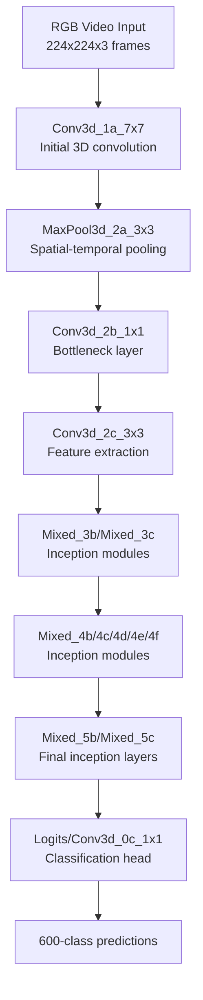
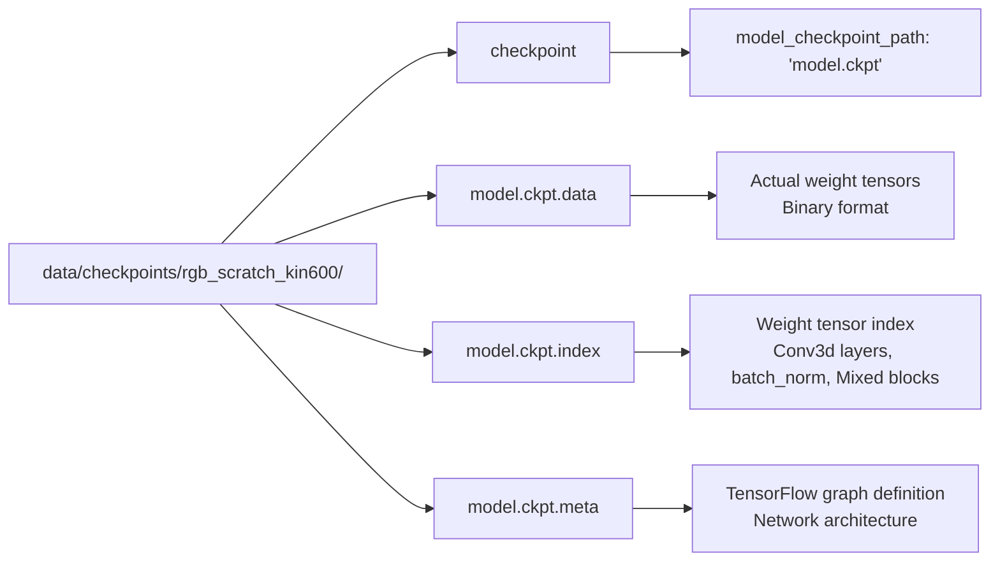
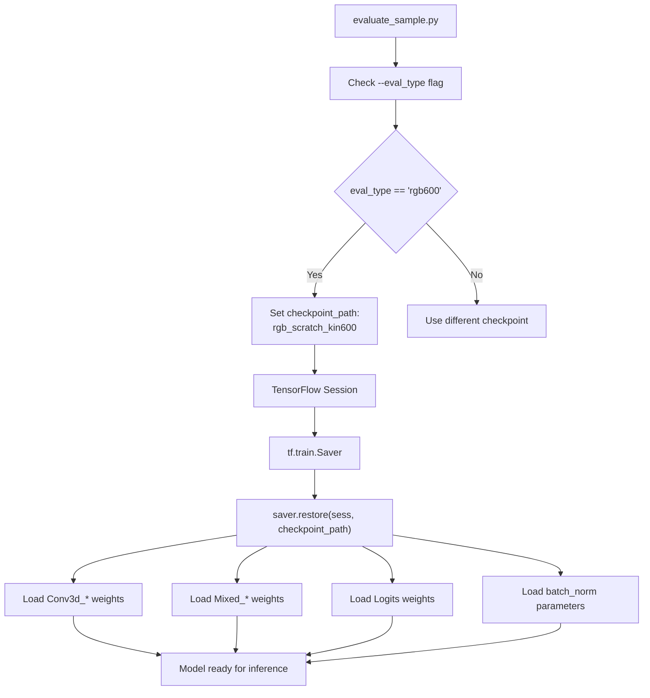
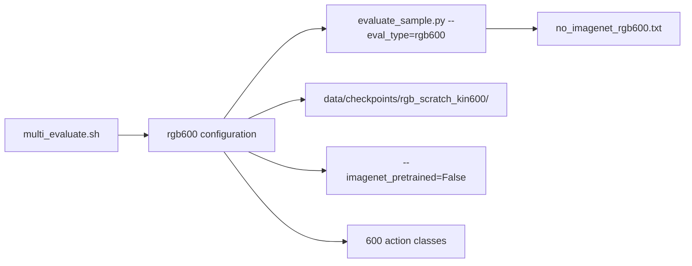
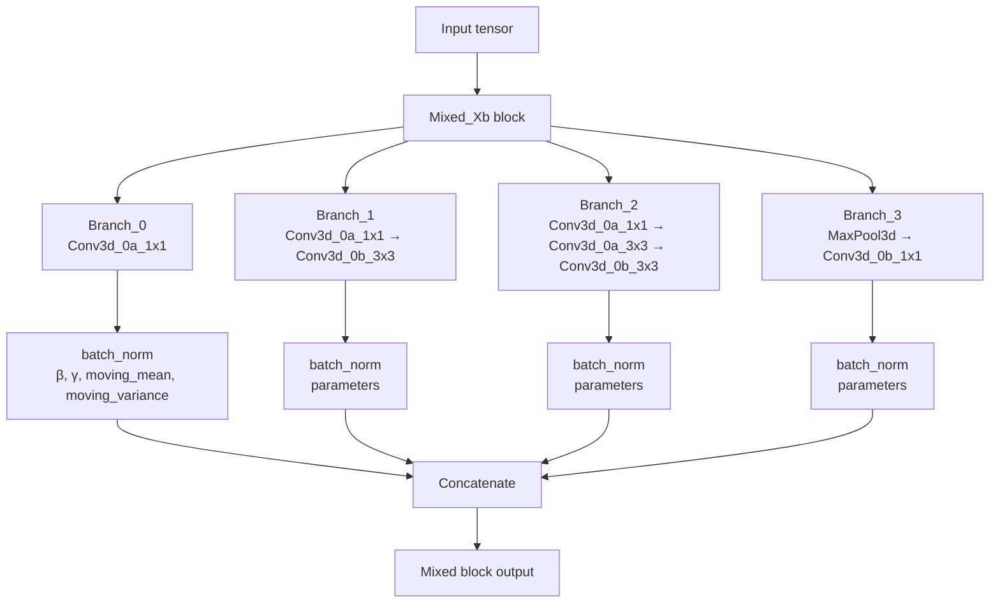

<!-- source: DeepWiki mcp.deepwiki.com · repo google-deepmind/kinetics-i3d · extra page Kinetics-600 RGB Model · fetched 2026-10-26 -->

# Kinetics-600 RGB Model

<details>
<summary>Relevant source files</summary>

The following files were used as context for generating this wiki page:

- [data/checkpoints/rgb_scratch_kin600/checkpoint](data/checkpoints/rgb_scratch_kin600/checkpoint)
- [data/checkpoints/rgb_scratch_kin600/model.ckpt.index](data/checkpoints/rgb_scratch_kin600/model.ckpt.index)
- [data/checkpoints/rgb_scratch_kin600/model.ckpt.meta](data/checkpoints/rgb_scratch_kin600/model.ckpt.meta)

</details>


This document provides detailed technical information about the RGB model trained from scratch on the Kinetics-600 dataset. This model processes visual appearance information from video frames without ImageNet pre-training, representing one of the core model variants in the I3D system.

For information about models that use ImageNet pre-training, see [ImageNet + Kinetics Models](#3.1). For the broader category of scratch-trained models, see [Kinetics-Only Models](#3.2). For general RGB stream architecture details, see [RGB Stream Processing](#2.1).

## Model Specifications

The Kinetics-600 RGB model is an Inflated 3D ConvNet trained from scratch on 600 action classes. This model demonstrates that competitive performance can be achieved without ImageNet pre-training when sufficient video data is available.

### Training Configuration

| Parameter | Value |
|-----------|-------|
| Training Dataset | Kinetics-600 |
| Input Modality | RGB frames only |
| Pre-training | None (trained from scratch) |
| Output Classes | 600 action categories |
| Architecture | Inception-I3D |
| Input Resolution | 224×224×3 per frame |

**Architecture Overview**


Sources: [data/checkpoints/rgb_scratch_kin600/model.ckpt.index:1-31]()

## Checkpoint Structure

The model checkpoint follows TensorFlow's standard format with specific organization for the I3D architecture components.

### Checkpoint Files

**File Organization**


The checkpoint file contains a simple text reference:
- `model_checkpoint_path: "model.ckpt"`
- `all_model_checkpoint_paths: "model.ckpt"`

### Weight Organization

The model weights are organized hierarchically following the Inception-I3D structure:

| Layer Type | Pattern | Example |
|------------|---------|---------|
| Initial Conv | `Conv3d_1a_7x7/*` | `Conv3d_1a_7x7/batch_norm/beta` |
| Bottleneck | `Conv3d_2b_1x1/*` | `Conv3d_2b_1x1/conv_3d/w` |
| Standard Conv | `Conv3d_2c_3x3/*` | `Conv3d_2c_3x3/batch_norm/moving_variance` |
| Inception Blocks | `Mixed_*/*` | `Mixed_3b/Branch_0/Conv3d_0a_1x1/*` |
| Classification | `Logits/*` | `Logits/Conv3d_0c_1x1/conv_3d/b` |

Sources: [data/checkpoints/rgb_scratch_kin600/checkpoint:1-3](), [data/checkpoints/rgb_scratch_kin600/model.ckpt.index:1-31]()

## Model Loading Process

The evaluation system loads this model through a standardized TensorFlow checkpoint restoration process.

**Model Loading Workflow**


Sources: [data/checkpoints/rgb_scratch_kin600/model.ckpt.index:1-31]()

## Usage in Evaluation

This model is specifically invoked using the `rgb600` evaluation type in the core evaluation framework.

### Evaluation Command

```bash
python evaluate_sample.py \
  --eval_type=rgb600 \
  --imagenet_pretrained=False \
  --sample_path=data/video_sample.avi
```

### Integration with Batch Evaluation

The `multi_evaluate.sh` script includes this model in systematic evaluations:

**Batch Evaluation Integration**


The evaluation produces output files following the naming pattern `no_imagenet_rgb600.txt` to indicate this model was trained without ImageNet pre-training.

Sources: [data/checkpoints/rgb_scratch_kin600/checkpoint:1-3]()

## Architecture Details

The model implements the full Inception-I3D architecture with 3D convolutions inflated from the 2D Inception-v1 design.

### Layer Structure

**Inception Module Organization**


### Weight Components

Each layer contains multiple parameter types:

| Component | Purpose | Storage Format |
|-----------|---------|----------------|
| `conv_3d/w` | Convolution weights | 5D tensor (T×H×W×C_in×C_out) |
| `batch_norm/beta` | Batch norm shift | 1D tensor |
| `batch_norm/gamma` | Batch norm scale | 1D tensor |
| `batch_norm/moving_mean` | Running mean | 1D tensor |
| `batch_norm/moving_variance` | Running variance | 1D tensor |
| `conv_3d/w/Momentum` | Optimizer state | Same shape as weights |

Sources: [data/checkpoints/rgb_scratch_kin600/model.ckpt.index:1-31]()

## Performance Characteristics

This model represents the Kinetics-600 scratch-trained variant, designed to demonstrate I3D effectiveness without ImageNet initialization.

### Key Features

- **No ImageNet dependency**: Trained entirely on video data
- **600-class output**: Full Kinetics-600 action vocabulary
- **RGB-only input**: Processes visual appearance without optical flow
- **Standard I3D architecture**: Full Inception-I3D implementation
- **TensorFlow format**: Compatible with standard TF checkpoint loading

### Evaluation Integration

The model integrates seamlessly with the evaluation framework through the `rgb600` evaluation type, producing standardized output formats compatible with the broader I3D evaluation ecosystem.

Sources: [data/checkpoints/rgb_scratch_kin600/checkpoint:1-3]()

---

