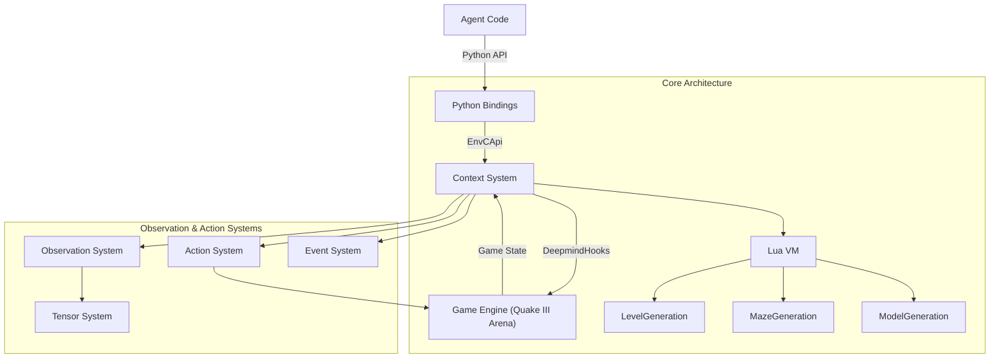
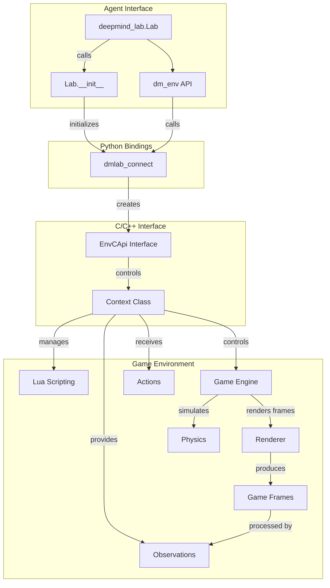
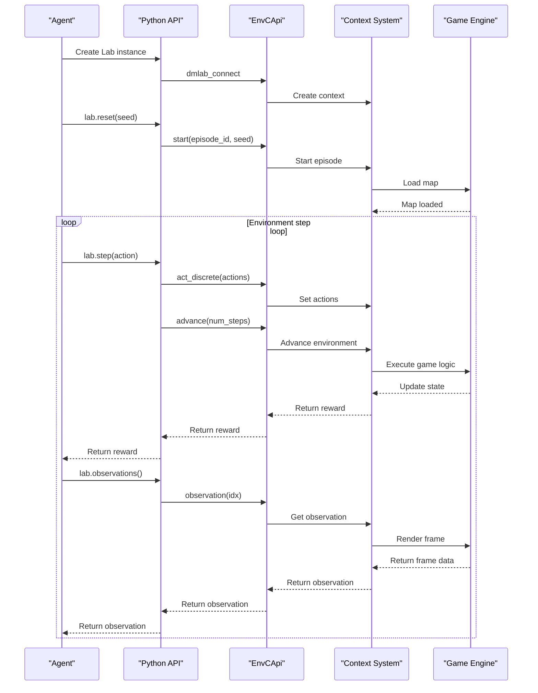

<!-- source: DeepWiki mcp.deepwiki.com · repo google-deepmind/lab · page 1 Overview · fetched 2026-10-26 -->

# Overview

<details>
<summary>Relevant source files</summary>

The following files were used as context for generating this wiki page:

- [README.md](README.md)
- [RELEASE_NOTES.md](RELEASE_NOTES.md)
- [engine/code/deepmind/dmlab_connect.c](engine/code/deepmind/dmlab_connect.c)
- [python/dmlab_module.c](python/dmlab_module.c)
- [python/pip_package/BUILD](python/pip_package/BUILD)
- [python/pip_package/README.md](python/pip_package/README.md)
- [python/pip_package/__init__.py](python/pip_package/__init__.py)
- [python/pip_package/build_pip_package.sh](python/pip_package/build_pip_package.sh)
- [python/pip_package/setup.py](python/pip_package/setup.py)
- [testing/recording_test.cc](testing/recording_test.cc)
- [third_party/rl_api/env_c_api.h](third_party/rl_api/env_c_api.h)
- [third_party/rl_api/env_c_api_bind.h](third_party/rl_api/env_c_api_bind.h)
- [third_party/rl_api/env_c_api_example.cc](third_party/rl_api/env_c_api_example.cc)
- [third_party/rl_api/env_c_api_example_test.cc](third_party/rl_api/env_c_api_example_test.cc)

</details>


DeepMind Lab is a 3D learning environment based on id Software's Quake III Arena game engine, designed primarily for research in artificial intelligence, especially deep reinforcement learning. This document provides a high-level overview of DeepMind Lab's architecture, core components, and how they interact to create a platform for agent-based AI research.

For specific guides on installation and setup, see [Getting Started](#2). For API documentation, see [Python API](#3) or [C/C++ API](#4). For details on creating custom levels, see [Level Generation](#6).

## Purpose and Features

DeepMind Lab provides a suite of challenging 3D navigation and puzzle-solving tasks for learning agents. It serves as a testbed for AI research by providing:

- A flexible platform for defining custom environments
- A standard reinforcement learning interface
- Rich 3D worlds with realistic physics
- Support for procedural content generation
- Customizable reward structures
- Multiple observation types (RGB, depth, velocity, etc.)

Sources: [README.md:27-29]()

## System Architecture

DeepMind Lab follows a layered architecture with clear separation of concerns between its components.

### Core System Architecture



The architecture consists of several key components:

1. **Agent Interface**: Python bindings that provide an API for agents to interact with the environment
2. **EnvCApi**: C-language interface that defines the core environment functionality
3. **Context System**: Central hub that connects the Python bindings to the underlying game engine
4. **Lua VM**: Scripting environment for level generation and game logic
5. **Game Engine**: Modified Quake III Arena engine that handles rendering, physics, and gameplay
6. **Observation & Action Systems**: Components that facilitate agent-environment interaction

Sources: [README.md:27-29](), [engine/code/deepmind/dmlab_connect.c:59-71](), [python/dmlab_module.c:234-265](), [third_party/rl_api/env_c_api.h:15-29]()

### Python Interface and Binding Flow



This diagram shows how the Python API interfaces with the underlying C/C++ code through the EnvCApi, which controls the Context system. The Context manages the Lua scripting environment and interfaces with the game engine.

Sources: [python/dmlab_module.c:51-102](), [engine/code/deepmind/dmlab_connect.c:138-149](), [third_party/rl_api/env_c_api.h:213-446]()

## Core Components

### Python API

The Python API is the primary interface for agents to interact with DeepMind Lab. It provides methods for:

- Initializing the environment with specific settings
- Getting observations from the environment
- Taking actions in the environment
- Getting rewards from the environment

The primary class is `Lab`, which wraps the C/C++ API and provides access to the environment.

```python
# Example usage
import deepmind_lab
lab = deepmind_lab.Lab("lt_chasm", ['RGB_INTERLEAVED'], {'fps': '30'})
lab.reset(seed=1)
observation = lab.observations()  # Get observations
reward = lab.step([0, 0, 0, 1, 0, 0, 0])  # Take an action
```

DeepMind Lab also provides bindings to the DeepMind "dm_env" standard API for reinforcement learning, allowing for compatibility with other DeepMind research tools.

Sources: [python/dmlab_module.c:51-102](), [python/pip_package/README.md:193-198](), [python/pip_package/__init__.py:1-22]()

### EnvCApi (Environment C API)

The EnvCApi is a C-language interface that defines the core functionality of the environment. It provides functions for:

- Setting environment parameters
- Initializing the environment
- Starting an episode
- Getting observations
- Taking actions
- Getting rewards

The API is defined in the `EnvCApi` struct, which contains function pointers to the various methods.

```c
struct EnvCApi_s {
  // Setup, start and termination
  int (*setting)(void* context, const char* key, const char* value);
  int (*init)(void* context);
  int (*start)(void* context, int episode_id, int seed);
  void (*release_context)(void* context);
  
  // Observations and actions
  void (*observation)(void* context, int observation_idx, EnvCApi_Observation* obs);
  void (*act_discrete)(void* context, const int actions_discrete[]);
  EnvCApi_EnvironmentStatus (*advance)(void* context, int num_steps, double* reward);
  
  // ... additional functions ...
};
```

The EnvCApi provides a standard interface for environment interaction, allowing the Python API to communicate with the underlying game engine.

Sources: [third_party/rl_api/env_c_api.h:97-448](), [third_party/rl_api/env_c_api_example.cc:72-193]()

### Context System

The Context system is the central hub of DeepMind Lab, connecting the Python bindings to the underlying game engine. It manages:

- The Lua VM for level generation and game logic
- The observation and action systems
- The game engine interface through DeepmindHooks

The Context system is implemented in the `GameContext` struct, which contains:

- A pointer to the DeepmindContext
- The environment's dimensions and buffer information
- The game's state information
- Recording context for demos and videos
- Network settings for multiplayer

Sources: [engine/code/deepmind/dmlab_connect.c:136-176]()

### Lua Scripting System

The Lua scripting system provides a flexible way to define custom levels, game mechanics, and reward structures. It includes:

- Level generation through maze and text level descriptions
- Custom observation and action definitions
- Game logic and reward definitions
- Customizable theme elements

Lua scripts are used to define the behavior of the environment, allowing researchers to create custom tasks without modifying the core C/C++ code.

Sources: [README.md:107-108]()

### Game Engine

DeepMind Lab uses a modified version of the Quake III Arena game engine (via ioquake3), providing:

- 3D rendering capabilities
- Physics simulation
- Game logic execution
- Multiplayer support

The game engine is responsible for rendering the environment, simulating physics, and executing the game logic defined in Lua scripts.

Sources: [README.md:3-6](), [README.md:114-132]()

## Environment Interaction Flow

### Initialization and Execution Flow



This diagram shows the flow of interaction between an agent and DeepMind Lab, from initialization to the step loop where actions are taken and observations are received.

Sources: [python/dmlab_module.c:311-430](), [engine/code/deepmind/dmlab_connect.c:775-836](), [third_party/rl_api/env_c_api.h:394-447]()

### Observation and Action Types

DeepMind Lab provides a variety of observation types:

| Observation Name | Description | Data Type |
|------------------|-------------|-----------|
| RGB_INTERLEAVED | RGB image with channels interleaved | uint8 |
| RGBD_INTERLEAVED | RGB + depth image with channels interleaved | uint8 |
| RGB | RGB image with channels planar | uint8 |
| RGBD | RGB + depth image with channels planar | uint8 |
| BGR_INTERLEAVED | BGR image with channels interleaved | uint8 |
| BGRD_INTERLEAVED | BGR + depth image with channels interleaved | uint8 |
| MAP_FRAME_NUMBER | Current frame number in the map | double |

Actions in DeepMind Lab are represented as a vector of discrete values:

| Action Name | Description | Range |
|-------------|-------------|-------|
| LOOK_LEFT_RIGHT_PIXELS_PER_FRAME | Angular velocity for horizontal look | [-512, 512] |
| LOOK_DOWN_UP_PIXELS_PER_FRAME | Angular velocity for vertical look | [-512, 512] |
| STRAFE_LEFT_RIGHT | Lateral movement | [-1, 1] |
| MOVE_BACK_FORWARD | Forward/backward movement | [-1, 1] |
| FIRE | Fire weapon | [0, 1] |
| JUMP | Jump | [0, 1] |
| CROUCH | Crouch | [0, 1] |

Sources: [engine/code/deepmind/dmlab_connect.c:74-115](), [engine/code/deepmind/dmlab_connect.c:922-972]()

## Build System and Distribution

DeepMind Lab uses the Bazel build system to build the project and its dependencies. The build process includes:

1. Building the game engine and associated libraries
2. Building the Python bindings
3. Building the test suite

DeepMind Lab can be distributed as a Python package through pip, making it easy to install and use. The pip package includes:

- The compiled DeepMind Lab shared library
- The Python bindings
- Additional assets required by the environment

```bash
# Install DeepMind Lab via pip
pip install /path/to/deepmind_lab-1.0-py2-none-any.whl
```

For more details on building and installing DeepMind Lab, see [Installation](#2.1).

Sources: [python/pip_package/README.md:17-23](), [python/pip_package/setup.py:1-20](), [python/pip_package/build_pip_package.sh:1-65]()

## Property System

Since the December 2020 release, DeepMind Lab includes a property system that allows dynamic querying and modifying of environment state. Properties are key-value pairs that represent the environment's configuration and can be:

- Read using `read_property`
- Written using `write_property`
- Listed using `properties`

```python
# Example of using properties
lab = deepmind_lab.Lab("lt_chasm", ['RGB_INTERLEAVED'])
lab.reset()
# Read a property
value = lab.read_property("key")
# Write a property
lab.write_property("key", "value")
# List properties
props = lab.properties()
```

This property system provides a flexible way to interact with the environment's state and configuration at runtime.

Sources: [RELEASE_NOTES.md:35-51](), [python/dmlab_module.c:684-780]()

## Version History

DeepMind Lab has evolved over time with new features and improvements:

| Release Date | Major Features |
|--------------|----------------|
| Dec 2020 | Property system, dm_env API support, new psychlab and language binding tasks |
| Oct 2019 | New psychlab levels, text actions, level caching improvements |
| June 2018 | New psychlab levels, Python 3 support |
| May 2018 | Level caching, DMLab-30 levels, custom actions |
| Feb 2018 | Demo recording and playback, DMLab-30 levels |
| Jan 2018 | Tensor and image libraries, new Lua customizable themes |
| Dec 2016 | Initial release |

For detailed release notes, see the [RELEASE_NOTES.md](RELEASE_NOTES.md) file.

Sources: [RELEASE_NOTES.md:13-371]()

---

