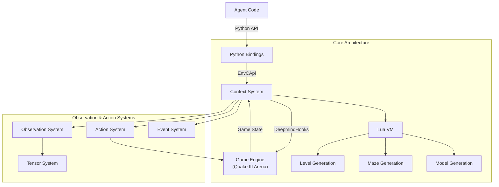
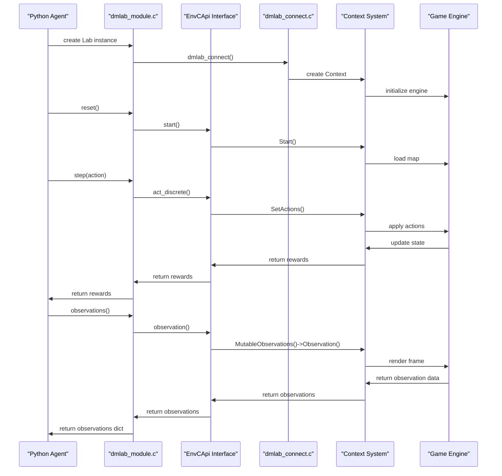
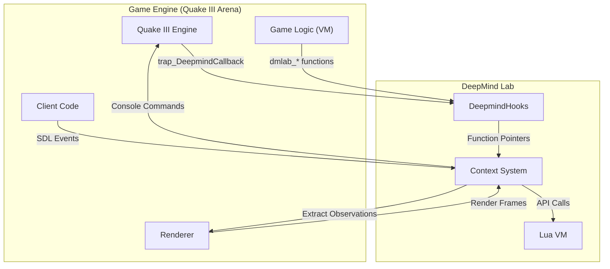
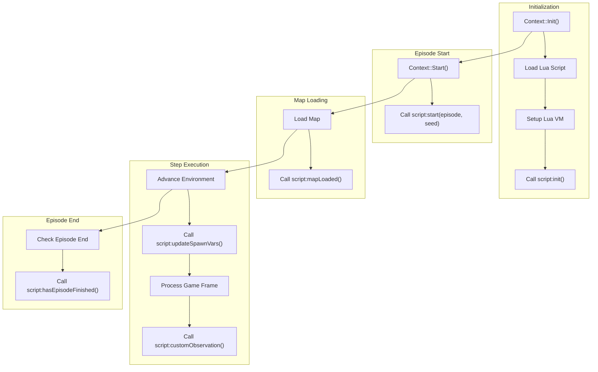
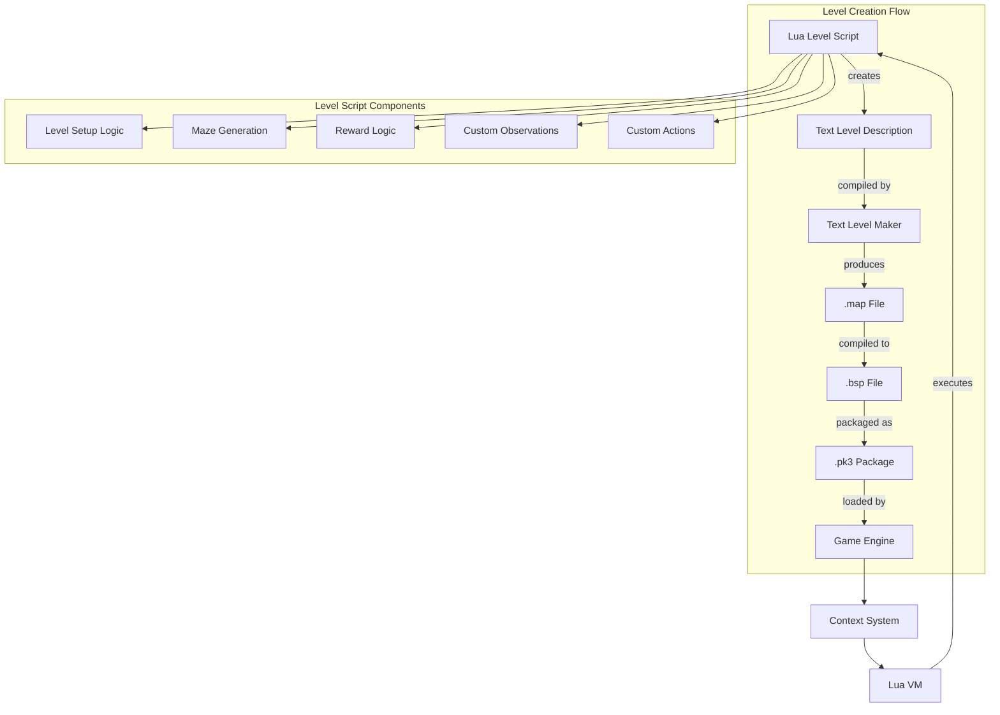
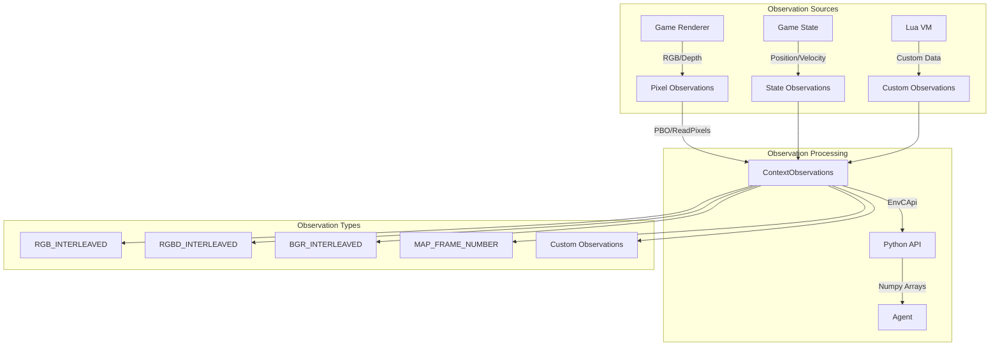
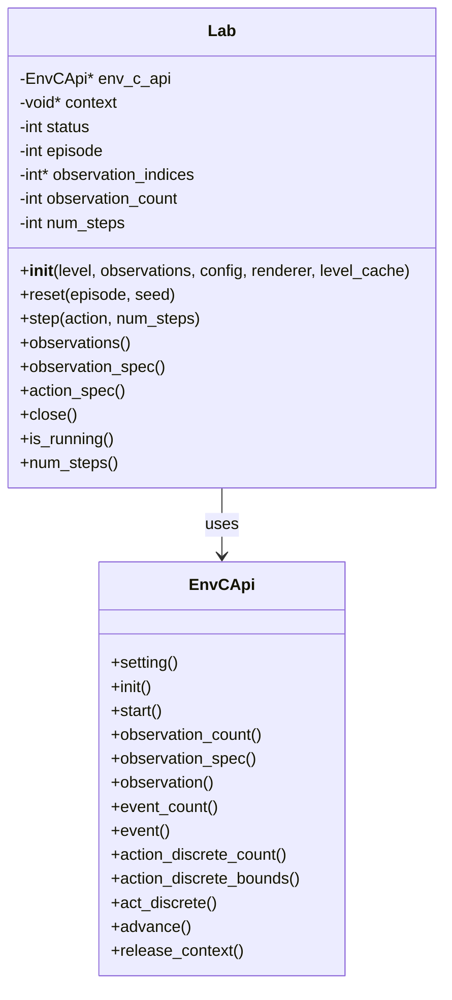
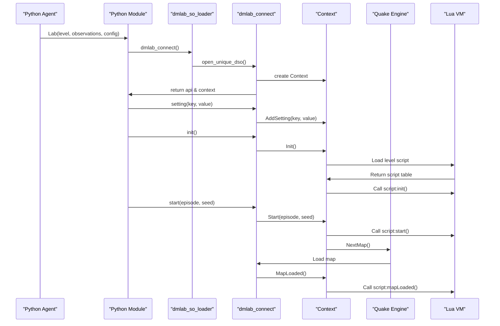
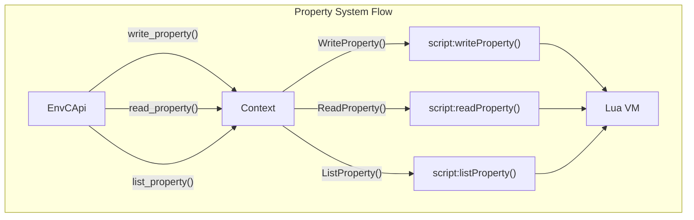
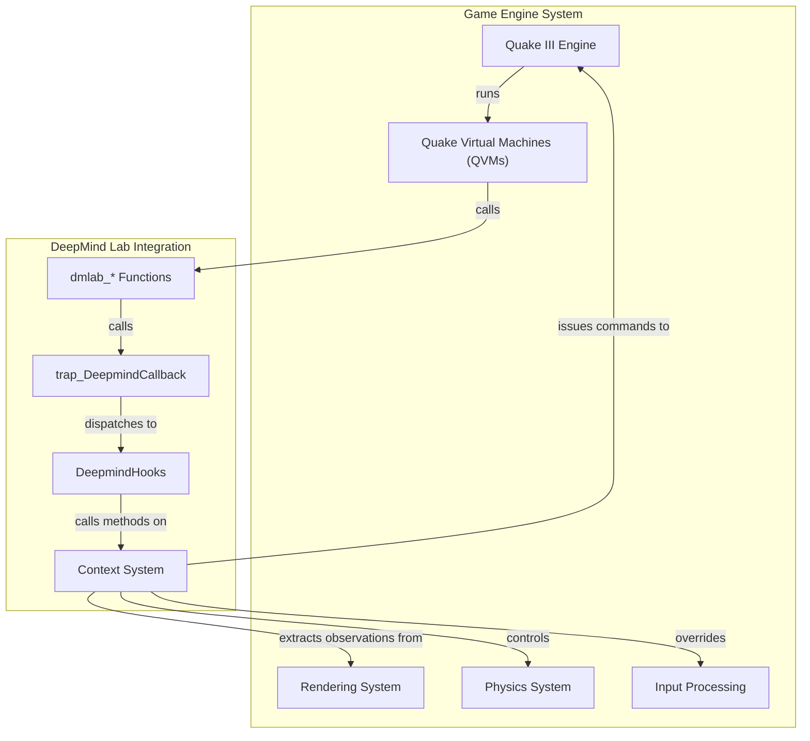

<!-- source: DeepWiki mcp.deepwiki.com · repo google-deepmind/lab · page 1.1 Architecture · fetched 2026-10-26 -->

# Architecture

<details>
<summary>Relevant source files</summary>

The following files were used as context for generating this wiki page:

- [RELEASE_NOTES.md](RELEASE_NOTES.md)
- [deepmind/engine/callbacks.cc](deepmind/engine/callbacks.cc)
- [deepmind/engine/callbacks_test.cc](deepmind/engine/callbacks_test.cc)
- [deepmind/engine/context.cc](deepmind/engine/context.cc)
- [deepmind/engine/context.h](deepmind/engine/context.h)
- [deepmind/include/deepmind_context.h](deepmind/include/deepmind_context.h)
- [deepmind/include/deepmind_hooks.h](deepmind/include/deepmind_hooks.h)
- [docs/developers/reference/lua_api.md](docs/developers/reference/lua_api.md)
- [engine/code/deepmind/dm_local.c](engine/code/deepmind/dm_local.c)
- [engine/code/deepmind/dm_local.h](engine/code/deepmind/dm_local.h)
- [engine/code/deepmind/dm_public.h](engine/code/deepmind/dm_public.h)
- [engine/code/deepmind/dmlab_connect.c](engine/code/deepmind/dmlab_connect.c)
- [engine/code/game/g_active.c](engine/code/game/g_active.c)
- [engine/code/game/g_local.h](engine/code/game/g_local.h)
- [engine/code/game/g_mover.c](engine/code/game/g_mover.c)
- [engine/code/game/g_spawn.c](engine/code/game/g_spawn.c)
- [engine/code/qcommon/deepmind_hooks.c](engine/code/qcommon/deepmind_hooks.c)
- [engine/code/qcommon/q_shared.h](engine/code/qcommon/q_shared.h)
- [engine/code/qcommon/surfaceflags.h](engine/code/qcommon/surfaceflags.h)
- [game_scripts/levels/tests/event_test.lua](game_scripts/levels/tests/event_test.lua)
- [game_scripts/levels/tests/text_observation_test.lua](game_scripts/levels/tests/text_observation_test.lua)
- [public/dmlab.h](public/dmlab.h)
- [public/dmlab_so_loader.cc](public/dmlab_so_loader.cc)
- [public/file_reader_types.h](public/file_reader_types.h)
- [python/dmlab_module.c](python/dmlab_module.c)
- [testing/recording_test.cc](testing/recording_test.cc)
- [third_party/rl_api/env_c_api.h](third_party/rl_api/env_c_api.h)
- [third_party/rl_api/env_c_api_bind.h](third_party/rl_api/env_c_api_bind.h)
- [third_party/rl_api/env_c_api_example.cc](third_party/rl_api/env_c_api_example.cc)
- [third_party/rl_api/env_c_api_example_test.cc](third_party/rl_api/env_c_api_example_test.cc)

</details>


This document describes the system architecture of DeepMind Lab, explaining the major components and how they interact. DeepMind Lab is a 3D learning environment based on the Quake III Arena engine, designed for reinforcement learning research. It provides a modular architecture that connects Python agent code with a customized game engine through well-defined interfaces.

## Core Architecture Overview

DeepMind Lab follows a layered architecture that separates the game engine, scripting environment, and agent interfaces into distinct components. The Context system serves as the central hub, connecting all components together.



Sources:
- [RELEASE_NOTES.md:1-371](https://github.com/google-deepmind/lab/blob/master/RELEASE_NOTES.md)
- [deepmind/engine/context.h:21-570](https://github.com/google-deepmind/lab/blob/master/deepmind/engine/context.h)
- [deepmind/engine/context.cc:1-1000](https://github.com/google-deepmind/lab/blob/master/deepmind/engine/context.cc)

## Context System and Component Interactions

The Context system (`deepmind::lab::Context` class) is the central component of DeepMind Lab, responsible for coordinating all other subsystems. It manages the Lua VM, interfaces with the game engine through hooks, and handles observations and actions.

```mermaid
classDiagram
    class Context {
        -lua_vm_: lua::Vm
        -script_table_ref_: lua::TableRef
        -game_: ContextGame
        -observations_: ContextObservations
        -custom_actions_: ContextActions
        -pickups_: ContextPickups
        -events_: ContextEvents
        -game_entities_: ContextEntities
        +Init(): int
        +Start(episode, seed): int
        +MapLoaded(): int
        +HasEpisodeFinished(): bool
        +SetActions(): void
        +GetActions(): void
    }
    
    Context --> ContextGame
    Context --> ContextObservations
    Context --> ContextActions
    Context --> ContextPickups
    Context --> ContextEvents
    Context --> ContextEntities
    Context --> "LuaVM"
    
    class ContextGame {
        +MapFinished(): bool
        +SetMapFinished(): void
        +GetCustomView(): void
        +SetPlayerState(): void
    }
    
    class ContextObservations {
        +Count(): int
        +Name(idx): const char*
        +Spec(idx): void
        +Observation(idx): void
    }
    
    class ContextActions {
        +DiscreteCount(): int
        +DiscreteName(idx): const char*
        +DiscreteBounds(idx): void
        +DiscreteApply(actions): void
    }
```

Sources:
- [deepmind/engine/context.h:54-566](https://github.com/google-deepmind/lab/blob/master/deepmind/engine/context.h)
- [deepmind/engine/context.cc:79-886](https://github.com/google-deepmind/lab/blob/master/deepmind/engine/context.cc)
- [deepmind/include/deepmind_hooks.h:35-620](https://github.com/google-deepmind/lab/blob/master/deepmind/include/deepmind_hooks.h)

## Python to C++ Interface Flow

DeepMind Lab provides a Python API that allows agents to interact with the environment. The Python layer connects to the C++ core through a well-defined bridge that uses the EnvCApi interface. This section shows how calls flow from Python through to the game engine.



Sources:
- [python/dmlab_module.c:66-600](https://github.com/google-deepmind/lab/blob/master/python/dmlab_module.c)
- [engine/code/deepmind/dmlab_connect.c:66-831](https://github.com/google-deepmind/lab/blob/master/engine/code/deepmind/dmlab_connect.c)
- [public/dmlab_so_loader.cc:45-300](https://github.com/google-deepmind/lab/blob/master/public/dmlab_so_loader.cc)

## Communication Between Game Engine and Lab System

DeepMind Lab uses a hook-based system to integrate with the Quake III Arena engine. The `DeepmindHooks` structure defines callbacks that the engine calls to interact with the Context system.



Sources:
- [deepmind/include/deepmind_hooks.h:35-545](https://github.com/google-deepmind/lab/blob/master/deepmind/include/deepmind_hooks.h)
- [engine/code/deepmind/dm_local.h:19-266](https://github.com/google-deepmind/lab/blob/master/engine/code/deepmind/dm_local.h)
- [engine/code/deepmind/dm_local.c:19-265](https://github.com/google-deepmind/lab/blob/master/engine/code/deepmind/dm_local.c)
- [engine/code/qcommon/deepmind_hooks.c:19-247](https://github.com/google-deepmind/lab/blob/master/engine/code/qcommon/deepmind_hooks.c)

## EnvCApi Integration

DeepMind Lab implements the EnvCApi interface, which provides a standard way for agents to interact with environments. This interface is defined in `third_party/rl_api/env_c_api.h` and connects the Python layer to the C++ implementation.

| EnvCApi Function      | Purpose                                   | Implementation in DeepMind Lab                |
|-----------------------|-------------------------------------------|----------------------------------------------|
| `setting`             | Apply a setting to the environment        | Configure level, screen size, etc.            |
| `init`                | Initialize the environment                | Initialize Context and load Lua script        |
| `start`               | Start a new episode                       | Call Context::Start with episode ID and seed  |
| `act_discrete`        | Send discrete actions to the environment  | Update actions in Context                     |
| `advance`             | Advance the environment by one step       | Run the game engine for one or more frames    |
| `observation`         | Get observations from the environment     | Get rendered frames, game state, etc.         |
| `observation_spec`    | Get the shape of an observation           | Describe observation dimensions and type      |
| `action_discrete_count` | Get the number of discrete actions     | Return number of available actions            |
| `release_context`     | Clean up and release resources            | Close the environment                         |

Sources:
- [third_party/rl_api/env_c_api.h:52-568](https://github.com/google-deepmind/lab/blob/master/third_party/rl_api/env_c_api.h)
- [engine/code/deepmind/dmlab_connect.c:500-736](https://github.com/google-deepmind/lab/blob/master/engine/code/deepmind/dmlab_connect.c)

## Lua Scripting System

DeepMind Lab uses Lua as its scripting language for defining levels, game logic, and custom behaviors. The Lua VM is embedded in the Context system and provides a powerful way to customize environments.

### Lua API and Script Lifecycle



The Lua VM is initialized with modules for:
- Maze generation (`dmlab.system.maze_generation`)
- Tensor operations (`dmlab.system.tensor`)
- Map making (`dmlab.system.map_maker`)
- Game interaction (`dmlab.system.game`)
- Events (`dmlab.system.events`)
- Pickups (`dmlab.system.pickups_spawn`)
- Random number generation (`dmlab.system.random`)
- Model creation (`dmlab.system.model`)

Sources:
- [deepmind/engine/context.cc:721-804](https://github.com/google-deepmind/lab/blob/master/deepmind/engine/context.cc)
- [deepmind/engine/context.cc:817-834](https://github.com/google-deepmind/lab/blob/master/deepmind/engine/context.cc)
- [docs/developers/reference/lua_api.md:1-118](https://github.com/google-deepmind/lab/blob/master/docs/developers/reference/lua_api.md)

## Level Generation System

DeepMind Lab provides a sophisticated level generation system that allows for procedural generation of maps.



The level generation process typically involves:
1. A Lua script defines the level logic
2. The script may use maze generation to create a procedural layout
3. This is converted to a text level description
4. The text level is compiled to a .map file
5. The .map file is compiled to a .bsp file (Binary Space Partition)
6. The .bsp file is packaged in a .pk3 file for loading
7. The game engine loads the .pk3 file

Sources:
- [deepmind/engine/lua_maze_generation.h](https://github.com/google-deepmind/lab/blob/master/deepmind/engine/lua_maze_generation.h)
- [deepmind/engine/lua_text_level_maker.h](https://github.com/google-deepmind/lab/blob/master/deepmind/engine/lua_text_level_maker.h)
- [deepmind/engine/context.cc:563-574](https://github.com/google-deepmind/lab/blob/master/deepmind/engine/context.cc)
- [engine/code/deepmind/dmlab_connect.c:336-397](https://github.com/google-deepmind/lab/blob/master/engine/code/deepmind/dmlab_connect.c)

## Observation and Action Systems

DeepMind Lab provides a flexible system for defining observations and actions that agents can use to interact with the environment.

### Observation Types and Flow



### Action System

The action system in DeepMind Lab defines several standard actions:

| Action Name                     | Type    | Description                               |
|---------------------------------|---------|-------------------------------------------|
| `LOOK_LEFT_RIGHT_PIXELS_PER_FRAME` | Discrete | Angular velocity for horizontal looking   |
| `LOOK_DOWN_UP_PIXELS_PER_FRAME`    | Discrete | Angular velocity for vertical looking     |
| `STRAFE_LEFT_RIGHT`              | Discrete | Movement left/right                        |
| `MOVE_BACK_FORWARD`              | Discrete | Movement backward/forward                  |
| `FIRE`                           | Discrete | Fire weapon                                |
| `JUMP`                           | Discrete | Jump                                       |
| `CROUCH`                         | Discrete | Crouch                                     |

Custom actions can also be defined through the Lua API.

Sources:
- [engine/code/deepmind/dmlab_connect.c:74-116](https://github.com/google-deepmind/lab/blob/master/engine/code/deepmind/dmlab_connect.c)
- [engine/code/deepmind/dmlab_connect.c:213-296](https://github.com/google-deepmind/lab/blob/master/engine/code/deepmind/dmlab_connect.c)
- [deepmind/engine/context_observations.h](https://github.com/google-deepmind/lab/blob/master/deepmind/engine/context_observations.h)
- [deepmind/engine/context_actions.h](https://github.com/google-deepmind/lab/blob/master/deepmind/engine/context_actions.h)

## Python API Interface

DeepMind Lab exposes its functionality through a Python module in `python/dmlab_module.c`. This module provides the `Lab` class that agents use to interact with the environment.



Key methods of the `Lab` class:

- `__init__(level, observations, config, renderer, level_cache)`: Initialize the environment with a specific level, desired observations, and configuration.
- `reset(episode, seed)`: Reset the environment to start a new episode with an optional seed.
- `step(action, num_steps)`: Take an action and advance the environment by a specified number of steps.
- `observations()`: Get the current observations from the environment.
- `observation_spec()`: Get the specifications of available observations.
- `action_spec()`: Get the specifications of available actions.

Sources:
- [python/dmlab_module.c:50-600](https://github.com/google-deepmind/lab/blob/master/python/dmlab_module.c)
- [public/dmlab.h:21-57](https://github.com/google-deepmind/lab/blob/master/public/dmlab.h)

## System Initialization and Startup Flow

The following diagram shows the initialization and startup sequence of DeepMind Lab:



Sources:
- [python/dmlab_module.c:138-308](https://github.com/google-deepmind/lab/blob/master/python/dmlab_module.c)
- [engine/code/deepmind/dmlab_connect.c:500-836](https://github.com/google-deepmind/lab/blob/master/engine/code/deepmind/dmlab_connect.c)
- [deepmind/engine/context.cc:700-848](https://github.com/google-deepmind/lab/blob/master/deepmind/engine/context.cc)
- [public/dmlab_so_loader.cc:136-232](https://github.com/google-deepmind/lab/blob/master/public/dmlab_so_loader.cc)

## Properties System

DeepMind Lab includes a property system (added in API version 1.4) that allows dynamic querying and modifying of environment state. This system provides a standard way for scripts to expose and consume custom properties.



Properties can have different attributes:
- `Readable`: Property can be read
- `Writable`: Property can be written
- `ReadWritable`: Property can be both read and written
- `Custom`: Property has custom behavior defined by scripts

Sources:
- [RELEASE_NOTES.md:34-50](https://github.com/google-deepmind/lab/blob/master/RELEASE_NOTES.md)
- [deepmind/include/deepmind_hooks.h:133-144](https://github.com/google-deepmind/lab/blob/master/deepmind/include/deepmind_hooks.h)
- [deepmind/engine/context.h:401-411](https://github.com/google-deepmind/lab/blob/master/deepmind/engine/context.h)

## Integration with Game Engine

DeepMind Lab integrates with the Quake III Arena engine through a set of hooks and callbacks that allow the Context system to control and interact with the game engine.



The integration happens through several key mechanisms:
1. The DeepmindHooks structure defines function pointers that the game engine calls
2. The trap_DeepmindCallback function allows the game code to call into the Context system
3. Various dmlab_* functions in the game code provide specific functionality
4. The Context system can issue console commands to control the engine

Sources:
- [engine/code/deepmind/dm_public.h:19-60](https://github.com/google-deepmind/lab/blob/master/engine/code/deepmind/dm_public.h)
- [engine/code/deepmind/dm_local.h:19-266](https://github.com/google-deepmind/lab/blob/master/engine/code/deepmind/dm_local.h)
- [engine/code/qcommon/deepmind_hooks.c:19-247](https://github.com/google-deepmind/lab/blob/master/engine/code/qcommon/deepmind_hooks.c)

## Conclusion

The architecture of DeepMind Lab is designed to provide a flexible, extensible platform for reinforcement learning research. The system cleanly separates the game engine from the reinforcement learning interfaces, allowing researchers to focus on agent development without worrying about the underlying implementation details.

Key features of the architecture include:
- A modular design with clear separation between components
- A powerful Lua scripting system for customizing environments
- A standardized API for agent interaction
- Support for procedural content generation
- Flexible observation and action systems

This architecture enables DeepMind Lab to serve as a versatile platform for a wide range of research in reinforcement learning, from navigation tasks to complex problem-solving scenarios.

---

