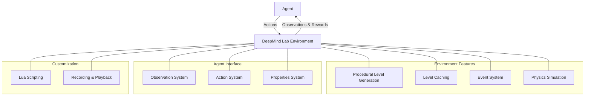
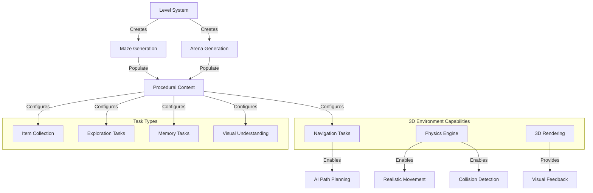
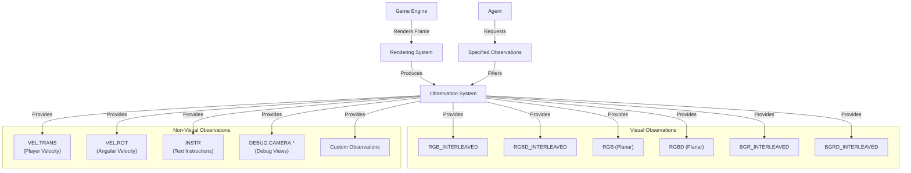
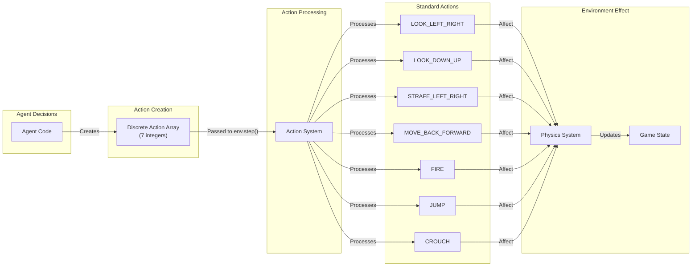
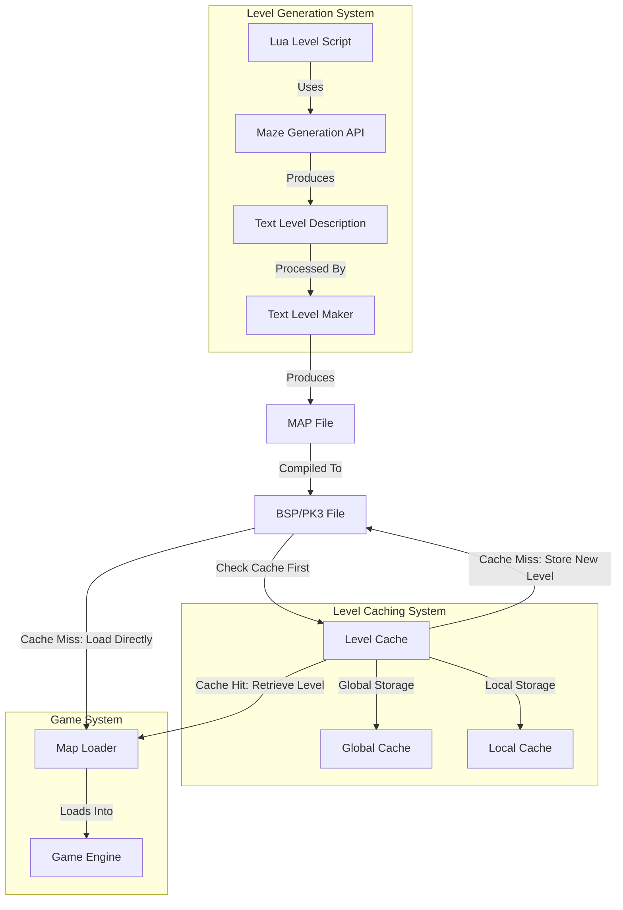
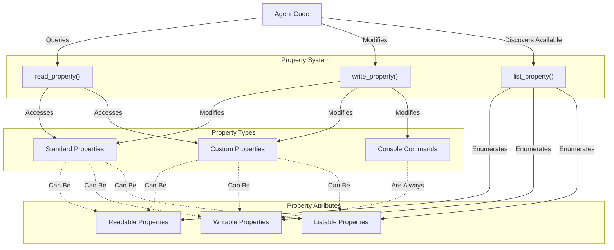
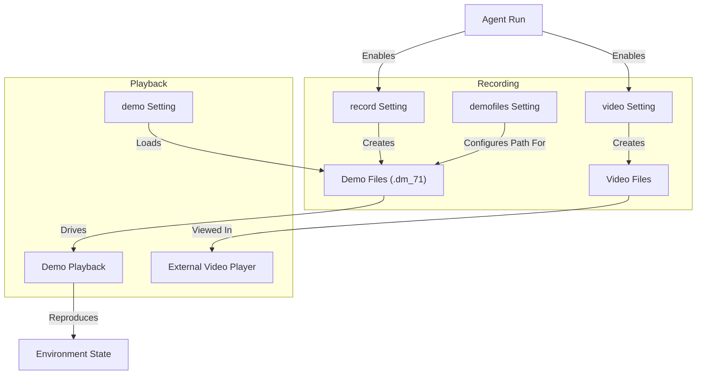
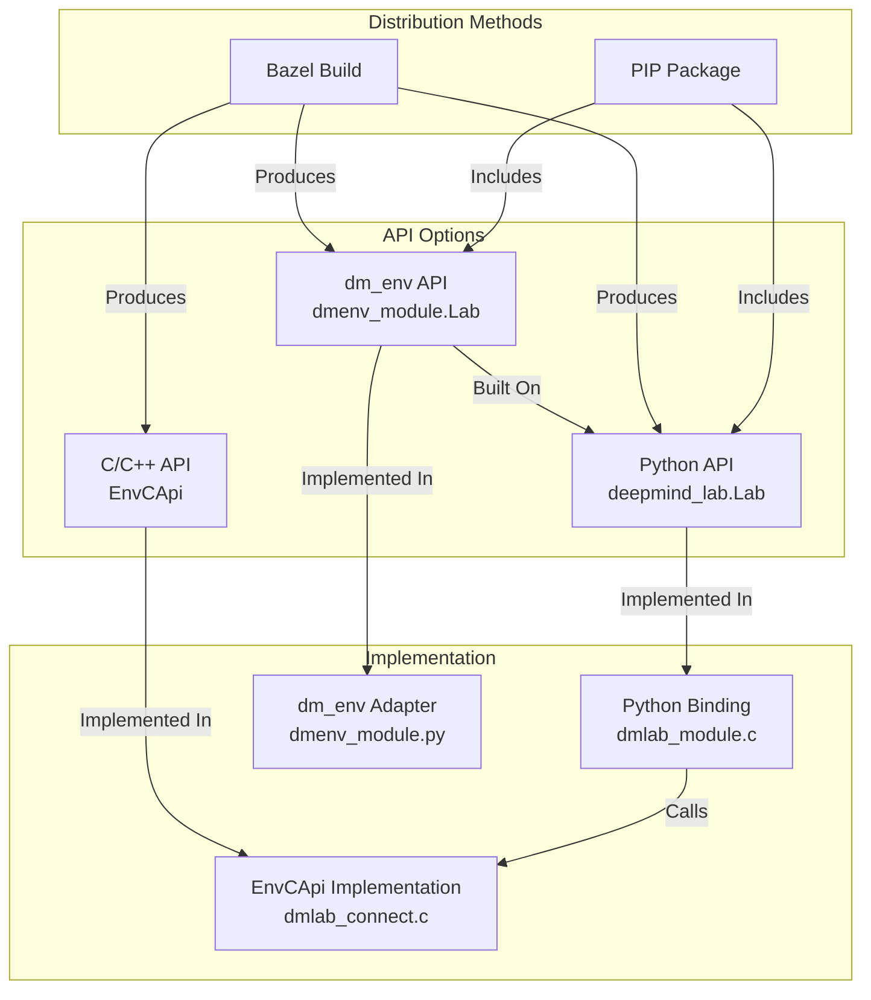
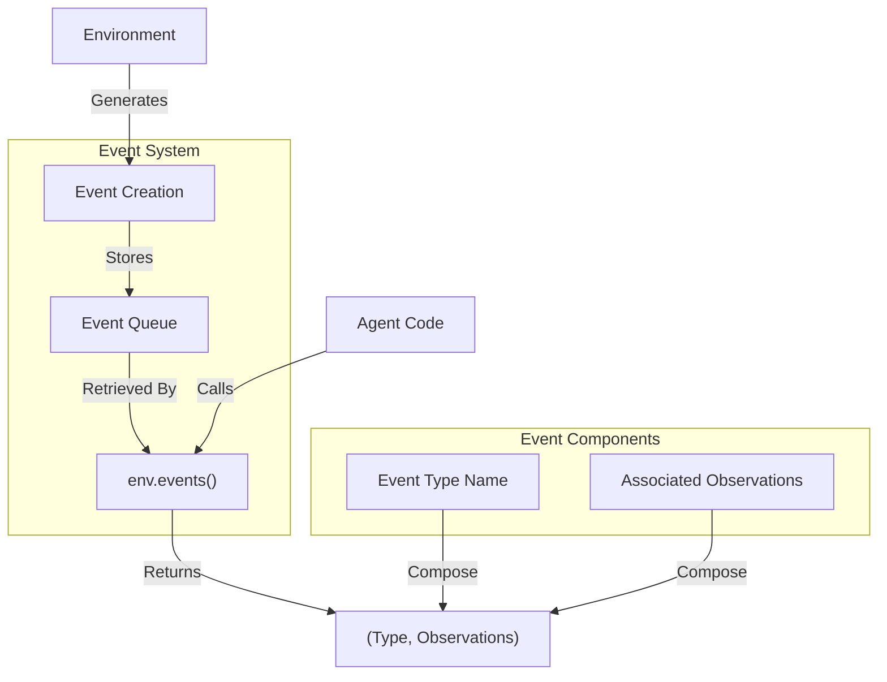
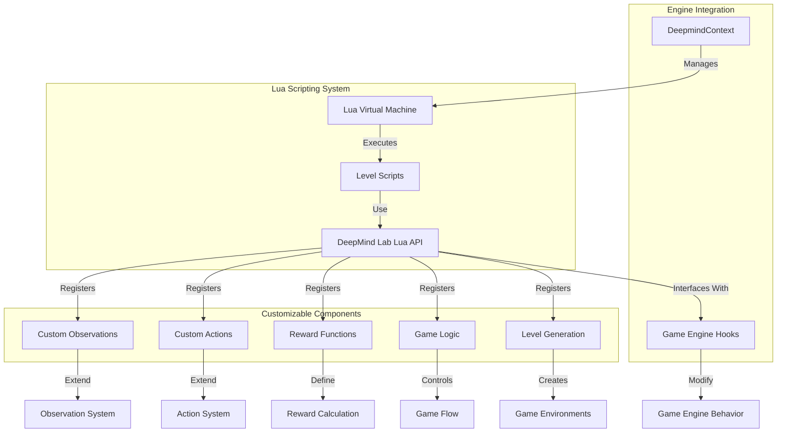

<!-- source: DeepWiki mcp.deepwiki.com · repo google-deepmind/lab · page 1.2 Features · fetched 2026-10-26 -->

# Features

<details>
<summary>Relevant source files</summary>

The following files were used as context for generating this wiki page:

- [README.md](README.md)
- [RELEASE_NOTES.md](RELEASE_NOTES.md)
- [docs/users/observations.md](docs/users/observations.md)
- [docs/users/python_api.md](docs/users/python_api.md)
- [docs/users/run_from_script.md](docs/users/run_from_script.md)
- [engine/code/deepmind/dmlab_connect.c](engine/code/deepmind/dmlab_connect.c)
- [python/dmlab_module.c](python/dmlab_module.c)
- [python/pip_package/BUILD](python/pip_package/BUILD)
- [python/pip_package/README.md](python/pip_package/README.md)
- [python/pip_package/__init__.py](python/pip_package/__init__.py)
- [python/pip_package/build_pip_package.sh](python/pip_package/build_pip_package.sh)
- [python/pip_package/setup.py](python/pip_package/setup.py)
- [python/random_agent.py](python/random_agent.py)
- [python/tests/dmlab_module_test.py](python/tests/dmlab_module_test.py)
- [python/tests/random_agent_test.py](python/tests/random_agent_test.py)
- [python/tests/render_test.py](python/tests/render_test.py)
- [testing/recording_test.cc](testing/recording_test.cc)
- [third_party/rl_api/env_c_api.h](third_party/rl_api/env_c_api.h)
- [third_party/rl_api/env_c_api_bind.h](third_party/rl_api/env_c_api_bind.h)
- [third_party/rl_api/env_c_api_example.cc](third_party/rl_api/env_c_api_example.cc)
- [third_party/rl_api/env_c_api_example_test.cc](third_party/rl_api/env_c_api_example_test.cc)

</details>


This page outlines the key features and capabilities of DeepMind Lab as a 3D learning environment and research platform for agent-based AI research. It focuses on what DeepMind Lab offers to researchers and developers building reinforcement learning agents. For information about the underlying architecture, see [Architecture](#1.1), and for setup instructions, see [Getting Started](#2).

## Core Features Overview

DeepMind Lab provides a rich feature set designed specifically for reinforcement learning research in 3D environments.



Sources: [RELEASE_NOTES.md](RELEASE_NOTES.md), [README.md](README.md), [python/dmlab_module.c](python/dmlab_module.c)

## 3D Environment

DeepMind Lab is built on the Quake III Arena engine via ioquake3, providing a mature 3D physics engine and rendering system.

### Features:
- **Rich 3D Worlds**: Full 3D navigation with physics simulation 
- **Variety of Tasks**: Navigation puzzles, exploration challenges, item collection
- **Puzzle-Solving Tasks**: Complex environments requiring strategy and planning
- **Procedural Generation**: Dynamically created levels with configurable difficulty
- **Themed Environments**: Multiple visual themes and scenarios



Sources: [README.md](README.md), [engine/code/deepmind/dmlab_connect.c](engine/code/deepmind/dmlab_connect.c)

## Observation System

DeepMind Lab provides a flexible observation system that can deliver various types of information to the agent. Observations are tensors (or strings) with well-defined shapes that agents can use to understand the environment.

### Standard Observations

| Observation Name | Type/Shape | Description |
|------------------|------------|-------------|
| `RGB_INTERLEAVED` | Bytes (height, width, 3) | RGB pixel values in height×width×channels format |
| `RGBD_INTERLEAVED` | Bytes (height, width, 4) | RGB pixel values with depth channel |
| `RGB` | Bytes (3, height, width) | RGB pixel values in planar format |
| `RGBD` | Bytes (4, height, width) | RGB pixel values with depth in planar format |
| `BGR_INTERLEAVED` | Bytes (height, width, 3) | BGR pixel values interleaved |
| `BGRD_INTERLEAVED` | Bytes (height, width, 4) | BGR pixel values with depth interleaved |

### Additional Observations

| Observation Name | Type/Shape | Description |
|------------------|------------|-------------|
| `VEL.TRANS` | Doubles (3) | Player's translational velocity |
| `VEL.ROT` | Doubles (3) | Player's rotational velocity |
| `INSTR` | String | Textual instructions from level to agent |
| `DEBUG.POS.TRANS` | Doubles (3) | Player's world position |
| `DEBUG.POS.ROT` | Doubles (3) | Player's world orientation |



Sources: [docs/users/observations.md](docs/users/observations.md), [python/dmlab_module.c:858-922](python/dmlab_module.c), [engine/code/deepmind/dmlab_connect.c:106-116](engine/code/deepmind/dmlab_connect.c)

## Action System

DeepMind Lab provides a flexible action interface that allows agents to interact with the environment through discrete actions.

### Standard Actions

| Action Name | Value Range | Description |
|-------------|-------------|-------------|
| `LOOK_LEFT_RIGHT_PIXELS_PER_FRAME` | -512 to 512 | Angular velocity for looking left/right |
| `LOOK_DOWN_UP_PIXELS_PER_FRAME` | -512 to 512 | Angular velocity for looking up/down |
| `STRAFE_LEFT_RIGHT` | -1 to 1 | Movement left/right |
| `MOVE_BACK_FORWARD` | -1 to 1 | Movement backward/forward |
| `FIRE` | 0 to 1 | Fire weapon |
| `JUMP` | 0 to 1 | Jump |
| `CROUCH` | 0 to 1 | Crouch |



Sources: [engine/code/deepmind/dmlab_connect.c:74-92](engine/code/deepmind/dmlab_connect.c), [python/tests/dmlab_module_test.py:61-78](python/tests/dmlab_module_test.py), [python/random_agent.py:37-48](python/random_agent.py)

## Level Generation and Caching

DeepMind Lab provides powerful level generation capabilities, allowing researchers to create diverse environments for training and testing agents.

### Level Generation Features

- **Procedural Maze Generation**: Create complex mazes with configurable parameters
- **Text-Based Level Descriptions**: Define levels using human-readable text format
- **Programmatic Level Creation**: Generate levels using Lua scripts
- **Level Factories**: Produce variations of environments with consistent properties
- **Theme Customization**: Change visual appearance and gameplay elements

### Level Caching

Level caching significantly improves performance by storing compiled levels for reuse:

- **Local Level Cache**: Caches levels on the local machine
- **Global Level Cache**: Shares cached levels across experiments
- **Performance Benefits**: Avoids costly recompilation of procedurally generated levels
- **Consistent Testing**: Ensures reproducibility across experimental runs



Sources: [RELEASE_NOTES.md:202-204](RELEASE_NOTES.md), [python/dmlab_module.c:181-207](python/dmlab_module.c), [python/pip_package/README.md:81-126](python/pip_package/README.md)

## Property System

DeepMind Lab includes a property system that allows dynamic querying and modification of environment state. This feature was introduced in the December 2020 release.

### Property System Features:

- **Dynamic State Queries**: Read current environment state through properties
- **Runtime Configuration**: Modify environment settings during execution
- **Custom Properties**: Level scripts can register and consume custom properties
- **Attribute Control**: Properties can be read-only, write-only, or read-write
- **Command Execution**: Issue Quake console commands via a write-only property



Sources: [RELEASE_NOTES.md:35-44](RELEASE_NOTES.md), [third_party/rl_api/env_c_api.h:185-208](third_party/rl_api/env_c_api.h), [third_party/rl_api/env_c_api_example.cc:188-238](third_party/rl_api/env_c_api_example.cc)

## Recording and Playback

DeepMind Lab provides tools for recording agent experiences and playing them back for analysis or demonstration purposes.

### Recording Features

- **Demo Recording**: Save gameplay sessions for later analysis and playback
- **Demo Playback**: Replay previously recorded demos
- **Video Recording**: Capture gameplay as video files
- **Reproducibility**: Saved demos can be used to validate agent behavior



Sources: [RELEASE_NOTES.md:292-337](RELEASE_NOTES.md), [testing/recording_test.cc](testing/recording_test.cc), [python/random_agent.py:140-154](python/random_agent.py)

## API Options

DeepMind Lab offers multiple API options for researchers with different requirements.

### Python API

The Python API is the most commonly used interface:

```python
import deepmind_lab
env = deepmind_lab.Lab('lt_chasm', ['RGB_INTERLEAVED'])
env.reset()
action = numpy.zeros([7], dtype=numpy.intc)  # No-op action
reward = env.step(action)
observation = env.observations()['RGB_INTERLEAVED']
```

### C/C++ API (EnvCApi)

The C/C++ API provides lower-level access for advanced integration:

```c
// Create and initialize the environment
EnvCApi env_c_api;
void* context;
dmlab_connect(&params, &env_c_api, &context);
env_c_api.init(context);
env_c_api.start(context, episode_id, seed);

// Interact with the environment
int discrete_actions[7] = {0};
env_c_api.act_discrete(context, discrete_actions);
double reward;
EnvCApi_EnvironmentStatus status = env_c_api.advance(context, 1, &reward);
```

### dm_env Integration

DeepMind's standard reinforcement learning API:

```python
from deepmind_lab import dmenv_module
env = dmenv_module.Lab(level='lt_chasm', observation_names=['RGB_INTERLEAVED'])
timestep = env.reset()
action = numpy.zeros([7], dtype=numpy.intc)
timestep = env.step(action)
```



Sources: [python/dmlab_module.c](python/dmlab_module.c), [engine/code/deepmind/dmlab_connect.c](engine/code/deepmind/dmlab_connect.c), [python/pip_package/README.md:192-215](python/pip_package/README.md), [docs/users/python_api.md](docs/users/python_api.md)

## Events System

DeepMind Lab includes an events system that allows tracking and responding to in-game events.

### Event System Features:

- **Custom Event Types**: Define custom events with associated observations
- **Event Querying**: Retrieve events that occurred during gameplay
- **Event-Driven Logic**: Trigger responses based on specific events
- **Event Observations**: Events can carry additional observation data



Sources: [python/tests/dmlab_module_test.py:148-196](python/tests/dmlab_module_test.py), [RELEASE_NOTES.md:326-331](RELEASE_NOTES.md)

## Customization via Lua Scripting

DeepMind Lab uses Lua scripts for extensive customization of environments, allowing researchers to define custom behaviors, observation processing, and more.

### Lua Scripting Features:

- **Level Definition**: Define level structure, rewards, and gameplay logic
- **Custom Observations**: Create specialized observation types
- **Custom Actions**: Define unique actions for specific research needs
- **Reward Shaping**: Design complex reward functions
- **Game Logic**: Implement custom game rules and mechanics
- **Tensor Operations**: Process and transform data efficiently
- **Image Processing**: Manipulate visual data



Sources: [RELEASE_NOTES.md:327-341](RELEASE_NOTES.md), [README.md:107-108](README.md)

## Other Features

### Performance Features
- **Level Caching**: Significant performance improvements for procedurally generated levels
- **Rendering Options**: Software or hardware rendering
- **Reduced UI Modes**: Options to disable UI elements for faster rendering
- **Fixed Time Step**: Control simulation speed independently of rendering

### Research Tools
- **Randomization Control**: Seed control for reproducible experiments
- **Episode Configuration**: Fine-grained control over episodes and resets
- **Team Play Settings**: Configure team gameplay environments
- **Gadget Selection**: Control for in-game gadget selection and switching

Sources: [RELEASE_NOTES.md](RELEASE_NOTES.md), [python/dmlab_module.c:630-648](python/dmlab_module.c)

---

