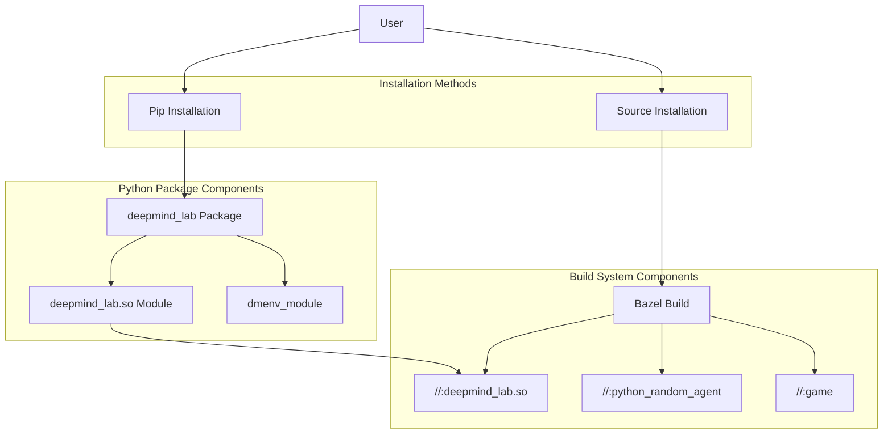
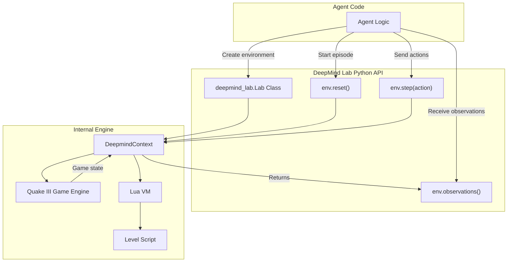

<!-- source: DeepWiki mcp.deepwiki.com · repo google-deepmind/lab · page 2 Getting Started · fetched 2026-10-26 -->

# Getting Started

<details>
<summary>Relevant source files</summary>

The following files were used as context for generating this wiki page:

- [.github/workflows/precommit.yml](.github/workflows/precommit.yml)
- [.precommit.bazelrc](.precommit.bazelrc)
- [BUILD](BUILD)
- [README.md](README.md)
- [docs/users/build.md](docs/users/build.md)
- [examples/game_main.py](examples/game_main.py)
- [public/dmlab_connect_test.cc](public/dmlab_connect_test.cc)
- [python/pip_package/BUILD](python/pip_package/BUILD)
- [python/pip_package/README.md](python/pip_package/README.md)
- [python/pip_package/__init__.py](python/pip_package/__init__.py)
- [python/pip_package/build_pip_package.sh](python/pip_package/build_pip_package.sh)
- [python/pip_package/setup.py](python/pip_package/setup.py)
- [python/random_agent_simple.py](python/random_agent_simple.py)
- [python/tests/BUILD](python/tests/BUILD)
- [python/tests/benchmark.py](python/tests/benchmark.py)
- [python/tests/level_cache_test.py](python/tests/level_cache_test.py)
- [python/tests/utils/BUILD](python/tests/utils/BUILD)
- [python/tests/utils/game_controller_test.py](python/tests/utils/game_controller_test.py)
- [python/tests/utils/maze_game_controller.py](python/tests/utils/maze_game_controller.py)
- [python/tests/utils/maze_game_controller_test.py](python/tests/utils/maze_game_controller_test.py)
- [python/tests/utils/test_environment_decorator.py](python/tests/utils/test_environment_decorator.py)
- [python/tests/utils/test_environment_decorator_test.py](python/tests/utils/test_environment_decorator_test.py)
- [python_system.bzl](python_system.bzl)

</details>


This document guides you through the process of setting up and using DeepMind Lab, a 3D learning environment based on the Quake III Arena engine, designed for reinforcement learning research. For an overview of DeepMind Lab architecture and features, see [Overview](#1) and [Architecture](#1.1). For details on individual API components, see [Python API](#3).

## Prerequisites and Dependencies

DeepMind Lab requires several dependencies to build and run effectively. The installation process differs slightly based on your operating system.

### Required Software

- **Bazel**: Build system used by DeepMind Lab
- **Python**: 2.7 or 3.5+ with NumPy and PIL/Pillow
- **SDL2**: For windowing and input when using graphical mode
- **OpenGL/EGL/OSMesa**: For rendering (either hardware-accelerated or software)
- **Additional libraries**: Varies by platform

### Platform-Specific Dependencies

#### Debian/Ubuntu

```bash
sudo apt-get install libffi-dev gettext freeglut3-dev libsdl2-dev \
     zip libosmesa6-dev python-dev python-numpy python-pil python-enum34 \
     python3-dev python3-numpy python3-pil
```

#### Red Hat Enterprise Linux/CentOS

```bash
sudo yum -y install unzip java-1.8.0-openjdk libffi-devel gcc gcc-c++ \
     java-1.8.0-openjdk-devel freeglut-devel python-devel python-imaging \
     numpy python36-numpy python36-pillow python36-devel SDL2 SDL2-devel \
     mesa-libOSMesa-devel zip
```

#### SUSE Linux

```bash
sudo zypper --non-interactive install gcc gcc-c++ java-1_8_0-openjdk \
     java-1_8_0-openjdk-devel libOSMesa-devel freeglut-devel libSDL-devel \
     python-devel python-numpy-devel python-imaging
```

Sources: [docs/users/build.md:32-70](), [README.md:138-171]()

## Installation Methods

DeepMind Lab can be installed in two primary ways: building from source with Bazel or using pip for Python integration.

### Diagram: Installation Methods



Sources: [README.md:42-65](), [docs/users/build.md:22-91](), [python/pip_package/README.md:8-46]()

### Building from Source (Recommended)

Follow these steps to build DeepMind Lab from source:

1. **Install Bazel** from [bazel.io](https://docs.bazel.build/versions/master/install.html)

2. **Clone the repository**:
   ```bash
   git clone https://github.com/deepmind/lab
   cd lab
   ```

3. **Build the Python interface**:
   ```bash
   bazel build -c opt //:deepmind_lab.so
   ```

4. **Verify the installation** by running tests:
   ```bash
   bazel test -c opt //python/tests:python_module_test
   ```

5. **Run a sample random agent**:
   ```bash
   bazel run -c opt //:python_random_agent --define graphics=sdl -- \
             --length=10000 --width=640 --height=480
   ```

Sources: [README.md:42-65](), [docs/users/build.md:22-91]()

### Installing via pip

For using DeepMind Lab as a Python module without modifying the code:

1. **Build the pip package**:
   ```bash
   git clone https://github.com/deepmind/lab
   cd lab
   bazel build -c opt --python_version=PY3 //python/pip_package:build_pip_package
   ./bazel-bin/python/pip_package/build_pip_package /tmp/dmlab_pkg
   ```

2. **Install the package**:
   ```bash
   pip install /tmp/dmlab_pkg/deepmind_lab-1.0-py3-none-any.whl
   ```

For Python 2 (if required), use `--python_version=PY2` in the build command.

Sources: [python/pip_package/README.md:16-138](), [python/pip_package/BUILD:1-16]()

## Basic Usage

### Diagram: Agent-Environment Interaction



Sources: [examples/game_main.py:1-97](), [python/random_agent_simple.py:1-83]()

### Running a Random Agent

To run a simple random agent and observe its behavior:

```bash
# With visual output (requires a display)
bazel run -c opt //:python_random_agent --define graphics=sdl -- \
         --length=10000 --width=640 --height=480

# Headless (for server environments)
bazel run -c opt //:python_random_agent --define headless=osmesa
```

The `--length` parameter controls how many steps the agent will take.

Sources: [README.md:52-66](), [.github/workflows/precommit.yml:52-52]()

### Playing as a Human

To interact with DeepMind Lab environments as a human:

```bash
bazel run -c opt :game -- --level_script=tests/empty_room_test

# With additional logging
bazel run -c opt :game -- -l tests/empty_room_test -s logToStdErr=true
```

To view specific observations during gameplay:

```bash
bazel run -c opt :game -- --level_script=lt_chasm --observation VEL.TRANS --observation VEL.ROT
```

Sources: [README.md:69-86]()

### Python API Basic Example

Here's a basic example of using the Python API:

```python
import deepmind_lab
import numpy as np

# Create a new environment
env = deepmind_lab.Lab(
    'seekavoid_arena_01',  # Level script
    ['RGB_INTERLEAVED'],   # Observations 
    {'fps': '30', 'width': '80', 'height': '60'}  # Config
)

# Reset environment and get initial observations
env.reset()

# Create a simple action (move forward)
action = np.zeros([7], dtype=np.intc)
action[3] = 1  # Forward movement

# Execute steps and collect rewards
for _ in range(100):
    reward = env.step(action)
    if not env.is_running():
        # Episode ended - reset environment
        env.reset()
```

Sources: [examples/game_main.py:30-63](), [python/random_agent_simple.py:46-61]()

### Using the dm_env API

DeepMind Lab also provides bindings to the DeepMind "dm_env" API:

```python
from deepmind_lab import dmenv_module as dm_env_lab

# Create a new environment using the dm_env API
env = dm_env_lab.Lab(
    level='seekavoid_arena_01', 
    observation_names=['RGB_INTERLEAVED'],
    config={'fps': '30', 'width': '80', 'height': '60'}
)

# Reset the environment to start a new episode
timestep = env.reset()

# Take actions and observe results using the dm_env API
action = [0, 0, 0, 1, 0, 0, 0]  # Move forward
timestep = env.step(action)
```

Sources: [python/pip_package/README.md:193-217](), [python/pip_package/__init__.py:1-32]()

## Level Caching

DeepMind Lab supports caching generated levels to improve startup time for procedurally generated levels.

```python
import os
import deepmind_lab

class SimpleLevelCache(object):
    def __init__(self, cache_dir):
        self._cache_dir = cache_dir
        os.makedirs(cache_dir, exist_ok=True)
        
    def fetch(self, key, pk3_path):
        """Try to fetch cached level."""
        path = os.path.join(self._cache_dir, key)
        if os.path.isfile(path):
            import shutil
            shutil.copyfile(path, pk3_path)
            return True
        return False
        
    def write(self, key, pk3_path):
        """Write generated level to cache."""
        path = os.path.join(self._cache_dir, key)
        import shutil
        shutil.copyfile(pk3_path, path)

# Create environment with level cache
cache = SimpleLevelCache("/tmp/dmlab_cache")
env = deepmind_lab.Lab(
    level='contributed/dmlab30/explore_goal_locations_small',
    observations=['RGB_INTERLEAVED'],
    config={'width': '96', 'height': '72'},
    level_cache=cache
)
```

Sources: [python/tests/level_cache_test.py:33-150]()

## Testing and Benchmarking

DeepMind Lab includes utilities for testing and benchmarking environments:

```bash
# Run the benchmark script to measure performance
bazel run //python/tests:python_benchmark

# Run a specific test
bazel test -c opt //python/tests:python_module_test
```

For custom test environments, the `TestEnvironmentDecorator` provides utilities for:
- Collecting cumulative rewards
- Accumulating events
- Saving rendered frames as images

Sources: [python/tests/utils/test_environment_decorator.py:1-125](), [python/tests/benchmark.py:1-110]()

## Game Controller Utilities

For more sophisticated agent behavior, DeepMind Lab includes game controller utilities:

```python
import deepmind_lab
from python.tests.utils import game_controller

# Create environment with required observations
env = deepmind_lab.Lab(
    'seekavoid_arena_01',
    ['VEL.ROT', 'VEL.TRANS', 'DEBUG.POS.ROT', 'DEBUG.POS.TRANS']
)
env.reset()

# Create controller
controller = game_controller.GameController(env)

# Use high-level movement commands
controller.look_at_2d(90)  # Look right
controller.move_to(100, 0)  # Move to coordinates (100, 0)
controller.stop()  # Stop moving
```

For maze navigation, the `MazeGameController` provides additional utilities:

```python
from python.tests.utils import maze_game_controller

# Create environment with required observations
env = deepmind_lab.Lab(
    'tests/maze_navigation_test', 
    maze_game_controller.REQUIRED_OBSERVATIONS
)
env.reset()

# Create maze controller
controller = maze_game_controller.MazeGameController(env)

# Move to specific maze cell
controller.move_to(2, 5)

# Find path to destination
path = controller.find_path(5, 1)
controller.follow_path(path)
```

Sources: [python/tests/utils/game_controller_test.py:1-102](), [python/tests/utils/maze_game_controller.py:1-225](), [python/tests/utils/maze_game_controller_test.py:1-74]()

## Rendering Options

DeepMind Lab supports different rendering options for different use cases:

- **SDL Rendering** (`--define graphics=sdl`): For visual output, requires a display
- **Headless Rendering**:
  - **OSMesa** (`--define headless=osmesa`): Software rendering
  - **EGL** (`--define graphics=osmesa_or_egl`): Hardware-accelerated off-screen rendering
  - **GLX** (`--define graphics=osmesa_or_glx`): Alternative hardware rendering

For most reinforcement learning workloads, headless rendering is preferred.

Sources: [README.md:162-172](), [BUILD:936-975]()

## Next Steps

Now that you've got DeepMind Lab up and running, you can explore:

- [Python API](#3) for detailed API documentation
- [Lua Scripting](#5) to customize environments
- [Level Generation](#6) to create your own levels
- [Observations and Actions](#7) to understand available inputs and outputs

---

