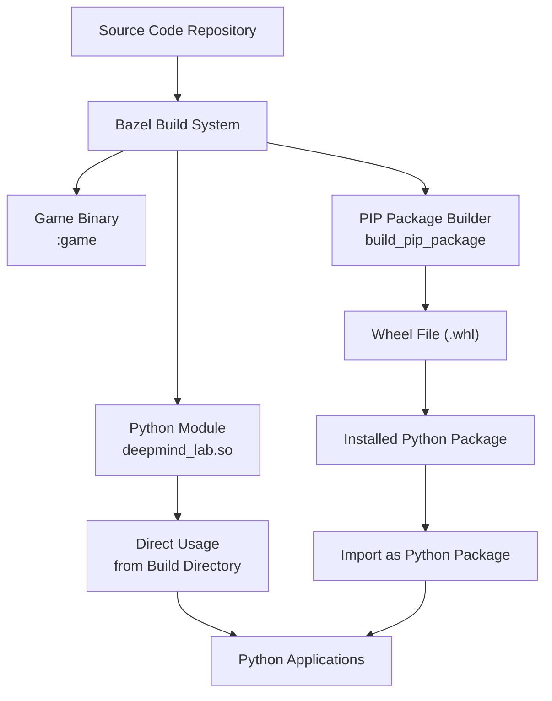
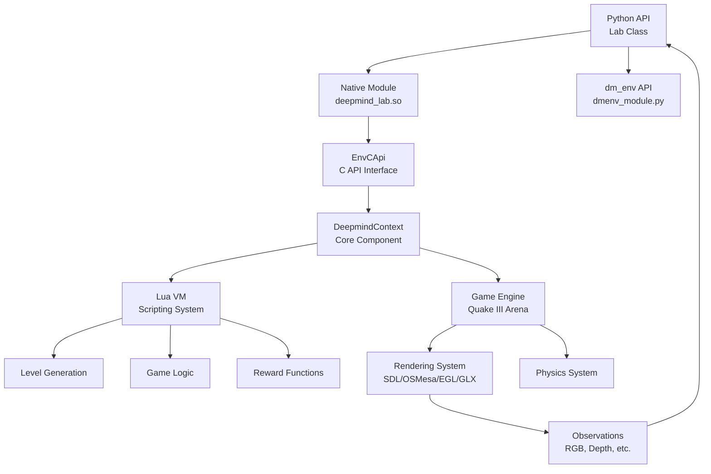
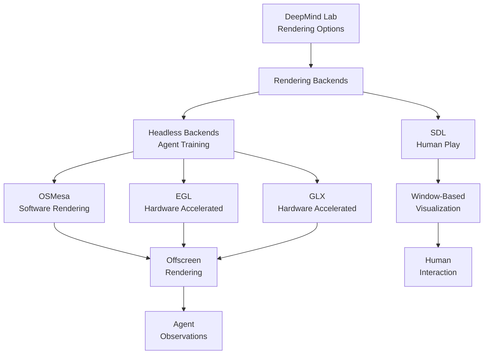

<!-- source: DeepWiki mcp.deepwiki.com · repo google-deepmind/lab · page 2.1 Installation · fetched 2026-10-26 -->

# Installation

<details>
<summary>Relevant source files</summary>

The following files were used as context for generating this wiki page:

- [.github/workflows/precommit.yml](.github/workflows/precommit.yml)
- [.precommit.bazelrc](.precommit.bazelrc)
- [BUILD](BUILD)
- [README.md](README.md)
- [WORKSPACE](WORKSPACE)
- [bazel/dm_env.BUILD](bazel/dm_env.BUILD)
- [bazel/pybind11.BUILD](bazel/pybind11.BUILD)
- [bazel/tree.BUILD](bazel/tree.BUILD)
- [docs/users/build.md](docs/users/build.md)
- [public/dmlab_connect_test.cc](public/dmlab_connect_test.cc)
- [python/pip_package/BUILD](python/pip_package/BUILD)
- [python/pip_package/README.md](python/pip_package/README.md)
- [python/pip_package/__init__.py](python/pip_package/__init__.py)
- [python/pip_package/build_pip_package.sh](python/pip_package/build_pip_package.sh)
- [python/pip_package/setup.py](python/pip_package/setup.py)
- [python/tests/BUILD](python/tests/BUILD)
- [python/tests/utils/BUILD](python/tests/utils/BUILD)
- [python_system.bzl](python_system.bzl)

</details>


This page provides detailed instructions for installing DeepMind Lab, a 3D learning environment based on the Quake III Arena engine used for artificial intelligence research. This document focuses specifically on installation procedures for both building from source and using the Python package. For information about using DeepMind Lab after installation, see [Basic Usage](#2.2).

## System Requirements

DeepMind Lab has been tested on several Linux distributions:

| Distribution | Versions Tested |
| ------------ | --------------- |
| Debian | 9 (Stretch) and newer |
| Ubuntu | 16.04 (Xenial) and newer |
| Red Hat Enterprise Linux / CentOS | 7.6 and newer |
| SUSE Linux Enterprise Server | 12 and newer |

DeepMind Lab requires:
- A C++17 compatible compiler
- Python (both Python 2.7 and Python 3.5+ are supported, Python 3 is recommended)
- Bazel build system (for building from source)

Sources: [README.md:41-65](), [docs/users/build.md:12-14]()

## Required Dependencies

The following dependencies are needed to build and run DeepMind Lab:

| Dependency | Purpose |
| ---------- | ------- |
| SDL2 | Windowing and input handling |
| OpenGL | Rendering (for human play) |
| OSMesa/EGL/GLX | Headless rendering (for agent training) |
| Python | Programming interface |
| NumPy | Array operations for Python interface |
| Pillow/PIL | Image processing for Python |
| Bazel | Build system |

### Installing Dependencies

#### Debian/Ubuntu

```bash
sudo apt-get install libffi-dev gettext freeglut3-dev libsdl2-dev \
  zip libosmesa6-dev python3-dev python3-numpy python3-pil
```

For building a PIP package, also install:
```bash
sudo apt-get install python3-setuptools python3-wheel python3-pip python3-virtualenv
```

#### Red Hat/CentOS

```bash
sudo yum -y install unzip java-1.8.0-openjdk libffi-devel gcc gcc-c++ \
  java-1.8.0-openjdk-devel freeglut-devel python3-devel python3-numpy \
  python3-pillow SDL2 SDL2-devel mesa-libOSMesa-devel zip
```

#### SUSE Linux

```bash
sudo zypper --non-interactive install gcc gcc-c++ java-1_8_0-openjdk \
  java-1_8_0-openjdk-devel libOSMesa-devel freeglut-devel libSDL-devel \
  python3-devel python3-numpy-devel python3-Pillow
```

Sources: [docs/users/build.md:33-70](), [.github/workflows/precommit.yml:35-40]()

## Build System Architecture

### DeepMind Lab Installation Flow



DeepMind Lab uses Bazel as its build system. The main configuration files are:

- `WORKSPACE`: Defines external dependencies (like SDL2, OpenGL, Python)
- `BUILD`: Defines build targets and dependencies between components
- `.bazelrc` and `.precommit.bazelrc`: Contains default build options

Sources: [BUILD:1-1088](), [WORKSPACE:1-165](), [.precommit.bazelrc:1-15]()

## Building from Source

This section covers building DeepMind Lab from source using Bazel.

### Step 1: Install Bazel

Follow the [official Bazel installation guide](https://docs.bazel.build/versions/master/install.html) to install Bazel on your system.

### Step 2: Clone DeepMind Lab Repository

```bash
git clone https://github.com/deepmind/lab.git
cd lab
```

### Step 3: Build the Python Module

```bash
bazel build -c opt //:deepmind_lab.so
```

The `-c opt` flag enables compiler optimizations for better performance.

### Step 4: Test the Build (Optional)

```bash
bazel test -c opt //python/tests:python_module_test
```

### Step 5: Run a Sample Agent (Optional)

```bash
bazel run -c opt //:python_random_agent
```

For an interactive human-playable version:

```bash
bazel run -c opt --define graphics=sdl //:game -- \
  --level_script=tests/empty_room_test --level_setting=logToStdErr=true
```

Sources: [README.md:42-77](), [docs/users/build.md:21-44](), [docs/users/build.md:71-94]()

## DeepMind Lab Component Architecture



Sources: [BUILD:801-869](), [BUILD:562-564](), [BUILD:974-995](), [public/dmlab_connect_test.cc:1-57]()

## Installation via PIP Package

DeepMind Lab can be installed as a Python package using pip. This is recommended for users who want to use DeepMind Lab without modifying its source code.

### Building the PIP Package

First, build the package script:

```bash
bazel build -c opt //python/pip_package:build_pip_package
```

Run the package script to create the wheel file:

```bash
./bazel-bin/python/pip_package/build_pip_package /tmp/dmlab_pkg
```

Install the wheel file:

```bash
pip install /tmp/dmlab_pkg/deepmind_lab-1.0-py3-none-any.whl
```

### Using a Virtual Environment (Recommended)

It's recommended to install DeepMind Lab in a virtual environment:

```bash
virtualenv dmlab_env
source dmlab_env/bin/activate
pip install numpy  # If not using --system-site-packages
pip install /tmp/dmlab_pkg/deepmind_lab-1.0-py3-none-any.whl
```

Sources: [python/pip_package/README.md:8-79](), [python/pip_package/build_pip_package.sh:1-66](), [python/pip_package/setup.py:1-21]()

## Python 2 vs Python 3 Support

DeepMind Lab supports both Python 2 and Python 3. By default, it builds for Python 3.

- For Python 2: Add `--python_version=PY2` to your Bazel commands
- For Python 3: Add `--python_version=PY3` or omit (default since Bazel 0.27)

For example, to build the PIP package for Python 2:

```bash
bazel build -c opt --python_version=PY2 //python/pip_package:build_pip_package
```

And when running the PIP package build script:

```bash
PYTHON_BIN_PATH="/usr/bin/python2" ./bazel-bin/python/pip_package/build_pip_package /tmp/dmlab_pkg
```

The Python system detection is handled by the `python_system.bzl` Bazel rule, which locates your system's Python installation and NumPy headers.

Sources: [python/pip_package/README.md:44-60](), [python_system.bzl:1-73](), [BUILD:1022-1033]()

## Rendering Options



DeepMind Lab supports multiple rendering backends:

1. **SDL** - For human play with window visualization
2. **OSMesa** - Software rendering for headless environments
3. **EGL/GLX** - Hardware-accelerated rendering for headless environments

To specify the rendering backend:

```bash
# For SDL (human play)
bazel build -c opt --define graphics=sdl //:game

# For headless with OSMesa or EGL (for training agents)
bazel build -c opt --define headless=osmesa //:python_random_agent
# or
bazel build -c opt --define headless=egl //:python_random_agent
```

Sources: [BUILD:802-892](), [BUILD:937-1008](), [README.md:156-169]()

## Verifying the Installation

Create a file `test_lab.py` with the following content:

```python
import deepmind_lab
import numpy as np

# Create a new environment object
lab = deepmind_lab.Lab("demos/extra_entities", ['RGB_INTERLEAVED'],
                      {'fps': '30', 'width': '80', 'height': '60'})
lab.reset(seed=1)

# Execute 100 walk-forward steps and sum the returned rewards
reward_sum = sum(
    [lab.step(np.array([0,0,0,1,0,0,0], dtype=np.intc)) for i in range(0, 100)])
print("Total reward:", reward_sum)
```

Run the script:
```bash
python test_lab.py
```

If the installation is successful, the script should print diagnostic information followed by a total reward of 4.0 (for the example level).

Sources: [python/pip_package/README.md:149-176]()

## Troubleshooting

### NumPy Compatibility

If you encounter errors related to NumPy, ensure that the version used to build DeepMind Lab matches the one you're using at runtime. You can find your NumPy include path by running:

```python
import numpy as np
print(np.get_include())
```

### Python Path Issues

DeepMind Lab uses the `python_system.bzl` rule to find your system's Python installation. If Python cannot be found, you may need to ensure that the correct Python is in your PATH or explicitly set the Python binary path:

```bash
PYTHON_BIN_PATH="/usr/bin/python3" ./bazel-bin/python/pip_package/build_pip_package /tmp/dmlab_pkg
```

### Missing Libraries

If you get "missing library" errors when trying to import the module, make sure all dependencies are installed. The error message should indicate which library is missing.

### Build Errors

If you encounter build errors, check that you're using a compatible compiler with C++17 support. Recent versions of DeepMind Lab require GCC 7+ or Clang 5+.

Sources: [docs/users/build.md:96-131](), [.github/workflows/precommit.yml:25-52]()

## Integration with dm_env API

DeepMind Lab provides integration with DeepMind's general reinforcement learning API `dm_env`. The adapter module `dmenv_module.py` is included in the PIP package and can be imported with:

```python
from deepmind_lab import dmenv_module
```

To install the additional dependencies required for using the dm_env integration:

```bash
pip install /tmp/dmlab_pkg/deepmind_lab-1.0-py3-none-any.whl[dmenv_module]
```

Sources: [python/pip_package/__init__.py:1-23](), [python/pip_package/README.md:199-218](), [bazel/dm_env.BUILD:1-33]()

---

