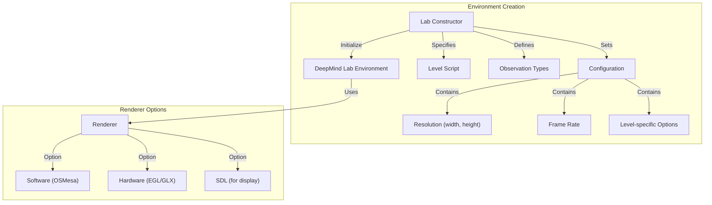
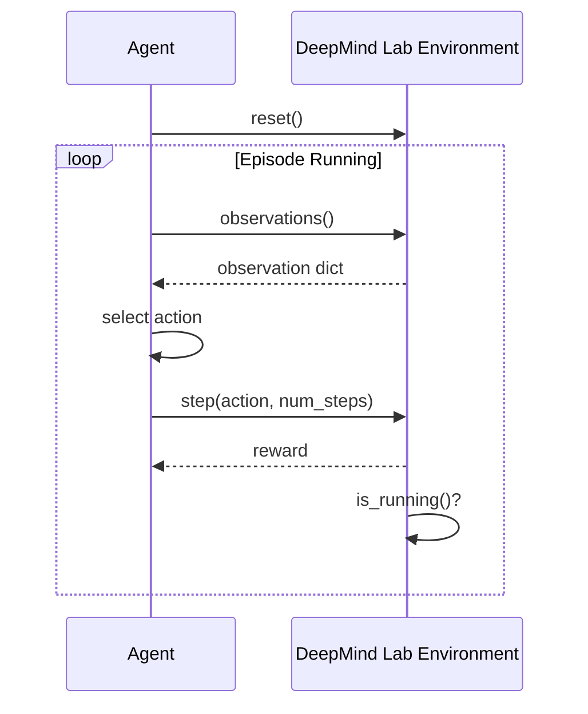
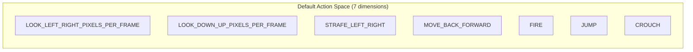
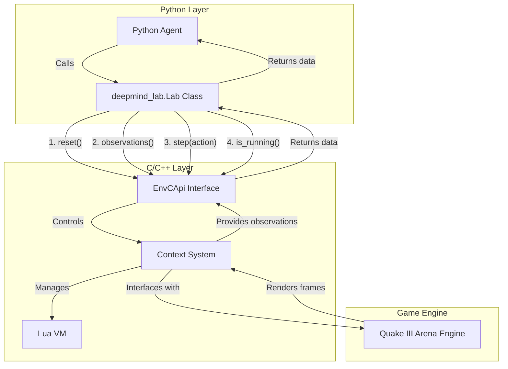

<!-- source: DeepWiki mcp.deepwiki.com · repo google-deepmind/lab · page 2.2 Basic Usage · fetched 2026-10-26 -->

# Basic Usage

<details>
<summary>Relevant source files</summary>

The following files were used as context for generating this wiki page:

- [README.md](README.md)
- [docs/users/observations.md](docs/users/observations.md)
- [docs/users/python_api.md](docs/users/python_api.md)
- [docs/users/run_from_script.md](docs/users/run_from_script.md)
- [examples/game_main.py](examples/game_main.py)
- [python/pip_package/BUILD](python/pip_package/BUILD)
- [python/pip_package/README.md](python/pip_package/README.md)
- [python/pip_package/__init__.py](python/pip_package/__init__.py)
- [python/pip_package/build_pip_package.sh](python/pip_package/build_pip_package.sh)
- [python/pip_package/setup.py](python/pip_package/setup.py)
- [python/random_agent.py](python/random_agent.py)
- [python/random_agent_simple.py](python/random_agent_simple.py)
- [python/tests/benchmark.py](python/tests/benchmark.py)
- [python/tests/dmlab_module_test.py](python/tests/dmlab_module_test.py)
- [python/tests/level_cache_test.py](python/tests/level_cache_test.py)
- [python/tests/random_agent_test.py](python/tests/random_agent_test.py)
- [python/tests/render_test.py](python/tests/render_test.py)
- [python/tests/utils/game_controller_test.py](python/tests/utils/game_controller_test.py)
- [python/tests/utils/maze_game_controller.py](python/tests/utils/maze_game_controller.py)
- [python/tests/utils/maze_game_controller_test.py](python/tests/utils/maze_game_controller_test.py)
- [python/tests/utils/test_environment_decorator.py](python/tests/utils/test_environment_decorator.py)
- [python/tests/utils/test_environment_decorator_test.py](python/tests/utils/test_environment_decorator_test.py)

</details>


This guide covers the fundamentals of using DeepMind Lab after installation. It shows how to create environments, interact with them through the Python API, and implement simple agents. For installation instructions, see [Installation](#2.1), and for command-line options, see [Command-Line Options](#2.3).

## Environment Creation

To use DeepMind Lab, you first need to create an environment instance using the `Lab` class.

```python
import deepmind_lab

# Create a Lab environment
env = deepmind_lab.Lab(
    level='lt_chasm',                 # Level script to load
    observations=['RGB_INTERLEAVED'],  # Observations to return
    config={                           # Optional configuration
        'width': '640',                # Screen width in pixels
        'height': '480',               # Screen height in pixels
        'fps': '60'                    # Frames per second
    }
)
```

The `Lab` constructor has the following parameters:

- `level`: The level script to load (e.g., 'lt_chasm', 'seekavoid_arena_01')
- `observations`: A list of observation names to return (e.g., 'RGB_INTERLEAVED', 'RGBD')
- `config`: Optional configuration parameters
- `renderer`: Rendering backend ('software' or 'hardware')
- `level_cache`: Optional level cache object for performance improvement

### Basic Environment Setup



Sources: [README.md:42-66](). [python/pip_package/README.md:1-189](). [docs/users/python_api.md:1-75]().

## Environment Interaction Loop

The basic interaction loop with a DeepMind Lab environment follows these steps:

1. **Reset** the environment to start a new episode
2. **Observe** the current state
3. **Act** by selecting an action
4. **Step** the environment forward
5. Repeat steps 2-4 until the episode ends



Sources: [python/random_agent.py:151-175](). [examples/game_main.py:31-62]().

### Basic Usage Example

Here's a minimal example showing the complete interaction loop:

```python
import deepmind_lab
import numpy as np

# Create environment
env = deepmind_lab.Lab('seekavoid_arena_01', ['RGB_INTERLEAVED'])

# Reset the environment
env.reset()

# Create an action - 7 dimensions for movement and looking
action = np.zeros([7], dtype=np.intc)

# Run for 100 steps
for _ in range(100):
    if not env.is_running():
        print('Environment stopped early')
        env.reset()
    
    # Get observations
    obs = env.observations()
    rgb_image = obs['RGB_INTERLEAVED']
    
    # Set some action (move forward)
    action[3] = 1  # Forward movement
    
    # Execute action and get reward
    reward = env.step(action, num_steps=4)
    print(f"Reward: {reward}")
```

Sources: [examples/game_main.py:31-62](). [python/tests/dmlab_module_test.py:92-102]().

## Understanding Observations

DeepMind Lab provides various observation types that can be requested when creating the environment. The environment will only return the observations that were specified during initialization.

### Common Observation Types

| Observation Name | Type/Shape | Description |
|------------------|------------|-------------|
| `RGB_INTERLEAVED` | Bytes (height, width, 3) | Player view, with RGB channels interleaved |
| `RGBD_INTERLEAVED` | Bytes (height, width, 4) | Player view with depth, channels interleaved |
| `RGB` | Bytes (3, height, width) | Player view, with RGB channels planar |
| `RGBD` | Bytes (4, height, width) | Player view with depth, channels planar |
| `VEL.TRANS` | Doubles (3) | Player relative velocity |
| `VEL.ROT` | Doubles (3) | Player relative angular velocity |

You can check the available observations and their specifications:

```python
env = deepmind_lab.Lab('lt_chasm', [])
observation_spec = env.observation_spec()
print(observation_spec)
```

Sources: [docs/users/observations.md:1-35](). [docs/users/python_api.md:166-208]().

## Actions and Control

DeepMind Lab uses a 7-dimensional action space by default:



You can query the action specifications:

```python
env = deepmind_lab.Lab('lt_chasm', ['RGB_INTERLEAVED'])
action_spec = env.action_spec()
print(action_spec)
```

Actions are provided as numpy arrays of integer type:

```python
import numpy as np
action = np.zeros([7], dtype=np.intc)  # No action
action[3] = 1  # Move forward
```

Sources: [python/random_agent.py:30-55](). [docs/users/python_api.md:220-235]().

## Implementing a Simple Agent

Here's how to implement a basic random agent that interacts with DeepMind Lab:

```python
import deepmind_lab
import numpy as np
import random

# Create action arrays for common movements
def _action(*entries):
    return np.array(entries, dtype=np.intc)

# Define discrete actions
ACTIONS = {
    'look_left': _action(-20, 0, 0, 0, 0, 0, 0),
    'look_right': _action(20, 0, 0, 0, 0, 0, 0),
    'look_up': _action(0, 10, 0, 0, 0, 0, 0),
    'look_down': _action(0, -10, 0, 0, 0, 0, 0),
    'strafe_left': _action(0, 0, -1, 0, 0, 0, 0),
    'strafe_right': _action(0, 0, 1, 0, 0, 0, 0),
    'forward': _action(0, 0, 0, 1, 0, 0, 0),
    'backward': _action(0, 0, 0, -1, 0, 0, 0),
    'fire': _action(0, 0, 0, 0, 1, 0, 0),
    'jump': _action(0, 0, 0, 0, 0, 1, 0),
    'crouch': _action(0, 0, 0, 0, 0, 0, 1)
}

ACTION_LIST = list(ACTIONS.values())

# Create environment
env = deepmind_lab.Lab(
    'lt_chasm', 
    ['RGB_INTERLEAVED'],
    config={'width': '80', 'height': '80'}
)

# Reset environment
env.reset()

# Run for 100 steps
for _ in range(100):
    if not env.is_running():
        print('Environment stopped early')
        env.reset()
    
    # Get observations
    obs = env.observations()
    
    # Choose random action
    action = random.choice(ACTION_LIST)
    
    # Execute action
    reward = env.step(action, num_steps=1)
    print(f"Reward: {reward}")
```

Sources: [python/random_agent.py:30-56](). [python/random_agent_simple.py:27-42]().

## Data Flow in DeepMind Lab

The following diagram illustrates the data flow between the Python API and the underlying DeepMind Lab system:



Sources: [python/pip_package/README.md:193-218](). [docs/users/python_api.md:1-30]().

## Advanced Usage

### Level Caching

For levels that generate new maps for each episode, you can improve performance using a level cache:

```python
class LevelCache(object):
    def __init__(self, cache_dir):
        self._cache_dir = cache_dir

    def fetch(self, key, pk3_path):
        # Return True if key was found in cache, False otherwise
        # If found, copy cached level to pk3_path
        pass

    def write(self, key, pk3_path):
        # Save the level at pk3_path to the cache with the given key
        pass

# Use the cache when creating the environment
env = deepmind_lab.Lab(
    level='contributed/dmlab30/explore_goal_locations_small',
    observations=['RGB_INTERLEAVED'],
    level_cache=LevelCache('/tmp/level_cache')
)
```

Sources: [python/tests/level_cache_test.py:42-150](). [docs/users/python_api.md:81-126]().

### Environment Configuration

The table below shows common configuration options you can provide to the `Lab` constructor:

| Option | Description | Default |
|--------|-------------|---------|
| `width` | Horizontal resolution of observation frames | `'320'` |
| `height` | Vertical resolution of observation frames | `'240'` |
| `fps` | Frames per second | `'60'` |
| `levelDirectory` | Optional path to level directory | `''` |
| `appendCommand` | Commands for the internal Quake console | `''` |
| `mixerSeed` | Value combined with seeds for unique subsets | `'0'` |

Additional level-specific options can also be provided in the config dictionary.

Sources: [docs/users/python_api.md:30-45](). [python/pip_package/README.md:152-175]().

### Command Line Examples

DeepMind Lab also includes example utilities for running environments:

1. Play as a human:
```bash
bazel run :game -- --level_script=tests/empty_room_test
```

2. Run a random agent:
```bash
bazel run :python_random_agent -- --length=10000 --width=640 --height=480
```

Sources: [README.md:67-96]().

---

