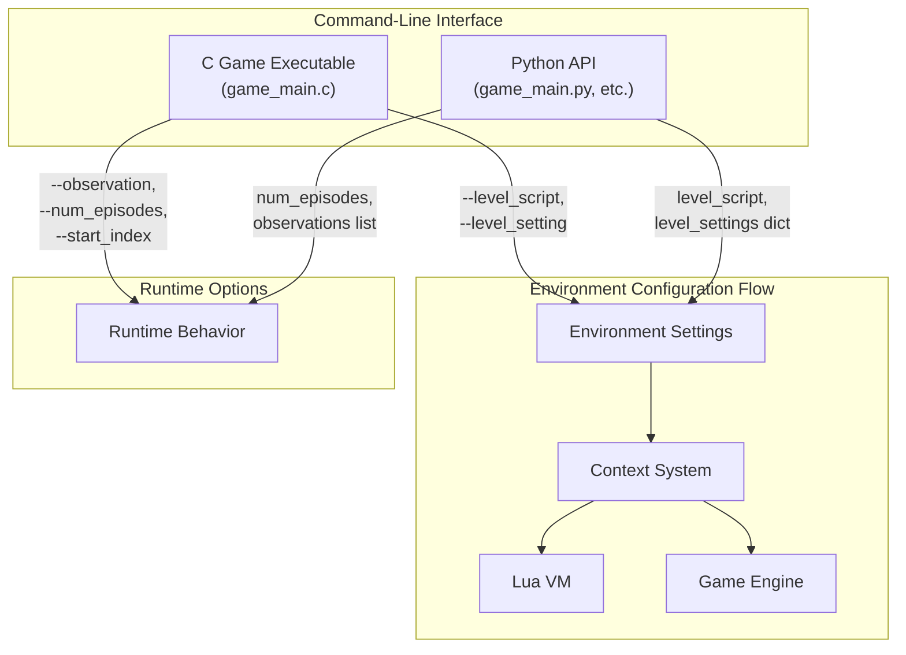
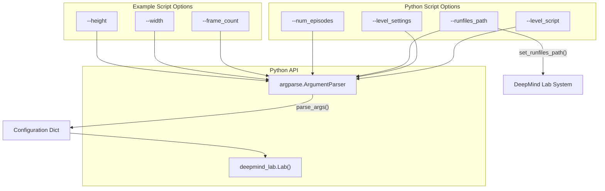
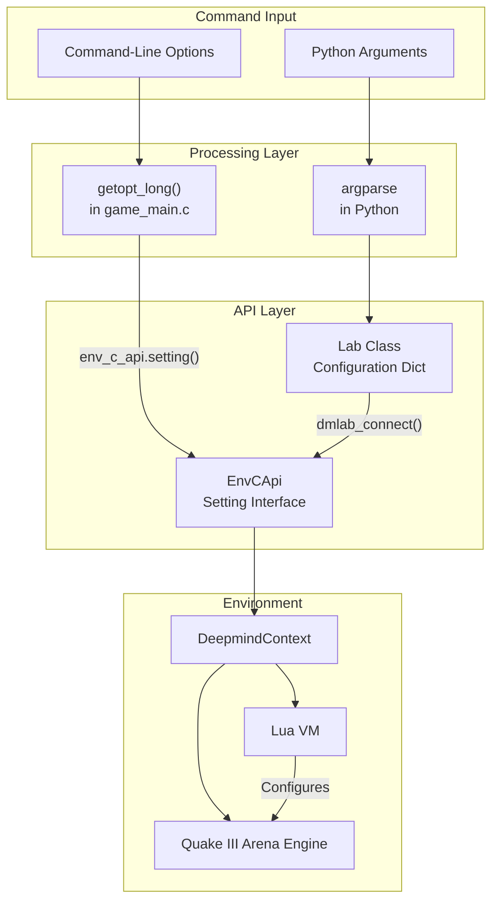

<!-- source: DeepWiki mcp.deepwiki.com · repo google-deepmind/lab · page 2.3 Command-Line Options · fetched 2026-10-26 -->

# Command-Line Options

<details>
<summary>Relevant source files</summary>

The following files were used as context for generating this wiki page:

- [deepmind/engine/context_actions.cc](deepmind/engine/context_actions.cc)
- [deepmind/engine/context_events.cc](deepmind/engine/context_events.cc)
- [deepmind/engine/context_observations.cc](deepmind/engine/context_observations.cc)
- [deepmind/level_generation/compile_map.cc](deepmind/level_generation/compile_map.cc)
- [deepmind/level_generation/text_level/char_grid.cc](deepmind/level_generation/text_level/char_grid.cc)
- [deepmind/level_generation/text_level/lua_bindings.cc](deepmind/level_generation/text_level/lua_bindings.cc)
- [deepmind/level_generation/text_level/translate_text_level_test.cc](deepmind/level_generation/text_level/translate_text_level_test.cc)
- [deepmind/support/test_srcdir.cc](deepmind/support/test_srcdir.cc)
- [deepmind/util/run_executable.cc](deepmind/util/run_executable.cc)
- [examples/game_main.c](examples/game_main.c)
- [examples/game_main.py](examples/game_main.py)
- [python/random_agent_simple.py](python/random_agent_simple.py)
- [python/tests/benchmark.py](python/tests/benchmark.py)
- [python/tests/level_cache_test.py](python/tests/level_cache_test.py)
- [python/tests/utils/game_controller_test.py](python/tests/utils/game_controller_test.py)
- [python/tests/utils/maze_game_controller.py](python/tests/utils/maze_game_controller.py)
- [python/tests/utils/maze_game_controller_test.py](python/tests/utils/maze_game_controller_test.py)
- [python/tests/utils/test_environment_decorator.py](python/tests/utils/test_environment_decorator.py)
- [python/tests/utils/test_environment_decorator_test.py](python/tests/utils/test_environment_decorator_test.py)

</details>


This document describes the command-line options available in DeepMind Lab for both the C/C++ and Python interfaces. These options allow you to configure various aspects of the environment, such as the level to run, visual settings, and randomization parameters. For information about creating custom agents using the Python API, see [Creating Custom Agents](#3.3).

## 1. Overview

DeepMind Lab provides command-line interfaces through both its C/C++ executable (`game_main`) and Python API. These options allow researchers and developers to configure the environment without modifying code.



Sources: [examples/game_main.c:59-87](), [examples/game_main.py:65-96]()

## 2. C/C++ Command-Line Options

The C/C++ executable provides a set of command-line options for configuring and running DeepMind Lab environments.

### 2.1 Usage Format

```
game --level_script <level> \
     [--level_setting key=value [...]] \
     [--observation <S>] \
     [--num_episodes <N>] \
     [--start_index <N>] \
     [--print_events] \
     [--random_seed <S>] \
     [--mixer_seed <M>] \
     [--fps <F>]
```

Sources: [examples/game_main.c:59-87]()

### 2.2 Available Options

| Option | Short | Type | Description | Default |
|--------|-------|------|-------------|---------|
| `--level_script` | `-l` | string | The level script to run (required) | None |
| `--level_setting` | `-s` | key=value | Key-value settings passed to the level script | None |
| `--observation` | `-o` | string | Observation to print each frame | None |
| `--num_episodes` | `-e` | integer | Number of episodes to play | 1 |
| `--start_index` | `-i` | integer | Starting episode index | 0 |
| `--print_events` | `-p` | flag | Print events emitted by the environment | False |
| `--random_seed` | `-r` | integer | Seed for random content generation | 1 |
| `--mixer_seed` | `-m` | integer | XOR mask applied to random seed | 0 |
| `--fps` | `-f` | integer | Frames per second | 250 |
| `--help` | `-h` | flag | Display help message | N/A |

Sources: [examples/game_main.c:95-106](), [examples/game_main.c:112-181]()

### 2.3 Option Details

#### Level Script
The `--level_script` option specifies which level to load. Levels are Lua scripts stored in the `assets/game_scripts/` directory. For example, `--level_script seekavoid_arena_01` will load `assets/game_scripts/seekavoid_arena_01.lua`.

#### Level Settings
The `--level_setting` option allows you to pass key-value pairs to the level script. This can be used to configure level-specific parameters. This option can be specified multiple times to set different parameters:

```
--level_setting width=640 --level_setting height=480
```

Common level settings include:
- `width`: Screen width in pixels (default: 640)
- `height`: Screen height in pixels (default: 480)
- `fps`: Frames per second (can also be set with `--fps`)
- `random_seed`: Random seed for procedural generation

#### Observations
The `--observation` option specifies which observations to print during execution. This option can be provided multiple times to print different observations:

```
--observation RGB_INTERLEAVED --observation PLAYER_POSITION
```

Sources: [examples/game_main.c:112-181](), [examples/game_main.c:225-238]()

## 3. Python API Command-Line Options

DeepMind Lab's Python API uses argparse to handle command-line options in example scripts.

### 3.1 Common Python Command-Line Options



Sources: [examples/game_main.py:65-96](), [python/random_agent_simple.py:67-82](), [python/tests/benchmark.py:88-94]()

### 3.2 Python API Option Details

| Option | Type | Description | Typical Default |
|--------|------|-------------|----------------|
| `--level_script` | string | Level script to load | 'seekavoid_arena_01' |
| `--level_settings` | list of key=value | Key-value pairs for level configuration | [] |
| `--runfiles_path` | string | Path to DeepMind Lab data files | None |
| `--num_episodes` | integer | Number of episodes to play | 1 |
| `--frame_count` | integer | Number of frames to run (in some examples) | 1000 |
| `--width` | integer | Screen width in pixels | Varies (80-640) |
| `--height` | integer | Screen height in pixels | Varies (80-480) |

Sources: [examples/game_main.py:65-96](), [python/random_agent_simple.py:67-82]()

### 3.3 Converting Command-Line Arguments to Configuration

The Python API typically converts command-line arguments into a configuration dictionary:

```python
config = {
    k: v
    for k, v in [six.ensure_str(s).split('=') for s in args.level_settings]
}
```

This dictionary is then passed to the `deepmind_lab.Lab()` constructor:

```python
env = deepmind_lab.Lab(level_script, ['RGB_INTERLEAVED'], config=config)
```

Sources: [examples/game_main.py:89-96]()

## 4. Common Environment Configuration Options

### 4.1 Universal Settings

These settings can be applied to any level:

| Setting | Type | Description | Default |
|---------|------|-------------|---------|
| `width` | integer | Screen width in pixels | 640 |
| `height` | integer | Screen height in pixels | 480 |
| `fps` | integer | Frames per second | 250 |
| `random_seed` | integer | Seed for random generation | 1 |
| `mixerSeed` | integer | XOR mask for random seed | 0 |
| `levelName` | string | Name of the level script | Required |
| `nativeApp` | boolean | Whether to run as native application | true (for game_main) |

Sources: [examples/game_main.c:283-295](), [examples/game_main.c:311-322]()

### 4.2 Default Values

The C/C++ executable sets these defaults:

```c
// Default width and height
env_c_api.setting(context, "width", "640")
env_c_api.setting(context, "height", "480")

// Default nativeApp setting for game_main
env_c_api.setting(context, "nativeApp", "true")

// Default FPS
env_c_api.setting(context, "appendCommand", " +set com_maxfps 250")
```

Sources: [examples/game_main.c:283-295](), [examples/game_main.c:311-322]()

## 5. Command-Line Flow Architecture

The following diagram illustrates how command-line options flow through the DeepMind Lab system:



Sources: [examples/game_main.c:89-181](), [examples/game_main.c:268-330]()

## 6. Examples

### 6.1 Basic C/C++ Usage

Run a specific level with default settings:

```bash
./game --level_script seekavoid_arena_01
```

Run with custom resolution and FPS:

```bash
./game --level_script seekavoid_arena_01 --level_setting width=1280 --level_setting height=720 --fps 60
```

Run with a specific random seed and monitor observations:

```bash
./game --level_script seekavoid_arena_01 --random_seed 42 --observation RGB_INTERLEAVED --observation PLAYER_POSITION
```

Sources: [examples/game_main.c:259-394]()

### 6.2 Python API Usage

Basic usage pattern:

```python
parser = argparse.ArgumentParser(description=__doc__)
parser.add_argument('--level_script', type=str, default='seekavoid_arena_01')
parser.add_argument('--level_settings', type=str, default=[], action='append')
args = parser.parse_args()

config = {k: v for k, v in [s.split('=') for s in args.level_settings]}
env = deepmind_lab.Lab(args.level_script, ['RGB_INTERLEAVED'], config=config)
```

Specifying runfiles path:

```python
if args.runfiles_path:
    deepmind_lab.set_runfiles_path(args.runfiles_path)
```

Sources: [examples/game_main.py:65-96](), [python/random_agent_simple.py:67-82]()

## 7. Common Settings Use Cases

### 7.1 Level Cache Settings

DeepMind Lab has a level caching system that can be configured through Python. This allows precomputed level data to be cached for faster loading:

```python
class LevelCache(object):
    def __init__(self, cache_dir):
        self._cache_dir = cache_dir
        
    def fetch(self, key, pk3_path):
        # Try to fetch cached level
        
    def write(self, key, pk3_path):
        # Save level to cache

env = deepmind_lab.Lab(
    level='contributed/dmlab30/explore_goal_locations_small',
    observations=['RGB_INTERLEAVED'],
    config={'width': '96', 'height': '72'},
    level_cache=LevelCache(cache_dir='/tmp/level_cache'))
```

Sources: [python/tests/level_cache_test.py:42-50](), [python/tests/level_cache_test.py:118-150]()

### 7.2 Testing and Benchmarking

Settings are often used for testing and benchmarking:

```python
# Run benchmarks at different resolutions and observation types
for level_script in ['nav_maze_static_01', 'lt_space_bounce_hard']:
    for width, height in [(84, 84), (160, 120), (320, 240)]:
        for observation_spec in ['RGB', 'RGBD']:
            run(length, width, height, fps, level_script, observation_spec)
```

Sources: [python/tests/benchmark.py:100-105]()

---

