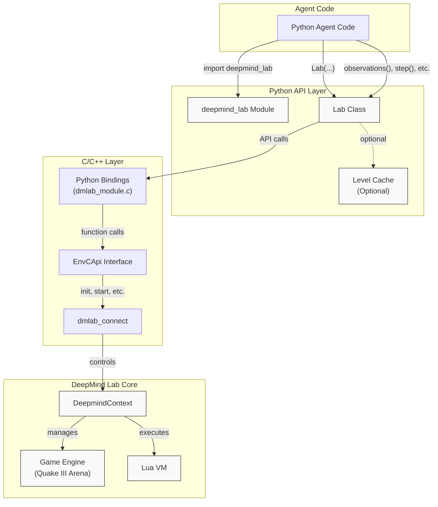
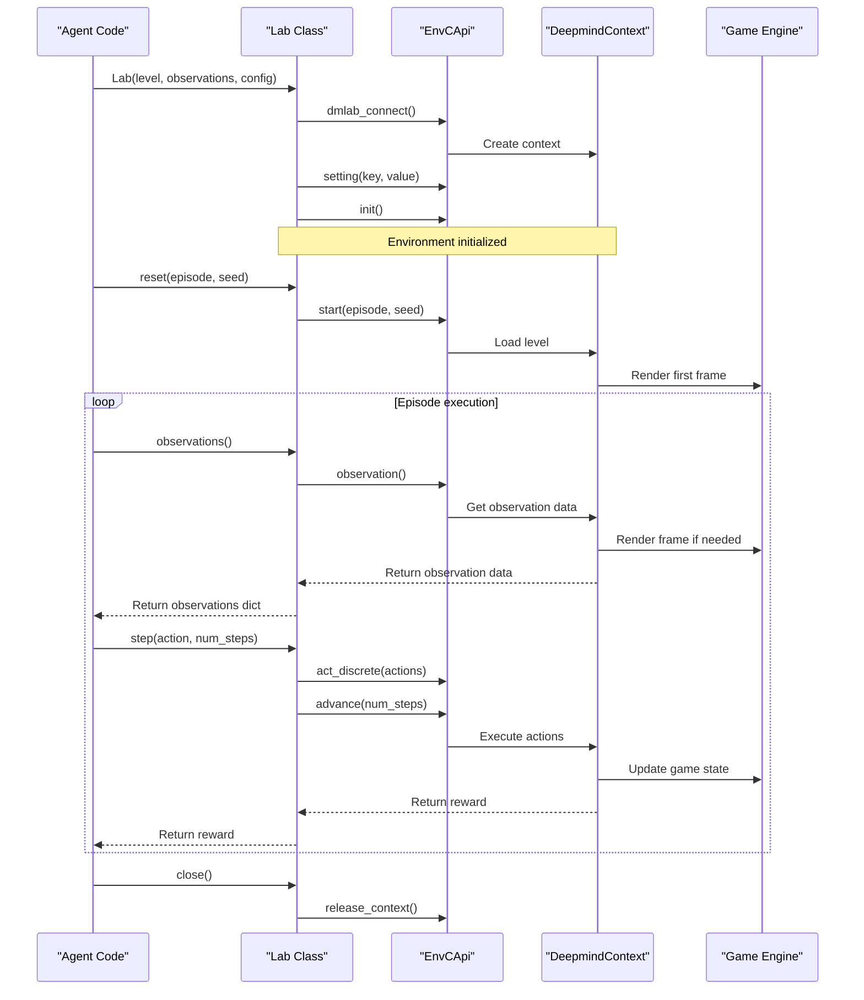
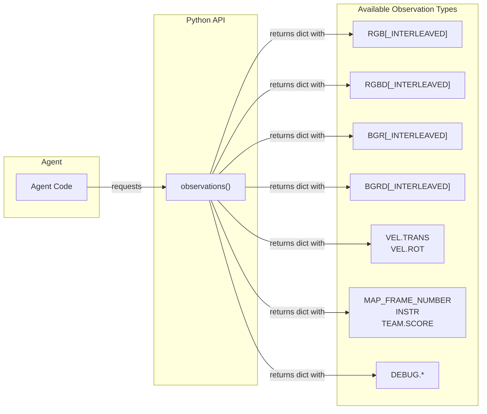
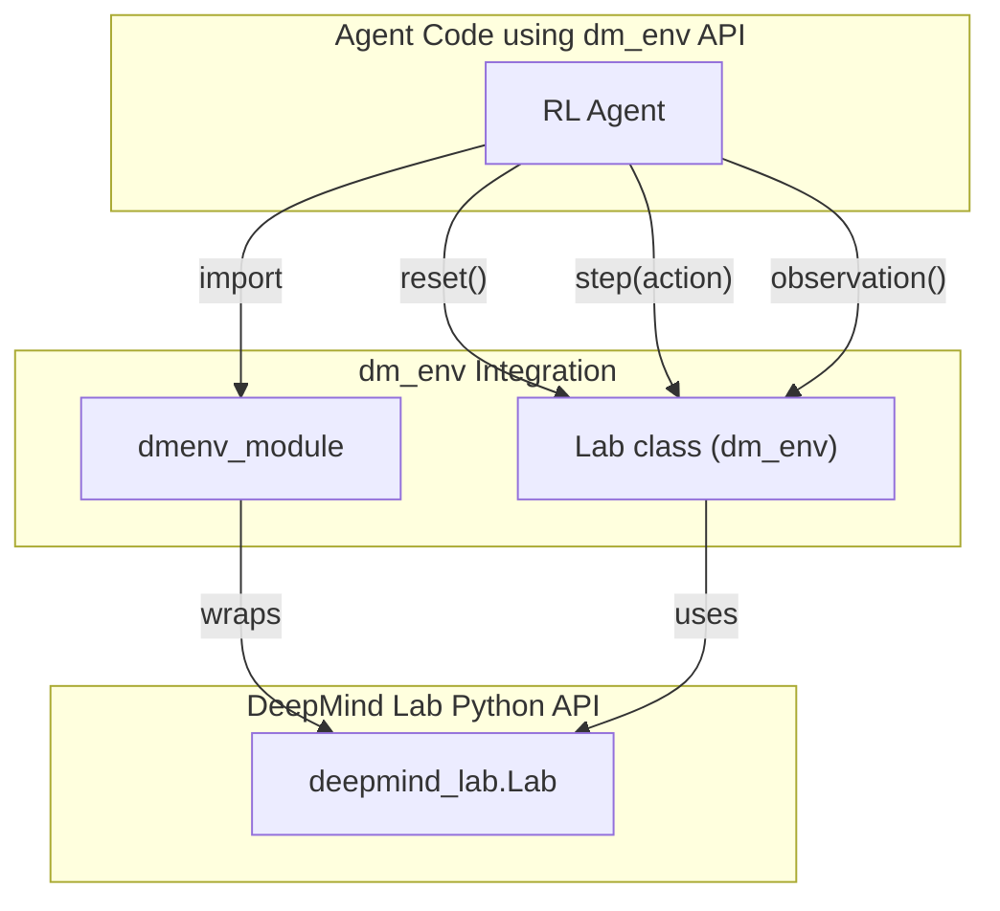

<!-- source: DeepWiki mcp.deepwiki.com · repo google-deepmind/lab · page 3 Python API · fetched 2026-10-26 -->

# Python API

<details>
<summary>Relevant source files</summary>

The following files were used as context for generating this wiki page:

- [README.md](README.md)
- [RELEASE_NOTES.md](RELEASE_NOTES.md)
- [docs/users/observations.md](docs/users/observations.md)
- [docs/users/python_api.md](docs/users/python_api.md)
- [docs/users/run_from_script.md](docs/users/run_from_script.md)
- [engine/code/deepmind/dmlab_connect.c](engine/code/deepmind/dmlab_connect.c)
- [python/dmlab_module.c](python/dmlab_module.c)
- [python/pip_package/BUILD](python/pip_package/BUILD)
- [python/pip_package/README.md](python/pip_package/README.md)
- [python/pip_package/__init__.py](python/pip_package/__init__.py)
- [python/pip_package/build_pip_package.sh](python/pip_package/build_pip_package.sh)
- [python/pip_package/setup.py](python/pip_package/setup.py)
- [python/random_agent.py](python/random_agent.py)
- [python/tests/dmlab_module_test.py](python/tests/dmlab_module_test.py)
- [python/tests/random_agent_test.py](python/tests/random_agent_test.py)
- [python/tests/render_test.py](python/tests/render_test.py)
- [testing/recording_test.cc](testing/recording_test.cc)
- [third_party/rl_api/env_c_api.h](third_party/rl_api/env_c_api.h)
- [third_party/rl_api/env_c_api_bind.h](third_party/rl_api/env_c_api_bind.h)
- [third_party/rl_api/env_c_api_example.cc](third_party/rl_api/env_c_api_example.cc)
- [third_party/rl_api/env_c_api_example_test.cc](third_party/rl_api/env_c_api_example_test.cc)

</details>


This page provides a comprehensive overview of the Python API for DeepMind Lab, which is the primary recommended way to interact with the DeepMind Lab environment for agent-based AI research. The Python API provides a convenient interface for creating environments, configuring settings, executing actions, and receiving observations.

For information about the dm_env integration, see [dm_env Integration](#3.2). For details about creating custom agents, see [Creating Custom Agents](#3.3).

## Python API Architecture

The Python API is implemented as a bridge between Python code and the underlying C/C++ implementation of DeepMind Lab. Understanding this architecture helps when working with the API.



Sources: 
- [python/dmlab_module.c]()
- [engine/code/deepmind/dmlab_connect.c]()
- [third_party/rl_api/env_c_api.h]()

## API Initialization and Execution Flow

This diagram illustrates the typical flow when using the DeepMind Lab Python API, from initialization to environment execution.



Sources:
- [python/dmlab_module.c:138-309]()
- [python/dmlab_module.c:311-354]()
- [python/dmlab_module.c:379-431]()
- [engine/code/deepmind/dmlab_connect.c:713-750]()
- [engine/code/deepmind/dmlab_connect.c:775-836]()

## Lab Class API

The `Lab` class is the primary interface for interacting with DeepMind Lab environments in Python.

### Constructor

```
Lab(level, observations, config={}, renderer='software', level_cache=None, temp_folder=None)
```

| Parameter | Type | Description |
|-----------|------|-------------|
| `level` | string | The level script to load (e.g., 'lt_chasm', 'seekavoid_arena_01') |
| `observations` | list | List of observation names to be returned by the environment |
| `config` | dict | Optional configuration parameters as key-value string pairs |
| `renderer` | string | Renderer type ('software' or 'hardware') |
| `level_cache` | object | Optional object implementing level caching interface |
| `temp_folder` | string | Optional path to store temporary files |

Common config parameters:

| Parameter | Description | Default |
|-----------|-------------|---------|
| `width` | Horizontal resolution of observations | '320' |
| `height` | Vertical resolution of observations | '240' |
| `fps` | Frames per second | '60' |
| `levelDirectory` | Path to level directory | '' |
| `mixerSeed` | Value combined with seed for random number generation | '0' |

Sources:
- [python/dmlab_module.c:138-209]()
- [docs/users/python_api.md:22-125]()

### Key Methods

| Method | Description |
|--------|-------------|
| `reset(episode=-1, seed=None)` | Starts a new episode with optional episode index and seed |
| `step(action, num_steps=1)` | Executes action for num_steps frames and returns reward |
| `observations()` | Returns a dictionary of requested observations |
| `events()` | Returns events that occurred since last reset or step |
| `num_steps()` | Returns number of frames since last reset |
| `is_running()` | Returns whether environment is in a running state |
| `observation_spec()` | Returns specifications of available observations |
| `action_spec()` | Returns specifications of available actions |
| `close()` | Closes the environment and releases resources |
| `fps()` | Returns the frames per second setting |
| `write_property(key, value)` | Writes to an environment property |
| `read_property(key)` | Reads an environment property |
| `properties(key="")` | Lists sub-properties of an environment property |

Sources:
- [python/dmlab_module.c:311-780]()
- [docs/users/python_api.md:130-256]()

## Observations

The environment provides various types of observations, which can be specified when creating the Lab instance.

### Standard Observations

| Observation Name | Type/Shape | Description |
|------------------|------------|-------------|
| `RGB_INTERLEAVED` | Bytes (height, width, 3) | RGB image with interleaved channels |
| `RGBD_INTERLEAVED` | Bytes (height, width, 4) | RGBD image with interleaved channels |
| `RGB` | Bytes (3, height, width) | RGB image with planar channels |
| `RGBD` | Bytes (4, height, width) | RGBD image with planar channels |
| `BGR_INTERLEAVED` | Bytes (height, width, 3) | BGR image with interleaved channels |
| `BGRD_INTERLEAVED` | Bytes (height, width, 4) | BGRD image with interleaved channels |
| `MAP_FRAME_NUMBER` | Doubles (1) | Current frame number since level start |

### Custom Observations

| Observation Name | Type/Shape | Description |
|------------------|------------|-------------|
| `VEL.TRANS` | Doubles (3) | Player's relative velocity |
| `VEL.ROT` | Doubles (3) | Player's relative angular velocity |
| `INSTR` | String | Textual message from level to agent |
| `TEAM.SCORE` | Doubles (2) | Team scores (your team, their team) |



Sources:
- [docs/users/observations.md:1-117]()
- [engine/code/deepmind/dmlab_connect.c:95-116]()
- [python/dmlab_module.c:576-610]()

## Actions

The API provides a standard set of discrete actions for controlling the agent in the environment.

### Standard Actions

| Action Name | Value Range | Description |
|-------------|-------------|-------------|
| `LOOK_LEFT_RIGHT_PIXELS_PER_FRAME` | [-512, 512] | Angular velocity for looking left/right |
| `LOOK_DOWN_UP_PIXELS_PER_FRAME` | [-512, 512] | Angular velocity for looking down/up |
| `STRAFE_LEFT_RIGHT` | [-1, 1] | Movement left/right |
| `MOVE_BACK_FORWARD` | [-1, 1] | Movement backward/forward |
| `FIRE` | [0, 1] | Fire weapon |
| `JUMP` | [0, 1] | Jump |
| `CROUCH` | [0, 1] | Crouch |

The actions are provided as a NumPy array of integers with shape determined by the action space.

```python
# Example of a discrete action array
action = np.array([0, 0, 0, 1, 0, 0, 0], dtype=np.intc)  # Move forward
```

Sources:
- [engine/code/deepmind/dmlab_connect.c:74-92]()
- [python/dmlab_module.c:379-431]()
- [python/random_agent.py:36-55]()

## Level Caching

Level caching can significantly improve performance for procedurally generated levels by reusing compiled levels instead of regenerating them each episode.

### Level Cache Interface

To use level caching, you must provide an object with the following methods:

| Method | Description |
|--------|-------------|
| `fetch(key, pk3_path)` | Tries to fetch a cached level, returns True if successful |
| `write(key, pk3_path)` | Writes a level to the cache |

Example implementation:

```python
class LevelCache:
    def __init__(self, cache_dir):
        self._cache_dir = cache_dir

    def fetch(self, key, pk3_path):
        # Try to fetch cached level
        # Return True if successful, False otherwise
        
    def write(self, key, pk3_path):
        # Write level to cache
```

Sources:
- [python/dmlab_module.c:104-136]()
- [docs/users/python_api.md:81-126]()

## dm_env Integration

DeepMind Lab also provides integration with the DeepMind Environment API (dm_env), which offers a standardized interface for reinforcement learning environments.



To use the dm_env integration:

```python
from deepmind_lab import dmenv_module

# Create a DM Lab environment with the dm_env API
env = dmenv_module.Lab(
    level='lt_chasm',
    observation_names=['RGB_INTERLEAVED'],
    config={'width': '320', 'height': '240'}
)

# Use standard dm_env methods
timestep = env.reset()
action = agent.select_action(timestep)
next_timestep = env.step(action)
```

Sources:
- [RELEASE_NOTES.md:38-40]()
- [python/pip_package/README.md:193-218]()
- [python/pip_package/__init__.py:13-22]()

## Basic Usage Example

Here's a simple example demonstrating how to use the DeepMind Lab Python API:

```python
import deepmind_lab
import numpy as np

# Create environment
env = deepmind_lab.Lab(
    'lt_chasm',                    # Level name
    ['RGB_INTERLEAVED'],           # Observations to return
    config={
        'width': '640',            # Screen width
        'height': '480',           # Screen height 
        'fps': '60'                # Frames per second
    }
)

# Start a new episode
env.reset(seed=42)

# Action vector - [look_left_right, look_down_up, strafe_left_right, 
#                  move_back_forward, fire, jump, crouch]
action = np.zeros([7], dtype=np.intc)  

# Step the environment
for _ in range(100):
    # Move forward
    action[3] = 1
    
    # Execute the action and get the reward
    reward = env.step(action, num_steps=4)
    
    # Get observations
    observations = env.observations()
    rgb_image = observations['RGB_INTERLEAVED']
    
    # Process observations and determine next action
    # ...

# Close the environment
env.close()
```

Sources:
- [python/random_agent.py:140-176]()
- [python/tests/dmlab_module_test.py:92-102]()

## Best Practices and Tips

1. **Resource Management**:
   - Always call `close()` when you're done with an environment to release resources.
   - Use a context manager or try/finally block to ensure proper cleanup.

2. **Performance Optimization**:
   - Use level caching for procedurally generated levels to avoid recompilation.
   - Consider using `BGR_INTERLEAVED` instead of `RGB_INTERLEAVED` if it better matches your processing pipeline.
   - Set appropriate screen resolution - higher resolutions require more processing.

3. **Common Gotchas**:
   - Make sure action arrays have the correct data type (`np.intc`).
   - Check that observations you request actually exist using `observation_spec()`.
   - Be aware that some observation names (`RGB_INTERLACED` and `RGBD_INTERLACED`) are deprecated and will be removed in future releases.

4. **Extensions**:
   - Custom observations can be added via Lua scripts.
   - The property system allows for flexible runtime environment configuration.

Sources:
- [python/tests/dmlab_module_test.py:30-266]()
- [RELEASE_NOTES.md:250-255]()
- [docs/users/python_api.md:127-256]()

---

