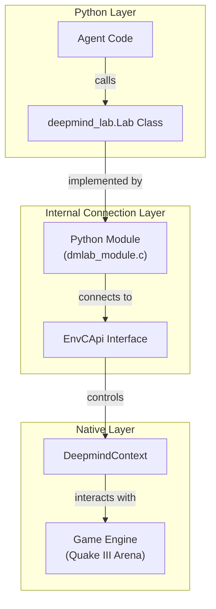
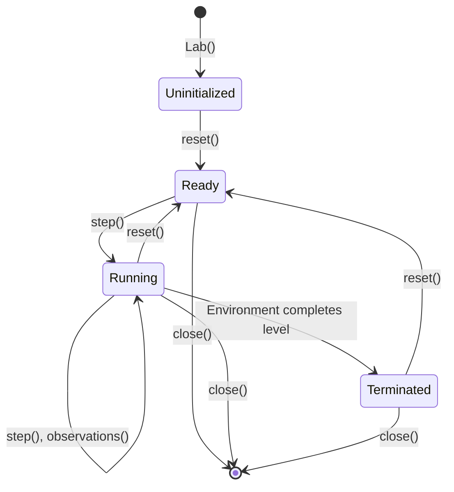
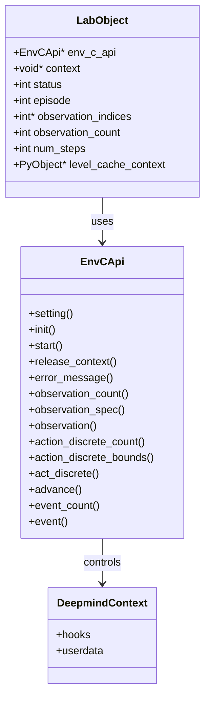

<!-- source: DeepWiki mcp.deepwiki.com · repo google-deepmind/lab · page 3.1 Lab Class · fetched 2026-10-26 -->

# Lab Class

<details>
<summary>Relevant source files</summary>

The following files were used as context for generating this wiki page:

- [README.md](README.md)
- [RELEASE_NOTES.md](RELEASE_NOTES.md)
- [docs/users/observations.md](docs/users/observations.md)
- [docs/users/python_api.md](docs/users/python_api.md)
- [docs/users/run_from_script.md](docs/users/run_from_script.md)
- [engine/code/deepmind/dmlab_connect.c](engine/code/deepmind/dmlab_connect.c)
- [python/dmlab_module.c](python/dmlab_module.c)
- [python/pip_package/BUILD](python/pip_package/BUILD)
- [python/pip_package/README.md](python/pip_package/README.md)
- [python/pip_package/__init__.py](python/pip_package/__init__.py)
- [python/pip_package/build_pip_package.sh](python/pip_package/build_pip_package.sh)
- [python/pip_package/setup.py](python/pip_package/setup.py)
- [python/random_agent.py](python/random_agent.py)
- [python/tests/dmlab_module_test.py](python/tests/dmlab_module_test.py)
- [python/tests/random_agent_test.py](python/tests/random_agent_test.py)
- [python/tests/render_test.py](python/tests/render_test.py)
- [testing/recording_test.cc](testing/recording_test.cc)
- [third_party/rl_api/env_c_api.h](third_party/rl_api/env_c_api.h)
- [third_party/rl_api/env_c_api_bind.h](third_party/rl_api/env_c_api_bind.h)
- [third_party/rl_api/env_c_api_example.cc](third_party/rl_api/env_c_api_example.cc)
- [third_party/rl_api/env_c_api_example_test.cc](third_party/rl_api/env_c_api_example_test.cc)

</details>


The `Lab` class is the primary interface for interacting with the DeepMind Lab environment through Python. This page documents the class's purpose, construction, methods for environment interaction, and advanced features. For information about how DeepMind Lab integrates with the `dm_env` API standard, see [dm_env Integration](#3.2).

## Overview

The `Lab` class serves as the bridge between Python code (typically agent implementations) and the underlying C/C++ DeepMind Lab environment. It provides methods for controlling the environment, receiving observations, sending actions, and retrieving environment information.



Sources: [python/dmlab_module.c:56-66](), [engine/code/deepmind/dmlab_connect.c:28-40](), [third_party/rl_api/env_c_api.h:97-132]()

## Construction

The `Lab` class constructor creates a new DeepMind Lab environment instance with specified parameters.

### Signature

```python
deepmind_lab.Lab(level, observations, config={}, renderer='software', level_cache=None, temp_folder=None)
```

### Parameters

| Parameter | Type | Description |
|-----------|------|-------------|
| `level` | string | The level to load. Can be a level name or path. |
| `observations` | list of strings | List of observation names that will be returned by `observations()`. |
| `config` | dict | Optional configuration parameters for the environment. |
| `renderer` | string | Optional renderer type: 'software' or 'hardware'. |
| `level_cache` | object | Optional level cache object for faster level loading. |
| `temp_folder` | string | Optional path to temporary folder for DeepMind Lab files. |

Sources: [python/dmlab_module.c:138-166](), [docs/users/python_api.md:23-42]()

### Common Configuration Options

| Option | Description | Default |
|--------|-------------|---------|
| `width` | Horizontal resolution of the observation frames | `'320'` |
| `height` | Vertical resolution of the observation frames | `'240'` |
| `fps` | Frames per second | `'60'` |
| `levelDirectory` | Path to level directory (relative to game_scripts/levels) | `''` |
| `mixerSeed` | Value combined with seeds to define unique subsets of seeds | `'0'` |

Sources: [docs/users/python_api.md:32-40](), [engine/code/deepmind/dmlab_connect.c:500-712]()

### Example Creation

```python
import deepmind_lab
import numpy as np

# Create a simple environment
env = deepmind_lab.Lab(
    'lt_chasm',                    # Level name
    ['RGB_INTERLEAVED'],           # Observations to return
    config={                       # Configuration
        'width': '640',            # Screen width in pixels
        'height': '480',           # Screen height in pixels
        'fps': '60'                # Frames per second
    },
    renderer='software'            # Rendering method
)
```

Sources: [python/pip_package/README.md:152-155](), [docs/users/python_api.md:52-59]()

## Environment Lifecycle

The following diagram shows the typical lifecycle of a `Lab` instance and the key methods used to interact with it:



Sources: [python/dmlab_module.c:311-354](), [python/dmlab_module.c:379-430](), [python/dmlab_module.c:576-610](), [python/dmlab_module.c:676-682]()

## Core Methods

### Environment Control

| Method | Description |
|--------|-------------|
| `reset(episode=-1, seed=None)` | Resets the environment to its initial state. Optional parameters specify episode number and random seed. |
| `step(action, num_steps=1)` | Advances the environment by executing the action for num_steps frames. Returns the reward. |
| `close()` | Releases resources associated with the environment. |
| `is_running()` | Returns True if the environment is in the Running state, False otherwise. |
| `num_steps()` | Returns the number of frames since the last reset. |

Sources: [python/dmlab_module.c:311-354](), [python/dmlab_module.c:379-430](), [python/dmlab_module.c:356-358](), [python/dmlab_module.c:371-377](), [python/dmlab_module.c:676-682]()

### Information Methods

| Method | Description |
|--------|-------------|
| `observation_spec()` | Returns a list of dictionaries describing available observations. |
| `action_spec()` | Returns a list of dictionaries describing available actions. |
| `observations()` | Returns a dictionary containing the requested observations. |
| `events()` | Returns a list of events that have occurred since the last call to reset() or step(). |

Sources: [python/dmlab_module.c:446-501](), [python/dmlab_module.c:503-528](), [python/dmlab_module.c:576-610](), [python/dmlab_module.c:612-674]()

### Property Methods

| Method | Description |
|--------|-------------|
| `write_property(key, value)` | Writes a property value to the environment. |
| `read_property(key)` | Reads a property value from the environment. |
| `properties(key="")` | Lists properties and their attributes. |

Sources: [python/dmlab_module.c:684-708](), [python/dmlab_module.c:710-742](), [python/dmlab_module.c:750-780]()

## Actions and Observations

### Action Structure

Actions are provided to the `step()` method as NumPy arrays of integer type (`np.intc`). The default DeepMind Lab actions are:

| Index | Name | Range | Description |
|-------|------|-------|-------------|
| 0 | LOOK_LEFT_RIGHT_PIXELS_PER_FRAME | -512 to 512 | Angular velocity for looking left/right |
| 1 | LOOK_DOWN_UP_PIXELS_PER_FRAME | -512 to 512 | Angular velocity for looking down/up |
| 2 | STRAFE_LEFT_RIGHT | -1 to 1 | Movement left/right |
| 3 | MOVE_BACK_FORWARD | -1 to 1 | Movement backward/forward |
| 4 | FIRE | 0 to 1 | Fire weapon |
| 5 | JUMP | 0 to 1 | Jump |
| 6 | CROUCH | 0 to 1 | Crouch |

Sources: [engine/code/deepmind/dmlab_connect.c:74-93](), [python/dmlab_module.c:861-880](), [python/tests/dmlab_module_test.py:70-78]()

### Observation Types

The environment provides various types of observations, which can be requested during environment creation:

| Observation Name | Type/Shape | Description |
|------------------|------------|-------------|
| RGB_INTERLEAVED | Bytes (height, width, 3) | RGB pixels in height × width × color format |
| RGBD_INTERLEAVED | Bytes (height, width, 4) | RGB + depth pixels |
| RGB | Bytes (3, height, width) | RGB pixels in planar format |
| RGBD | Bytes (4, height, width) | RGB + depth pixels in planar format |
| BGR_INTERLEAVED | Bytes (height, width, 3) | BGR pixels in interleaved format |
| BGRD_INTERLEAVED | Bytes (height, width, 4) | BGR + depth pixels in interleaved format |
| VEL.TRANS | Doubles (3) | Player's translational velocity |
| VEL.ROT | Doubles (3) | Player's rotational velocity |

Sources: [docs/users/observations.md:12-47](), [python/dmlab_module.c:935-974]()

## Data Flow

The following diagram illustrates how data flows between the agent and the DeepMind Lab environment through the `Lab` class:

```mermaid
sequenceDiagram
    participant Agent
    participant LabClass as deepmind_lab.Lab
    participant Native as Native Environment
    
    Agent->>LabClass: Lab(level, observations, config)
    LabClass->>Native: Initialize environment
    Note over LabClass,Native: Environment created but not started
    
    Agent->>LabClass: reset(seed=seed)
    LabClass->>Native: start(episode, seed)
    Native-->>LabClass: Environment ready
    LabClass-->>Agent: True
    
    loop Until termination
        Agent->>LabClass: observations()
        LabClass->>Native: Get observations
        Native-->>LabClass: Return observation data
        LabClass-->>Agent: {observation_name: data, ...}
        
        Agent->>LabClass: step(action, num_steps)
        LabClass->>Native: Set action
        LabClass->>Native: Advance environment
        Native-->>LabClass: Return reward and status
        LabClass-->>Agent: reward
        
        opt Environment Terminated
            Native-->>LabClass: Status = Terminated
            LabClass-->>Agent: is_running() = False
            break
        end
    end
    
    Agent->>LabClass: close()
    LabClass->>Native: Release resources
```

Sources: [python/dmlab_module.c:311-354](), [python/dmlab_module.c:379-430](), [python/dmlab_module.c:576-610](), [engine/code/deepmind/dmlab_connect.c:775-836]()

## Advanced Features

### Level Caching

The `level_cache` parameter allows reusing previously compiled levels, significantly improving performance for procedurally generated levels.

A level cache object must implement two methods:
- `fetch(key, pk3_path)`: Returns `True` if the level exists in cache and copies it to `pk3_path`
- `write(key, pk3_path)`: Stores the level at `pk3_path` in the cache with the given key

```python
class SimpleFileCache:
    def __init__(self, cache_dir):
        self._cache_dir = cache_dir
        os.makedirs(cache_dir, exist_ok=True)
        
    def fetch(self, key, pk3_path):
        cache_path = os.path.join(self._cache_dir, key)
        if os.path.exists(cache_path):
            shutil.copyfile(cache_path, pk3_path)
            return True
        return False
        
    def write(self, key, pk3_path):
        cache_path = os.path.join(self._cache_dir, key)
        shutil.copyfile(pk3_path, cache_path)
        
# Usage
cache = SimpleFileCache("/tmp/dmlab_cache")
env = deepmind_lab.Lab("explore_goal_locations_small", 
                       ["RGB_INTERLEAVED"], 
                       level_cache=cache)
```

Sources: [python/dmlab_module.c:104-136](), [python/dmlab_module.c:201-208](), [docs/users/python_api.md:81-126]()

### Recording and Playback

DeepMind Lab supports recording and playing back demos:

```python
# Record gameplay
env = deepmind_lab.Lab(
    'lt_chasm', 
    ['RGB_INTERLEAVED'],
    config={'record': 'my_recording_name'}
)

# Play back recorded gameplay
env = deepmind_lab.Lab(
    'lt_chasm', 
    ['RGB_INTERLEAVED'],
    config={'demo': 'my_recording_name'}
)
```

Sources: [engine/code/deepmind/dmlab_connect.c:657-674](), [testing/recording_test.cc:115-213]()

## Error Handling

The `Lab` class throws exceptions for various error conditions:

| Error Type | Typical Cause |
|------------|---------------|
| `RuntimeError` | Environment initialization failure, invalid state transitions |
| `ValueError` | Invalid parameter values, incorrect observation or action types |
| `KeyError` | Unknown property names |
| `TypeError` | Incorrect data types for properties |

Each method documents the specific exceptions it might raise. Always check for exceptions when using the `Lab` class, especially during environment creation and reset.

Sources: [python/dmlab_module.c:516-524](), [python/dmlab_module.c:339-348](), [python/dmlab_module.c:694-708](), [python/dmlab_module.c:729-740]()

## Complete Usage Example

Here's a complete example demonstrating the core functionality of the `Lab` class:

```python
import deepmind_lab
import numpy as np

# Create environment
env = deepmind_lab.Lab(
    'lt_chasm',                       # Level name
    ['RGB_INTERLEAVED', 'VEL.TRANS'], # Observations to return
    config={
        'width': '320',
        'height': '240',
        'fps': '60'
    }
)

# Print action and observation specs
print("Action spec:", env.action_spec())
print("Observation spec:", env.observation_spec())

# Initialize environment
env.reset(seed=42)

# Create action array
action = np.zeros([7], dtype=np.intc)  # No-op action

# Run for 100 steps
for i in range(100):
    if not env.is_running():
        print("Environment stopped early")
        break
        
    # Get observations
    obs = env.observations()
    rgb = obs['RGB_INTERLEAVED']    # Camera view
    vel = obs['VEL.TRANS']          # Velocity
    
    # Process observations and determine next action
    # ...
    
    # Take a step in the environment
    reward = env.step(action)
    print(f"Step {i}, Reward: {reward}")
    
    # Modify action for next step
    action[3] = 1  # Move forward
    
# Close the environment
env.close()
```

Sources: [python/random_agent.py:140-175](), [python/tests/dmlab_module_test.py:92-102]()

## Internal Implementation

The `Lab` class is implemented in C as a Python module. It connects to the C/C++ DeepMind Lab environment through the `EnvCApi` interface.



Sources: [python/dmlab_module.c:50-66](), [third_party/rl_api/env_c_api.h:234-443](), [engine/code/deepmind/dmlab_connect.c:486-502]()

## Performance Considerations

- Use level caching for procedurally generated levels to avoid expensive recompilation
- Choose appropriate observation types (interleaved is faster than planar)
- Consider using a hardware renderer when possible
- Setting appropriate FPS, width, and height values can significantly affect performance

Sources: [docs/users/python_api.md:81-87](), [docs/users/observations.md:29-30](), [docs/users/python_api.md:62-74]()

---

