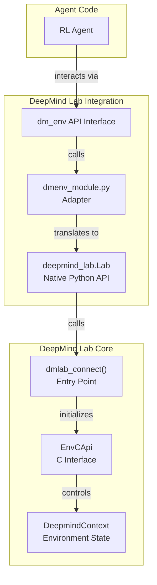
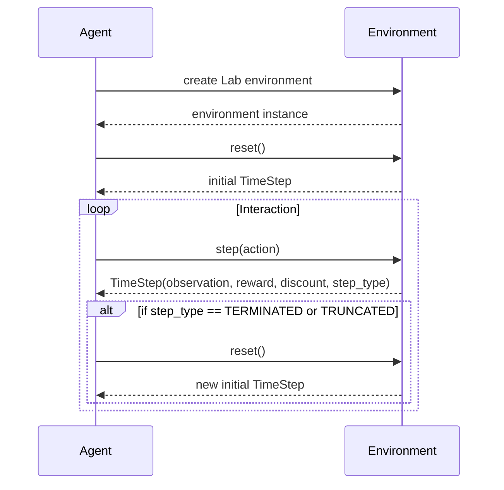
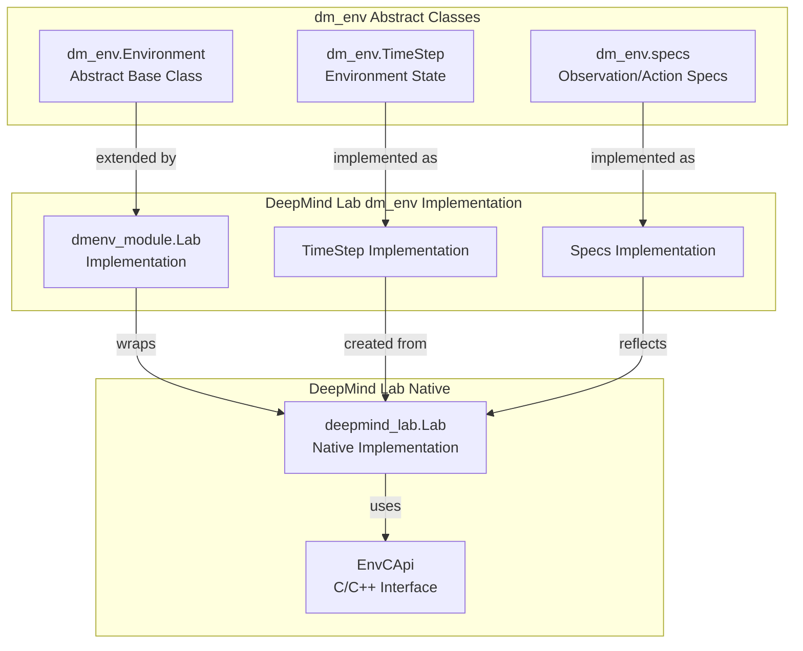

<!-- source: DeepWiki mcp.deepwiki.com · repo google-deepmind/lab · page 3.2 dm_env Integration · fetched 2026-10-26 -->

# dm_env Integration

<details>
<summary>Relevant source files</summary>

The following files were used as context for generating this wiki page:

- [README.md](README.md)
- [RELEASE_NOTES.md](RELEASE_NOTES.md)
- [WORKSPACE](WORKSPACE)
- [bazel/dm_env.BUILD](bazel/dm_env.BUILD)
- [bazel/pybind11.BUILD](bazel/pybind11.BUILD)
- [bazel/tree.BUILD](bazel/tree.BUILD)
- [engine/code/deepmind/dmlab_connect.c](engine/code/deepmind/dmlab_connect.c)
- [python/dmlab_module.c](python/dmlab_module.c)
- [python/pip_package/BUILD](python/pip_package/BUILD)
- [python/pip_package/README.md](python/pip_package/README.md)
- [python/pip_package/__init__.py](python/pip_package/__init__.py)
- [python/pip_package/build_pip_package.sh](python/pip_package/build_pip_package.sh)
- [python/pip_package/setup.py](python/pip_package/setup.py)
- [testing/recording_test.cc](testing/recording_test.cc)
- [third_party/rl_api/env_c_api.h](third_party/rl_api/env_c_api.h)
- [third_party/rl_api/env_c_api_bind.h](third_party/rl_api/env_c_api_bind.h)
- [third_party/rl_api/env_c_api_example.cc](third_party/rl_api/env_c_api_example.cc)
- [third_party/rl_api/env_c_api_example_test.cc](third_party/rl_api/env_c_api_example_test.cc)

</details>


This page explains how DeepMind Lab integrates with the `dm_env` API, an alternative interface to DeepMind Lab environments that follows DeepMind's standard reinforcement learning environment API. The integration allows researchers who are familiar with the `dm_env` interface to use DeepMind Lab environments without having to learn the native DeepMind Lab API. For information about the native Python API, see [Python API](#3).

## What is dm_env?

`dm_env` is DeepMind's standard API for reinforcement learning environments, released as an open-source Python package. The `dm_env` API provides a consistent interface to environments, enabling researchers to write agents that can interact with different environments without changes to the agent code.

The `dm_env` API defines:
- Standard objects for observations, actions, and rewards
- Standard methods for environment interaction (reset, step)
- Consistent typing via specs that describe the format of observations and actions
- A set of well-defined environment states (TERMINATED, TRUNCATED, etc.)

Sources: [RELEASE_NOTES.md:34-39](). [python/pip_package/README.md:200-203]().

## Architecture Overview

DeepMind Lab integrates with `dm_env` through an adapter module called `dmenv_module`. This module translates between the `dm_env` interface and DeepMind Lab's native interface, allowing agents built using the `dm_env` paradigm to control DeepMind Lab environments.



The adapter module translates between:
- `dm_env`'s `TimeStep` objects and DeepMind Lab's observation dictionaries
- `dm_env`'s action specs and DeepMind Lab's discrete actions
- `dm_env`'s environment states and DeepMind Lab's status codes

Sources: [RELEASE_NOTES.md:34-39](). [WORKSPACE:134-139](). [python/pip_package/__init__.py:13-22]().

## Installation and Setup

The `dm_env` integration is included in the DeepMind Lab Python package as the `dmenv_module`. To use it, you'll need to install the additional `dm_env` dependency.

### Installation

When installing the DeepMind Lab package via pip, include the `dmenv_module` extra:

```
pip install deepmind_lab[dmenv_module]
```

Or, if installing from a local wheel file:

```
pip install /path/to/deepmind_lab-1.0-py3-none-any.whl[dmenv_module]
```

Sources: [python/pip_package/README.md:207-212](). [python/pip_package/setup.py:17-18]().

## Using the dm_env Interface

The `dm_env` interface follows a standard pattern for reinforcement learning environments:



### Basic Usage

```python
from deepmind_lab import dmenv_module as dm_env_lab
import numpy as np

# Create a DeepMind Lab environment using the dm_env interface
environment = dm_env_lab.Lab(
    level='lt_chasm',  # Level name
    observation_names=['RGB_INTERLEAVED'],  # Requested observations
    config={'fps': '30'}  # Configuration settings
)

# Reset the environment to get the initial TimeStep
time_step = environment.reset()

# Interact with the environment
while not time_step.last():
    # Select a random action
    action = np.random.randint(
        low=environment.action_spec().minimum,
        high=environment.action_spec().maximum + 1,
        size=environment.action_spec().shape
    )
    
    # Take a step in the environment
    time_step = environment.step(action)
    
    # Process observation and reward
    observation = time_step.observation['RGB_INTERLEAVED']
    reward = time_step.reward
```

Sources: [python/pip_package/__init__.py:13-22](). [python/pip_package/README.md:200-218]().

## Differences from the Native API

The `dm_env` interface differs from the native DeepMind Lab Python API in several important ways:

| Feature | Native API | dm_env API |
|---------|------------|------------|
| Environment Creation | `deepmind_lab.Lab(level='...', observations=['...'])` | `dmenv_module.Lab(level='...', observation_names=['...'], config={})` |
| Reset Method | Returns boolean success | Returns `dm_env.TimeStep` with initial observation |
| Step Method | Takes array of actions and returns reward | Takes array of actions and returns `dm_env.TimeStep` with observation, reward, and step type |
| Observation Access | Via `observations()` method | Via `time_step.observation` dict |
| Action Format | Array of integers | According to `action_spec()` |
| Episode Termination | Check via `is_running()` | Check via `time_step.step_type` |
| Properties/Settings | Via `read_property()` and `write_property()` | Limited to initial configuration |

### Limitations

Some features of the native DeepMind Lab API are not fully exposed through the `dm_env` interface:

1. **Dynamic Observation Shapes**: `dm_env` specs do not allow dynamic shapes, while DeepMind Lab's native API supports them.
2. **Custom Events**: The events system in DeepMind Lab is not directly exposed through the `dm_env` API.
3. **Property System**: The dynamic querying and modifying of environment state via the property system is not fully exposed.

Sources: [python/pip_package/README.md:213-218](). [python/pip_package/__init__.py:13-22]().

## Technical Details

The integration works through an adapter layer that bridges between the `dm_env` abstract classes and DeepMind Lab's implementation:



The adapter module maps key concepts between the two APIs:

1. The `dm_env.Environment` interface is implemented by a `Lab` class in `dmenv_module.py`
2. The class wraps a native DeepMind Lab instance and translates between APIs
3. `dm_env.TimeStep` objects are created based on DeepMind Lab's internal state
4. Observation and action specs use `dm_env.specs` classes to describe types and shapes

Under the hood, both interfaces ultimately call into the same `EnvCApi` C interface, which provides the core functionality of DeepMind Lab environments.

Sources: [engine/code/deepmind/dmlab_connect.c:38-53](). [third_party/rl_api/env_c_api.h:123-128](). [WORKSPACE:134-139]().

## Version and History

The `dm_env` integration was added in the December 2020 release of DeepMind Lab. It has been part of the standard distribution since then.

When using the module, it's important to check compatibility with your version of `dm_env`, especially if you're using other DeepMind environments or libraries that depend on specific versions of the API.

Sources: [RELEASE_NOTES.md:34-39]().

---

