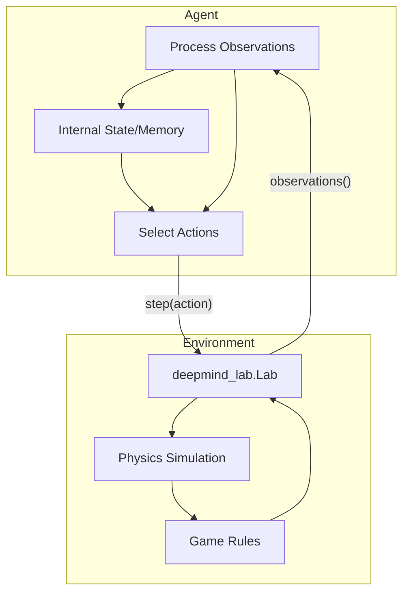
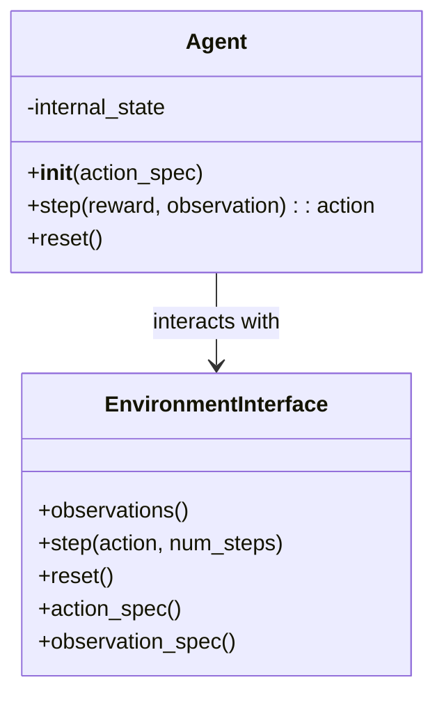
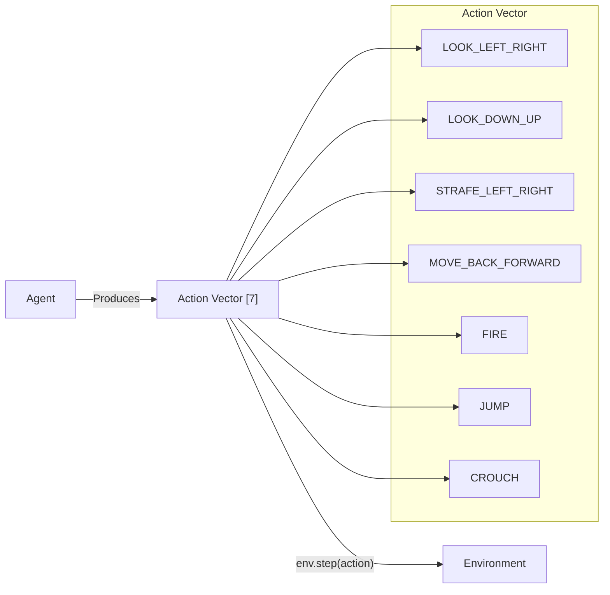
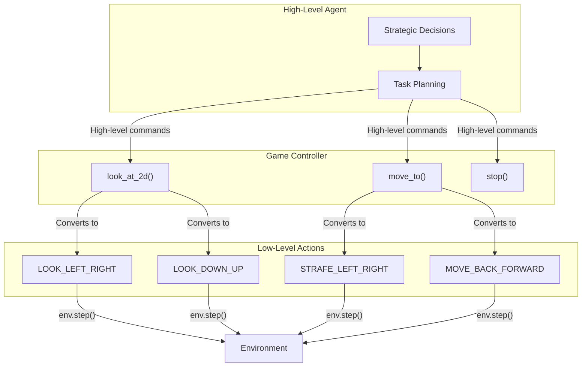

<!-- source: DeepWiki mcp.deepwiki.com · repo google-deepmind/lab · page 3.3 Creating Custom Agents · fetched 2026-10-26 -->

# Creating Custom Agents

<details>
<summary>Relevant source files</summary>

The following files were used as context for generating this wiki page:

- [docs/users/observations.md](docs/users/observations.md)
- [docs/users/python_api.md](docs/users/python_api.md)
- [docs/users/run_from_script.md](docs/users/run_from_script.md)
- [examples/game_main.py](examples/game_main.py)
- [python/random_agent.py](python/random_agent.py)
- [python/random_agent_simple.py](python/random_agent_simple.py)
- [python/tests/benchmark.py](python/tests/benchmark.py)
- [python/tests/dmlab_module_test.py](python/tests/dmlab_module_test.py)
- [python/tests/level_cache_test.py](python/tests/level_cache_test.py)
- [python/tests/random_agent_test.py](python/tests/random_agent_test.py)
- [python/tests/render_test.py](python/tests/render_test.py)
- [python/tests/utils/game_controller_test.py](python/tests/utils/game_controller_test.py)
- [python/tests/utils/maze_game_controller.py](python/tests/utils/maze_game_controller.py)
- [python/tests/utils/maze_game_controller_test.py](python/tests/utils/maze_game_controller_test.py)
- [python/tests/utils/test_environment_decorator.py](python/tests/utils/test_environment_decorator.py)
- [python/tests/utils/test_environment_decorator_test.py](python/tests/utils/test_environment_decorator_test.py)

</details>


This document explains how to create custom agents that interact with the DeepMind Lab environment. A custom agent in this context is a Python class that receives observations from the environment, processes them, and returns appropriate actions. This guide covers the agent-environment interface, observation and action spaces, and provides templates and examples for implementing your own agents.

For information about the Python API that agents use to interact with the environment, see [Python API](#3).

## Agent-Environment Interface

In DeepMind Lab, agents interact with the environment in a loop: the environment provides observations, the agent determines actions based on those observations, and the environment updates its state based on the actions, producing new observations and rewards.



Sources: [python/random_agent.py:30-55](python/random_agent.py:30-55), [examples/game_main.py:31-62](examples/game_main.py:31-62)

### Environment Creation and Initialization

Before an agent can interact with the environment, you need to create and initialize the environment:

```python
import deepmind_lab
import numpy as np

# Create the environment
env = deepmind_lab.Lab(
    level='seekavoid_arena_01',  # Level to load
    observations=['RGB_INTERLEAVED'],  # Observations to request
    config={
        'width': '320',  # Screen width
        'height': '240'  # Screen height
    }
)

# Reset the environment to start a new episode
env.reset()
```

Sources: [examples/game_main.py:31-34](examples/game_main.py:31-34), [python/random_agent.py:140-156](python/random_agent.py:140-156)

## Basic Agent Structure

A custom agent in DeepMind Lab typically follows this basic structure:



The minimum requirements for a custom agent are:

1. An initialization method that sets up the agent
2. A `step` method that takes observations (and potentially rewards) and returns actions
3. Optional: a `reset` method to reset the agent's internal state

Sources: [python/random_agent.py:34-55](python/random_agent.py:34-55), [python/random_agent.py:58-138](python/random_agent.py:58-138), [python/random_agent_simple.py:30-43](python/random_agent_simple.py:30-43)

## Understanding Observations and Actions

### Observation Space

DeepMind Lab provides various observation types that your agent can use to perceive the environment. The most common observation types include:

| Observation Name | Type/Shape | Description |
|------------------|------------|-------------|
| `RGB_INTERLEAVED` | Bytes (height, width, 3) | Player's view in RGB format, interleaved |
| `RGBD_INTERLEAVED` | Bytes (height, width, 4) | Player's view with depth, interleaved |
| `RGB` | Bytes (3, height, width) | Player's view in RGB format, planar |
| `RGBD` | Bytes (4, height, width) | Player's view with depth, planar |
| `VEL.TRANS` | Doubles (3) | Player's translational velocity |
| `VEL.ROT` | Doubles (3) | Player's rotational velocity |

You can request specific observations when creating the environment:

```python
env = deepmind_lab.Lab(
    level='seekavoid_arena_01',
    observations=['RGB_INTERLEAVED', 'VEL.TRANS']
)
```

To get the complete list of available observations and their specifications:

```python
observation_spec = env.observation_spec()
print(observation_spec)
```

Sources: [docs/users/observations.md:1-46](docs/users/observations.md:1-46), [docs/users/python_api.md:166-208](docs/users/python_api.md:166-208)

### Action Space

Actions in DeepMind Lab are represented as integer arrays corresponding to different control inputs:



The action space consists of 7 dimensions:

| Index | Action Name | Min | Max | Description |
|-------|-------------|-----|-----|-------------|
| 0 | `LOOK_LEFT_RIGHT_PIXELS_PER_FRAME` | -512 | 512 | Look left/right (negative = left) |
| 1 | `LOOK_DOWN_UP_PIXELS_PER_FRAME` | -512 | 512 | Look down/up (negative = down) |
| 2 | `STRAFE_LEFT_RIGHT` | -1 | 1 | Strafe left/right (negative = left) |
| 3 | `MOVE_BACK_FORWARD` | -1 | 1 | Move backward/forward (negative = backward) |
| 4 | `FIRE` | 0 | 1 | Fire (1 = fire) |
| 5 | `JUMP` | 0 | 1 | Jump (1 = jump) |
| 6 | `CROUCH` | 0 | 1 | Crouch (1 = crouch) |

To get the action specification from the environment:

```python
action_spec = env.action_spec()
print(action_spec)
```

Sources: [docs/users/python_api.md:219-235](docs/users/python_api.md:219-235), [python/random_agent.py:37-49](python/random_agent.py:37-49)

## Implementing a Custom Agent

Now that we understand the interface, let's look at how to implement a custom agent.

### Basic Agent Template

Here's a template for a basic agent:

```python
import numpy as np

class MyCustomAgent:
    def __init__(self, action_spec):
        # Store information about the action space
        self.action_spec = action_spec
        self.num_actions = len(action_spec)
        
        # Initialize any internal state
        self.reset()
    
    def step(self, reward, observation):
        """Process the environment's response and return an action.
        
        Args:
            reward: The reward received from the previous action
            observation: The current observation from the environment
            
        Returns:
            An action vector (numpy array of integers)
        """
        # Process the observation and determine the next action
        # This is where your agent's logic goes
        
        # Example: return a zero action vector
        action = np.zeros([self.num_actions], dtype=np.intc)
        
        return action
    
    def reset(self):
        """Reset the agent's internal state."""
        # Reset any internal state variables
        pass
```

Sources: [python/random_agent.py:34-55](python/random_agent.py:34-55), [python/random_agent_simple.py:30-43](python/random_agent_simple.py:30-43)

### Agent-Environment Interaction Loop

Here's how to use your agent in the environment:

```python
# Create and initialize the environment
env = deepmind_lab.Lab('level_name', ['RGB_INTERLEAVED'])
env.reset()

# Create the agent
agent = MyCustomAgent(env.action_spec())

# Run the agent-environment loop
for _ in range(1000):  # Run for 1000 steps
    if not env.is_running():
        print('Environment stopped early')
        env.reset()
        agent.reset()
    
    # Get the observations from the environment
    obs = env.observations()
    
    # Let the agent decide the next action
    action = agent.step(reward, obs['RGB_INTERLEAVED'])
    
    # Execute the action and get the reward
    reward = env.step(action, num_steps=1)
    
    print('Reward received:', reward)
```

Sources: [python/random_agent.py:163-175](python/random_agent.py:163-175), [examples/game_main.py:54-62](examples/game_main.py:54-62)

## Example Agent Implementations

Here are some example agent implementations to help you get started.

### Random Agent

This agent selects random actions from the action space:

```python
class RandomAgent:
    """Basic random agent for DeepMind Lab."""
    def __init__(self, action_spec):
        self.action_spec = action_spec
        self.action_count = len(action_spec)

    def step(self, reward=0, observation=None):
        """Choose a random amount of a randomly selected action."""
        action_choice = random.randint(0, self.action_count - 1)
        action_amount = random.randint(
            self.action_spec[action_choice]['min'],
            self.action_spec[action_choice]['max'])
        
        action = np.zeros([self.action_count], dtype=np.intc)
        action[action_choice] = action_amount
        return action
```

Sources: [python/random_agent_simple.py:30-43](python/random_agent_simple.py:30-43)

### Discretized Random Agent

This agent selects from a set of predefined action combinations:

```python
class DiscretizedRandomAgent:
    """Simple agent with predefined actions."""
    
    # Define a set of discrete actions
    ACTIONS = {
        'look_left': np.array([-20, 0, 0, 0, 0, 0, 0], dtype=np.intc),
        'look_right': np.array([20, 0, 0, 0, 0, 0, 0], dtype=np.intc),
        'look_up': np.array([0, 10, 0, 0, 0, 0, 0], dtype=np.intc),
        'look_down': np.array([0, -10, 0, 0, 0, 0, 0], dtype=np.intc),
        'strafe_left': np.array([0, 0, -1, 0, 0, 0, 0], dtype=np.intc),
        'strafe_right': np.array([0, 0, 1, 0, 0, 0, 0], dtype=np.intc),
        'forward': np.array([0, 0, 0, 1, 0, 0, 0], dtype=np.intc),
        'backward': np.array([0, 0, 0, -1, 0, 0, 0], dtype=np.intc),
        'fire': np.array([0, 0, 0, 0, 1, 0, 0], dtype=np.intc),
        'jump': np.array([0, 0, 0, 0, 0, 1, 0], dtype=np.intc),
        'crouch': np.array([0, 0, 0, 0, 0, 0, 1], dtype=np.intc)
    }
    
    ACTION_LIST = list(ACTIONS.values())
    
    def step(self, unused_reward=0, unused_image=None):
        """Return a random action from the predefined list."""
        return random.choice(self.ACTION_LIST)
```

Sources: [python/random_agent.py:34-55](python/random_agent.py:34-55)

### Spring Agent (Smooth Movement)

For more realistic movement patterns, this agent uses spring-like forces to create smooth transitions between actions:

```python
class SpringAgent:
    """An agent using spring-like forces for smooth action evolution."""
    
    def __init__(self, action_spec):
        self.action_spec = action_spec
        
        # Natural frequency for the spring motion
        self.omega = np.array([
            0.1,  # look left-right
            0.1,  # look up-down
            0.1,  # strafe left-right
            0.1,  # forward-backward
            0.0,  # fire
            0.0,  # jumping
            0.0   # crouching
        ])
        
        # Scaling factors for actions
        self.velocity_scaling = np.array([2.5, 2.5, 0.01, 0.01, 1, 1, 1])
        
        # Extract action limits
        self.indices = {a['name']: i for i, a in enumerate(self.action_spec)}
        self.mins = np.array([a['min'] for a in self.action_spec])
        self.maxs = np.array([a['max'] for a in self.action_spec])
        
        self.reset()
    
    def step(self, reward, unused_frame):
        # Generate random target action
        action = (self.maxs - self.mins) * np.random.random_sample(
            size=[len(self.action_spec)]) + self.mins
        
        # Apply spring dynamics for smooth transitions
        self.velocity = self.critically_damped_derivative(
            1, self.omega, action, self.velocity)
        
        # Update action with smoothed values
        self.action = self.velocity / self.velocity_scaling + 0.5 * self.action
        
        # Special handling for discrete actions
        self.action[self.indices['FIRE']] = int(np.random.random() > 0.99)
        self.action[self.indices['JUMP']] = int(np.random.random() > 0.995)
        self.action[self.indices['CROUCH']] = int(np.random.random() > 0.995)
        
        # Clip to valid range and return
        return self.clip_action(self.action)
    
    def clip_action(self, action):
        return np.clip(action, self.mins, self.maxs).astype(np.intc)
    
    def reset(self):
        self.velocity = np.zeros([len(self.action_spec)])
        self.action = np.zeros([len(self.action_spec)])
```

Sources: [python/random_agent.py:58-138](python/random_agent.py:58-138)

## Advanced Agent Techniques

### Game Controller Wrapper

For higher-level control, you can implement a game controller wrapper that provides more abstract commands:



The DeepMind Lab test utilities include a `GameController` class that provides high-level movement controls:

```python
from python.tests.utils import game_controller

# Create the controller
controller = game_controller.GameController(env)

# Use high-level commands
controller.look_at_2d(45.0)  # Look at 45 degrees
controller.move_to(100.0, 200.0)  # Move to position (100, 200)
controller.stop()  # Stop moving
```

Sources: [python/tests/utils/game_controller_test.py:30-71](python/tests/utils/game_controller_test.py:30-71)

### Maze Navigation

For maze-based levels, you can use the `MazeGameController` to navigate mazes easily:

```python
from python.tests.utils import maze_game_controller

# Create the controller (requires specific observations)
controller = maze_game_controller.MazeGameController(env)

# Use high-level maze navigation commands
current_pos = controller.maze_position()  # Get current position in maze
path = controller.find_path(5, 3)  # Find path to position (5, 3)
controller.follow_path(path)  # Follow the path
controller.move_to(5, 3)  # Move to position (5, 3) directly
```

Sources: [python/tests/utils/maze_game_controller.py:98-224](python/tests/utils/maze_game_controller.py:98-224), [python/tests/utils/maze_game_controller_test.py:17-67](python/tests/utils/maze_game_controller_test.py:17-67)

## Best Practices for Agent Development

### Testing Your Agent

You can use the test environment decorator to help debug and analyze your agent's behavior:

```python
from python.tests.utils import test_environment_decorator

# Wrap the environment with the test decorator
test_env = test_environment_decorator.TestEnvironmentDecorator(env)

# Use additional functionality
accumulated_reward = test_env.accumulated_reward()
events = test_env.accumulated_events()

# Save frames for visual inspection
test_env.save_frames('/tmp/agent_frames')
```

Sources: [python/tests/utils/test_environment_decorator.py:29-125](python/tests/utils/test_environment_decorator.py:29-125), [python/tests/utils/test_environment_decorator_test.py:93-186](python/tests/utils/test_environment_decorator_test.py:93-186)

### Performance Optimization

To optimize the performance of your agent:

1. Use `RGB_INTERLEAVED` instead of `RGB` for slightly better performance
2. Consider using the level cache for procedurally generated levels
3. Minimize the number of observations requested
4. Use appropriate resolution settings (`width` and `height`)

```python
# Example of using a level cache
class LevelCache:
    def __init__(self, cache_dir):
        self._cache_dir = cache_dir

    def fetch(self, key, pk3_path):
        path = os.path.join(self._cache_dir, key)
        if os.path.isfile(path):
            shutil.copyfile(path, pk3_path)
            return True
        return False

    def write(self, key, pk3_path):
        path = os.path.join(self._cache_dir, key)
        shutil.copyfile(pk3_path, path)

# Create the environment with cache
env = deepmind_lab.Lab(
    'level_name',
    ['RGB_INTERLEAVED'],
    config={'width': '160', 'height': '120'},
    level_cache=LevelCache('/tmp/level_cache')
)
```

Sources: [python/tests/level_cache_test.py:33-156](python/tests/level_cache_test.py:33-156), [docs/users/python_api.md:81-126](docs/users/python_api.md:81-126), [python/tests/benchmark.py:52-84](python/tests/benchmark.py:52-84)

## Conclusion

Creating custom agents for DeepMind Lab involves understanding the environment interface, observation and action spaces, and implementing an agent class that can process observations and select appropriate actions. 

Start with the basic templates and examples provided in this guide, and gradually build more sophisticated agent behaviors as you become comfortable with the environment. The utility classes like `GameController` and `MazeGameController` can help simplify complex navigation tasks, allowing you to focus on higher-level agent strategies.

For further exploration, examine the example agents in the codebase and experiment with different environment configurations to create challenging and interesting scenarios for your agents to solve.

---

