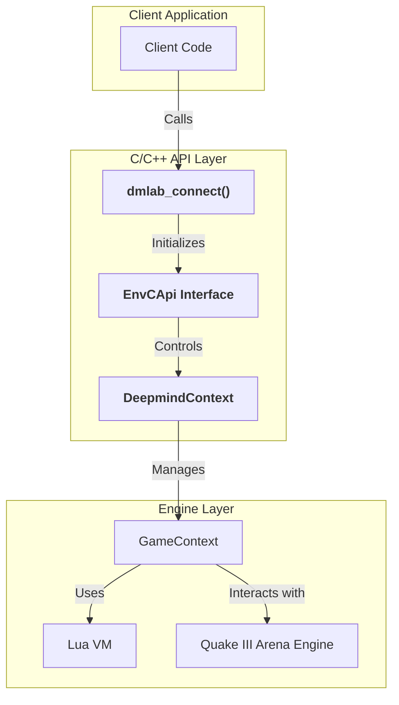
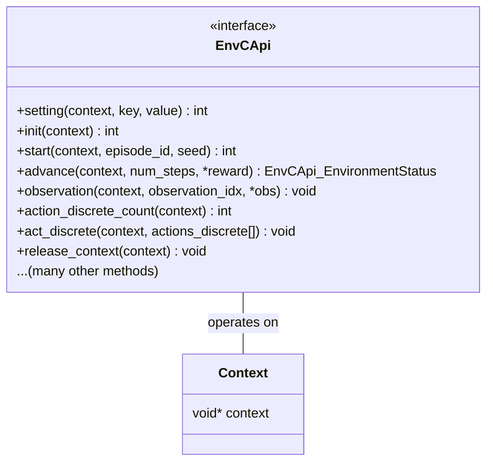
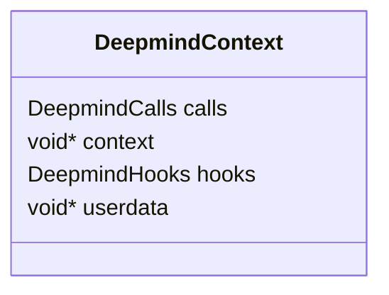
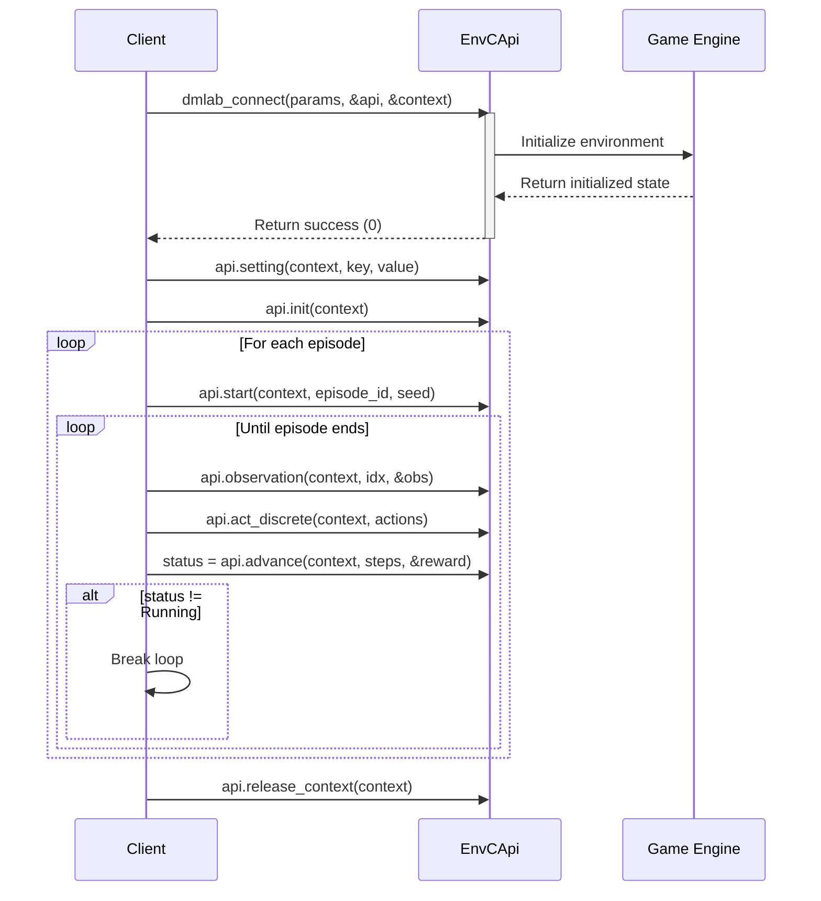
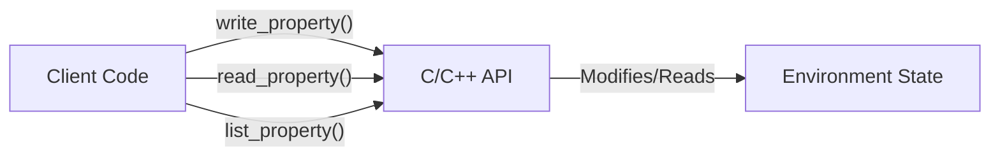
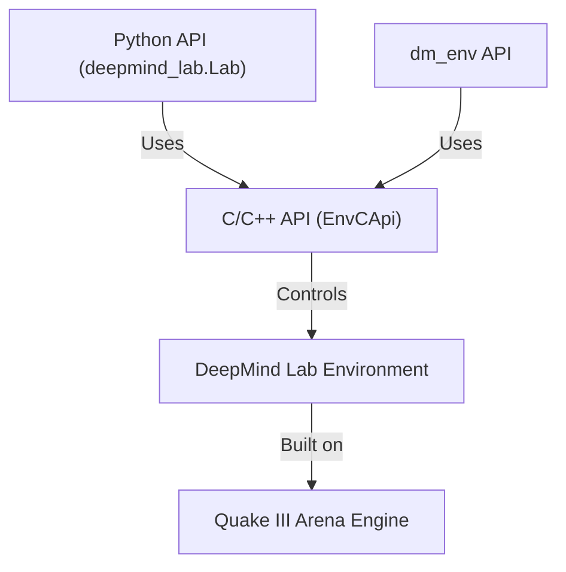

<!-- source: DeepWiki mcp.deepwiki.com · repo google-deepmind/lab · page 4 C/C++ API · fetched 2026-10-26 -->

# C/C++ API

<details>
<summary>Relevant source files</summary>

The following files were used as context for generating this wiki page:

- [RELEASE_NOTES.md](RELEASE_NOTES.md)
- [deepmind/engine/callbacks.cc](deepmind/engine/callbacks.cc)
- [deepmind/engine/callbacks_test.cc](deepmind/engine/callbacks_test.cc)
- [deepmind/include/deepmind_context.h](deepmind/include/deepmind_context.h)
- [engine/code/deepmind/dmlab_connect.c](engine/code/deepmind/dmlab_connect.c)
- [game_scripts/levels/tests/event_test.lua](game_scripts/levels/tests/event_test.lua)
- [game_scripts/levels/tests/text_observation_test.lua](game_scripts/levels/tests/text_observation_test.lua)
- [public/dmlab.h](public/dmlab.h)
- [public/dmlab_so_loader.cc](public/dmlab_so_loader.cc)
- [public/file_reader_types.h](public/file_reader_types.h)
- [python/dmlab_module.c](python/dmlab_module.c)
- [testing/recording_test.cc](testing/recording_test.cc)
- [third_party/rl_api/env_c_api.h](third_party/rl_api/env_c_api.h)
- [third_party/rl_api/env_c_api_bind.h](third_party/rl_api/env_c_api_bind.h)
- [third_party/rl_api/env_c_api_example.cc](third_party/rl_api/env_c_api_example.cc)
- [third_party/rl_api/env_c_api_example_test.cc](third_party/rl_api/env_c_api_example_test.cc)

</details>


The C/C++ API provides the core interface for interacting with the DeepMind Lab environment. It serves as the foundation for higher-level interfaces such as the [Python API](#3) and enables direct integration with C/C++ applications. This document explains the architecture, key components, and usage patterns of this low-level API.

## Architecture Overview

The C/C++ API sits between client applications and the DeepMind Lab engine, providing a standardized interface for environment interaction. It implements the EnvCApi specification which defines a consistent contract for RL environments.



Sources: [public/dmlab.h:61-73](), [engine/code/deepmind/dmlab_connect.c:498-511](), [third_party/rl_api/env_c_api.h:97-448]()

## Key Components

### 1. EnvCApi Interface

EnvCApi is the core interface that defines how clients interact with the environment. It's a C struct containing function pointers for all supported operations:



Sources: [third_party/rl_api/env_c_api.h:234-448]()

The EnvCApi interface is organized into several functional categories:

1. **Setup, Start and Termination**: Functions for initialization, starting episodes, and cleaning up resources
2. **Metadata Querying/Setting**: Functions for retrieving information about actions, observations, and events
3. **Run Loop**: Functions for the core environment loop (observing, acting, advancing)
4. **Property System**: Functions for reading and writing environment properties

Sources: [third_party/rl_api/env_c_api.h:236-447]()

### 2. Connection Mechanism

The connection to DeepMind Lab is established through the `dmlab_connect` function:

```c
int dmlab_connect(
    const DeepMindLabLaunchParams* params,
    EnvCApi* env_c_api,
    void** context);
```

This function initializes the environment, populates the EnvCApi struct with function pointers, and returns a context pointer that will be used for all subsequent calls.

Sources: [public/dmlab.h:70-73](), [engine/code/deepmind/dmlab_connect.c:496-260](), [public/dmlab_so_loader.cc:196-260]()

### 3. DeepmindContext

The DeepmindContext structure bridges the gap between the API and the game engine, containing:



Sources: [deepmind/include/deepmind_context.h:37-42]()

### 4. GameContext

The GameContext is an internal structure that maintains the state of the environment. It contains:

- References to the DeepMind context
- Game state (dimensions, images, etc.)
- Performance settings
- Recording state
- Rendering configuration

Sources: [engine/code/deepmind/dmlab_connect.c:134-176]()

## API Lifecycle

The typical lifecycle of using the C/C++ API follows this pattern:



Sources: [engine/code/deepmind/dmlab_connect.c:714-750](), [engine/code/deepmind/dmlab_connect.c:775-835](), [third_party/rl_api/env_c_api_example_test.cc:289-347]()

## API Initialization

### Launch Parameters

The `DeepMindLabLaunchParams` structure is used to configure the environment during initialization:

```c
struct DeepMindLabLaunchParams_s {
  const char* runfiles_path;
  DeepMindLabRenderer renderer;
  DeepMindLabLevelCacheParams level_cache_params;
  DeepmindFileReaderType* file_reader_override;
  const char* optional_temp_folder;
  const DeepMindReadOnlyFileSystem* read_only_file_system;
};
```

Sources: [public/dmlab.h:43-59]()

### Connection Process

1. Create and populate a `DeepMindLabLaunchParams` structure
2. Call `dmlab_connect` to initialize the environment
3. Verify successful connection (return value is 0)
4. Use the returned EnvCApi struct and context pointer for further interactions

Example connection pattern:

```c
DeepMindLabLaunchParams params = {};
params.runfiles_path = "path/to/deepmind_lab";
params.renderer = DeepMindLabRenderer_Software;

EnvCApi env_c_api;
void* context;
if (dmlab_connect(&params, &env_c_api, &context) != 0) {
    // Handle error
}
```

Sources: [testing/recording_test.cc:115-122](), [public/dmlab_so_loader.cc:196-260]()

## Environment Configuration

After connecting, you can configure the environment using the `setting` function:

```c
// Set the level name
env_c_api.setting(context, "levelName", "seekavoid_arena_01");

// Set screen dimensions
env_c_api.setting(context, "width", "64");
env_c_api.setting(context, "height", "64");

// Set frame rate
env_c_api.setting(context, "fps", "60");
```

Once all settings are applied, call `init` to initialize the environment:

```c
if (env_c_api.init(context) != 0) {
    // Handle initialization error
}
```

Sources: [engine/code/deepmind/dmlab_connect.c:512-712](), [python/dmlab_module.c:238-280]()

## Running Episodes

### Starting an Episode

To start an episode, call the `start` function with an episode ID and random seed:

```c
if (env_c_api.start(context, episode_id, seed) != 0) {
    // Handle start error
}
```

Sources: [engine/code/deepmind/dmlab_connect.c:775-835](), [python/dmlab_module.c:338-352]()

### The Run Loop

The main run loop consists of:

1. Getting observations
2. Taking actions
3. Advancing the environment
4. Checking the environment status

```c
EnvCApi_Observation observation;
env_c_api.observation(context, observation_index, &observation);

int actions[3] = {0, 1, 0};  // Example actions
env_c_api.act_discrete(context, actions);

double reward;
EnvCApi_EnvironmentStatus status = env_c_api.advance(context, 1, &reward);

if (status != EnvCApi_EnvironmentStatus_Running) {
    // Episode has ended
}
```

Sources: [third_party/rl_api/env_c_api_example_test.cc:289-347](), [python/dmlab_module.c:416-430]()

## Observations and Actions

### Discrete Actions

Discrete actions represent digital inputs (like button presses). The API provides functions to:

- Get the number of discrete actions: `action_discrete_count`
- Get the name of an action: `action_discrete_name`
- Get the bounds of an action: `action_discrete_bounds`
- Set action values: `act_discrete`

```c
int action_count = env_c_api.action_discrete_count(context);
int actions[action_count];
// ... populate actions array
env_c_api.act_discrete(context, actions);
```

Sources: [engine/code/deepmind/dmlab_connect.c:842-881](), [third_party/rl_api/env_c_api.h:334-362]()

### Observations

Observations represent the agent's view of the environment. The API provides:

- Functions to get observation metadata: `observation_count`, `observation_name`, `observation_spec`
- Function to get the current observation: `observation`

```c
EnvCApi_ObservationSpec spec;
env_c_api.observation_spec(context, obs_index, &spec);

EnvCApi_Observation obs;
env_c_api.observation(context, obs_index, &obs);

// Access observation data based on its type
if (obs.spec.type == EnvCApi_ObservationBytes) {
    // Process byte data in obs.payload.bytes
} else if (obs.spec.type == EnvCApi_ObservationDoubles) {
    // Process double data in obs.payload.doubles
}
```

Sources: [engine/code/deepmind/dmlab_connect.c:984-1023](), [third_party/rl_api/env_c_api.h:365-383](), [python/dmlab_module.c:530-574]()

## Property System

The Property system allows dynamic querying and modification of environment state:



Sources: [third_party/rl_api/env_c_api.h:186-208](), [RELEASE_NOTES.md:35-50]()

Each property has attributes that define what operations are allowed:
- Readable: Can be read via `read_property`
- Writable: Can be set via `write_property`
- Listable: Has sub-properties accessible via `list_property`

Example usage:

```c
// Reading a property
const char* value;
if (env_c_api.read_property(context, "prop_name", &value) == 
    EnvCApi_PropertyResult_Success) {
    // Use the property value
}

// Writing a property
env_c_api.write_property(context, "prop_name", "new_value");

// Listing properties
env_c_api.list_property(context, userdata, "prop_list",
    [](void* userdata, const char* key, EnvCApi_PropertyAttributes attr) {
        // Process each property
    });
```

Sources: [third_party/rl_api/env_c_api_example_test.cc:147-243](), [python/dmlab_module.c:712-780]()

## Error Handling

Most API functions return an integer status code (0 for success, non-zero for failure). When an error occurs, you can retrieve an error message:

```c
if (env_c_api.init(context) != 0) {
    const char* error_msg = env_c_api.error_message(context);
    printf("Error: %s\n", error_msg);
}
```

Sources: [third_party/rl_api/env_c_api.h:266-269](), [engine/code/deepmind/dmlab_connect.c:506-510]()

## Memory Management

The API manages resources associated with the context. When you're done with the environment, you must release the context:

```c
env_c_api.release_context(context);
```

Sources: [public/dmlab_so_loader.cc:64-95](), [third_party/rl_api/env_c_api.h:261-264]()

## API Version

The EnvCApi has version information that clients can check to ensure compatibility:

```c
#define DEEPMIND_ENV_C_API_VERSION_MAJOR 2
#define DEEPMIND_ENV_C_API_VERSION_MINOR 0
```

The version follows specific compatibility rules:
- ABI compatibility: Environment and client must be compiled at the same version
- API stability for clients within minor versions: Clients can be recompiled against upgraded API with the same major version
- Major version changes may require migration

Sources: [third_party/rl_api/env_c_api.h:55-81](), [RELEASE_NOTES.md:5-11]()

## Example Integration

This simplified example shows the basic pattern for using the C/C++ API:

```c
// Initialize the environment
DeepMindLabLaunchParams params = {};
params.runfiles_path = "path/to/deepmind_lab";
params.renderer = DeepMindLabRenderer_Software;

EnvCApi env_c_api;
void* context;
if (dmlab_connect(&params, &env_c_api, &context) != 0) {
    // Handle error
    return 1;
}

// Configure the environment
env_c_api.setting(context, "levelName", "seekavoid_arena_01");
env_c_api.setting(context, "width", "64");
env_c_api.setting(context, "height", "64");

if (env_c_api.init(context) != 0) {
    // Handle initialization error
    return 1;
}

// Run episodes
for (int episode = 0; episode < 10; ++episode) {
    if (env_c_api.start(context, episode, time(NULL)) != 0) {
        // Handle start error
        break;
    }
    
    // Prepare action array
    int action_count = env_c_api.action_discrete_count(context);
    int actions[action_count];
    memset(actions, 0, sizeof(actions));
    
    // Run episode
    EnvCApi_EnvironmentStatus status;
    do {
        // Get observations if needed
        EnvCApi_Observation obs;
        env_c_api.observation(context, 0, &obs);
        
        // Update actions based on observation
        // ...
        
        // Apply actions
        env_c_api.act_discrete(context, actions);
        
        // Advance environment
        double reward;
        status = env_c_api.advance(context, 1, &reward);
        
        // Process reward
        // ...
    } while (status == EnvCApi_EnvironmentStatus_Running);
}

// Cleanup
env_c_api.release_context(context);
```

Sources: [third_party/rl_api/env_c_api_example.cc:264-268](), [testing/recording_test.cc:115-133](), [third_party/rl_api/env_c_api_example_test.cc:289-347]()

## Relationship to Other Components

The C/C++ API serves as the foundation for other interfaces in DeepMind Lab:



Sources: [python/dmlab_module.c:214-247](), [public/dmlab_so_loader.cc:196-260]()

The C/C++ API is implemented in `dmlab_connect.c` and exposed through `dmlab.h`, with the interface defined in `env_c_api.h`. Python bindings and other higher-level interfaces are built on top of this foundation.

---

