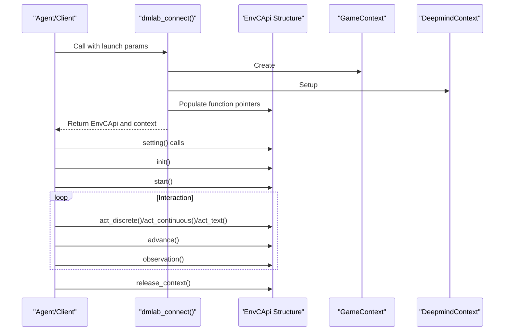
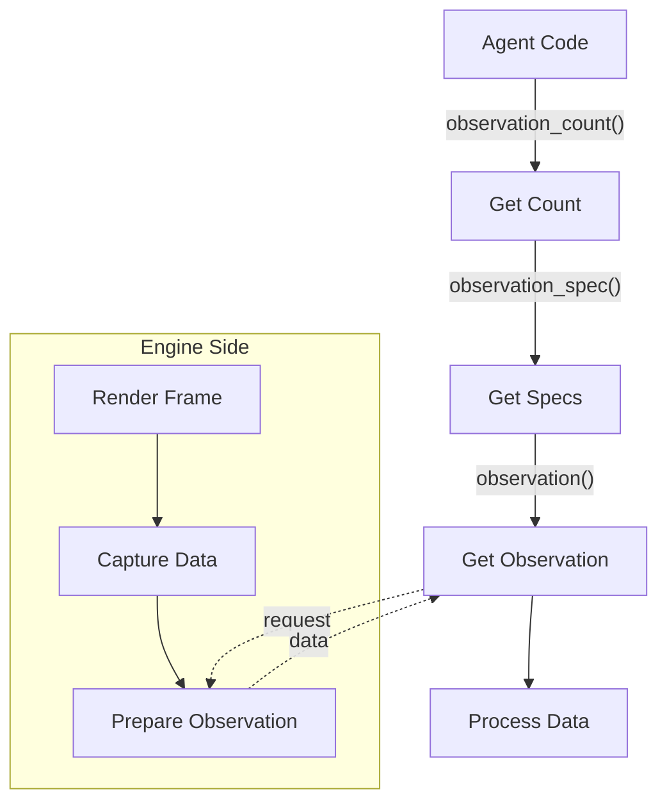
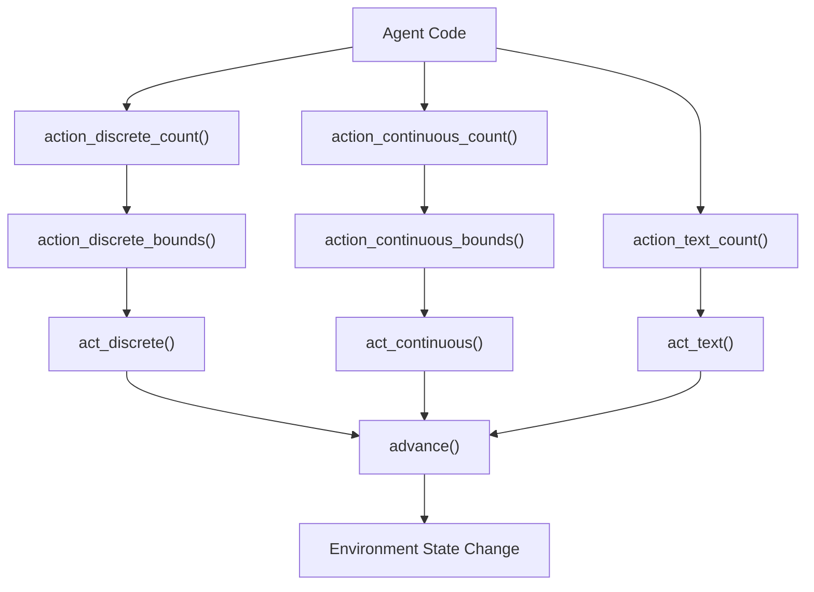
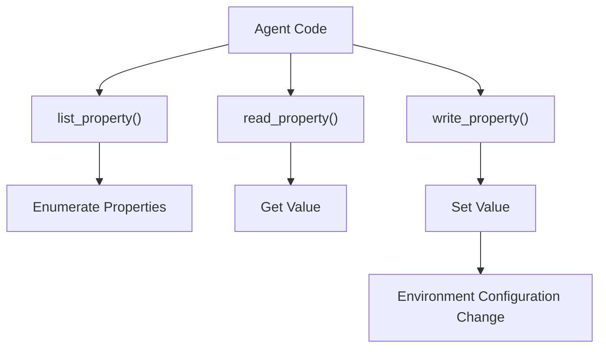
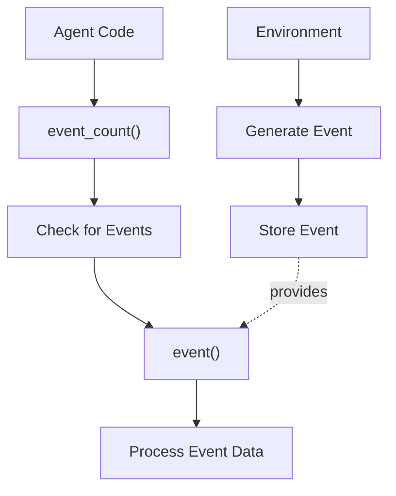
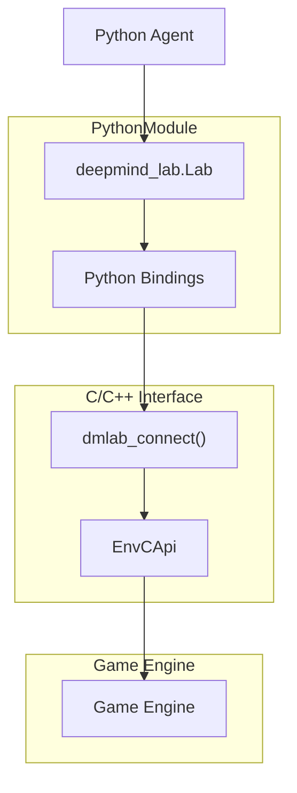
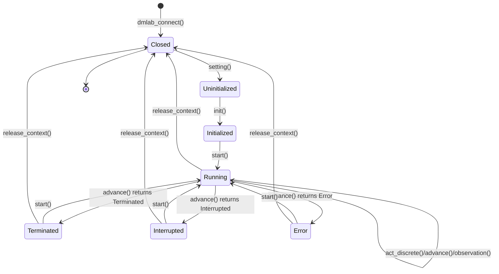

<!-- source: DeepWiki mcp.deepwiki.com · repo google-deepmind/lab · page 4.1 EnvCApi · fetched 2026-10-26 -->

# EnvCApi

<details>
<summary>Relevant source files</summary>

The following files were used as context for generating this wiki page:

- [RELEASE_NOTES.md](RELEASE_NOTES.md)
- [deepmind/engine/callbacks.cc](deepmind/engine/callbacks.cc)
- [deepmind/engine/callbacks_test.cc](deepmind/engine/callbacks_test.cc)
- [deepmind/include/deepmind_context.h](deepmind/include/deepmind_context.h)
- [engine/code/deepmind/dmlab_connect.c](engine/code/deepmind/dmlab_connect.c)
- [game_scripts/levels/tests/event_test.lua](game_scripts/levels/tests/event_test.lua)
- [game_scripts/levels/tests/text_observation_test.lua](game_scripts/levels/tests/text_observation_test.lua)
- [public/dmlab.h](public/dmlab.h)
- [public/dmlab_so_loader.cc](public/dmlab_so_loader.cc)
- [public/file_reader_types.h](public/file_reader_types.h)
- [python/dmlab_module.c](python/dmlab_module.c)
- [testing/recording_test.cc](testing/recording_test.cc)
- [third_party/rl_api/env_c_api.h](third_party/rl_api/env_c_api.h)
- [third_party/rl_api/env_c_api_bind.h](third_party/rl_api/env_c_api_bind.h)
- [third_party/rl_api/env_c_api_example.cc](third_party/rl_api/env_c_api_example.cc)
- [third_party/rl_api/env_c_api_example_test.cc](third_party/rl_api/env_c_api_example_test.cc)

</details>


This document provides a comprehensive overview of the Environment C API (EnvCApi) interface in DeepMind Lab. EnvCApi is a standardized C interface that allows agents to interact with reinforcement learning environments. It defines how to initialize environments, retrieve observations, perform actions, and handle environment events. This interface serves as the primary bridge between DeepMind Lab's internal game engine and external agent code.

## Purpose and Scope

EnvCApi provides a stable interface for agent-environment interactions in reinforcement learning. It enables:

- Standardized environment lifecycle management
- Retrieval of observations from the environment
- Execution of actions within the environment
- Property management for configuring environments
- Event handling for monitoring environment state

For information about the specific Python implementation of this API, see [Python API](#3). For information about context management in DeepMind Lab, see [DeepmindContext](#4.2).

## API Structure and Version

EnvCApi uses a C-style interface defined by a set of function pointers within a struct. This allows for language-agnostic bindings while maintaining performance.

```mermaid
classDiagram
    class "EnvCApi" {
        +setting()
        +init()
        +start()
        +release_context()
        +error_message()
        +write_property()
        +read_property()
        +list_property()
        +environment_name()
        +action_discrete_count()
        +action_discrete_name()
        +action_discrete_bounds()
        +action_continuous_count()
        +action_continuous_name()
        +action_continuous_bounds()
        +action_text_count()
        +action_text_name()
        +observation_count()
        +observation_name()
        +observation_spec()
        +event_type_count()
        +event_type_name()
        +observation()
        +event_count()
        +event()
        +act_discrete()
        +act_continuous()
        +act_text()
        +advance()
    }
```

The API follows semantic versioning (MAJOR.MINOR) to manage compatibility:

- Major version changes (e.g., 1.x → 2.0) may require client code migration
- Minor version changes (e.g., 1.3 → 1.4) are backward compatible for clients

As of the latest release, the EnvCApi is at version 2.0, updated from 1.4 as noted in the [RELEASE_NOTES.md:1-11]().

Sources: [third_party/rl_api/env_c_api.h:55-86](), [RELEASE_NOTES.md:1-11]()

## Key Data Structures

### Core Structures

```mermaid
classDiagram
    EnvCApi <-- EnvCApi_Observation
    EnvCApi <-- EnvCApi_Event
    EnvCApi_Observation <-- EnvCApi_ObservationSpec
    EnvCApi_Observation -- ObservationPayload
    EnvCApi_Event -- EnvCApi_Observation

    class "EnvCApi" {
        Function pointers for environment control
    }
    class "EnvCApi_ObservationSpec" {
        +EnvCApi_ObservationType type
        +int dims
        +const int* shape
    }
    class "EnvCApi_Observation" {
        +EnvCApi_ObservationSpec spec
        +payload union
    }
    class "ObservationPayload" {
        +const double* doubles
        +const unsigned char* bytes
        +const char* string
    }
    class "EnvCApi_Event" {
        +int id
        +int observation_count
        +const EnvCApi_Observation* observations
    }
```

The key data structures in EnvCApi include:

- **EnvCApi**: Main structure containing function pointers for all API operations
- **EnvCApi_ObservationSpec**: Describes the shape and type of observations
- **EnvCApi_Observation**: Contains observation data and its specification
- **EnvCApi_Event**: Represents events with associated observations
- **EnvCApi_TextAction**: Represents text actions that can be performed

Sources: [third_party/rl_api/env_c_api.h:97-173]()

### Environment Status

The environment can be in one of four states:

- **Running**: Episode is active, actions can be taken
- **Terminated**: Episode has reached a terminal state naturally
- **Interrupted**: Episode ended without reaching a terminal state
- **Error**: An error occurred, episode is no longer active

Sources: [third_party/rl_api/env_c_api.h:123-128]()

## Initialization and Connection

### Connection Process



Initializing an environment involves these steps:

1. **Connect to the environment**:
   ```c
   int dmlab_connect(const DeepMindLabLaunchParams* params, 
                     EnvCApi* env_c_api, void** context);
   ```

2. **Configure environment settings**:
   ```c
   // Apply settings before initialization
   env_c_api->setting(context, "levelName", "seekavoid_arena_01");
   env_c_api->setting(context, "width", "640");
   env_c_api->setting(context, "height", "480");
   ```

3. **Initialize the environment**:
   ```c
   env_c_api->init(context);
   ```

4. **Start an episode**:
   ```c
   env_c_api->start(context, episode_id, seed);
   ```

Sources: [public/dmlab.h:60-73](), [engine/code/deepmind/dmlab_connect.c:500-502](), [python/dmlab_module.c:214-317]()

## Observation System

### Observation Types and Retrieval

EnvCApi supports three observation types:

- **Doubles**: For numeric data (`EnvCApi_ObservationDoubles`)
- **Bytes**: For image data and other byte arrays (`EnvCApi_ObservationBytes`)
- **String**: For text data (`EnvCApi_ObservationString`)

Each observation has a specification describing its dimensionality and shape:

```c
struct EnvCApi_ObservationSpec_s {
  EnvCApi_ObservationType type;
  int dims;
  const int* shape;
};
```

### Observation Workflow



To retrieve observations:

1. Get the number of available observations:
   ```c
   int obs_count = env_c_api->observation_count(context);
   ```

2. Get the specification for each observation:
   ```c
   EnvCApi_ObservationSpec spec;
   env_c_api->observation_spec(context, obs_idx, &spec);
   ```

3. Retrieve the actual observation:
   ```c
   EnvCApi_Observation obs;
   env_c_api->observation(context, obs_idx, &obs);
   ```

In DeepMind Lab, common observations include:
- `RGB_INTERLEAVED` (or deprecated `RGB_INTERLACED`): RGB image data
- `RGBD_INTERLEAVED` (or deprecated `RGBD_INTERLACED`): RGB image with depth
- `RGB`: Planar RGB data
- `RGBD`: Planar RGB with depth
- `BGR_INTERLEAVED`: BGR image data
- `BGRD_INTERLEAVED`: BGR image with depth
- `MAP_FRAME_NUMBER`: Current frame number

Sources: [engine/code/deepmind/dmlab_connect.c:94-116](), [engine/code/deepmind/dmlab_connect.c:984-1047](), [third_party/rl_api/env_c_api.h:132-149]()

## Action System

### Action Types

EnvCApi supports three action types:

1. **Discrete Actions**: Integer values within specified bounds
   ```c
   void act_discrete(void* context, const int actions_discrete[]);
   ```

2. **Continuous Actions**: Floating-point values within specified bounds
   ```c
   void act_continuous(void* context, const double actions_continuous[]);
   ```

3. **Text Actions**: String values
   ```c
   void act_text(void* context, const EnvCApi_TextAction actions_text[]);
   ```

### Action Flow



Standard actions in DeepMind Lab include:
- `LOOK_LEFT_RIGHT_PIXELS_PER_FRAME`: Angular velocity for looking left/right
- `LOOK_DOWN_UP_PIXELS_PER_FRAME`: Angular velocity for looking up/down
- `STRAFE_LEFT_RIGHT`: Sideways movement
- `MOVE_BACK_FORWARD`: Forward/backward movement
- `FIRE`: Shooting action
- `JUMP`: Jumping action
- `CROUCH`: Crouching action

Sources: [engine/code/deepmind/dmlab_connect.c:74-92](), [engine/code/deepmind/dmlab_connect.c:879-890](), [third_party/rl_api/env_c_api.h:342-362]()

## Property System

The property system allows for dynamic querying and modification of environment state. Properties are key-value pairs with string representations.

### Property Attributes

Properties can have one or more attributes:
- **Readable**: Can be read via `read_property()`
- **Writable**: Can be set via `write_property()`
- **Listable**: Has sub-properties that can be enumerated

### Property Access



Property operations return result codes:
- `Success`: Operation completed successfully
- `NotFound`: Property does not exist
- `PermissionDenied`: Operation not allowed on the property
- `InvalidArgument`: Property could not accept provided value

Sources: [third_party/rl_api/env_c_api.h:187-207](), [third_party/rl_api/env_c_api.h:294-328](), [RELEASE_NOTES.md:49-51]()

## Events System

The events system allows the environment to communicate significant occurrences to the agent, separate from the regular observation-action loop.

### Event Structure

```c
struct EnvCApi_Event_s {
  int id;
  int observation_count;
  const EnvCApi_Observation* observations;
};
```

### Event Flow



To retrieve events:

1. Get the number of pending events:
   ```c
   int event_count = env_c_api->event_count(context);
   ```

2. Retrieve each event:
   ```c
   EnvCApi_Event event;
   env_c_api->event(context, event_idx, &event);
   ```

3. Interpret the event using its ID and the event type name:
   ```c
   const char* event_type = env_c_api->event_type_name(context, event.id);
   ```

Sources: [third_party/rl_api/env_c_api.h:160-167](), [third_party/rl_api/env_c_api.h:408-416](), [game_scripts/levels/tests/event_test.lua:32-36]()

## Integration with Python

DeepMind Lab provides Python bindings for the EnvCApi through the `deepmind_lab` Python module.

### Python Integration Architecture



The Python API implements methods that map directly to EnvCApi functions:
- `Lab.reset()` → `start()`
- `Lab.step()` → `act_discrete()` + `advance()`
- `Lab.observations()` → `observation()`
- `Lab.events()` → `event()`
- `Lab.close()` → `release_context()`

Sources: [python/dmlab_module.c:139-237](), [python/dmlab_module.c:311-354](), [python/dmlab_module.c:576-610]()

## Environment Lifecycle

### Complete Lifecycle Flow



The environment lifecycle follows these main states:
1. **Closed**: Before connecting or after releasing
2. **Uninitialized**: After connecting but before initialization
3. **Initialized**: After initialization but before starting
4. **Running**: During active episode
5. **Terminated/Interrupted/Error**: After episode ends

Sources: [third_party/rl_api/env_c_api.h:234-446](), [engine/code/deepmind/dmlab_connect.c:714-750](), [engine/code/deepmind/dmlab_connect.c:775-835]()

## Example Usage

Here's a simplified example of using EnvCApi in C:

```c
// Connect to environment
DeepMindLabLaunchParams params = {.runfiles_path = "/path/to/lab"};
EnvCApi env_c_api;
void* context;
dmlab_connect(&params, &env_c_api, &context);

// Configure and initialize
env_c_api.setting(context, "levelName", "seekavoid_arena_01");
env_c_api.init(context);

// Start episode
env_c_api.start(context, /*episode_id=*/0, /*seed=*/123);

// Game loop
while (true) {
  // Execute action
  int actions[7] = {0, 0, 0, 1, 0, 0, 0}; // Move forward
  env_c_api.act_discrete(context, actions);
  
  // Advance environment
  double reward;
  EnvCApi_EnvironmentStatus status = env_c_api.advance(context, 1, &reward);
  if (status != EnvCApi_EnvironmentStatus_Running) break;
  
  // Get observations
  EnvCApi_Observation obs;
  env_c_api.observation(context, 0, &obs); // RGB observation
  
  // Process observation and reward...
}

// Clean up
env_c_api.release_context(context);
```

Sources: [third_party/rl_api/env_c_api_example_test.cc:39-81](), [testing/recording_test.cc:116-148]()

## Conclusion

EnvCApi provides a standardized interface for agent-environment interaction in DeepMind Lab. It manages the full lifecycle of environments, handles observations and actions, and provides systems for properties and events. The C interface enables language-agnostic bindings while maintaining performance, making it suitable for reinforcement learning research and development.

---

