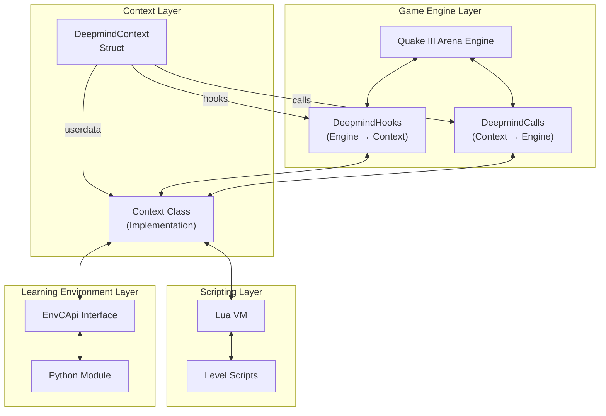
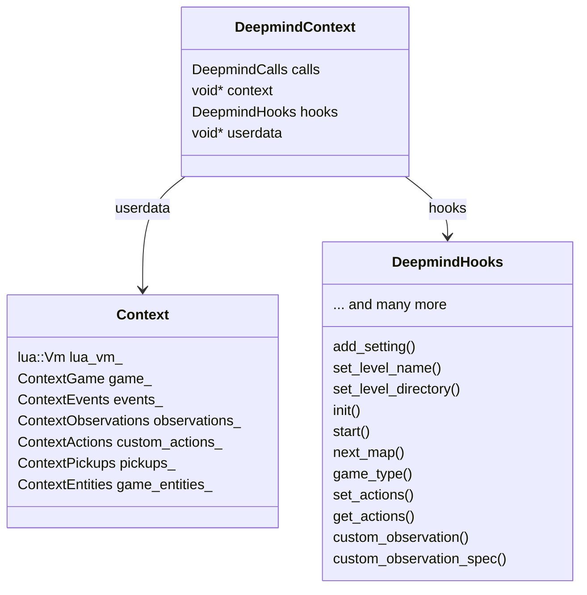
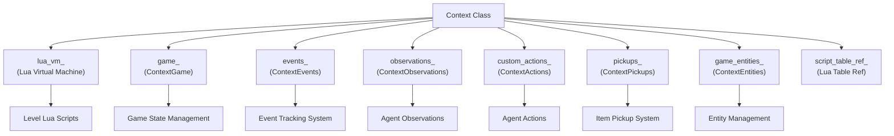
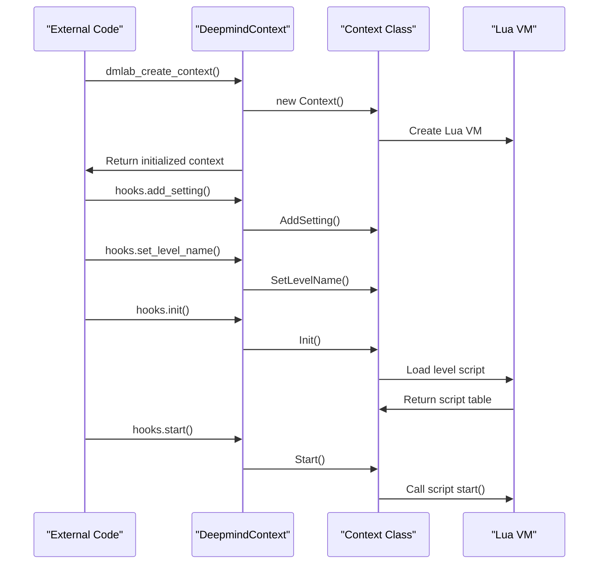
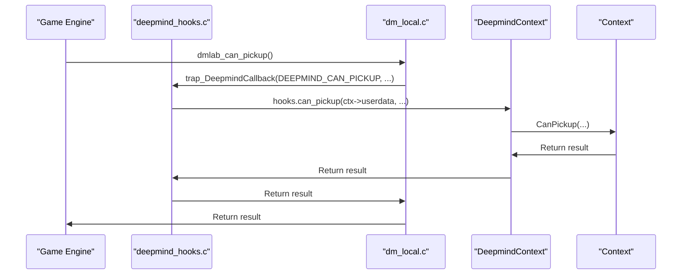
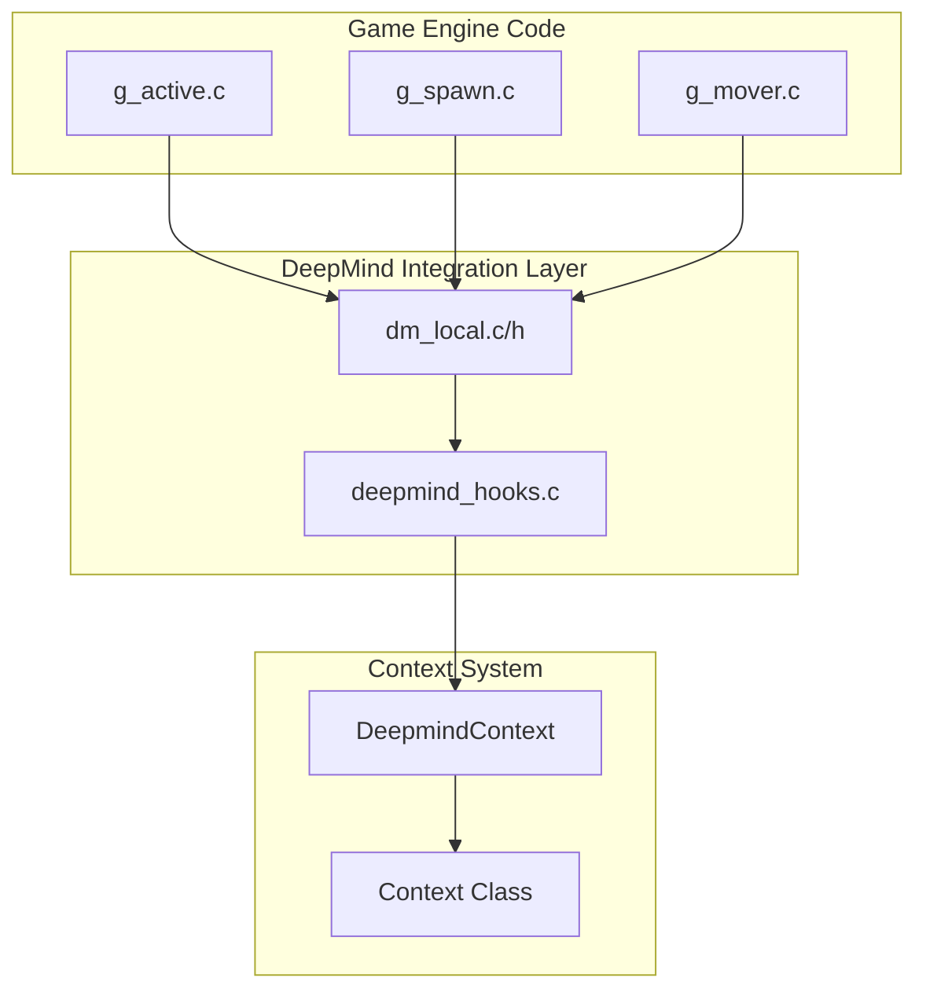
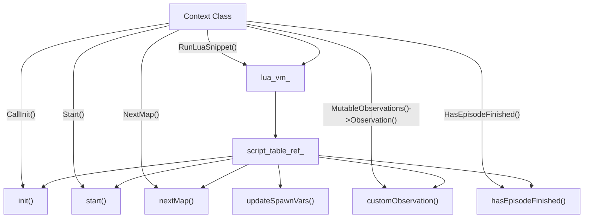
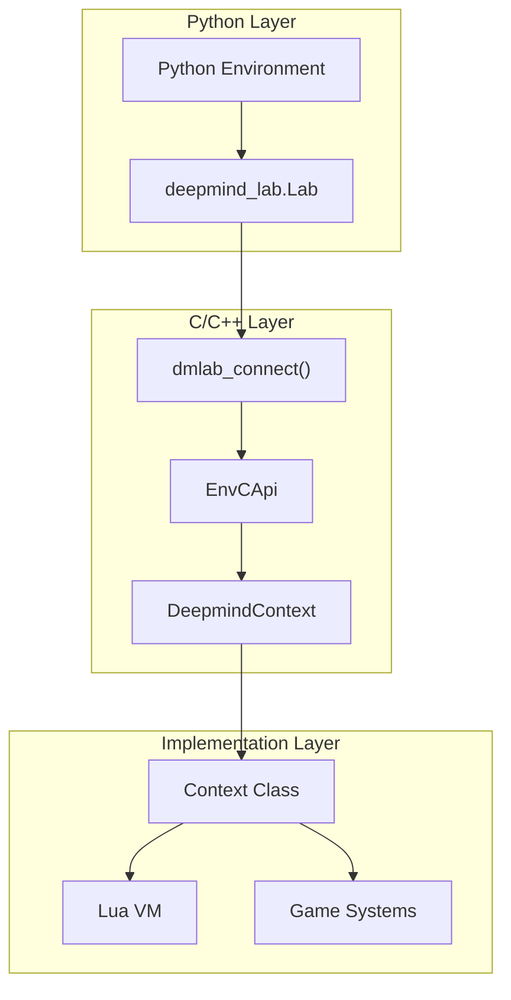

<!-- source: DeepWiki mcp.deepwiki.com · repo google-deepmind/lab · page 4.2 DeepmindContext · fetched 2026-10-26 -->

# DeepmindContext

Relevant source files

The following files were used as context for generating this wiki page:

- [deepmind/engine/callbacks.cc](deepmind/engine/callbacks.cc)
- [deepmind/engine/callbacks_test.cc](deepmind/engine/callbacks_test.cc)
- [deepmind/engine/context.cc](deepmind/engine/context.cc)
- [deepmind/engine/context.h](deepmind/engine/context.h)
- [deepmind/include/deepmind_context.h](deepmind/include/deepmind_context.h)
- [deepmind/include/deepmind_hooks.h](deepmind/include/deepmind_hooks.h)
- [docs/developers/reference/lua_api.md](docs/developers/reference/lua_api.md)
- [engine/code/deepmind/dm_local.c](engine/code/deepmind/dm_local.c)
- [engine/code/deepmind/dm_local.h](engine/code/deepmind/dm_local.h)
- [engine/code/deepmind/dm_public.h](engine/code/deepmind/dm_public.h)
- [engine/code/game/g_active.c](engine/code/game/g_active.c)
- [engine/code/game/g_local.h](engine/code/game/g_local.h)
- [engine/code/game/g_mover.c](engine/code/game/g_mover.c)
- [engine/code/game/g_spawn.c](engine/code/game/g_spawn.c)
- [engine/code/qcommon/deepmind_hooks.c](engine/code/qcommon/deepmind_hooks.c)
- [engine/code/qcommon/q_shared.h](engine/code/qcommon/q_shared.h)
- [engine/code/qcommon/surfaceflags.h](engine/code/qcommon/surfaceflags.h)
- [game_scripts/levels/tests/event_test.lua](game_scripts/levels/tests/event_test.lua)
- [game_scripts/levels/tests/text_observation_test.lua](game_scripts/levels/tests/text_observation_test.lua)
- [public/dmlab.h](public/dmlab.h)
- [public/dmlab_so_loader.cc](public/dmlab_so_loader.cc)
- [public/file_reader_types.h](public/file_reader_types.h)

## Purpose and Overview

The DeepmindContext is a core component in DeepMind Lab that serves as the central connection point between the game engine (based on Quake III Arena) and the ML/AI components. It functions as the primary mediation layer, enabling bidirectional communication through a defined API. For information about the Python-facing API that leverages this context system, see [Python API](#3).

Sources: [deepmind/include/deepmind_context.h:35-42](), [deepmind/engine/context.h:52-54]()

## Architecture

DeepmindContext follows a bridge pattern that connects the game engine with the AI components through a well-defined interface of hooks and callbacks. This design enables the separation of concerns between the game simulation and the reinforcement learning environment.

Sources: [deepmind/include/deepmind_context.h:35-42](), [deepmind/engine/context.h:54-566](), [engine/code/qcommon/deepmind_hooks.c:30-251]()

## Structure of DeepmindContext

The DeepmindContext is a C structure that contains:

1. **DeepmindCalls calls**: Function pointers that allow the context to call into the game engine
2. **void* context**: A pointer used by the engine when calls are made
3. **DeepmindHooks hooks**: Function pointers that allow the game engine to call into the context
4. **void* userdata**: A pointer to the actual implementation (Context class)

Sources: [deepmind/include/deepmind_context.h:37-42](), [deepmind/engine/context.h:54-566]()

## Context Class Implementation

The Context class (`deepmind::lab::Context`) is the actual implementation of the "userdata" in DeepmindContext. It manages:

1. **Lua VM**: A Lua virtual machine for scripting
2. **Game state**: Current game information
3. **Observations**: State information provided to agents
4. **Actions**: Inputs from agents
5. **Events**: Game events tracking
6. **Entities**: Game world entities
7. **Pickups**: Collectible items

The Context class provides methods that correspond to the hooks in DeepmindHooks, handling various game events, player actions, observations, etc.

### Key Components of the Context Class

Sources: [deepmind/engine/context.h:54-566](), [deepmind/engine/context.cc:79-587]()

## Initialization and Lifecycle

The lifecycle of a DeepmindContext involves:

1. **Creation**: Created via `dmlab_create_context()`
2. **Initialization**: Initialized with settings and level information
3. **Execution**: Processes game frames, observations, actions
4. **Destruction**: Destroyed via `dmlab_release_context()`

### Creation and Initialization Flow

Sources: [deepmind/engine/callbacks.cc:48-72](), [deepmind/engine/context.cc:587-608](), [deepmind/engine/context.cc:720-815](), [deepmind/engine/context.cc:817-834]()

## Hook Mechanism

The hook mechanism enables bidirectional communication between the game engine and the Context. The hooks are defined in DeepmindHooks and implemented in the Context class.

### Hook Categories

| Category | Description | Examples |
|----------|-------------|----------|
| **Initialization** | Hooks for setting up the environment | `add_setting`, `set_level_name`, `init`, `start` |
| **Level Management** | Hooks for managing game levels | `next_map`, `map_loaded`, `map_finished` |
| **Player Actions** | Hooks for handling player inputs | `set_actions`, `get_actions`, `custom_action_discrete_apply` |
| **Observations** | Hooks for providing environment state | `custom_observation`, `custom_observation_spec` |
| **Entity Interaction** | Hooks for entity-related events | `can_pickup`, `override_pickup`, `can_trigger` |
| **Events** | Hooks for event handling | `game_event`, `events.clear`, `events.count` |

### Hook Call Flow Example

Sources: [deepmind/include/deepmind_hooks.h:34-440](), [engine/code/qcommon/deepmind_hooks.c:26-251](), [engine/code/deepmind/dm_local.c:22-202]()

## Integration with Game Engine

The game engine (based on Quake III Arena) integrates with DeepmindContext through several layers:

1. **DeepmindHooks**: Function pointers for the engine to call into the context
2. **deepmind_hooks.c**: Implements the callback handling from engine to context
3. **dm_local.h/c**: Provides local functions for the game code to interact with the context

### Engine-Context Integration Flow

Sources: [engine/code/qcommon/deepmind_hooks.c:26-251](), [engine/code/deepmind/dm_local.c:22-202](), [engine/code/deepmind/dm_public.h:22-60]()

## Lua Scripting Integration

The Context class manages a Lua VM that executes level scripts and custom logic. This enables researchers to define custom environments without modifying the core C/C++ code.

### Key Lua Integration Points

The level scripts can define various callback functions that the Context will call during execution, such as:

- `init(settings)`: Called at environment initialization
- `start(episode, seed)`: Called at the start of each episode
- `nextMap()`: Called when a map needs to be loaded
- `customObservation(name)`: Called to get custom observations
- `hasEpisodeFinished(time)`: Called to check if the episode is done

Sources: [deepmind/engine/context.cc:726-815](), [deepmind/engine/context.cc:817-834](), [deepmind/engine/context.cc:850-866](), [deepmind/engine/context.cc:902-915](), [docs/developers/reference/lua_api.md:1-584]()

## EnvCApi Integration

The DeepmindContext system is exposed to Python through the EnvCApi interface, allowing it to be used as a reinforcement learning environment.

Sources: [public/dmlab_so_loader.cc:196-260](), [public/dmlab.h:60-73]()

## Error Handling and Debugging

The DeepmindContext includes mechanisms for error reporting and debugging:

1. **Error Messages**: The Context maintains an error message string that can be accessed via `ErrorMessage()`
2. **Lua Error Handling**: Errors in Lua scripts are captured and reported
3. **Console Commands**: The Context can issue console commands to the game engine for debugging

Sources: [deepmind/engine/context.h:384-389](), [deepmind/engine/context.cc:885-901]()

## Summary

The DeepmindContext is the central bridge between the game engine and the ML/AI components in DeepMind Lab. It:

1. Manages bidirectional communication through hooks and callbacks
2. Maintains game state, observations, actions, and events
3. Provides a Lua scripting environment for custom logic
4. Integrates with the EnvCApi for reinforcement learning research

Its modular design allows researchers to create custom environments without modifying the core code, making it a flexible platform for reinforcement learning research.

Sources: [deepmind/include/deepmind_context.h:35-42](), [deepmind/engine/context.h:54-566](), [deepmind/engine/context.cc:79-587]()

---

