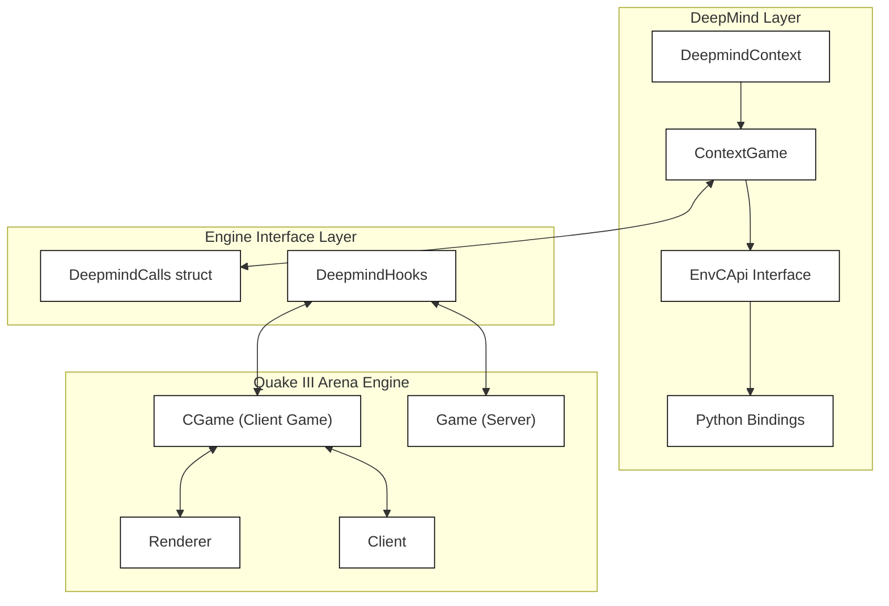
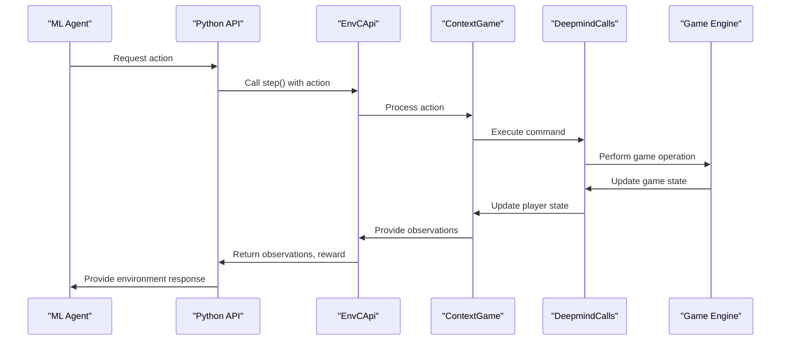
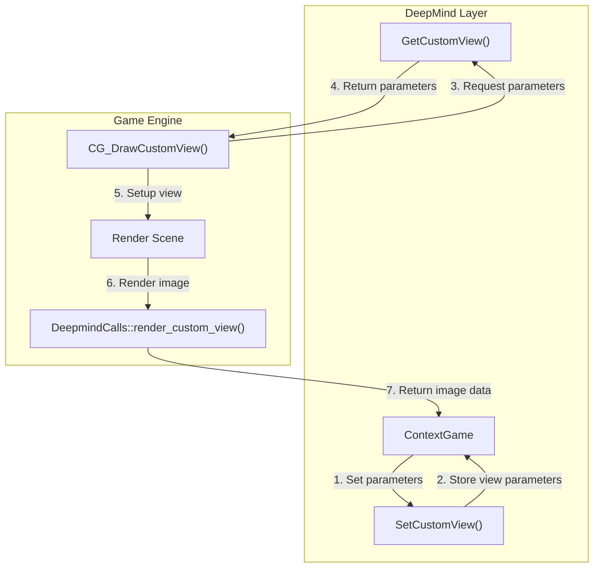
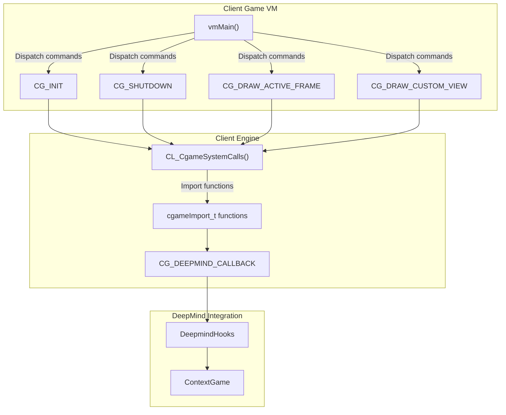
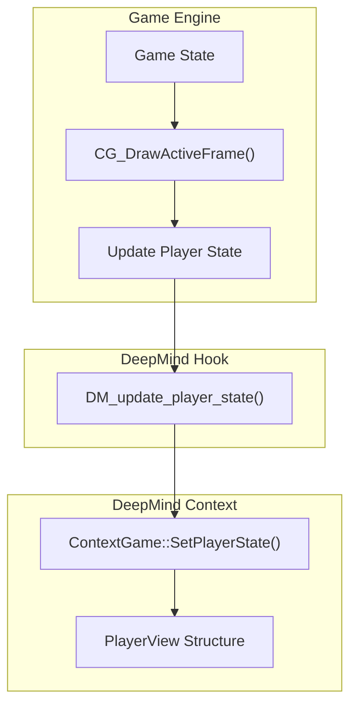
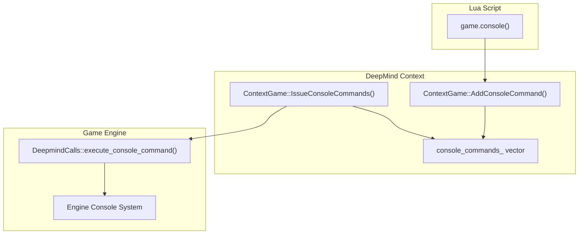
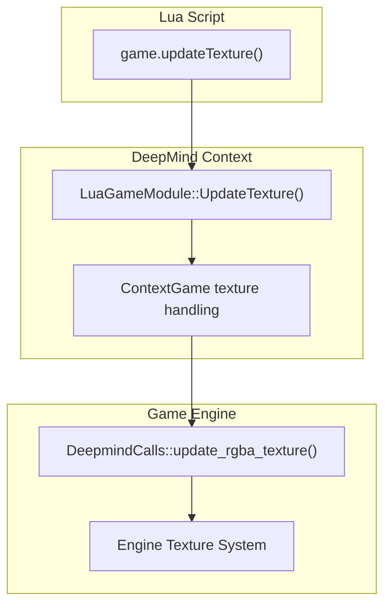
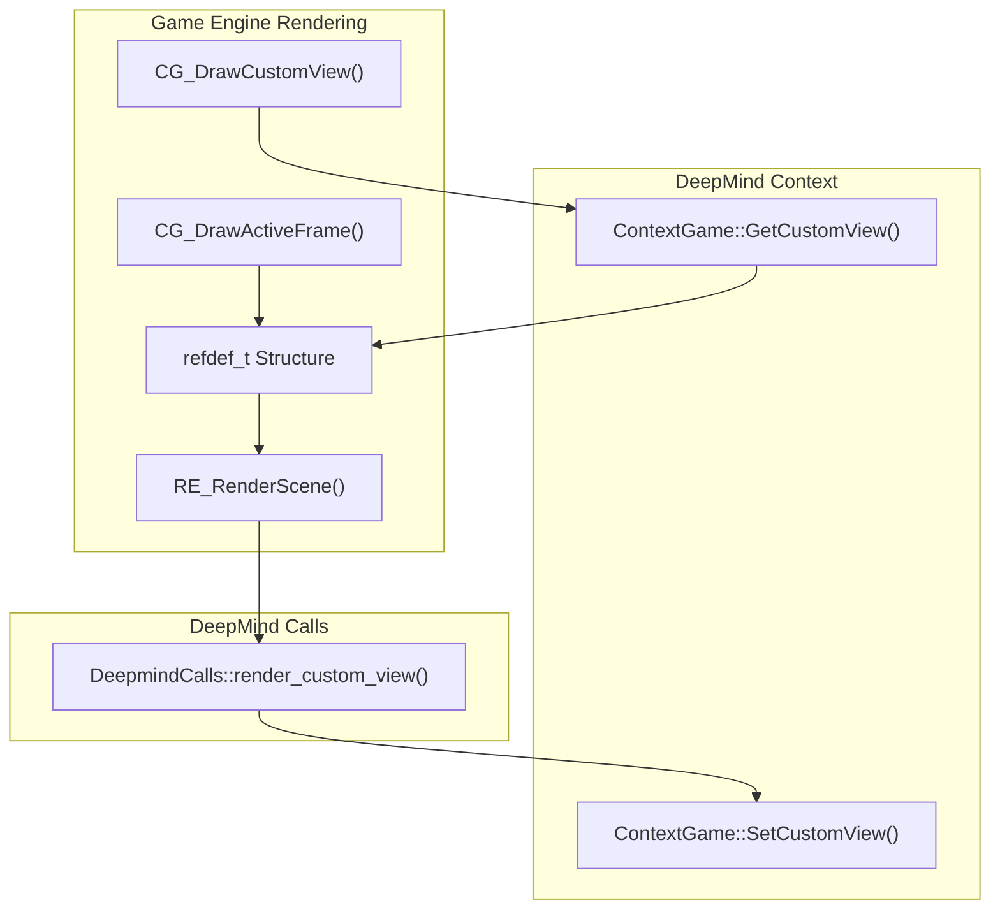
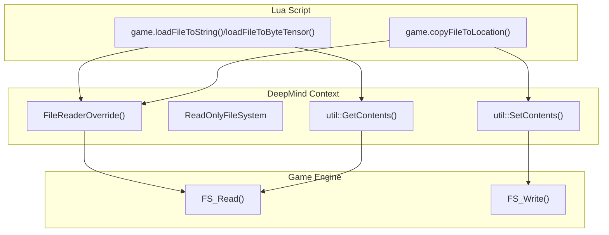

<!-- source: DeepWiki mcp.deepwiki.com · repo google-deepmind/lab · page 4.3 Game Engine Integration · fetched 2026-10-26 -->

# Game Engine Integration

<details>
<summary>Relevant source files</summary>

The following files were used as context for generating this wiki page:

- [deepmind/engine/context_game.cc](deepmind/engine/context_game.cc)
- [deepmind/engine/context_game.h](deepmind/engine/context_game.h)
- [deepmind/include/deepmind_calls.h](deepmind/include/deepmind_calls.h)
- [engine/code/cgame/cg_draw.c](engine/code/cgame/cg_draw.c)
- [engine/code/cgame/cg_local.h](engine/code/cgame/cg_local.h)
- [engine/code/cgame/cg_main.c](engine/code/cgame/cg_main.c)
- [engine/code/cgame/cg_public.h](engine/code/cgame/cg_public.h)
- [engine/code/cgame/cg_view.c](engine/code/cgame/cg_view.c)
- [engine/code/client/cl_cgame.c](engine/code/client/cl_cgame.c)
- [engine/code/client/cl_scrn.c](engine/code/client/cl_scrn.c)
- [engine/code/client/client.h](engine/code/client/client.h)
- [engine/code/renderercommon/tr_types.h](engine/code/renderercommon/tr_types.h)
- [engine/code/server/sv_game.c](engine/code/server/sv_game.c)

</details>


This page describes how DeepMind Lab integrates with and interfaces to the modified Quake III Arena game engine. It covers the communication pathways, core integration points, and how the game engine is controlled by the DeepMind Lab environment. For information about the Lua scripting interface, see [Lua Scripting](#5), and for observation handling, see [Observations and Actions](#7).

## Core Integration Architecture

DeepMind Lab tightly integrates with a modified version of the Quake III Arena engine to provide a 3D environment for reinforcement learning. The integration architecture creates a bidirectional communication channel between DeepMind's ML systems and the game engine.



Sources:
- [deepmind/engine/context_game.h:18-167]()
- [deepmind/include/deepmind_calls.h:22-129]()
- [engine/code/cgame/cg_public.h:22-247]()

## DeepmindCalls Interface

The `DeepmindCalls` structure represents the primary interface for DeepMind to control the game engine. It is a collection of function pointers that allow DeepMind's code to call into the game engine. These functions are implemented by the engine and made available to DeepMind for interaction.

```mermaid
classDiagram
    class "DeepmindCalls" {
        void (*add_score)(int player_id, double score)
        void (*screen_shape)(int* width, int* height, int* buff_width, int* buff_height)
        void (*execute_console_command)(const char* cmd)
        int (*engine_frame_period_msec)(void)
        int (*total_engine_time_msec)(void)
        double (*total_time_seconds)(void)
        void (*add_bot)(const char* name, double skill, const char* team)
        int (*player_score)(void* context)
        bool (*update_rgba_texture)(const char* name, int width, int height, const unsigned char* data)
        float (*raycast)(const float start[3], const float end[3])
        bool (*in_fov)(const float start[3], const float end[3], const float angles[3], float fov)
        void (*render_custom_view)(int width, int height, unsigned char* buffer)
        bool (*is_map_loading)()
    }
```

Sources:
- [deepmind/include/deepmind_calls.h:34-123]()

## ContextGame Class

The `ContextGame` class is the central component in DeepMind Lab's game engine integration. It maintains the state of the game environment, handles communication with the engine, and provides interfaces for Lua scripts to interact with the game world.

```mermaid
classDiagram
    class "ContextGame" {
        PlayerView player_view_
        DeepmindCalls* deepmind_calls_
        bool map_finished_
        util::SmoothExponentialDecayAt60~Eigen::Vector3d~ velocity_smoother_
        std::string executable_runfiles_
        DeepmindFileReaderType* file_reader_override_
        DeepMindReadOnlyFileSystem read_only_file_system_
        std::string temp_folder_
        
        +Init() int
        +Module(lua_State* L) lua::NResultsOr
        +SetPlayerState(const float pos[3], const float vel[3], const float angles[3], ...) void
        +GetPlayerView() const PlayerView&
        +SmoothedAcceleration() const Eigen::Vector3d&
        +GetCustomView(int* width, int* height, float position[3], ...) void
        +SetCustomView(int width, int height, const std::array<float, 3>& pos, ...) void
        +IssueConsoleCommands() void
        +AddConsoleCommand(absl::string_view command) void
    }
    
    class "PlayerView" {
        Eigen::Vector3d pos
        Eigen::Vector3d eyePos
        Eigen::Vector3d vel
        Eigen::Vector3d angles
        Eigen::Vector3d anglesVel
        int team_score
        int other_team_score
        int player_id
        int timestamp_msec
        double height
        bool teleporter_flip[2]
    }
```

Sources:
- [deepmind/engine/context_game.h:37-165]()
- [deepmind/engine/context_game.cc:386-521]()

## Integration Flow

The following diagram illustrates how commands and data flow between the DeepMind Lab environment and the Quake III Arena engine.



Sources:
- [deepmind/engine/context_game.cc:446-501]()
- [deepmind/include/deepmind_calls.h:38-123]()

## Custom View Rendering

DeepMind Lab can request custom views of the game world outside the normal first-person perspective. This is essential for creating various types of observations for reinforcement learning agents.



Sources:
- [deepmind/engine/context_game.cc:493-512]()
- [engine/code/cgame/cg_main.c:46-88]()
- [engine/code/cgame/cg_view.c:415-542]()

## Engine Callbacks to Lua

The game engine integration allows Lua scripts to interact with the engine through a set of predefined functions exposed via the `LuaGameModule` class. These functions enable scripts to modify game state, query information, and control game elements.

| Function Name | Purpose |
|---------------|---------|
| `addScore` | Add score to a player |
| `finishMap` | Signal that the current map/episode should end |
| `playerInfo` | Get information about the player's position, angle, etc. |
| `updateTexture` | Update an in-game texture with custom RGBA data |
| `episodeTimeSeconds` | Get the current episode time in seconds |
| `raycast` | Cast a ray in the world and return hit information |
| `inFov` | Check if a point is within the field of view |
| `renderCustomView` | Generate a custom camera view of the scene |
| `screenShape` | Get screen dimensions |
| `console` | Execute a console command |

Sources:
- [deepmind/engine/context_game.cc:76-94]()
- [deepmind/engine/context_game.cc:97-370]()

## Game System Calls

The Quake III Arena engine communicates with the DeepMind integration through a set of system calls. These allow the engine to notify DeepMind about events and request actions. The main entry point is `CG_CgameSystemCalls` on the client side and `SV_GameSystemCalls` on the server side.



Sources:
- [engine/code/client/cl_cgame.c:412-462]()
- [engine/code/cgame/cg_main.c:46-88]()
- [engine/code/cgame/cg_public.h:74-187]()
- [engine/code/cgame/cg_public.h:199-245]()

## Player State Synchronization

One of the key integration points is player state synchronization. The game engine updates player position, velocity, orientation, and other state information, which is then passed to the DeepMind environment.



Sources:
- [deepmind/engine/context_game.cc:447-491]()
- [deepmind/engine/context_game.h:40-53]()

## Console Command Integration

The integration allows DeepMind to issue console commands to the game engine, enabling direct control over many engine functions.



Sources:
- [deepmind/engine/context_game.cc:129-157]()
- [deepmind/engine/context_game.cc:514-519]()
- [deepmind/include/deepmind_calls.h:48]()

## Custom Textures

DeepMind Lab can dynamically update textures in the game, which is useful for creating custom environments or displaying information within the game world.



Sources:
- [deepmind/engine/context_game.cc:238-262]()
- [deepmind/include/deepmind_calls.h:105-112]()

## Rendering System Integration

The game engine's rendering system has been integrated with DeepMind Lab to support custom views, texture updates, and specific rendering requirements for reinforcement learning.



Sources:
- [engine/code/cgame/cg_view.c:415-542]()
- [deepmind/engine/context_game.cc:493-512]()
- [engine/code/renderercommon/tr_types.h:126-142]()

## File System Integration

DeepMind Lab integrates with the game engine's file system to support loading and saving of files, which is essential for many reinforcement learning scenarios.



Sources:
- [deepmind/engine/context_game.cc:279-370]()
- [deepmind/engine/context_game.h:109-115]()

## Summary

The game engine integration in DeepMind Lab creates a bidirectional communication channel between DeepMind's ML systems and the Quake III Arena engine. This integration enables:

1. ML agents to send actions to and receive observations from the 3D environment
2. Custom rendering for various observation types
3. Dynamic environment modification through console commands
4. Synchronization of player and world state
5. Custom textures and visual elements
6. Integration with the file system for data loading and saving

The key components in this integration are the `ContextGame` class, which manages the DeepMind side of the integration, and the `DeepmindCalls` structure, which provides function pointers for DeepMind to call into the game engine. These components work together to create a powerful and flexible 3D environment for reinforcement learning research.

---

