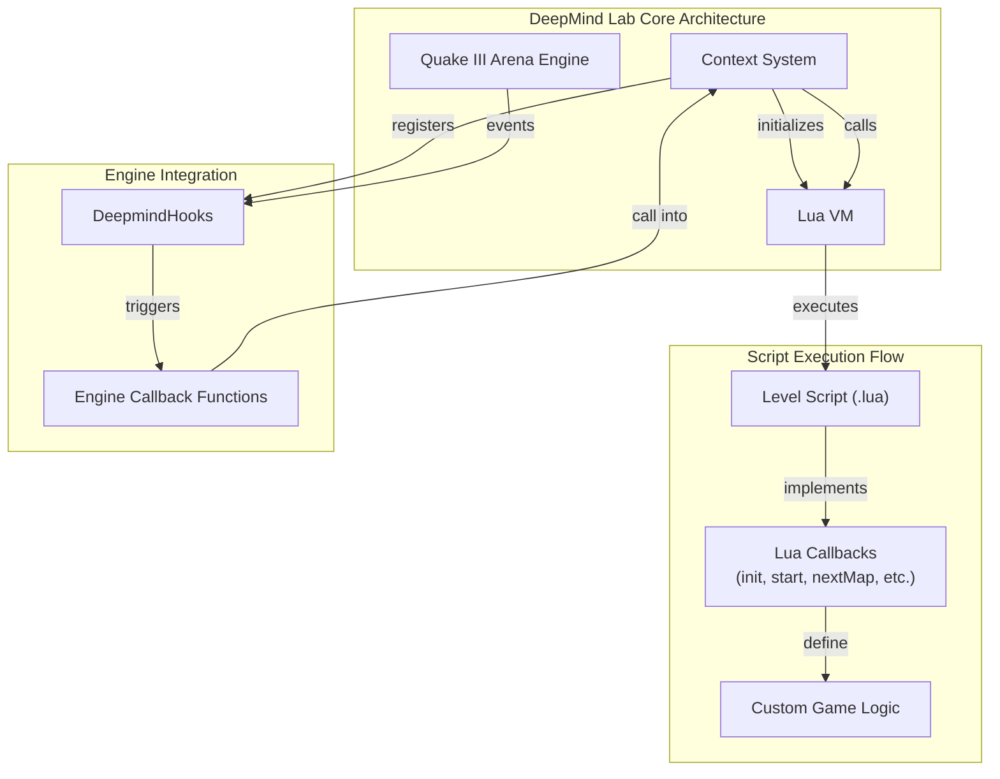
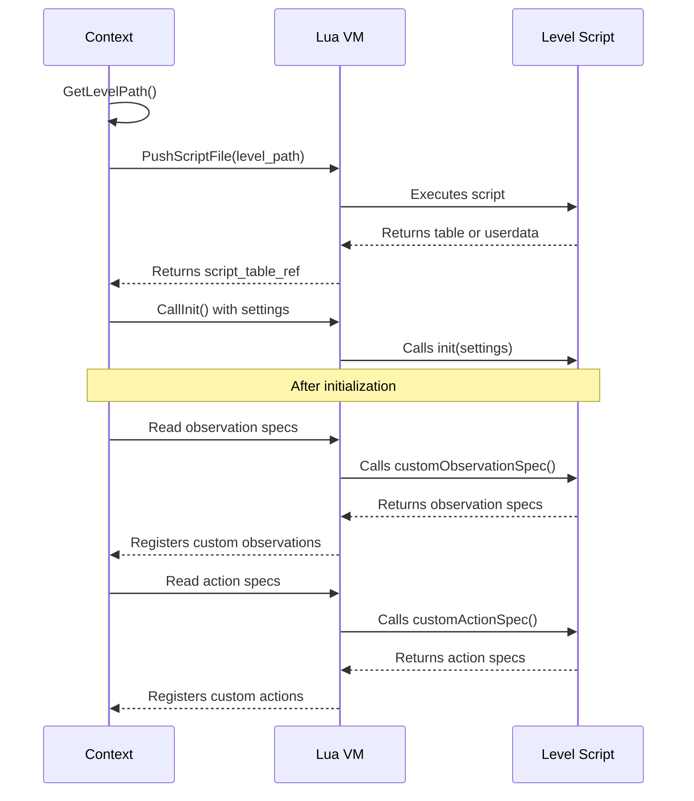
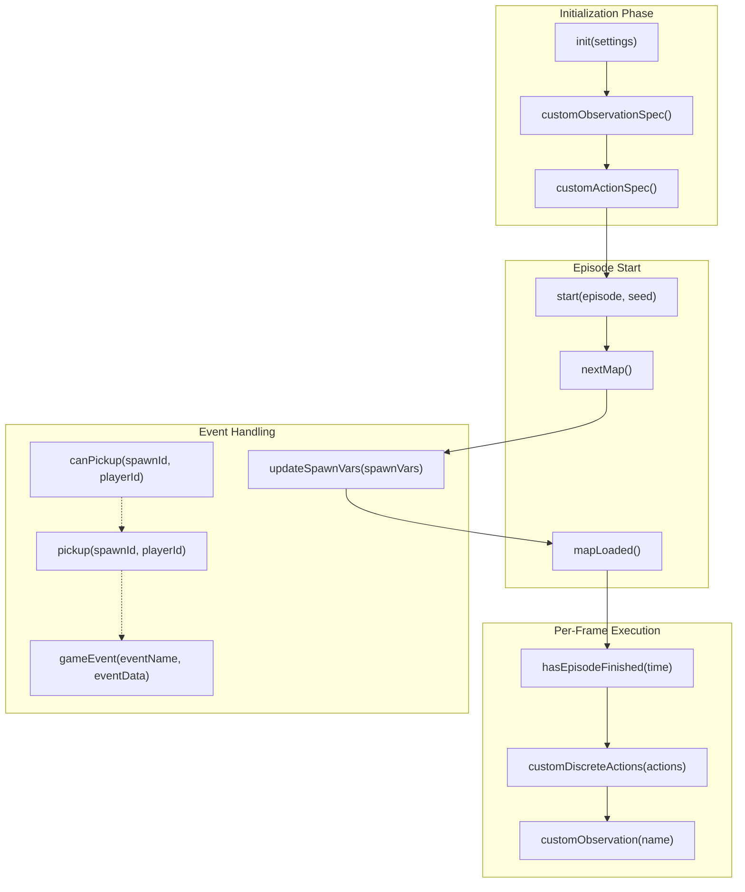
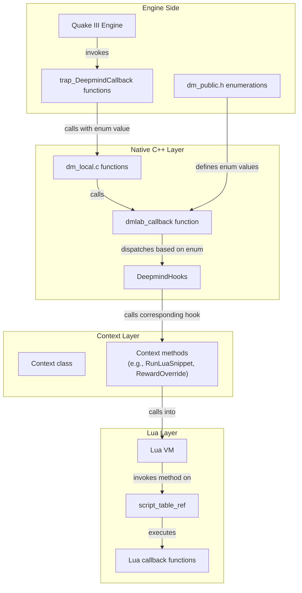
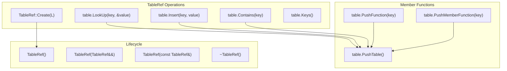
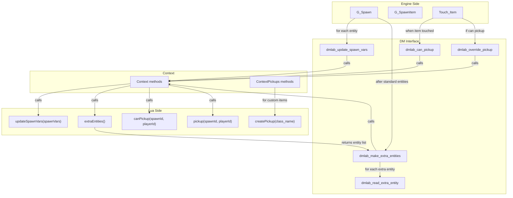
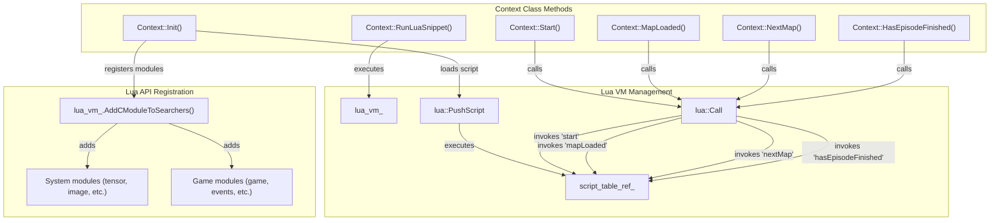

<!-- source: DeepWiki mcp.deepwiki.com · repo google-deepmind/lab · page 5 Lua Scripting · fetched 2026-10-26 -->

# Lua Scripting

<details>
<summary>Relevant source files</summary>

The following files were used as context for generating this wiki page:

- [deepmind/engine/context.cc](deepmind/engine/context.cc)
- [deepmind/engine/context.h](deepmind/engine/context.h)
- [deepmind/include/deepmind_hooks.h](deepmind/include/deepmind_hooks.h)
- [deepmind/lua/push.h](deepmind/lua/push.h)
- [deepmind/lua/push_test.cc](deepmind/lua/push_test.cc)
- [deepmind/lua/read.h](deepmind/lua/read.h)
- [deepmind/lua/read_test.cc](deepmind/lua/read_test.cc)
- [deepmind/lua/table_ref.h](deepmind/lua/table_ref.h)
- [deepmind/lua/table_ref_test.cc](deepmind/lua/table_ref_test.cc)
- [docs/developers/reference/lua_api.md](docs/developers/reference/lua_api.md)
- [engine/code/deepmind/dm_local.c](engine/code/deepmind/dm_local.c)
- [engine/code/deepmind/dm_local.h](engine/code/deepmind/dm_local.h)
- [engine/code/deepmind/dm_public.h](engine/code/deepmind/dm_public.h)
- [engine/code/game/g_active.c](engine/code/game/g_active.c)
- [engine/code/game/g_local.h](engine/code/game/g_local.h)
- [engine/code/game/g_mover.c](engine/code/game/g_mover.c)
- [engine/code/game/g_spawn.c](engine/code/game/g_spawn.c)
- [engine/code/qcommon/deepmind_hooks.c](engine/code/qcommon/deepmind_hooks.c)
- [engine/code/qcommon/q_shared.h](engine/code/qcommon/q_shared.h)
- [engine/code/qcommon/surfaceflags.h](engine/code/qcommon/surfaceflags.h)

</details>


DeepMind Lab utilizes Lua as its primary scripting language to customize environment behavior, define level logic, and control in-game interactions. This page describes how Lua is integrated into DeepMind Lab, the available APIs, and how to effectively use Lua to create custom environments.

For information about specific Lua modules like tensor operations, see [Tensor Operations](#5.2), and for details on image processing in Lua scripts, see [Image Processing](#5.3).

## Lua Integration Architecture

DeepMind Lab embeds a Lua virtual machine (VM) within its core architecture. The Lua VM serves as the bridge between the agent's Python interface and the underlying Quake III Arena game engine.



Sources: 
- [deepmind/engine/context.cc:588-686](deepmind/engine/context.cc:588-686)
- [deepmind/engine/context.h:52-74](deepmind/engine/context.h:52-74)
- [deepmind/include/deepmind_hooks.h:35-439](deepmind/include/deepmind_hooks.h:35-439)

### Core Components

The Lua scripting system consists of several key components:

1. **Context System**: The central hub that manages the Lua VM and connects it to the game engine.
2. **Lua VM**: An embedded Lua interpreter that executes the scripts.
3. **DeepmindHooks**: A system of callback functions that lets the engine call into the Lua scripts.
4. **Level Scripts**: Lua scripts that define environment behavior.

## Lua Module Registration

When DeepMind Lab initializes, it registers several modules with the Lua VM that provide specialized functionality:

```mermaid
graph TD
    LuaVM["Lua VM"]
    
    subgraph "Core Modules"
        Tensor["dmlab.system.tensor<br/>(Tensor operations)"]
        Image["dmlab.system.image<br/>(Image manipulation)"]
        Random["dmlab.system.random<br/>(Random number generation)"]
    end
    
    subgraph "Environment Modules"
        Game["dmlab.system.game<br/>(Game state access)"]
        Events["dmlab.system.events<br/>(Event management)"]
        Entities["dmlab.system.game_entities<br/>(Entity handling)"]
        Pickups["dmlab.system.pickups_spawn<br/>(Item spawning)"]
    end
    
    subgraph "Level Generation Modules"
        MazeGen["dmlab.system.maze_generation<br/>(Maze creation)"]
        MapMaker["dmlab.system.map_maker<br/>(Level creation)"]
        Model["dmlab.system.model<br/>(3D model handling)"]
        Transform["dmlab.system.transform<br/>(Geometric transforms)"]
    end
    
    LuaVM -- "registers" --> Tensor
    LuaVM -- "registers" --> Image
    LuaVM -- "registers" --> Random
    LuaVM -- "registers" --> Game
    LuaVM -- "registers" --> Events
    LuaVM -- "registers" --> Entities
    LuaVM -- "registers" --> Pickups
    LuaVM -- "registers" --> MazeGen
    LuaVM -- "registers" --> MapMaker
    LuaVM -- "registers" --> Model
    LuaVM -- "registers" --> Transform
```



Sources:
- [deepmind/engine/context.cc:742-785](deepmind/engine/context.cc:742-785)

## Script Loading Process

The DeepMind Lab environment loads Lua scripts using a specific process:

1. **Level Name Resolution**: The system first resolves the level name to a file path
2. **Script Execution**: The Lua script is executed and must return a table or userdata
3. **Initialization**: The `init` function of the returned table is called with settings
4. **API Registration**: Script functions like `customObservationSpec` are registered with the system



Sources:
- [deepmind/engine/context.cc:721-814](deepmind/engine/context.cc:721-814)

## Lua API Callbacks

The Lua API in DeepMind Lab provides a variety of callback functions that scripts can implement to customize environment behavior. These callbacks are called at specific points in the simulation flow.

### Key Callbacks

| Callback | Purpose | Called When |
|----------|---------|-------------|
| `init(settings)` | Initialize the level with settings | At environment creation |
| `start(episode, seed)` | Start a new episode | At the beginning of each episode |
| `nextMap()` | Provide the next map name | Whenever a map needs to be loaded |
| `updateSpawnVars(spawnVars)` | Customize entity settings | For each entity when loading a map |
| `customObservationSpec()` | Define custom observations | After initialization |
| `customObservation(name)` | Provide observation data | When agent requests an observation |
| `hasEpisodeFinished(timeInSeconds)` | Determine if episode is over | At the end of each frame |
| `pickup(spawnId, playerId)` | Handle pickup events | When an item is picked up |
| `createPickup(class_name)` | Create custom items | When a pickup needs to be created |
| `extraEntities()` | Add additional entities | After processing built-in entities |

Sources:
- [docs/developers/reference/lua_api.md:31-536](docs/developers/reference/lua_api.md:31-536)
- [deepmind/engine/context.cc:792-915](deepmind/engine/context.cc:792-915)

### Callback Execution Flow



Sources:
- [docs/developers/reference/lua_api.md:31-185](docs/developers/reference/lua_api.md:31-185)

## Engine-to-Lua Communication

DeepMind Lab implements a callback system that allows the game engine to communicate with Lua scripts. This is implemented through the `DeepmindHooks` structure and corresponding engine code.



Sources:
- [engine/code/deepmind/dm_local.c:22-264](engine/code/deepmind/dm_local.c:22-264)
- [engine/code/qcommon/deepmind_hooks.c:26-251](engine/code/qcommon/deepmind_hooks.c:26-251)
- [engine/code/deepmind/dm_public.h:22-60](engine/code/deepmind/dm_public.h:22-60)

## Lua Value Handling

DeepMind Lab provides utility functions to simplify communication between C++ and Lua through the `push.h` and `read.h` interfaces.

### Reading Values from Lua

The `Read` function family converts Lua values on the stack to C++ types:

```cpp
// Read a number from stack position idx
double result;
if (IsFound(Read(L, idx, &result))) {
    // Use result
}

// Read a string from stack position idx
std::string text;
if (IsFound(Read(L, idx, &text))) {
    // Use text
}

// Read a table from stack position idx into a vector
std::vector<double> values;
if (IsFound(Read(L, idx, &values))) {
    // Use values
}
```

Sources:
- [deepmind/lua/read.h:127-407](deepmind/lua/read.h:127-407)
- [deepmind/lua/read_test.cc:51-266](deepmind/lua/read_test.cc:51-266)

### Pushing Values to Lua

The `Push` function family converts C++ values to Lua values on the stack:

```cpp
// Push a number onto the stack
Push(L, 42.0);

// Push a string onto the stack
Push(L, "Hello, world!");

// Push a vector onto the stack as a Lua table
std::vector<double> values = {1.0, 2.0, 3.0};
Push(L, values);
```

Sources:
- [deepmind/lua/push.h:40-155](deepmind/lua/push.h:40-155)
- [deepmind/lua/push_test.cc:48-257](deepmind/lua/push_test.cc:48-257)

## TableRef: Working with Lua Tables

DeepMind Lab provides the `TableRef` class to simplify working with Lua tables from C++:



Sources:
- [deepmind/lua/table_ref.h:46-221](deepmind/lua/table_ref.h:46-221)
- [deepmind/lua/table_ref_test.cc:100-266](deepmind/lua/table_ref_test.cc:100-266)

## Typical Script Structure

A typical DeepMind Lab level script follows this general structure:

```lua
-- Define module table
local api = {}

-- Initialize the level
function api:init(settings)
    -- Initialize level state based on settings
end

-- Start a new episode
function api:start(episode, seed)
    -- Reset level state for new episode
end

-- Provide the next map
function api:nextMap()
    -- Return the map name to load
    return "map_name"
end

-- Determine if episode is finished
function api:hasEpisodeFinished(timeInSeconds)
    -- Return true/false based on level conditions
    return false
end

-- Define custom observations
function api:customObservationSpec()
    return {
        {name = "OBSERVATION_NAME", type = "bytes", shape = {0}},
        -- Additional observations...
    }
end

function api:customObservation(name)
    -- Return observation data based on name
end

-- Return the API table
return api
```

Sources:
- [docs/developers/reference/lua_api.md:31-536](docs/developers/reference/lua_api.md:31-536)

## Entity and Pickup System

DeepMind Lab provides a powerful entity and pickup system that can be customized through Lua:



Sources:
- [engine/code/game/g_spawn.c:22-785](engine/code/game/g_spawn.c:22-785)
- [engine/code/deepmind/dm_local.h:38-96](engine/code/deepmind/dm_local.h:38-96)
- [docs/developers/reference/lua_api.md:315-382](docs/developers/reference/lua_api.md:315-382)

## Context-Lua Interaction

The `Context` class serves as the bridge between the C++ engine and Lua scripts, managing script execution and data transfer:



Sources:
- [deepmind/engine/context.cc:721-901](deepmind/engine/context.cc:721-901)
- [deepmind/engine/context.h:52-566](deepmind/engine/context.h:52-566)

## Best Practices for Lua Scripting

When writing Lua scripts for DeepMind Lab, consider the following best practices:

1. **Modularity**: Break down complex logic into separate Lua modules
2. **Performance**: Optimize computational-heavy code sections, particularly in per-frame callbacks
3. **Error Handling**: Use proper error checking in callbacks to prevent crashes
4. **State Management**: Keep track of state in local variables or in the API table
5. **Documentation**: Comment your code and document the API your level provides

Example pattern for a well-structured level script:

```lua
local api = {}

-- Import utility modules
local game = require 'dmlab.system.game'
local tensor = require 'dmlab.system.tensor'
local helpers = require 'common.helpers'

-- Private state variables
local timeLimit = 60
local score = 0

-- Initialization
function api:init(settings)
  timeLimit = tonumber(settings.timeLimit) or timeLimit
  return true
end

-- Custom API implementation
function api:hasEpisodeFinished(timeSeconds)
  return timeSeconds >= timeLimit
end

-- Return the API
return api
```

Sources:
- [docs/developers/reference/lua_api.md:130-278](docs/developers/reference/lua_api.md:130-278)

## Advanced Features

### Custom Observations

DeepMind Lab allows defining custom observations through Lua:

```lua
function api:customObservationSpec()
  return {
    {name = 'TEXT_MESSAGE', type = 'bytes', shape = {0}},
    {name = 'LOCATION', type = 'doubles', shape = {3}},
  }
end

function api:customObservation(name)
  if name == 'TEXT_MESSAGE' then
    return tensor.ByteTensor('Current objective: Find the goal')
  elseif name == 'LOCATION' then
    return tensor.DoubleTensor{
      game.playerInfo().pos.x,
      game.playerInfo().pos.y,
      game.playerInfo().pos.z,
    }
  end
end
```

Sources:
- [docs/developers/reference/lua_api.md:211-259](docs/developers/reference/lua_api.md:211-259)

### Custom Actions

Custom actions allow defining additional inputs for agents:

```lua
function api:customActionSpec()
  return {
    {name = 'JUMP', min = 0, max = 1},
    {name = 'FIRE', min = 0, max = 1},
  }
end

function api:customDiscreteActions(actions)
  -- Store custom actions for use in modifyControl
  self._jumpAction = actions[1]
  self._fireAction = actions[2]
end

function api:modifyControl(controls)
  -- Apply custom actions to standard controls
  if self._jumpAction == 1 then
    controls.crouch_jump = 1
  end
  if self._fireAction == 1 then
    controls.buttonsDown = 1  -- Primary fire button
  end
  return controls
end
```

Sources:
- [docs/developers/reference/lua_api.md:171-208](docs/developers/reference/lua_api.md:171-208)

---

