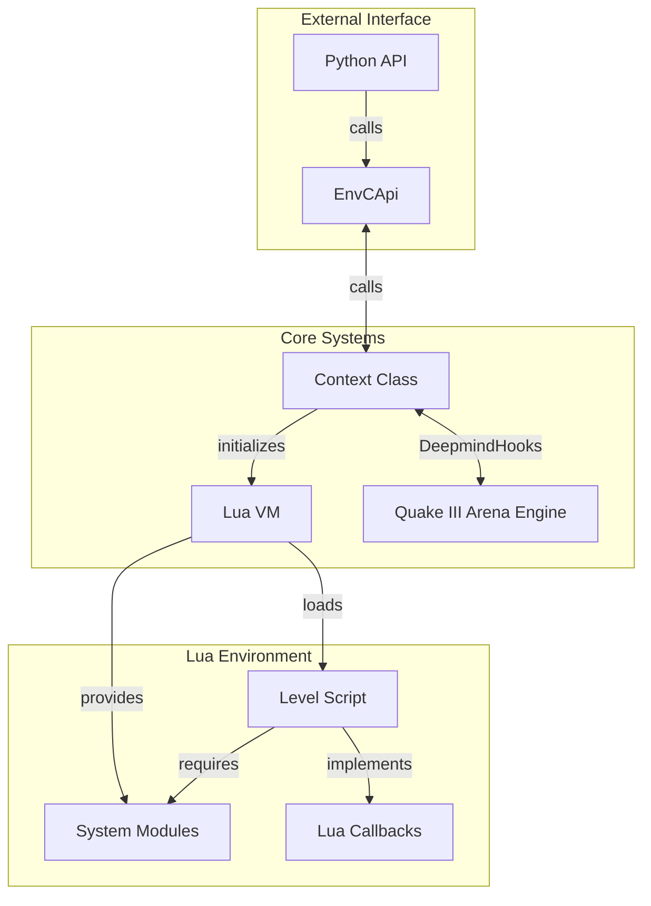
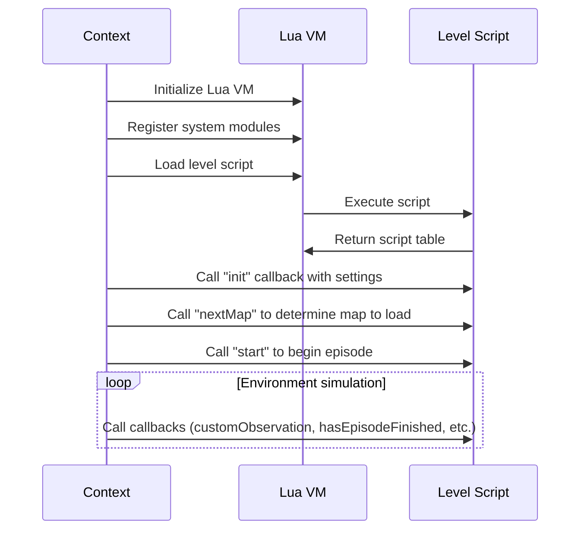
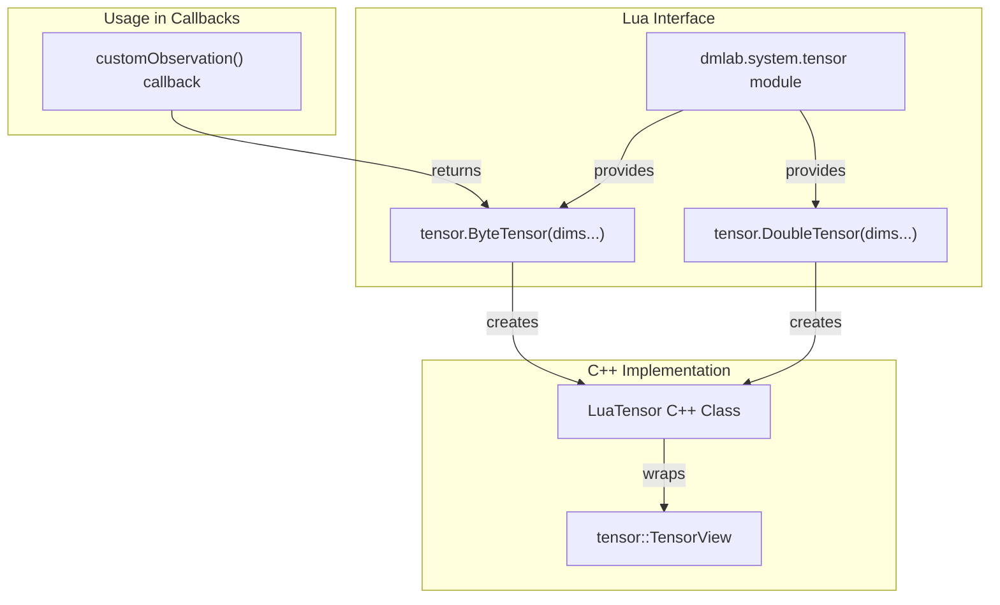
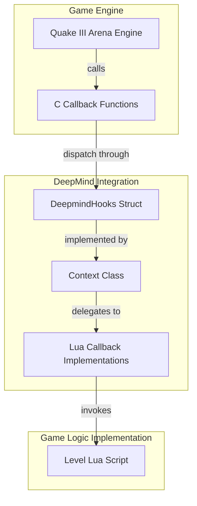

<!-- source: DeepWiki mcp.deepwiki.com · repo google-deepmind/lab · page 5.1 Lua API Overview · fetched 2026-10-26 -->

# Lua API Overview

<details>
<summary>Relevant source files</summary>

The following files were used as context for generating this wiki page:

- [deepmind/engine/BUILD](deepmind/engine/BUILD)
- [deepmind/engine/context.cc](deepmind/engine/context.cc)
- [deepmind/engine/context.h](deepmind/engine/context.h)
- [deepmind/include/BUILD](deepmind/include/BUILD)
- [deepmind/include/deepmind_hooks.h](deepmind/include/deepmind_hooks.h)
- [deepmind/level_generation/BUILD](deepmind/level_generation/BUILD)
- [deepmind/level_generation/map_builder/BUILD](deepmind/level_generation/map_builder/BUILD)
- [deepmind/level_generation/text_level/BUILD](deepmind/level_generation/text_level/BUILD)
- [deepmind/level_generation/text_maze_generation/BUILD](deepmind/level_generation/text_maze_generation/BUILD)
- [deepmind/lua/BUILD](deepmind/lua/BUILD)
- [deepmind/model_generation/BUILD](deepmind/model_generation/BUILD)
- [deepmind/support/BUILD](deepmind/support/BUILD)
- [deepmind/tensor/BUILD](deepmind/tensor/BUILD)
- [deepmind/util/BUILD](deepmind/util/BUILD)
- [docs/developers/reference/lua_api.md](docs/developers/reference/lua_api.md)
- [engine/code/deepmind/dm_local.c](engine/code/deepmind/dm_local.c)
- [engine/code/deepmind/dm_local.h](engine/code/deepmind/dm_local.h)
- [engine/code/deepmind/dm_public.h](engine/code/deepmind/dm_public.h)
- [engine/code/game/g_active.c](engine/code/game/g_active.c)
- [engine/code/game/g_local.h](engine/code/game/g_local.h)
- [engine/code/game/g_mover.c](engine/code/game/g_mover.c)
- [engine/code/game/g_spawn.c](engine/code/game/g_spawn.c)
- [engine/code/qcommon/deepmind_hooks.c](engine/code/qcommon/deepmind_hooks.c)
- [engine/code/qcommon/q_shared.h](engine/code/qcommon/q_shared.h)
- [engine/code/qcommon/surfaceflags.h](engine/code/qcommon/surfaceflags.h)
- [lua_tests/BUILD](lua_tests/BUILD)
- [testing/BUILD](testing/BUILD)

</details>


This document provides a technical overview of the Lua scripting API in DeepMind Lab, explaining how it integrates with the core C++ engine to enable customizable environments, observations, rewards, and procedural level generation. For information about specific Lua operations like tensor manipulation or image processing, see [Tensor Operations](#5.2) and [Image Processing](#5.3).

## Architecture

DeepMind Lab implements Lua integration through a Context system that manages a Lua VM and bridges the gap between the native C++ engine (based on Quake III Arena) and Lua scripts. This architecture allows researchers to customize environment behavior without modifying the core C++ codebase.



Sources: [deepmind/engine/context.h](), [deepmind/engine/context.cc]()

## Lua VM Initialization

The Context class initializes a Lua VM and registers various C++ modules and callbacks during environment setup. The initialization sequence is:

1. Create a Lua VM
2. Load the specified level script
3. Register system modules
4. Execute the level script which returns a table of callback implementations
5. Call `init` callback to initialize the environment



Sources: [deepmind/engine/context.cc:588-686](), [deepmind/engine/context.cc:721-814]()

## System Modules

DeepMind Lab registers several Lua modules that expose C++ functionality to Lua scripts. These modules are accessible through the `require` function in Lua.

| Module Name | Purpose | Implementation |
|-------------|---------|----------------|
| `dmlab.system.tensor` | Creates and manipulates multidimensional arrays | [deepmind/tensor/lua_tensor.cc]() |
| `dmlab.system.image` | Loads and manipulates images | [deepmind/engine/lua_image.cc]() |
| `dmlab.system.maze_generation` | Generates procedural mazes | [deepmind/engine/lua_maze_generation.cc]() |
| `dmlab.system.map_maker` | Creates maps from text descriptions | [deepmind/engine/lua_text_level_maker.cc]() |
| `dmlab.system.game` | Provides game engine access | [deepmind/engine/context_game.cc]() |
| `dmlab.system.events` | Handles game events | [deepmind/engine/context_events.cc]() |
| `dmlab.system.game_entities` | Manages game entities | [deepmind/engine/context_entities.cc]() |
| `dmlab.system.pickups_spawn` | Manages pickup items | [deepmind/engine/context_pickups.cc]() |
| `dmlab.system.random` | Provides random number generation | [deepmind/engine/lua_random.cc]() |
| `dmlab.system.model` | Creates and manipulates 3D models | [deepmind/model_generation/lua_model.cc]() |
| `dmlab.system.transform` | Performs geometric transformations | [deepmind/model_generation/lua_transform.cc]() |

These modules are registered with the Lua VM in the `Context::Init()` method:

Sources: [deepmind/engine/context.cc:746-785]()

## Lua Callbacks

The environment invokes specific Lua functions (callbacks) in your level script at key points during execution. Below are the most important callbacks:

| Callback | Description | Required? | Called By |
|----------|-------------|-----------|-----------|
| `init(settings)` | Initializes the level with provided settings | No | [deepmind/engine/context.cc:808-814]() |
| `start(episode, seed)` | Starts a new episode | No | [deepmind/engine/context.cc:817-834]() |
| `nextMap()` | Returns the name of the map to load | **Yes** | [deepmind/engine/context.cc:903-915]() |
| `hasEpisodeFinished(timeInSeconds)` | Determines if episode should end | No | [deepmind/engine/context.cc:850-866]() |
| `customObservation(name)` | Returns a custom observation tensor | No | [deepmind/engine/context_observations.cc]() |
| `customObservationSpec()` | Defines custom observation specifications | No | [deepmind/engine/context_observations.cc]() |
| `updateSpawnVars(spawnVars)` | Modifies entity spawn settings | No | [deepmind/engine/context_pickups.cc]() |

The callback execution flow is visualized below:

```mermaid
flowchart TD
    Start[Environment Start] --> Init[init(settings)]
    Init --> NextMap[nextMap()]
    NextMap --> MapLoaded[mapLoaded()]
    MapLoaded --> StartEpisode[start(episode, seed)]
    
    StartEpisode --> Loop[Environment Loop]
    
    Loop --> |For each frame| CustomObs[customObservation()]
    Loop --> |For each frame| HasFinished{hasEpisodeFinished()?}
    
    HasFinished -->|Yes| StartEpisode
    HasFinished -->|No| Loop
    
    subgraph "Entity Handling"
        MapLoaded -..-> UpdateSpawn[updateSpawnVars()]
        UpdateSpawn -..-> ExtraEntities[extraEntities()]
    end
```

Sources: [deepmind/engine/context.cc](), [docs/developers/reference/lua_api.md]()

## Callback Implementation Pattern

The Context class uses a consistent pattern to invoke Lua callbacks:

1. Reset the Lua stack with `lua::StackResetter`
2. Push the function to call with `script_table_ref_.PushMemberFunction(name)`
3. Push arguments with `lua::Push(L, arg)`
4. Call the function with `lua::Call(L, numArgs)`
5. Process the return values

For example, here's how the `hasEpisodeFinished` callback is invoked:

```cpp
lua_State* L = lua_vm_.get();
lua::StackResetter stack_resetter(L);
script_table_ref_.PushMemberFunction("hasEpisodeFinished");
if (lua_isnil(L, -2)) {
  return elapsed_episode_time_seconds >= kDefaultEpisodeLengthSeconds;
}
lua::Push(L, elapsed_episode_time_seconds);
auto result = lua::Call(L, 2);
CHECK(result.ok()) << "[hasEpisodeFinished] - " << result.error();
CHECK(result.n_results() == 1) << "[hasEpisodeFinished] - Expect single return value of true or false.";
bool finish_episode = false;
CHECK(IsFound(lua::Read(L, -1, &finish_episode)))
    << "[hasEpisodeFinished] - Must return a boolean.";
return finish_episode;
```

Sources: [deepmind/engine/context.cc:850-866]()

## Type Mapping

DeepMind Lab implements a bidirectional mapping between C++ and Lua types:

| C++ Type | Lua Type | Implementation |
|----------|----------|----------------|
| `bool` | boolean | [deepmind/lua/push.h](), [deepmind/lua/read.h]() |
| `int`, `float`, `double` | number | [deepmind/lua/push.h](), [deepmind/lua/read.h]() |
| `std::string` | string | [deepmind/lua/push.h](), [deepmind/lua/read.h]() |
| `std::vector<T>` | table (array) | [deepmind/lua/push.h](), [deepmind/lua/read.h]() |
| `absl::flat_hash_map<K, V>` | table (dictionary) | [deepmind/lua/push.h](), [deepmind/lua/read.h]() |
| Custom classes | userdata with metatable | [deepmind/lua/class.h]() |
| `tensor::TensorView` | Lua tensor object | [deepmind/tensor/lua_tensor.cc]() |

## Tensor System

A fundamental component of the Lua API is the tensor system, which allows for efficient creation and manipulation of multi-dimensional arrays. Tensors are used for observations, rewards, and other data processing.



Sources: [deepmind/tensor/tensor_view.h](), [deepmind/tensor/lua_tensor.cc](), [deepmind/tensor/lua_tensor.h]()

## Context and Hooks Integration

The DeepMind Lab environment integrates Lua scripting with the game engine through a system of hooks defined in [deepmind/include/deepmind_hooks.h](). These hooks are implemented by the Context class and are called by the engine.



Sources: [deepmind/include/deepmind_hooks.h](), [engine/code/deepmind/dm_local.c](), [engine/code/qcommon/deepmind_hooks.c]()

## Level Script Example

A minimal level script in DeepMind Lab implements at least the `nextMap` callback:

```lua
local api = {}

function api:init(settings)
  -- Initialize level variables
end

function api:start(episode, seed)
  -- Set up the episode
end

function api:nextMap()
  return "map_name"  -- Return the name of the map to load
end

function api:customObservationSpec()
  return {
    {name = "CUSTOM_OBSERVATION", type = "bytes", shape = {10, 20}},
  }
end

function api:customObservation(name)
  if name == "CUSTOM_OBSERVATION" then
    local tensor = require 'dmlab.system.tensor'
    return tensor.ByteTensor(10, 20):fill(1)  -- Return a 10x20 tensor filled with 1s
  end
end

return api  -- Return the API table
```

Sources: [docs/developers/reference/lua_api.md]()

## Conclusion

The Lua API in DeepMind Lab provides a powerful interface for customizing environments, observations, rewards, and level generation. By implementing key callbacks and utilizing the provided system modules, researchers can create complex, custom environments without modifying the core C++ codebase.

For more details on specific aspects of the API, refer to:
- [Tensor Operations](#5.2)
- [Image Processing](#5.3)
- [C++ to Lua Integration](#5.4)

Sources: [deepmind/engine/context.h](), [deepmind/engine/context.cc](), [deepmind/include/deepmind_hooks.h](), [docs/developers/reference/lua_api.md]()

---

