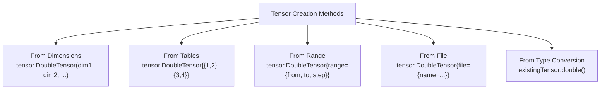
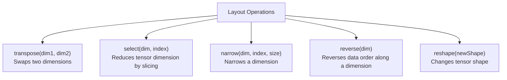
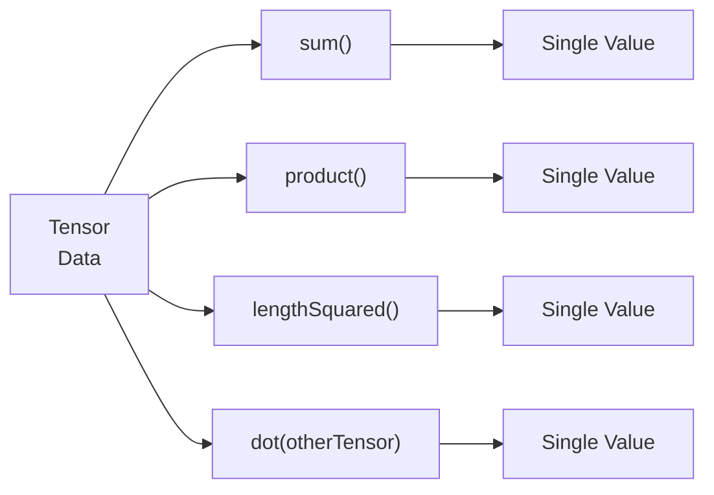
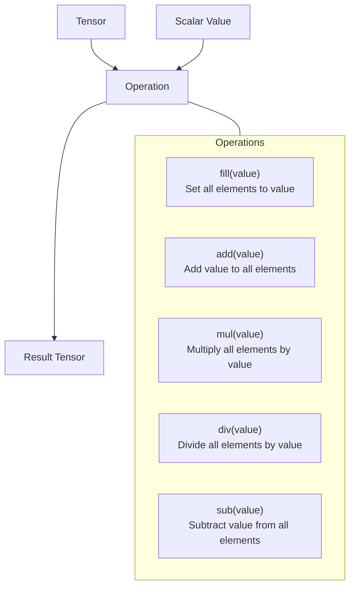
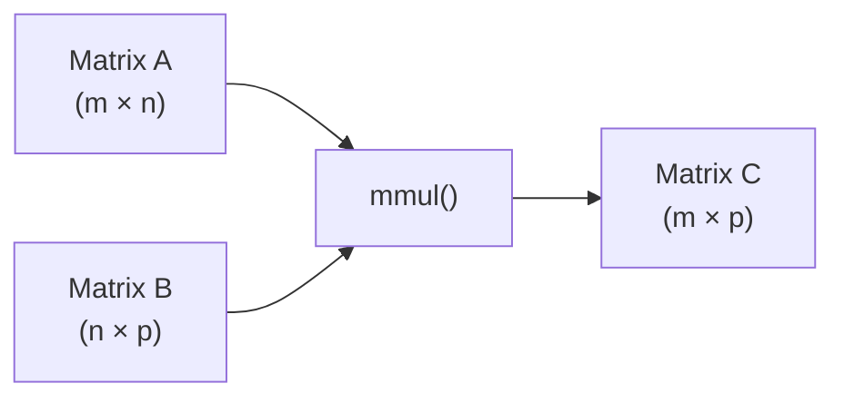
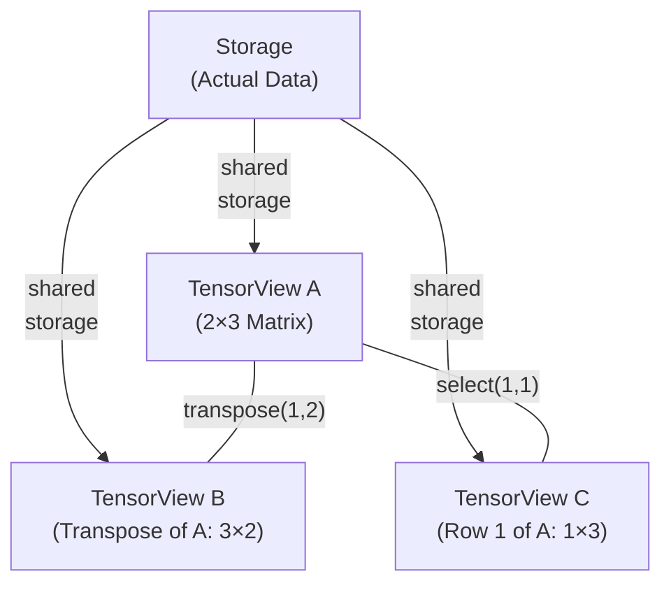

<!-- source: DeepWiki mcp.deepwiki.com · repo google-deepmind/lab · page 5.2 Tensor Operations · fetched 2026-10-26 -->

# Tensor Operations

<details>
<summary>Relevant source files</summary>

The following files were used as context for generating this wiki page:

- [deepmind/tensor/lua_tensor.cc](deepmind/tensor/lua_tensor.cc)
- [deepmind/tensor/lua_tensor.h](deepmind/tensor/lua_tensor.h)
- [deepmind/tensor/lua_tensor_benchmark.cc](deepmind/tensor/lua_tensor_benchmark.cc)
- [deepmind/tensor/lua_tensor_test.cc](deepmind/tensor/lua_tensor_test.cc)
- [deepmind/tensor/tensor_view.cc](deepmind/tensor/tensor_view.cc)
- [deepmind/tensor/tensor_view.h](deepmind/tensor/tensor_view.h)
- [deepmind/tensor/tensor_view_test.cc](deepmind/tensor/tensor_view_test.cc)
- [docs/developers/reference/tensor.md](docs/developers/reference/tensor.md)

</details>


This document provides a comprehensive guide to working with tensors in the DeepMind Lab Lua scripting environment. It explains how to perform various operations on tensors, including creation, manipulation, and mathematical operations. For an overview of the tensor system and its features, see [Lua API Overview](#5.1).

The tensor system in DeepMind Lab is designed to be similar to tensor libraries like PyTorch, offering efficient handling of numerical data with a rich set of operations.

## Tensor Hierarchy and Structure

The tensor system in DeepMind Lab consists of a layered architecture that provides tensor operations through the Lua scripting interface. Understanding this hierarchy is essential for effectively working with tensors.

```mermaid
classDiagram
    class "Layout" {
        -shape_: ShapeVector
        -stride_: StrideVector
        -offset_: size_t
        +Transpose(dim0, dim1): bool
        +Select(dim, index): bool
        +Narrow(dim, index, size): bool
        +Reverse(dim): bool
        +Reshape(new_shape): bool
    }
    
    class "TensorView~T~" {
        -storage_: T*
        +ForEach(f)
        +ForEachMutable(f)
        +Sum(): double
        +Product(): double
        +LengthSquared(): double
        +DotProduct(other): double
        +Assign(value)
        +Add(value)
        +Mul(value)
        +Div(value)
        +Sub(value)
    }
    
    class "LuaTensor~T~" {
        -tensor_view_: View
        -storage_validity_: shared_ptr<StorageValidity>
        +Clone()
        +Transpose(dim1, dim2)
        +Select(dim, index)
        +Narrow(dim, index, size)
        +Reverse(dim)
        +Apply(func)
        +ApplyIndexed(func)
        +Val()
    }
    
    class "StorageValidity" {
        -tag_: Tag
        +Invalidate()
        +IsValid(): bool
        +OwnsStorage(): bool
    }
    
    Layout <|-- TensorView~T~
    TensorView~T~ <.. LuaTensor~T~
    LuaTensor~T~ o-- StorageValidity
```

Sources: [deepmind/tensor/lua_tensor.h:50-962](), [deepmind/tensor/tensor_view.h:46-394](), [deepmind/tensor/tensor_view.h:398-960]()

The diagram shows the key components:
- **Layout**: Manages shape and stride information for tensors
- **TensorView**: Adds storage management to Layout
- **LuaTensor**: Lua interface for TensorView with additional functionality
- **StorageValidity**: Manages tensor storage lifetime and validity

## Tensor Types and Creation

DeepMind Lab provides various tensor types to handle different data requirements.

### Available Tensor Types

| Tensor Type | Lua Constructor | Conversion Method | C++ Type |
|-------------|-----------------|-------------------|----------|
| ByteTensor  | `tensor.ByteTensor` | `:byte()` | `uint8_t` |
| CharTensor  | `tensor.CharTensor` | `:char()` | `int8_t` |
| Int16Tensor | `tensor.Int16Tensor` | `:int16()` | `int16_t` |
| Int32Tensor | `tensor.Int32Tensor` | `:int32()` | `int32_t` |
| Int64Tensor | `tensor.Int64Tensor` | `:int64()` | `int64_t` |
| FloatTensor | `tensor.FloatTensor` | `:float()` | `float` |
| DoubleTensor | `tensor.DoubleTensor` | `:double()` | `double` |

Sources: [deepmind/tensor/lua_tensor.h:929-962](), [deepmind/tensor/lua_tensor.cc:41-48]()

### Tensor Creation Methods

There are multiple ways to create tensors in the Lua environment:



Sources: [deepmind/tensor/lua_tensor.h:255-413](), [docs/developers/reference/tensor.md:149-226]()

#### Creating from Dimensions

Creates a zero-initialized tensor with the specified dimensions:

```lua
tensor.DoubleTensor(3, 4)  -- Creates a 3x4 zero matrix
```

#### Creating from Tables

Creates a tensor with values from a nested Lua table:

```lua
tensor.DoubleTensor{{1, 2}, {3, 4}}  -- Creates a 2x2 matrix
```

#### Creating from Range

Creates a tensor with values in a specified range:

```lua
tensor.DoubleTensor{range={1, 5}}     -- [1, 2, 3, 4, 5]
tensor.DoubleTensor{range={2, 10, 2}} -- [2, 4, 6, 8, 10]
```

#### Creating from File

Creates a tensor by reading data from a file:

```lua
tensor.FloatTensor{file={name="data.bin", byteOffset=0, numElements=100}}
```

## Tensor Operations

DeepMind Lab's tensor system provides a rich set of operations for manipulating and computing with tensors.

### Layout Operations

Layout operations change how the tensor is viewed but don't modify the underlying data.



Sources: [deepmind/tensor/tensor_view.h:68-337](), [docs/developers/reference/tensor.md:432-557]()

#### Transpose

Swaps two dimensions of a tensor:

```lua
local t = tensor.DoubleTensor{{1, 2}, {3, 4}, {5, 6}}  -- 3x2 tensor
local transposed = t:transpose(1, 2)  -- 2x3 tensor
```

#### Select

Slices a tensor along a dimension:

```lua
local t = tensor.DoubleTensor{{1, 2, 3}, {4, 5, 6}}
local row1 = t:select(1, 1)  -- [1, 2, 3]
local col2 = t:select(2, 2)  -- [2, 5]
```

#### Narrow

Narrows a tensor along a dimension:

```lua
local t = tensor.DoubleTensor{range={1, 10}}:reshape{2, 5}
local narrowed = t:narrow(2, 2, 3)  -- Selects columns 2-4
```

#### Reverse

Reverses the order of elements along a dimension:

```lua
local t = tensor.DoubleTensor{range={1, 9}}:reshape{3, 3}
local reversed = t:reverse(1)  -- Reverses the rows
```

#### Reshape

Changes the shape of a tensor while keeping the same data:

```lua
local t = tensor.DoubleTensor{range={1, 12}}  -- [1, 2, 3, ..., 12]
local reshaped = t:reshape{3, 4}  -- 3x4 matrix
```

### Accumulation Operations

These operations combine all elements of a tensor into a single value.



Sources: [deepmind/tensor/tensor_view.h:760-869](), [docs/developers/reference/tensor.md:585-643]()

#### Sum

Calculates the sum of all elements:

```lua
local t = tensor.DoubleTensor{1, 2, 3, 4}
assert(t:sum() == 10)
```

#### Product

Calculates the product of all elements:

```lua
local t = tensor.DoubleTensor{2, 3, 4}
assert(t:product() == 24)
```

#### LengthSquared

Calculates the sum of squares of all elements:

```lua
local t = tensor.DoubleTensor{1, 2, 3}
assert(t:lengthSquared() == 14)  -- 1² + 2² + 3² = 14
```

#### Dot Product

Calculates the dot product with another tensor:

```lua
local t1 = tensor.DoubleTensor{1, 2, 3}
local t2 = tensor.DoubleTensor{4, 5, 6}
assert(t1:dot(t2) == 32)  -- 1*4 + 2*5 + 3*6 = 32
```

### Element-wise Operations

These operations apply transformations to each element of a tensor.

#### Scalar Operations

Apply an operation between each tensor element and a scalar value.



Sources: [deepmind/tensor/tensor_view.h:482-510](), [docs/developers/reference/tensor.md:644-792]()

Example usage:

```lua
local t = tensor.DoubleTensor{range={1, 5}}  -- [1, 2, 3, 4, 5]
t:fill(10)   -- [10, 10, 10, 10, 10]
t:add(2)     -- [12, 12, 12, 12, 12]
t:mul(2)     -- [24, 24, 24, 24, 24]
t:div(6)     -- [4, 4, 4, 4, 4]
t:sub(1)     -- [3, 3, 3, 3, 3]
```

#### Component Operations

Apply operations between corresponding elements of two tensors.

```mermaid
flowchart LR
    T1["Tensor 1"] --> Op
    T2["Tensor 2"] --> Op
    Op --> R["Result Tensor"]
    
    subgraph Component Operations
        Copy["copy(tensor)\nCopy values from tensor"]
        CMul["cmul(tensor)\nElement-wise multiplication"]
        CAdd["cadd(tensor)\nElement-wise addition"]
        CDiv["cdiv(tensor)\nElement-wise division"]
        CSub["csub(tensor)\nElement-wise subtraction"]
    end
    
    Op --- Component Operations
```

Sources: [deepmind/tensor/tensor_view.h:516-538](), [docs/developers/reference/tensor.md:793-872]()

Example usage:

```lua
local t1 = tensor.DoubleTensor{1, 2, 3}
local t2 = tensor.DoubleTensor{10, 20, 30}

t1:copy(t2)   -- t1 becomes [10, 20, 30]
t1:cmul(t2)   -- t1 becomes [100, 400, 900]
t1:cadd(t2)   -- t1 becomes [110, 420, 930]
t1:cdiv(t2)   -- t1 becomes [11, 21, 31]
t1:csub(t2)   -- t1 becomes [1, 1, 1]
```

### Matrix Operations

The tensor system supports matrix multiplication for rank-2 tensors.



Sources: [deepmind/tensor/lua_tensor.h:848-870](), [deepmind/tensor/tensor_view.h:686-759]()

Example:

```lua
local a = tensor.DoubleTensor{{1, 2}, {3, 4}}  -- 2x2 matrix
local b = tensor.DoubleTensor{{5, 6}, {7, 8}}  -- 2x2 matrix
local c = a:mmul(b)  -- Matrix multiplication: 2x2 matrix
```

### Transformation and Utility Operations

#### Apply and ApplyIndexed

Apply a function to every element of a tensor:

```lua
local t = tensor.DoubleTensor{1, 2, 3, 4}
t:apply(function(val) return val * val end)  -- [1, 4, 9, 16]

t:applyIndexed(function(val, index) 
  return val + index[1]  -- Add the 1-based index to each value
end)  -- [2, 6, 12, 20]
```

Sources: [deepmind/tensor/lua_tensor.h:587-622](), [deepmind/tensor/lua_tensor.h:656-683]()

#### Clamp

Clamps all tensor values to a specified range:

```lua
local t = tensor.DoubleTensor{-10, 5, 20, 30}
t:clamp(0, 25)  -- [0, 5, 20, 25]
```

Sources: [deepmind/tensor/lua_tensor.h:624-654](), [docs/developers/reference/tensor.md:390-430]()

#### Rounding Operations

Apply rounding operations to tensor elements:

```lua
local t = tensor.DoubleTensor{-2.7, -1.2, 0.3, 1.8}
t:floor()  -- [-3, -2, 0, 1]
t:ceil()   -- [-2, -1, 1, 2]
t:round()  -- [-3, -1, 0, 2]
```

Sources: [deepmind/tensor/lua_tensor.h:784-788](), [deepmind/tensor/tensor_view.h:869-891]()

## Tensor Storage Model

Understanding how tensor storage works is important for efficient tensor operations. Tensors can share storage, making operations like transpose and select very efficient.



Sources: [deepmind/tensor/lua_tensor.h:96-125](), [docs/developers/reference/tensor.md:6-14]()

Key points about tensor storage:
- Multiple tensor views can share the same underlying storage
- Layout operations (transpose, select, narrow, etc.) create new views of the same storage
- Modifying data in one tensor affects all tensors sharing that storage
- Creating a new tensor or using conversion methods creates fresh, unshared storage

## Reading and Writing Tensor Values

### Using val() method

The `val()` method provides a flexible way to read and write tensor values:

```lua
-- Reading a single element
local t = tensor.DoubleTensor{{1, 2}, {3, 4}}
assert(t(1, 1):val() == 1)  -- Read single value 

-- Reading entire tensor as table
local values = t:val()
assert(values[1][1] == 1)

-- Writing a single element
t(1, 1):val(10)  -- Changes to [[10, 2], [3, 4]]

-- Writing entire tensor from table
t:val{{11, 12}, {13, 14}}  -- Changes to [[11, 12], [13, 14]]
```

Sources: [deepmind/tensor/lua_tensor.h:506-546](), [docs/developers/reference/tensor.md:62-123]()

## Performance Considerations

When working with tensors, certain operations are more efficient than others:

1. **Shared Storage**: Layout operations (transpose, select, narrow) are very efficient as they don't copy data, just create new views

2. **Contiguous vs Non-Contiguous**: Operations on contiguous tensors (those with data stored in memory with fixed strides) are faster than on non-contiguous tensors

3. **In-place Operations**: Operations like `fill()`, `add()`, etc. that modify the tensor in-place are more efficient than creating new tensors

4. **Batch Operations**: Using component operations like `cadd()` on the whole tensor is more efficient than element-by-element operations

Sources: [deepmind/tensor/lua_tensor_benchmark.cc:1-220](), [deepmind/tensor/tensor_view.h:344-394]()

## Practical Examples

### Image Processing

```lua
-- Create a 100x100 grayscale image filled with zeros
local image = tensor.ByteTensor(100, 100):fill(0)

-- Draw a diagonal line
for i = 1, 100 do
  image(i, i):val(255)  -- White diagonal
end

-- Horizontal gradient
local gradient = tensor.ByteTensor(100, 100)
for i = 1, 100 do
  gradient:select(2, i):fill(i * 2.55)  -- Gradient from dark to light
end

-- Combine images (add with clamping)
image:cadd(gradient)
image:clamp(0, 255)
```

### Matrix Operations

```lua
-- Create matrices
local A = tensor.DoubleTensor(5, 3):apply(function() return math.random() end)
local B = tensor.DoubleTensor(3, 4):apply(function() return math.random() end)

-- Matrix multiplication
local C = A:mmul(B)  -- 5x4 result

-- Transpose and dot product
local AT = A:transpose(1, 2)  -- 3x5
local D = AT:mmul(A)  -- 3x3 matrix A^T * A
```

### Data Preprocessing

```lua
-- Load data
local data = tensor.FloatTensor{file = {name = "dataset.bin"}}

-- Normalize data to range [0,1]
local min = data:clone():fill(data:val()):apply(function(v) return math.min(v) end)
local max = data:clone():fill(data:val()):apply(function(v) return math.max(v) end)
local normalized = data:clone():sub(min):div(max - min)

-- Split into batches
local batchSize = 32
local numBatches = math.floor(normalized:size() / batchSize)
local batches = {}
for i = 1, numBatches do
  table.insert(batches, normalized:narrow(1, (i-1)*batchSize + 1, batchSize))
end
```

This page provides a comprehensive reference for tensor operations in DeepMind Lab. By understanding and utilizing these operations effectively, you can build powerful Lua scripts for various tasks in the lab environment.

---

