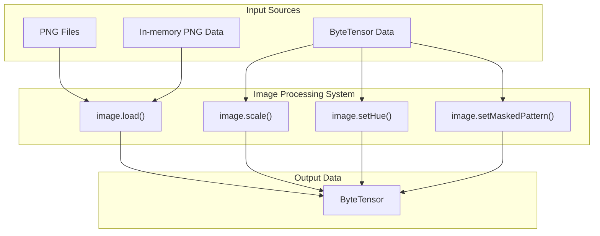
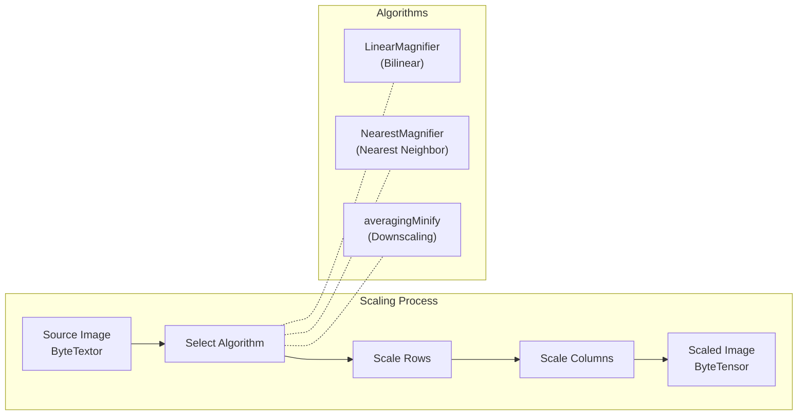
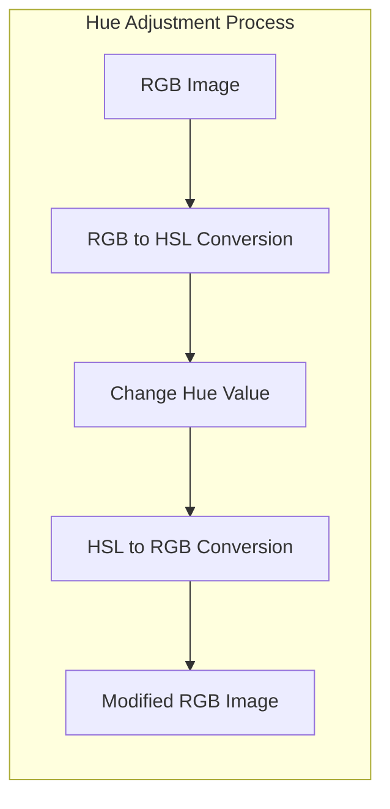
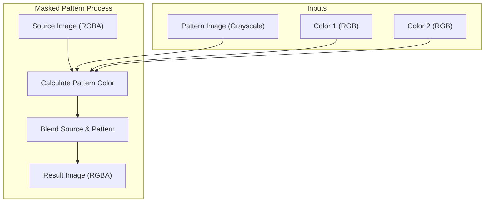
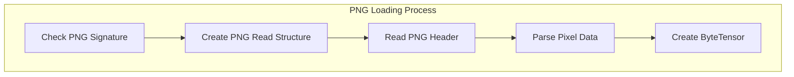

<!-- source: DeepWiki mcp.deepwiki.com · repo google-deepmind/lab · page 5.3 Image Processing · fetched 2026-10-26 -->

# Image Processing

<details>
<summary>Relevant source files</summary>

The following files were used as context for generating this wiki page:

- [deepmind/engine/lua_image.cc](deepmind/engine/lua_image.cc)
- [deepmind/engine/lua_image.h](deepmind/engine/lua_image.h)
- [deepmind/engine/lua_image_test.cc](deepmind/engine/lua_image_test.cc)
- [docs/developers/reference/image.md](docs/developers/reference/image.md)
- [lua_tests/image_test.lua](lua_tests/image_test.lua)
- [lua_tests/read_file_test.lua](lua_tests/read_file_test.lua)
- [lua_tests/set_test.lua](lua_tests/set_test.lua)

</details>


This page documents the image processing capabilities available in DeepMind Lab through the Lua API. The image processing system provides functionality for loading, manipulating, and transforming images, which is particularly useful for procedural content generation, customizing environments, and implementing visual effects in DeepMind Lab levels.

## Overview

The image processing functionality is exposed through the `dmlab.system.image` Lua module, which provides methods for:

1. Loading PNG images from files or in-memory data
2. Scaling images using different interpolation methods
3. Manipulating colors through hue adjustments
4. Applying masked patterns to images



Sources: [deepmind/engine/lua_image.cc](), [deepmind/engine/lua_image.h](), [docs/developers/reference/image.md]()

## Loading Images

DeepMind Lab supports loading PNG images through the `image.load()` function. This function takes a file path or in-memory data and returns a ByteTensor containing the image data.

### Loading from Files

```lua
local image = require 'dmlab.system.image'
local helpers = require 'common.helpers'

local imageTensor = image.load(helpers.dirname(FILE_NAME) .. "path/to/image.png")
```

### Loading from Memory

```lua
local image = require 'dmlab.system.image'
local game = require 'dmlab.system.game'
local helpers = require 'common.helpers'

local filename = helpers.dirname(FILE_NAME) .. "path/to/image.png"
local pngContents = game:loadFileToString(filename)
local imageTensor = image.load('content:.png', pngContents)
```

The resulting tensor will have shape `{height, width, channels}`, where `channels` is 1, 2, 3, or 4 depending on the image format (grayscale, grayscale with alpha, RGB, or RGBA).

Sources: [deepmind/engine/lua_image.cc:156-201](), [docs/developers/reference/image.md:7-38]()

## Image Scaling

The image processing system provides the ability to scale images through the `image.scale()` function. This function supports both upscaling and downscaling with different interpolation methods.



### Scaling Function Signature

```lua
local scaledImage = image.scale(sourceImage, targetHeight, targetWidth, mode)
```

Parameters:
- `sourceImage`: A ByteTensor with shape `{height, width, channels}`
- `targetHeight`: The desired height of the output image
- `targetWidth`: The desired width of the output image
- `mode` (optional): Scaling algorithm, either `'bilinear'` (default) or `'nearest'`

### Scaling Algorithms

The system uses different algorithms depending on the scaling operation:

1. **Bilinear Interpolation**: Used for upscaling when `mode` is `'bilinear'`
2. **Nearest Neighbor**: Used for upscaling when `mode` is `'nearest'`
3. **Averaging**: Always used for downscaling, regardless of `mode`

#### Example

```lua
local image = require 'dmlab.system.image'
local tensor = require 'dmlab.system.tensor'

local src = tensor.ByteTensor{
  {{255, 0, 0}, {0, 255, 0}},
  {{0, 0, 255}, {255, 255, 255}}
}

-- Scale to 4x4 using bilinear interpolation (default)
local tgt1 = image.scale(src, 4, 4)

-- Scale to 4x4 using nearest neighbor interpolation
local tgt2 = image.scale(src, 4, 4, 'nearest')
```

Sources: [deepmind/engine/lua_image.cc:203-491](), [docs/developers/reference/image.md:40-73]()

## Color Manipulation

The image processing system includes functions for manipulating the colors of images.

### Setting Hue

The `image.setHue()` function allows changing the hue of an image while preserving its saturation and lightness.



```lua
local image = require 'dmlab.system.image'
local tensor = require 'dmlab.system.tensor'

local src = tensor.ByteTensor{
    {255, 0, 0},    -- Red
    {127, 0, 0},    -- Dark red
    {255, 127, 127} -- Light red
}

-- Change to green (hue = 120 degrees)
image.setHue(src, 120)
-- src now contains green pixels with the same lightness and saturation
```

The function converts RGB colors to HSL (Hue, Saturation, Lightness), changes the hue value, and then converts back to RGB. This preserves the lightness and saturation of the original image, meaning whites remain white and blacks remain black.

Sources: [deepmind/engine/lua_image.cc:493-631](), [docs/developers/reference/image.md:75-118]()

### Masked Pattern Application

The `image.setMaskedPattern()` function applies a colored pattern to an image, using the image's alpha channel as a mask.



```lua
local image = require 'dmlab.system.image'
local tensor = require 'dmlab.system.tensor'

-- Source image with varying alpha values
local img = tensor.ByteTensor{
    {{255, 0, 0, 0}, {255, 0, 0, 128}, {255, 0, 0, 255}},
    {{255, 0, 0, 0}, {255, 0, 0, 128}, {255, 0, 0, 255}},
    {{255, 0, 0, 0}, {255, 0, 0, 128}, {255, 0, 0, 255}}
}

-- Pattern image (grayscale)
local pat = tensor.ByteTensor{
    {{255}, {255}, {255}},
    {{128}, {128}, {128}},
    {{0}, {0}, {0}}
}

-- Apply pattern (green to blue gradient based on pattern)
local result = image.setMaskedPattern(img, pat, {0, 255, 0}, {0, 0, 255})
```

The function performs the following operations:
1. For each pixel in the pattern, interpolates between `color1` (for pattern value 255) and `color2` (for pattern value 0)
2. For each pixel in the source image, interpolates between the original color (for alpha value 0) and the pattern color (for alpha value 255)
3. Sets the alpha channel of the result to 255

This is useful for creating visually distinct and customized textures and elements in the environment.

Sources: [deepmind/engine/lua_image.cc:633-752](), [docs/developers/reference/image.md:120-194]()

## Implementation Details

### Internal Data Structure

Internally, all image data is stored in tensors with the shape `{height, width, channels}`, where:
- `height`: Number of rows in the image
- `width`: Number of columns in the image
- `channels`: Number of color channels (1 for grayscale, 2 for grayscale with alpha, 3 for RGB, 4 for RGBA)

### PNG Loading

The PNG loading functionality is implemented using the libpng library. The process involves:
1. Opening and validating the PNG file
2. Reading the PNG header to determine image dimensions and format
3. Converting the PNG data to a ByteTensor



Source: [deepmind/engine/lua_image.cc:51-154]()

### Scaling Implementation

The scaling implementation uses a two-pass approach:
1. First, scale the rows of the image
2. Then, scale the columns of the resulting image

For upscaling, two algorithms are available:
- `LinearMagnifier`: Performs bilinear interpolation between pixels
- `NearestMagnifier`: Selects the nearest source pixel for each target pixel

For downscaling, the `averagingMinify` function is always used, which computes the average of all source pixels that map to a single target pixel.

Source: [deepmind/engine/lua_image.cc:203-438]()

### Color Space Conversion

The color manipulation functions perform conversions between the RGB and HSL color spaces:
- `RgbToSl`: Converts RGB values to Saturation and Lightness components
- `HslToRgb`: Converts Hue, Saturation, and Lightness values to RGB

The Hue value is specified in degrees (0-360), while Saturation and Lightness are in the range [0, 1].

Source: [deepmind/engine/lua_image.cc:493-575]()

## Conclusion

The image processing system in DeepMind Lab provides a versatile set of tools for loading, scaling, and manipulating images. These functions are useful for creating visually rich and dynamic environments in DeepMind Lab.

For information on other tensor operations in Lua, see [Tensor Operations](#5.2).
For details on how C++ integrates with Lua in DeepMind Lab, see [C++ to Lua Integration](#5.4).

---

