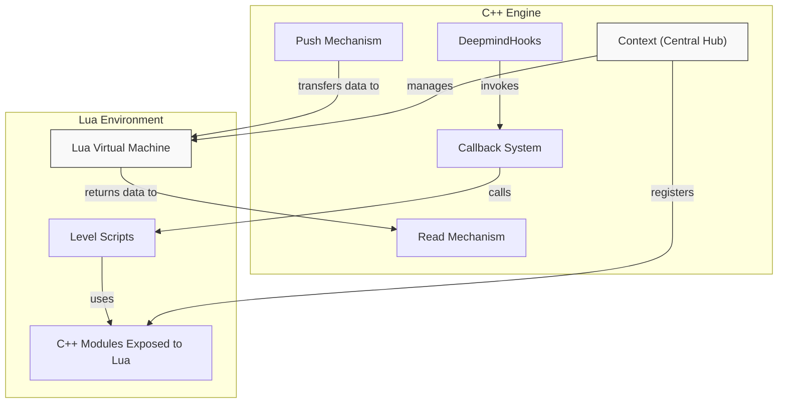
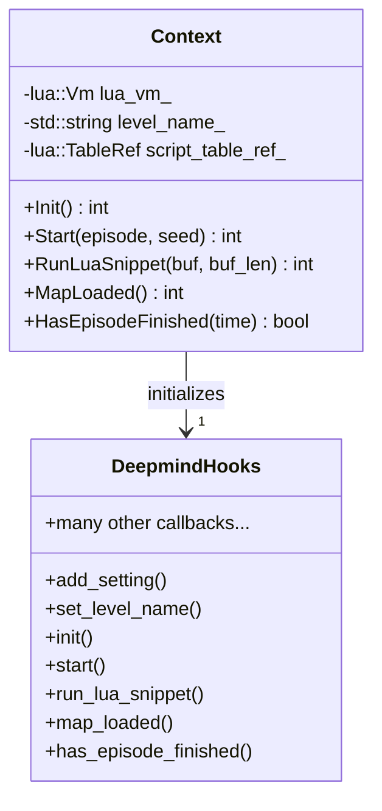
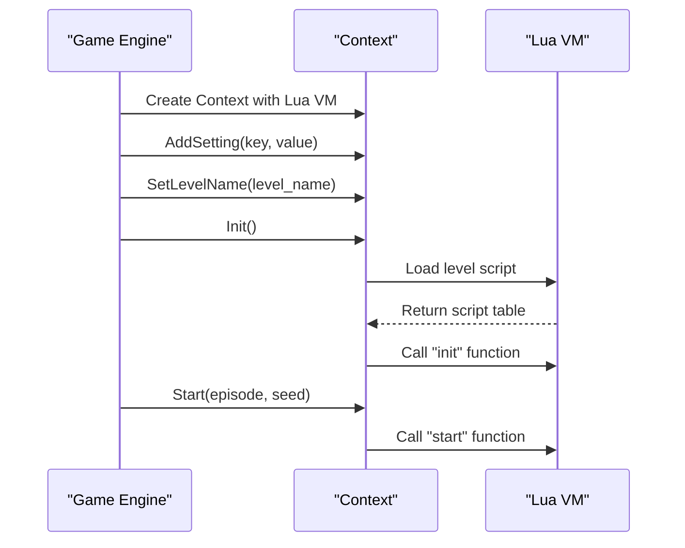
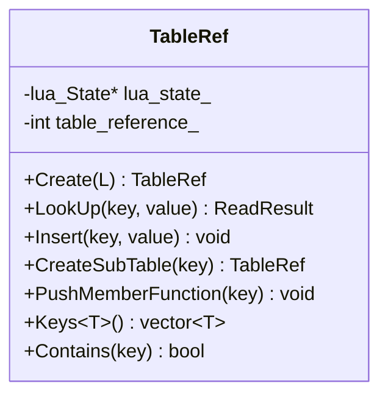
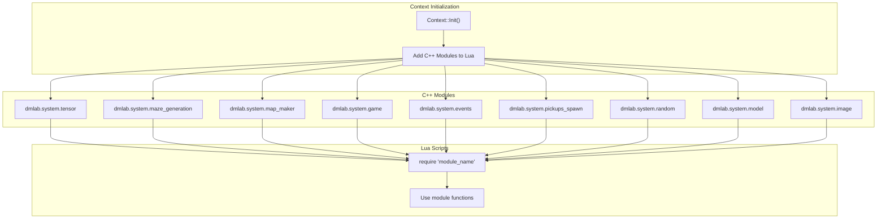
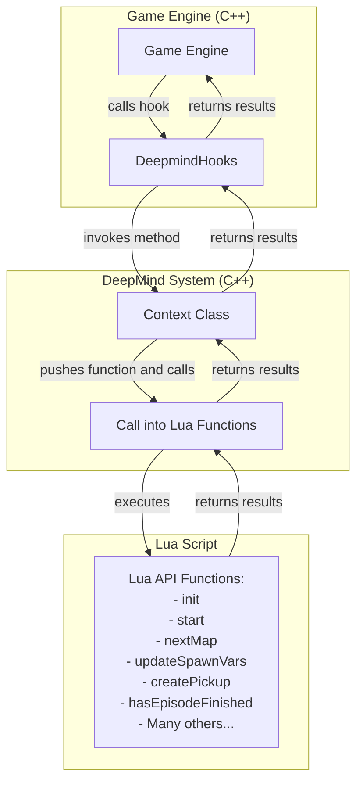
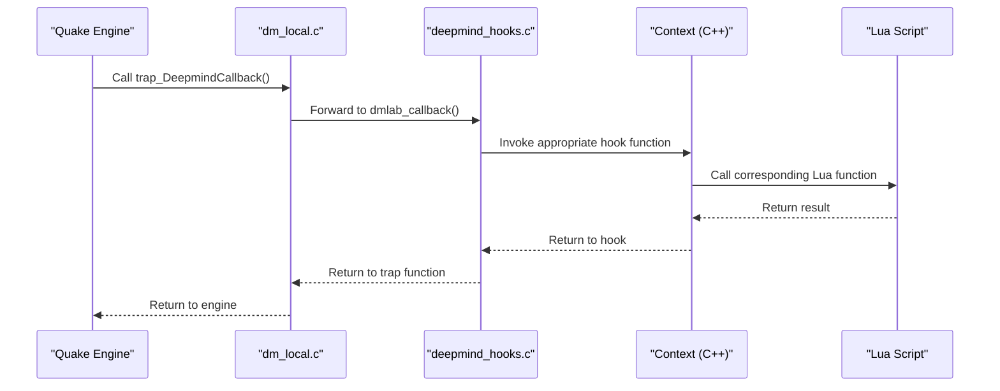
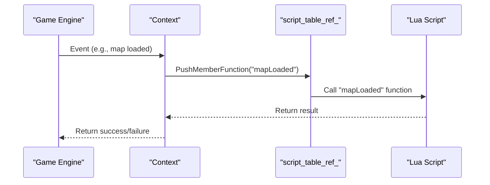
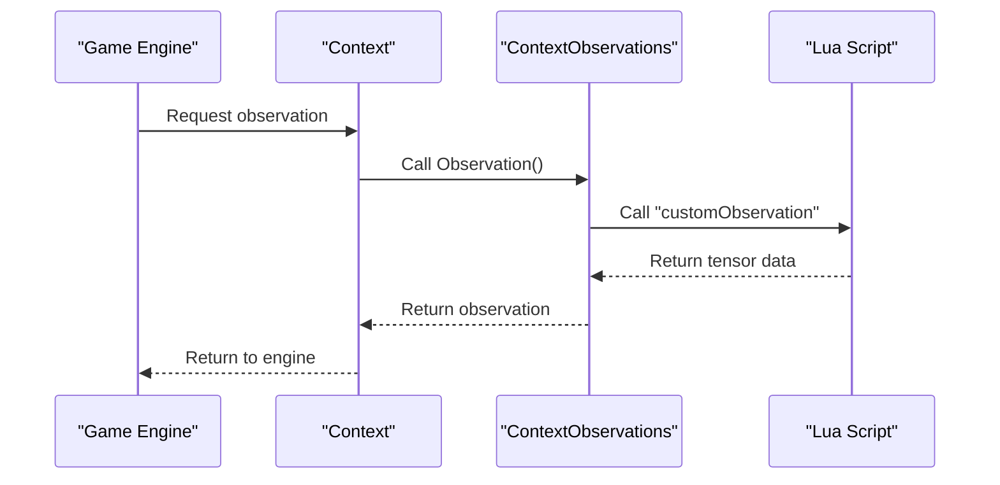
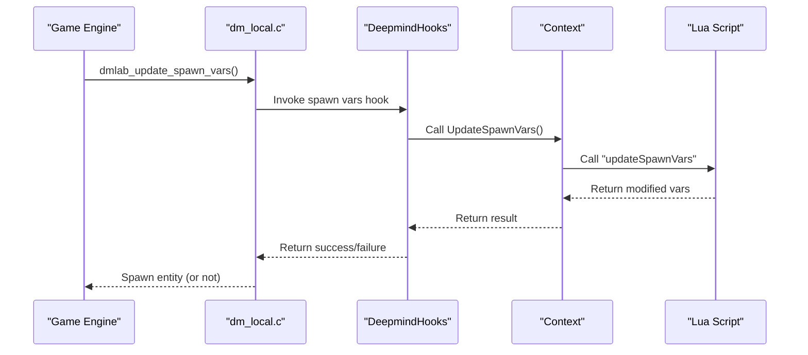

<!-- source: DeepWiki mcp.deepwiki.com · repo google-deepmind/lab · page 5.4 C++ to Lua Integration · fetched 2026-10-26 -->

# C++ to Lua Integration

<details>
<summary>Relevant source files</summary>

The following files were used as context for generating this wiki page:

- [deepmind/engine/context.cc](deepmind/engine/context.cc)
- [deepmind/engine/context.h](deepmind/engine/context.h)
- [deepmind/include/deepmind_hooks.h](deepmind/include/deepmind_hooks.h)
- [deepmind/lua/push.h](deepmind/lua/push.h)
- [deepmind/lua/push_test.cc](deepmind/lua/push_test.cc)
- [deepmind/lua/read.h](deepmind/lua/read.h)
- [deepmind/lua/read_test.cc](deepmind/lua/read_test.cc)
- [deepmind/lua/table_ref.h](deepmind/lua/table_ref.h)
- [deepmind/lua/table_ref_test.cc](deepmind/lua/table_ref_test.cc)
- [docs/developers/reference/lua_api.md](docs/developers/reference/lua_api.md)
- [engine/code/deepmind/dm_local.c](engine/code/deepmind/dm_local.c)
- [engine/code/deepmind/dm_local.h](engine/code/deepmind/dm_local.h)
- [engine/code/deepmind/dm_public.h](engine/code/deepmind/dm_public.h)
- [engine/code/game/g_active.c](engine/code/game/g_active.c)
- [engine/code/game/g_local.h](engine/code/game/g_local.h)
- [engine/code/game/g_mover.c](engine/code/game/g_mover.c)
- [engine/code/game/g_spawn.c](engine/code/game/g_spawn.c)
- [engine/code/qcommon/deepmind_hooks.c](engine/code/qcommon/deepmind_hooks.c)
- [engine/code/qcommon/q_shared.h](engine/code/qcommon/q_shared.h)
- [engine/code/qcommon/surfaceflags.h](engine/code/qcommon/surfaceflags.h)

</details>


This document explains how DeepMind Lab integrates C++ and Lua, allowing bidirectional communication between the core engine (implemented in C++) and customizable game logic (written in Lua). The integration enables researchers to modify environment behavior through Lua scripting while maintaining the performance benefits of the C++ engine.

For information about using the Lua API to create custom environments, see [Lua Scripting](#5).

## Integration Architecture

DeepMind Lab's C++ to Lua integration revolves around a few core mechanisms:

1. The `Context` class manages a Lua virtual machine and serves as the central hub between the engine and Lua scripts
2. A callback system allows C++ code to invoke Lua functions
3. Data transfer mechanisms move values between C++ and Lua
4. A module system exposes C++ functionality as Lua modules



Sources:
- [deepmind/engine/context.h:52-566]()
- [deepmind/engine/context.cc:79-548]()
- [deepmind/include/deepmind_hooks.h:35-438]()

## Context Class: The Central Hub

The `Context` class serves as the bridge between the C++ game engine and the Lua scripting environment. It:

1. Manages a Lua virtual machine (VM)
2. Initializes the hooks between engine and Lua
3. Loads and runs Lua level scripts
4. Registers C++ functionality as Lua modules
5. Transfers data between C++ and Lua



Sources:
- [deepmind/engine/context.h:54-566]()
- [deepmind/engine/context.cc:587-686]()

### Initialization Flow

When DeepMind Lab starts, it:

1. Creates a `Context` instance with a Lua VM
2. Initializes engine hooks to point to `Context` methods
3. Sets environment settings and level name
4. Calls `Context::Init()` which loads and runs the level script
5. Calls `Context::Start()` to begin the episode



Sources:
- [deepmind/engine/context.cc:586-847]()
- [deepmind/engine/context.cc:99-104]()

## Data Transfer Between C++ and Lua

DeepMind Lab uses two primary mechanisms for data transfer:

1. **Push**: Moving data from C++ to Lua stack
2. **Read**: Extracting data from Lua stack to C++

### Push Mechanism

The `Push` functions transfer C++ values onto the Lua stack:

| C++ Type | Lua Type | Function |
|----------|----------|----------|
| `std::string`, `const char*`, `absl::string_view` | string | `Push(L, string_value)` |
| `int`, `float`, `double` | number | `Push(L, numeric_value)` |
| `bool` | boolean | `Push(L, bool_value)` |
| `std::vector<T>`, `std::array<T,N>` | table (array) | `Push(L, array_value)` |
| `absl::flat_hash_map<K,V>` | table (dictionary) | `Push(L, map_value)` |
| `lua_CFunction` | function | `Push(L, function_ptr)` |
| `void*` | userdata | `Push(L, pointer)` |
| `absl::variant<...>` | (varies) | `Push(L, variant_value)` |
| `TableRef` | table | `Push(L, table_ref)` |

Sources:
- [deepmind/lua/push.h:39-156]()
- [deepmind/lua/push_test.cc:42-257]()

### Read Mechanism

The `Read` functions extract values from the Lua stack into C++ variables, with error handling:

| Lua Type | C++ Type | Result Type | Function |
|----------|----------|-------------|----------|
| string | `std::string`, `absl::string_view` | `ReadResult` | `Read(L, idx, &string_var)` |
| number | `int`, `float`, `double` | `ReadResult` | `Read(L, idx, &number_var)` |
| boolean | `bool` | `ReadResult` | `Read(L, idx, &bool_var)` |
| table (array) | `std::vector<T>`, `std::array<T,N>` | `ReadResult` | `Read(L, idx, &array_var)` |
| table (dict) | `absl::flat_hash_map<K,V>` | `ReadResult` | `Read(L, idx, &map_var)` |
| function | `lua_CFunction` | `ReadResult` | `Read(L, idx, &function_var)` |
| userdata | `T*` | `ReadResult` | `Read(L, idx, &pointer_var)` |
| any/varies | `absl::variant<...>` | `ReadResult` | `Read(L, idx, &variant_var)` |
| table/userdata | `TableRef` | `ReadResult` | `Read(L, idx, &table_ref)` |

`ReadResult` can be:
- `kFound` - Value was successfully read
- `kNotFound` - Value is nil or missing
- `kTypeMismatch` - Value exists but has wrong type

Sources:
- [deepmind/lua/read.h:42-467]()
- [deepmind/lua/read_test.cc:37-315]()

## TableRef: Working with Lua Tables

The `TableRef` class provides a convenient way to work with Lua tables from C++. It stores a reference to a Lua table in the registry and provides methods to access and modify it.



Example usage:

```cpp
// Create a new table
TableRef table = TableRef::Create(L);

// Insert values
table.Insert("name", "apple");
table.Insert("color", "red");
table.Insert("weight", 0.5);

// Create a subtable
TableRef subtable = table.CreateSubTable("nutrients");
subtable.Insert("vitamin_c", 4.6);

// Access values
std::string name;
if (IsFound(table.LookUp("name", &name))) {
    // Use name...
}

// Call a member function on a table
table.PushMemberFunction("process");
// Now "process" function and the table are on the stack
// Call with: lua::Call(L, 1, 0);
```

Sources:
- [deepmind/lua/table_ref.h:32-227]()
- [deepmind/lua/table_ref_test.cc:101-126]()
- [deepmind/lua/table_ref_test.cc:160-179]()
- [deepmind/lua/table_ref_test.cc:181-200]()

## Exposing C++ Functionality to Lua

DeepMind Lab exposes C++ functionality to Lua through modules. These modules are registered with the Lua VM during initialization and can be required in Lua scripts.



Key C++ modules exposed to Lua:

| Module Name | Purpose | Function |
|-------------|---------|----------|
| `dmlab.system.tensor` | Tensor manipulation | `tensor::LuaTensorConstructors` |
| `dmlab.system.maze_generation` | Create mazes | `LuaMazeGeneration::Require` |
| `dmlab.system.map_maker` | Generate maps | `MapMakerModule` |
| `dmlab.system.game` | Game state | `ContextGame::Module` |
| `dmlab.system.events` | Event system | `ContextEvents::Module` |
| `dmlab.system.pickups_spawn` | Item pickup system | `ContextPickups::Module` |
| `dmlab.system.random` | Random number generation | `LuaRandom::Require` |
| `dmlab.system.model` | Model creation | `ModelModule` |
| `dmlab.system.image` | Image manipulation | `LuaImageRequire` |
| `dmlab.system.transform` | Geometry transforms | `LuaTransform::Require` |

The modules are registered in `Context::Init()` using `lua_vm_.AddCModuleToSearchers()`.

Sources:
- [deepmind/engine/context.cc:743-785]()

## Callback System: C++ Calling Lua

DeepMind Lab uses a callback system that allows C++ code to invoke functions in Lua scripts. The system works like this:

1. C++ registers hooks with function pointers to C++ methods
2. Engine calls these hooks during gameplay
3. C++ methods invoke corresponding Lua script functions
4. Results from Lua are returned to the engine



The most important callbacks from C++ to Lua include:

| C++ Function | Lua Function | Purpose |
|--------------|--------------|---------|
| `Context::Init()` | `init` | Initialize level with settings |
| `Context::Start()` | `start` | Start an episode |
| `Context::NextMap()` | `nextMap` | Get the name of the map to load |
| `Context::MapLoaded()` | `mapLoaded` | Called when map is loaded |
| `Context::HasEpisodeFinished()` | `hasEpisodeFinished` | Check if episode should end |
| `Context::UpdateInventory()` | `updateInventory` | Update player inventory |
| `Context::RunLuaSnippet()` | (custom code) | Run arbitrary Lua code |
| `Context::MutablePickups()->UpdateSpawnVars()` | `updateSpawnVars` | Modify entity spawn variables |
| `Context::MutablePickups()->CanPickup()` | `canPickup` | Check if item can be picked up |
| `Context::MutablePickups()->OverridePickup()` | `pickup` | Handle item pickup |

Sources:
- [deepmind/engine/context.cc:721-835]()
- [deepmind/engine/context.cc:850-866]()
- [deepmind/engine/context.cc:902-914]()
- [deepmind/include/deepmind_hooks.h:146-438]()
- [docs/developers/reference/lua_api.md:35-546]()

## Engine to DeepMind Lab Bridge

The connection between the Quake III Arena engine and DeepMind Lab happens through a callback system defined in `deepmind_hooks.c` and `dm_local.c`. This system works as follows:



This bridging mechanism is what allows the game engine to call into the DeepMind Lab system, which then calls into Lua scripts.

Sources:
- [engine/code/deepmind/dm_local.c:22-264]()  
- [engine/code/qcommon/deepmind_hooks.c:26-251]()
- [engine/code/deepmind/dm_local.h:19-264]()
- [engine/code/deepmind/dm_public.h:22-60]()

## Common Integration Patterns

### 1. Engine Events Calling Lua Functions



Sources:
- [deepmind/engine/context.cc:836-848]()

### 2. Lua Custom Observations



Sources:
- [deepmind/engine/context.cc:402-406]()

### 3. Custom Entity Spawning



Sources:
- [engine/code/deepmind/dm_local.c:55-65]()
- [engine/code/qcommon/deepmind_hooks.c:32-38]()

## Conclusion

The C++ to Lua integration in DeepMind Lab provides a flexible system for customizing environment behavior through Lua scripts while maintaining the performance benefits of the C++ engine. The `Context` class serves as the central hub for this integration, managing data transfer, callback invocation, and module registration.

This bidirectional communication allows researchers to:

1. Create custom game levels with specialized logic
2. Define custom observations, actions, and rewards
3. Implement procedural environment generation
4. Intercept and modify game events
5. Create custom game mechanics

By understanding this integration system, developers can create sophisticated custom environments for reinforcement learning research or extend the capabilities of DeepMind Lab itself.

---

