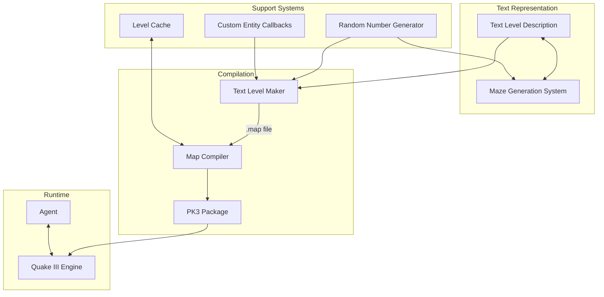
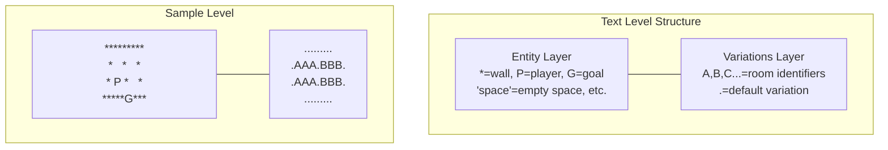
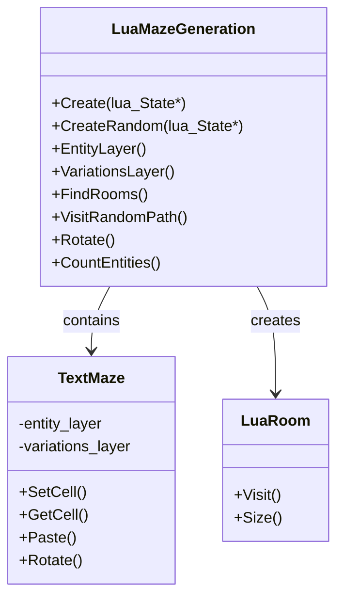
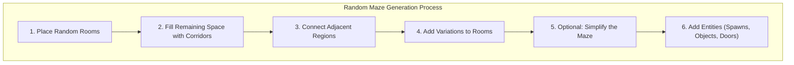
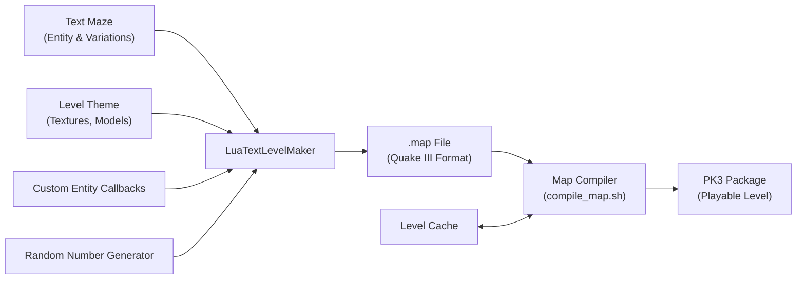
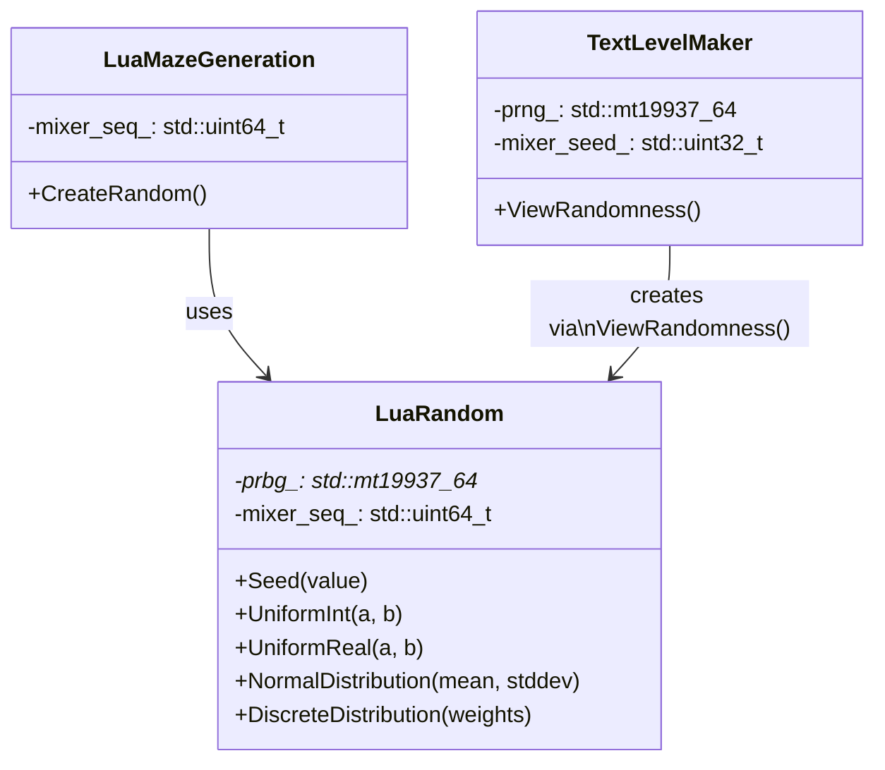
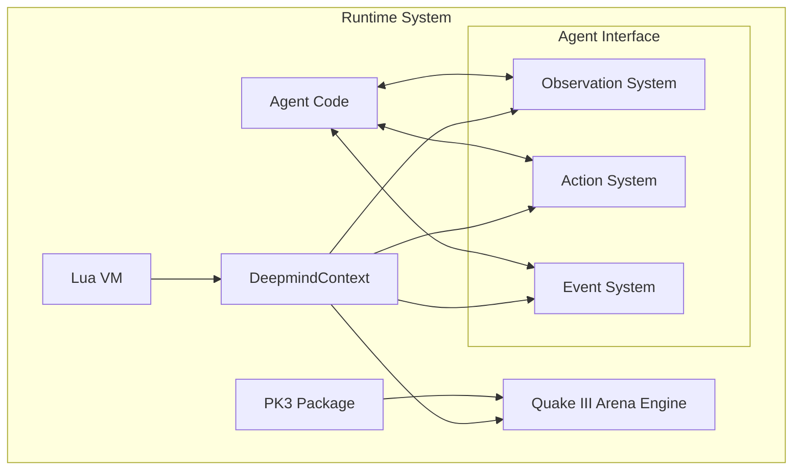
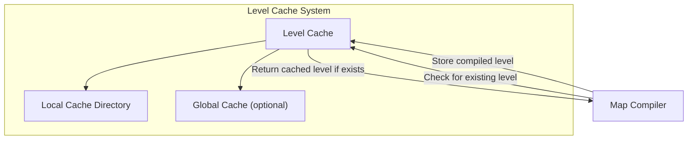

<!-- source: DeepWiki mcp.deepwiki.com · repo google-deepmind/lab · page 6 Level Generation · fetched 2026-10-26 -->

# Level Generation

<details>
<summary>Relevant source files</summary>

The following files were used as context for generating this wiki page:

- [deepmind/engine/context_actions.cc](deepmind/engine/context_actions.cc)
- [deepmind/engine/context_events.cc](deepmind/engine/context_events.cc)
- [deepmind/engine/context_observations.cc](deepmind/engine/context_observations.cc)
- [deepmind/engine/lua_maze_generation.cc](deepmind/engine/lua_maze_generation.cc)
- [deepmind/engine/lua_maze_generation.h](deepmind/engine/lua_maze_generation.h)
- [deepmind/engine/lua_maze_generation_test.cc](deepmind/engine/lua_maze_generation_test.cc)
- [deepmind/engine/lua_random.cc](deepmind/engine/lua_random.cc)
- [deepmind/engine/lua_random.h](deepmind/engine/lua_random.h)
- [deepmind/engine/lua_random_test.cc](deepmind/engine/lua_random_test.cc)
- [deepmind/engine/lua_text_level_maker.cc](deepmind/engine/lua_text_level_maker.cc)
- [deepmind/engine/lua_text_level_maker.h](deepmind/engine/lua_text_level_maker.h)
- [deepmind/level_generation/compile_map.cc](deepmind/level_generation/compile_map.cc)
- [deepmind/level_generation/text_level/char_grid.cc](deepmind/level_generation/text_level/char_grid.cc)
- [deepmind/level_generation/text_level/lua_bindings.cc](deepmind/level_generation/text_level/lua_bindings.cc)
- [deepmind/level_generation/text_level/translate_text_level_test.cc](deepmind/level_generation/text_level/translate_text_level_test.cc)
- [deepmind/support/test_srcdir.cc](deepmind/support/test_srcdir.cc)
- [deepmind/util/run_executable.cc](deepmind/util/run_executable.cc)
- [examples/game_main.c](examples/game_main.c)

</details>


Level Generation in DeepMind Lab refers to the system for creating, manipulating, and converting level layouts that can be used in the RL environment. This page documents how levels are represented, generated, and compiled into playable maps that agents can interact with. For information about how agents interact with these levels, see [Observations and Actions](#7).

## Level Generation Architecture

Level generation in DeepMind Lab follows a pipeline from text-based representations to compiled game maps:



Sources: [deepmind/engine/lua_maze_generation.h](), [deepmind/engine/lua_maze_generation.cc](), [deepmind/engine/lua_text_level_maker.h](), [deepmind/level_generation/compile_map.cc]()

## Text Level Representation

Levels in DeepMind Lab are initially represented as text grids, where different characters represent different elements of the level (walls, doors, player spawns, etc.).

### Level Layers

Each text level consists of two main layers:

1. **Entity Layer**: Defines the physical structure and game elements
2. **Variations Layer**: Provides additional metadata for theming and variations



Sources: [deepmind/engine/lua_maze_generation_test.cc:89-105](), [deepmind/level_generation/text_level/translate_text_level_test.cc:49-65]()

### Default Character Meanings

| Character | Entity Layer Meaning      | Character | Entity Layer Meaning       |
|-----------|---------------------------|-----------|----------------------------|
| `*`       | Wall                      | `P`       | Player spawn               |
| ` ` (space)| Empty space              | `G`       | Goal/pickup                |
| `H`       | Horizontal door           | `I`       | Vertical door              |
| `x`       | Custom entity (example)   | `.`       | Default variation          |
| `A-Z`     | Variation identifiers     |           |                            |

Sources: [deepmind/level_generation/text_level/translate_text_level_test.cc:49-65]()

## Maze Generation System

The maze generation system provides tools for creating and manipulating maze-like level structures programmatically.

### Core Components



Sources: [deepmind/engine/lua_maze_generation.h:33-202](), [deepmind/engine/lua_maze_generation.cc:69-114](), [deepmind/engine/lua_maze_generation.cc:318-317]()

### Creating Mazes

Mazes can be created in several ways:

1. **Empty Maze** - Create a maze of a specific size:

```lua
local maze = maze_generation.mazeGeneration{width = 5, height = 3}
```

2. **From Text** - Create a maze from text description:

```lua
local maze = maze_generation.mazeGeneration{
  entity = entityLayer,
  variations = variationsLayer
}
```

3. **Random Maze** - Generate a procedural maze with rooms and corridors:

```lua
local maze = maze_generation.randomMazeGeneration{
    random = random_generator,
    width = 15,
    height = 13,
    maxRooms = 3,
    extraConnectionProbability = 0.0,
    simplify = false,
}
```

Sources: [deepmind/engine/lua_maze_generation_test.cc:65-86](), [deepmind/engine/lua_maze_generation_test.cc:89-112](), [deepmind/engine/lua_maze_generation_test.cc:262-275]()

### Random Maze Generation

The random maze generation algorithm creates a structure with rooms and corridors:



Sources: [deepmind/engine/lua_maze_generation.cc:171-317]()

Random maze generation parameters:

| Parameter                   | Description                                     | Default |
|-----------------------------|-------------------------------------------------|---------|
| `width`, `height`           | Dimensions of the maze (must be odd)            | -       |
| `maxRooms`                  | Maximum number of rooms to generate             | 0       |
| `roomMinSize`, `roomMaxSize`| Min/max dimensions of rooms (must be odd)       | 3, 7    |
| `extraConnectionProbability`| Chance of extra connections between regions     | 0.05    |
| `simplify`                  | Whether to remove dead ends and horseshoe bends | true    |
| `roomSpawnCount`            | Number of spawn points per room                 | 0       |
| `roomObjectCount`           | Number of objects per room                      | 0       |
| `spawn`, `object`           | Characters to use for spawns and objects        | P, G    |
| `hasDoors`                  | Whether to add doors between rooms              | false   |

Sources: [deepmind/engine/lua_maze_generation.cc:171-317](), [deepmind/engine/lua_maze_generation.h:67-89]()

### Manipulating Mazes

The maze generation system provides several functions for manipulating mazes:

1. **Cell Access and Modification**:
   - `getEntityCell(row, col)` / `setEntityCell(row, col, character)`
   - `getVariationsCell(row, col)` / `setVariationsCell(row, col, character)`
   - `fillEntityRect{row, col, height, width, character}`

2. **Structural Operations**:
   - `rotate(clockwiseRotations)` - Creates a rotated copy of the maze
   - `paste(row, col, maze)` - Inserts another maze at the specified position

3. **Analysis and Path Finding**:
   - `findRooms([wallChars])` - Identifies separate room regions
   - `visitFill{cell={row, col}, wall="*", func=callback}` - Flood fill from a point
   - `visitRandomPath{from={row, col}, to={row, col}, func=callback}` - Find random path

4. **Utility Functions**:
   - `size()` - Returns maze dimensions
   - `countEntities(characters)` / `countVariations(characters)` - Count occurrences
   - `toWorldPos(row, col)` / `fromWorldPos(x, y)` - Convert between grid and world coordinates

Sources: [deepmind/engine/lua_maze_generation.cc:320-612](), [deepmind/engine/lua_maze_generation_test.cc:138-157](), [deepmind/engine/lua_maze_generation_test.cc:230-257](), [deepmind/engine/lua_maze_generation_test.cc:593-636](), [deepmind/engine/lua_maze_generation_test.cc:650-700]()

## Text Level Compilation

The text level compilation system converts maze representations into playable game maps.

### Compilation Pipeline



Sources: [deepmind/engine/lua_text_level_maker.cc:315-415](), [deepmind/level_generation/compile_map.cc:77-139]()

### LuaTextLevelMaker

The `LuaTextLevelMaker` class provides the interface for converting text levels to map files:

```lua
local map_path = text_level_maker:mapFromTextLevel{
  entityLayer = entity_layer_string,
  variationsLayer = variations_layer_string,
  mapName = "my_level",
  callback = custom_entity_handler,  -- optional
  theme = level_theme                -- optional
}
```

Sources: [deepmind/engine/lua_text_level_maker.cc:342-415]()

### Custom Entity Handlers

Custom entity handlers allow defining special behavior for particular characters in the entity layer:

```lua
local function my_custom_handler(i, j, entity_char, emitter)
  if entity_char == 'x' then
    return emitter:makeEntity{
      i = i,
      j = j,
      classname = "special_entity",
      attributes = {
        attribute1 = "value1",
        attribute2 = "value2"
      }
    }
  end
  return nil  -- Let default handler process other characters
end
```

The `emitter` object provides methods for creating various map elements:

| Method | Description |
|--------|-------------|
| `makeEntity` | Create a custom entity |
| `makeSpawnPoint` | Create a player spawn point |
| `makeDoor` | Create a door entity |
| `makeFenceDoor` | Create a fence door entity |
| `addPlatform` | Add a platform at a position |
| `addGlassColumn` | Add a glass column |

Sources: [deepmind/level_generation/text_level/lua_bindings.cc:58-185](), [deepmind/level_generation/text_level/translate_text_level_test.cc:122-145]()

### Theming System

The theming system allows customizing the appearance of levels through textures and models:

```lua
local theme = {
  mazeVariation = function(self, variation)
    return {
      floor = { tex = "textures/floor1", width = 1024, height = 1024 },
      ceiling = { tex = "textures/ceiling1", width = 1024, height = 1024 },
      wallN = { tex = "textures/wall1", width = 1024, height = 1024 },
      wallE = { tex = "textures/wall1", width = 1024, height = 1024 },
      wallS = { tex = "textures/wall1", width = 1024, height = 1024 },
      wallW = { tex = "textures/wall1", width = 1024, height = 1024 },
      riser = { tex = "textures/riser1", width = 1024, height = 1024 },
      tread = { tex = "textures/tread1", width = 1024, height = 1024 },
    }
  end,
  
  placeWallDecals = function(self, args)
    -- Add decorations to walls
  end,
  
  placeFloorModels = function(self, args)
    -- Add models to the floor
  end
}
```

Sources: [deepmind/engine/lua_text_level_maker.cc:106-306]()

## Randomness and Reproducibility

The level generation system uses a pseudo-random number generator (PRNG) to ensure reproducible level generation, which is crucial for reinforcement learning experiments.

### LuaRandom

The `LuaRandom` class provides an interface to the C++ random number generator:



Sources: [deepmind/engine/lua_random.h:40-129](), [deepmind/engine/lua_random.cc:60-140](), [deepmind/engine/lua_text_level_maker.cc:411-415]()

### Seed Management

The random number generator uses seeds to ensure reproducibility:

```lua
local random = random_gen:randomGen()  -- Get random generator
random:seed(123)                       -- Set a specific seed
local maze = maze_generation.randomMazeGeneration{
    random = random,
    -- other parameters...
}
```

With the same seed, the same level will be generated consistently, which is important for reproducible experiments.

Sources: [deepmind/engine/lua_random.cc:87-99](), [deepmind/engine/lua_random_test.cc:50-87]()

## Integration with Game Engine

The generated levels are loaded into the game engine at runtime:



Sources: [deepmind/engine/context_observations.cc](), [deepmind/engine/context_actions.cc](), [deepmind/engine/context_events.cc]()

## Level Cache System

To improve performance, especially for procedurally generated levels, DeepMind Lab includes a level caching system:



The level cache stores compiled maps based on their content hash, avoiding redundant compilation of identical levels.

Sources: [deepmind/level_generation/compile_map.cc:77-139](), [deepmind/engine/lua_text_level_maker.cc:316-327]()

## Example Usage

Here's a complete example of creating and compiling a level:

```lua
-- Create a random maze
local random = random_gen:randomGen()
random:seed(123)

local maze = maze_generation.randomMazeGeneration{
    random = random,
    width = 15,
    height = 13,
    maxRooms = 3,
    roomSpawnCount = 1,
    roomObjectCount = 1,
    hasDoors = true
}

-- Add custom elements to the maze
maze:setEntityCell(5, 5, 'x')  -- Add a custom entity

-- Compile the maze to a playable level
local map_path = text_level_maker:mapFromTextLevel{
    entityLayer = maze:entityLayer(),
    variationsLayer = maze:variationsLayer(),
    mapName = "random_level",
    callback = function(i, j, entity_char, emitter)
        if entity_char == 'x' then
            return emitter:makeEntity{
                i = i,
                j = j,
                classname = "info_item",
                attributes = { item = "weapon_rocketlauncher" }
            }
        end
        return nil
    end
}

-- The map_path can now be used to load the level in the game
```

Sources: [deepmind/engine/lua_maze_generation_test.cc:349-367](), [deepmind/level_generation/text_level/translate_text_level_test.cc:122-145]()

---

