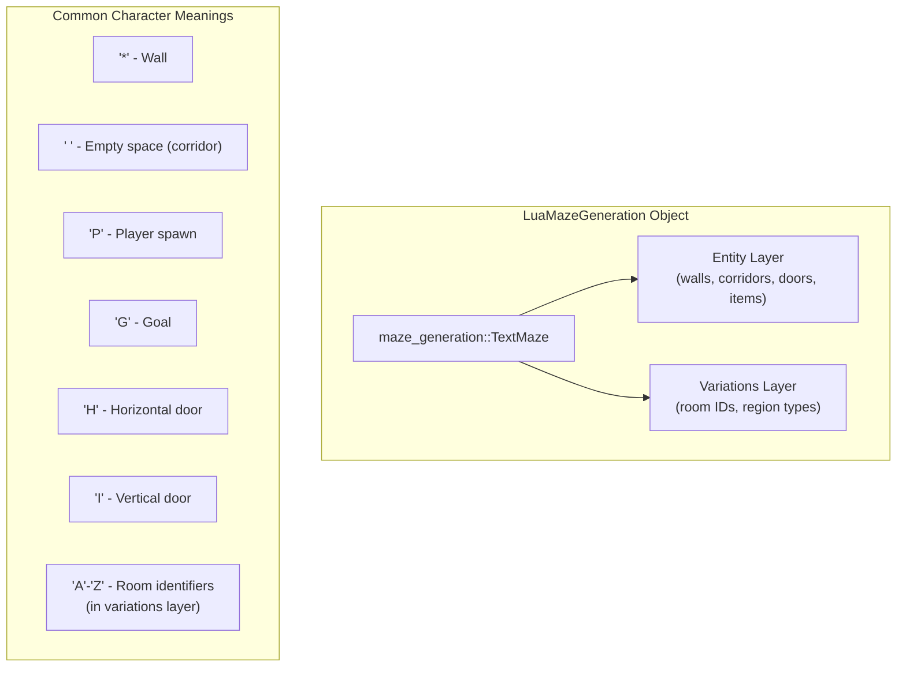
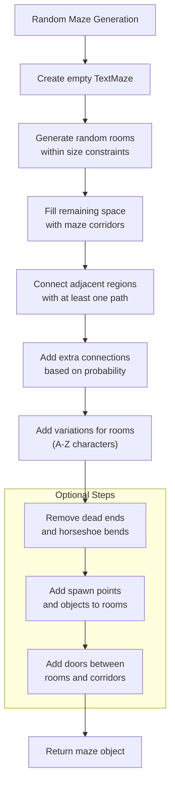
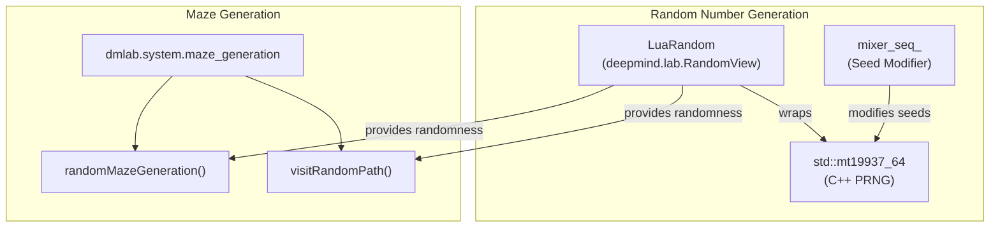
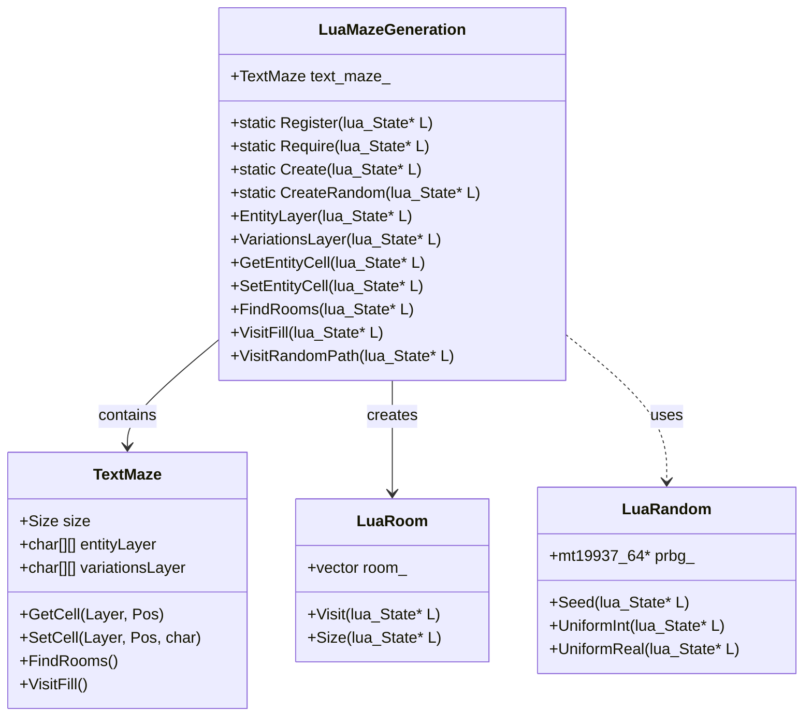
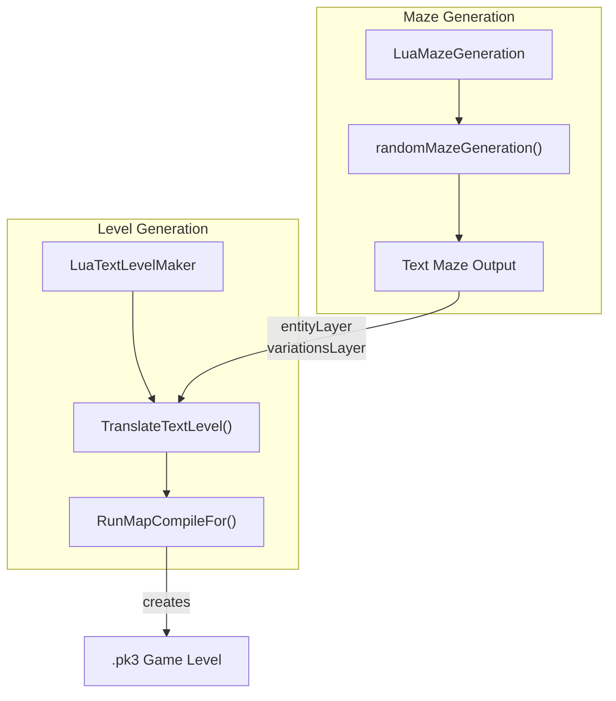

<!-- source: DeepWiki mcp.deepwiki.com · repo google-deepmind/lab · page 6.1 Maze Generation · fetched 2026-10-26 -->

# Maze Generation

<details>
<summary>Relevant source files</summary>

The following files were used as context for generating this wiki page:

- [deepmind/engine/lua_maze_generation.cc](deepmind/engine/lua_maze_generation.cc)
- [deepmind/engine/lua_maze_generation.h](deepmind/engine/lua_maze_generation.h)
- [deepmind/engine/lua_maze_generation_test.cc](deepmind/engine/lua_maze_generation_test.cc)
- [deepmind/engine/lua_random.cc](deepmind/engine/lua_random.cc)
- [deepmind/engine/lua_random.h](deepmind/engine/lua_random.h)
- [deepmind/engine/lua_random_test.cc](deepmind/engine/lua_random_test.cc)
- [deepmind/engine/lua_text_level_maker.cc](deepmind/engine/lua_text_level_maker.cc)
- [deepmind/engine/lua_text_level_maker.h](deepmind/engine/lua_text_level_maker.h)

</details>


This document details the maze generation system within DeepMind Lab, which provides functionality to create and manipulate procedurally generated mazes for reinforcement learning environments. The maze generation system serves as a foundation for the broader level generation pipeline, creating the underlying structure that can be translated into 3D game levels. For information about converting these generated mazes into actual game levels, see [Text Level Format](#6.2) and [Level Factories](#6.3).

## Overview of the Maze Generation System

The maze generation system in DeepMind Lab uses a text-based representation where characters in a grid represent different elements of the maze (walls, corridors, rooms, etc.). The system is implemented as a C++ module with a Lua API, allowing researchers to create and manipulate mazes programmatically.

### Key Features

- Creation of empty mazes with specified dimensions
- Generation of random mazes with customizable parameters
- Room detection and manipulation
- Path finding between points in the maze
- Integration with the system's random number generator for reproducible results
- Various maze transformation operations (rotation, pasting, etc.)

### Maze Representation

In DeepMind Lab, mazes are represented using a 2D character grid with two main layers:

1. **Entity Layer**: Represents the physical structure of the maze, including walls, corridors, entities, etc.
2. **Variations Layer**: Contains additional information about regions, such as room identifiers or custom properties



Sources: [deepmind/engine/lua_maze_generation.h:35-196](), [deepmind/engine/lua_maze_generation_test.cc:138-136]()

## Creating Mazes

There are two primary ways to create mazes using the maze generation system:

### 1. Empty Maze Creation

You can create an empty maze of a specified size:

```lua
local maze_generation = require 'dmlab.system.maze_generation'
local maze = maze_generation.mazeGeneration{width = 5, height = 3}
-- Creates a 5x3 maze filled with walls (*)
```

### 2. Predefined Maze Creation

You can also create a maze from predefined string representations:

```lua
local entityLayer = [[
*******
*   *G*
* * * *
*P*   *
*******
]]

local variationsLayer = [[
.......
.ABC.E.
.A.C.E.
.A.CDE.
.......
]]

local maze = maze_generation.mazeGeneration{
  entity = entityLayer,
  variations = variationsLayer
}
```

Sources: [deepmind/engine/lua_maze_generation.cc:137-169](), [deepmind/engine/lua_maze_generation_test.cc:89-136]()

### 3. Random Maze Generation

The most powerful feature is the ability to generate random mazes with customizable parameters:

```lua
local maze_generation = require 'dmlab.system.maze_generation'
local sys_random = require 'dmlab.system.sys_random'

sys_random:seed(123) -- Set seed for reproducibility

local maze = maze_generation.randomMazeGeneration{
    random = sys_random,     -- Random number generator
    width = 15,              -- Width of maze (must be odd)
    height = 13,             -- Height of maze (must be odd)
    maxRooms = 3,            -- Maximum number of rooms
    roomMinSize = 3,         -- Minimum room size (must be odd)
    roomMaxSize = 7,         -- Maximum room size (must be odd)
    extraConnectionProbability = 0.05, -- Chance of extra connections
    simplify = true,         -- Remove dead ends and horseshoe bends
    hasDoors = true,         -- Add doors between rooms
    roomSpawnCount = 1,      -- Spawns per room
    roomObjectCount = 1,     -- Objects per room
    spawn = 'P',             -- Character for spawn points
    object = 'G'             -- Character for objects
}
```

The random maze generation algorithm creates rooms and corridors with the following process:



Sources: [deepmind/engine/lua_maze_generation.cc:171-318](), [deepmind/engine/lua_maze_generation_test.cc:262-347]()

## Accessing and Manipulating Mazes

Once a maze has been created, you can access and modify its cells:

### Basic Getters and Setters

```lua
-- Get cell values
local entityChar = maze:getEntityCell(row, col)
local variationChar = maze:getVariationsCell(row, col)

-- Set cell values
maze:setEntityCell(row, col, 'P')
maze:setVariationsCell(row, col, 'A')

-- Get full string representation
local entityLayerStr = maze:entityLayer()
local variationsLayerStr = maze:variationsLayer()

-- Get maze dimensions
local height, width = maze:size()
```

Sources: [deepmind/engine/lua_maze_generation.cc:346-430](), [deepmind/engine/lua_maze_generation_test.cc:138-177]()

### Finding and Working with Rooms

The maze generation system provides functionality to identify and work with rooms:

```lua
-- Find all rooms in the maze (where '*' are walls)
local rooms = maze:findRooms("*")

-- Iterate over each room
for i, room in ipairs(rooms) do
    -- Get room size
    local size = room:size()
    
    -- Visit each cell in the room
    room:visit(function(row, col)
        -- Do something with each cell
        maze:setVariationsCell(row, col, 'A')
    end)
end
```

Sources: [deepmind/engine/lua_maze_generation.cc:432-454](), [deepmind/engine/lua_maze_generation_test.cc:179-228]()

### Flood Fill and Path Finding

The system provides utilities for flood filling and path finding:

```lua
-- Flood fill from a specific cell
maze:visitFill{
    cell = {5, 7},     -- Starting position
    wall = "*",        -- Wall characters to stop at
    func = function(row, col, distance)
        -- Called for each reachable cell with distance from start
    end
}

-- Find a random path between two points
maze:visitRandomPath{
    random = sys_random,  -- Random number generator
    from = {2, 2},        -- Start position
    to = {10, 10},        -- End position 
    wall = "*",           -- Wall characters to avoid
    func = function(row, col)
        -- Called for each cell in the path
    end
}
```

Sources: [deepmind/engine/lua_maze_generation.cc:521-612](), [deepmind/engine/lua_maze_generation_test.cc:575-648]()

## Random Number Generation Integration

The maze generation system is tightly integrated with the DeepMind Lab random number generation system to ensure reproducible results:



The random number generator is crucial for:
- Creating random maze layouts
- Placing rooms randomly
- Generating random paths between points
- Adding random connections between regions

The system uses a 64-bit Mersenne Twister algorithm (`std::mt19937_64`) for high-quality random number generation, which can be seeded for reproducible results.

Sources: [deepmind/engine/lua_random.h:28-134](), [deepmind/engine/lua_random.cc:19-144](), [deepmind/engine/lua_maze_generation.cc:39-62]()

## System Architecture

The maze generation system is implemented as a C++ module with a Lua API. Here's the overall architecture:



Sources: [deepmind/engine/lua_maze_generation.h:32-202](), [deepmind/engine/lua_maze_generation.cc:69-114](), [deepmind/engine/lua_random.h:40-129]()

## Integration with Level Generation

The maze generation system is one component in the overall level generation pipeline:



The maze generation system creates text-based maze representations that can be passed to the level generation system, which transforms them into 3D game levels:

1. Generate a maze using `LuaMazeGeneration`
2. Extract the entity and variations layers
3. Pass these layers to `LuaTextLevelMaker:mapFromTextLevel()`
4. The text level maker converts the 2D representation to a 3D map
5. The resulting .pk3 file is loaded by the game engine

Sources: [deepmind/engine/lua_text_level_maker.cc:316-415](), [deepmind/engine/lua_maze_generation.cc:346-354]()

## Example Use Cases

### 1. Creating a Simple Random Maze

```lua
local maze_generation = require 'dmlab.system.maze_generation'
local sys_random = require 'dmlab.system.sys_random'

-- Set seed for reproducibility
sys_random:seed(42)

-- Create a random maze with default settings
local maze = maze_generation.randomMazeGeneration{
    random = sys_random,
    width = 11,
    height = 11,
    maxRooms = 2
}

-- Get the string representation
local entityLayer = maze:entityLayer()
local variationsLayer = maze:variationsLayer()

-- Use these layers with the text level maker to create a 3D level
```

### 2. Finding a Path Through a Maze

```lua
local path_found = maze:visitRandomPath{
    random = sys_random,
    from = {2, 2},    -- Starting position (player spawn)
    to = {9, 9},      -- Ending position (goal)
    wall = "*",       -- Wall characters to avoid
    func = function(row, col)
        -- Mark the path with breadcrumbs
        if maze:getEntityCell(row, col) == ' ' then
            maze:setEntityCell(row, col, '.')
        end
    end
}

-- path_found will be true if a path was found
```

### 3. Creating Rooms and Connecting Them

```lua
-- Create an empty maze
local maze = maze_generation.mazeGeneration{width = 21, height = 21}

-- Function to create a room
local function createRoom(top, left, height, width)
    for row = top, top + height - 1 do
        for col = left, left + width - 1 do
            maze:setEntityCell(row, col, ' ')
        end
    end
end

-- Create rooms
createRoom(2, 2, 5, 5)   -- Top-left room
createRoom(2, 14, 5, 5)  -- Top-right room
createRoom(14, 2, 5, 5)  -- Bottom-left room
createRoom(14, 14, 5, 5) -- Bottom-right room

-- Connect rooms with corridors
for col = 7, 14 do maze:setEntityCell(4, col, ' ') end  -- Horizontal top
for row = 7, 14 do maze:setEntityCell(row, 4, ' ') end  -- Vertical left
for col = 7, 14 do maze:setEntityCell(16, col, ' ') end -- Horizontal bottom
for row = 7, 14 do maze:setEntityCell(row, 16, ' ') end -- Vertical right
```

Sources: [deepmind/engine/lua_maze_generation_test.cc:262-347](), [deepmind/engine/lua_maze_generation_test.cc:575-648]()

## Common Configurations and Parameters

The following table summarizes the key parameters for random maze generation:

| Parameter | Default | Description |
|-----------|---------|-------------|
| `width` | (required) | Width of the maze (must be odd) |
| `height` | (required) | Height of the maze (must be odd) |
| `random` | (required) | Random number generator |
| `maxRooms` | 0 | Maximum number of rooms |
| `maxVariations` | 26 | Maximum number of variations (A-Z) |
| `roomMinSize` | 3 | Minimum room size (must be odd) |
| `roomMaxSize` | 7 | Maximum room size (must be odd) |
| `retryCount` | 1000 | Maximum attempts to lay out rooms |
| `extraConnectionProbability` | 0.05 | Probability of additional connections |
| `simplify` | true | Remove dead ends and horseshoe bends |
| `roomSpawnCount` | 0 | Number of spawn points per room |
| `roomObjectCount` | 0 | Number of objects per room |
| `spawn` | 'P' | Character for spawn points |
| `object` | 'G' | Character for objects |
| `hasDoors` | false | Whether to add doors between rooms |

Sources: [deepmind/engine/lua_maze_generation.cc:171-318]()

## Limitations and Considerations

1. **Size Constraints**: Both `width` and `height` must be odd numbers for proper maze generation.
2. **Room Size Constraints**: Both `roomMinSize` and `roomMaxSize` must be odd numbers.
3. **Maximum Variations**: The system supports up to 26 variations (A-Z).
4. **Performance**: Large mazes or mazes with many rooms may take longer to generate.
5. **Reproducibility**: To ensure reproducible results, always set the seed of the random number generator.

Sources: [deepmind/engine/lua_maze_generation.cc:183-248]()

---

