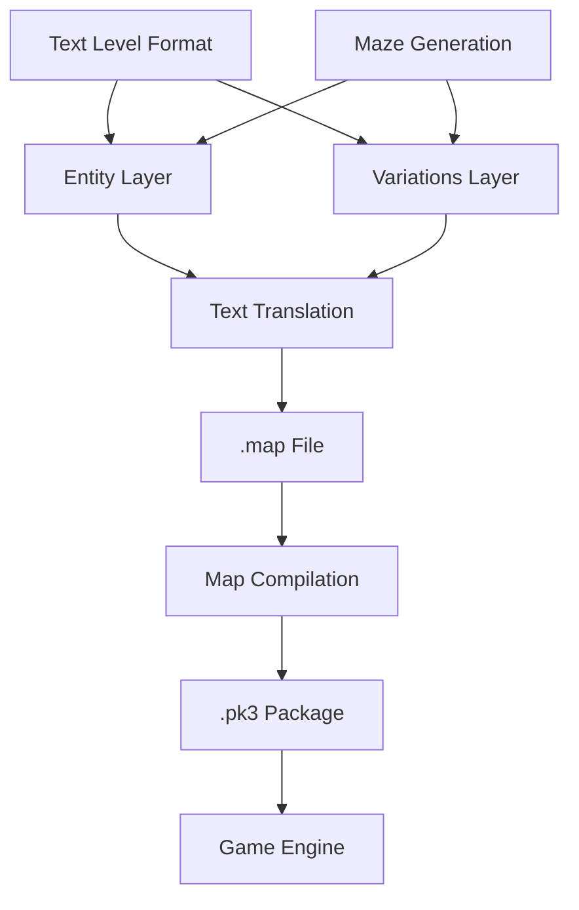
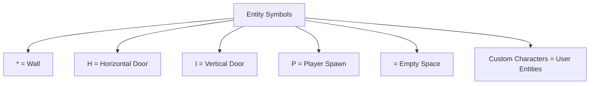
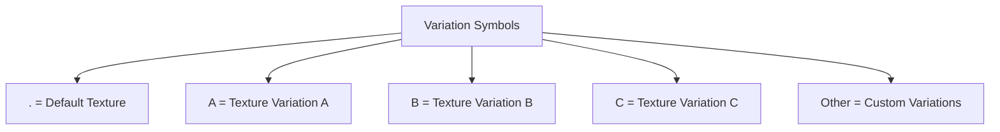
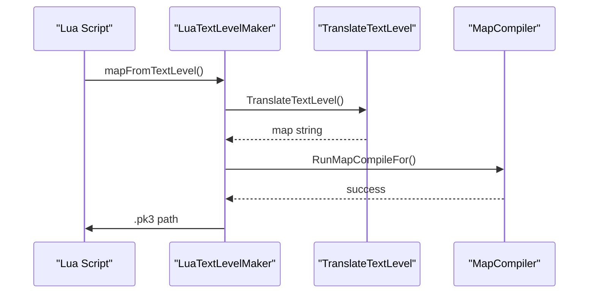

<!-- source: DeepWiki mcp.deepwiki.com · repo google-deepmind/lab · page 6.2 Text Level Format · fetched 2026-10-26 -->

# Text Level Format

<details>
<summary>Relevant source files</summary>

The following files were used as context for generating this wiki page:

- [deepmind/engine/context_actions.cc](deepmind/engine/context_actions.cc)
- [deepmind/engine/context_events.cc](deepmind/engine/context_events.cc)
- [deepmind/engine/context_observations.cc](deepmind/engine/context_observations.cc)
- [deepmind/engine/lua_maze_generation.cc](deepmind/engine/lua_maze_generation.cc)
- [deepmind/engine/lua_maze_generation.h](deepmind/engine/lua_maze_generation.h)
- [deepmind/engine/lua_maze_generation_test.cc](deepmind/engine/lua_maze_generation_test.cc)
- [deepmind/engine/lua_random.cc](deepmind/engine/lua_random.cc)
- [deepmind/engine/lua_random.h](deepmind/engine/lua_random.h)
- [deepmind/engine/lua_random_test.cc](deepmind/engine/lua_random_test.cc)
- [deepmind/engine/lua_text_level_maker.cc](deepmind/engine/lua_text_level_maker.cc)
- [deepmind/engine/lua_text_level_maker.h](deepmind/engine/lua_text_level_maker.h)
- [deepmind/level_generation/compile_map.cc](deepmind/level_generation/compile_map.cc)
- [deepmind/level_generation/text_level/char_grid.cc](deepmind/level_generation/text_level/char_grid.cc)
- [deepmind/level_generation/text_level/lua_bindings.cc](deepmind/level_generation/text_level/lua_bindings.cc)
- [deepmind/level_generation/text_level/translate_text_level_test.cc](deepmind/level_generation/text_level/translate_text_level_test.cc)
- [deepmind/support/test_srcdir.cc](deepmind/support/test_srcdir.cc)
- [deepmind/util/run_executable.cc](deepmind/util/run_executable.cc)
- [examples/game_main.c](examples/game_main.c)

</details>


The Text Level Format is a system within DeepMind Lab that allows for defining 3D game environments using simple ASCII text representations. It provides an abstraction layer that makes it easier to create, modify, and procedurally generate levels without requiring expertise in 3D modeling or game design. For information about maze generation algorithms, see [Maze Generation](#6.1), and for custom level creation workflows, see [Custom Level Creation](#6.4).

## Overview

The Text Level Format consists of two primary components:

1. **Entity Layer**: Defines the physical structure and entities of the level
2. **Variations Layer**: Specifies visual appearance and texture variations

These text representations are translated into Quake III Arena map format (.map) and then compiled into PK3 packages that can be loaded by the DeepMind Lab game engine.



Sources: `deepmind/engine/lua_text_level_maker.cc`, `deepmind/level_generation/text_level/translate_text_level_test.cc`

## Entity Layer

The entity layer is a grid of ASCII characters that defines the core structure of the level. Each character represents a specific element in the 3D environment:

| Character | Description | 3D Element |
|-----------|-------------|------------|
| `*` | Wall | Solid barrier |
| `H` | Horizontal door/gate | Horizontal door entity |
| `I` | Vertical door/gate | Vertical door entity |
| `P` | Player spawn | Player starting position |
| ` ` (space) | Empty area | Navigable space |
| Custom | User-defined entity | Customizable game object |

Example entity layer:
```
   ******
 ***    *********
 *    x    I    *
 ** P ***H****H**
  *   *     *   *
  ***************
```

This representation defines a simple room with walls (`*`), a player spawn point (`P`), horizontal and vertical doors (`H` and `I`), and a custom entity (`x`).



Sources: `deepmind/level_generation/text_level/translate_text_level_test.cc:49-56`, `deepmind/engine/lua_maze_generation.cc`

## Variations Layer

The variations layer corresponds to the entity layer but uses different characters to define visual properties and texture variations:

| Character | Description |
|-----------|-------------|
| `.` | Default texture |
| `A`-`Z` | Different texture variations |
| Other | Custom theme variations |

Example variations layer:
```
.........
....AAAAAAAAAAAAAA
.
.CCCCCCCCCCCCCCCCCCCCCCCCCC
.CCCCCCCCCCCCCCCCCCCCCCC
.............
```

The variations layer is optional but provides control over the visual appearance of the level. Different regions marked with the same letter will have consistent texturing.



Sources: `deepmind/level_generation/text_level/translate_text_level_test.cc:57-66`, `deepmind/engine/lua_maze_generation.cc`

## Translation Process

The translation process converts the text representation into a 3D environment through several steps:

1. The entity and variations layers are passed to the `TranslateTextLevel` function
2. This function generates a Quake map file (.map) containing brushes and entities
3. The map file is compiled into a PK3 package using the `RunMapCompileFor` function
4. The resulting PK3 file can be loaded by the DeepMind Lab game engine



Sources: `deepmind/engine/lua_text_level_maker.cc:341-409`, `deepmind/level_generation/compile_map.cc:78-139`

## Lua API

The Text Level Format is primarily accessed through Lua scripts using the `LuaTextLevelMaker` class. The main method is `mapFromTextLevel` which takes a table with the following fields:

| Field | Description | Required |
|-------|-------------|----------|
| `entityLayer` | String containing the entity layer | Yes |
| `variationsLayer` | String containing the variations layer | No |
| `mapName` | Name for the generated map | No (defaults to "luamap") |
| `skyboxTextureName` | Texture to use for the skybox | No |
| `ceilingHeight` | Height of the ceiling | No |
| `cellSize` | Size of each cell in game units | No (defaults to 100.0) |
| `callback` | Function to handle custom entities | No |
| `allowBots` | Whether to generate bot navigation data | No (defaults to false) |

Example usage:

```lua
local level_maker = require 'dmlab.system.game_level'
local map_path = level_maker:mapFromTextLevel{
  entityLayer = [[
    *****
    *   *
    * P *
    *   *
    *****
  ]],
  variationsLayer = [[
    .....
    .AAA.
    .AAA.
    .AAA.
    .....
  ]],
  mapName = "simple_room"
}
```

Sources: `deepmind/engine/lua_text_level_maker.cc:316-409`, `deepmind/engine/lua_text_level_maker.h:55-85`

## Custom Entities

The Text Level Format allows for custom entities through a callback function. This function is called for each character in the entity layer and can create custom game objects:

```lua
local map_path = level_maker:mapFromTextLevel{
  entityLayer = entity_layer_string,
  variationsLayer = variations_layer_string,
  callback = function(i, j, character, emitter)
    if character == 'G' then
      return emitter:makeEntity{
        i = i,
        j = j,
        classname = "item_health",
        attributes = {
          angle = "90",
          origin = "0 0 20"
        }
      }
    end
    return false  -- Let the system handle default characters
  end
}
```

The callback can use several methods provided by the `MapSnippetEmitter` class:

| Method | Description |
|--------|-------------|
| `makeEntity` | Creates a custom entity at the specified position |
| `makeSpawnPoint` | Creates a player spawn point |
| `makeDoor` | Creates a door entity |
| `makeFenceDoor` | Creates a fence-style door |
| `addPlatform` | Adds a platform at the specified height |
| `addGlassColumn` | Adds a transparent column |

Sources: `deepmind/level_generation/text_level/lua_bindings.cc:58-186`, `deepmind/level_generation/text_level/translate_text_level_test.cc:122-145`

## Integration with Maze Generation

The Text Level Format integrates with DeepMind Lab's maze generation system, which can automatically create text-based maze layouts:

```lua
local maze_gen = require 'dmlab.system.maze_generation'
local maze = maze_gen.mazeGeneration{width = 15, height = 11}

-- Use the generated maze to create a level
local map_path = level_maker:mapFromTextLevel{
  entityLayer = maze:entityLayer(),
  variationsLayer = maze:variationsLayer(),
  mapName = "generated_maze"
}
```

The maze generation system provides several ways to create and manipulate text mazes:

1. `mazeGeneration`: Creates empty mazes or loads from strings
2. `randomMazeGeneration`: Generates random mazes with rooms and corridors
3. Maze manipulation methods:
   - `findRooms`: Identifies rooms in the maze
   - `visitFill`: Floods an area with a fill operation
   - `visitRandomPath`: Creates a random path between points
   - `countEntities`/`countVariations`: Counts specific characters
   - Various getter/setter methods to manipulate individual cells

Example of random maze generation:

```lua
local random = require 'dmlab.system.sys_random'
random:seed(123)

local maze = maze_gen.randomMazeGeneration{
  random = random,
  width = 15,
  height = 15,
  maxRooms = 3,
  roomMinSize = 3,
  roomMaxSize = 7,
  extraConnectionProbability = 0.1,
  hasDoors = true
}
```

Sources: `deepmind/engine/lua_maze_generation.cc:136-318`, `deepmind/engine/lua_maze_generation.h:62-198`, `deepmind/engine/lua_maze_generation_test.cc:263-314`

## Level Caching

For performance optimization, DeepMind Lab includes a level caching system that can store compiled levels to avoid recompilation:

```lua
local map_path = level_maker:mapFromTextLevel{
  entityLayer = entity_layer_string,
  mapName = "cached_level"
}
```

The caching system works by:

1. Generating an MD5 hash of the map file
2. Creating a unique key based on the map name, settings, and hash
3. Checking if a compiled PK3 with this key exists in the cache
4. Using the cached version if available, otherwise compiling and storing the result

The caching mechanism can be controlled through settings passed to the `LuaTextLevelMaker` constructor:

- `use_local_level_cache`: Uses a cache in the system's temp directory
- `use_global_level_cache`: Uses a shared cache location
- `level_cache_params`: Advanced cache configuration

Sources: `deepmind/engine/lua_text_level_maker.cc:386-409`, `deepmind/level_generation/compile_map.cc:92-139`

## Summary

The Text Level Format provides a powerful abstraction for creating 3D environments in DeepMind Lab. By representing levels as simple ASCII grids, it makes it easy to:

1. Define level layouts programmatically
2. Generate random environments
3. Customize appearance and behavior
4. Share and reproduce environments for experiments

This system forms the foundation for many of the procedurally generated environments used in reinforcement learning research with DeepMind Lab.

Sources: `deepmind/engine/lua_text_level_maker.cc`, `deepmind/engine/lua_maze_generation.cc`, `deepmind/level_generation/text_level/translate_text_level_test.cc`

---

